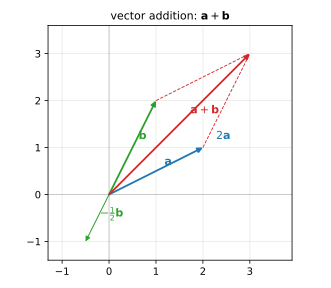
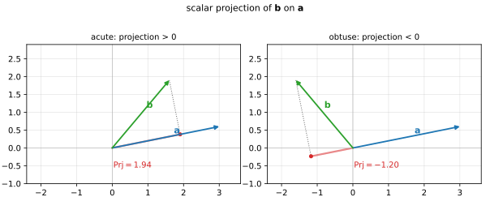
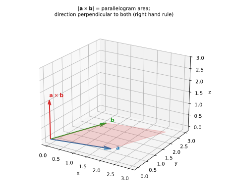

# 第 01 讲：向量与坐标

> **前置**：上册全部（尤其一元微积分的思想与记号；高中向量只需"带箭头的线段"的模糊印象，本讲从头重建）。
> **本讲解决什么**：下册的所有几何对象和几乎所有公式，都要用"向量"这门语言写出来。本讲把语言立起来：向量是什么、怎么用坐标算、以及**三个乘法**（数量积、向量积、混合积）各自回答什么问题；并专门辨析**向量的符号表示**——几何矢量、坐标、列向量、内积与外积、模与范数这些"同一件事的多种写法"，这是最容易在不同教材之间被记号绊住的地方。学完这一讲，后续的平面方程、曲面法向、梯度、曲面积分的定向，都只是把今天的内容换到具体场景。

## 一、向量是什么

**定义（向量）**：既有大小、又有方向的量。空间中用一条**有向线段**表示；**起点可以任意选择**——两条有向线段只要长度相同、方向相同，就表示**同一个向量**（这样的向量叫自由向量）。

这句话里"起点可以任意选择"是向量与"点"的根本区别：

- **点**表示**位置**，换个点就是另一个点；
- **向量**表示**位移与方向**，把它整体平移，还是同一个向量。

所以写向量时，重要的只有两件事：**长度（模）**和**方向**。这两件事都由坐标决定，见下。

**坐标表示**：取定空间直角坐标系 $Oxyz$（右手系：右手四指从 $x$ 轴弯向 $y$ 轴，拇指指向 $z$ 轴）。若向量的起点为 $A(x_1,y_1,z_1)$、终点为 $B(x_2,y_2,z_2)$，则

$$\overrightarrow{AB}=(x_2-x_1,\ y_2-y_1,\ z_2-z_1).$$

习惯上把向量记作 $\mathbf a=(a_x,a_y,a_z)$；$a_x,a_y,a_z$ 叫它的**坐标**（也叫分量）。

**模与方向余弦**：向量 $\mathbf a=(a_x,a_y,a_z)$ 的长度

$$\lvert\mathbf a\rvert=\sqrt{a_x^2+a_y^2+a_z^2}.$$

它与三条坐标轴的夹角 $\alpha,\beta,\gamma$（取 $[0,\pi]$）叫**方向角**，其余弦叫**方向余弦**：

$$\cos\alpha=\frac{a_x}{\lvert\mathbf a\rvert},\qquad \cos\beta=\frac{a_y}{\lvert\mathbf a\rvert},\qquad \cos\gamma=\frac{a_z}{\lvert\mathbf a\rvert}.$$

三者的平方和为 $1$（因为分子平方和等于分母平方）：

$$\cos^2\alpha+\cos^2\beta+\cos^2\gamma=1.$$

**单位向量**：与 $\mathbf a$ 同方向、长度为 $1$ 的向量记作 $\mathbf e_a=\dfrac{\mathbf a}{\lvert\mathbf a\rvert}$（要求 $\mathbf a\ne\mathbf 0$）。它的坐标恰好就是三个方向余弦。

> **边界**：零向量 $\mathbf 0=(0,0,0)$ 长度为 $0$、**方向不确定**（也可以说方向任意）。所以"单位化零向量"没有意义——凡是出现 $\mathbf a/\lvert\mathbf a\rvert$，都要先确认 $\mathbf a\ne\mathbf 0$。这个检查在后面求法向量、单位法向时每次都要做。

## 二、符号表示辨析：几何矢量、坐标、列向量、内积与外积、模与范数

同一个向量，在几何书里写成箭头、在线代里写成列矩阵、在分析书里写成范数——这一节把"同一件事的多种写法"对齐。它是**对照手册**，不是新的数学内容；遇到看不懂的记号，回到这里查。

### 2.1 一个向量，几种写法

- **手写与排版**：$\vec a$（中文教材与板书最常用）、$\mathbf a$ 或 $\boldsymbol a$（英文排版）、$a$（不少物理书，靠上下文区分）、$\underline a$（老教材）。本课程正文用 $\mathbf a$。
- **抽象向量与坐标**：$\mathbf a$ 是几何对象，**不依赖坐标系**；选定坐标系后才写成 $\mathbf a=(a_x,a_y,a_z)$——这三个数叫**分量**（本课程说的"向量的坐标"就是这个意思）。换坐标系，分量会变，向量本身不变。
- **横写与竖写**：几何向量本身**不分行与列**——横着写 $(1,2,3)$ 只是为了排版紧凑。一旦进入矩阵运算，线代约定用**列向量**（把分量竖排成一个 $n$ 行 $1$ 列的矩阵）；此时行向量要写成转置 $\mathbf a^\top$。
- **本课程的约定**：01–07 讲的公式都是分量式，不依赖行/列；从 08 讲（梯度）、09 讲（海森矩阵）、21 讲（向量场与旋度）起，**明确采用列向量约定**（与线代一致），需要行向量时写转置。

### 2.2 三个积的名字对照（同一个东西的多个名字）

| 名字 | 符号 | 结果是什么 | 常见于 |
|---|---|---|---|
| 数量积＝点积＝**内积**＝标量积 | $\mathbf a\cdot\mathbf b$；线代写 $\mathbf a^\top\mathbf b$ | 数 | 几何/物理（$\cdot$）；线代与机器学习（$\top$） |
| 向量积＝叉积＝矢量积 | $\mathbf a\times\mathbf b$（**只在三维**） | 向量 | 几何/物理 |
| 混合积＝三重积 | $(\mathbf a\times\mathbf b)\cdot\mathbf c$ | 数 | 几何 |

- **"外积"是一个危险的名字**：不少物理书把叉积叫"外积"；而线代与张量里的 **outer product（外积）**指的是 $\mathbf u\mathbf v^\top$（一个矩阵）——**同名不同物**。本课程**不使用"外积"这个词**：说"向量积"或"叉积"。读别的书时看符号判断：$\times$ 是叉积；$\mathbf u\mathbf v^\top$ 或 $\otimes$ 是张量积/外积。
- **点积的两种写法如何接上**：$\mathbf a\cdot\mathbf b=\mathbf a^\top\mathbf b$（$\mathbf a,\mathbf b$ 按列向量理解，$\mathbf a^\top$ 是 $1\times n$ 的行向量）——**当式子要与矩阵乘法混写时，必须写清转置**；只用几何公式时，$\cdot$ 更简洁。
- **二维的特殊情况**：二维没有"叉积向量"（垂直于平面的方向在第三维）；二维的有向面积是 $a_xb_y-a_yb_x$（一个 $2\times2$ 行列式），它等于三维叉积的第三个分量——这也是线代里行列式"有向面积"含义的最简单一例。

### 2.3 模长与范数

| 写法 | 名称 | 用在哪 | 说明 |
|---|---|---|---|
| $\lvert\mathbf a\rvert$ | 模（长度） | 几何、高数（本课程） | 与标量绝对值同形，按上下文区分 |
| $\lVert\mathbf a\rVert$ | 范数（norm） | 线代、分析、数值、机器学习 | 不带下标时默认欧氏范数（2-范数） |
| $\lVert\mathbf a\rVert_2$ | 2-范数 | 同上 | 数值上等于 $\lvert\mathbf a\rvert$ |
| $\lVert A\rVert$ | 矩阵范数 | 线代、数值 | 与向量范数不是一类东西（有谱范数、Frobenius 范数等） |

- **本课程口径**：几何量一律写 $\lvert\mathbf a\rvert$；从 21 讲起引入矩阵与算子时写 $\lVert\cdot\rVert$ 并说明是哪种范数。
- **读到别的书写 $\lVert\mathbf a\rVert$**：对向量它通常就是长度（欧氏范数），数值与 $\lvert\mathbf a\rvert$ 相同——不熟悉记号不影响计算。
- **单位向量的 $\mathbf e$ 有两个角色**：本课程用 $\mathbf e_a$ 表示"$\mathbf a$ 方向的单位向量"（下标跟着某个向量）；线代用 $\mathbf e_1,\mathbf e_2,\mathbf e_3$ 表示**标准基**（三个坐标轴方向的单位向量）。**看下标**：$\mathbf e_a$ 跟随向量，$\mathbf e_i$ 是坐标轴。

### 2.4 "坐标"一词的两种身份（最隐蔽的一处）

- 本课程的"坐标"＝**分量**：$\mathbf a=(a_x,a_y,a_z)$——标准坐标系的分解系数。
- 线代的"坐标"＝**相对一组基的系数**：$\mathbf a=c_1\mathbf b_1+c_2\mathbf b_2+c_3\mathbf b_3$，记 $[\mathbf a]_B=(c_1,c_2,c_3)$——换一组基，坐标就变（线代第 10 讲讲这件事）。
- 两者在**标准基**下重合——这就是平时感觉不出区别的原因。本课程不需要换基，知道"分量就是标准基下的坐标"即可。

### 2.5 什么时候把向量当什么

| 场景 | 把向量当作 | 例子 |
|---|---|---|
| 几何判断（平行、垂直、夹角、面积、法向） | 高中式的**几何矢量** | 本讲与 02–07 讲 |
| 具体计算（点积、叉积、投影） | **坐标三元组** | 本课程大部分计算题 |
| 与矩阵相乘、写梯度/雅可比/旋度 | **列矩阵**（线代对象） | 08、09、21 讲 |
| 证明恒等式、不选坐标系 | **抽象向量**（只用运算律） | 作业 6、7 这类题 |

- **叉积的矩阵身份**（认识层）：$\mathbf a\times\mathbf b=[\mathbf a]_\times\mathbf b$，其中
$$[\mathbf a]_\times=\begin{pmatrix}0&-a_z&a_y\\ a_z&0&-a_x\\ -a_y&a_x&0\end{pmatrix}$$
（反对称矩阵）。知道"叉积可以写成矩阵乘"即可；21 讲讲旋度时会再见到它。
- **一句话判读**：**要算，就落到坐标；要证，就留在抽象；要接矩阵，就选列向量并写转置。**

### 2.6 本课程的统一约定

| 对象 | 本课程写法 | 与线代的对应 |
|---|---|---|
| 向量 | $\mathbf a$；分量 $(a_x,a_y,a_z)$ | 需要矩阵运算时按列向量 |
| 点积 | $\mathbf a\cdot\mathbf b$ | $\mathbf a^\top\mathbf b$ |
| 叉积 | $\mathbf a\times\mathbf b$（三维） | $[\mathbf a]_\times\mathbf b$（认识层） |
| 模 | $\lvert\mathbf a\rvert$ | $\lVert\mathbf a\rVert_2$ |
| 单位向量 | $\mathbf e_a$（$\mathbf a$ 方向） | 标准基 $\mathbf e_i$（不同对象，看下标） |
| 零向量 | $\mathbf 0$ | $\mathbf 0$ |

## 三、向量的线性运算

**加法**：$\mathbf a+\mathbf b$ 按三角形法则（把 $\mathbf b$ 的起点接到 $\mathbf a$ 的终点）或平行四边形法则（图 1）。**坐标逐分量相加**：

$$\mathbf a+\mathbf b=(a_x+b_x,\ a_y+b_y,\ a_z+b_z).$$

**数乘**：$k\mathbf a$（$k$ 为实数）长度为 $\lvert k\rvert\lvert\mathbf a\rvert$；$k>0$ 时同向、$k<0$ 时反向；坐标逐分量乘 $k$。减法就是加上相反向量：$\mathbf a-\mathbf b=\mathbf a+(-1)\mathbf b$。



*图 1：$\mathbf a+\mathbf b$ 按平行四边形法则；$2\mathbf a$ 与 $-\tfrac12\mathbf b$ 是数乘的两种情形。*

**线性组合**：形如 $k_1\mathbf a+k_2\mathbf b$ 的式子叫 $\mathbf a,\mathbf b$ 的线性组合。两个向量的线性组合，几何上是"由它们张成的平面（或直线）上的所有向量"——这句话在下一讲写平面方程时会直接用到。

**共线（平行）的判定**：$\mathbf a\parallel\mathbf b$（$\mathbf b\ne\mathbf 0$）$\iff$ 存在实数 $k$ 使 $\mathbf a=k\mathbf b$ $\iff$ 对应坐标成比例（有零分量时按"比例式意义"处理）。

## 四、数量积：回答"夹角、投影、是否垂直"

**定义（数量积／点积）**：设 $\mathbf a,\mathbf b$ 的夹角为 $\theta\in[0,\pi]$，

$$\mathbf a\cdot\mathbf b=\lvert\mathbf a\rvert\,\lvert\mathbf b\rvert\cos\theta.$$

**它是一个数，不是向量。**

**坐标公式**（与定义等价）：

$$\mathbf a\cdot\mathbf b=a_xb_x+a_yb_y+a_zb_z.$$

> **为什么两式相等（一行推导）**：对三角形 $OAB$（$\overrightarrow{OA}=\mathbf a$、$\overrightarrow{OB}=\mathbf b$）用余弦定理：
> $$\lvert\mathbf a-\mathbf b\rvert^2=\lvert\mathbf a\rvert^2+\lvert\mathbf b\rvert^2-2\lvert\mathbf a\rvert\lvert\mathbf b\rvert\cos\theta,$$
> 左边按坐标展开是 $\sum(a_i-b_i)^2=\lvert\mathbf a\rvert^2+\lvert\mathbf b\rvert^2-2\sum a_ib_i$，与右边比较即得 $\sum a_ib_i=\lvert\mathbf a\rvert\lvert\mathbf b\rvert\cos\theta$。

**三个直接用途**（都能从定义或坐标式读出）：

1. **夹角**：$\cos\theta=\dfrac{\mathbf a\cdot\mathbf b}{\lvert\mathbf a\rvert\lvert\mathbf b\rvert}$（$\mathbf a,\mathbf b\ne\mathbf 0$）。
2. **投影**：$\mathbf a$ 在 $\mathbf b$ 方向上的**投影**（一个带符号的数）
   $$\operatorname{Prj}_{\mathbf b}\mathbf a=\lvert\mathbf a\rvert\cos\theta=\frac{\mathbf a\cdot\mathbf b}{\lvert\mathbf b\rvert}.$$
   投影**可以为负**：夹角为钝角时，$\mathbf a$ 的终点落在 $\mathbf b$ 的反方向一侧。若需要"投影向量"，就是 $\big(\operatorname{Prj}_{\mathbf b}\mathbf a\big)\,\mathbf e_b$。
3. **垂直判定**：$\mathbf a\perp\mathbf b\iff\mathbf a\cdot\mathbf b=0$（$\mathbf a,\mathbf b\ne\mathbf 0$）。



*图 2：$\mathbf b$ 在 $\mathbf a$ 上的投影是带符号的标量 $\lvert\mathbf b\rvert\cos\theta$；夹角为钝角时投影取负。*

**性质**（按需使用，都能由定义或坐标式验证）：

- 交换律：$\mathbf a\cdot\mathbf b=\mathbf b\cdot\mathbf a$；
- 分配律：$(\mathbf a+\mathbf b)\cdot\mathbf c=\mathbf a\cdot\mathbf c+\mathbf b\cdot\mathbf c$；
- 与数乘相容：$(k\mathbf a)\cdot\mathbf b=k(\mathbf a\cdot\mathbf b)$；
- $\mathbf a\cdot\mathbf a=\lvert\mathbf a\rvert^2$（这是"模"与点积的桥：求模可以用 $\sqrt{\mathbf a\cdot\mathbf a}$）；
- **没有结合律**：$\mathbf a\cdot\mathbf b\cdot\mathbf c$ 根本没有定义（$\mathbf a\cdot\mathbf b$ 已经是数，再"数点乘向量"没有意义）。若写成 $(\mathbf a\cdot\mathbf b)\mathbf c$，那是一个**向量**（数乘向量），与 $\mathbf a(\mathbf b\cdot\mathbf c)$ 一般不同。这是点积与普通乘法最容易混淆的边界。

## 五、向量积：回答"面积、法向量、是否平行"

**定义（向量积／叉积）**：$\mathbf a\times\mathbf b$ 是一个**向量**，由两件事确定：

- **大小**：$\lvert\mathbf a\times\mathbf b\rvert=\lvert\mathbf a\rvert\lvert\mathbf b\rvert\sin\theta$（$\theta$ 为夹角）——几何上等于以 $\mathbf a,\mathbf b$ 为邻边的**平行四边形的面积**；
- **方向**：与 $\mathbf a,\mathbf b$ 都垂直，且 $\mathbf a,\mathbf b,\mathbf a\times\mathbf b$ 依次构成**右手系**（右手法则：四指从 $\mathbf a$ 弯向 $\mathbf b$，拇指指向 $\mathbf a\times\mathbf b$）。

**坐标公式**：

$$\mathbf a\times\mathbf b=\big(a_yb_z-a_zb_y,\ \ a_zb_x-a_xb_z,\ \ a_xb_y-a_yb_x\big).$$

记忆上，把它写成"三阶行列式"最省事：

$$\mathbf a\times\mathbf b=\begin{vmatrix}\mathbf i&\mathbf j&\mathbf k\\ a_x&a_y&a_z\\ b_x&b_y&b_z\end{vmatrix},$$

其中 $\mathbf i,\mathbf j,\mathbf k$ 是三条坐标轴方向的单位向量，行列式按第一行展开就得到上面的坐标公式。（**行列式本身**是线性代数的内容，这里只把它当"展开式的记法"用，不需要会算一般行列式。）

**三个直接用途**：

1. **求法向量**：与 $\mathbf a,\mathbf b$ 都垂直的向量，最方便的就是 $\mathbf a\times\mathbf b$（下一讲写平面方程、第 07 讲写切平面都用它）。
2. **求面积**：平行四边形面积 $=\lvert\mathbf a\times\mathbf b\rvert$；三角形面积 $=\frac12\lvert\mathbf a\times\mathbf b\rvert$。
3. **平行判定**：$\mathbf a\parallel\mathbf b\iff\mathbf a\times\mathbf b=\mathbf 0$（$\mathbf a,\mathbf b\ne\mathbf 0$）。



*图 3：$\mathbf a\times\mathbf b$ 的大小是平行四边形的面积，方向垂直于 $\mathbf a,\mathbf b$ 所在平面并按右手系定向。*

**性质**（都必须会用的几条）：

- **反交换**：$\mathbf b\times\mathbf a=-\mathbf a\times\mathbf b$——交换顺序，方向翻转。这是"带方向"的积与数量积最根本的差别，也是后面曲面积分定号错误的常见来源。
- $\mathbf a\times\mathbf a=\mathbf 0$；$\mathbf a\times\mathbf b=\mathbf 0\iff\mathbf a,\mathbf b$ 共线。
- 分配律 $(\mathbf a+\mathbf b)\times\mathbf c=\mathbf a\times\mathbf c+\mathbf b\times\mathbf c$（不证，用的时候按坐标展开即得）。
- 与数乘相容：$(k\mathbf a)\times\mathbf b=k(\mathbf a\times\mathbf b)$。

**坐标计算的自检**：算完 $\mathbf a\times\mathbf b$ 后，分别与 $\mathbf a,\mathbf b$ 做点积，结果应为 $0$。这个检查只需两次点积，能抓住大部分算错的叉积。

## 六、混合积：回答"体积、是否共面"（认识层）

**定义（混合积）**：$(\mathbf a\times\mathbf b)\cdot\mathbf c$（先叉积再点积，结果是一个**数**）。

**几何意义**：它的绝对值等于以 $\mathbf a,\mathbf b,\mathbf c$ 为棱的**平行六面体的体积**；符号由三者的左右手关系决定（$\mathbf a,\mathbf b,\mathbf c$ 成右手系时为正）。

**共面判定**：$\mathbf a,\mathbf b,\mathbf c$ 共面 $\iff(\mathbf a\times\mathbf b)\cdot\mathbf c=0$。

**坐标公式**：把三个向量排成行列式：

$$(\mathbf a\times\mathbf b)\cdot\mathbf c=\begin{vmatrix}a_x&a_y&a_z\\ b_x&b_y&b_z\\ c_x&c_y&c_z\end{vmatrix}.$$

**理解层次**：混合积在本课程中属于**知道有这回事、会用共面判定与体积**的层级——不需要推它的性质（轮换不变号等），遇到"判断四点共面"这类题时找它即可。

## 七、三个积的分工（对照表）与后续接口

| 积 | 结果是什么 | 大小/数值的含义 | 回答的问题 | 后续出现处 |
|---|---|---|---|---|
| 数量积 $\mathbf a\cdot\mathbf b$ | **数** | $\lvert\mathbf a\rvert\lvert\mathbf b\rvert\cos\theta$ | 夹角、投影、垂直 | 08 讲梯度与方向导数、21 讲散度 |
| 向量积 $\mathbf a\times\mathbf b$ | **向量** | $\lvert\mathbf a\rvert\lvert\mathbf b\rvert\sin\theta$＝平行四边形面积 | 法向量、面积、平行 | 02 讲平面法向、07 讲切平面、19–20 讲曲面定向 |
| 混合积 $(\mathbf a\times\mathbf b)\cdot\mathbf c$ | **数** | 平行六面体体积（带符号） | 体积、共面 | 03/07 讲几何判定、综合题 |

**后续接口（一句话各）**：梯度（08 讲）是一个向量，方向导数等于梯度与方向单位向量的**数量积**；曲面的法向量（07、19 讲）用**向量积**或梯度求；曲面积分的定向（20 讲）由**法向量的指哪一侧**决定——今天这三个积，就是那些内容最底层的运算。

## 八、例题

**例 1**：$\mathbf a=(1,2,3)$、$\mathbf b=(2,0,-1)$。求 $\mathbf a\cdot\mathbf b$、夹角余弦、$\mathbf a$ 在 $\mathbf b$ 方向上的投影。

**解**：$\mathbf a\cdot\mathbf b=1\cdot2+2\cdot0+3\cdot(-1)=-1$；$\lvert\mathbf a\rvert=\sqrt{14}$、$\lvert\mathbf b\rvert=\sqrt5$，故

$$\cos\theta=\frac{-1}{\sqrt{14}\sqrt5}=-\frac1{\sqrt{70}}\approx-0.1195,$$

夹角为钝角；投影 $\operatorname{Prj}_{\mathbf b}\mathbf a=\dfrac{\mathbf a\cdot\mathbf b}{\lvert\mathbf b\rvert}=-\dfrac1{\sqrt5}\approx-0.4472$（负号与钝角一致）。

**例 2**：同上 $\mathbf a,\mathbf b$。求 $\mathbf a\times\mathbf b$、以它们为邻边的平行四边形面积、以及与两者都垂直的单位向量。

**解**：按坐标公式：

$$\mathbf a\times\mathbf b=\big(2\cdot(-1)-3\cdot0,\ \ 3\cdot2-1\cdot(-1),\ \ 1\cdot0-2\cdot2\big)=(-2,\ 7,\ -4).$$

**自检**：$\mathbf a\cdot(\mathbf a\times\mathbf b)=-2+14-12=0$、$\mathbf b\cdot(\mathbf a\times\mathbf b)=-4+0+4=0$ ✓。

平行四边形面积 $=\lvert\mathbf a\times\mathbf b\rvert=\sqrt{4+49+16}=\sqrt{69}\approx8.3066$；三角形面积 $=\frac{\sqrt{69}}2\approx4.1533$。

与两者都垂直的**单位**向量有两个方向：

$$\pm\frac{(-2,7,-4)}{\sqrt{69}}.$$

（取哪一个由需要的"侧"决定——下一讲写平面方程时两方向都合法；第 20 讲曲面积分时由定向决定，选错会差一个负号。）

**例 3**：$\mathbf c=(1,1,1)$。求 $(\mathbf a\times\mathbf b)\cdot\mathbf c$，并判断 $\mathbf a,\mathbf b,\mathbf c$ 是否共面。

**解**：$(\mathbf a\times\mathbf b)\cdot\mathbf c=(-2)\cdot1+7\cdot1+(-4)\cdot1=1\ne0$，故三者**不共面**；平行六面体体积为 $\lvert1\rvert=1$。

## 九、数值核对

三个计算都用脚本独立核验（`scripts/lec01-02_verify_vectors.py`，可复跑）。脚本用 numpy 直接算点积、叉积与模，与手算结果对照（全脚本 0.04 秒）：

```
=== EXP1: dot, angle, projection ===
  a.b = -1.0000000000  (expect -1)
  |a| = 3.7416573868 = sqrt(14) = 3.7416573868
  |b| = 2.2360679775 = sqrt(5)  = 2.2360679775
  cos(theta) = -0.1195228609  (expect -1/sqrt(70) = -0.1195228609)
  proj_b(a)  = -0.4472135955  (expect -1/sqrt(5) = -0.4472135955)

=== EXP2: cross product, perpendicularity, area ===
  a x b = [-2.  7. -4.]  (expect [-2, 7, -4])
  |a x b| = 8.3066238629 = sqrt(69) = 8.3066238629
  triangle area = 4.1533119315 = sqrt(69)/2 = 4.1533119315
  |a.(a x b)| / (|a||a x b|) = 0.00e+00  (expect ~1e-17)
  |b.(a x b)| / (|b||a x b|) = 0.00e+00  (expect ~1e-17)

=== EXP3: triple product and volume ===
  (a x b).c = 1.0000000000  (expect 1)
  cyclic: (b x c).a = 1.0000000000, (c x a).b = 1.0000000000
  volume = 1.0000000000

=== EXP4: random check (Q7 reference) ===
  worst relative perpendicularity residual over 200 trials: 2.64e-16
  worst relative area mismatch:                             1.10e-14
```

**核对点**：

- 例 1 的 $\cos\theta$ 与投影：数值 $-0.1195228609$、$-0.4472135955$，与解析逐位一致；
- 例 2 的叉积三分量与模：$(-2,7,-4)$、$\sqrt{69}\approx8.3066$；**垂直残差为恰好 $0$**——这是“整数向量”的特例，不要把它当普遍现象（真正的普遍情形看 EXP4 的随机检查）；
- 例 3 的混合积 $=1$，且轮换三值相等（$1,1,1$）；
- EXP4（作业 7 的参考实现）随机取 200 组向量：垂直相对残差最坏 $2.6\times10^{-16}$、面积相对失配最坏 $1.1\times10^{-14}$——两者都在 $10^{-12}$ 以下（双精度在量级 $1$ 的舍入约 $10^{-16}$，阈值留了三个量级余量）。

## 小结

- **向量**＝大小＋方向，起点可平移（与"点"的区别）；坐标表示 $\overrightarrow{AB}=(x_2-x_1,y_2-y_1,z_2-z_1)$；模 $\sqrt{a_x^2+a_y^2+a_z^2}$；方向余弦平方和为 $1$。
- **线性运算**逐分量进行；共线 $\iff$ 成比例 $\iff$ 叉积为零。
- **数量积**：$\mathbf a\cdot\mathbf b=\lvert\mathbf a\rvert\lvert\mathbf b\rvert\cos\theta=a_xb_x+a_yb_y+a_zb_z$（一个数）；管夹角、投影（带符号）、垂直；**没有结合律**。
- **向量积**：$\mathbf a\times\mathbf b$ 大小＝平行四边形面积、方向由右手系定（一个向量）；管法向量、面积、平行；**反交换**，算完用两次点积自检。
- **混合积**：$(\mathbf a\times\mathbf b)\cdot\mathbf c$＝平行六面体体积（带符号，一个数）；管体积与共面判定（认识层）。
- 三个积分别对应"夹角/投影""面积/法向""体积/共面"三类问题——后面的平面、切平面、梯度、曲面定向全部建立在这三类运算上。

## 作业

**说明**：按内容需要出题，答案平铺在每题下方（先做再对照）。所有题只用本讲与上册已教内容。

**1.** 设 $\mathbf a=(3,-1,2)$、$\mathbf b=(1,2,-1)$。求 $\mathbf a\cdot\mathbf b$、$\lvert\mathbf a\rvert$、$\lvert\mathbf b\rvert$、$\cos\theta$。

**参考答案**：
$\mathbf a\cdot\mathbf b=3-2-2=-1$；$\lvert\mathbf a\rvert=\sqrt{9+1+4}=\sqrt{14}$；$\lvert\mathbf b\rvert=\sqrt{1+4+1}=\sqrt6$；$\cos\theta=\dfrac{-1}{\sqrt{14}\sqrt6}=-\dfrac1{\sqrt{84}}\approx-0.1091$。

**2.** 求 $\mathbf a=(1,0,2)$ 在 $\mathbf b=(2,1,-2)$ 方向上的投影，并写出投影向量。

**参考答案**：
$\mathbf a\cdot\mathbf b=2+0-4=-2$，$\lvert\mathbf b\rvert=3$ ⇒ 投影 $=-\frac23$；$\mathbf e_b=\frac13(2,1,-2)$ ⇒ 投影向量 $=-\frac23\cdot\frac13(2,1,-2)=\left(-\frac49,-\frac29,\frac49\right)$。

**3.** 求以 $A(1,0,0)$、$B(0,1,0)$、$C(0,0,1)$ 为顶点的三角形面积，并求该平面的一个法向量。

**参考答案**：
$\overrightarrow{AB}=(-1,1,0)$、$\overrightarrow{AC}=(-1,0,1)$；$\overrightarrow{AB}\times\overrightarrow{AC}=(1\cdot1-0\cdot0,\ 0\cdot(-1)-(-1)\cdot1,\ (-1)\cdot0-1\cdot(-1))=(1,1,1)$；面积 $=\frac12\lvert(1,1,1)\rvert=\frac{\sqrt3}2$；法向量可取 $(1,1,1)$（或任意非零倍数）。

**4.** 判断 $\mathbf a=(1,2,3)$、$\mathbf b=(2,0,-1)$、$\mathbf c=(1,1,1)$ 是否共面；若不共面，求以它们为棱的平行六面体体积。

**参考答案**：
混合积 $=(\mathbf a\times\mathbf b)\cdot\mathbf c$；先算 $\mathbf a\times\mathbf b=(-2,7,-4)$（见正文例 2），点乘 $\mathbf c$：$-2+7-4=1\ne0$ ⇒ **不共面**；体积 $=\lvert1\rvert=1$。

**5.** 证明：$\lvert\mathbf a\times\mathbf b\rvert^2+\lvert\mathbf a\cdot\mathbf b\rvert^2=\lvert\mathbf a\rvert^2\lvert\mathbf b\rvert^2$（拉格朗日恒等式）。

**参考答案**：
左边 $=\lvert\mathbf a\rvert^2\lvert\mathbf b\rvert^2\sin^2\theta+\lvert\mathbf a\rvert^2\lvert\mathbf b\rvert^2\cos^2\theta=\lvert\mathbf a\rvert^2\lvert\mathbf b\rvert^2$（用 $\sin^2+\cos^2=1$）。$\blacksquare$

**6.** 若 $\mathbf a+\mathbf b+\mathbf c=\mathbf 0$，证明 $\mathbf a\times\mathbf b=\mathbf b\times\mathbf c=\mathbf c\times\mathbf a$。

**参考答案**：
由 $\mathbf c=-\mathbf a-\mathbf b$：$\mathbf b\times\mathbf c=\mathbf b\times(-\mathbf a-\mathbf b)=-\mathbf b\times\mathbf a-\mathbf b\times\mathbf b=\mathbf a\times\mathbf b$（用反交换与 $\mathbf b\times\mathbf b=0$）；同理 $\mathbf c\times\mathbf a=(-\mathbf a-\mathbf b)\times\mathbf a=-\mathbf b\times\mathbf a=\mathbf a\times\mathbf b$。$\blacksquare$

**7.** 设计一个数值检查：随机取两个不共线的三维向量，验证"$\mathbf a\times\mathbf b$ 与两者都垂直"以及"$\lvert\mathbf a\times\mathbf b\rvert$ 等于平行四边形面积"。写一小段代码并解释你的断言阈值。

**参考答案**：
思路：随机 $\mathbf a,\mathbf b$；算 $\mathbf c=\mathbf a\times\mathbf b$；用 $\lvert\mathbf a\cdot\mathbf c\rvert/(\lvert\mathbf a\rvert\lvert\mathbf c\rvert)<10^{-12}$ 与同理的 $\mathbf b$ 断言垂直（用**相对量**，避免向量的量级影响阈值）；面积用行列式或"两边及其夹角"公式 $\lvert\mathbf a\rvert\lvert\mathbf b\rvert\sin\theta$ 另一路计算，断言相对差 $<10^{-12}$。关键是：**断言要按相对量设定，并说明为什么这个阈值足够**（双精度在量级 $1$ 上的舍入误差约 $10^{-16}$，留三个量级余量）。

**8.** 符号判读：(1) $\lvert\mathbf a\rvert$ 与 $\lVert\mathbf a\rVert_2$ 是什么关系？(2) $\mathbf a\cdot\mathbf b$ 与 $\mathbf a^\top\mathbf b$ 是什么关系？(3) "外积"在物理书与线代里各指什么？(4) $\mathbf e_a$ 与 $\mathbf e_1$ 是一回事吗？

**参考答案**：
(1) 数值相同（都是欧氏长度），只是记号来自不同课程（几何用模、线代用 2-范数）。
(2) 数值相同（同一个内积）：$\mathbf a\cdot\mathbf b=\mathbf a^\top\mathbf b$；后者是列向量按矩阵乘法写出来（$\mathbf a^\top$ 是行向量）。
(3) 物理书/旧教材有时把**叉积**叫外积；线代/张量里 outer product 是 $\mathbf u\mathbf v^\top$（矩阵）——同名不同物，看符号与语境。
(4) 不是：$\mathbf e_a$ 是 $\mathbf a$ 方向的单位向量（下标跟着向量），$\mathbf e_1$ 是标准基（$x$ 轴方向）。

**9.** 转换：(1) 把点积写成矩阵形式（列向量）；(2) 写出叉积的矩阵形式 $\mathbf a\times\mathbf b=[\mathbf a]_\times\mathbf b$ 中的 $[\mathbf a]_\times$；(3) 说明为什么 $\mathbf a^\top\mathbf b=\mathbf b^\top\mathbf a$，而 $\mathbf a\mathbf b^\top\ne\mathbf b\mathbf a^\top$。

**参考答案**：
(1) $\mathbf a\cdot\mathbf b=\mathbf a^\top\mathbf b$。
(2) $[\mathbf a]_\times=\begin{pmatrix}0&-a_z&a_y\\ a_z&0&-a_x\\ -a_y&a_x&0\end{pmatrix}$。
(3) $\mathbf a^\top\mathbf b$ 是数，且数的乘法可交换：$\mathbf a^\top\mathbf b=\mathbf b^\top\mathbf a$；$\mathbf a\mathbf b^\top$ 是 $n\times n$ 矩阵（外积），$\mathbf b\mathbf a^\top$ 是它的转置，一般不等于它（例如 $\mathbf a=(1,0),\mathbf b=(0,1)$：$\mathbf a\mathbf b^\top=\begin{pmatrix}0&1\\0&0\end{pmatrix}$，$\mathbf b\mathbf a^\top=\begin{pmatrix}0&0\\1&0\end{pmatrix}$）。
