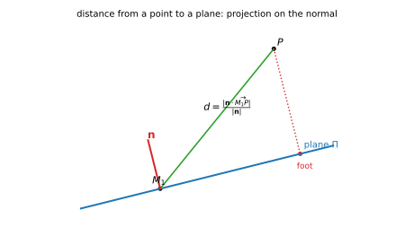
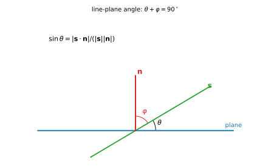
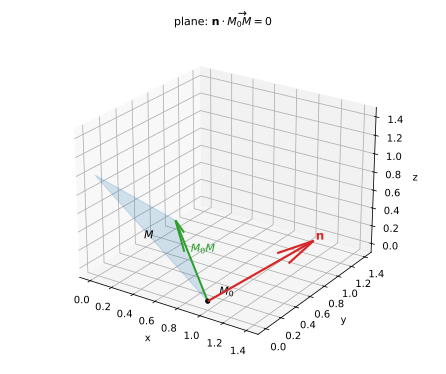

# 第 02 讲：平面与直线

> **前置**：第 01 讲（向量、数量积、向量积、混合积）。
> **本讲解决什么**：空间里的"一次对象"只有两类——**平面**和**直线**。本讲把它们写成方程：平面由"一点＋法向量"确定，直线由"一点＋方向向量"确定；所有位置关系（平行、垂直、夹角、距离、交点）都化成向量运算。学完这一讲，你不需要背任何"位置关系公式表"——每个结论都能从法向量与方向向量的关系当场推出来。

## 一、平面方程

### 1.1 点法式：平面为什么是"一次"的

**确定一个平面的要素**：一个点 $M_0(x_0,y_0,z_0)$，以及一个**与平面垂直的非零向量** $\mathbf n=(A,B,C)$——叫**法向量**。

**推导**：平面上任意一点 $M(x,y,z)$，向量 $\overrightarrow{M_0M}$ 落在平面内，因此与法向量垂直：

$$\mathbf n\cdot\overrightarrow{M_0M}=0,$$

即

$$A(x-x_0)+B(y-y_0)+C(z-z_0)=0.$$

这叫**点法式**。

**"平面方程为什么是一次方程"的答案**就在上面：法向量固定时，$\mathbf n\cdot\overrightarrow{M_0M}$ 是 $x,y,z$ 的一次式（点积是线性运算）。反过来，任何一次方程 $Ax+By+Cz+D=0$（$A,B,C$ 不全为零）都表示一个平面，其法向量就是 $(A,B,C)$。

### 1.2 一般式：法向量直接读

把点法式展开：

$$Ax+By+Cz+\underbrace{(-Ax_0-By_0-Cz_0)}_{D}=0,$$

即**一般式**

$$Ax+By+Cz+D=0\qquad(A,B,C\ \text{不全为零}).$$

**考试动作**：看到一般式，**法向量就是系数** $(A,B,C)$；要写平面，先找法向量，再找一个点。

**系数为零时的特殊位置**（常见且必须会读）：

| 条件 | 平面的位置 | 原因 |
|---|---|---|
| $D=0$ | 过原点 | 原点代入得 $0=0$ |
| $A=0$ | 平行于 $x$ 轴（若 $D=0$ 则含 $x$ 轴） | 法向量 $x$ 分量为零，$\mathbf n\perp x$ 轴 |
| $B=0$ | 平行于 $y$ 轴（若 $D=0$ 则含 $y$ 轴） | 同上 |
| $C=0$ | 平行于 $z$ 轴（若 $D=0$ 则含 $z$ 轴） | 同上 |
| $A=B=0$ | 平行于 $xOy$ 面（$C\ne0$） | 法向量沿 $z$ 轴 |

### 1.3 截距式

若平面在三条坐标轴上的截距分别为 $a,b,c$（都非零），则

$$\frac xa+\frac yb+\frac zc=1.$$

**适用范围（边界）**：截距都存在且非零时才好用；过原点（截距为 $0$）或平行于某坐标轴（某截距不存在）时**不能**写成这个形式——回到一般式。

### 1.4 三种形式的互化

- 点法式展开 → 一般式；
- 一般式找出与坐标轴的交点 → 截距式（截距存在时）；
- 反过来：一般式的系数就是法向量，任取满足方程的一点即得点法式。

**形式只是外壳**：判断、计算时最常用的是"**法向量＋一个点**"，其余形式按题目方便选。

## 二、两平面的位置关系

设 $\Pi_1:\ \mathbf n_1=(A_1,B_1,C_1)$，$\Pi_2:\ \mathbf n_2=(A_2,B_2,C_2)$。

### 2.1 夹角

两平面的夹角定义为它们**法向量的夹角中不超过 $\frac\pi2$ 的那个**，所以

$$\cos\theta=\frac{\lvert\mathbf n_1\cdot\mathbf n_2\rvert}{\lvert\mathbf n_1\rvert\,\lvert\mathbf n_2\rvert},\qquad \theta\in\left[0,\frac\pi2\right].$$

**边界提醒**：分子要加绝对值——否则算出的可能是钝角；题目问"夹角"时默认取锐角（或直角）。

### 2.2 平行、垂直、重合

| 关系 | 判别 | 注意 |
|---|---|---|
| 平行 | $\mathbf n_1\parallel\mathbf n_2$（坐标成比例） | 还要比较常数项才能区分"平行"与"重合" |
| 重合 | $\mathbf n_1\parallel\mathbf n_2$ 且常数项也同比例 | 例如 $x+y+z=1$ 与 $2x+2y+2z=2$ 是同一平面 |
| 垂直 | $\mathbf n_1\cdot\mathbf n_2=0$ | 法向量垂直 $\iff$ 平面垂直 |

### 2.3 点到平面的距离

点 $P(x_0,y_0,z_0)$ 到平面 $Ax+By+Cz+D=0$ 的距离：

$$d=\frac{\lvert Ax_0+By_0+Cz_0+D\rvert}{\sqrt{A^2+B^2+C^2}}.$$

**推导（一步投影）**：在平面上任取一点 $M_1$，则 $\overrightarrow{M_1P}$ 在法向量方向上的投影的绝对值就是距离：

$$d=\frac{\lvert\mathbf n\cdot\overrightarrow{M_1P}\rvert}{\lvert\mathbf n\rvert}=\frac{\lvert A(x_0-x_1)+B(y_0-y_1)+C(z_0-z_1)\rvert}{\sqrt{A^2+B^2+C^2}}.$$

再由 $M_1$ 在平面上（$Ax_1+By_1+Cz_1=-D$）代入，分子化为 $\lvert Ax_0+By_0+Cz_0+D\rvert$。



*图 2：距离等于 $\overrightarrow{M_1P}$ 在法向量方向上的投影长度（截面示意）。*

## 三、直线方程

确定一条直线的要素：一个点 $M_0(x_0,y_0,z_0)$，以及一个**方向向量** $\mathbf s=(l,m,n)\ne\mathbf 0$。

### 3.1 参数式（最本质的形式）

$$x=x_0+lt,\qquad y=y_0+mt,\qquad z=z_0+nt\qquad(t\in\mathbb R).$$

点 $M_0+ t\mathbf s$ 随 $t$ 扫过整条直线。**求交点、判断位置关系时，参数式最好用**——因为它把"直线上的点"写成了一个关于 $t$ 的表达式。

### 3.2 对称式（点向式）

消去参数 $t$：

$$\frac{x-x_0}{l}=\frac{y-y_0}{m}=\frac{z-z_0}{n}.$$

**边界：分母可以为 0 吗？** 这个写法是三个等式"比例相等"的简写；当某个分量 $l=0$ 时，含义是 **$x$ 恒等于 $x_0$**，应写成

$$x=x_0,\qquad \frac{y-y_0}{m}=\frac{z-z_0}{n}.$$

**不能**写成分母为 $0$ 的分数。同理，两个方向分量为零时，直线平行于某坐标轴，按"两个坐标恒等＋一个比例"写。

### 3.3 一般式（两平面交线）

$$\begin{cases}A_1x+B_1y+C_1z+D_1=0\\ A_2x+B_2y+C_2z+D_2=0\end{cases}$$

表示两平面的交线（两平面不平行时）。**方向向量**：

$$\mathbf s=\mathbf n_1\times\mathbf n_2=\begin{vmatrix}\mathbf i&\mathbf j&\mathbf k\\ A_1&B_1&C_1\\ A_2&B_2&C_2\end{vmatrix}.$$

（交线同时落在两个平面内，所以方向与两个法向量都垂直——这正是向量积的用途。）

### 3.4 三种形式的互化

- **参数式 → 对称式**：消去 $t$（按 3.2 的边界处理零分量）；
- **一般式 → 点＋方向**：方向用 $\mathbf n_1\times\mathbf n_2$；再解方程组取交线上一点（令某个坐标为方便值，解另两个）；
- **对称式 → 参数式**：把比例的公共值设为 $t$。

**选形式的经验**：求交点/动点用**参数式**；写答案、看方向用**对称式**；题目给"两平面交线"时只能是**一般式**。

## 四、直线与平面、直线与直线

### 4.1 直线与平面

设直线方向 $\mathbf s$、平面法向 $\mathbf n$。

- **夹角**：直线与平面的夹角 $\theta\in[0,\frac\pi2]$ 满足
  $$\sin\theta=\frac{\lvert\mathbf s\cdot\mathbf n\rvert}{\lvert\mathbf s\rvert\,\lvert\mathbf n\rvert}.$$
  **为什么是 $\sin$ 而不是 $\cos$**：$\mathbf s$ 与 $\mathbf n$ 的夹角 $\varphi$ 满足 $\theta=\frac\pi2-\varphi$（直线在平面内时 $\mathbf s\perp\mathbf n$、夹角为 $0$），于是 $\sin\theta=\lvert\cos\varphi\rvert$。
- **平行**：$\mathbf s\perp\mathbf n$（$\mathbf s\cdot\mathbf n=0$）且直线不在平面内；
- **垂直**：$\mathbf s\parallel\mathbf n$；
- **交点**：把参数式代入平面方程解 $t$，再回代。



*图 3：线面角 $\theta$ 与 $\mathbf s,\mathbf n$ 的夹角互余，所以用 $\sin$。*

### 4.2 两条直线

设方向 $\mathbf s_1,\mathbf s_2$，分别过 $M_1,M_2$。

- **夹角**：$\cos\theta=\dfrac{\lvert\mathbf s_1\cdot\mathbf s_2\rvert}{\lvert\mathbf s_1\rvert\lvert\mathbf s_2\rvert}$（取锐角）；
- **平行**：$\mathbf s_1\parallel\mathbf s_2$；**垂直**：$\mathbf s_1\cdot\mathbf s_2=0$；
- **共面/异面**：两直线共面 $\iff$ 混合积
  $$(\mathbf s_1\times\mathbf s_2)\cdot\overrightarrow{M_1M_2}=0$$
  （第 01 讲混合积的用途）。为零时再分平行与相交；不为零则**异面**。

### 4.3 点到直线的距离（简介）

点 $P$ 到过 $M_0$、方向 $\mathbf s$ 的直线：

$$d=\frac{\lvert\overrightarrow{M_0P}\times\mathbf s\rvert}{\lvert\mathbf s\rvert}.$$

（几何意义：平行四边形面积 $\lvert\overrightarrow{M_0P}\times\mathbf s\rvert$ 除以底 $\lvert\mathbf s\rvert$，得高，即距离。）**理解层次：会套用即可**，推导就是这一句面积除法。

## 五、例题

**例 1（过三点写平面）**：求过 $A(1,0,0)$、$B(0,1,0)$、$C(0,0,1)$ 的平面。

**解**：法向量垂直于平面内两个向量：

$$\overrightarrow{AB}=(-1,1,0),\qquad \overrightarrow{AC}=(-1,0,1),$$

$$\mathbf n=\overrightarrow{AB}\times\overrightarrow{AC}=(1,1,1).$$

取点 $A$：$1\cdot(x-1)+1\cdot(y-0)+1\cdot(z-0)=0$ ⇒

$$x+y+z=1.$$

**验算**：三点代入均成立（$1=1$；三个坐标轮换）。这也是图 1 的平面。



*图 1：平面上任意一点 $M$ 都满足 $\mathbf n\cdot\overrightarrow{M_0M}=0$。*

**例 2（两平面夹角与交线）**：$\Pi_1:x+y+z=1$，$\Pi_2:x+y-z=0$。求夹角与交线的对称式。

**解**：$\mathbf n_1=(1,1,1)$、$\mathbf n_2=(1,1,-1)$：

$$\cos\theta=\frac{\lvert1+1-1\rvert}{\sqrt3\cdot\sqrt3}=\frac13,\qquad \theta\approx70.53^\circ.$$

交线方向 $\mathbf s=\mathbf n_1\times\mathbf n_2=(-2,2,0)$，可取 $(1,-1,0)$。

交线上一点：解方程组 $\begin{cases}x+y+z=1\\ x+y-z=0\end{cases}$ ⇒ $z=\frac12$、$x+y=\frac12$——取 $y=0$，得 $\left(\frac12,0,\frac12\right)$。对称式：

$$\frac{x-\frac12}{1}=\frac{y}{-1},\qquad z=\frac12.$$

**例 3（点到平面距离）**：点 $P(1,1,1)$ 到平面 $x+2y+2z-3=0$。

**解**：$d=\dfrac{\lvert1+2+2-3\rvert}{\sqrt{1+4+4}}=\dfrac23$。

**例 4（交点与线面角）**：直线 $x=t,\ y=2t,\ z=3t$ 与平面 $x+y+z=1$。

**解**：代入：$t+2t+3t=1$ ⇒ $t=\frac16$，交点 $\left(\frac16,\frac13,\frac12\right)$。

方向 $\mathbf s=(1,2,3)$、法向 $\mathbf n=(1,1,1)$：

$$\sin\theta=\frac{1+2+3}{\sqrt{14}\sqrt3}=\frac{6}{\sqrt{42}}\approx0.9258,\qquad \theta\approx67.8^\circ.$$

## 六、数值核对

用脚本独立核对本讲四类计算（`scripts/lec02-02_verify_plane_line.py`，全脚本 0.00 秒）：

```
=== EXP1: plane through three points ===
  n = AB x AC = [1. 1. 1.]  (expect [1,1,1])
  x+y+z-1 at A,B,C = [0.0, 0.0, 0.0]  (expect 0)
  |n.AB|/(|n||AB|) = 0.00e+00
  |n.AC|/(|n||AC|) = 0.00e+00

=== EXP2: angle between planes and their intersection line ===
  cos(theta) = 0.3333333333  (expect 1/3 = 0.3333333333); theta = 70.53 deg
  line direction n1 x n2 = [-2.  2.  0.]  (expect [-2,2,0])
  |s.n1|/... = 0.00e+00; |s.n2|/... = 0.00e+00
  point (0.5,0,0.5) on both planes: 0.00e+00, 0.00e+00

=== EXP3: distance point-plane ===
  formula d = 0.6666666667  (expect 2/3 = 0.6666666667)
  projection d = 0.6666666667

=== EXP4: line-plane intersection and angle ===
  t = 0.1666666667; point = [0.1666666667 0.3333333333 0.5         ]; residual = 0.00e+00
  sin(theta) = 0.9258200998  (expect 6/sqrt(42) = 0.9258200998); theta = 67.79 deg

=== EXP5: pencil of planes (Q7) ===
  coefficients = [ 7. -5.  1.], constant = -1.0  (expect [7,-5,1], -1)
  dot with (1,2,3) = 0.00e+00  (expect 0)
  line point [0. 0. 1.]: value = 0.00e+00  (expect 0); on both planes: 0.00e+00, 0.00e+00
  line point [0.5 0.5 0. ]: value = 0.00e+00  (expect 0); on both planes: 0.00e+00, 0.00e+00
```

**核对点**：

- 例 1：三点满足 $x+y+z=1$；法向量与 $\overrightarrow{AB},\overrightarrow{AC}$ 的点积为 $0$；
- 例 2：$\cos\theta=1/3$、$\theta\approx70.53^\circ$；交线方向 $(-2,2,0)$ 与两法向都垂直；点 $(\frac12,0,\frac12)$ 确实在两平面上；
- 例 3：公式法与投影法两路都得 $2/3$（逐位相同）；
- 例 4：$t=1/6$、交点代回平面方程残差为 $0$；$\sin\theta=6/\sqrt{42}$ 与解析逐位；
- 作业 7：平面束解得 $\lambda=6$，系数 $(7,-5,1)$、常数 $-1$；与目标法向点积为 $0$；交线上两点均满足方程。

（这些数据是整数或简单分数，残差恰好为 $0$ 属于构造良好时的特例；一般随机数据的舍入量级见第 01 讲 EXP4。）

## 小结

- **平面**：一点＋法向量 ⟹ 点法式 $A(x-x_0)+B(y-y_0)+C(z-z_0)=0$；一般式 $Ax+By+Cz+D=0$ 的法向量就是 $(A,B,C)$；截距式只在截距存在且非零时用。系数为零 ⇒ 特殊位置（过原点、平行坐标轴）。
- **两平面**：夹角用 $\lvert\mathbf n_1\cdot\mathbf n_2\rvert$（取锐角）；平行/重合看法向量与常数项；垂直看 $\mathbf n_1\cdot\mathbf n_2=0$。
- **点到平面距离**：$\dfrac{\lvert Ax_0+By_0+Cz_0+D\rvert}{\sqrt{A^2+B^2+C^2}}$（投影的绝对值除以 $\lvert\mathbf n\rvert$）。
- **直线**：参数式最适合求交点与动点；对称式注意分母为零的写法；一般式（两平面交线）的方向 $=\mathbf n_1\times\mathbf n_2$。
- **线面关系**：线面角用 $\sin$（与法向量夹角互余）；两直线共面用混合积；点到直线距离 $=\lvert\overrightarrow{M_0P}\times\mathbf s\rvert/\lvert\mathbf s\rvert$。

## 作业

**说明**：答案平铺在每题下方（先做再对照）。只用第 01 讲与本讲已教内容。

**1.** 求过点 $M_0(2,-1,3)$、以 $\mathbf n=(1,2,-1)$ 为法向量的平面方程（先点法式，再化一般式）。

**参考答案**：
$(x-2)+2(y+1)-(z-3)=0$ ⇒ $x+2y-z+3=0$。

**2.** 判断两平面 $\Pi_1:x+2y-2z=3$ 与 $\Pi_2:-2x-4y+4z=1$ 的关系。

**参考答案**：
$\mathbf n_1=(1,2,-2)$、$\mathbf n_2=(-2,-4,4)=-2\mathbf n_1$ ⇒ 法向量平行 ⇒ 两平面平行或重合；把 $\Pi_1$ 两边乘 $-2$：$-2x-4y+4z=-6\ne1$ ⇒ **平行但不重合（无公共点）**。

**3.** 求点 $P(0,1,2)$ 到平面 $2x-y+2z+3=0$ 的距离。

**参考答案**：
$d=\dfrac{\lvert0-1+4+3\rvert}{\sqrt{4+1+4}}=\dfrac{6}{3}=2$。

**4.** 直线过 $M_0(1,2,3)$、方向 $\mathbf s=(2,-1,4)$：(1) 写参数式与对称式；(2) 判断它是否平行于平面 $x+y+z=0$（若相交，求交点）。

**参考答案**：
(1) 参数式 $x=1+2t,\ y=2-t,\ z=3+4t$；对称式 $\dfrac{x-1}{2}=\dfrac{y-2}{-1}=\dfrac{z-3}{4}$。
(2) $\mathbf s\cdot\mathbf n=2-1+4=5\ne0$ ⇒ 不平行，相交；代入 $x+y+z=0$：$(1+2t)+(2-t)+(3+4t)=6+5t=0$ ⇒ $t=-\frac65$，交点 $\left(1-\frac{12}5,\ 2+\frac65,\ 3-\frac{24}5\right)=\left(-\frac75,\frac{16}5,-\frac95\right)$。

**5.** 求直线 $\dfrac{x}{1}=\dfrac{y-1}{-1}=\dfrac{z}{2}$ 与平面 $x+y+z=0$ 的夹角。

**参考答案**：
$\mathbf s=(1,-1,2)$、$\mathbf n=(1,1,1)$；$\sin\theta=\dfrac{\lvert1-1+2\rvert}{\sqrt6\sqrt3}=\dfrac{2}{3\sqrt2}=\dfrac{\sqrt2}{3}\approx0.4714$ ⇒ $\theta\approx28.1^\circ$。

**6.** 判断直线 $L_1$（过 $(0,0,0)$，方向 $(1,1,0)$）与 $L_2$（过 $(1,0,0)$，方向 $(0,1,1)$）是否异面。

**参考答案**：
$\mathbf s_1\times\mathbf s_2=(1,1,0)\times(0,1,1)=(1\cdot1-0\cdot1,\ 0\cdot0-1\cdot1,\ 1\cdot1-1\cdot0)=(1,-1,1)$；$\overrightarrow{M_1M_2}=(1,0,0)$；混合积 $=1\ne0$ ⇒ **异面**。

**7.** 求过交线 $\begin{cases}x+y+z=1\\ x-y=0\end{cases}$ 且垂直于平面 $x+2y+3z=0$ 的平面。

**参考答案**：
用**平面束**（过交线的平面族，除 $\Pi_2$ 本身外）：
$$x+y+z-1+\lambda(x-y)=0.$$
其法向量 $(1+\lambda,\ 1-\lambda,\ 1)$；与目标平面法向量 $(1,2,3)$ 垂直：
$$(1+\lambda)+2(1-\lambda)+3=6-\lambda=0\Rightarrow\lambda=6.$$
代入：$x+y+z-1+6x-6y=0$ ⇒ $\boxed{7x-5y+z-1=0}$。
**验算**：与 $x+2y+3z=0$ 的法向点积 $7-10+3=0$ ✓；交线上两点 $x=y,\ 2x+z=1$：取 $x=0$ 得 $(0,0,1)$，代入 $7\cdot0-5\cdot0+1-1=0$ ✓；取 $x=\frac12$ 得 $(\frac12,\frac12,0)$，代入 $\frac72-\frac52+0-1=0$ ✓。
