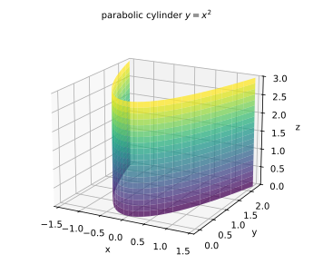
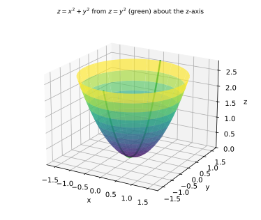
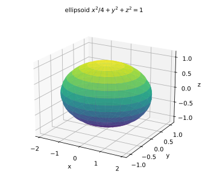
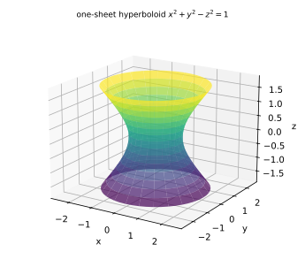
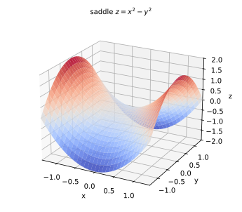
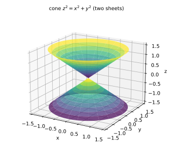
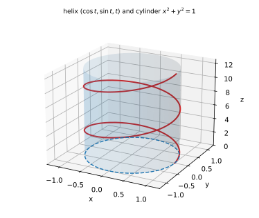

# 第 03 讲：曲面与曲线

> **前置**：第 01–02 讲（向量、平面与直线）。
> **本讲解决什么**：后面的重积分和曲面积分，对象都是**曲面**和**曲线**——不会认图、不会写方程，题就无从设限。本讲把三类曲面（柱面、旋转面、二次曲面）的方程与形状对齐，再讲空间曲线的两种写法（参数式、两曲面交线）和"投影柱面"。目标是：**给出方程能说出形状，给出形状能写出方程**，不靠死记一张表。

## 一、曲面方程

曲面在空间里是"二维的一片"。常见两种写法：

- **隐式**：$F(x,y,z)=0$。例：球面 $x^2+y^2+z^2=R^2$。
- **显式**：$z=f(x,y)$。例：上半球面 $z=\sqrt{R^2-x^2-y^2}$。

**两者的差别（重要边界）**：显式 $z=f(x,y)$ 每个 $(x,y)$ 只对应**一个** $z$——它只能表示"曲面的一半"（或整体上"单值"的那部分）；要表示完整曲面（比如整个球面、双锥），必须用隐式或分段。**开方要小心**：$z=\sqrt{R^2-x^2-y^2}$ 只是上半球，下半球是 $z=-\sqrt{\cdots}$。

## 二、先把账立住：变量、方程与维数（1 维到 4 维）

这一节不介绍新曲面，只做一件事：**把"这是几维的对象、谁是谁"一次说清**。后面遇到任何方程，先套这套账，再谈具体形状。

### 2.1 一条账：自由度 = 变量数 − 独立方程数

在 $n$ 维空间里，每加一个**独立**方程（不能由其他方程推出），解集就少一个自由度（维数）。

| 所在空间 | 方程个数 | 解集的维数 | 叫法 | 例子 |
|---|---|---|---|---|
| 平面（2 维） | 1 | 1 | 平面曲线 | $x^2+y^2=1$（圆） |
| 平面（2 维） | 2 | 0 | 点（或空集） | $x=1,\ y=2$ |
| 空间（3 维） | 1 | 2 | **曲面** | $x^2+y^2+z^2=1$（球面） |
| 空间（3 维） | 2 | 1 | **空间曲线** | $x^2+y^2+z^2=1,\ z=0$（圆） |
| 空间（3 维） | 3 | 0 | 点（或空集） | $x=1,\ y=2,\ z=3$（三个平面交于一点） |
| 空间（3 维） | 0 | 3 | 体（区域） | 整个空间 |
| "四维"（3 个自变量 + 1 个值） | 1 | 3 | 超曲面（在四维里）；**投影回三维就是等值面** | $T(x,y,z)=c$ |

**读法（考场上先做的动作）**：看到方程先数"几个变量、几个独立方程"，报出"这是几维对象"——**不要**急着解出谁。**曲面 = 空间里 1 个方程的解集（2 维）；空间曲线 = 2 个方程的交集（1 维）**。

**术语（一句话）**：**余维数**（codimension）$=$ 所在空间维数 $-$ 解集维数——曲面在三维里余维 $1$，空间曲线余维 $2$。数字不必记，账会算就行。

### 2.2 同一个曲面，四种身份

以球面 $x^2+y^2+z^2=1$ 为例：

| 身份 | 写法 | 数学对象（映射方向） | 什么时候用 |
|---|---|---|---|
| **点集（隐式）** | $F(x,y,z)=0$ | 三维空间里的一个**二维子集**（不是函数） | 几何判断、曲面积分（19–21） |
| **函数图像（显式）** | $z=f(x,y)$ | 映射 $\mathbb R^2\to\mathbb R$：上半球 $z=\sqrt{1-x^2-y^2}$ | 求偏导（05）、梯度（08）、极值（09） |
| **参数化** | $\mathbf r(u,v)=(x(u,v),y(u,v),z(u,v))$ | 映射 $\mathbb R^2\to\mathbb R^3$（两个参数） | 曲面积分计算（19）、球坐标（14） |
| **等值面** | $F(x,y,z)=c$ 的集合 | 把"高度" $F$ 固定成一个数后剩下的点集 | 场论（08/21）：等温面、等势面 |

**关键**：**隐式写法里三个变量地位对称，没有"因变量"**——"因变量"是**选了显式视角之后**才出现的叫法。所以"$z$ 是 $x,y$ 的函数"这句话，是**给球面选了一种视角**（而且只覆盖上半球），不是球面本身的性质。

### 2.3 对某个变量，方程属于哪种情形（能不能"解出它"）

拿到 $F(x,y,z)=0$，想把它写成"某变量 = 其余变量的函数"之前，先判它属于哪种：

| 情形 | 判据 | 结论 | 例 |
|---|---|---|---|
| **缺这个变量** | 方程里不出现它 | 它完全自由——曲面沿该方向"拉直"（柱面） | $x^2+y^2=1$ 缺 $z$：母线平行 $z$ 轴的柱面 |
| **含它，且对该变量的偏导数不为零** | $F_z\ne0$（把 $x,y$ 当常数、只对 $z$ 求导） | **局部**可解出 $z=\varphi(x,y)$（隐函数定理；05 讲正式定义偏导数，这里只用判据） | 球面在 $z\ne0$ 处（上、下半球） |
| **含它，但偏导数为零** | $F_z=0$（在该点） | 该点附近**不能**保证解出（可能多值或奇异） | 球面赤道 $z=0$ 处：$F_z=2z=0$ |

**整体单值 vs 局部可解（必须分清）**：

- **整体**能不能写成 $z=f(x,y)$，看几何：曲面向 $xOy$ 面投影时有没有"叠起来"（同一个 $(x,y)$ 对应两个 $z$）。球面整张**不能**（上下两半，$z=\pm\sqrt{\cdot}$），要写成两个函数，各带自己的定义域。
- **局部**能不能解出，看 $F_z$：球面在 $z\ne0$ 处处可以（上半或下半）；在赤道 $z=0$ 处不行（$F_z=0$）。
- **换个方向也可能行**：赤道上 $z$ 解不出，但那里 $x$ 往往可以（$F_x=2x\ne0$）——解出 $x=\pm\sqrt{1-y^2-z^2}$（左右两半）。球面上每点的 $(F_x,F_y,F_z)=(2x,2y,2z)$ **都不是零向量**（因为 $x^2+y^2+z^2=1$），所以球面上**每点至少有一个方向可以局部解出**——光滑曲面的普遍性质。真正"三个方向都失效"的例子是**锥面的顶点**：$F=x^2+y^2-z^2$ 在 $(0,0,0)$ 处三个偏导全为零，任何方向都解不出（那里是尖点）。

**"解不出"的另两种典型形态**：

- **双值**：$z^2=x^2+y^2$（锥面）⇒ $z=\pm\sqrt{x^2+y^2}$：每个 $(x,y)\ne(0,0)$ 对应两个 $z$；要"函数"必须拆成上下两支，且顶点 $(0,0,0)$ 处两支相遇、函数在该点没有好性质。
- **缺变量**（柱面）：见上表第一行——它不是"解不出"，而是"根本不需要解"：那个变量自由，方程只约束另外两个。

### 2.4 从 1 维到 4 维：图像与等值集

| 函数 | 自变量个数 | 图像（"画出来"的维数） | 等值集 $f=c$ | 等值集维数 |
|---|---|---|---|---|
| $y=f(x)$ | 1 | 2 维平面里的曲线（1 维） | 点（$x$ 的值） | 0 |
| $z=f(x,y)$ | 2 | 3 维空间里的曲面（2 维） | 等值线（1 维） | 1 |
| $T=f(x,y,z)$（"四维"） | 3 | **4 维，画不出** | **等值面**（2 维，落在三维空间里，能画） | 2 |

**规律**：**图像自身的维数 = 自变量个数；等值集维数 = 自变量个数 − 1**。所谓"四维"（如温度场），指的是**自变量 3 个（空间点）+ 因变量 1 个（温度值）**，不是"四个自变量"。

**温度场怎么想（四维的实用视角）**：

- **不要**去想"四维图像"——人脑没有这个画布，考试也不考"画出四维"。
- **要**用**等值面**：把所有"温度等于 $20^\circ$C"的点收集起来，得到一张**三维空间里的曲面**（等温面）；温度场就是"一层套一层"的等温面。
- **要用函数视角**：$T(x,y,z)$ 在每一点有一个数——求它的偏导（05）、梯度（08）就是在问"往哪个方向升温最快"；等温面的**法向量**就是温度梯度（07/08 讲的事）。
- **考试极少数场合**会直接把四维对象当"超曲面"说（${F=0}$ 在四维里是 3 维的），**知道有这么回事即可**。

### 2.5 考场上防混的六条检查

1. **先报维度**：变量数 − 独立方程数 = 自由度数；2=曲面、1=曲线、0=点、3=体。
2. **看到 $F=0$ 不要解**：它首先是"点集"；只有需要求导/极值时才考虑转成显式。
3. **转显式前问两层**：整体单值吗（几何上有没有叠）？局部可解吗（$F_z\ne0$？）？
4. **开方必双支**：$z^2=\cdots$ 写成 $z=\pm\cdots$；只取一支必须**补定义域与说明**。
5. **写"函数"就要给定义域**：显式化会丢点、丢支（球面只剩一半、锥面丢顶点）。
6. **曲线用两个方程或一个参数**：两曲面交线（1 维）不要写成"一个曲面"；参数化的参数个数 = 1。

## 三、柱面：方程里缺一个变量

**定义（柱面）**：一条直线（**母线**）沿一条曲线（**准线**）平行移动扫出的曲面，母线方向固定。

**判据（最好用的一条）**：方程中**缺哪个变量，母线就平行哪个坐标轴**。

- $x^2+y^2=R^2$：缺 $z$ ⇒ 母线平行 $z$ 轴，准线是 $xOy$ 面上的圆——**圆柱面**。
- $y=x^2$：缺 $z$ ⇒ **抛物柱面**（母线平行 $z$ 轴），截面是抛物线（图 1）。
- $\dfrac{x^2}{a^2}-\dfrac{y^2}{b^2}=1$：缺 $z$ ⇒ **双曲柱面**。
- $y=\sin x$：缺 $z$ ⇒ 正弦柱面。



*图 1：$y=x^2$ 的图形——每条平行于 $z$ 轴的直线（固定 $x$ 与 $y$）都整条落在曲面上。*

**术语边界**："柱面"不等于"圆柱面"。**圆柱面**是准线为圆这一特例；准线是抛物线、正弦曲线的也叫柱面。判断柱面只看"方程是否缺变量、母线是否平行某轴"，与"圆不圆"无关。

## 四、旋转面：一条曲线绕定直线转

**定义（旋转面）**：一条曲线（**母线**）绕一条定直线（**旋转轴**）旋转一周扫出的曲面。

**方程的替换规则**（这是唯一要记的操作，来源是"旋转时到轴的距离不变"）：

| 旋转轴 | 母线所在坐标面 | 替换规则 |
|---|---|---|
| $z$ 轴 | $yOz$ 面（方程只含 $y,z$） | $z$ 不变，$y^2$ 换成 $x^2+y^2$ |
| $x$ 轴 | $yOz$ 面（只含 $y,z$） | $x$ 不变，$y^2$ 换成 $y^2+z^2$（或 $z^2$ 换） |
| $y$ 轴 | $xOz$ 面（只含 $x,z$） | $y$ 不变，$x^2$ 换成 $x^2+z^2$（或 $z^2$ 换） |

**为什么是"平方换平方"**：母线上一点 $(0,y_0,z_0)$ 旋转后到轴的距离保持为 $\lvert y_0\rvert$，新点的 $(x,y)$ 满足 $x^2+y^2=y_0^2$——所以 $y_0^2$ 被换成了 $x^2+y^2$（平方形式避免了 $\pm\sqrt{\cdot}$ 的符号讨论）。

**例 1**：$yOz$ 面内的抛物线 $z=y^2$ 绕 $z$ 轴旋转：

$$z=y^2\ \longrightarrow\ z=x^2+y^2$$

——**旋转抛物面**（图 2）。

**例 2**：$yOz$ 面内的直线 $z=y$ 绕 $z$ 轴旋转：

$$z=y\ \longrightarrow\ z^2=x^2+y^2$$

——**圆锥面**。注意这里是 $z^2$：方程给出的是**上下两个锥面**（$z=\pm\sqrt{x^2+y^2}$），不是"一个锥"。要只取上半锥，必须补条件 $z\ge0$。



*图 2：母线（$yOz$ 面内的抛物线，绿色）绕 $z$ 轴旋转得到曲面 $z=x^2+y^2$。*

**柱面与旋转面的关系（辨析）**：两者都可能"长得像圆筒"，但生成方式不同——柱面是**整条直线平移**，旋转面是**曲线绕轴转**。圆柱面（$x^2+y^2=R^2$）既满足"柱面"（缺 $z$、母线平行 $z$）又满足"旋转面"（$y=R$ 绕 $z$ 轴），是两者的交叉特例；抛物柱面（$y=x^2$）只是柱面，不是旋转面。

## 五、常见二次曲面：认图与截痕

**二次曲面**：三元二次方程 $Ax^2+By^2+Cz^2+Dxy+\cdots=0$ 表示的曲面。本课程只要求认出五种**标准型**，且**不靠背表**——用**截痕法**（用坐标面或平行平面去截，看截线是什么曲线）现场判断。

| 名称 | 标准方程 | 截痕特征（用来认图） |
|---|---|---|
| 椭球面 | $\dfrac{x^2}{a^2}+\dfrac{y^2}{b^2}+\dfrac{z^2}{c^2}=1$ | 三个坐标面截出**椭圆**；三个半轴 $a,b,c$（$a=b=c$ 是球面） |
| 椭圆抛物面 | $\dfrac{x^2}{a^2}+\dfrac{y^2}{b^2}=z$ | 水平截 $z=k$ 是椭圆（或点）；竖直截是抛物线——**开口向上** |
| 双曲抛物面（马鞍面） | $\dfrac{x^2}{a^2}-\dfrac{y^2}{b^2}=z$ | 水平截是双曲线；两个竖直方向截是开口相反的抛物线 |
| 单叶双曲面 | $\dfrac{x^2}{a^2}+\dfrac{y^2}{b^2}-\dfrac{z^2}{c^2}=1$ | 水平截是椭圆（$z=0$ 时最小，"腰"）；**一整片连通** |
| 双叶双曲面 | $\dfrac{x^2}{a^2}+\dfrac{y^2}{b^2}-\dfrac{z^2}{c^2}=-1$ | 水平截：$\lvert z\rvert<c$ 时无交；$\lvert z\rvert>c$ 时是椭圆——**两片分离** |
| 锥面 | $\dfrac{x^2}{a^2}+\dfrac{y^2}{b^2}=z^2$ | 水平截是椭圆（$z=0$ 时缩成一点）——**上下两个锥** |



*图 3：椭球面 $x^2/4+y^2+z^2=1$——三个方向的半轴不同。*



*图 4：单叶双曲面 $x^2+y^2-z^2=1$——一整片连通，$z=0$ 处腰最细。*



*图 5：双曲抛物面 $z=x^2-y^2$——沿 $x$ 方向向上弯，沿 $y$ 方向向下弯。*



*图 6：锥面 $z^2=x^2+y^2$——上下两个锥，顶点在原点。*

**认图的标准（理解层次）**：给出方程，能说出"是哪一类、沿哪个方向开口/哪个量最小"；给出图，能写出标准型或指出参数。**不要求**记住所有退化情形与旋转角度后的方程。

**几个容易混的对照**：

- **椭圆抛物面 vs 椭球面**：前者开口（$z$ 无界），后者封闭（三个方向都有界）。
- **单叶 vs 双叶双曲面**：看等号右边与 $z^2$ 项的符号——右边为 $1$ 且 $z^2$ 系数为负 ⇒ **单叶**；右边为 $-1$（等价于 $z^2$ 项为正、其余为负）⇒ **双叶**。用截痕验证：水平截"$\lvert z\rvert$ 小时无交"就是双叶。
- **锥面 vs 双曲面**：锥面在 $z=0$ 缩成**一个点**；双曲面在 $z=0$ 仍是一个**椭圆**。

## 六、空间曲线：两种写法

### 6.1 一般式（两曲面交线）

$$\begin{cases}F(x,y,z)=0\\ G(x,y,z)=0\end{cases}$$

例：$\begin{cases}x^2+y^2=1\\ z=2x\end{cases}$ 是圆柱面与平面的交线（一条空间曲线）。

### 6.2 参数式

$$\mathbf r(t)=\big(x(t),\ y(t),\ z(t)\big),\qquad t\in I.$$

参数式最直观：$t$ 变大时点在空间里"走"出一条曲线。**标准例子（螺旋线）**：

$$\mathbf r(t)=(\cos t,\ \sin t,\ t),\qquad t\in\mathbb R.$$

它的 $x,y$ 满足 $x^2+y^2=1$（绕着 $z$ 轴转），$z=t$ 匀速上升——图 7。（这个例子在 16–21 讲算曲线积分时会反复出现。）



*图 7：螺旋线 $(\cos t,\sin t,t)$ 与它的投影柱面 $x^2+y^2=1$。*

### 6.3 一般式与参数式的互化

- **一般式 → 参数式**：消去一个变量，把剩下的关系参数化。例：$\begin{cases}x^2+y^2=1\\ z=2x\end{cases}$ ⇒ 取 $x=\cos t$、$y=\sin t$ ⇒ $z=2\cos t$，得 $(\cos t,\sin t,2\cos t)$。
- **参数式 → 一般式**：从参数式消去 $t$。例：$(\cos t,\sin t,2\cos t)$ 中 $z=2x$ 且 $x^2+y^2=1$。

**什么时候用哪种**：算曲线积分用**参数式**（有 $t$ 才能算 $ds$）；给"两曲面交线"的题用**一般式**；求投影用**一般式消元**（见 6.4）。

### 6.4 投影柱面与投影曲线

**做法**：从两曲面方程中**消去一个变量**（比如 $z$），得到只含 $x,y$ 的方程 $H(x,y)=0$——这是一个**柱面**（母线平行 $z$ 轴）。曲线上的点都满足它，所以这条曲线整体落在这个柱面上；这个柱面叫曲线关于 $xOy$ 面的**投影柱面**。

再把这个柱面与 $xOy$ 面"相交"（也就是只看 $x,y$），得到**投影曲线** $H(x,y)=0,\ z=0$。

**例**：螺旋线 $x^2+y^2=1,\ z=t$ 的投影柱面就是 $x^2+y^2=1$；投影曲线是 $xOy$ 面上的单位圆。

**用途**：求"曲线在坐标面上的投影"是常见题型；后面的重积分设限也常要"区域边界在坐标面上的投影"。

## 七、和后面几讲的连接

- **07 讲（切平面与法线）**：给曲面 $F(x,y,z)=0$，切平面的法向量是梯度 $\nabla F=(F_x,F_y,F_z)$——曲面方程今天写熟，07 讲才写得动。
- **19–21 讲（曲面积分）**：曲面的"面积元"与"定向"都依赖曲面的显式/参数方程；"投影到坐标面"正是 19–20 讲把曲面积分化成二重积分的动作。
- **11–15 讲（重积分）**：积分区域的边界就是今天这些曲面——认不出图，就设不对限。

## 八、例题

**例 1**：指出 $x^2+y^2=2z$ 的形状。

**解**：水平截 $z=k$：$x^2+y^2=2k$——$k>0$ 时是圆、$k=0$ 时是点、$k<0$ 时无交；竖直截 $y=0$：$x^2=2z$ 是抛物线。⇒ **旋转抛物面**（也可看成 $z=y^2/2$ 绕 $z$ 轴旋转），开口向上，顶点在原点。

**例 2**：指出 $x^2-y^2=1$ 的形状。

**解**：缺 $z$ ⇒ **双曲柱面**（母线平行 $z$ 轴）；$xOy$ 面内是双曲线。

**例 3**：$yOz$ 面内曲线 $z=y^2$ 绕 $z$ 轴旋转，求曲面方程。

**解**：$y^2\to x^2+y^2$ ⇒ $z=x^2+y^2$（旋转抛物面）。

**例 4**：求曲线 $\begin{cases}x^2+y^2=1\\ z=2x\end{cases}$ 在 $xOy$ 面上的投影柱面与投影曲线。

**解**：消去 $z$：$x^2+y^2=1$（本来就只含 $x,y$）⇒ 投影柱面是圆柱面 $x^2+y^2=1$；投影曲线是 $\begin{cases}x^2+y^2=1\\ z=0\end{cases}$（$xOy$ 面上的单位圆）。

## 九、数值核对

用脚本核对"方程与点"的归属、旋转面对称性与投影（`scripts/lec03-02_verify_surfaces.py`，全脚本 0.00 秒）：

```
=== EXP1: cylinder y = x^2 (any z) ===
  point (0.7, 0.49, -2.0): y - x^2 = 5.55e-17, z varies freely
  point (0.7, 0.49, 0.0): y - x^2 = 5.55e-17, z varies freely
  point (0.7, 0.49, 3.0): y - x^2 = 5.55e-17, z varies freely

=== EXP2: surface of revolution z = x^2 + y^2 ===
  (+0.6,+0.8): z - (x^2+y^2) = 0.00e+00
  (+0.6,-0.8): z - (x^2+y^2) = 0.00e+00
  (-0.6,+0.8): z - (x^2+y^2) = 0.00e+00
  (-0.6,-0.8): z - (x^2+y^2) = 0.00e+00

=== EXP3: ellipsoid x^2/4 + y^2 + z^2 = 1 ===
  param point [0.4190780615 0.7547810556 0.6216099683]; residual = 0.00e+00 (expect 0)
  z=0 section: x^2/4 + y^2 = 1 -> semi-axes 2 and 1

=== EXP4: one-sheet hyperboloid x^2 + y^2 - z^2 = 1 ===
  t=-1.0: residual = 4.44e-16; section radius = 1.4142
  t=+0.0: residual = 0.00e+00; section radius = 1.0000
  t=+2.0: residual = 8.88e-16; section radius = 2.2361
  (z=0 radius 1, z=2 radius sqrt(5) = 2.2361)

=== EXP5: helix projected to xOy ===
  t=0.0: x^2+y^2-1 = 0.00e+00
  t=1.0: x^2+y^2-1 = 0.00e+00
  t=2.5: x^2+y^2-1 = -1.11e-16
  t=6.0: x^2+y^2-1 = -1.11e-16

=== EXP6: z = 1 - x^2 - y^2 cut by z = 0 (Q7) ===
  (1.0,0.0): z = 0.00e+00; x^2+y^2-1 = 0.00e+00
  (0.0,-1.0): z = 0.00e+00; x^2+y^2-1 = 0.00e+00
  (0.6,0.8): z = -1.11e-16; x^2+y^2-1 = 0.00e+00
```

**核对点**：柱面上取 $(0.7,0.49,z)$，$z$ 取 $-2,0,3$ 三个值残差都不变（母线平行 $z$ 轴的数值表现）；旋转面上四个符号组合同高（残差 $0$）；椭球参数点满足方程、$z=0$ 截痕半轴为 $2$ 与 $1$；单叶双面面三处截圆半径 $1.4142,1,2.2361$ 与 $\sqrt{1+t^2}$ 一致；螺旋线逐点满足 $x^2+y^2=1$；作业 7 的截痕为单位圆。

（EXP1 的 $5.55\times10^{-17}$ 不是错误：脚本里的 $0.49$ 是独立写的字面值，与 $0.7^2$ 的双精度结果差一个最小单位量级——**正因为两者独立，残差才有意义**；若用 $x_0^2$ 自己算自己，残差会恒为 $0$，什么也验证不了。）

## 小结

- **隐式** $F(x,y,z)=0$ 能表示整张曲面；**显式** $z=f(x,y)$ 只能表示单值的"一半"（开方只取一支）。
- **柱面**：方程缺哪个变量，母线就平行哪个轴；柱面≠圆柱面。
- **旋转面**：绕哪根轴，哪个坐标不变，另一个平方换成"两平方和"；开方形式的双支要补范围（锥面是上下两个）。
- **二次曲面五种标准型**：椭球、椭圆抛物面、双曲抛物面（马鞍）、单叶/双叶双曲面、锥面——用**截痕**认图，不必背表；单叶/双叶看 $z^2$ 项符号与截痕有无空档。
- **空间曲线**：一般式（两曲面交线）与参数式；消元得**投影柱面**，再与坐标面联合得**投影曲线**。

## 作业

**说明**：答案平铺在每题下方（先做再对照）。只用第 01–03 讲已教内容。

**1.** 判断下列方程表示什么曲面（写出类型与母线/轴）：
(1) $x^2+z^2=4$；(2) $z=x^2$；(3) $\dfrac{x^2}{4}+\dfrac{y^2}{9}=1$；(4) $z=x^2+y^2$；(5) $z^2=x^2+y^2$。

**参考答案**：
(1) 缺 $y$ ⇒ 母线平行 $y$ 轴的**圆柱面**（准线是 $xOz$ 面上的圆）。
(2) 缺 $y$ ⇒ **抛物柱面**（母线平行 $y$ 轴）。
(3) 缺 $z$ ⇒ **椭圆柱面**（母线平行 $z$ 轴）。
(4) **旋转抛物面**（$z=y^2$ 绕 $z$ 轴旋转），开口向上。
(5) **圆锥面**（上下两个锥），顶点在原点。

**2.** $xOz$ 面内曲线 $z=x^2$ 绕 $z$ 轴旋转，求方程。

**参考答案**：
绕 $z$ 轴：$z$ 不变，$x^2\to x^2+y^2$ ⇒ $z=x^2+y^2$（旋转抛物面）。

**3.** $yOz$ 面内直线 $z=2y$ 绕 $z$ 轴旋转，求方程，并说明它是几个锥面。

**参考答案**：
$z=2y$ ⇒（$y^2\to x^2+y^2$）$z^2=4(x^2+y^2)$；含 $z^2$ ⇒ **上下两个锥面**（$z=\pm2\sqrt{x^2+y^2}$）；只取上半锥需补 $z\ge0$。

**4.** 说明 $\dfrac{x^2}{4}+y^2-\dfrac{z^2}{9}=1$ 是单叶还是双叶双曲面（用截痕判断）。

**参考答案**：
$z=0$ 截痕：$\dfrac{x^2}4+y^2=1$ 是椭圆（有交）；且 $z^2$ 项系数为负、右边为 $1$ ⇒ **单叶双曲面**（一整片连通，$z=0$ 处腰最细）。

**5.** 求曲线 $\begin{cases}x^2+y^2=4\\ z=x^2-y^2\end{cases}$ 在 $xOy$ 面上的投影柱面与投影曲线。

**参考答案**：
方程已只含 $x,y$（$z$ 由第二个方程给出）⇒ 消去 $z$ 得 $x^2+y^2=4$ ⇒ 投影柱面是圆柱面 $x^2+y^2=4$；投影曲线是 $\begin{cases}x^2+y^2=4\\ z=0\end{cases}$。

**6.** 求曲线 $\begin{cases}z=x^2+y^2\\ z=4\end{cases}$ 在 $xOy$ 面上的投影曲线，并说明这条空间曲线是什么。

**参考答案**：
代入 $z=4$：$x^2+y^2=4$ ⇒ 投影柱面 $x^2+y^2=4$、投影曲线 $\begin{cases}x^2+y^2=4\\ z=0\end{cases}$；空间曲线是旋转抛物面与平面 $z=4$ 的交线——**水平面上的圆**（$(2\cos t,2\sin t,4)$）。

**7.**（综合）某曲面由"$yOz$ 面内抛物线 $z=1-y^2$（$0\le y\le1$）绕 $z$ 轴旋转"生成：(1) 写出曲面方程；(2) 判断它属于哪类二次曲面；(3) 它被 $z=0$ 平面截出什么。

**参考答案**：
(1) $z=1-(x^2+y^2)=1-x^2-y^2$（旋转抛物面，开口向下）。
(2) **椭圆抛物面**（$x^2+y^2=1-z$）。
(3) $z=0$：$x^2+y^2=1$——$xOy$ 面上的单位圆。

**8.** 维度账：说出下列对象的自由度（维数）与叫法：(1) 三维空间中一个平面；(2) 球面 $x^2+y^2+z^2=1$；(3) 两曲面交线；(4) 三个平面交于一点；(5) 圆盘 $x^2+y^2\le1,\ z=0$。

**参考答案**：
(1) 3 变量 − 1 方程 = **2 维**（曲面）。(2) **2 维**（曲面）。(3) 3 − 2 = **1 维**（曲线）。(4) 3 − 3 = **0 维**（点）。(5) 等式 $z=0$ 提供一个约束（$3-1=2$ 维），不等式 $x^2+y^2\le1$ 只是把范围限制在圆盘内（**不等式不降维**）——所以是 $2$ 维的**平面区域**（圆盘）。

**9.** 可解性：对球面 $x^2+y^2+z^2=1$：(1) 能否**整体**写成 $z=f(x,y)$？为什么？(2) 在哪些点**局部**可以解出 $z$？(3) 在赤道（$z=0$）处，$z$ 能解出吗？$x$ 能解出吗？找一找有没有"三个方向都失效"的点。

**参考答案**：
(1) 不能：圆内每个 $(x,y)$ 对应 $z=\pm\sqrt{1-x^2-y^2}$ 两个值，投影重叠；必须拆成上下两个函数并各带定义域。
(2) $z\ne0$ 处（上、下半球），$F_z=2z\ne0$。
(3) 赤道 $z=0$：$F_z=0$，不能解出 $z$；但赤道上 $x\ne0$ 处 $F_x=2x\ne0$，可以局部解出 $x=\pm\sqrt{1-y^2-z^2}$（左右两半）。**球面上不存在三偏导全为零的点**（$(2x,2y,2z)$ 的长度为 $2$），所以处处至少有一个方向可局部解出。
