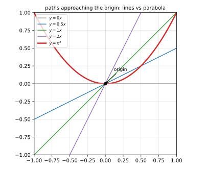
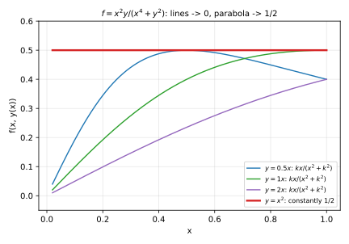

# 第 04 讲：多元函数、极限与连续

> **前置**：第 01–03 讲（空间几何语言）；上册第 02–04 讲（极限的 ε-N/ε-δ、四则法则）——本讲把那一套搬到"多元"，并处理搬过去之后**真正变难的地方**。
> **本讲解决什么**：多元函数的极限不是"先对 $x$ 取极限再对 $y$ 取极限"。本讲把重极限的定义、**路径法**（怎么用一条路径证明极限不存在）、**极坐标 + 夹逼**（怎么证明极限存在）、**累次极限与重极限的区别**讲清楚，最后给出连续的定义与"沿路径不同值"的间断判定。

## 一、多元函数：定义域、图像、等值线

**二元函数** $z=f(x,y)$：对平面上的点 $(x,y)$ 指定一个数 $z$。**定义域**是平面上的一块区域 $D$（使得式子有意义的点集）；**图像**是空间中的曲面（第 03 讲的那类曲面）。

**几个定义域的例子**（先看"使式子有意义"这件事在平面上长什么样）：

- $z=\sqrt{1-x^2-y^2}$：$x^2+y^2\le1$——**闭圆盘**（边界上根号为零、也有定义）。
- $z=\ln(x+y)$：$x+y>0$——**半平面**（边界不算，开区域）。
- $z=\dfrac{1}{x^2+y^2-1}$：$x^2+y^2\ne1$——**挖掉一个圆**（不连通？——圆内与圆外两块；本题通常只讨论其中一块）。
- $z=\arcsin\frac{y}{x}$：$\lvert y\rvert\le\lvert x\rvert,\ x\ne0$——两个角形区域。

**等值线**：把 $f(x,y)=c$ 的点连起来——**等高线**。看等值线的疏密能读出"哪里变化快"（等值线密的地方陡）——第 08 讲方向导数会把这个观察变成公式。地形图、温度分布图都是等值线图。

**三元函数** $u=f(x,y,z)$：定义域是空间中的体；图像在四维空间里，**看不到**——能画的是**等值面** $f=c$（比如温度场的等温面）。本课程三元函数主要用于重积分与场论，**只要求会求定义域、会理解等值面**。

## 二、二元函数的极限（重极限）

**定义（重极限（double limit））**：设 $f$ 在点 $P_0(x_0,y_0)$ 的某去心邻域内有定义。若存在常数 $A$，使得

$$\forall\varepsilon>0,\ \exists\delta>0:\quad 0<\sqrt{(x-x_0)^2+(y-y_0)^2}<\delta\ \Longrightarrow\ \lvert f(x,y)-A\rvert<\varepsilon,$$

则称 $\lim_{(x,y)\to(x_0,y_0)}f(x,y)=A$，也叫**二重极限**。

**与一元定义的差别只有两处，但这两处是全部困难的来源**：

1. **邻域从"去心区间"变成"去心圆盘"**：$0<\lvert x-x_0\rvert<\delta$ 变成了 $0<\text{距离}<\delta$；
2. **趋近方式“无穷多”**：一元只有从左、从右两条路；平面上点可以从**任意方向、任意曲线**趋近——**重极限要求“所有路径同时”趋向同一个数**。

**一元那套性质照搬**（证明相同）：极限唯一、局部有界、四则运算（分母极限不为零）。这些不再重复。

## 三、路径法：怎么证明极限**不存在**

**核心结论**：若沿两条不同路径趋近 $P_0$ 得到**不同的极限值**，则重极限**不存在**。

**为什么**（一句话）：如果重极限存在且等于 $A$，那么沿**任何**路径趋近，函数值都必须趋于 $A$（路径上的点也是邻域内的点）——所以出现两个不同的值，就与"存在唯一的 $A$"矛盾。

> **边界（最重要的一句）**：**路径法只能证明“不存在”，不能证明“存在”。**
> 沿一百条路径都趋于同一个数，也**不能**推出重极限存在——因为还有无穷多条没试过的路径。证明存在要靠二、四节的 $\varepsilon$-$\delta$ 或极坐标夹逼。

**例 1（沿直线就翻车）**：$f(x,y)=\dfrac{xy}{x^2+y^2}$（原点处无定义）。沿 $y=kx$：

$$f(x,kx)=\frac{kx^2}{x^2+k^2x^2}=\frac{k}{1+k^2}.$$

这个值**随 $k$ 变**：$k=0$ 时是 $0$，$k=1$ 时是 $\frac12$。两条路径给出不同结果 ⇒ **重极限不存在**。

**例 2（所有直线都趋于 0，仍不存在）**：$f(x,y)=\dfrac{x^2y}{x^4+y^2}$。沿 $y=kx$：

$$f(x,kx)=\frac{kx^3}{x^4+k^2x^2}=\frac{kx}{x^2+k^2}\longrightarrow 0\quad(x\to0),$$

——**对任何斜率 $k$ 都趋于 0**。但沿抛物线 $y=x^2$：

$$f(x,x^2)=\frac{x^4}{x^4+x^4}=\frac12\quad(\text{恒等于 }\tfrac12).$$

两条路径（直线族与抛物线）给出不同结果 ⇒ **重极限不存在**。



*图 1：沿所有直线 $y=kx$ 趋于原点时 $f\to0$；沿抛物线 $y=x^2$ 时 $f\equiv\frac12$。*



*图 2：例 2 的数值表现——直线路径（多种斜率）都贴着 0 收敛，抛物线路径始终是 $\frac12$。*

**这个例子说明什么**：**“把直线都试一遍”远远不够**。路径法的价值在于“找到一条反例路径就结束”；它的局限在于“试遍直线也可能漏掉一条曲线”。

## 四、证明极限**存在**：极坐标 + 夹逼

对 $(x,y)\to(0,0)$，令 $x=r\cos\theta,\ y=r\sin\theta$（$r\ge0$）。重极限存在等价于：**当 $r\to0$ 时，$f$ 的值与 $\theta$ 无关地一致趋于 $A$**。实用判据是**夹逼**：

$$\lvert f(r\cos\theta,\ r\sin\theta)-A\rvert\le g(r),\qquad g(r)\to0\ (r\to0),$$

其中 $g$ **不含 $\theta$**——这样界与方向无关，才真正排除“不同路径不同值”。

**例 3（存在）**：$f=\dfrac{x^3+y^3}{x^2+y^2}$：

$$x^3+y^3=r^3(\cos^3\theta+\sin^3\theta),\qquad x^2+y^2=r^2,$$

$$\lvert f\rvert=r\,\lvert\cos^3\theta+\sin^3\theta\rvert\le 2r\longrightarrow 0.$$

界 $2r$ 不含 $\theta$，且随 $r\to0$ 趋于 $0$ ⇒ 极限为 $0$。

**例 4（存在）**：$f=\dfrac{xy}{\sqrt{x^2+y^2}}$：$f=r\cos\theta\sin\theta$，$\lvert f\rvert\le r\to0$ ⇒ 极限 $0$。（注意这与例 1 只差分母的幂次：$\sqrt{x^2+y^2}$ 是一次，$x^2+y^2$ 是二次——**分母的“阶”决定成败**。）

**方法总结（考试动作）**：

1. 先**试路径**找反例（直线、抛物线 $y=x^2$、$y=kx^2$）；找到一个 ⇒ 不存在，结束；
2. 找不到，转**极坐标**：把式子写成 $r$ 与 $\theta$；若能把绝对值界成只含 $r$、且 $r\to0$ 时趋于 $0$ ⇒ 存在；
3. 极坐标里界**仍含 $\theta$ 且不能消**（比如 $\frac{\cos^2\theta\sin^2\theta}{\cos^4\theta+\sin^4\theta}$ 之类）——既不说明存在，也不能下结论；回去继续找路径，或直接用 $\varepsilon$-$\delta$。

## 五、累次极限与重极限：互不蕴含

**定义（累次极限（iterated limit））**：

$$\lim_{x\to x_0}\Big(\lim_{y\to y_0}f(x,y)\Big)\quad\text{与}\quad\lim_{y\to y_0}\Big(\lim_{x\to x_0}f(x,y)\Big).$$

它们是"先固定一个变量、对另一个取极限，再对剩下的取极限"——**两次一元的极限**。

**结论：重极限与累次极限互不蕴含。** 两个反例：

**反例 A（两个累次极限存在但不等，重极限不存在）**：$f=\dfrac{x^2-y^2}{x^2+y^2}$（原点）：

$$\lim_{x\to0}\Big(\lim_{y\to0}f\Big)=\lim_{x\to0}\frac{x^2}{x^2}=1,\qquad \lim_{y\to0}\Big(\lim_{x\to0}f\Big)=\lim_{y\to0}\frac{-y^2}{y^2}=-1.$$

两个累次极限不相等 ⇒（由"重极限存在则一切路径一致"）重极限不存在——**而两次一元极限都算得出来，这正是最容易误判的地方**。

**反例 B（重极限存在，但累次极限不存在）**：$f(x,y)=y\sin\dfrac1x$（$x\ne0$）：

- 重极限：$\lvert f\rvert\le\lvert y\rvert\to0$ ⇒ 重极限 $=0$；
- 累次极限 $\lim_{x\to0}\big(y\sin\frac1x\big)$ 对任何固定的 $y\ne0$ **不存在**（$\sin\frac1x$ 在 $0$ 附近振荡）⇒ $\lim_{y\to0}\lim_{x\to0}$ 不存在。

**一句话记**：**重极限是“所有路径一起”，累次极限是“两条特定顺序”；前者强，但强得不能推出后者的存在性——两者各有各的反例。**

## 六、连续

**定义（连续）**：$f$ 在 $P_0$ 连续 $\iff\lim_{(x,y)\to P_0}f(x,y)=f(P_0)$（在定义域内）。

- **多元初等函数**（由多项式、三角、指数、对数经有限次四则与复合得到的）在其定义域内连续——与一元相同的结论；
- **有界闭区域上连续函数的性质**（最值定理、介值定理）与一元同构（第 08 讲用的就是最值定理）；
- **间断的判定**：若沿两条路径趋近得到不同值 ⇒ 在 $P_0$ **不连续**（例 1 的 $f$ 在原点不连续，且极限不存在——属于"极限不存在型"间断）。

**与一元的差别**：一元间断只有"跳跃、可去、无穷、振荡"几类；多元的"沿路径不同值"是**新的一类**（有时叫"路径型间断"），它既不是跳跃也不是可去——**函数值完全可能沿每条直线都有极限，但这些极限互不相同**（例 1）。

## 七、例题

**例 5**：判断 $\lim_{(x,y)\to(0,0)}\dfrac{x^2y^2}{x^2+y^2}$。

**解**：极坐标：$f=r^2\cos^2\theta\sin^2\theta$，$\lvert f\rvert\le r^2\to0$ ⇒ 极限 $0$。

**例 6**：判断 $\lim_{(x,y)\to(0,0)}\dfrac{x^2-y^2}{x^2+y^2}$ 是否存在。

**解**：沿 $y=0$：$f=1$；沿 $x=0$：$f=-1$ ⇒ **不存在**。（这也是第五节反例 A 的重极限部分。）

**例 7**：$f(x,y)=\dfrac{xy}{x^2+y^2}$（原点无定义）——能否补充定义使其在原点连续？

**解**：不能。连续要求极限存在，而例 1 已证极限不存在（沿不同直线不同值）——**补任何一个数都无法使所有路径一致**。

## 八、数值核对

用脚本核对本讲的关键现象（`scripts/lec04-02_verify_limits.py`，全脚本 0.00 秒）：

```
=== EXP1: xy/(x^2+y^2) along y = kx ===
  k=0: limit value = k/(1+k^2) = 0.000000
  k=0.5: limit value = k/(1+k^2) = 0.400000
  k=1: limit value = k/(1+k^2) = 0.500000
  k=2: limit value = k/(1+k^2) = 0.400000

=== EXP2: x^2 y/(x^4+y^2) ===
  line k=1 at x=0.001: f = 1.000e-03  (-> 0)
  line k=1 at x=1e-06: f = 1.000e-06  (-> 0)
  parabola y=x^2 at x=0.01: f = 0.500000  (constant 0.5)
  parabola y=x^2 at x=0.0001: f = 0.500000  (constant 0.5)
  parabola y=x^2 at x=1e-08: f = 0.500000  (constant 0.5)

=== EXP3: y sin(1/x) ===
  sup over grid: max |f| = 0.826880; max |y| = 1.000000
  ratio max|f|/max|y| = 0.826880 (<= 1)
  fixed y=0.3, x_k=0.636620: f = +0.300000
  fixed y=0.3, x_k=0.212207: f = -0.300000

=== EXP4: (x^3+y^3)/(x^2+y^2), grid worst |f|/r ===
  worst |f|/r over grid = 1.000000 (bound 2; actual max of |c^3+s^3| is 1, so the bound is loose)
```

**核对点**：例 1 沿不同斜率给出 $0,\ 0.4,\ 0.5,\ 0.4$（$k$ 与 $1/k$ 对称——同一组值）；例 2 沿直线 $k=1$ 时 $10^{-3}\to10^{-6}$ 趋 $0$，沿抛物线在 $x=10^{-2},10^{-4},10^{-8}$ 处都恰为 $0.5$；反例 B 的网格最大 $\lvert f\rvert=0.82688$ 小于 $\max\lvert y\rvert=1$（重极限的界成立），而固定 $y=0.3$ 时两个 $x$ 点分别给 $+0.3$ 与 $-0.3$（振荡）；例 3 的网格最坏 $\lvert f\rvert/r=1.0$——**实际最大值是 $1$，我们用的界 $2$ 是松的，但对“$\to0$”够用**（上界不必最优，只需趋于 $0$）。

## 小结

- **二元函数**：定义域是平面区域；图像是曲面；**等值线**是"高度相同点的连线"（疏密反映变化快慢）。三元函数的图像在四维，能画的是**等值面**。
- **重极限**：邻域是**圆盘**，趋近路径**无穷多**，要求"所有路径同时"趋于同一个值；一元性质（唯一、局部有界、四则）照搬。
- **路径法**：两条路径不同值 ⇒ **不存在**；**只能证不存在，不能证存在**。反例路径首选直线 $y=kx$、抛物线 $y=x^2$；**"直线全试一遍"仍可能漏**（例 2）。
- **证存在**：极坐标 + 夹逼，界必须**不含 $\theta$**。
- **累次极限 ≠ 重极限**，**互不蕴含**：A（累次都存在但不等、重不存在）；B（重存在、累次不存在）。
- **连续**：极限等于函数值；多元初等函数在定义域内连续；沿路径不同值 ⇒ 不连续（**路径型间断**，一元没有这一类）。

## 作业

**说明**：答案平铺在每题下方（先做再对照）。只用上册与本讲已教内容。

**1.** 求下列函数的定义域（画草图或写不等式）：
(1) $z=\sqrt{4-x^2-y^2}$；(2) $z=\ln(xy)$；(3) $z=\dfrac{1}{\sqrt{x^2+y^2-1}}$。

**参考答案**：
(1) $x^2+y^2\le4$（闭圆盘）。
(2) $xy>0$（第一、三象限的内部，不含坐标轴）。
(3) $x^2+y^2>1$（单位圆外的开区域）。

**2.** 用路径法证明 $\lim_{(x,y)\to(0,0)}\dfrac{xy}{x^2+y^2}$ 不存在。

**参考答案**：
沿 $y=kx$：$f=\frac{k}{1+k^2}$；取 $k=0$ 得 $0$、$k=1$ 得 $\frac12$ —— 两条路径不同值 ⇒ 不存在。$\blacksquare$

**3.** 证明 $\lim_{(x,y)\to(0,0)}\dfrac{x^2y}{x^4+y^2}$ 不存在（只试直线不够，需要抛物线）。

**参考答案**：
沿 $y=kx$：$f=\frac{kx}{x^2+k^2}\to0$（对每个固定的 $k$）；
沿 $y=x^2$：$f=\frac{x^4}{x^4+x^4}=\frac12$。
两条路径不同值 ⇒ 不存在。$\blacksquare$

**4.** 判断 $\lim_{(x,y)\to(0,0)}\dfrac{x^2y^2}{x^2+y^2}$ 是否存在，并说明方法。

**参考答案**：
极坐标：$f=r^2\cos^2\theta\sin^2\theta$，$\lvert f\rvert\le r^2\to0$ ⇒ 极限 $0$（界不含 $\theta$，故对所有路径一致）。$\blacksquare$

**5.** 判断 $\lim_{(x,y)\to(0,0)}\dfrac{x^3+y^3}{x^2+y^2}$。

**参考答案**：
极坐标：$\lvert f\rvert=r\lvert\cos^3\theta+\sin^3\theta\rvert\le2r\to0$ ⇒ 极限 $0$。

**6.** 分别求 $f(x,y)=\dfrac{x^2-y^2}{x^2+y^2}$ 在原点处的两个累次极限，并据此说明重极限不存在。

**参考答案**：
$\lim_{x\to0}\lim_{y\to0}f=1$；$\lim_{y\to0}\lim_{x\to0}f=-1$（见正文第五节）。两累次极限不等 ⇒ 若重极限存在则两者都应用等于它，矛盾 ⇒ 重极限不存在。$\blacksquare$

**7.**（综合）设 $f(x,y)=y\sin\frac1x$（$x\ne0$）：(1) 求重极限 $\lim_{(x,y)\to(0,0)}f$；(2) 说明累次极限 $\lim_{y\to0}\lim_{x\to0}f$ 不存在；(3) 这与"重极限存在 ⇒ 累次极限存在"的说法矛盾吗？

**参考答案**：
(1) $\lvert f\rvert\le\lvert y\rvert\to0$ ⇒ 重极限 $=0$。
(2) 固定 $y\ne0$，$\sin\frac1x$ 在 $x\to0$ 时在 $[-1,1]$ 间振荡（例如 $x_k=1/(\frac\pi2+2k\pi)$ 给 $f=y$，$x_k'=1/(\frac{3\pi}2+2k\pi)$ 给 $f=-y$）⇒ 内层极限不存在 ⇒ 累次极限不存在。
(3) 不矛盾：**“重极限存在 ⇒ 累次极限存在”本身就不成立**——本讲第五节反例 B 正是它。重极限只保证"所有路径一起趋于同一值"，不保证"固定一个变量后另一个变量的极限存在"。
