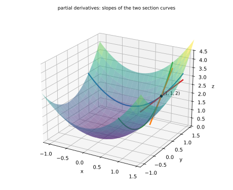
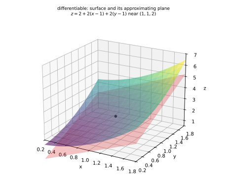
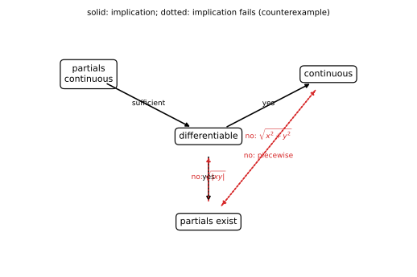
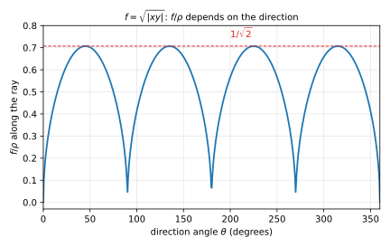
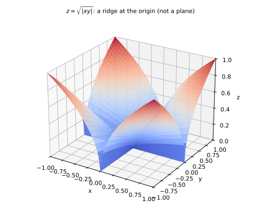

# 第 05 讲：偏导数与全微分

> **前置**：第 04 讲（重极限、连续、路径法）；上册第 09、12 讲（导数的定义、微分的"线性主部"）。
> **本讲解决什么**：一元里"可导 ⇔ 可微 ⇒ 连续"是顺的；到了多元，**"偏导存在"只保证沿两条坐标轴方向的性质**，与"连续""可微"的关系全部要重新排。本讲把三者的强弱链、两个反例、以及动笔写 $dz$ 之前必须做的那一步讲清楚——这是多元微分学最容易栽的地方。

## 一、偏导数

### 1.1 定义

**对 $x$ 的偏导数**（在点 $(x_0,y_0)$）：

$$f_x(x_0,y_0)=\lim_{\Delta x\to0}\frac{f(x_0+\Delta x,\ y_0)-f(x_0,y_0)}{\Delta x},$$

就是**把 $y$ 固定在 $y_0$、把 $f$ 看成 $x$ 的一元函数**再求导。对 $y$ 的偏导同理（固定 $x$）。

**记号**：$\dfrac{\partial z}{\partial x}$、$z_x$、$f_x$ 都表示同一个东西；二阶偏导 $\dfrac{\partial^2 z}{\partial x^2}=z_{xx}$，混合偏导 $\dfrac{\partial^2 z}{\partial x\partial y}=z_{xy}$（先对 $x$、再对 $y$）。

**区分"偏导函数"与"偏导在一点的值"**：$f_x(x,y)$ 是函数（在每点都有值时）；$f_x(x_0,y_0)$ 是一个数。**分段点、原点这类"接缝处"必须回到定义算极限**——不能套求导公式。

### 1.2 几何意义

曲面 $z=f(x,y)$ 被平面 $y=y_0$ 截出一条曲线；**$f_x(x_0,y_0)$ 是这条曲线在点 $(x_0,y_0)$ 处的切线斜率**。同理 $f_y$ 是 $x=x_0$ 截线的切线斜率。

**一句话**：偏导描述的是"**沿坐标轴方向**"的变化率——只有两个方向（$x$ 与 $y$），而平面上的方向有无穷多。这就是后面所有反例的根源。



*图 3：曲面 $z=x^2+y^2$ 被平面 $y=1$（蓝）与 $x=1$（绿）截出两条曲线；$f_x(1,1)$、$f_y(1,1)$ 分别是这两条曲线在 $(1,1)$ 处的切线斜率。偏导只看这两条截面——其它方向一概不管。*

### 1.3 计算

**对 $x$ 求偏导时，把 $y$ 当常数**（反过来也一样）。例：

$$z=x^3y^2+x\ln y\ (y>0):\qquad z_x=3x^2y^2+\ln y,\qquad z_y=2x^3y+\frac{x}{y}.$$

**接缝处用定义**（重要）：$f(x,y)=\sqrt{x^2+y^2}$ 在原点：

$$f_x(0,0)=\lim_{\Delta x\to0}\frac{\sqrt{(\Delta x)^2+0}-0}{\Delta x}=\lim_{\Delta x\to0}\frac{\lvert\Delta x\rvert}{\Delta x},$$

左右极限为 $\pm1$，不存在 ⇒ **$f_x(0,0)$ 不存在**（同理 $f_y$）。注意 $f$ 在原点**连续**（$f\to0$）——**连续不保证偏导存在**，这是一元没有的情形。

### 1.4 高阶偏导与混合偏导

二阶偏导有四个：$f_{xx},\ f_{xy},\ f_{yx},\ f_{yy}$。**混合偏导一般与顺序有关**；但有定理：**若 $f_{xy}$ 与 $f_{yx}$ 在某区域内连续，则在该区域内二者相等**。

- **理解层次**：定理的条件（连续性）**知道有这回事**即可；考试里遇到的初等函数都满足，**正常按任意顺序算**。
- 反例存在（$f=xy\dfrac{x^2-y^2}{x^2+y^2}$ 在原点 $f_{xy}(0,0)\ne f_{yx}(0,0)$）——**不要求记**。

## 二、全微分：比"偏导存在"多要求了什么

### 2.1 一元回顾

上册第 12 讲：$y=f(x)$ 在 $x_0$ 可微 $\iff$

$$\Delta y=f'(x_0)\Delta x+o(\Delta x).$$

**"可微"= 增量能被"线性主部 + 高阶小量"表示**。

### 2.2 二元可微的定义

设 $\rho=\sqrt{(\Delta x)^2+(\Delta y)^2}$（点到原点的距离）。若存在**与 $\Delta x,\Delta y$ 无关**的常数 $A,B$，使得

$$\Delta z=f(x_0+\Delta x,y_0+\Delta y)-f(x_0,y_0)=A\Delta x+B\Delta y+o(\rho),$$

则称 $f$ 在 $(x_0,y_0)$ **可微**；$A\Delta x+B\Delta y$ 叫**全微分**，记 $dz$。

**几何直观（这句话是本讲的中心）**：把 $\Delta z\approx A\Delta x+B\Delta y$ 写成函数形式，就是

$$z\approx f(x_0,y_0)+A(x-x_0)+B(y-y_0)\qquad(\text{误差}=o(\rho)).$$

右边是一个**平面**（对 $x,y$ 都是一次式）。所以：**可微 = 曲面在 $(x_0,y_0)$ 附近能用一个平面逼近，且误差比"到该点的距离"更快趋于零**。偏导存在只保证"两条坐标轴方向上的切线斜率存在"，但不保证存在一个统一的平面能把四周都贴住——这就是可微比偏导强的几何含义。（这个逼近平面在第 07 讲会被正式命名为**切平面**。）



*图 4：曲面 $z=x^2+y^2$ 在 $(1,1,2)$ 附近与逼近平面 $z=2+2(x-1)+2(y-1)$ 的贴合（网格已加密）；可微要求整个邻域内误差都是 $o(\rho)$，而不只是沿两条轴。*

**先确认 $A,B$ 是什么**：取 $\Delta y=0$，则 $\rho=\lvert\Delta x\rvert$，条件变成 $\Delta z=A\Delta x+o(\Delta x)$ ⇒ $A=f_x$；同理 $B=f_y$。所以**可微时**

$$dz=f_x\,dx+f_y\,dy.$$

**"可微"到底比"偏导存在"多要了什么**（关键辨析）：$o(\rho)$ 是**关于"距离"的高阶**——它要求**不论从哪个方向、沿哪条路径**，误差都比"到原点的距离"更快趋于 $0$。而偏导只检查了 $\Delta x$ 方向与 $\Delta y$ 方向**两条线**。

> **两个写法不能混**：$o(\rho)$ **不是** "$o(\Delta x)+o(\Delta y)$"。$o(\rho)$ 更强：它自动管住所有方向。

### 2.3 强弱关系（本讲的核心）

**先给结论表**（证明见下）：

| 关系 | 是否成立 | 反例/依据 |
|---|---|---|
| 可微 ⇒ 连续 | **成立** | $\Delta z=o(\rho)\to0$ |
| 可微 ⇒ 偏导存在 | **成立** | 取 $\Delta y=0$ 得 $A=f_x$ |
| 偏导连续 ⇒ 可微 | **成立**（充分，非必要） | 两次中值定理（见下） |
| 连续 ⇒ 偏导存在 | **不成立** | $\sqrt{x^2+y^2}$ 在原点（§1.3） |
| 偏导存在 ⇒ 连续 | **不成立** | §2.5 反例（$xy=0$ 时取 1、否则取 0） |
| 偏导存在 ⇒ 可微 | **不成立** | $\sqrt{\lvert xy\rvert}$ 在原点（§2.4） |



*图 1：实线是"⇒"；虚线方向都有反例。注意"偏导存在"与"连续"互不蕴含。*

**补上两条"⇒"的推导**（表格里的前两行不是一句话就算数的）：

- **可微 ⇒ 连续**：由 $\Delta z=A\Delta x+B\Delta y+o(\rho)$，注意 $\lvert\Delta x\rvert\le\rho$、$\lvert\Delta y\rvert\le\rho$，所以 $\lvert A\Delta x+B\Delta y\rvert\le(\lvert A\rvert+\lvert B\rvert)\rho\to0$，且 $o(\rho)\to0$ ⇒ $\Delta z\to0$ ⇒ 连续。
- **可微 ⇒ 偏导存在**：取 $\Delta y=0$，则 $\rho=\lvert\Delta x\rvert$，$\Delta z=A\Delta x+o(\lvert\Delta x\rvert)$，除以 $\Delta x$ 取极限：$\dfrac{\Delta z}{\Delta x}=A+\dfrac{o(\lvert\Delta x\rvert)}{\Delta x}\to A$ ⇒ $f_x(x_0,y_0)=A$。同理 $f_y=B$。

**证明"偏导连续 ⇒ 可微"**（三段，考试可写）：

$$\Delta z=\underbrace{\big[f(x+\Delta x,y+\Delta y)-f(x,y+\Delta y)\big]}_{①}+\underbrace{\big[f(x,y+\Delta y)-f(x,y)\big]}_{②}.$$

对 ① 用一元拉格朗日中值定理（固定 $y+\Delta y$，关于 $x$）：$①=f_x(\xi,y+\Delta y)\Delta x$；对 ②：$②=f_y(x,\eta)\Delta y$。再由 $f_x,f_y$ 连续：$f_x(\xi,y+\Delta y)=f_x(x,y)+\alpha$、$f_y(x,\eta)=f_y(x,y)+\beta$，其中 $\alpha,\beta\to0$（当 $\Delta x,\Delta y\to0$）。于是

$$\Delta z=f_x(x,y)\Delta x+f_y(x,y)\Delta y+\alpha\Delta x+\beta\Delta y,$$

而 $\lvert\alpha\Delta x+\beta\Delta y\rvert\le(\lvert\alpha\rvert+\lvert\beta\rvert)\rho=o(\rho)$ ⇒ 可微 ✓。

### 2.4 反例：偏导存在、连续，但**不可微**

$f(x,y)=\sqrt{\lvert xy\rvert}$（在原点）。

- **偏导**：$f_x(0,0)=\lim_{\Delta x\to0}\dfrac{\sqrt{\lvert\Delta x\cdot0\rvert}-0}{\Delta x}=0$；同理 $f_y(0,0)=0$。
- **连续**：$\sqrt{\lvert xy\rvert}\le\sqrt{\frac{x^2+y^2}{2}}\to0$ ✓。
- **可微？** 需要 $\sqrt{\lvert\Delta x\Delta y\rvert}=o(\rho)$。沿 $\Delta x=\Delta y=t$：

$$\frac{\sqrt{\lvert t^2\rvert}}{\sqrt{2t^2}}=\frac1{\sqrt2}\quad(\text{常数}),$$

**不是**趋于 $0$ 的量 ⇒ 条件不成立 ⇒ **不可微**。



*图 2：沿 $y=x$ 方向，$f/\rho$ 恒为 $1/\sqrt2$；沿坐标轴方向则是 $0$——不同方向不一致，正是"不可微"的数值形态。*



*图 5：$z=\sqrt{\lvert xy\rvert}$ 的曲面——四片沿坐标轴"翻起"，原点是一个指向的"脊"。它不是一张平滑的曲面，当然无法被一张平面在原点附近逼住：沿两条轴看它"平"，沿 $y=x$ 看它"尖"。*

**这个反例说明**：偏导存在**还不够**；可微要求“所有方向一致地线性逼近”，而偏导只检查了两条坐标轴。

### 2.5 反例：偏导存在但**不连续**

$$f(x,y)=\begin{cases}1,&xy=0\\0,&xy\ne0\end{cases}$$

- 偏导：沿 $x$ 轴（$y=0$）$f\equiv1$ ⇒ $f_x(0,0)=0$；沿 $y$ 轴同理 $f_y(0,0)=0$；
- 连续？沿 $y=x$ 趋近：$f=0\to0$，而 $f(0,0)=1$ ⇒ **不连续**。

**结论**：偏导只沿两条轴看，**完全可能"两条轴上都平"，而斜线上跳**。

### 2.6 考试动作（写 $dz$ 之前的检查）

1. 对**初等函数**（多项式、三角、指数、对数、复合）：偏导在定义域内连续 ⇒ **一定可微** ⇒ 直接写 $dz=f_xdx+f_ydy$；
2. 对**分段函数**、**接缝点**（原点、分界线）：先按定义验偏导，再用 $o(\rho)$ 判可微，**不许直接套**；
3. 题目问"是否可微"时，标准答法是：**写出 $\Delta z-A\Delta x-B\Delta y$，看它是不是 $o(\rho)$**；反例用一条路径把比值压成非零常数。

## 三、例题

**例 1**：$z=x^3y^2+x\ln y$（$y>0$）：求 $z_x,z_y,z_{xy}$。

**解**：$z_x=3x^2y^2+\ln y$；$z_y=2x^3y+\dfrac xy$；$z_{xy}=\dfrac{\partial}{\partial y}\big(3x^2y^2+\ln y\big)=6x^2y+\dfrac1y$。

**例 2**：$f=\sqrt{x^2+y^2}$ 在原点：偏导是否存在？是否连续？

**解**：$f$ 连续（$f\to0$）；$f_x(0,0)=\lim\frac{\lvert\Delta x\rvert}{\Delta x}$ 不存在（左右为 $\pm1$），$f_y$ 同理 ⇒ **偏导不存在**。

**例 3**：$f=\sqrt{\lvert xy\rvert}$ 在原点：偏导是否存在？是否可微？

**解**：偏导均为 $0$（§2.4）；沿 $\Delta x=\Delta y=t$，$f/\rho=1/\sqrt2$ ⇒ 不是 $o(\rho)$ ⇒ **不可微**。

**例 4**：$z=e^x\sin y$：求 $dz$。

**解**：$z_x=e^x\sin y$、$z_y=e^x\cos y$，均为初等函数、连续 ⇒ 可微 ⇒ $dz=e^x\sin y\,dx+e^x\cos y\,dy$。

## 四、数值核对

用脚本核对偏导数值、强弱链的两个反例（`scripts/lec05-02_verify_partial.py`，全脚本 0.00 秒）：

```
=== EXP1: z = x^3 y^2 + x ln y at (1,2) ===
  z_x: num = 12.6931471809, formula = 12.6931471806, diff = 3.71e-10
  z_y: num = 4.5000000000, formula = 4.5000000000, diff = 7.28e-12
  z_xy: num = 12.4999999240, formula = 12.5000000000, diff = 7.60e-08

=== EXP2: sqrt(|xy|) at the origin ===
  t=0.01: f/rho along y=x = 0.7071067812 (1/sqrt(2) = 0.7071067812)
  t=0.0001: f/rho along y=x = 0.7071067812 (1/sqrt(2) = 0.7071067812)
  t=1e-06: f/rho along y=x = 0.7071067812 (1/sqrt(2) = 0.7071067812)
  axis partial at t=0.01: f_x = 0.00e+00 (0)
  axis partial at t=0.0001: f_x = 0.00e+00 (0)

=== EXP3: piecewise f (1 on axes, 0 otherwise) ===
  f_x(0,0) = 0.00e+00, f_y(0,0) = 0.00e+00 (both 0)
  f(1e-3,1e-3) = 0, f(0,0) = 1 -> discontinuous

=== EXP4: z = e^x sin y at (0.5,0.5) ===
  z_x: num = 0.7904390832, exact = 0.7904390832, diff = 6.68e-12
  z_y: num = 1.4468890366, exact = 1.4468890366, diff = 2.93e-11
```

**核对点**：例 1 的三个偏导与解析一致（$z_{xy}$ 的差 $7.6\times10^{-8}$ 比两个一阶偏导的差大两个量级——因为它是**两层差分**（先对 $y$ 差分、再对 $x$ 差分），舍入与截断叠加——阈值取 $10^{-6}$ 仍然绰绰有余）；$\sqrt{\lvert xy\rvert}$ 沿 $y=x$ 的比值在三档 $t$ 下都恰为 $1/\sqrt2$（**不趋 $0$**），而沿坐标轴的偏导为 $0$；分段例的两个偏导为 $0$，但 $f(t,t)=0\ne f(0,0)=1$（不连续）；例 4 的两个偏导与解析差在 $10^{-11}$ 级。

## 小结

- **偏导**：固定另一个变量、对一元求导；几何上是**坐标轴方向截面曲线的切线斜率**；接缝点用定义（$\sqrt{x^2+y^2}$ 在原点偏导不存在，但连续）。
- **全微分**：$\Delta z=A\Delta x+B\Delta y+o(\rho)$；可微则 $A=f_x,B=f_y$，$dz=f_xdx+f_ydy$。**$o(\rho)$ 管所有方向**，比"偏导存在"强得多。
- **强弱链**：**偏导连续 ⇒ 可微 ⇒ 连续**；**可微 ⇒ 偏导存在**；反方向都有反例——**连续 ⇏ 偏导存在**（$\sqrt{x^2+y^2}$）、**偏导存在 ⇏ 连续**（$xy=0$ 分段例）、**偏导存在 ⇏ 可微**（$\sqrt{\lvert xy\rvert}$）。
- **写 $dz$ 前**：初等函数直接写；分段/接缝点先验偏导、再判 $o(\rho)$。
- **混合偏导**：$f_{xy},f_{yx}$ 连续时相等（考试函数默认满足，可任意顺序）。

## 作业

**说明**：答案平铺在每题下方（先做再对照）。只用上册与本讲已教内容。

**1.** 求 $z=x^2y^3+\sin x$ 的 $z_x,z_y$。

**参考答案**：
$z_x=2xy^3+\cos x$；$z_y=3x^2y^2$。

**2.** 求 $z=x^2e^y$ 的 $z_{xx},z_{xy},z_{yx},z_{yy}$。

**参考答案**：
$z_x=2xe^y$、$z_y=x^2e^y$；$z_{xx}=2e^y$；$z_{xy}=2xe^y$；$z_{yx}=2xe^y$；$z_{yy}=x^2e^y$（两个混合偏导相等——初等函数）。

**3.** 用**定义**求 $f(x,y)=x^2y+y^3$ 在 $(1,1)$ 处的 $f_x,f_y$，再用公式核对。

**参考答案**：
定义法：$f(1+h,1)=(1+h)^2\cdot1+1=2+2h+h^2$ ⇒ 差为 $2h+h^2$，除以 $h$ 后极限 $=2$；$f(1,1+h)=1\cdot(1+h)+(1+h)^3=2+4h+3h^2+h^3$ ⇒ 差为 $4h+3h^2+h^3$，除以 $h$ 后极限 $=4$。
公式核对：$f_x=2xy\Rightarrow f_x(1,1)=2$；$f_y=x^2+3y^2\Rightarrow f_y(1,1)=4$ ✓。

**4.** 判断 $f=\sqrt{x^2+y^2}$ 在原点是否连续、偏导是否存在。

**参考答案**：
连续（$f\to0$）；偏导不存在（$f_x=\lim\frac{\lvert\Delta x\rvert}{\Delta x}$ 左右为 $\pm1$）。

**5.** 证明 $\sqrt{\lvert xy\rvert}$ 在原点偏导存在但不可微。

**参考答案**：
偏导：沿 $y=0$，$f\equiv0$ ⇒ $f_x(0,0)=0$；同理 $f_y=0$。可微性：需 $\sqrt{\lvert\Delta x\Delta y\rvert}=o(\rho)$；取 $\Delta x=\Delta y=t$：比值 $\frac{\lvert t\rvert}{\sqrt2\lvert t\rvert}=\frac1{\sqrt2}\ne0$ ⇒ 不成立 ⇒ 不可微。$\blacksquare$

**6.** 讨论 $f(x,y)=\begin{cases}1,&xy=0\\0,&xy\ne0\end{cases}$ 在原点的连续性与两个偏导。

**参考答案**：
$f_x(0,0)=0$（沿 $x$ 轴恒为 1）、$f_y(0,0)=0$；但沿 $y=x$ 趋于 $(0,0)$ 时 $f\equiv0\to0\ne f(0,0)=1$ ⇒ **不连续**。$\blacksquare$

**7.**（综合）设 $z=\ln(x^2+y^2)$（$x^2+y^2>0$）：(1) 求 $z_x,z_y$；(2) 说明它在定义域内可微并写出 $dz$；(3) 求 $z_{xx}+z_{yy}$。

**参考答案**：
(1) $z_x=\dfrac{2x}{x^2+y^2}$，$z_y=\dfrac{2y}{x^2+y^2}$。
(2) 偏导为初等函数、在定义域内连续 ⇒ 可微；$dz=\dfrac{2x\,dx+2y\,dy}{x^2+y^2}$。
(3) $z_{xx}=\dfrac{2(y^2-x^2)}{(x^2+y^2)^2}$、$z_{yy}=\dfrac{2(x^2-y^2)}{(x^2+y^2)^2}$ ⇒ 和为 $0$（这个函数在 21 讲拉普拉斯方程里会再出现）。
