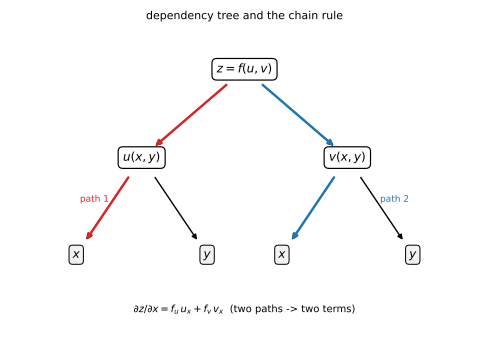
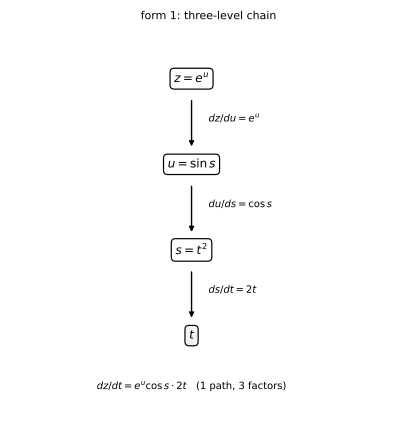
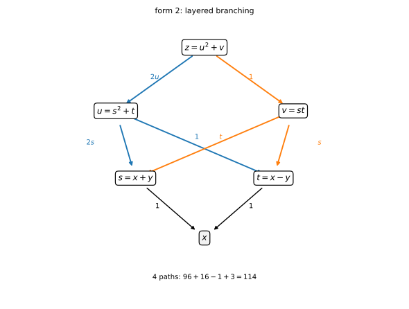
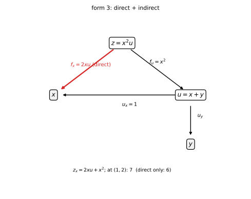
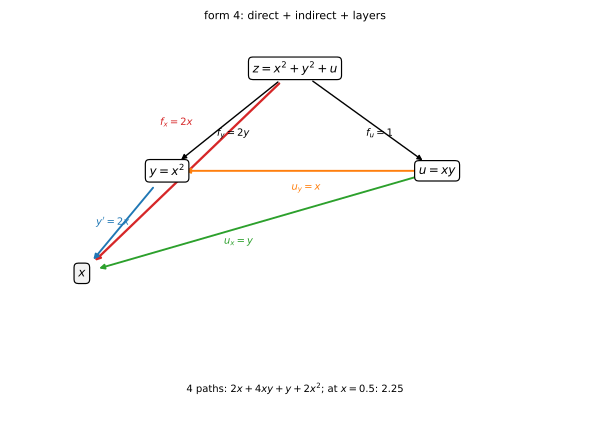
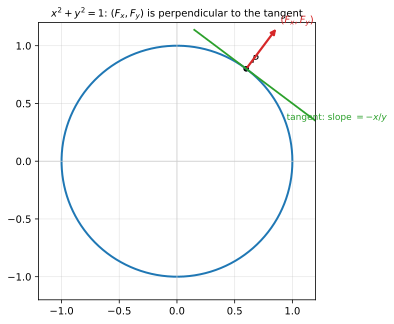
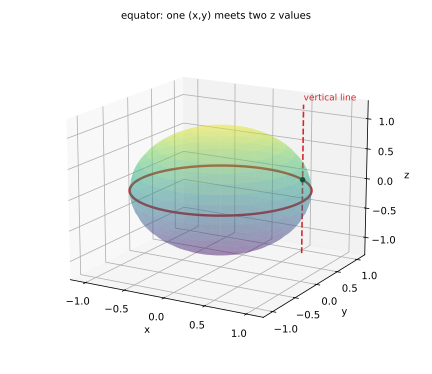

# 第 06 讲：复合函数与隐函数求导

> **前置**：第 05 讲（偏导、全微分）；上册第 10 讲（一元链式法则）、第 11 讲（隐函数求导）。
> **本讲解决什么**：多元复合函数的导数公式不是"再背一个公式"——它的**项数由变量依赖关系决定**：从 $z$ 到 $x$ 有几条路径，就有几项。本讲先立"依赖树 + 两条操作规则"（乘路径、加同目标），再讲**全导数**（中间变量全是一元时的情形）、**全微分形式不变性**，最后讲隐函数：一个方程确定 $z=z(x,y)$ 时的 $z_x,z_y$ 怎么来、公式与"直接两边求导"两条路、以及 $F_z\ne0$ 这个条件的重要性。

## 一、复合函数的依赖结构

**典型结构**：$z=f(u,v)$，其中 $u=u(x,y)$、$v=v(x,y)$。于是 $z$ 通过 $u,v$ 依赖于 $x,y$。

**链式法则**（对 $x$ 求偏导）：

$$
\frac{\partial z}{\partial x}=\frac{\partial f}{\partial u}\cdot\frac{\partial u}{\partial x}+\frac{\partial f}{\partial v}\cdot\frac{\partial v}{\partial x}.
$$

**两条操作规则（考试动作）**：

1. **每条从 $z$ 到 $x$ 的路径**：链上的偏导**相乘**；
2. **所有到达同一目标的路径相加**——**项数 = 路径条数**（这里两条：$z\to u\to x$ 与 $z\to v\to x$）。



*图 1：$z=f(u,v),u=u(x,y),v=v(x,y)$ 的依赖树；到 $x$ 有两条路径，所以 $\partial z/\partial x$ 是两项相加。*

**记号提醒（最容易混的一处）**：$f_u=\partial f/\partial u$ 是"对第一个位置变量求偏导"；而 $z_x$ 是"复合后对 $x$ 求偏导"。**当 $z=f(u,v)$ 且 $u,v$ 依赖于 $x$ 时，$z_x\ne f_x$**（$f_x$ 通常指对第一个位置求导，此时应为 $f_u$）。写答案时用 $f_u,f_v$ 这类"对位置"的记号，避免歧义。

**为什么是这两项（用全微分走一遍，这比背"路径数"更能说明问题）**：由 05 讲，$z=f(u,v)$ 可微时 $dz=f_u\,du+f_v\,dv$；而 $u=u(x,y)$、$v=v(x,y)$ 可微时 $du=u_xdx+u_ydy$、$dv=v_xdx+v_ydy$。代入并归并同类项：

$$
dz=f_u(u_xdx+u_ydy)+f_v(v_xdx+v_ydy)=\underbrace{(f_uu_x+f_vv_x)}_{z_x}dx+\underbrace{(f_uu_y+f_vv_y)}_{z_y}dy.
$$

另一方面，$z$ 作为 $(x,y)$ 的函数也有全微分 $dz=z_xdx+z_ydy$——**比较 $dx,dy$ 的系数**就得到链式法则。所以"**路径数 = 项数**"只是"**每个中间变量各贡献一项**"的记账说法；两项的来源是 $u,v$ 两个中间变量，而不是某种规则。

## 二、链式法则的几种形态

### 2.1 中间变量是二元函数（默认形态）

$$
z=f(u,v),\quad u=u(x,y),\quad v=v(x,y):\qquad z_x=f_u u_x+f_v v_x,\quad z_y=f_u u_y+f_v v_y.
$$

**例 1**：$z=f(u,v)$、$u=x+y$、$v=xy$：$u_x=1,u_y=1,v_x=y,v_y=x$ ⇒

$$
z_x=f_u+y f_v,\qquad z_y=f_u+x f_v.
$$

### 2.2 多层链、多路径、变量出现在多层

前面的例子（$z=f(u,v)$、$u=x+y$、$v=xy$）只有两层、两个中间变量。真实题目（尤其考试压轴）常把层数加深，或者让同一个变量同时出现在多个位置。**规则一个字都不用改**：还是"每条路径相乘、同一目标相加"；变复杂的是**树上有多少条路径**。

符号（$f_u$、$u_x$ 这些）容易看不出谁对谁。所以这一节**每个形态都配一个具体函数，逐项算到底**；算完再把具体数字换回符号，抽象公式就有落点。

#### 形态一：三层链（单一通路）

$z=e^u$、$u=\sin s$、$s=t^2$，求 $\dfrac{dz}{dt}$。

先把每一层的导数单独写出来：

- 最外层（对 $u$）：$\dfrac{dz}{du}=e^u$；
- 中间层（对 $s$）：$\dfrac{du}{ds}=\cos s$；
- 最内层（对 $t$）：$\dfrac{ds}{dt}=2t$。

从 $z$ 到 $t$ 只有一条路，三个因子相乘：

$$
\frac{dz}{dt}=e^u\cos s\cdot2t=e^{\sin(t^2)}\cos(t^2)\cdot2t.
$$

在 $t=0.7$ 出数：$t^2=0.49$，$e^{\sin0.49}\approx1.601$，$\cos0.49\approx0.882$，$2t=1.4$，乘积 $\approx1.978$（脚本 EXP5 实测 $1.9776558344$）。

**换回符号**：$z=f(u)$、$u=g(s)$、$s=s(t)$ 时就是 $\dfrac{dz}{dt}=f'(u)g'(s)s'(t)$——三个因子正好对应三层。



*图 4：形态一的三层链——一条路、三个因子；每条边上标的是该层自己的导数。*

#### 形态二：多层 + 分叉

$z=u^2+v$、$u=s^2+t$、$v=st$、$s=x+y$、$t=x-y$，求 $z_x$（在 $(x,y)=(1,2)$）。

先算**每一个单步偏导**：

- 对 $z$：$\dfrac{\partial z}{\partial u}=2u$，$\dfrac{\partial z}{\partial v}=1$；
- 对 $u$：$u_s=2s$，$u_t=1$；
- 对 $v$：$v_s=t$，$v_t=s$；
- 对 $s,t$：$s_x=1$，$t_x=1$。

从 $z$ 到 $x$ 有四条路，**逐条乘出来**：

1. $z\to u\to s\to x$：$2u\cdot2s\cdot1$；
2. $z\to u\to t\to x$：$2u\cdot1\cdot1$；
3. $z\to v\to s\to x$：$1\cdot t\cdot1$；
4. $z\to v\to t\to x$：$1\cdot s\cdot1$。

在 $(x,y)=(1,2)$：$s=3$、$t=-1$、$u=3^2+(-1)=8$、$v=3\cdot(-1)=-3$。逐条出数：

1. $2\cdot8\cdot(2\cdot3)\cdot1=96$；
2. $2\cdot8\cdot1\cdot1=16$；
3. $1\cdot(-1)\cdot1=-1$；
4. $1\cdot3\cdot1=3$。

相加：$96+16-1+3=114$。（脚本 EXP8 的差分也是 $114$。）

**换回符号**：$z_x=z_u(u_ss_x+u_tt_x)+z_v(v_ss_x+v_tt_x)$——两个括号分别是"经 $u$"和"经 $v$"的两组子路径。



*图 5：形态二的分层分叉——蓝线是经 $u$ 的两条子路，橙线是经 $v$ 的两条；边上数字是每一步的偏导，四条路相乘后相加。*

#### 形态三：变量同时出现在多个层（直接 + 间接）

$z=x^2u$、$u=x+y$，求 $z_x$（在 $(1,2)$）。

- **直接项**：把 $u$ 固定，$z$ 对第一个位置 $x$ 求偏导：$f_x=2xu$；
- **间接项**：$z$ 先对 $u$ 求偏导 $f_u=x^2$，再乘 $u$ 对 $x$ 的导数 $u_x=1$：$f_uu_x=x^2$。

两条路相加：

$$
z_x=2xu+x^2.
$$

在 $(1,2)$：$u=3$，$z_x=2\cdot1\cdot3+1=7$。**只算直接项会得到 $6$——少的就是经 $u$ 的那条路**（脚本 EXP6 把这 $1.0$ 的差打了出来）。

**换回符号**：$z=f(x,u)$、$u=u(x,y)$ 时 $z_x=f_x+f_uu_x$。**$f_x$ 只是直连项，$z_x$ 才是总和**。



*图 6：形态三——$z$ 到 $x$ 有直连（红，$f_x$）与经 $u$（$u_x$）两条路；$(1,2)$ 处总导数 $7$，只算直连得 $6$。*

#### 形态四：直接 + 间接 + 多层（综合）

$z=x^2+y^2+u$、$u=xy$、$y=x^2$，求 $z_x$（在 $x=0.5$）。

先算所有单步偏导：

- 对 $z$：$f_x=2x$，$f_y=2y$，$f_u=1$；
- 对 $u$：$u_x=y$，$u_y=x$；
- 对 $y$：$y'=2x$。

四条路逐条：

1. $z\to x$（直连）：$2x$；
2. $z\to y\to x$：$2y\cdot2x=4xy$；
3. $z\to u\to x$：$1\cdot y=y$；
4. $z\to u\to y\to x$：$1\cdot x\cdot2x=2x^2$。

相加：

$$
z_x=2x+4xy+y+2x^2.
$$

在 $x=0.5$（此时 $y=0.25$）：$1+0.5+0.25+0.5=2.25$。

**核对**：先代入再求导，$z=x^2+x^4+x^3$ ⇒ $z_x=2x+4x^3+3x^2$，$x=0.5$ 也是 $1+0.5+0.75=2.25$ ✓（脚本 EXP7 三种算法都出 $2.25$）。

**换回符号**：$z_x=f_x+f_yh'(x)+f_u\big(g_x+g_yh'(x)\big)$。括号里是 $u$ 对 $x$ 的总导数——**内层自己也可以有直连和间接**。



*图 7：形态四——四条路：$z\to x$（红）、$z\to y\to x$（蓝）、$z\to u\to x$（绿）、$z\to u\to y\to x$（橙）；每条边上标对应的单步偏导。*

#### 操作动作：画树 → 数路 → 相乘 → 相加

1. **画树**：每个变量一个节点；**同一个符号在不同位置各算一个节点**（$z=f(x,u)$ 里两个 $x$ 分开画）。
2. **数路径**：从 $z$ 到目标变量，所有向下的路径，**包括直连边**。
3. **每条路径相乘**：经过几个箭头就乘几个偏导。
4. **全部相加**；换一个目标变量重做。
5. **自检**：项数 = 路径数；有没有"同名变量的第二条路"被漏掉。

### 2.3 二阶链式：$f_u$ 本身也是复合函数（本讲最大的坑）

对 $z=f(u,v)$、$u=x+y$、$v=xy$ 再求一次 $z_{xx}$：由上一节已得 $z_x=f_u(u,v)+y f_v(u,v)$。**$f_u$ 与 $f_v$ 都还是 $u,v$ 的函数**，对 $x$ 求导时**同样要走链式法则**：

$$
\frac{\partial}{\partial x}f_u=f_{uu}u_x+f_{uv}v_x=f_{uu}+y f_{uv},\qquad \frac{\partial}{\partial x}f_v=f_{vu}+y f_{vv}.
$$

于是

$$
z_{xx}=f_{uu}+2y f_{uv}+y^2 f_{vv}.
$$

**如果漏掉"$f_u$ 也是复合函数"**，就会写成 $f_{uu}+yf_{vv}$ 之类——**这是二阶链式最常见的错误**。

### 2.4 全导数：中间变量全是一元

若 $z=f(u,v)$、$u=u(t)$、$v=v(t)$（**只有一个自变量 $t$**），则 $z$ 最终只是 $t$ 的一元函数，用**全导数**记号：

$$
\frac{dz}{dt}=f_u\frac{du}{dt}+f_v\frac{dv}{dt}.
$$

**例 2**：$z=u^2v$、$u=\sin t$、$v=\cos t$：

$$
\frac{dz}{dt}=2uv\cdot\cos t+u^2\cdot(-\sin t)=2\sin t\cos^2t-\sin^3t.
$$

**辨析**：这里的 $\dfrac{dz}{dt}$ 是**全导数**（$z$ 最终只有一个自变量）；若 $u,v$ 还依赖于其他变量，对 $t$ 求就只能是"偏导"——**记号的选择反映"有几个独立自变量"**。

### 2.5 一阶全微分的形式不变性

无论 $u,v$ 是自变量还是中间变量，

$$
dz=f_u\,du+f_v\,dv
$$

**形式相同**（这叫**一阶全微分形式不变性**）。**用处**：求全微分时不必先判断变量层次，直接按"$f$ 的全微分"写，再把 $du,dv$ 展开即可。**注意**：这条只对**一阶**成立（二阶没有这个性质）。

## 三、隐函数求导

### 3.1 一个方程，一个隐函数：$F(x,y)=0$

**做法一（直接两边求导，推荐）**：把 $y$ 看成 $x$ 的函数，两边对 $x$ 求导，解出 $y'$。

**例 3**：$x^2+y^2=1$：$2x+2y\,y'=0$ ⇒

$$
y'=-\frac{x}{y}\qquad(y\ne0).
$$

**做法二（公式）**：对 $F(x,y)=0$ 两边求全导数：$F_x+F_y y'=0$ ⇒

$$
y'=-\frac{F_x}{F_y}\qquad(F_y\ne0).
$$

两条路结果相同——**公式是"直接求导"整理出来的**，不是另一条原理。

**几何意义（为什么 $y'=-F_x/F_y$ 就是切线斜率）**：把曲线 $F(x,y)=0$ 参数化为 $\big(x(t),y(t)\big)$，取参数使 $x'(t)=1$、于是 $y'(t)=y'$。沿曲线 $F\equiv0$，对 $t$ 求导（链式法则）：$F_xx'+F_yy'=0$ ⇒ $y'=-F_x/F_y$。

**读法**：向量 $(F_x,F_y)$ 与切向量 $(1,y')$ 的点积为零 ⇒ **$(F_x,F_y)$ 垂直于曲线**；$y'$ 就是切线的斜率。

（向量 $(F_x,F_y)$ 就是第 08 讲的**梯度**——在这里只需要知道"它垂直于等值线"；图 2 把这件事画了出来。）



*图 2：曲线 $x^2+y^2=1$；在点 $P$ 处，向量 $(F_x,F_y)=(2x,2y)$ 沿半径方向、与切线垂直；$y'=-x/y$ 是切线的斜率。*

### 3.2 三元：$F(x,y,z)=0$ 确定 $z=z(x,y)$

把 $z$ 看成 $x,y$ 的函数，对 $x$ 求偏导（**$y$ 固定，但 $z$ 随 $x$ 变**）：

$$
F_x+F_z\,z_x=0\ \Longrightarrow\ z_x=-\frac{F_x}{F_z};\qquad z_y=-\frac{F_y}{F_z}\qquad(F_z\ne0).
$$

**例 4**：$x^2+y^2+z^2=1$ 确定 $z=z(x,y)$（取 $z\ne0$ 的那一支）：

$$
z_x=-\frac{2x}{2z}=-\frac xz,\qquad z_y=-\frac yz.
$$

**注意这一支的适用条件**：$z\ne0$。在 $z=0$（赤道）处 $F_z=2z=0$，公式失效——**几何上**，那里曲面与竖直方向相切，无法在 $(x,y)$ 的邻域内写成单值的 $z(x,y)$（上半球与下半球在赤道"对接"，一个 $(x,y)$ 对应两个 $z$）。



*图 3：球面 $x^2+y^2+z^2=1$。赤道 $z=0$ 处，竖直方向的直线与球面相切（上下两半球在那里对接）——固定的 $(x,y)$ 对应两个 $z$，不能写成单值 $z(x,y)$；$F_z=2z=0$ 正是这一点。*

### 3.3 隐函数存在条件（简介）

$F$ 在点 $P_0$ 附近连续且有连续偏导、$F(P_0)=0$、**$F_z(P_0)\ne0$** ⇒ 在 $P_0$ 的某邻域内，$F(x,y,z)=0$ 唯一确定一个连续可微的 $z=z(x,y)$。

- **理解层次**：知道 $F_z\ne0$ 是"能解出 $z$"的条件即可；定理的证明不属本课程。
- **边界实例**：$z^2=x^2+y^2$（双锥）在原点：$F_z=2z=0$——原点附近一个 $(x,y)\ne(0,0)$ 对应两个 $z$（上下两个锥），**不能**写成单值函数；远离原点（$z\ne0$）则可以。

### 3.4 隐函数的二阶导

**例 5**：$x^2+y^2=1$，求 $y''$。由 $y'=-\dfrac xy$：

$$
y''=-\frac{1\cdot y-x y'}{y^2}=-\frac{y-x\left(-\frac xy\right)}{y^2}=-\frac{y^2+x^2}{y^3}=-\frac1{y^3}
$$

（最后一步用了 $x^2+y^2=1$）。**要点**：求二阶导时把 $y'$ 的表达式代回去，并**用原方程化简**。

## 四、例题

**例 6**：$z=f(u,v)$、$u=x^2y$、$v=x+y$：求 $z_x,z_y$。

**解**：$u_x=2xy$、$u_y=x^2$、$v_x=1$、$v_y=1$ ⇒

$$
z_x=2xy f_u+f_v,\qquad z_y=x^2 f_u+f_v.
$$

**例 7**：$z=f(x^2+y^2)$（单变量复合）：求 $z_x,z_y$。

**解**：令 $u=x^2+y^2$，$z=f(u)$：$z_x=f'(u)\cdot2x$、$z_y=f'(u)\cdot2y$。

**例 8**：$xyz-\sin z=0$ 确定 $z=z(x,y)$：求 $z_x$（在 $F_z\ne0$ 处）。

**解**：$F_x=yz$、$F_z=xy-\cos z$ ⇒ $z_x=-\dfrac{yz}{xy-\cos z}$（要求 $xy\ne\cos z$）。

**例 9**（再练一题：直接 + 间接 + 多层）：$z=xy+u^2$、$u=x+y$、$y=x^2$：求 $z_x$，并在 $x=0.5$ 核对。

**解**：单步偏导 $f_x=y$、$f_y=x$、$f_u=2u$、$u_x=1$、$u_y=1$、$y'=2x$。四条路逐条：

- $z\to x$：$f_x=y$；
- $z\to y\to x$：$f_y\,y'=x\cdot2x=2x^2$；
- $z\to u\to x$：$f_u\,u_x=2u$；
- $z\to u\to y\to x$：$f_u\,u_y\,y'=2u\cdot1\cdot2x=4ux$。

$$
z_x=y+2x^2+2u+4ux.
$$

在 $x=0.5$（此时 $y=0.25$、$u=0.75$）：$0.25+0.5+1.5+1.5=3.75$。

**核对**：先代入再求导：$z=x\cdot x^2+(x+x^2)^2=x^2+3x^3+x^4$ ⇒ $z_x=2x+9x^2+4x^3$，在 $x=0.5$ 也是 $1+2.25+0.5=3.75$ ✓（脚本 EXP9）。

## 五、数值核对

用脚本核对链式法则、全导数与隐函数（`scripts/lec06-02_verify_chain.py`，全脚本 0.00 秒）：

```
=== EXP1: z = u^2 v, u = x+y, v = xy at (1,2) ===
  z_x: num = 30.00000000, formula = 30
  z_y: num = 21.00000000, formula = 21
  z_xx: num = 28.00000000, formula = 28

=== EXP2: z = u^2 v, u = sin t, v = cos t at t = 0.7 ===
  dz/dt: num = 0.4863526031, exact = 0.4863526032, diff = 9.76e-11

=== EXP3: x^2+y^2+z^2=1, point (0.6, 0), z = 0.8 ===
  z_x: num = -0.7500000001, exact = -0.75
  z_y: num = 0.0000000000, exact = 0

=== EXP4: x^2+y^2=1 at (0.6,0.8) ===
  y': num = -0.7500000001, exact = -0.75
  y'': num = -1.9531279088, exact = -1/0.8^3 = -1.9531250000

=== EXP5: three-level chain z = exp(sin(t^2)) at t = 0.7 ===
  dz/dt: num = 1.9776558344, exact = 1.9776558345, diff = 5.16e-11

=== EXP6: direct + indirect z = x^2 u, u = x+y at (1,2) ===
  z_x: num = 7.0000000001, f_x + f_u u_x = 7.0
  if the indirect term f_u u_x is dropped: f_x = 6.0  (wrong by 1.0)

=== EXP7: combined z = x^2+y^2+u, u = xy, y = x^2 at x = 0.5 ===
  z_x: num = 2.2500000003, chain formula = 2.2500, direct substitution = 2.2500

=== EXP8: layered branching at (x,y) = (1,2) ===
  z_x: num = 114.0000000014, exact = 114

=== EXP9: Sec.4 example z = xy + u^2, u = x+y, y = x^2 at x = 0.5 ===
  z_x: num = 3.7500000005, chain = 3.7500, direct substitution = 3.7500
```

**核对点**：例 1 的 $z_x,z_y,z_{xx}$ 与解析逐位（$30,21,28$）；例 2 的全导数差 $9.8\times10^{-11}$；例 4 的 $z_x=-0.75,z_y=0$；例 5 的 $y''$ 与解析差 $2.9\times10^{-6}$——**这是二阶差分的截断误差**（步长 $h=10^{-3}$，误差 $\sim h^2=10^{-6}$ 量级），不是公式错；若把 $h$ 缩小到 $10^{-4}$，差会按 $h^2$ 降到 $10^{-8}$ 级（但舍入噪声会开始出现）。

**多层与直接/间接的核对**：EXP5 验证三层链（三个因子逐层相乘）；EXP6 同时给出 $z_x=f_x+f_uu_x=7$ 与“漏掉间接项”的错误值 $f_x=6$——**差 1，就是漏掉的那条路**；EXP7 与例 9 的两种算法（链式公式与直接代入）分别得到 $2.25$（§2.2 形态四）与 $3.75$（例 9）；EXP8 验证四条路径的分层分叉（$114$）。

## 小结

- **链式法则**：**每条路径相乘、同一目标相加**——**项数 = 路径条数**；依赖树是数项数的工具。
- **多层与直接/间接**：层数越深、分叉越多，路径数增长；**变量同时出现在多个层时，直连项与间接项都要算**（$z=f(x,u),u=u(x,y)$ 时 $z_x=f_x+f_uu_x$，其中 $f_x$ 只是直连项）。
- **二阶链式的坑**：$f_u,f_v$ **本身是复合函数**，再求导要走链式（例 1 的 $z_{xx}=f_{uu}+2yf_{uv}+y^2f_{vv}$）。
- **全导数**（中间变量全一元）用 $\dfrac{dz}{dt}$；**偏导**用于多独立变量。
- **一阶全微分形式不变性**：$dz=f_u\,du+f_v\,dv$ 不分层次；**只对一阶成立**。
- **隐函数**：直接两边求导最稳；公式 $z_x=-F_x/F_z$（$F_z\ne0$）；**$F_z=0$ 处公式失效**（$x^2+y^2+z^2=1$ 的赤道、双锥的原点）；二阶导别忘了代回并化简。

## 作业

**说明**：答案平铺在每题下方（先做再对照）。只用上册与本讲已教内容。

**1.** $z=f(u,v)$、$u=x-y$、$v=xy$：求 $z_x,z_y$。

**参考答案**：
$u_x=1,u_y=-1,v_x=y,v_y=x$ ⇒ $z_x=f_u+yf_v$；$z_y=-f_u+xf_v$。

**2.** $z=f(u,v)$、$u=x-y$、$v=xy$：求 $z_{xy}$。

**参考答案**：
$z_x=f_u(u,v)+y f_v(u,v)$；对 $y$ 求：$f_u$ 走链式（$u_y=-1,v_y=x$）、$y f_v$ 用乘积法则：
$z_{xy}=(-f_{uu}+x f_{uv})+f_v+y(-f_{uv}+x f_{vv})=f_v-f_{uu}+(x-y)f_{uv}+xy f_{vv}$。

**3.** $z=u^2+v^2$、$u=\cos t$、$v=\sin t$：求 $\dfrac{dz}{dt}$（并化简）。

**参考答案**：
$\dfrac{dz}{dt}=2u(-\sin t)+2v(\cos t)=-2\cos t\sin t+2\sin t\cos t=0$——这是必然的：$z=u^2+v^2=1$ 恒为常数，导数为 $0$ ✓。

**4.** $z=\ln(x^2+y^2)$：用链式法则求 $z_x,z_y$（与 05 讲作业 7 对照）。

**参考答案**：
令 $u=x^2+y^2$：$z_x=\dfrac{1}{u}\cdot2x=\dfrac{2x}{x^2+y^2}$；$z_y=\dfrac{2y}{x^2+y^2}$ ✓。

**5.** $x^3+y^3-3xy=0$ 确定 $y=y(x)$：求 $y'$（用公式与直接求导两条路）。

**参考答案**：
$F=x^3+y^3-3xy$：$F_x=3x^2-3y$、$F_y=3y^2-3x$ ⇒ $y'=-\dfrac{x^2-y}{y^2-x}$。直接求导：$3x^2+3y^2y'-3(y+xy')=0$ ⇒ $y'(y^2-x)=y-x^2$ ⇒ 同式 ✓。

**6.** $x^2+y^2+z^2=2z$ 确定 $z=z(x,y)$（注意先配方）：求 $z_x,z_y$ 与适用条件。

**参考答案**：
配方：$x^2+y^2+(z-1)^2=1$（球面，球心 $(0,0,1)$）。$F=x^2+y^2+z^2-2z$：$F_x=2x$、$F_y=2y$、$F_z=2z-2$ ⇒ $z_x=-\dfrac{x}{z-1}$、$z_y=-\dfrac{y}{z-1}$；适用条件 $z\ne1$（即不在赤道 $x^2+y^2=1$ 上）。

**7.**（综合）设 $z=f(x,y)$ 由 $F(x,y,z)=0$ 确定，且 $F_z\ne0$：证明 $z_x F_z+F_x=0$ 并解释它的意思。

**参考答案**：
对 $F(x,y,z(x,y))\equiv0$ 两边对 $x$ 求偏导（$y$ 固定）：$F_x+F_z z_x=0$ ⇒ $z_x=-F_x/F_z$。意思：**复合后沿 $x$ 方向的"带 $z$ 变化"的导数必须为零**——这正是链式法则（$z$ 是 $x$ 的函数）的展开；也说明 $F_z\ne0$ 时才能解出 $z_x$。$\blacksquare$

**8.**（三层链）$z=\ln u$、$u=\cos s$、$s=x^2+y^2$：求 $z_x$（用链式法则逐层剥）。

**参考答案**：
$\dfrac{dz}{du}=\dfrac1u$、$\dfrac{du}{ds}=-\sin s$、$\dfrac{ds}{dx}=2x$ ⇒ $z_x=-\dfrac{2x\sin s}{u}=-\dfrac{2x\sin(x^2+y^2)}{\cos(x^2+y^2)}=-2x\tan(x^2+y^2)$。验算：也可先写成 $z=\ln\cos(x^2+y^2)$ 直接求导，结果相同 ✓。

**9.**（直接 + 间接）$z=f(x,u)$、$u=x^2+y$：求 $z_x,z_y$，并指名哪些项是直接、哪些是间接。

**参考答案**：
$z_x=f_x+f_u\cdot2x$（$f_x$ 是直连项，$f_u\cdot2x$ 是经 $u$ 的间接项）；$z_y=f_u\cdot1=f_u$（$y$ 只经 $u$ 进入 $z$，没有直连项）。

**10.**（综合）$z=f(x,y,u)$、$u=x^2y$、$y=\sin x$：写出 $z_x$ 的完整展开。

**参考答案**：
四条路：$z\to x$（$f_x$）、$z\to y\to x$（$f_y\cos x$）、$z\to u\to x$（$f_u\cdot2xy$）、$z\to u\to y\to x$（$f_u\cdot x^2\cos x$）。相加：
$$z_x=f_x+f_y\cos x+f_u\big(2xy+x^2\cos x\big).$$
自检：项数 $4$ = 路径数 $4$ ✓。
