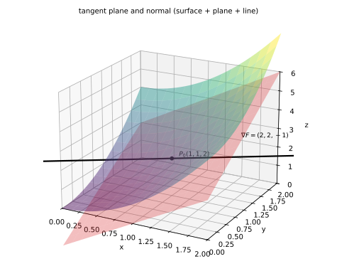
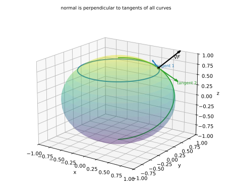
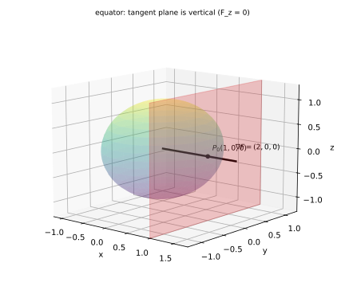
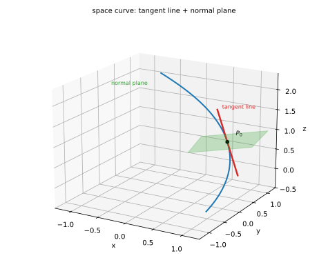
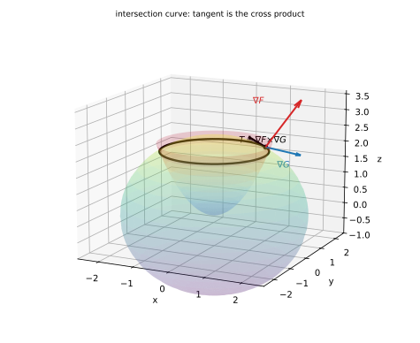

# 第 07 讲：多元微分的几何应用

> **前置**：05（偏导、全微分）、06（链式法则、隐函数）、01（数量积/向量积）、02（平面与直线）。
> **本讲解决什么**：05 讲说"可微 = 曲面在一点附近被一个平面逼近"，那个平面就是**切平面**；06 讲的隐函数公式 $z_x=-F_x/F_z$ 就是切平面的两个斜率。本讲把"导数在空间里的几何身份"一次说清：曲面 $F(x,y,z)=0$ 给出**法向量** $∇F$，由它写切平面与法线；空间曲线给出**切向量**，由它写切线与法平面。

## 一、曲面 $F(x,y,z)=0$：切平面与法线

### 1.1 法向量为什么是 $∇F$

**问题**：曲面是弯的，凭什么在一点有一个"贴住它"的平面？先把"贴住"翻译成可计算的条件：切平面必须**包含曲面上过该点的每一条曲线的切线**——否则它就会"切穿"曲面。

设 $P_0=(x_0,y_0,z_0)$ 在曲面 $F(x,y,z)=0$ 上，曲面上过 $P_0$ 的任意一条曲线写成 $\mathbf r(t)=(x(t),y(t),z(t))$，且 $\mathbf r(t_0)=P_0$。因为整条曲线在曲面上，

$$F(x(t),y(t),z(t))≡0.$$

两边对 $t$ 求导（链式法则，06 讲）：

$$F_x x'(t_0)+F_y y'(t_0)+F_z z'(t_0)=0,$$

即

$$∇F(P_0)·\mathbf r'(t_0)=0.$$

**读法**：向量 $∇F(P_0)=(F_x,F_y,F_z)$ 与**任意**一条过 $P_0$ 的曲线切向量垂直。于是它垂直于切平面里的所有方向——**它就是切平面的法向量**。

**切平面方程**（点法式，02 讲）：

$$F_x(P_0)(x-x_0)+F_y(P_0)(y-y_0)+F_z(P_0)(z-z_0)=0.$$

**法线方程**（过 $P_0$、方向 $∇F$）：

$$\frac{x-x_0}{F_x(P_0)}=\frac{y-y_0}{F_y(P_0)}=\frac{z-z_0}{F_z(P_0)}.$$

**分母为 0 的读法**（与 02 讲直线对称式一致）：某个分量为 0，就表示对应坐标恒定。例如 $F_y(P_0)=0$ 时，法线满足 $y=y_0$（法线在平面 $y=y_0$ 内），其余两个比例照算。

**法向可以乘 $-1$**：$∇F$ 与 $-∇F$ 给出同一张切平面；法线是直线，两个方向算同一条。



*图 1：曲面 $z=x^2+y^2$ 在 $P_0(1,1,2)$ 的切平面（红）与法线（黑，方向 $(2,2,-1)$）。*



*图 2：球面上过 $P_0$ 的纬线（蓝）与经线（绿）；两条切线都与法向 $∇F$ 垂直——所以任意曲线的切线都落在同一张切平面里。*

### 1.2 显式 $z=f(x,y)$：与 05 讲的"逼近平面"是同一个

把显式写成隐式：$F(x,y,z)=f(x,y)-z=0$。于是

$$F_x=f_x,\quad F_y=f_y,\quad F_z=-1,$$

法向量

$$∇F=(f_x,f_y,-1).$$

切平面：

$$f_x(x-x_0)+f_y(y-y_0)-(z-z_0)=0\quad⟺\quad z-z_0=f_x(x-x_0)+f_y(y-y_0).$$

**这正是 05 讲可微定义里的逼近平面**（$A=f_x,B=f_y$）——当时叫"局部线性逼近"，现在它有名字：**切平面**。所以：

- **可微** ⇒ 切平面存在，且误差是 $o(\rho)$；
- 偏导存在但不可微（$\sqrt{\lvert xy\rvert}$）⇒ 两条截面切线都在，但**没有一个平面能同时贴住所有方向**——切平面不存在（§三再回看）。

**法线方向** $(f_x,f_y,-1)$：注意 $z$ 分量是 $-1$，不是 $1$。

### 1.3 退化与边界：什么时候写不出来

**边界一：$F_z=0$ 但 $∇F≠0$**。公式照样能用：切平面竖直（法向水平）。但这时**不能**把切平面写成 $z=z(x,y)$ 的显式（06 讲隐函数条件 $F_z≠0$ 失效，一个 $(x,y)$ 对应多个 $z$）。典型：球面 $x^2+y^2+z^2=1$ 在赤道点 $(1,0,0)$：$∇F=(2,0,0)$，切平面 $x=1$（竖直），法线沿 $x$ 轴。



*图 3：球面赤道点 $(1,0,0)$：法向 $(2,0,0)$ 水平，切平面 $x=1$ 竖直——写不出 $z=z(x,y)$，但切平面与法线照写。*

**边界二：$∇F(P_0)=0$（奇异点）**。法向量是零向量，方向无从谈起——**切平面可能不存在**。例：圆锥 $z^2=x^2+y^2$（$F=z^2-x^2-y^2$）在顶点 $(0,0,0)$：$∇F=(-2x,-2y,2z)$ 在原点为零。沿不同母线逼近，$∇F$ 的极限方向不同（依赖逼近方向 $θ$），顶点没有一个统一切平面（锥尖）。

**边界三：$F$ 不够光滑**。若偏导不存在，$∇F$ 没有定义，本节方法不适用（本课程题目默认光滑）。

## 二、空间曲线：切线与法平面

### 2.1 参数式

曲线 $\mathbf r(t)=(x(t),y(t),z(t))$，在 $t_0$ 处：

- **切向量** $\mathbf T=\mathbf r'(t_0)=(x'(t_0),y'(t_0),z'(t_0))$；
- **切线**（过 $P_0$、方向 $\mathbf T$）：$\dfrac{x-x_0}{x'(t_0)}=\dfrac{y-y_0}{y'(t_0)}=\dfrac{z-z_0}{z'(t_0)}$；
- **法平面**（过 $P_0$、**以 $\mathbf T$ 为法向**的平面）：$x'(t_0)(x-x_0)+y'(t_0)(y-y_0)+z'(t_0)(z-z_0)=0$。



*图 4：螺旋线在 $P_0$ 的切线（红）与法平面（绿）——法平面以切向量为法向，曲线从它中间穿过。*

### 2.2 两曲面交线：切向量 $=∇F×∇G$

曲线由 $\begin{cases}F(x,y,z)=0\\G(x,y,z)=0\end{cases}$ 给出。在交点 $P_0$：

- 曲线在曲面 $F=0$ 上 ⇒ 切向量 $⊥∇F$；
- 也在 $G=0$ 上 ⇒ 切向量 $⊥∇G$；
- 同时垂直两个向量 ⇒ 切向量平行于它们的**叉积**（01 讲）。

叉积按分量展开（不用行列式写法，直接算）：

$$∇F×∇G=\big(F_yG_z-F_zG_y,\ F_zG_x-F_xG_z,\ F_xG_y-F_yG_x\big).$$

得到 $\mathbf T=∇F(P_0)×∇G(P_0)$，再照 2.1 写切线/法平面。



*图 5：球面与抛物面的交线（黑）；在 $P_0$ 处两个法向 $∇F$（红）与 $∇G$（蓝）的叉积给出交线切向。*

**退化边界**：若 $∇F∥∇G$（两曲面在 $P_0$ 相切），叉积为零向量——交线在这一点**可能不光滑**（尖点/自交），切线要单独判断，不能直接用叉积。

### 2.3 显式 $y=y(x),z=z(x)$

曲线写成 $(x,y(x),z(x))$，就是参数式取 $x$ 作参数：$\mathbf r'(x)=(1,y'(x),z'(x))$。

- 切线：$\dfrac{x-x_0}{1}=\dfrac{y-y_0}{y'}=\dfrac{z-z_0}{z'}$；
- 法平面：$(x-x_0)+y'(y-y_0)+z'(z-z_0)=0$。

### 2.4 辨析：切平面/法平面，切线/法线

| 对象 | 给出的向量 | 用它写出的"一次对象" | 另一个对象 |
|---|---|---|---|
| 曲面 $F=0$ | 法向 $∇F$ | **切平面**（法向 $∇F$） | **法线**（方向 $∇F$） |
| 曲线 $\mathbf r(t)$ | 切向 $\mathbf r'$ | **切线**（方向 $\mathbf r'$） | **法平面**（法向 $\mathbf r'$） |

**记忆的锚**：曲面"用自己的法向做平面的法向"→ 切平面；曲线"用自己的切向做平面的法向"→ 法平面。**不要混**：曲面的法线是直线，曲线的法平面是平面。

## 三、与 05/06 的接口

1. **可微 ⇔ 切平面存在（误差 $o(\rho)$）**：05 的定义就是切平面的定义；$\sqrt{\lvert xy\rvert}$ 是"偏导存在、但切平面不存在"的标准反例。
2. **隐函数斜率就是切平面斜率**：$F(x,y,z)=0$ 且 $F_z≠0$ 时，切平面方程解出

$$z-z_0=-\frac{F_x}{F_z}(x-x_0)-\frac{F_y}{F_z}(y-y_0),$$

所以 $z_x=-F_x/F_z$、$z_y=-F_y/F_z$——**06 讲的公式在这里有了几何解释**。

3. **$∇F$ 是什么**：本讲只把它当"法向量"用；下一讲（08）会把它作为**梯度**系统讲：方向导数、最速上升、等值线法向。

## 四、例题

**例 1**：$z=x^2+y^2$ 在 $(1,1,2)$ 的切平面与法线。

**解**：$F=x^2+y^2-z$，$∇F=(2x,2y,-1)$，在 $P_0$ 为 $(2,2,-1)$。

切平面：$2(x-1)+2(y-1)-(z-2)=0$ ⇒ $z=2x+2y-2$。

法线：$\dfrac{x-1}{2}=\dfrac{y-1}{2}=\dfrac{z-2}{-1}$。

（与 05 讲图 4 的逼近平面 $z=2+2(x-1)+2(y-1)$ 是同一张 ✓。）

**例 2**：球面 $x^2+y^2+z^2=1$ 在 $P_0=\big(\tfrac12,\tfrac12,\tfrac{\sqrt2}{2}\big)$。

**解**：$∇F=(2x,2y,2z)=2P_0=(1,1,\sqrt2)$。切平面：$(x-\tfrac12)+(y-\tfrac12)+\sqrt2\,(z-\tfrac{\sqrt2}{2})=0$，即 $x+y+\sqrt2\,z=2$。法线过原点（法向沿半径）——球面的法线都过球心 ✓。

**例 3**：螺旋线 $\mathbf r(t)=(\cos t,\sin t,t)$ 在 $t_0=\pi/4$。

**解**：$\mathbf r'=(-\sin t,\cos t,1)$，在 $t_0$ 为 $\big(-\tfrac{\sqrt2}{2},\tfrac{\sqrt2}{2},1\big)$；点 $P_0=\big(\tfrac{\sqrt2}{2},\tfrac{\sqrt2}{2},\tfrac{\pi}{4}\big)$。

切线：$\dfrac{x-\sqrt2/2}{-\sqrt2/2}=\dfrac{y-\sqrt2/2}{\sqrt2/2}=\dfrac{z-\pi/4}{1}$。

法平面：$-\tfrac{\sqrt2}{2}\big(x-\tfrac{\sqrt2}{2}\big)+\tfrac{\sqrt2}{2}\big(y-\tfrac{\sqrt2}{2}\big)+\big(z-\tfrac{\pi}{4}\big)=0$。

**例 4**：两曲面 $x^2+y^2+z^2=6$ 与 $z=x^2+y^2$ 的交线在 $P_0=(1,1,2)$ 的切线。

**解**：$F=x^2+y^2+z^2-6$，$∇F=(2x,2y,2z)=(2,2,4)$；$G=x^2+y^2-z$，$∇G=(2x,2y,-1)=(2,2,-1)$。

叉积：

$$∇F×∇G=\big(2·(-1)-4·2,\ 4·2-2·(-1),\ 2·2-2·2\big)=(-10,10,0)∥(-1,1,0).$$

切线：$\dfrac{x-1}{-1}=\dfrac{y-1}{1}=\dfrac{z-2}{0}$，即 $z=2$ 且 $x+y=2$。

**例 5**（边界）：球面 $x^2+y^2+z^2=1$ 在赤道点 $(1,0,0)$。

**解**：$∇F=(2,0,0)$，切平面 $x=1$（竖直），法线 $y=0,z=0$（$x$ 轴）。

**注意**：这里 $F_z=0$，写不出 $z=z(x,y)$——但切平面与法线照样有。

## 五、数值核对

用脚本核对本节结论（`scripts/lec07-02_verify_tangent.py`，全脚本 0.00 秒）：

```
=== EXP1: tangent plane is o(rho) approximation for z = x^2+y^2 at (1,1) ===
  h=1e-01 theta=0.00: err/rho = 1.000e-01  (expect ~ h)
  h=1e-01 theta=0.79: err/rho = 1.000e-01  (expect ~ h)
  h=1e-02 theta=0.00: err/rho = 1.000e-02  (expect ~ h)
  h=1e-02 theta=0.79: err/rho = 1.000e-02  (expect ~ h)
  h=1e-03 theta=0.00: err/rho = 1.000e-03  (expect ~ h)
  h=1e-03 theta=0.79: err/rho = 1.000e-03  (expect ~ h)

=== EXP2: sphere normal is parallel to the radius at (0.5,0.5,sqrt2/2) ===
  grad F = (1.000000, 1.000000, 1.414214)
  cross(grad F, radius) = (0.00e+00, 0.00e+00, 0.00e+00)
  |cross| = 0.00e+00  (expect 0)

=== EXP3: helix tangent vs finite difference at t0 = pi/4 ===
  analytic T = (-0.70710678, 0.70710678, 1.00000000)
  difference = (-0.70710678, 0.70710678, 1.00000000)
  |T|^2 = 2.000000
  h=1e-02: T.(r(t0+h)-r(t0))=+2.000e-02, h=-1e-02: -2.000e-02  (opposite signs -> curve crosses the plane)
  h=1e-03: T.(r(t0+h)-r(t0))=+2.000e-03, h=-1e-03: -2.000e-03  (opposite signs -> curve crosses the plane)

=== EXP4: implicit slope -F_x/F_z vs tangent-plane slope on the sphere ===
  -F_x/F_z = -0.750000
  numerical dz/dx = -0.750000

=== EXP5: cone tip: gradient direction depends on the approach angle ===
  theta=0.00: normalized grad F = (-0.7071, -0.0000, +0.7071)
  theta=1.57: normalized grad F = (-0.0000, -0.7071, +0.7071)
  theta=3.14: normalized grad F = (+0.7071, -0.0000, +0.7071)
  -> the limiting direction depends on theta: no common tangent plane at the tip
```

**核对点**：EXP1 的误差/距离比随 $h$ 同步降（$10^{-1},10^{-2},10^{-3}$），且两个方向一致——**这就是 $o(\rho)$ 的数值含义**：误差比距离更快趋零；EXP2 的法向与半径叉积为 $0$（球面法线过球心）；EXP3 的切向解析值与差分逐位一致（差 $<10^{-8}$），法平面两侧的点积反号（$+2.000\times10^{-2}$ 与 $-2.000\times10^{-2}$）——曲线确实穿过法平面；EXP4 的 $-F_x/F_z$ 与数值斜率都是 $-0.75$（06 讲公式 = 切平面斜率）；EXP5 的归一化梯度方向随逼近角 $θ$ 变（$(-0.71,0,0.71)$、$(0,-0.71,0.71)$、$(0.71,0,0.71)$）——锥顶没有统一切平面。

## 小结

- **曲面 $F(x,y,z)=0$**：法向量 $∇F=(F_x,F_y,F_z)$（由"曲面上任意曲线的切向量都垂直于它"推出）；切平面 $F_xΔx+F_yΔy+F_zΔz=0$；法线沿 $∇F$。
- **显式 $z=f(x,y)$**：法向 $(f_x,f_y,-1)$，切平面 $z-z_0=f_x(x-x_0)+f_y(y-y_0)$——**就是 05 讲的局部逼近平面**。
- **空间曲线 $\mathbf r(t)$**：切向量 $\mathbf r'(t_0)$；切线沿它，**法平面以它为法向**。
- **两曲面交线**：切向量 $=∇F×∇G$；$∇F∥∇G$ 时退化。
- **边界**：$F_z=0$ 时切平面竖直（写不出 $z(x,y)$）；$∇F=0$ 时可能没有切平面（锥顶）。

## 作业

**说明**：答案平铺在每题下方（先做再对照）。只用上册与本讲已教内容。

**1.** $z=x^2+xy$ 在 $(1,2,3)$：求切平面与法线。

**参考答案**：
$F=x^2+xy-z$，$∇F=(2x+y,\ x,\ -1)$，在 $(1,2,3)$ 为 $(4,1,-1)$。切平面：$4(x-1)+(y-2)-(z-3)=0$ ⇒ $z=4x+y-3$。法线：$\dfrac{x-1}{4}=\dfrac{y-2}{1}=\dfrac{z-3}{-1}$。

**2.** 椭球 $x^2+2y^2+3z^2=6$ 在 $(1,1,1)$：求切平面。

**参考答案**：
$F=x^2+2y^2+3z^2-6$，$∇F=(2x,4y,6z)=(2,4,6)$。切平面：$2(x-1)+4(y-1)+6(z-1)=0$ ⇒ $x+2y+3z=6$。

**3.** 曲线 $\mathbf r(t)=(t,t^2,t^3)$ 在 $t=1$：求切线与法平面。

**参考答案**：
$\mathbf r'=(1,2t,3t^2)$，$t=1$ 时 $(1,2,3)$；点 $(1,1,1)$。
切线：$\dfrac{x-1}{1}=\dfrac{y-1}{2}=\dfrac{z-1}{3}$。
法平面：$(x-1)+2(y-1)+3(z-1)=0$ ⇒ $x+2y+3z=6$。

**4.** 两曲面 $x^2+y^2+z^2=14$ 与 $z=x+y$ 的交线在 $(1,2,3)$：求切线。

**参考答案**：
$∇F=(2,4,6)$，$∇G=(1,1,-1)$。
叉积 $=(4·(-1)-6·1,\ 6·1-2·(-1),\ 2·1-4·1)=(-10,8,-2)∥(-5,4,-1)$。
切线：$\dfrac{x-1}{-5}=\dfrac{y-2}{4}=\dfrac{z-3}{-1}$。

**5.** 球面 $x^2+y^2+z^2=4$ 在 $(0,2,0)$：求切平面、法线，并说明为什么这里写不出 $z=z(x,y)$。

**参考答案**：
$∇F=(0,4,0)$。切平面 $y=2$（竖直）；法线沿 $y$ 轴：$x=0,z=0$。
$F_z=2z=0$：竖直方向与球面相切，一个 $(x,y)$ 对应两个 $z$（上下半球），不能写成单值 $z(x,y)$——但切平面/法线照写。

**6.**（概念）"曲面的法线"与"曲线的法平面"分别是什么对象？为什么曲面的切平面用法向写、曲线的法平面用切向写？

**参考答案**：
曲面的法线是**直线**（方向 $∇F$）；曲线的法平面是**平面**（法向 $\mathbf r'$）。因为平面由法向定（点法式），而曲面在一点"贴住"的平面以曲面法向为法向；曲线在一点"贴住"的平面以曲线切向为法向（曲线沿切向穿出该平面）。

**7.**（证明）设 $F$ 有连续偏导且 $∇F(P_0)≠0$，证明：曲面上任意过 $P_0$ 的曲线在该点的切向量都垂直于 $∇F(P_0)$。

**参考答案**：
设曲线 $\mathbf r(t)$ 在曲面上，$\mathbf r(t_0)=P_0$，则 $F(\mathbf r(t))≡0$。对 $t$ 求导（链式法则）：$∇F(\mathbf r(t))·\mathbf r'(t)=0$；取 $t=t_0$ 得 $∇F(P_0)·\mathbf r'(t_0)=0$。$\blacksquare$
