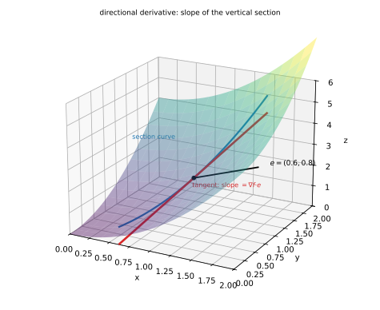
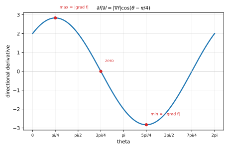
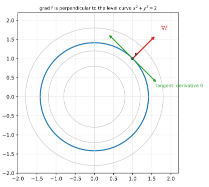
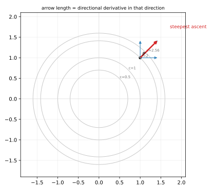

# 第 08 讲：方向导数与梯度

> **前置**：05（偏导、可微）、06（链式法则）、07（曲面法向）。
> **本讲解决什么**：偏导只回答"沿坐标轴走多快"；实际要问"沿任意方向走多快"。本讲先定义**方向导数**（沿单位方向的变化率）并推出公式 $∇f·\mathbf e$，再把所有方向的信息打包成**梯度**这个向量：方向指向最速上升，长度是最大变化率，并且垂直于等值线（等值面）——07 讲曲面法向的那一半，在这里补全。

## 一、方向导数

### 1.1 为什么需要它

05 讲的偏导 $f_x$ 是"固定 $y$、沿 $x$ 轴走"的变化率；$f_y$ 是"沿 $y$ 轴"。但爬山时你朝哪走都行，问题变成：**从 $P_0$ 沿某个方向 $\mathbf e$ 走，高度变化多快？**

这就需要一个依赖"方向"的导数。

### 1.2 定义：方向必须取单位向量

设 $\mathbf e=(\cosα,\cosβ)$ 是平面上的**单位向量**（三元时 $\mathbf e=(\cosα,\cosβ,\cosγ)$，三个方向余弦平方和 $=1$）。函数在 $P_0$ 沿 $\mathbf e$ 的**方向导数**定义为

$$\frac{∂f}{∂\mathbf l}\Big|_{P_0}=\lim_{t\to0^+}\frac{f(P_0+t\mathbf e)-f(P_0)}{t}.$$

**为什么非要单位向量**：$t$ 在这里是"沿方向走过的距离"。如果 $\mathbf e$ 的长度不是 1，$t$ 就不再是距离，同一个物理方向换个写法会得到不同数值。举例：若用 $2\mathbf e$ 代替 $\mathbf e$，分子变成 $f(P_0+2t\mathbf e)-f(P_0)$，除以 $t$ 后极限翻倍——**方向导数的值会被方向向量的长度缩放**。所以定义里必须先把方向单位化。

**注意 $t\to0^+$**：方向导数只沿指定方向（单侧）取极限；反方向 $-\mathbf e$ 是另一个方向导数，不可微时两者可能不相等（§三有例子）。

### 1.3 可微时的计算公式（推导）

设 $f$ 在 $P_0$ 可微。由 05 讲的全微分：

$$\Delta f=f_x\Delta x+f_y\Delta y+o(\rho),\qquad \rho=\sqrt{\Delta x^2+\Delta y^2}.$$

取 $\Delta x=t\cosα$、$\Delta y=t\cosβ=t\sinα$，则 $\rho=t$，于是

$$\frac{\Delta f}{t}=f_x\cosα+f_y\cosβ+\frac{o(t)}{t}.$$

令 $t\to0^+$，最后一项趋于 $0$：

$$\boxed{\frac{∂f}{∂\mathbf l}=f_x\cosα+f_y\cosβ=∇f·\mathbf e.}$$

三元同理：$\dfrac{∂f}{∂\mathbf l}=f_x\cosα+f_y\cosβ+f_z\cosγ$。

**几何意义**：用平面沿方向 $\mathbf e$ 竖直切曲面，得到一条截面曲线；方向导数就是这条曲线在 $P_0$ 的切线斜率（与 05 讲偏导的截面解释一致，只是截面方向从两条轴换成了任意方向）。



*图 1：曲面 $z=x^2+y^2$ 沿方向 $\mathbf e=(0.6,0.8)$ 的竖直截面（蓝）与它在该点的切线（红）；切线斜率就是方向导数。*

### 1.4 与偏导的关系

取 $\mathbf e=(1,0)$：$\dfrac{∂f}{∂\mathbf l}=f_x$；取 $\mathbf e=(0,1)$：$=f_y$。

**所以偏导是方向导数的两个特例**，方向导数是"沿任意方向"的推广。

## 二、梯度：把所有方向导数打包

### 2.1 梯度是向量；最速上升

把两个（或三个）偏导排成一个向量，叫**梯度**：

$$∇f=(f_x,f_y)\quad\text{或}\quad ∇f=(f_x,f_y,f_z).$$

于是方向导数就是点积：

$$\frac{∂f}{∂\mathbf l}=∇f·\mathbf e=|∇f|\,\lvert\mathbf e\rvert\cosθ=|∇f|\cosθ,$$

其中 $θ$ 是 $∇f$ 与 $\mathbf e$ 的夹角（$\lvert\mathbf e\rvert=1$）。**这个式子把"所有方向的答案"一次说完了**：

- $\cosθ=1$（$\mathbf e$ 与 $∇f$ 同向）：方向导数取最大值 $|∇f|$——**$∇f$ 指向最速上升方向，长度就是最大变化率**；
- $\cosθ=-1$（反向）：最小值 $-|∇f|$——最速下降；
- $\cosθ=0$（垂直）：方向导数为 $0$——沿这个方向走，函数值一阶不变。

**注意**：最大值是 $|∇f|$ 而不是 $|∇f|^2$，因为 $\mathbf e$ 已经是单位向量。



*图 2：固定点、让方向角 $θ$ 转一圈，方向导数是余弦曲线：$θ$ 等于梯度方向时取最大 $|∇f|$，垂直时为零，反向时为 $-|∇f|$。*

### 2.2 梯度垂直于等值线（等值面）——与 07 讲接上

**二元**：$f(x,y)=c$ 是一条等值线。沿这条线走，$f$ 恒等于 $c$，所以沿它的切线方向 $\mathbf T$ 有

$$\frac{∂f}{∂\mathbf l}\Big|_{\mathbf T}=∇f·\frac{\mathbf T}{\lvert\mathbf T\rvert}=0\quad⟹\quad ∇f⊥\mathbf T.$$

**$∇f$ 垂直于等值线**，指向 $f$ 增大的那一侧。

**三元**：$f(x,y,z)=c$ 是等值面，$∇f$ 是它的法向量——**07 讲的曲面法向 $∇F$ 就是这里的梯度**：把曲面写成 $F=f(x,y,z)-c=0$，则

$$∇F=(f_x,f_y,f_z)=∇f.$$

**显式曲面** $z=f(x,y)$ 写成 $F=f(x,y)-z$：$∇F=(f_x,f_y,-1)$——**前两个分量正是二元梯度 $∇f$**，第三个分量 $-1$ 是因为方程里 $z$ 的系数是 $-1$。两个"梯度"不矛盾：二元梯度是三元法向在 $xy$ 平面上的投影信息。



*图 3：等值线 $x^2+y^2=2$（蓝）；在 $P(1,1)$ 处 $∇f=(2,2)$（红）与切线（绿）垂直——沿切线的方向导数为 $0$。*

### 2.3 梯度为零意味着什么（边界）

$∇f(P_0)=\mathbf 0$ 时，**所有方向的方向导数都是 0**：一阶看，函数在这一点"平坦"，朝哪走都不变。

但**不能**由此推出"这是极值"。反例：$f=x^2-y^2$（马鞍面）在原点 $∇f=(2x,-2y)=(0,0)$，可沿 $x$ 轴是极小、沿 $y$ 轴是极大——**驻点只是极值的候选**，判定要二阶信息（09 讲）。

另外，$∇f$ 不存在的点（尖点、接缝）也可能是极值点，不能只盯 $∇f=0$。



*图 4：等高线图上的同一个点 $P$：各方向箭头的长度就是该方向的方向导数（负值不画）；最长的红色箭头沿 $∇f$，指向最速上升。*

## 三、边界与辨析

### 3.1 方向导数都存在，也不一定可微（重要反例）

取 05 讲的反例 $f(x,y)=\sqrt{\lvert xy\rvert}$，在原点。沿单位方向 $\mathbf e=(h,k)$：

$$f(th,tk)=\sqrt{\lvert th\cdot tk\rvert}=t\sqrt{\lvert hk\rvert}\quad(t>0),$$

所以

$$\frac{∂f}{∂\mathbf l}\Big|_{(0,0)}=\sqrt{\lvert hk\rvert}.$$

**每个方向的方向导数都存在**（值依赖方向）。但：

- 偏导 $f_x(0,0)=f_y(0,0)=0$ ⇒ $∇f=(0,0)$；
- 公式 $∇f·\mathbf e$ 给出 $0$，与实际值 $\sqrt{\lvert hk\rvert}$ 不符——**公式失效**；
- 不同方向的导数值不同 ⇒ 不存在统一的线性逼近 ⇒ **不可微**（05 讲）。

**结论**：**可微 ⇒ 方向导数存在且等于 $∇f·\mathbf e$**（这是公式的使用条件）；反过来，方向导数都存在 **推不出** 可微。所以做题时先看可微性（初等函数在定义域内可微；分段/接缝点要回定义验证）。

### 3.2 偏导、方向导数、梯度：三者辨析

| 对象 | 是什么 | 依赖什么 | 典型用途 |
|---|---|---|---|
| 偏导 $f_x,f_y$ | **数** | 固定其余变量，沿坐标轴 | 算梯度、判可微 |
| 方向导数 $\dfrac{∂f}{∂\mathbf l}$ | **数** | 点 + **单位方向** $\mathbf e$ | 问"沿某方向变化多快" |
| 梯度 $∇f$ | **向量** | 只依赖点 | 最速上升方向与最大变化率；等值线/面法向 |

**关系**：方向导数 $=∇f·\mathbf e$（可微时）——**梯度是"打包"，方向导数是"投影"**。

## 四、例题

**例 1**：$f=x^2+y^2$ 在 $(1,1)$，沿 $\mathbf e=\big(\tfrac35,\tfrac45\big)$ 的方向导数。

**解**：$∇f=(2x,2y)=(2,2)$；$\dfrac{∂f}{∂\mathbf l}=2\cdot\tfrac35+2\cdot\tfrac45=\tfrac{14}{5}=2.8$。

**例 2**：$f=x^2+y^2$ 在 $(1,1)$，求最速上升方向与最大变化率、最速下降方向。

**解**：$∇f=(2,2)$，最速上升方向 $\dfrac{(2,2)}{\lvert(2,2)\rvert}=\big(\tfrac{1}{\sqrt2},\tfrac{1}{\sqrt2}\big)$，最大变化率 $\lvert∇f\rvert=2\sqrt2\approx2.828$；最速下降方向为反向，变化率 $-2\sqrt2$。

**例 3**：$f=xyz$ 在 $(1,1,1)$，沿 $\mathbf e=\big(\tfrac{1}{\sqrt2},\tfrac{1}{\sqrt2},0\big)$ 的方向导数；最速上升方向。

**解**：$∇f=(yz,xz,xy)=(1,1,1)$；$\dfrac{∂f}{∂\mathbf l}=\tfrac{1}{\sqrt2}+\tfrac{1}{\sqrt2}+0=\sqrt2$。最速上升方向 $\big(\tfrac{1}{\sqrt3},\tfrac{1}{\sqrt3},\tfrac{1}{\sqrt3}\big)$，最大变化率 $\sqrt3$。

**例 4**：$f=x^2+y^2$ 在 $(1,1)$ 的等值线是 $x^2+y^2=2$；验证 $∇f$ 垂直于它。

**解**：等值线（圆）在 $(1,1)$ 的切向为 $(-1,1)$（与半径 $(1,1)$ 垂直）；$∇f=(2,2)$ 与 $(-1,1)$ 点积 $=-2+2=0$ ✓。沿切向的方向导数 $=0$（沿圆走高度不变）。

**例 5**（曲面法向的接口）：曲面 $z=x^2+y^2$ 在 $(1,1,2)$。
**解**：写成 $F=x^2+y^2-z$，$∇F=(2,2,-1)$（07 讲）；二元梯度 $∇f=(2,2)$ 正好是它的前两个分量。

**例 6**（反例）：$f=\sqrt{\lvert xy\rvert}$ 在原点，沿 $\mathbf e=\big(\tfrac{1}{\sqrt2},\tfrac{1}{\sqrt2}\big)$ 的方向导数。
**解**：$f\big(\tfrac{t}{\sqrt2},\tfrac{t}{\sqrt2}\big)=t\cdot\tfrac{1}{\sqrt2}$ ⇒ 方向导数 $=\tfrac{1}{\sqrt2}\approx0.707$。而 $∇f=(0,0)$、公式给 $0$——**公式在这里不成立**，因为 $f$ 在原点不可微。

## 五、数值核对

用脚本核对本节结论（`scripts/lec08-02_verify_gradient.py`，全脚本 0.00 秒）：

```
=== EXP1: directional derivative vs grad f . e at (1,1), f = x^2+y^2 ===
  theta=0.00: num=2.0000009999, formula=2.0000000000, diff=1.00e-06
  theta=0.79: num=2.8284281246, formula=2.8284271247, diff=1.00e-06
  theta=1.57: num=2.0000009999, formula=2.0000000000, diff=1.00e-06

=== EXP2: scan theta, find the steepest ascent direction ===
  max at theta=0.785398 rad, value=2.8284271247
  |grad f| = 2.8284271247  (expect pi/4 and 2*sqrt2 = 2.8284271247)

=== EXP3: along the level curve, directional derivative is zero ===
  along tangent (-1,1)/sqrt2: num=1.00e-06  (expect ~ 0)
  grad . tangent = 0.00e+00

=== EXP4: sqrt(|xy|) at origin: directional derivative vs the formula ===
  e=(1,0): num=0.0000000000, formula grad f . e = 0.0000000000, diff=0.00e+00
  e=(1,1)/sqrt2: num=0.7071067812, formula grad f . e = 0.0000000000, diff=7.07e-01
  e=(0,1): num=0.0000000000, formula grad f . e = 0.0000000000, diff=0.00e+00
  -> every direction exists, but grad f = (0,0): the formula fails (not differentiable)

=== EXP5: 2D gradient vs the 3D surface normal (first two components) ===
  grad f (2D)      = [2. 2.]
  first two of grad F = [2. 2.]
  max |difference| = 0.00e+00
```

**核对点**：EXP1 的数值与公式差 $1.0\times10^{-6}$——正是单侧差分的步长量级（$O(h)$，不是公式错）；EXP2 扫描得到最大在 $θ=π/4$、值 $2.8284271247=|∇f|$；EXP3 沿切向的数值是 $1.0\times10^{-6}$（同样是差分噪声），而 $∇f·\mathbf T$ 恰为 $0$；EXP4 沿 $(1,1)/\sqrt2$ 的方向导数为 $0.7071$ 而公式给 $0$（**公式失效**），沿坐标轴方向两者一致——**方向导数都存在但不能推出可微**；EXP5 二元梯度与 07 讲曲面法向的前两个分量逐位一致。

## 小结

- **方向导数**：沿单位方向 $\mathbf e$ 的变化率；**必须单位化**（$t$ 才是距离）。
- **公式**：可微时 $\dfrac{∂f}{∂\mathbf l}=∇f·\mathbf e=f_x\cosα+f_y\cosβ$（三元加 $f_z\cosγ$）。
- **梯度** $∇f=(f_x,f_y,\dots)$ 是**向量**：方向指向最速上升，长度 $|∇f|$ 是最大变化率；反方向最速下降；垂直方向的变化率为 $0$。
- **等值线/等值面**：$∇f$ 垂直于等值线（面）——07 讲曲面法向是它的特例（$∇F=∇(f-c)$；显式曲面多一个 $-1$ 分量）。
- **边界**：$∇f=0$ 只说明一阶平坦（驻点候选，不一定是极值）；**方向导数都存在 ⇏ 可微**（$\sqrt{\lvert xy\rvert}$ 的原点，公式失效）。

## 作业

**说明**：答案平铺在每题下方（先做再对照）。只用上册与本讲已教内容。

**1.** $f=x^2-y^2$ 在 $(1,1)$，沿 $\mathbf e=\big(\tfrac{1}{\sqrt2},\tfrac{1}{\sqrt2}\big)$ 的方向导数。

**参考答案**：
$∇f=(2x,-2y)=(2,-2)$；$\dfrac{∂f}{∂\mathbf l}=\dfrac{2}{\sqrt2}+\dfrac{-2}{\sqrt2}=0$。沿这个方向函数值一阶不变（它正好沿着双曲线 $x^2-y^2=0$ 的切线）。

**2.** $f=e^x\sin y$ 在 $\big(0,\tfrac{\pi}{4}\big)$，沿 $\mathbf e=\big(\tfrac{1}{\sqrt2},-\tfrac{1}{\sqrt2}\big)$ 的方向导数。

**参考答案**：
$∇f=(e^x\sin y,\ e^x\cos y)$，在 $\big(0,\tfrac{\pi}{4}\big)$ 为 $\big(\tfrac{\sqrt2}{2},\tfrac{\sqrt2}{2}\big)$。
$\dfrac{∂f}{∂\mathbf l}=\tfrac{\sqrt2}{2}\cdot\tfrac{1}{\sqrt2}+\tfrac{\sqrt2}{2}\cdot\big(-\tfrac{1}{\sqrt2}\big)=0$。

**3.** $f=x^2+y^2+z^2$ 在 $(1,2,2)$：最速上升方向与最大变化率。

**参考答案**：
$∇f=(2x,2y,2z)=(2,4,4)$，$\lvert∇f\rvert=\sqrt{4+16+16}=6$。
最速上升方向 $\big(\tfrac13,\tfrac23,\tfrac23\big)$，最大变化率 $6$。

**4.** 曲线 $x^2+xy+y^2=3$ 在 $(1,1)$ 的切线斜率（用梯度求）。

**参考答案**：
令 $f=x^2+xy+y^2$，$∇f=(2x+y,\ x+2y)=(3,3)$——等值线的法向。
切线与法向垂直：斜率 $k$ 满足 $3\cdot1+3k=0$ ⇒ $k=-1$。

**5.**（证明）设 $f$ 在 $P_0$ 可微，证明沿单位方向 $\mathbf e=(\cosα,\cosβ)$ 的方向导数为 $f_x\cosα+f_y\cosβ$。

**参考答案**：
由可微性，$\Delta f=f_x\Delta x+f_y\Delta y+o(\rho)$。取 $\Delta x=t\cosα,\Delta y=t\cosβ$，$\rho=t$，则
$\dfrac{\Delta f}{t}=f_x\cosα+f_y\cosβ+\dfrac{o(t)}{t}\to f_x\cosα+f_y\cosβ$。$\blacksquare$

**6.**（反例）$f=\sqrt{\lvert xy\rvert}$ 在原点，沿 $\mathbf e=(0,1)$ 与 $\mathbf e=\big(\tfrac{1}{\sqrt2},\tfrac{1}{\sqrt2}\big)$ 的方向导数各是多少？它们与 $∇f·\mathbf e$ 一致吗？

**参考答案**：
沿 $(0,1)$：$f(0,t)=0$ ⇒ 方向导数 $0$；沿 $\big(\tfrac{1}{\sqrt2},\tfrac{1}{\sqrt2}\big)$：$\tfrac{1}{\sqrt2}$。
$∇f=(0,0)$，公式对两个方向都给 $0$——第二个方向**不一致**（$0\ne\tfrac{1}{\sqrt2}$）。原因：$f$ 在原点不可微，公式不适用。

**7.**（概念）偏导、方向导数、梯度分别是什么对象？$∇f=0$ 能说明什么、不能说明什么？

**参考答案**：
偏导是数（沿坐标轴）；方向导数是数（沿任意单位方向）；梯度是向量（打包所有方向）。
$∇f=0$ 说明所有方向导数一阶为 $0$（局部一阶平坦，是极值候选）；**不能**说明一定是极值——$x^2-y^2$ 在原点也是 $∇f=0$，但它是鞍点。
