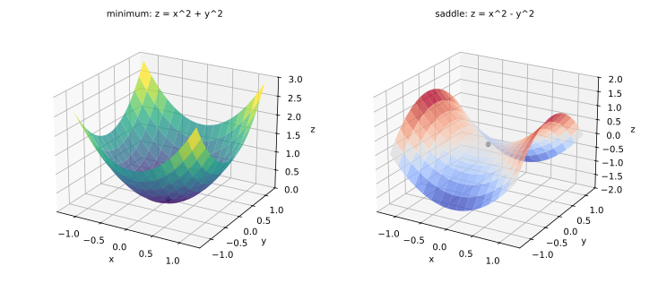
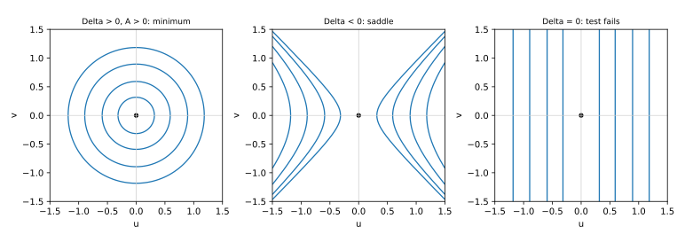
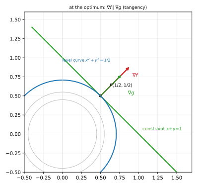
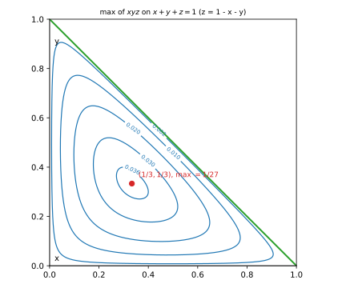

# 第 09 讲：多元极值与条件极值

> **前置**：05（偏导、可微）、08（方向导数、梯度）。
> **本讲解决什么**：08 讲的 $∇f=0$ 只能给出"候选点"，不能判断它是山顶、谷底还是鞍点。本讲先解决**无条件极值**：候选点怎么列全（驻点 + 偏导不存在的点），以及二阶判据 $AC-B^2$ 为什么长这样（从二次型配方推出来）。再解决**条件极值**：在一条约束曲线上找极值时，为什么是 $∇f∥∇g$——这是 08 讲"方向导数"的直接应用。

## 一、无条件极值

### 1.1 极值的定义

设 $P_0=(x_0,y_0)$ 是 $f$ 定义域的内点。若存在 $P_0$ 的某个邻域，使得邻域内所有 $P$ 都有

$$
f(P)\le f(P_0)\quad(\text{或 }f(P)\ge f(P_0)),
$$

则称 $f$ 在 $P_0$ 取**局部极大值**（或局部极小值），$P_0$ 叫**极值点**。把"$\le$"换成"$<$"（除 $P_0$ 外）叫**严格**极值。

两点要说清：

- **"局部"**：只看 $P_0$ 附近，不管远处。这与一元完全一致。
- **极值 ≠ 最值**：极值是局部概念；最值是整个区域上的最大/最小（闭区域上的最值还要查边界——10 讲）。

**几何图景**：极小=谷底，极大=山顶，还有一种**鞍点**——沿一个方向是谷、沿另一个方向是山（马鞍面 $z=x^2-y^2$ 的原点）。

**用定义验证一个具体点**：$f=x^2+y^2$ 在原点。任取一个邻域，邻域内每个点都有 $x^2+y^2\ge0=f(0,0)$，所以原点是（严格）极小值点——这就是“邻域内比较”的含义。



*图 1：左 $z=x^2+y^2$ 原点极小；右 $z=x^2-y^2$ 原点是鞍点——沿 $x$ 方向上升、沿 $y$ 方向下降。*

### 1.2 必要条件：驻点 + 偏导不存在的点

**定理**：若 $f$ 在 $P_0$ 可微且取极值，则

$$
∇f(P_0)=(f_x(P_0),f_y(P_0))=\mathbf 0.
$$

**证明（把二元化成一元）**：固定 $y=y_0$，令 $g(x)=f(x,y_0)$。$f$ 在 $P_0$ 取极值 ⇒ 一元函数 $g$ 在 $x_0$ 取极值 ⇒ $g'(x_0)=0$，而 $g'(x_0)=f_x(x_0,y_0)$。同法固定 $x=x_0$ 得 $f_y(x_0,y_0)=0$。$\blacksquare$

满足 $∇f=0$ 的点叫**驻点**。

**这条只是必要条件**：$f=x^2-y^2$ 在原点 $∇f=(2x,-2y)=\mathbf 0$，但原点不是极值（沿 $x$ 轴是极小、沿 $y$ 轴是极大）。

**还有一类候选：偏导不存在的点**。一元里"不可导点"也要查（如 $|x|$ 在 $0$），多元一样：

- $f=\sqrt{x^2+y^2}$ 在原点：偏导不存在（05 讲）；但 $f\ge0=f(0,0)$ 对所有点成立，所以它是极小点（比“邻域内”更强的结论）；
- $f=|x|+|y|$ 在原点：偏导不存在；同样 $f\ge0=f(0,0)$，是极小点。

**所以候选点 = 驻点 ∪ 偏导不存在的点**（内点范围）。漏掉第二类，就会漏解。

### 1.3 充分条件：$AC-B^2$ 判据（从二次型配方推出来）

设 $P_0$ 是驻点，记

$$
A=f_{xx}(P_0),\quad B=f_{xy}(P_0),\quad C=f_{yy}(P_0),\quad \Delta=AC-B^2.
$$

**结论表**（先用；下面马上解释为什么）：

| $\Delta$   | $A$ 的符号 | 结论                       |
| ------------ | ------------ | -------------------------- |
| $\Delta>0$ | $A>0$      | 极小值                     |
| $\Delta>0$ | $A<0$      | 极大值                     |
| $\Delta<0$ | 任意         | **鞍点**（不是极值） |
| $\Delta=0$ | —           | 判据失效（另想办法）       |

**为什么是这三个量的组合**：在驻点附近做二阶展开（二阶泰勒；这里只需要用到形式，推导不展开）：

$$
f(P_0+\Delta\mathbf x)-f(P_0)\approx\frac12\Big(A\Delta x^2+2B\Delta x\Delta y+C\Delta y^2\Big).
$$

记 $u=\Delta x,v=\Delta y$，括号里是二次型

$$
Q(u,v)=Au^2+2Buv+Cv^2.
$$

**配方**（设 $A\ne0$）：先把含 $u$ 的项配成完全平方：

$$
Au^2+2Buv=A\Big(u^2+\frac{2B}{A}uv\Big)=A\Big(u+\frac{B}{A}v\Big)^2-\frac{B^2}{A}v^2,
$$

再加上 $Cv^2$：

$$
Q=A\Big(u+\frac{B}{A}v\Big)^2+\Big(C-\frac{B^2}{A}\Big)v^2=A\Big(u+\frac{B}{A}v\Big)^2+\frac{AC-B^2}{A}\,v^2.
$$

现在逐种情况看：

- $\Delta=AC-B^2>0$：第二项的系数 $\dfrac{\Delta}{A}$ 与 $A$ **同号**；第一项也与 $A$ 同号。所以 $Q$ 除原点外**恒与 $A$ 同号**：$A>0$ ⇒ $Q>0$（$f$ 上升，极小）；$A<0$ ⇒ $Q<0$（极大）。
- $\Delta<0$：第二项与 $A$ **反号**。沿 $v$ 方向（$u=-\frac BA v$ 时第一项为 0）$Q$ 与 $A$ 反号；沿 $u$ 方向（$v=0$）$Q=Au^2$ 与 $A$ 同号——**两个方向一升一降**，鞍点。
- $\Delta=0$：$Q=A\big(u+\frac BA v\big)^2$——沿直线 $u=-\frac BA v$ 上 $Q=0$，其它方向同号，**二阶项不能定号**，判据失效。

**$A=0$ 的情形**：若 $B\ne0$，$\Delta=-B^2<0$，仍是鞍点；若 $A=B=0$，$\Delta=0$，失效（此时 $Q=Cv^2$ 也定不了号）。

**用一个具体函数把判据走一遍**：$f=x^2+2xy+3y^2$ 在原点。

- 求偏导：$f_x=2x+2y$、$f_y=2x+6y$，在原点均为 $0$（是驻点）；
- 求二阶：$f_{xx}=2$、$f_{xy}=2$、$f_{yy}=6$ ⇒ $A=2,B=2,C=6$；
- 算行列式：$\Delta=AC-B^2=12-4=8>0$，且 $A=2>0$ ⇒ **极小**；
- **独立验证**：配方 $f=x^2+2xy+3y^2=(x+y)^2+2y^2\ge0=f(0,0)$——确实是极小。

判据与直接配方结果一致；当判据能用时，它比每次配方快得多。



*图 2：二次型 $Q$ 的等高线：椭圆（正定，$\Delta>0$）、双曲线（不定，$\Delta<0$）、平行直线（半定，$\Delta=0$ 判据失效）。*

**与线性代数的接口（认识层）**：$A,B,C$ 排成矩阵 $H=\begin{pmatrix}A&B\\B&C\end{pmatrix}$（海森矩阵），$\Delta=\det H$。$Q$ 正定 ⇔ $A>0,\Delta>0$；负定 ⇔ $A<0,\Delta>0$；不定 ⇔ $\Delta<0$。这里只需要把 $AC-B^2$ 与"正定/负定/不定"对上，矩阵理论不必展开。

### 1.4 判据的边界：$\Delta=0$ 时怎么办

$\Delta=0$ 时判据**失效**，可能极小、可能极大、也可能不是极值：

- $f=x^4+y^4$：$f_{xx}=12x^2$、$f_{xy}=0$、$f_{yy}=12y^2$，原点 $A=B=C=0$，$\Delta=0$，但 $f\ge0=f(0,0)$——**极小**；
- $f=x^4-y^4$：$f_{xx}=12x^2$、$f_{xy}=0$、$f_{yy}=-12y^2$，原点同样 $A=B=C=0$、$\Delta=0$，但沿 $x$ 升、沿 $y$ 降——**鞍点**。

**同一判据失效，结果却相反**。这时要回到定义（比较邻域内的值）或用更高阶信息。考试里遇到 $\Delta=0$，通常题目会设计成能用定义直接看出来。

**还要记住**：判据是**充分**的（$\Delta>0$ 一定极值；$\Delta<0$ 一定不是极值），但**不必要**——有些极值点根本不在驻点上（§1.2 的偏导不存在点）。

## 二、条件极值：拉格朗日乘数法

### 2.1 问题长什么样

求 $f(x,y)$ 在**约束** $g(x,y)=0$ 上的极值。例如：矩形周长固定为 $2p$，求面积 $xy$ 的最大值；或求 $f=x^2+y^2$ 在约束 $x+y=1$ 上的极值（原点到直线的最近点）。

**与无条件极值的区别**：不是在整个平面上找，而是**只能沿约束曲线走**。所以 $∇f=0$ 不再是必要条件——最优点可能不在驻点上。

### 2.2 为什么是 $∇f∥∇g$（用 08 讲的方向导数）

设约束曲线参数化为 $\mathbf r(t)$，且 $g(\mathbf r(t))\equiv0$。在约束曲线上，$f$ 的变化率就是沿曲线切向 $\mathbf T=\mathbf r'(t)$ 的方向导数：

$$
\frac{∂f}{∂\mathbf l}\Big|_{\mathbf T}=∇f·\mathbf T.
$$

若 $P_0$ 是约束上的极值点，则沿曲线往两边走 $f$ 都不再减小（或增大），**一阶变化率为 0**：

$$
∇f(P_0)·\mathbf T=0.
$$

另一方面，$g$ 沿曲线恒为 0，同样有 $∇g(P_0)·\mathbf T=0$。（具体核对：圆 $x^2+y^2=1$ 的参数化是 $\mathbf r(t)=(\cos t,\sin t)$，切向 $\mathbf T=(-\sin t,\cos t)$；$∇g=(2x,2y)$，$∇g·\mathbf T=-2x\sin t+2y\cos t=-2\cos t\sin t+2\sin t\cos t=0$ ✓。）于是 **$∇f$ 与 $∇g$ 都垂直于同一条切线 $\mathbf T$**。在平面上，垂直于同一条直线的两个向量平行，所以存在数 $λ$ 使

$$
\boxed{∇f(P_0)=λ\,∇g(P_0).}
$$

这就是拉格朗日条件。**$λ$ 只是一个比例系数**（叫拉格朗日乘数），不是极值，也不是约束值。

**边界**：这个推导要求 $∇g(P_0)\ne\mathbf 0$。若 $∇g(P_0)=\mathbf 0$（约束曲线在该点奇异，例如 $x^2+y^2=0$ 退化成一点），法向不存在，乘数法失效——这种点要**单独代入检查**。



*图 3：约束直线 $x+y=1$ 与 $f$ 的等值圆在最优处相切；此时 $∇f$（红）与 $∇g$（绿）同向，$∇f=λ∇g$。*

### 2.3 操作步骤

1. 设 $L=f-λg$（写成 $f+λg$ 也一样，$λ$ 的符号会随之变）。
2. 列方程组：

$$
f_x=λg_x,\qquad f_y=λg_y,\qquad g(x,y)=0.
$$

3. 解出所有 $(x,y,λ)$，得到候选点（可能有多个）。
4. 比较各候选点的 $f$ 值（或结合几何判断）；**别忘**检查 $∇g=0$ 的点与约束的端点。

**马上用一道题走一遍**：求 $f=x+2y$ 在圆 $x^2+y^2=1$ 上的最值。

1. 两个梯度：$∇f=(1,2)$、$∇g=(2x,2y)$；
2. 列方程：$1=2λx$、$2=2λy$，即 $x=\dfrac{1}{2λ}$、$y=\dfrac{1}{λ}$；
3. 消 $λ$：两式相除，$\dfrac{y}{x}=2$ ⇒ $y=2x$；
4. 代入约束：$x^2+(2x)^2=1$ ⇒ $5x^2=1$ ⇒ $x=±\dfrac{1}{\sqrt5}$，对应 $y=±\dfrac{2}{\sqrt5}$；
5. 比较：$f=x+2y=±\Big(\dfrac{1}{\sqrt5}+\dfrac{4}{\sqrt5}\Big)=±\sqrt5$。

最大值 $\sqrt5$ 在 $\big(\tfrac{1}{\sqrt5},\tfrac{2}{\sqrt5}\big)$，最小值 $-\sqrt5$ 在反向点。

**第 3 步的“消 $λ$”是把两个方程相除**（不是解出 $λ$ 再代）——这是考试里最省事的一步。

**三元一个约束**：$f(x,y,z)$ 在 $g(x,y,z)=0$ 上：$f_x=λg_x,f_y=λg_y,f_z=λg_z,g=0$。

### 2.4 多个约束（简介）

$f$ 在 $g=0$ 与 $h=0$ 的交线上取极值：$∇f=λ∇g+μ∇h$（两个乘数），再加 $g=0,h=0$ 两个方程。**理解层次**：知道形式即可；本课程题目以单约束为主。

**$λ$ 的一个解释（认识层）**：$λ$ 度量"约束放松一点，最优值能改善多少"（敏感度）。做题不需要它，知道它有含义即可。

## 三、例题

**例 1**：$f=x^2+y^2-2x-4y$ 的极值。

**解**：$f_x=2x-2=0$ ⇒ $x=1$；$f_y=2y-4=0$ ⇒ $y=2$；驻点 $(1,2)$。

$A=f_{xx}=2$，$B=f_{xy}=0$，$C=f_{yy}=2$，$\Delta=4>0$，$A>0$ ⇒ **极小值** $f(1,2)=1+4-2-8=-5$。

（二阶偏导的来源：$f_x=2x-2$ 再对 $x$ 求导得 $A=2$；$f_x$ 对 $y$ 求导得 $B=0$；$f_y=2y-4$ 再对 $y$ 求导得 $C=2$。）

**例 2**：$f=x^3+y^3-3xy$ 的极值。

**解**：$f_x=3x^2-3y=0$ ⇒ $y=x^2$；$f_y=3y^2-3x=0$ ⇒ $x=y^2$。代入：$x=x^4$ ⇒ $x(x^3-1)=0$ ⇒ $x=0$ 或 $x=1$（实数；$x^3=1$ 的另两根是复数），对应 $(0,0)$ 与 $(1,1)$。

先算二阶偏导（对任意点）：$f_{xx}=6x$、$f_{xy}=-3$、$f_{yy}=6y$。

- $(0,0)$：$A=0,B=-3,C=0$，$\Delta=0\cdot0-(-3)^2=-9<0$ ⇒ **鞍点**；
- $(1,1)$：$A=6,B=-3,C=6$，$\Delta=36-9=27>0$，$A>0$ ⇒ **极小值** $f(1,1)=1+1-3=-1$。

**例 3**：$f=x^2+y^2$ 在约束 $x+y=1$ 上的极值（原点到直线的最近点）。

**解**：$∇f=(2x,2y)$，$∇g=(1,1)$。方程：$2x=λ$、$2y=λ$ ⇒ $x=y$；代入 $x+y=1$ ⇒ $x=y=\tfrac12$。

$f\big(\tfrac12,\tfrac12\big)=\tfrac12$。几何：原点到直线 $x+y=1$ 的距离是 $\tfrac{1}{\sqrt2}$，平方正是 $\tfrac12$ ✓。

**例 4**：$f=xyz$ 在 $x+y+z=1$、$x,y,z>0$ 上的最大值。

**解**：$∇f=(yz,xz,xy)$，$∇g=(1,1,1)$：$yz=λ,xz=λ,xy=λ$。

**两两相减**：

- 第一式减第二式：$yz-xz=0$ ⇒ $z(y-x)=0$；因 $z>0$，得 $x=y$；
- 第一式减第三式：$yz-xy=0$ ⇒ $y(z-x)=0$；因 $y>0$，得 $x=z$。

所以 $x=y=z$；代入 $x+y+z=1$ ⇒ $3x=1$ ⇒ $x=y=z=\tfrac13$，$f=\tfrac1{27}$。

（与均值不等式 $xyz\le\big(\tfrac{x+y+z}{3}\big)^3=\tfrac1{27}$ 一致。）



*图 4：把 $z=1-x-y$ 代入，$xyz=xy(1-x-y)$ 在三角形区域上的等高线；最大在 $(1/3,1/3)$，值 $1/27$。*

**例 5**：$f=x^2-y^2$ 在圆 $x^2+y^2=1$ 上的极值。

**解**：$∇f=(2x,-2y)$，$∇g=(2x,2y)$：$2x=2λx$、$-2y=2λy$ ⇒ $x(1-λ)=0$、$y(1+λ)=0$。

- $x\ne0,y=0$：$λ=1$，点 $(±1,0)$，$f=1$（最大）；
- $x=0,y\ne0$：$λ=-1$，点 $(0,±1)$，$f=-1$（最小）。

（$x=y=0$ 不在圆上。）

**例 6**（约束退化）：$f=x+y$ 在 $x^2+y^2=0$ 上。

**解**：约束只含点 $(0,0)$，$∇g=(2x,2y)=\mathbf 0$——乘数法的推导前提失效。直接代入：$f(0,0)=0$，这就是约束上的唯一值。

## 四、数值核对

用脚本核对本节结论（`scripts/lec09-02_verify_extrema.py`，全脚本 0.00 秒）：

```
=== EXP1: f=x^2+y^2-2x-4y: stationary point and the AC-B^2 test ===
  stationary point: (1,2); f = -5.0000
  A=2, B=0, C=2, Delta=4.0 > 0, A>0 -> minimum
  min over 20000 random points near the point: -5.000000 (expect >= -5)

=== EXP2: f=x^3+y^3-3xy: saddle at (0,0), minimum at (1,1) ===
  at (0,0): A=0, B=-3, C=0, Delta=-9.0 < 0 -> saddle
  t=0.1: f(t,t)=-0.028000, f(t,-t)=+0.030000  (opposite signs)
  t=0.05: f(t,t)=-0.007250, f(t,-t)=+0.007500  (opposite signs)
  at (1,1): A=6, B=-3, C=6, Delta=27.0 > 0, A>0 -> minimum, f=-1.0000

=== EXP3: Lagrange on x^2+y^2 with x+y=1 ===
  solution: (0.5,0.5), f = 0.5000
  scan along the constraint: min = 0.500000, at x = 0.500

=== EXP4: maximize xyz subject to x+y+z=1 ===
  candidate: (1/3,1/3,1/3), xyz = 0.0370370370
  max over 200000 random points on the simplex: 0.0370367268 (expect <= 1/27)
  largest sample point: [0.3323299  0.3342537  0.33341641]

=== EXP5: x^2-y^2 on the unit circle: four candidates ===
  candidate (+1,+0): f = +1.0
  candidate (-1,+0): f = +1.0
  candidate (+0,+1): f = -1.0
  candidate (+0,-1): f = -1.0
  scan: max = 1.000000, min = -1.000000
```

**核对点**：EXP1 的邻域 20000 个随机点最小值恰为 $-5.000000$（在驻点取得）；EXP2 的两个驻点判据相反——$(0,0)$ 的 $\Delta=-9<0$ 是鞍点（$t=0.1$ 时 $f(t,t)=-0.028$ 与 $f(t,-t)=+0.030$ **符号相反**，直接验证了“一升一降”），$(1,1)$ 的 $\Delta=27>0$ 且 $A>0$ 是极小（$f=-1$）；EXP3 沿约束扫描 200001 个点，最小值 $0.500000$ 在 $x=0.500$ 处；EXP4 的 $1/27=0.0370370370$，20 万个随机点的最大值 $0.0370367268$ 略小（采样未命中，但不超过上限）；EXP5 四个候选值 $±1$，扫描也得到 $\max=1,\min=-1$。

## 小结

- **极值定义**：邻域内的最大/最小（局部概念）；鞍点两个方向一升一降。
- **必要条件**：可微极值点 ⇒ $∇f=0$（驻点）；**候选要列全**：驻点 + 偏导不存在的点。
- **充分条件**：$A=f_{xx},B=f_{xy},C=f_{yy},\Delta=AC-B^2$：$\Delta>0,A>0$ 极小；$\Delta>0,A<0$ 极大；$\Delta<0$ 鞍点；$\Delta=0$ 失效。
- **条件极值**：约束曲线上极值 ⇒ $∇f=λ∇g$（两者都垂直于约束曲线的切线）；列 $f_x=λg_x,f_y=λg_y,g=0$。
- **边界**：$∇g=0$ 的约束点单独查；极值只在内部，最值还要查边界（10 讲）。

## 作业

**说明**：答案平铺在每题下方（先做再对照）。只用上册与本讲已教内容。

**1.** $f=x^2+2y^2-2x+4y$：求驻点并判断极值。

**参考答案**：
$f_x=2x-2=0$ ⇒ $x=1$；$f_y=4y+4=0$ ⇒ $y=-1$；驻点 $(1,-1)$。
$f_{xx}=2$、$f_{xy}=0$、$f_{yy}=4$ ⇒ $A=2,B=0,C=4$，$\Delta=8>0,A>0$ ⇒ 极小值 $f(1,-1)=1+2-2-4=-3$。

**2.** $f=xy$ 在原点：判断它是不是极值。

**参考答案**：
$f_x=y$、$f_y=x$，原点 $(0,0)$ 是驻点。$f_{xx}=0$、$f_{xy}=1$、$f_{yy}=0$ ⇒ $A=0,B=1,C=0$，$\Delta=-1<0$ ⇒ **鞍点**（沿 $y=x$：$f=x^2$ 升；沿 $y=-x$：$f=-x^2$ 降）。

**3.** $f=x^2+y^2$ 在约束 $x-y=2$ 上：求最小值。

**参考答案**：
$∇f=(2x,2y)$，$∇g=(1,-1)$：$2x=λ$、$2y=-λ$ ⇒ $2y=-2x$ ⇒ $y=-x$；代入 $x-y=2$ ⇒ $2x=2$ ⇒ $x=1,y=-1$。
$f=1+1=2$；几何：原点到 $x-y=2$ 的距离平方 $=\big(\tfrac{2}{\sqrt2}\big)^2=2$ ✓。

**4.** $f=x+y+z$ 在球面 $x^2+y^2+z^2=1$ 上：求最大值与最小值。

**参考答案**：
$∇f=(1,1,1)$，$∇g=(2x,2y,2z)$：$1=2λx$、$1=2λy$、$1=2λz$ ⇒ $x=\dfrac{1}{2λ}$，同理 $y=z=\dfrac{1}{2λ}$ ⇒ $x=y=z$；代入球面 $3x^2=1$ ⇒ $x=±\tfrac{1}{\sqrt3}$。
最大值 $f=\sqrt3$（点 $(1,1,1)/\sqrt3$），最小值 $-\sqrt3$（反向）。

**5.** $f=x^2+y^2$ 在 $x^2+y^2=1$ 上：用乘数法会发生什么？说明了什么？

**参考答案**：
$2x=2λx$、$2y=2λy$ ⇒ 若 $x\ne0$ 或 $y\ne0$，则 $λ=1$，约束圆上**每个点**都满足方程；$f$ 在圆上恒为 $1$，处处是（非严格的）等值极值。
说明：乘数法给出的是"必要条件"，当约束本身就是 $f$ 的等值线时，所有点都是候选——需要结合函数值/几何意义下结论。

**6.** $f=x^2+y^2$ 在原点：偏导存在吗？它是极值点吗？$AC-B^2$ 判据能用吗？

**参考答案**：
偏导存在（$f_x=2x,f_y=2y$，原点均为 0），$∇f=0$ 是驻点。
$A=2,B=0,C=2,\Delta=4>0,A>0$ ⇒ 极小值（$f\ge0=f(0,0)$）。
另：$f=\sqrt{x^2+y^2}$ 在原点才是"偏导不存在但极小"的例子；本题用来说明判据正常适用。

**7.**（概念）极值与最值有什么区别？为什么闭区域上的最值要额外查边界？

**参考答案**：
极值是邻域内的局部比较；最值是整个区域上的全局比较。
闭区域的最值可能出现在边界上（边界点不是内点，$∇f=0$ 在那里没有意义）——所以要把内部候选（驻点/不可导点）与边界上的候选（条件极值或直接代入）放在一起比较。
