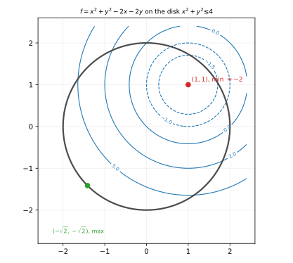
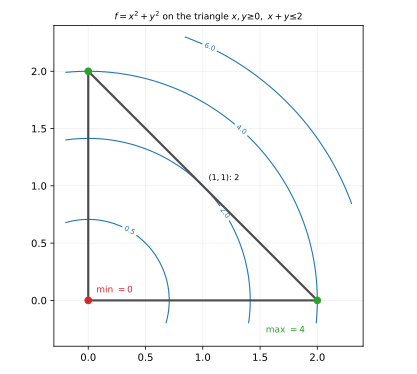
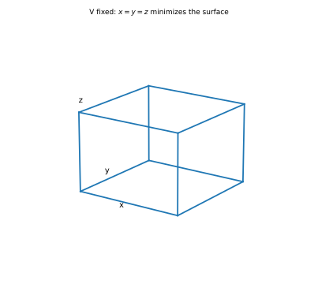
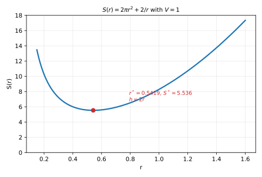

# 第 10 讲：闭区域上的最值与应用

> **前置**：09（极值判据、拉格朗日乘数法）、04（有界闭区域上的最值定理）。
> **本讲解决什么**：09 讲的是**极值**（邻域内的局部比较）；这一讲解决**最值**（整个区域上的全局比较）。核心是一套三步流程：**内部候选 → 边界候选 → 比较**。再把几何/工程应用题接进来：先建模（目标函数 + 约束），再走同一套流程。

## 一、闭区域最值：三步法

### 1.1 为什么三步就够

先引用 04 讲的**最值定理**：若 $f$ 在有界闭区域 $D$ 上连续，则 $f$ 在 $D$ 上**一定**取到最大值与最小值。

有了"一定存在"，剩下的问题只是"去哪里找"。最值点只可能是下面三类：

1. **$D$ 内部的驻点**（$∇f=0$）；
2. **$D$ 内部偏导不存在的点**；
3. **边界上的点**。

**为什么没有第四类**：若最值点在内部且偏导存在，09 讲已经证明它必须是驻点（可微极值 ⇒ $∇f=0$）；否则就是偏导不存在的点；再不然就在边界上。三类穷尽了所有可能。

**内部也可能有“不可导点”**：若区域内部的函数含根号、绝对值或分段定义（如 $\sqrt{x^2+y^2}$、$|x|+|y|$），这些点偏导不存在，同样是候选。考试题里出现这类函数时，先看内部有没有尖点、接缝。

**边界为什么不能漏**：边界点不是内点，$∇f=0$ 在那里没有意义——最值完全可能只出现在边界（例如 $f=x$ 在单位圆盘上，最大值在边界 $(1,0)$）。这是本讲与 09 讲最大的区别。

### 1.2 边界怎么查

边界通常由几段**光滑曲线**拼成（直线段、圆弧、抛物线弧等）。逐段处理：

**（a）直线段**：把直线方程代进去，化成一元函数。

例如边界是 $x+y=2$、$0\le x\le2$：令 $y=2-x$，$f(x,y)$ 变成 $g(x)=f(x,2-x)$，在区间 $[0,2]$ 上求一元最值（端点 + $g'=0$）。

**（b）圆弧**：参数化成一元。

例如 $x^2+y^2=4$：令 $x=2\cosθ,y=2\sinθ$，$f$ 变成 $θ$ 的一元函数，$θ\in[0,2π]$。

**（c）角点（分段边界的交点）**：**必须单独代入**。

角点是两段边界的接头，左右导数可能不同，一元求导在角点不适用；但它本身是区域的边界点，完全可能是最值点。例如三角形区域的三个顶点、矩形区域的四个角。

**（d）不光滑的边界点**（尖点）：同样单独代入。

**完整示范（把这一段的四步写全）**：取边界段 $x+y=2$、$0\le x\le2$，$f=x^2+y^2$。

1. **代入**：$y=2-x$ ⇒ $g(x)=x^2+(2-x)^2$；
2. **展开**：$g(x)=x^2+4-4x+x^2=2x^2-4x+4$；
3. **求导**：$g'(x)=4x-4=0$ ⇒ $x=1$（在区间内）；
4. **端点**：$g(0)=4$、$g(2)=4$；内部点 $g(1)=2$。

段上最小 $2$、最大 $4$。**这四步一步都不能省**：代入后不展开，求导容易错；只求导不代端点，会漏掉单调段的端点最值。

**一句话**：边界分段 → 每段化一元 → 段端点（含角点）单独算。

### 1.3 比较与结论的写法

把三类候选列成表（位置 + 函数值），再比较：

1. 内部候选：驻点、偏导不存在点；
2. 边界候选：各段的内部极值点、各段的端点/角点；
3. **所有候选的函数值放在一起**，最大者即最大值，最小者即最小值。

**写法要求**：先列候选、再下结论，不要跳过候选直接写“最大值为……”——跳步的答案在考试里容易被扣过程分，而且漏项时自己也发现不了。

**候选表的写法（以 §四例 2 为例）**：

| 位置 | 类型 | 函数值 |
|---|---|---|
| $(0,0)$ | 角点 | $0$ |
| $(2,0)$ | 角点 | $4$ |
| $(0,2)$ | 角点 | $4$ |
| $(1,1)$ | 边界 $x+y=2$ 的内部点 | $2$ |
| —— | 内部驻点 | 无 |

看表直接得：最小 $0$、最大 $4$。表列全了，结论就不用猜。

**一个常见误解**：内部驻点若是鞍点，不必参与"极值"讨论，但它的函数值**可以**参与最值比较（虽然鞍点不可能是全局最值，算上不会有错，只是多一项）。

## 二、应用题：先建模，再走三步

### 2.1 建模的两件事

应用题的第一步不是求导，而是把文字翻译成两样东西：

- **目标函数**：要最大/最小的量（面积、体积、表面积、成本、距离……）；
- **约束**：题目给定的条件（体积固定、周长固定、点在曲面上……）。

然后有两条路：

- **代入消元**：从约束解出一个变量，代进目标函数，变成少一个变量的（往往是一元）问题；
- **拉格朗日乘数法**：约束不易解出时，用 $∇f=λ∇g$。

**两条路等价**：能代入就代入（更简单）；不能代入就用乘数法。

**开区域的边界问题**：应用题的定义域常常是开的（$x,y,z>0$），最值定理不直接适用。这时要补一句论证：

- 若只有**唯一驻点**，且**边界趋于无穷时目标函数也趋于无穷**（或边界值都比驻点差），则驻点就是全局最值；
- 或者用实际意义（如"面积不可能为负、且连续"）说明。

这一步不能省——"只有一个驻点所以是最大"本身不是定理，必须配上边界行为。

### 2.2 例：体积固定的长方体，表面积最小

设长宽高 $x,y,z>0$，体积 $V=xyz$ 固定。目标是表面积

$$S=2(xy+yz+zx).$$

**代入消元**：$z=V/(xy)$，于是

$$S(x,y)=2\Big(xy+\frac{V}{x}+\frac{V}{y}\Big).$$

把括号展开：$S=2xy+\dfrac{2V}{x}+\dfrac{2V}{y}$。逐项求偏导：

$$S_x=2y-\frac{2V}{x^2},\qquad S_y=2x-\frac{2V}{y^2}.$$

令其为零：$x^2y=V$、$xy^2=V$。两式相除：$\dfrac{x^2y}{xy^2}=\dfrac{x}{y}=1$ ⇒ $x=y$；代回 $x^3=V$ ⇒ $x=y=z=V^{1/3}$。

**边界行为**：$x\to0^+$ 或 $y\to0^+$ 时 $S\to\infty$；$x\to\infty$ 或 $y\to\infty$ 时也 $S\to\infty$。唯一驻点 ⇒ **全局最小**。

**“唯一驻点 ⇒ 全局最小”的补证（反证）**：假设某点 $Q$ 的值比驻点的值更小。从 $Q$ 沿一条路走到边界（$x$ 或 $y$ 趋于 $0$ 或 $\infty$），$S$ 连续，沿路从比驻点小的值变到趋于 $\infty$，必在途中取到局部极小；但驻点已是全部驻点——矛盾。所以不存在比驻点更小的点。

最小值 $S_{\min}=6V^{2/3}$（正方体）。

**用拉格朗日核对**：$∇S=λ∇(xyz)$：

$$2(y+z)=λyz,\quad 2(x+z)=λxz,\quad 2(x+y)=λxy.$$

前两式相减：$2(y-x)=λz(y-x)$ ⇒ $(y-x)(2-λz)=0$。若 $λz=2$，则 $λyz=2y$，代入第一式得 $2(y+z)=2y$ ⇒ $z=0$，与 $z>0$ 矛盾；所以 $x=y$。同理 $y=z$。结论一致 ✓。

### 2.3 例：圆柱形罐，表面积最小

体积 $V=πr^2h$ 固定，表面积（含上下底）$S=2πr^2+2πrh$。

**代入消元**：$h=V/(πr^2)$，

$$S(r)=2πr^2+\frac{2V}{r}.$$

$$S'(r)=4πr-\frac{2V}{r^2}=0\ \Longrightarrow\ r^3=\frac{V}{2π}.$$

此时 $h=\dfrac{V}{πr^2}=\dfrac{πr^2\cdot2r}{πr^2}=2r$——**高等于直径**。

再求导一次：$S'(r)=4πr-2Vr^{-2}$ ⇒ $S''(r)=4π+4Vr^{-3}=4π+\dfrac{4V}{r^3}>0$，所以是极小；又 $r\to0^+$ 或 $r\to\infty$ 时 $S\to\infty$，所以是全局最小。

（这就是现实中易拉罐"高≈直径"的原因；实际罐子略矮，是因为罐壁与罐底厚度不同、材料成本不同。）

## 三、易错表

| 错法 | 后果 | 正确做法 |
|---|---|---|
| 只查内部驻点 | 漏掉边界最值 | 三步：内部 + 边界 + 比较 |
| 只查边界 | 漏掉内部最值（如 §四例 1） | 三步 |
| 漏角点 | 漏掉顶点处的最大/最小 | 角点单独代入 |
| 把极值当最值 | 局部 ≠ 全局 | 候选列表比较 |
| 拉格朗日解完直接写"最大" | 候选未必最大 | 比较函数值或补唯一性/边界论证 |
| 开区域直接说"一定有最值" | 最值定理不适用 | 闭+有界才保证；开区域补边界行为论证 |
| 边界上仍令 $∇f=0$ | 边界点不需要这个条件 | 边界化一元或用乘数法 |

## 四、例题

**例 1**：$f=x^2+y^2-2x-2y$ 在闭圆盘 $D:x^2+y^2\le4$ 上的最值。

**解**：

**内部**：$f_x=2x-2=0$、$f_y=2y-2=0$ ⇒ 驻点 $(1,1)$（在圆盘内），$f(1,1)=1+1-2-2=-2$。$A=2,B=0,C=2,\Delta=4>0,A>0$，是极小。

**边界** $x^2+y^2=4$：把 $x^2+y^2=4$ 代入 $f$，得 $f=4-2(x+y)$。设 $x=2\cosθ,y=2\sinθ$：$f=4-4(\cosθ+\sinθ)$。

用辅助角公式：$\cosθ+\sinθ=\sqrt2\big(\tfrac{1}{\sqrt2}\cosθ+\tfrac{1}{\sqrt2}\sinθ\big)=\sqrt2\sin\big(θ+\tfrac{π}{4}\big)$，所以

$$f=4-4\sqrt2\sin\big(θ+\tfrac{π}{4}\big).$$

$\sin$ 的范围是 $[-1,1]$ ⇒ 边界上 $f$ 的范围是 $[4-4\sqrt2,\ 4+4\sqrt2]$，在 $θ=\tfrac{π}{4}$ 取最小、$θ=\tfrac{5π}{4}$ 取最大。

**比较**：内部 $-2$ vs 边界最小 $4-4\sqrt2\approx-1.657$。因为 $-2<-1.657$，**全局最小是 $-2$，在内部 $(1,1)$ 取到**；全局最大是 $4+4\sqrt2\approx9.657$，在边界 $(-\sqrt2,-\sqrt2)$ 取到。

**这个例子的意义**：最值不一定在边界——内部也可能胜出；两个地方都必须查。



*图 1：$f$ 的等高线（蓝）与闭圆盘（灰）；内部驻点 $(1,1)$（红）给出全局最小 $-2$，边界上的 $(-\sqrt{2},-\sqrt{2})$（绿）给出全局最大。*

**例 2**：$f=x^2+y^2$ 在三角形 $D:x\ge0,\ y\ge0,\ x+y\le2$ 上的最值。

**解**：

**内部**：$∇f=(2x,2y)=0$ ⇒ $(0,0)$——在边界上，不算内部驻点。内部没有其他驻点。

**边界**：三段分别处理，**每段都要算“段内驻点 + 两个端点”**。

- $x=0$，$0\le y\le2$：$g(y)=y^2$，$g'(y)=2y=0$ ⇒ $y=0$（正是端点）；比较 $g(0)=0$、$g(2)=4$——段上最小 $0$、最大 $4$；
- $y=0$，$0\le x\le2$：同理，最小 $0$、最大 $4$；
- $x+y=2$，$0\le x\le2$：$y=2-x$，$g(x)=x^2+(2-x)^2=2x^2-4x+4$；$g'(x)=4x-4=0$ ⇒ $x=1$，$g(1)=2$；端点 $g(0)=4$、$g(2)=4$——段上最小 $2$、最大 $4$。

**角点**：$(0,0)$ 值 $0$；$(2,0)$ 值 $4$；$(0,2)$ 值 $4$。

**比较**：最小 $0$ 在 $(0,0)$；最大 $4$ 在 $(2,0)$ 与 $(0,2)$。



*图 2：三角形区域与 $f=x^2+y^2$ 的等高线；最小值在角点 $(0,0)$，最大值在两个角点 $(2,0)$、$(0,2)$（边界 $x+y=2$ 上的最低点是 $(1,1)$，值 $2$）。*

**例 3**（应用，拉格朗日）：体积 $V=1$ 的长方体，表面积最小。

**解**：设 $x,y,z>0$，$xyz=1$，$S=2(xy+yz+zx)$。

$∇S=λ∇(xyz)$：$2(y+z)=λyz$，$2(x+z)=λxz$，$2(x+y)=λxy$。

前两式相减：$2(y+z)-2(x+z)=λyz-λxz$ ⇒ $2(y-x)=λz(y-x)$ ⇒ $(y-x)(2-λz)=0$。若 $λz=2$，则 $λyz=(λz)y=2y$，代入第一式得 $2(y+z)=2y$ ⇒ $z=0$，与 $z>0$ 矛盾；所以只能 $y-x=0$，即 $x=y$。同理 $y=z$。于是 $x=y=z=1$，$S_{\min}=6$。

（边界行为：$x\to0$ 或 $x\to\infty$ 时 $S\to\infty$，唯一驻点即全局最小。）



*图 3：体积固定时，正方体 $x=y=z$ 的表面积最小（$V=1$ 时 $S_{\min}=6$）。*

**例 4**（应用，代入消元）：体积 $V=1$ 的圆柱罐，表面积最小。

**解**：$S(r)=2πr^2+\dfrac{2}{r}$；$S'(r)=4πr-\dfrac{2}{r^2}=0$ ⇒ $r^3=\dfrac{1}{2π}$，$r≈0.5419$，$h=2r≈1.0839$。

$S_{\min}=6πr^2≈5.536$。



*图 4：$S(r)=2πr^2+2/r$ 的曲线；最小值在 $r=(1/2π)^{1/3}≈0.542$，此时 $h=2r$（高等于直径）。*

## 五、数值核对

用脚本核对本节结论（`scripts/lec10-02_verify_global.py`，全脚本 0.00 秒）：

```
=== EXP1: disk case: interior -2 vs boundary 4 -/+ 4*sqrt2 ===
  interior: f(1,1) = -2.000000
  boundary min = -1.656854, max = 9.656854
  random 300000 points in disk: min = -1.999986, max = 9.649002

=== EXP2: triangle case: candidates 0, 2, 4 ===
  corners: (0,0)=0.0, (2,0)=4.0, (0,2)=4.0
  edge x+y=2: min = 2.000000 at x = 1.000
  random 300000 points in triangle: min = 0.000013, max = 3.999993

=== EXP3: box with V=1: S_min = 6 at x=y=z=1 ===
  S(1,1) = 6.000000
  random 300000 (x,y): min = 6.000327 (expect >= 6)

=== EXP4: cylinder with V=1: r* and h*/r* ===
  r* = 0.5419260701, h* = 1.0838521403, h*/r* = 2.0000000000
  S* = 5.5358104459
  scan: min = 5.5358104460 at r = 0.541927
```

**核对点**：EXP1 的随机采样最小 $-1.999986$、最大 $9.649$（未正好命中边界极值，但逼近解析值 $-2$ 与 $9.657$）；EXP2 的边界段最小值 $2.000000$ 在 $x=1.000$，随机采样最小 $0.000013$、最大 $3.999993$；EXP3 的 $3$ 万组随机 $(x,y)$ 最小 $6.000327$（不低于 $6$）；EXP4 的 $h^*/r^*=2.0000000000$，扫描最小值 $5.5358104460$ 与解析值差 $1\times10^{-10}$ 量级。

## 小结

- **最值定理**：有界闭区域 + 连续 ⇒ 最值存在；**只可能**在内部驻点、内部偏导不存在点、边界上。
- **三步**：内部候选 → 边界候选（分段化一元 + 角点）→ 比较函数值。
- **边界技术**：直线段代入、圆弧参数化、角点单独代入。
- **应用题**：先建模（目标 + 约束）；能代入就代入，不能就拉格朗日；开区域要补边界行为论证。
- **易错**：漏内部/漏边界/漏角点；把极值当最值；开区域直接引用最值定理。

## 作业

**说明**：答案平铺在每题下方（先做再对照）。只用上册与本讲已教内容。

**1.** $f=x+y$ 在闭圆盘 $x^2+y^2\le1$ 上的最值。

**参考答案**：
内部：$∇f=(1,1)\ne0$，无驻点。
边界：$x=\cosθ,y=\sinθ$，$f=\cosθ+\sinθ=\sqrt2\sin\big(θ+\tfrac{π}{4}\big)$，范围 $[-\sqrt2,\sqrt2]$。
最值：最大 $\sqrt2$ 在 $\big(\tfrac{1}{\sqrt2},\tfrac{1}{\sqrt2}\big)$，最小 $-\sqrt2$ 在反向点。

**2.** $f=x^2+y^2$ 在闭圆盘 $x^2+y^2\le4$ 上的最值。

**参考答案**：
内部：驻点 $(0,0)$，$f=0$。
边界：$x^2+y^2=4$ ⇒ $f=4$ 恒等。
比较：最小 $0$（内部），最大 $4$（边界处处）。

**3.** $f=xy$ 在闭正方形 $0\le x\le1,\ 0\le y\le1$ 上的最值。

**参考答案**：
内部：$f_x=y=0$、$f_y=x=0$ ⇒ $(0,0)$（角点，不算内部）。
边界：$x=0$ 或 $y=0$ 上 $f=0$；$x=1$：$f=y\in[0,1]$；$y=1$：$f=x\in[0,1]$。
角点：$(0,0),(1,0),(0,1)$ 值 $0$；$(1,1)$ 值 $1$。
最值：最小 $0$（两条边及原点），最大 $1$ 在 $(1,1)$。

**4.**（应用）用拉格朗日求：$x,y,z>0$，$xyz=1$ 时 $x+y+z$ 的最小值。

**参考答案**：
$∇(x+y+z)=(1,1,1)$，$∇(xyz)=(yz,xz,xy)$：$1=λyz$、$1=λxz$、$1=λxy$ ⇒ $x=y=z$（同乘 $x,y,z$ 比较）。
$xyz=1$ ⇒ $x=y=z=1$，最小值 $3$。
边界行为：任一变量趋于 $0$ 时另一个趋于 $\infty$，和趋于 $\infty$，故驻点即全局最小。

**5.**（应用）用代入消元求：体积 $V$ 固定、无盖长方体（底面 $x\times y$、高 $z$）表面积最小。

**参考答案**：
无盖表面积 $S=xy+2xz+2yz$，$z=V/(xy)$ ⇒ $S=xy+\dfrac{2V}{y}+\dfrac{2V}{x}$。
$S_x=y-\dfrac{2V}{x^2}=0$ ⇒ $x^2y=2V$；$S_y=x-\dfrac{2V}{y^2}=0$ ⇒ $xy^2=2V$ ⇒ $x=y$；代回 $x^3=2V$ ⇒ $x=y=(2V)^{1/3}$，$z=V/x^2=\dfrac{(2V)^{1/3}}{2}$。
（高是底面边长的一半。）

**6.**（概念）为什么闭区域最值必须查边界？举一个"最大值只在边界"的例子。

**参考答案**：
边界点不是内点，$∇f=0$ 在边界上没有意义，内部驻点分析覆盖不到。
例：$f=x$ 在单位圆盘上，内部 $∇f=(1,0)\ne0$ 无驻点，最大值 $1$ 在边界 $(1,0)$。

**7.**（易错）"$f$ 在开区域 $x>0,y>0$ 上只有一个驻点，所以它就是最小值"——这句话缺了什么？

**参考答案**：
缺边界行为论证。开区域不满足最值定理（不是闭集），唯一驻点可能是极小但不一定是**全局**最小（函数可能在边界附近更小，或根本没有最小值）。
需要补：边界（$x\to0^+$、$y\to0^+$、$x,y\to\infty$）上函数的行为，证明驻点的值比其他所有地方都小。
