# 第 11 讲：二重积分的定义与性质

> **前置**：上册定积分的“分割—求和—取极限”；03 讲曲面；10 讲闭区域。
> **本讲解决什么**：一元定积分是把区间切碎、求和、取极限；二重积分把**区间换成平面区域**、把“长度”换成“面积”，做同一件事。本讲先把“曲顶柱体的体积”这个具体问题算给你看，从中抽出**黎曼和与可积**的定义，再讲**可积性条件**与**性质**。计算（化成累次积分）留到下一讲。

## 零、先看清对象：一重、二重、三重积分分别在积什么

### 0.0 先说清“重积分”这个词

**重积分**（multiple integral）是**二重积分、三重积分以及更高重积分的统称**。“重”是“多重”的意思：积分区域是**多维**的——二重积分的区域是平面区域（二维），三重积分的区域是空间区域（三维）。

**它和“累次积分”不是一回事**：

- **重积分**是**一个**积分：$\iint_D f\,d\sigma$ 或 $\iiint_\Omega f\,dV$，区域是多维的；
- **累次积分**是**算它的方法**：把这个多维积分化成**多次一重积分**（12 讲、14 讲）。

**“一重积分”**是定积分的俗称（区域是一维区间）；严格说“重积分”通常指二重及以上，本课程按习惯把三者并列讲。

> **本节是预览**：目的是让你拿到题目先认出“这是哪一维的累积”，**不要求现在会算**。二重的计算在 12–13 讲，三重积分在 14 讲，具体的物理量（质量、质心、惯量）在 15 讲。

### 0.1 一重积分：四种“值”，四个对象

**共同结构**：把区间切成小段 $dx$，每段贡献“值 × $dx$”，累加。值取什么，就得到什么量。

**1. 面积（$f\ge0$）**：每段贡献 $f(x)\,dx$ 是一条细竖条的面积，累加得**曲边梯形**的面积。

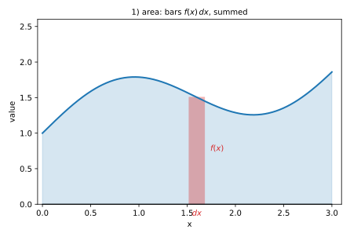

*图 0-1：曲边梯形面积：竖条宽 $dx$、高 $f(x)$，面积 $f(x)dx$。*

**2. 带符号面积（$f$ 变号）**：$x$ 轴上方的部分算正、下方算负。例：$\int_0^{2π}\sin x\,dx=0$——上下两块面积相等，互相抵消。

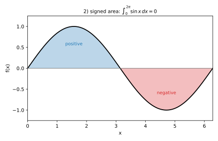

*图 0-2：带符号面积：蓝为正、红为负；$\sin x$ 在 $[0,2π]$ 上一正一负，总和为 0。*

**3. 线质量（$f$ 是线密度）**：$f(x)\,dx$ 是一小段的质量。例：一根杆 $x\in[0,1]$，线密度 $\rho(x)=1+x$（越往右越重），总质量

$$m=\int_0^1(1+x)\,dx=\Big[x+\frac{x^2}{2}\Big]_0^1=1.5.$$

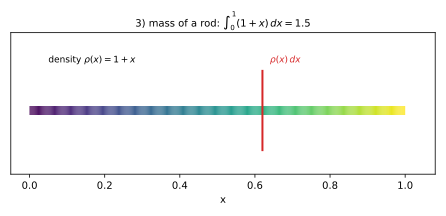

*图 0-3：线质量：杆上颜色越亮密度越大；一小段的质量是 $\rho(x)dx$。*

**4. 变力做功（$f$ 是力）**：$f(x)\,dx$ 是一小段位移上的功。例：力 $F(x)=1+0.6x$ 把物体从 $x=0$ 推到 $x=2$，总功

$$W=\int_0^2(1+0.6x)\,dx=\Big[x+0.3x^2\Big]_0^2=2+1.2=3.2.$$

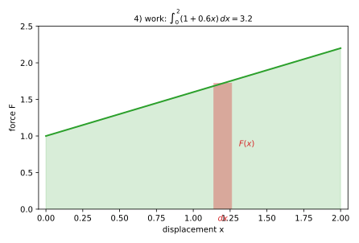

*图 0-4：做功：$F$-$x$ 图下方面积就是功；竖条是 $F(x)dx$。*

### 0.2 二重积分：五种

**5. 曲顶柱体体积（$f\ge0$）**：每块贡献 $f\,d\sigma$ 是一根细柱的体积，累加得**曲顶柱体**体积（底 $D$、顶 $z=f(x,y)$）。

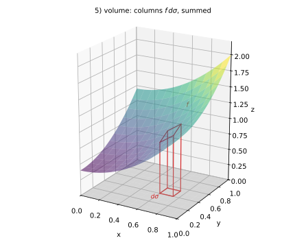

*图 0-5：曲顶柱体：细柱底面积 $d\sigma$、高 $f$，体积 $f\,d\sigma$。*

**6. 面积（$f=1$）**：每块贡献就是它自己的面积，累加得 $D$ 的面积。例：单位圆盘面积

$$\iint_{x^2+y^2\le1}1\,d\sigma=\pi.$$

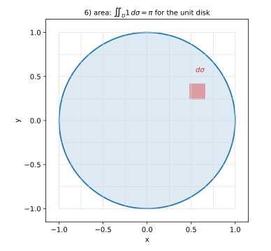

*图 0-6：面积：把区域切成小格，每格面积 $d\sigma$，累加得总面积。*

**7. 薄片质量（$f$ 是面密度）**：$\rho\,d\sigma$ 是一小块的质量。例：正方形薄片 $[0,1]^2$，面密度 $\rho=x+y$，总质量

$$m=\int_0^1\int_0^1(x+y)\,dx\,dy=\frac12+\frac12=1.$$

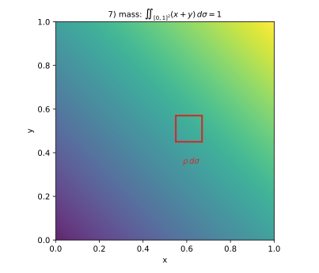

*图 0-7：薄片质量：颜色表示密度；一小块的质量是 $\rho\,d\sigma$。*

**8. 质心（一阶矩）**：质心是质量分布的平衡点。分母是质量，分子是“坐标 × 密度”的积分（叫**对坐标面的矩**）：

$$\overline{x}=\frac{1}{m}\iint x\rho\,d\sigma,\qquad \overline{y}=\frac{1}{m}\iint y\rho\,d\sigma.$$

例：同样 $\rho=x+y$ 的正方形薄片，$m=1$，$\iint x\rho=\frac13+\frac14=\frac7{12}$（对称地 $\iint y\rho=\frac7{12}$），所以质心是 $\big(\frac7{12},\frac7{12}\big)$。

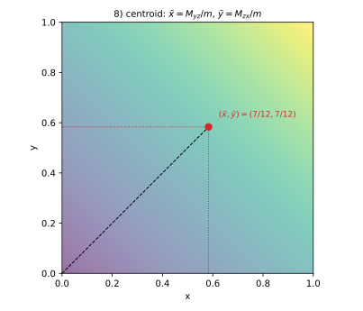

*图 0-8：质心：把薄片支在红点上，各方向力矩抵消；坐标是一阶矩除以质量。*

**9. 转动惯量（二阶矩）**：到转轴的距离平方乘密度，再积分：

$$I_z=\iint(x^2+y^2)\rho\,d\sigma.$$

离轴越远，同样的质量对转动的影响越大（权重 $r^2$）。

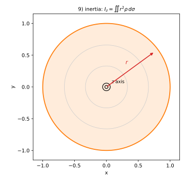

*图 0-9：转动惯量：点绕 $z$ 轴（垂直纸面）转动，权重是到轴距离的平方 $r^2$。*

### 0.3 三重积分：四种

**10. 体积（$f=1$）**：每块贡献就是它自己的体积，累加得 $\Omega$ 的体积。

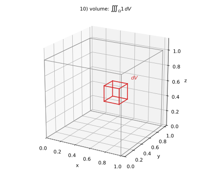

*图 0-10：体积：空间区域中的小块 $dV$，累加得总体积。*

**11. 体质量（$f$ 是体密度）**：$\rho\,dV$ 是一小块的质量。

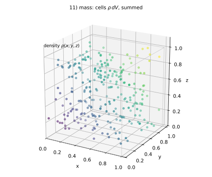

*图 0-11：体质量：体内颜色表示密度；小块质量 $\rho\,dV$，累加得总质量。*

**12. 质心（一阶矩）**：同样是一阶矩除以质量。例：均匀半球 $x^2+y^2+z^2\le R^2$、$z\ge0$，由对称性 $\overline{x}=\overline{y}=0$，而

$$\overline{z}=\frac{1}{m}\iiint z\,dV=\frac{3R}{8}.$$

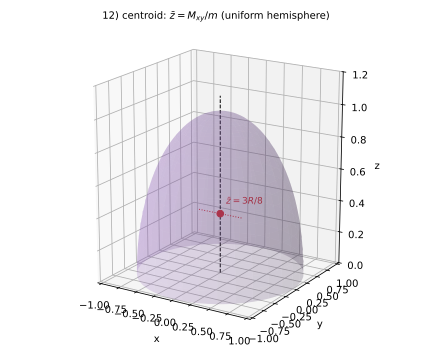

*图 0-12：质心：均匀半球的质心在 $z$ 轴上，高度 $3R/8$（不是几何中心 $R/2$，因为下半部更重）。*

**13. 转动惯量（二阶矩）**：

$$I_z=\iiint(x^2+y^2)\rho\,dV.$$

例：均匀球（总质量 $m$、半径 $R$）绕任意直径的转动惯量是 $\frac25mR^2$。

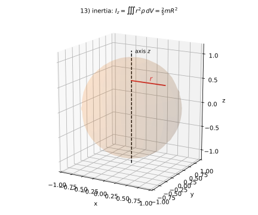

*图 0-13：转动惯量：绕 $z$ 轴转动，每个小块权重是到轴距离的平方 $r^2$。*

### 0.4 三者是同一个结构

| | 一重 | 二重 | 三重 |
|---|---|---|---|
| 区域 | 区间 $[a,b]$ | 平面区域 $D$ | 空间区域 $\Omega$ |
| 小块 | 长度元 $dx$ | 面积元 $d\sigma$ | 体积元 $dV$ |
| 累加式 | $\sum f\,dx$ | $\sum f\,d\sigma$ | $\sum f\,dV$ |
| $f=1$ 时 | 区间长度 | 面积 | 体积 |
| $f$ 是密度时 | 线质量 | 面质量 | 体质量 |
| $f=$ 坐标 × 密度 | 杆的质心 | 薄片质心 | 体质心 |
| $f=$ 距离² × 密度 | 杆绕点的转动惯量 | 薄片绕轴惯量 | 体绕轴惯量 |
| 记号 | $\int$ | $\iint$ | $\iiint$ |

**加一维 = 小块多一个方向**。12 讲把二重积分化成两次一重积分；14 讲把三重积分化成三次一重积分——都是“降维”。

**三重积分的四维问题**：二重积分能画成“曲顶柱体”，是因为“二维底 + 一维高”刚好放得进三维；三重积分的“值 × 体积元”是四维的，画不出来。所以 §0.3 的图只画“区域 + 小块 + 密度”，不要硬找“四维柱体”。

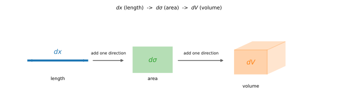

*图 0-14：三级嵌套：长度元 $dx$ → 面积元 $d\sigma$ → 体积元 $dV$，每加一维就多乘一个方向的长度。*

### 0.5 现在要“面熟”到什么程度

| 看到 | 先认出 | 现在要不要会算 |
|---|---|---|
| $\int_a^b f\,dx$ | 一维累积：面积、带符号面积、线质量、功 | 上册已会 |
| $\iint_D f\,d\sigma$ | 二维累积：体积、面积、面质量、质心、转动惯量 | 本讲开始学 |
| $\iiint_\Omega f\,dV$ | 三维累积：体积、体质量、质心、转动惯量 | 14 讲学 |

**只需要记住三句**：看积分号是几重、区域是几维、小块是什么。至于“值”是什么（高度、密度、电荷密度、坐标×密度、距离²×密度），题目会直接告诉你。质心与转动惯量的算法在 15 讲，现在只要知道：**它们也是“值 × 小块”的累加**。

## 一、从曲顶柱体的体积说起

> §0 已经说过：二重积分对应“曲顶柱体的体积”。现在把这个说法**算实**：把底切成小格、每格用细柱近似，看和怎么收敛。

### 1.1 一个具体问题

设 $D=[0,1]\times[0,1]$（笛卡尔积，即 $0\le x\le1$、$0\le y\le1$ 的单位正方形），曲面 $z=x^2+y^2$ 在 $D$ 上方围出一个**曲顶柱体**（底面是平面区域 $D$、顶面是曲面 $z=f(x,y)$、侧面竖直的立体）。求它的体积 $V$。

**先粗算**：把 $D$ 切成 $4\times4=16$ 个小正方形，每块面积 $\Delta\sigma=\frac{1}{16}$。在每块里取**右上角点** $(\xi_i,\eta_i)$，用高度 $f(\xi_i,\eta_i)$ 乘面积，得到近似体积

$$S_{16}=\sum_{i=1}^{16} f(\xi_i,\eta_i)\,\Delta\sigma.$$

具体地，第 $(i,j)$ 块的右上角是 $\big(\tfrac{i}{4},\tfrac{j}{4}\big)$（$i,j=1,\dots,4$），所以

$$S_{16}=\frac{1}{16}\sum_{i=1}^{4}\sum_{j=1}^{4}\left[\Big(\frac{i}{4}\Big)^2+\Big(\frac{j}{4}\Big)^2\right].$$

**切得更细**：$n\times n$ 块，每块面积 $1/n^2$：

$$S_n=\frac{1}{n^2}\sum_{i=1}^{n}\sum_{j=1}^{n}\left[\Big(\frac{i}{n}\Big)^2+\Big(\frac{j}{n}\Big)^2\right].$$

$n$ 越大，$S_n$ 越接近真实体积。**极限过程**就是二重积分的定义。

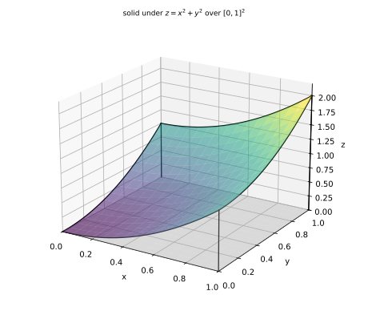

*图 1：$z=x^2+y^2$ 在单位正方形上方的曲顶柱体；底面切成小格，每格用小柱体近似。*

### 1.2 定义：分割、取点、求极限

设 $D$ 是平面上的**有界闭区域**，$f$ 在 $D$ 上有界。

1. **分割**：把 $D$ 任意分成 $n$ 个小区域 $\Delta\sigma_1,\Delta\sigma_2,\dots,\Delta\sigma_n$（$\Delta\sigma_i$ 同时表示第 $i$ 块的**面积**）。
2. **取点**：在每块 $\Delta\sigma_i$ 里**任意**取一点 $(\xi_i,\eta_i)$。
3. **求和**：

$$S_n=\sum_{i=1}^{n} f(\xi_i,\eta_i)\,\Delta\sigma_i.$$

这个和叫**黎曼和**（Riemann sum）：用每块里的一个值代表整块，再按面积加权求和。

4. **取极限**：令 $\lambda$ 为所有小区域**直径**的最大值（直径＝块内任意两点距离的上确界）。若 $\lambda\to0$ 时 $S_n$ 趋于一个**与分割方式、取点方式都无关**的常数 $I$，则称 $f$ 在 $D$ 上**可积**（integrable），并记

$$\iint_D f(x,y)\,d\sigma=I.$$

**逐句读这个定义**：

- “**任意**分成 $n$ 块”：切法不限（方格、斜块、大小不一都行）；
- “**任意**取点”：每块里挑哪个点都行；
- “**与分割、取点无关**”：这是可积的实质——不管怎么切、怎么挑，和都挤向同一个数；
- “$\lambda\to0$”：要求**每一块都变小**（不只是块数变多），否则可能出现“越切越细但某一块始终很大”的情况，和不一定收敛。

**$d\sigma$ 是什么**：面积元素（area element）。直角坐标下 $d\sigma=dx\,dy$（第 12 讲），极坐标下 $d\sigma=r\,dr\,d\theta$（第 13 讲）——现在只需要把它理解成“一小块面积”。

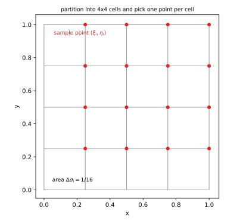

*图 2：把 $[0,1]^2$ 分成 $4\times4$ 块，每块面积 $1/16$，在每块里取一点（红点）——定义里的“任意分割、任意取点”。*

**“和随 $n$ 收敛”长什么样**：对 $x^2+y^2$ 在 $[0,1]^2$ 上的右端点黎曼和，可以算出

$$S_n=\frac{(n+1)(2n+1)}{3n^2}\to\frac23.$$

$n=10$ 时 $S_n=0.77$，$n=100$ 时 $0.6767$，$n=1000$ 时 $0.667667$——误差按 $1/n$ 降（见数值核对 EXP1）。

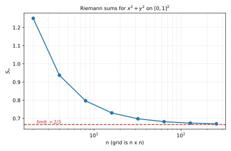

*图 3：$n$ 从 2 到 256，黎曼和逼近 $2/3$（红色虚线）；横轴对数。*

### 1.3 与一元定积分的对照

| 一元定积分 | 二重积分 |
|---|---|
| 区间 $[a,b]$ | 平面区域 $D$ |
| 分成小段 $\Delta x_i$ | 分成小区域 $\Delta\sigma_i$ |
| 长度 $\Delta x_i$ | 面积 $\Delta\sigma_i$ |
| $\sum f(\xi_i)\Delta x_i$ | $\sum f(\xi_i,\eta_i)\Delta\sigma_i$ |
| $\lambda=\max\Delta x_i$ | $\lambda=\max$ 直径 |
| $\int_a^b f(x)\,dx$ | $\iint_D f(x,y)\,d\sigma$ |

**唯一的实质升级**：分割对象从“长度”变成了“面积”。其余（分割、取点、求和、极限、与切法无关）一模一样。

**几何意义**：$f\ge0$ 时，$\iint_D f\,d\sigma$ 就是曲顶柱体的体积。$f$ 有正有负时，正的部分算正体积、负的部分算负体积，积分是**代数和**（图 4 会看到）。

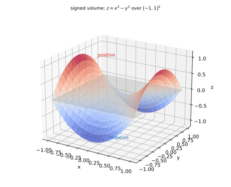

*图 4：$z=x^2-y^2$ 在 $[-1,1]^2$ 上：一半在 $z=0$ 上方（红），一半在下方（蓝）；积分是两者的代数和（本例为 $0$）。*

## 二、可积性

### 2.1 必要条件：有界

**若 $f$ 在 $D$ 上无界，则不可积**。理由：无界意味着在某个方向上函数值可以任意大；把取点放在那里，黎曼和可以任意大，不可能趋于一个固定数。

**例子**：$f=\dfrac{1}{x^2+y^2}$ 在含原点的区域上无界——作为黎曼积分**不可积**。（它在某些区域上作为“反常积分”可能收敛，但那是另一套定义，本课程不讨论。）本课程只讨论**有界函数**的黎曼积分。

### 2.2 充分条件：连续 ⇒ 可积

**定理**：若 $f$ 在**有界闭区域** $D$ 上**连续**，则 $f$ 在 $D$ 上可积。（证明属分析课程，本课程直接用。）

更一般地，**分片连续**也可积：如果 $f$ 在 $D$ 内除了有限条光滑曲线外连续，且有界，则仍可积——间断点落在“零面积”的曲线上，不影响黎曼和。

**这一条解释了为什么课本上的二重积分题几乎都能积**：题目给的函数在区域上连续或分片连续。

### 2.3 有界不等于可积（Dirichlet 型反例）

有界只是必要条件。反例：在 $D=[0,1]\times[0,1]$ 上定义

$$f(x,y)=\begin{cases}1,&x,y\text{ 都是有理数},\\0,&\text{否则}.\end{cases}$$

$f$ 有界（$0\le f\le1$），但：每块小区域里既有有理点也有无理点。**全取有理点**时，黎曼和 $=\sum1\cdot\Delta\sigma_i=1$；**全取无理点**时，和 $=0$。

**同一个分割、不同的取点，和趋于不同的值**——按定义**不可积**。

**结论**：可积性不是“有界”自动给的；连续（或分片连续）是常用的充分条件。

## 三、性质

以下性质都由黎曼和直接推出（和的线性、不等式、极限保序），不需要重新证明。

### 3.1 线性与区域可加

**线性**：$\alpha,\beta$ 为常数，

$$\iint_D(\alpha f+\beta g)\,d\sigma=\alpha\iint_D f\,d\sigma+\beta\iint_D g\,d\sigma.$$

**理由**：黎曼和逐项拆开，再取极限。

**区域可加**：若 $D=D_1\cup D_2$，且 $D_1,D_2$ 的内部不交（最多共享边界），则

$$\iint_D f\,d\sigma=\iint_{D_1} f\,d\sigma+\iint_{D_2} f\,d\sigma.$$

**理由**：把分割取得与 $D_1,D_2$ 的公共边界一致，和自然分成两部分。

**两个直接推论**：

- $\iint_D 1\,d\sigma=\sigma(D)$（$D$ 的面积）——每块面积加起来就是总面积；
- $\iint_D c\,d\sigma=c\,\sigma(D)$（常数提出来）。

### 3.2 保号、比较、估值

- **保号**：$f\ge0$ 在 $D$ 上 ⇒ $\iint_D f\,d\sigma\ge0$。
- **比较**：$f\le g$ 在 $D$ 上 ⇒ $\iint_D f\,d\sigma\le\iint_D g\,d\sigma$。
- **估值**：设 $m\le f\le M$ 在 $D$ 上，则

$$m\,\sigma(D)\le\iint_D f\,d\sigma\le M\,\sigma(D).$$

**理由**：每块都满足 $m\Delta\sigma_i\le f(\xi_i,\eta_i)\Delta\sigma_i\le M\Delta\sigma_i$，求和后取极限。

**估值怎么用**：当积分算不出来（或不想算）时，先用 $f$ 的最大最小值框出一个区间。例：$D$ 是单位圆盘（$\sigma=\pi$），$f=\dfrac{1}{1+x^2+y^2}$。在 $D$ 上 $x^2+y^2\in[0,1]$，所以

$$\frac12\le f\le1\quad\Longrightarrow\quad \frac{\pi}{2}\le\iint_D f\,d\sigma\le\pi.$$

### 3.3 中值定理

**定理**：若 $f$ 在（有界闭）区域 $D$ 上连续，则存在 $(\xi,\eta)\in D$，使

$$\iint_D f\,d\sigma=f(\xi,\eta)\,\sigma(D).$$

**读法**：曲顶柱体的体积 = “某个高度” × 底面积；$f(\xi,\eta)$ 就是**平均高度**。

**边界说明**：$(\xi,\eta)$ 只保证在**闭区域** $D$ 内，**可能在边界上**；不保证在内部。

## 四、例题

**例 1**：设 $D$ 是半径为 $2$ 的圆盘，求 $\iint_D 5\,d\sigma$。

**解**：由 3.1 的推论，常数可以提出来：

$$\iint_D 5\,d\sigma=5\iint_D 1\,d\sigma=5\,\sigma(D).$$

圆盘面积 $\sigma(D)=\pi\cdot2^2=4\pi$，所以

$$\iint_D 5\,d\sigma=5\cdot4\pi=20\pi.$$

**例 2**：$D=[0,1]\times[0,1]$，用定义计算 $\iint_D x\,d\sigma$。

**解**：把 $D$ 均匀分成 $n\times n$ 块，每块面积 $\Delta\sigma=\dfrac{1}{n^2}$；第 $(i,j)$ 块取右上角点 $\big(\tfrac{i}{n},\tfrac{j}{n}\big)$。

黎曼和：

$$S_n=\sum_{i=1}^{n}\sum_{j=1}^{n}\frac{i}{n}\cdot\frac{1}{n^2}=\frac{1}{n^3}\sum_{i=1}^{n} i\sum_{j=1}^{n}1=\frac{1}{n^3}\cdot\frac{n(n+1)}{2}\cdot n=\frac{n+1}{2n}.$$

取极限：

$$\lim_{n\to\infty}S_n=\lim_{n\to\infty}\frac{n+1}{2n}=\frac12.$$

所以 $\iint_D x\,d\sigma=\dfrac12$。**检验**：$D$ 关于直线 $x=\frac12$ 对称，$x$ 的平均值是 $\frac12$，积分 $=\frac12\cdot\sigma(D)=\frac12$ ✓。

**例 3**：$D=[0,1]\times[0,1]$，比较 $\iint_D x^2y\,d\sigma$ 与 $\iint_D xy^2\,d\sigma$。

**解**：把两个被积函数相减：

$$x^2y-xy^2=xy(x-y).$$

直接看符号：在 $x>y$ 的部分为正、$x<y$ 的部分为负，不能直接比较。**用对称性**：区域 $D$ 在交换 $x,y$ 后不变（正方形），而被积函数 $x^2y$ 交换后变成 $y^2x=xy^2$。因此两个积分相等：

$$\iint_D x^2y\,d\sigma=\iint_D xy^2\,d\sigma.$$

（等价地：差的积分 $\iint_D xy(x-y)\,d\sigma=0$，因为被积函数在交换 $x,y$ 后变号，而区域不变。）

**例 4**：$D$ 是单位圆盘，估计 $I=\iint_D\dfrac{1}{1+x^2+y^2}\,d\sigma$ 的范围。

**解**：在 $D$ 上 $0\le x^2+y^2\le1$，所以

$$\frac12\le\frac{1}{1+x^2+y^2}\le1.$$

又 $\sigma(D)=\pi$，由估值性质：

$$\frac{\pi}{2}\le I\le\pi.$$

（数值上 $I\approx2.177$，确实落在 $[\frac{\pi}{2},\pi]\approx[1.571,3.142]$ 内——见数值核对。注意这里只用估值，没有真的算积分。）

**例 5**（有界但不可积）：$D=[0,1]\times[0,1]$，

$$f(x,y)=\begin{cases}1,&x,y\text{ 都是有理数},\\0,&\text{否则}.\end{cases}$$

说明 $f$ 在 $D$ 上不可积。

**解**：任取一个分割（例如 $n\times n$ 网格）。每块小区域里既有有理点也有无理点。

- 每块都取有理点：$f(\xi_i,\eta_i)=1$，黎曼和 $=\sum1\cdot\Delta\sigma_i=\sigma(D)=1$；
- 每块都取无理点：$f(\xi_i,\eta_i)=0$，黎曼和 $=0$。

同一个分割、不同的取点，和分别恒等于 $1$ 与 $0$。按定义（要求与取点无关），$f$ **不可积**。

**例 6**：$D=[0,1]\times[0,1]$，求 $\iint_D(2x+3y)\,d\sigma$。

**解**：由线性性质拆开：

$$\iint_D(2x+3y)\,d\sigma=2\iint_D x\,d\sigma+3\iint_D y\,d\sigma.$$

由例 2，$\iint_D x\,d\sigma=\frac12$；同理（把 $x,y$ 互换）$\iint_D y\,d\sigma=\frac12$。所以

$$\iint_D(2x+3y)\,d\sigma=2\cdot\frac12+3\cdot\frac12=\frac52.$$

## 五、数值核对

用脚本核对本节结论（`scripts/lec11-02_verify_double.py`，全脚本 0.00 秒）：

```
=== EXP1: Riemann sums for x^2+y^2 on [0,1]^2, n = 10, 100, 1000 ===
  n=  10: S_n = 0.7700000000, err vs 2/3 = 1.03e-01
  n= 100: S_n = 0.6767000000, err vs 2/3 = 1.00e-02
  n=1000: S_n = 0.6676670000, err vs 2/3 = 1.00e-03

=== EXP2: Riemann sums for x on [0,1]^2 (right endpoints) ===
  n=  10: S_n = 0.5500000000, err vs 1/2 = 5.00e-02
  n= 100: S_n = 0.5050000000, err vs 1/2 = 5.00e-03
  n=1000: S_n = 0.5005000000, err vs 1/2 = 5.00e-04

=== EXP3: estimate of 1/(1+x^2+y^2) on the unit disk vs bounds ===
  grid estimate = 2.177458
  bounds: pi/2 = 1.570796 <= I <= pi = 3.141593
  analytic check: pi*ln2 = 2.177586

=== EXP4: Dirichlet-type function: two choices of sample points ===
  all rational sample points:   S = 1.000000
  all irrational sample points: S = 0.000000
  -> same partition, different sample points, different limits: not integrable
```

**核对点**：EXP1 与 EXP2 的误差都按 $1/n$ 降（$10^{-1},10^{-2},10^{-3}$ 与 $5\times10^{-2},5\times10^{-3},5\times10^{-4}$）——这是矩形法（右端点）的一阶误差，不是算错；EXP3 的网格估计是 $2.177458$，落在 $[\pi/2,\pi]$ 内（与充分细网格的 $2.177586$ 差 $1.3\times10^{-4}$）；EXP4 同一分割下“全取有理点”和 $=1$、“全取无理点”和 $=0$，直接展示不可积。

## 小结

- **定义**：有界闭区域上分割 → 每块任意取点 → 求和 → 令最大直径趋于零；极限与分割、取点无关时才叫**可积**。
- **与定积分**：只把“区间/长度”换成“区域/面积”，其余同构；$f\ge0$ 时是曲顶柱体体积，有正负时是代数和。
- **可积性**：**有界**是必要条件；**连续（或分片连续）**是充分条件；**有界不一定可积**（Dirichlet 型反例）。
- **性质**：线性、区域可加、保号、比较、估值 $m\sigma\le\iint f\le M\sigma$、中值定理 $\iint f=f(\xi,\eta)\sigma$（中值点可在边界）。
- **下一步**：定义不负责“怎么算”；计算要靠**累次积分**（第 12 讲）。

## 作业

**说明**：答案平铺在每题下方（先做再对照）。只用上册与本讲已教内容。

**1.** 设 $D$ 是边长为 $3$ 的正方形，求 $\iint_D 7\,d\sigma$。

**参考答案**：
$\iint_D 7\,d\sigma=7\,\sigma(D)=7\cdot9=63$。

**2.** $D=[0,1]\times[0,1]$，用定义（$n\times n$ 均匀分割、取右上角点）计算 $\iint_D y\,d\sigma$，写出黎曼和与极限。

**参考答案**：
$S_n=\sum_{i=1}^{n}\sum_{j=1}^{n}\frac{j}{n}\cdot\frac{1}{n^2}=\frac{1}{n^3}\cdot n\cdot\frac{n(n+1)}{2}=\frac{n+1}{2n}$。
$\lim_{n\to\infty}S_n=\frac12$，所以 $\iint_D y\,d\sigma=\frac12$。

**3.** $D$ 是单位圆盘，利用估值给出 $\iint_D(x^2+y^2)\,d\sigma$ 的范围。

**参考答案**：
在 $D$ 上 $0\le x^2+y^2\le1$，$\sigma(D)=\pi$，所以 $0\le\iint_D(x^2+y^2)\,d\sigma\le\pi$。

**4.** $D=[0,1]\times[0,1]$，判断 $\iint_D x^2y\,d\sigma$ 与 $\iint_D xy^2\,d\sigma$ 的大小关系，并说明理由。

**参考答案**：
相等。区域在交换 $x,y$ 后不变，而被积函数互换（$x^2y\leftrightarrow xy^2$），所以两个积分相等；差的积分 $\iint_D xy(x-y)\,d\sigma=0$。

**5.** 设 $f$ 在 $D$ 上连续，$m\le f\le M$。证明 $m\sigma(D)\le\iint_D f\,d\sigma\le M\sigma(D)$。

**参考答案**：
对任意分割与取点，每块有 $m\Delta\sigma_i\le f(\xi_i,\eta_i)\Delta\sigma_i\le M\Delta\sigma_i$；求和得 $m\sum\Delta\sigma_i\le S_n\le M\sum\Delta\sigma_i$，即 $m\sigma(D)\le S_n\le M\sigma(D)$。令 $\lambda\to0$，由极限保序得结论。$\blacksquare$

**6.**（概念）为什么“有界”不足以保证可积？举出本讲的反例。

**参考答案**：
可积还要求黎曼和**与取点无关**。Dirichlet 型函数 $f=1$（$x,y$ 都有理）/ $0$（否则）在 $[0,1]^2$ 上有界，但全取有理点与全取无理点时，和分别为 $1$ 和 $0$，极限不唯一，所以不可积。
