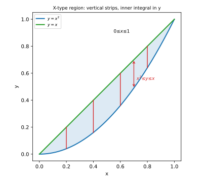
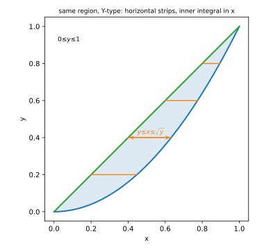
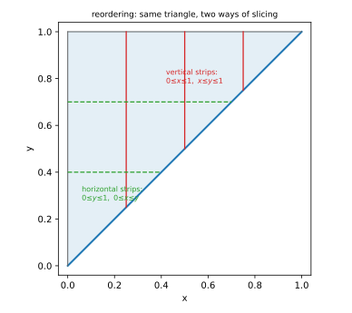
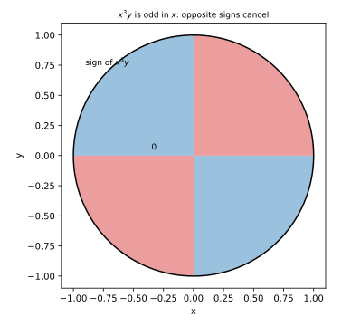

# 第 12 讲：二重积分的计算（直角坐标）

> **前置**：11 讲（二重积分的定义与性质）；上册定积分与牛顿-莱布尼茨公式。
> **本讲解决什么**：11 讲的定义只说“二重积分是什么”，没说“怎么算”。计算的核心是把它化成**两次一元积分**：先固定一个变量、算一条截面的积分，再沿另一个变量累加。本讲讲清三件事：**X 型/Y 型区域怎么设限**、**换序为什么要重画区域**、**对称性怎么省计算**。

## 一、从黎曼和到累次积分：先分组，再相加

### 1.1 为什么要“先固定一个变量”

11 讲的二重积分是黎曼和的极限：

$$\iint_D f\,d\sigma=\lim_{\lambda\to0}\sum_i f(\xi_i,\eta_i)\,\Delta\sigma_i.$$

这个和是**二维**的：每个小块同时有 $x$ 方向和 $y$ 方向的尺寸。要把它算出来，先决定**按什么顺序把和拆开**。

取一条竖条：固定 $x$，让 $y$ 在竖条内从下边界 $y_1(x)$ 变到上边界 $y_2(x)$。竖条内的和是

$$\sum_j f(x,\eta_j)\,\Delta y\ \longrightarrow\ \int_{y_1(x)}^{y_2(x)}f(x,y)\,dy=:A(x).$$

这一步只是**把二维和先按 $y$ 加完**，得到一个只依赖 $x$ 的量 $A(x)$。几何上，$A(x)$ 就是竖直平面 $x=\text{常数}$ 切曲顶柱体得到的**截面积**（竖条扫出的曲边梯形的面积）。

再把所有竖条沿 $x$ 加起来：

$$\sum_k A(x_k)\,\Delta x\ \longrightarrow\ \int_a^b A(x)\,dx.$$

合起来：

$$\boxed{\iint_D f\,d\sigma=\int_a^b\left[\int_{y_1(x)}^{y_2(x)}f(x,y)\,dy\right]dx.}$$

**所以累次积分不是新公式**：它是**同一个二维黎曼和，先按 $y$ 分组、再按 $x$ 分组**的结果。后面所有设限、换序、对称性，都是在这句话上做文章。



*图 1：区域夹在 $y=x^2$ 与 $y=x$ 之间；固定 $x$ 画一条竖线，它从下边界 $x^2$ 穿到上边界 $x$——这条竖条内的和就是 $A(x)$。*

### 1.2 X 型区域与累次积分公式

若区域可以写成

$$D=\{(x,y):a\le x\le b,\ \varphi_1(x)\le y\le\varphi_2(x)\},$$

则称 $D$ 为 **X 型区域**（每条竖线与 $D$ 的交是一段）。此时上式就是

$$\iint_D f(x,y)\,d\sigma=\int_a^b dx\int_{\varphi_1(x)}^{\varphi_2(x)} f(x,y)\,dy.$$

**注意两个位置**：外层 $dx$ 的上下限 $a,b$ 必须是**常数**（因为 $x$ 在所有竖条上跑）；内层 $dy$ 的上下限 $\varphi_1,\varphi_2$ 可以**含 $x$**（每条竖条的上下边界随位置变）。

### 1.3 Y 型区域

若区域可以写成

$$D=\{(x,y):c\le y\le d,\ \psi_1(y)\le x\le\psi_2(y)\},$$

则称 **Y 型区域**（每条横线与 $D$ 的交是一段），此时先对 $x$ 积：

$$\iint_D f\,d\sigma=\int_c^d dy\int_{\psi_1(y)}^{\psi_2(y)} f(x,y)\,dx.$$



*图 2：同一个区域（$y=x^2$ 与 $y=x$ 之间）也可以用横条切：$y$ 从 $0$ 到 $1$，每条横线从 $x=y$ 穿到 $x=\sqrt y$。*

### 1.4 设限的两条硬规矩

1. **外层上下限必须是常数**：外层积分变量在整个区域上跑，范围是一个固定区间；
2. **内层上下限可以含外层变量**：内层变量的边界随外层变量变化（图 1 中“上边界是 $x$”）。

**写反会错**：$\int_a^b dx\int_{\varphi_1(x)}^{\varphi_2(x)}dy$ 表示“先 $y$ 后 $x$”；若把两个积分号对调而不重画区域，上下限就失去了意义。换序的正确做法见 §三。

## 二、设限的实践

### 2.1 先画图，再切条（三步）

1. **画边界**：把区域的边界曲线画出来，标出交点；
2. **找投影区间**：确定外层变量（$x$ 或 $y$）的范围；
3. **切条看穿越**：固定外层变量画一条线，看它从哪条边界进、从哪条边界出——这两个表达式就是内层上下限。

**不要跳过第 1 步**：不画图直接写限，是这类题最常见的错误来源。

### 2.2 判断 X 型还是 Y 型

- **X 型**：每条**竖线**与区域交成一段；
- **Y 型**：每条**横线**与区域交成一段。

很多区域**两种都行**。例：$D$ 由 $y=x^2$ 与 $y=x$ 围成（交点 $(0,0)$、$(1,1)$）：

- X 型：$0\le x\le1$，$x^2\le y\le x$；
- Y 型：$0\le y\le1$，$y\le x\le\sqrt y$（由 $x^2\le y$ 且 $x\ge0$ 得 $x\le\sqrt y$）。

**选哪种**：看内层哪个好积。例：被积函数含 $e^{y^2}$ 时，先对 $y$ 积积不出，就换 Y 型（先对 $x$ 积）。

### 2.3 需要拆分的情形

有的区域对某个方向**不是** X 型或 Y 型，或者需要拆成几段。

**例**：$D$ 由 $y=x^2$ 与 $y=2-x^2$ 围成（交点 $(\pm1,1)$）。

- **X 型（一段）**：$-1\le x\le1$，$x^2\le y\le2-x^2$；
- **Y 型（两段）**：$0\le y\le1$ 时 $-\sqrt y\le x\le\sqrt y$；$1\le y\le2$ 时 $-\sqrt{2-y}\le x\le\sqrt{2-y}$。

同一区域，X 型一段就够，Y 型要拆两段。**先比较，选不拆的那种**。

**再看一个必须拆的例子**：$D$ 是 $y=\sin x$（$0\le x\le2\pi$）与 $x$ 轴围成的两块。X 型要按 $[0,\pi]$（$0\le y\le\sin x$）与 $[\pi,2\pi]$（$\sin x\le y\le0$）拆成两段；Y 型要把上半、下半分别写成 $\arcsin$ 的形式，也麻烦。**拆分在这类题里是常态，不是例外**。

## 三、换序

### 3.1 换序 = 重画区域

累次积分的两种次序是**同一个二重积分**的两种写法（Fubini 定理），但换序**必须重新画区域、重新设限**，不能把上下限机械对调。

**例**：$I=\int_0^1 dx\int_x^1 f(x,y)\,dy$。

区域是 $0\le x\le1$、$x\le y\le1$——由 $y=x$、$y=1$、$x=0$ 围成的三角形。

换成先 $x$ 后 $y$：$y$ 的范围是 $0\le y\le1$；固定 $y$，横线从 $x=0$ 穿到 $x=y$。所以

$$I=\int_0^1 dy\int_0^y f(x,y)\,dx.$$

**注意**：不是 $\int_x^1 dx\int_0^1 dy$——那样上下限都错位了。



*图 3：区域是三角形；竖条（先 $y$）与横条（先 $x$）是同一块区域的两种切法。换序就是把“竖条的范围”改写成“横条的范围”。*

### 3.2 换序救场：内层积不出时

**例**：$I=\int_0^1 dx\int_x^1 e^{-y^2}\,dy$。

内层 $\int e^{-y^2}dy$ **没有初等原函数**，直接积不出来。

**换序**：区域是三角形 $0\le x\le1$、$x\le y\le1$。先 $x$ 后 $y$：

$$I=\int_0^1 dy\int_0^y e^{-y^2}\,dx=\int_0^1 y\,e^{-y^2}\,dy.$$

内层对 $x$ 积（$e^{-y^2}$ 当常数）给出 $y e^{-y^2}$。再算外层：令 $u=y^2$，$du=2y\,dy$，

$$I=\frac12\int_0^1 e^{-u}\,du=\frac12\Big[-e^{-u}\Big]_0^1=\frac12(1-e^{-1})\approx0.316.$$

**这就是换序的第一用途**：内层积不出时，换个次序让它变成可积的。

## 四、对称性

### 4.1 关于坐标轴对称

设 $D$ 关于 $y$ 轴对称（$(x,y)\in D$ ⇔ $(-x,y)\in D$）。

- 若 $f$ 关于 $x$ 是**奇函数**（$f(-x,y)=-f(x,y)$），则 $\iint_D f\,d\sigma=0$；
- 若 $f$ 关于 $x$ 是**偶函数**，则 $\iint_D f\,d\sigma=2\iint_{D_{x\ge0}} f\,d\sigma$。

**理由**：左右对称的两块，奇函数的值一正一负抵消；偶函数的值相同，翻倍。

关于 $x$ 轴对称同理（看 $f$ 关于 $y$ 的奇偶）。

**注意**：两个条件缺一不可——**区域对称**且**函数对相应变量奇/偶**。

**例**：$\iint_{x^2+y^2\le1} x^3y\,d\sigma$。区域是圆盘，关于 $y$ 轴对称；$x^3y$ 关于 $x$ 是奇函数（$(-x)^3y=-x^3y$）。所以积分 $=0$。



*图 4：$x^3y$ 在圆盘上的符号：左右两半符号相反（红/蓝），积分抵消为 $0$。*

### 4.2 轮换对称（$x,y$ 互换）

若 $D$ 关于直线 $y=x$ 对称（$(x,y)\in D$ ⇔ $(y,x)\in D$），则

$$\iint_D f(x,y)\,d\sigma=\iint_D f(y,x)\,d\sigma.$$

**用途**：把难积的 $f(x,y)$ 换成 $f(y,x)$，或把两个积分合并。例：在正方形 $[0,1]^2$ 上，$\iint x^2y\,d\sigma=\iint xy^2\,d\sigma$（11 讲例 3 已用此结论）。

## 五、例题

**例 1**：$D$ 是三角形 $0\le x\le1$、$0\le y\le x$，求 $\iint_D(x+y)\,d\sigma$。

**解**：这是 X 型区域：$0\le x\le1$，$0\le y\le x$。

先对 $y$ 积（$x$ 当常数）：

$$\int_0^x(x+y)\,dy=\Big[xy+\frac{y^2}{2}\Big]_0^x=x^2+\frac{x^2}{2}=\frac32x^2.$$

再对 $x$ 积：

$$\iint_D(x+y)\,d\sigma=\int_0^1\frac32x^2\,dx=\frac32\cdot\frac13=\frac12.$$

**例 2**：$D$ 由 $y=x^2$ 与 $y=x$ 围成（$0\le x\le1$），求 $\iint_D xy\,d\sigma$。

**解**：X 型：$0\le x\le1$，$x^2\le y\le x$。

先对 $y$ 积：

$$\int_{x^2}^{x}xy\,dy=x\cdot\Big[\frac{y^2}{2}\Big]_{x^2}^{x}=\frac{x}{2}(x^2-x^4)=\frac12(x^3-x^5).$$

再对 $x$ 积：

$$\iint_D xy\,d\sigma=\frac12\int_0^1(x^3-x^5)\,dx=\frac12\Big(\frac14-\frac16\Big)=\frac12\cdot\frac1{12}=\frac1{24}.$$

**例 3**（换序）：计算 $I=\int_0^1 dx\int_x^1 e^{-y^2}\,dy$。

**解**：区域是三角形 $0\le x\le1$、$x\le y\le1$。换序（§3.2）：$0\le y\le1$、$0\le x\le y$。

$$I=\int_0^1 dy\int_0^y e^{-y^2}\,dx=\int_0^1 y e^{-y^2}\,dy.$$

令 $u=y^2$，$du=2y\,dy$：$I=\frac12\int_0^1 e^{-u}du=\frac12(1-e^{-1})\approx0.3161$。

**例 4**（拆分对比）：$D$ 由 $y=x^2$ 与 $y=2-x^2$ 围成，求面积 $\iint_D 1\,d\sigma$。

**解一（X 型，一段）**：$-1\le x\le1$，$x^2\le y\le2-x^2$。

$$\iint_D1\,d\sigma=\int_{-1}^1\big[(2-x^2)-x^2\big]dx=\int_{-1}^1(2-2x^2)dx=\Big[2x-\frac{2x^3}{3}\Big]_{-1}^1=\frac43+\frac43=\frac83.$$

**解二（Y 型，两段）**：

- $0\le y\le1$：$-\sqrt y\le x\le\sqrt y$，长度 $2\sqrt y$；
- $1\le y\le2$：$-\sqrt{2-y}\le x\le\sqrt{2-y}$，长度 $2\sqrt{2-y}$。

$$\iint_D1\,d\sigma=\int_0^1 2\sqrt y\,dy+\int_1^2 2\sqrt{2-y}\,dy=2\cdot\frac23+2\cdot\frac23=\frac43+\frac43=\frac83.$$

两种设限结果一致（$\frac83$）——**这既是验算，也说明“同一区域可以有两种类型，拆不拆看哪种省事”**。

**例 5**（对称）：$\iint_{x^2+y^2\le1} x^3y\,d\sigma$。

**解**：区域关于 $y$ 轴对称；$f(x,y)=x^3y$ 关于 $x$ 是奇函数。所以积分 $=0$。

（若不信，也可换极坐标算——但本节只用直角坐标的对称性，理由已在 §4.1 说明。）

## 六、数值核对

用脚本核对本节结论（`scripts/lec12-02_verify_iterated.py`，全脚本 0.00 秒）：

```
=== EXP1: example 1, double integral of x+y over the triangle ===
  numeric = 0.49999997, exact = 0.5, diff = 3.12e-08

=== EXP2: example 2, double integral of xy between y=x^2 and y=x ===
  numeric = 0.04166668, exact = 1/24 = 0.04166667, diff = 1.04e-08

=== EXP3: example 3, reversed order for exp(-y^2) ===
  numeric = 0.31606028, exact = (1-e^-1)/2 = 0.31606028, diff = 1.42e-12

=== EXP4: example 4, area by X-type vs Y-type ===
  X-type = 2.66666667, Y-type = 2.66666667, exact = 8/3 = 2.66666667

=== EXP5: symmetry, x^3 y over the unit disk ===
  numeric = 4.463e-20  (expect ~ 0)
```

**核对点**：EXP1 用二维网格黎曼和（三角形内逐条采样）得 $0.49999997$（差 $3\times10^{-8}$）；EXP2 的内层用解析、外层数值，得 $0.04166668$（差 $1\times10^{-8}$）；EXP3 换序后的一元积分与解析值差 $1.4\times10^{-12}$；EXP4 的 X 型（一段）与 Y 型（两段）给出完全相同的 $2.66666667=8/3$——**两种设限的互相验证**；EXP5 的 $x^3y$ 在圆盘上数值为 $4.5\times10^{-20}$（机器零），与对称性结论一致。

## 小结

- **累次积分**：固定外层变量 → 截面是一元积分 → 再沿外层累加。
- **X 型**：$\int_a^b dx\int_{\varphi_1(x)}^{\varphi_2(x)}f\,dy$；**Y 型**：$\int_c^d dy\int_{\psi_1(y)}^{\psi_2(y)}f\,dx$。
- **设限规矩**：外层上下限是常数，内层上下限可含外层变量；**先画图、再切条、再写限**。
- **换序**：必须重画区域、重新设限；用途是救“内层积不出”。
- **对称性**：区域对称 + 函数对相应变量奇/偶 ⇒ 积分为 0 或翻倍；轮换对称可交换 $x,y$。

## 作业

**说明**：答案平铺在每题下方（先做再对照）。只用上册与本讲已教内容。

**1.** $D$ 是矩形 $0\le x\le2$、$0\le y\le1$，求 $\iint_D(x+2y)\,d\sigma$。

**参考答案**：
X 型：$0\le x\le2$，$0\le y\le1$。
内层：$\int_0^1(x+2y)dy=x+1$；外层：$\int_0^2(x+1)dx=\big[\frac{x^2}{2}+x\big]_0^2=2+2=4$。

**2.** $D$ 由 $y=x$、$y=2x$、$x=1$ 围成，求 $\iint_D xy\,d\sigma$。

**参考答案**：
X 型：$0\le x\le1$，$x\le y\le2x$。
内层：$\int_x^{2x}xy\,dy=x\cdot\frac{(2x)^2-x^2}{2}=\frac32x^3$；外层：$\int_0^1\frac32x^3dx=\frac32\cdot\frac14=\frac38$。

**3.** 交换积分次序：$\int_0^1 dy\int_{y^2}^{y} f(x,y)\,dx$。

**参考答案**：
区域：$0\le y\le1$，$y^2\le x\le y$，即由 $x=y^2$（$y=\sqrt x$）与 $x=y$（$y=x$）围成，$0\le x\le1$。
换序：$0\le x\le1$，$x\le y\le\sqrt x$，即 $\int_0^1 dx\int_x^{\sqrt x} f(x,y)\,dy$。

**4.** 计算 $\int_0^1 dx\int_x^1 \cos(y^2)\,dy$。

**参考答案**：
换序：$0\le y\le1$，$0\le x\le y$。
$\int_0^1 dy\int_0^y\cos(y^2)dx=\int_0^1 y\cos(y^2)dy=\frac12\sin(1)$。

**5.** $D$ 是单位圆盘，求 $\iint_D x^2y\,d\sigma$。

**参考答案**：
区域关于 $y$ 轴对称；$x^2y$ 关于 $x$ 是偶函数（不是奇函数），**不能直接判 0**。但 $x^2y$ 关于 $y$ 是奇函数，而区域也关于 $x$ 轴对称——所以积分为 0。
（两个方向的对称性任选一个用；关键是区域与函数要对上。）

**6.**（概念）为什么换序不能直接把两个积分号的上下限对调？

**参考答案**：
积分上下限描述的是区域在**该次序下**的切片范围。换序改变了“先切哪个方向”，区域的边界表达式也随之改变；直接对调会得到一块不同的区域（或上下限失去意义）。正确做法是重画区域、按新次序重新切条设限。
