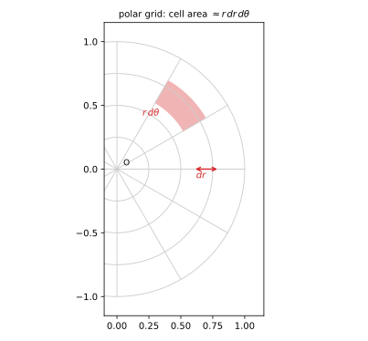
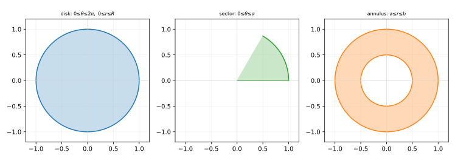
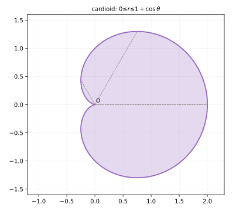
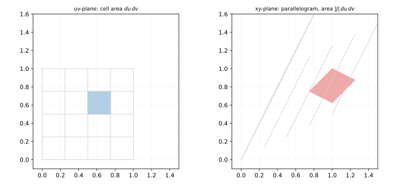

# 第 13 讲：极坐标与一般换元（雅可比）

> **前置**：12 讲（直角坐标下的累次积分）。
> **本讲解决什么**：圆形、环形、扇形区域的边界用 $x,y$ 写很丑，换成极坐标就变简单。但换元有个代价：**面积元会变**——$d\sigma$ 不是 $dr\,dθ$，而是 $r\,dr\,dθ$。本讲先把“为什么多一个 $r$”讲清，再讲极坐标下怎么设限，最后推广到一般换元，并把那个“多出来的因子”升级为**雅可比**。

## 一、为什么需要换元

### 1.1 圆形区域用直角坐标的麻烦

求 $I=\iint_D(x^2+y^2)\,d\sigma$，$D$ 是单位圆盘 $x^2+y^2\le1$。

直角坐标能写：

$$I=\int_{-1}^{1}dx\int_{-\sqrt{1-x^2}}^{\sqrt{1-x^2}}(x^2+y^2)\,dy.$$

但要算它：内层展开是 $x^2y+\frac{y^3}{3}$，代上下限后出现 $\sqrt{1-x^2}^{\;3}$，再对 $x$ 积分——**能算，但很长**。而区域本身是“圆的”，用“半径 + 角度”描述会自然得多。

## 二、极坐标

### 2.1 面积元为什么是 $r\,dr\,dθ$

极坐标变换：

$$x=r\cosθ,\qquad y=r\sinθ\qquad(r\ge0).$$

**关键**：面积元不是 $dr\,dθ$，而是

$$\boxed{d\sigma=r\,dr\,dθ.}$$

**几何理由**：在 $(r,θ)$ 处取一个“小格”：径向长度 $dr$，横向是半径 $r$ 的圆弧，弧长 $r\,dθ$。所以小块的面积约

$$dr\cdot r\,dθ=r\,dr\,dθ.$$

离原点越远，同样的 $dθ$ 对应的弧越长（正比于 $r$）——这就是那个 $r$ 的来源。



*图 1：极坐标网格；一小块的径向长度是 $dr$，横向弧长是 $r\,dθ$，面积 $r\,dr\,dθ$。*

**代数理由**（更严格）：换元的面积缩放因子是雅可比行列式，极坐标的雅可比恰好是 $r$（§3.2 会算）。

**最常见的错误**：把 $d\sigma$ 直接写成 $dr\,dθ$——**漏掉 $r$**，结果整体差一个因子。

### 2.2 极坐标下怎么设限

统一方法：**射线扫描**。固定 $θ$，从原点出发画一条射线，看它从 $r$ 的哪个值进入区域、从哪个值离开；再把 $θ$ 转一圈，看哪些角度能扫到区域。

四种常见区域：

1. **圆盘** $x^2+y^2\le R^2$：$0\leθ\le2π$，$0\le r\le R$。
2. **扇形**（半径 $R$、张角 $α$）：$0\leθ\leα$，$0\le r\le R$。
3. **环形** $a^2\le x^2+y^2\le b^2$：$0\leθ\le2π$，$a\le r\le b$。
4. **心形线内部**：曲线 $r=1+\cosθ$（画出来像心形）围成的区域，$0\leθ\le2π$，$0\le r\le1+\cosθ$。



*图 2：圆盘（左）、扇形（中）、环形（右）——它们的 $θ$ 与 $r$ 范围正好对应“射线怎么扫”。*

**极点不在区域内部时**：$θ$ 的范围要缩。例：右半圆盘 $x^2+y^2\le1,\ x\ge0$——射线只能从 $-π/2$ 扫到 $π/2$，所以 $θ\in[-\fracπ2,\fracπ2]$。

**心形线**（$r=1+\cosθ$）：$θ$ 从 $0$ 到 $2π$ 转一圈即可（曲线本身闭合、极点在其内部）。



*图 3：心形线 $r=1+\cosθ$ 围成的区域：$θ$ 扫一圈（$0$ 到 $2π$），每条射线从原点穿到 $r=1+\cosθ$。*

### 2.3 积分顺序：通常先 $r$ 后 $θ$

写成

$$\iint_D f\,d\sigma=\int_{θ_1}^{θ_2}dθ\int_{r_1(θ)}^{r_2(θ)}f(r\cosθ,r\sinθ)\,r\,dr.$$

**外层是 $θ$（常数限），内层是 $r$（可含 $θ$）**——与直角坐标的“外层常数、内层含外层变量”一致。

**注意 $r$ 的位置**：$r$ 是面积元的一部分，必须写在内层积分里，不能丢。

## 三、一般换元与雅可比

### 3.1 雅可比：面积缩放因子

**先看“一小块面积怎么变”**：设 $x=x(u,v)$、$y=y(u,v)$ 有连续偏导。在 $(u,v)$ 处取一个 $du\times dv$ 的小矩形，它映射到 $xy$ 平面是一个小平行四边形。

平行四边形的两条边，就是沿 $u$、$v$ 方向的位移：

$$\big(x_u\,du,\ y_u\,du\big),\qquad\big(x_v\,dv,\ y_v\,dv\big).$$

两条边围成的面积 $=$ 叉积的模 $=|x_u y_v-x_v y_u|\,du\,dv$。**记**

$$J=x_u\,y_v-x_v\,y_u,$$

叫**雅可比行列式**（Jacobian）。这里的“二阶行列式”就是这个交叉相乘再相减的式子 $x_u y_v-x_v y_u$，不需要额外记别的。于是小块面积变成 $|J|\,du\,dv$。

**换元公式就是这句话的累加**：

$$\iint_D f(x,y)\,dx\,dy=\iint_{D'} f\big(x(u,v),y(u,v)\big)\,|J|\,du\,dv.$$

**为什么必须乘 $|J|$**：$uv$ 平面里的小块面积是 $du\,dv$，映射到 $xy$ 平面后面积被拉伸/压缩了 $|J|$ 倍；不乘就相当于“换了坐标系却还用旧的面积”。

**例**：$x=2u$、$y=3v$ ⇒ $J=2\cdot3-0=6$——面积放大 $6$ 倍（横纵各拉伸）。



*图 4：$uv$ 平面的小矩形经线性变换变成 $xy$ 平面的平行四边形，面积比就是 $|J|$。*

### 3.2 极坐标是雅可比的特例

$x=r\cosθ$、$y=r\sinθ$：

$$x_r=\cosθ,\quad x_θ=-r\sinθ,\quad y_r=\sinθ,\quad y_θ=r\cosθ.$$

$$J=x_r y_θ-x_θ y_r=\cosθ\cdot r\cosθ-(-r\sinθ)\sinθ=r(\cos^2θ+\sin^2θ)=r.$$

所以 $d\sigma=|J|\,dr\,dθ=r\,dr\,dθ$——与 §2.1 的几何结论一致。

### 3.3 边界：$J=0$ 意味着什么

$J=0$ 表示该点附近**面积被压成 0**（变换退化）。若退化只发生在零面积的点或曲线上（例如极坐标的 $r=0$ 即原点），**不影响积分值**；但若整块区域 $J=0$，换元不可逆，公式不能用。

**检查习惯**：写换元后，先看 $J$ 在区域内部是否恒不为 0（或只在边界为零）。

## 四、例题

**例 1**：$D$ 是单位圆盘 $x^2+y^2\le1$，求 $\iint_D(x^2+y^2)\,d\sigma$。

**解**：极坐标：$0\leθ\le2π$，$0\le r\le1$；$x^2+y^2=r^2$，$d\sigma=r\,dr\,dθ$。

$$\iint_D(x^2+y^2)\,d\sigma=\int_0^{2π}dθ\int_0^1 r^2\cdot r\,dr=\int_0^{2π}dθ\cdot\Big[\frac{r^4}{4}\Big]_0^1=2π\cdot\frac14=\fracπ2.$$

**例 2**：$D$ 是第一象限的单位圆盘（$x\ge0,y\ge0,x^2+y^2\le1$），求 $\iint_D e^{-(x^2+y^2)}\,d\sigma$。

**解**：极坐标：$0\leθ\le\fracπ2$，$0\le r\le1$；$x^2+y^2=r^2$。

$$\iint_D e^{-(x^2+y^2)}\,d\sigma=\int_0^{π/2}dθ\int_0^1 e^{-r^2}r\,dr.$$

内层：令 $u=r^2$，$du=2r\,dr$，$\int_0^1 e^{-r^2}r\,dr=\frac12\int_0^1e^{-u}du=\frac12(1-e^{-1})$。

所以

$$\iint_D e^{-(x^2+y^2)}\,d\sigma=\fracπ2\cdot\frac12(1-e^{-1})=\fracπ4(1-e^{-1})\approx0.4967.$$

**例 3**：$D$ 是第一象限的单位圆盘，求 $\iint_D xy\,d\sigma$。

**解**：极坐标：$xy=r^2\cosθ\sinθ$，$d\sigma=r\,dr\,dθ$。

$$\iint_D xy\,d\sigma=\int_0^{π/2}\cosθ\sinθ\,dθ\cdot\int_0^1 r^3\,dr.$$

两个一元积分分开算：$\int_0^{π/2}\cosθ\sinθ\,dθ=\Big[\frac{\sin^2θ}{2}\Big]_0^{π/2}=\frac12$；$\int_0^1r^3dr=\frac14$。所以

$$\iint_D xy\,d\sigma=\frac12\cdot\frac14=\frac18.$$

**例 4**：$D$ 是单位圆盘，求 $\iint_D\sqrt{x^2+y^2}\,d\sigma$。

**解**：$\sqrt{x^2+y^2}=r$，$d\sigma=r\,dr\,dθ$：

$$\iint_D\sqrt{x^2+y^2}\,d\sigma=\int_0^{2π}dθ\int_0^1 r\cdot r\,dr=2π\cdot\frac13=\frac{2π}{3}.$$

**例 5**（一般换元）：$D$ 是由 $x+y=0$、$x+y=1$、$x-y=0$、$x-y=1$ 围成的平行四边形，求 $\iint_D e^{x+y}\,d\sigma$。

**解**：令

$$u=x+y,\qquad v=x-y.$$

反解：$x=\frac{u+v}{2}$，$y=\frac{u-v}{2}$。

雅可比：

$$x_u=\frac12,\quad x_v=\frac12,\quad y_u=\frac12,\quad y_v=-\frac12,$$

$$J=x_u y_v-x_v y_u=\frac12\cdot\Big(-\frac12\Big)-\frac12\cdot\frac12=-\frac14-\frac14=-\frac12,\qquad |J|=\frac12.$$

区域 $D$ 在 $(u,v)$ 下变成矩形：$0\le u\le1$，$0\le v\le1$（四条边界正好是 $u=0,u=1,v=0,v=1$）。

$$\iint_D e^{x+y}\,d\sigma=\int_0^1du\int_0^1 e^u\cdot\frac12\,dv=\frac12\int_0^1e^u du=\frac12(e-1)\approx0.8591.$$

## 五、数值核对

用脚本核对本节结论（`scripts/lec13-02_verify_polar.py`，全脚本 0.00 秒）：

```
=== EXP1: x^2+y^2 over the unit disk -> pi/2 ===
  polar = 1.57079613, exact = pi/2 = 1.57079633, diff = 1.96e-07

=== EXP2: exp(-(x^2+y^2)) over the first-quadrant disk -> (pi/4)(1-1/e) ===
  polar = 0.49646635, exact = (pi/4)(1-1/e) = 0.49646633, diff = 2.24e-08

=== EXP3: xy over the first-quadrant disk -> 1/8 ===
  polar = 0.12500000, exact = 0.125, diff = 2.77e-09

=== EXP4: sqrt(x^2+y^2) over the unit disk -> 2*pi/3 ===
  polar = 2.09439497, exact = 2pi/3 = 2.09439510, diff = 1.31e-07

=== EXP5: general substitution, exp(x+y) over the parallelogram -> (e-1)/2 ===
  uv-grid = 0.85914091, exact = (e-1)/2 = 0.85914091, diff = 2.24e-09
```

**核对点**：五个实验的误差均在 $10^{-7}$ 到 $10^{-9}$（中点法则的一阶误差），不是公式错：EXP1 $\pi/2$、EXP2 $\fracπ4(1-e^{-1})$、EXP3 $1/8$、EXP4 $\frac{2π}{3}$ 全部对上；EXP5 的 $uv$ 网格乘 $|J|=\frac12$ 后与 $\frac12(e-1)$ 差 $2.2\times10^{-9}$——**雅可比因子用对了**。

## 小结

- **极坐标变换**：$x=r\cosθ$、$y=r\sinθ$；**面积元 $d\sigma=r\,dr\,dθ$**（横向弧长 $r\,dθ$ 带来的 $r$）。
- **设限**：射线扫描——固定 $θ$ 看 $r$ 的进出；$θ$ 的范围是能扫到区域的角度。
- **顺序**：通常先 $r$ 后 $θ$，$r$ 写在内层。
- **一般换元**：$d\sigma=|J|\,du\,dv$，$J=x_uy_v-x_vy_u$；$|J|$ 是面积缩放因子。
- **极坐标是特例**：$J=r$。
- **边界**：$J=0$ 的零面积退化点不影响积分；整块 $J=0$ 则换元不可用。

## 作业

**说明**：答案平铺在每题下方（先做再对照）。只用上册与本讲已教内容。

**1.** $D$ 是上半圆盘 $x^2+y^2\le4,y\ge0$，求 $\iint_D 1\,d\sigma$（面积）。

**参考答案**：
极坐标：$0\leθ\leπ$，$0\le r\le2$。
$\iint_D1\,d\sigma=\int_0^{π}dθ\int_0^2r\,dr=π\cdot2=2π$（半圆面积 $\frac12\pi\cdot2^2=2\pi$ ✓）。

**2.** $D$ 是环形 $1\le x^2+y^2\le4$，求 $\iint_D(x^2+y^2)\,d\sigma$。

**参考答案**：
极坐标：$0\leθ\le2π$，$1\le r\le2$。
$\iint_D r^2\cdot r\,dr\,dθ=2π\int_1^2r^3dr=2π\cdot\frac{2^4-1}{4}=\frac{15π}{2}$。

**3.** $D$ 是单位圆盘，求 $\iint_D xy\,d\sigma$。

**参考答案**：
被积函数 $xy$ 关于 $x$ 是奇函数，区域关于 $y$ 轴对称 ⇒ 积分 $=0$。
（也可极坐标算：$\int_0^{2π}\cosθ\sinθ\,dθ=0$。）

**4.** $D$ 是由 $y=x$、$y=2x$、$x=1$ 围成的三角形，用换元 $u=y/x$、$v=x$ 求 $\iint_D(x+y)\,d\sigma$。

**参考答案**：
$u=y/x$，$v=x$ ⇒ $y=uv$，$x=v$。
雅可比：$x_u=0,x_v=1,y_u=v,y_v=u$ ⇒ $J=0\cdot u-1\cdot v=-v$，$|J|=v$。
区域：$1\le u\le2$，$0\le v\le1$（$x$ 从 $0$ 到 $1$）。
$x+y=v(1+u)$：
$\iint_D(x+y)\,d\sigma=\int_1^2du\int_0^1 v(1+u)\cdot v\,dv=\int_1^2(1+u)du\cdot\int_0^1v^2dv=\Big[u+\frac{u^2}{2}\Big]_1^2\cdot\frac13=\frac52\cdot\frac13=\frac56$。

**5.**（概念）为什么极坐标的面积元是 $r\,dr\,dθ$ 而不是 $dr\,dθ$？用一小块图形的边长说明。

**参考答案**：
小块径向长度是 $dr$；横向是一段圆弧，弧长 $r\,dθ$（半径 $r$ 乘角增量）。面积约 $dr\cdot r\,dθ=r\,dr\,dθ$。离原点越远，同样 $dθ$ 的弧越长，所以 $r$ 不能漏。

**6.**（概念）换元后雅可比 $J=0$ 意味着什么？什么时候仍然可以算？

**参考答案**：
$J=0$ 表示该点附近面积被压缩为 0（变换退化，不可逆）。若退化只发生在零面积的点/曲线上（如极坐标原点 $r=0$），积分值不变，仍可算；若区域内部整块 $J=0$，换元公式不适用。
