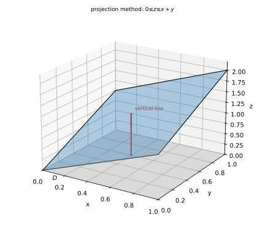
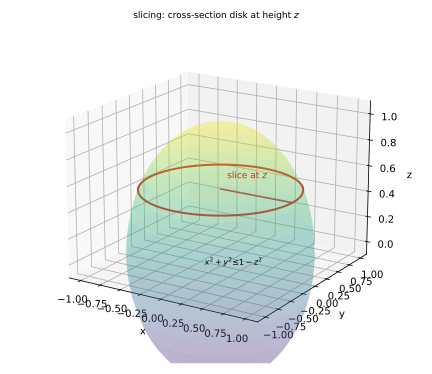
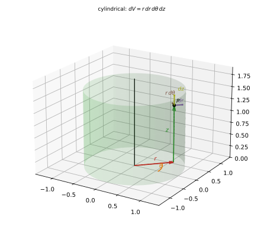
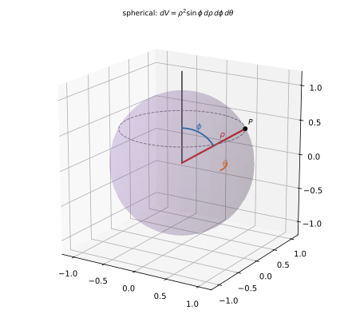

# 第 14 讲：三重积分

> **前置**：11–13 讲（二重积分的定义与计算、极坐标与雅可比）。
> **本讲解决什么**：三重积分是“对**体积**的分割求和取极限”。计算上它和一二重积分一样，只是多一层：先把三维区域切成“线/片”，化成三次一元积分。本讲讲清四种设限方式——**先一后二（投影法）**、**先二后一（截面法）**、**柱面坐标**、**球面坐标**——以及怎么按区域形状选。

**先接上 11 讲 §0 的对象表**：那里把一重、二重、三重的“对象”列在一起——一重积的是区间上的长度元，二重积的是平面区域上的面积元，三重积的是**空间区域上的体积元**。二重积分能画成曲顶柱体，是因为“二维底 + 一维高”刚好放得进三维；三重积分没有这种画法（四维），所以本讲的图只画“区域 + 小块 $dV$”。

## 一、从二重到三重

### 1.1 定义与体积元

设 $\Omega$ 是空间中的有界闭区域，$f$ 在 $\Omega$ 上有界。把 $\Omega$ 任意分成 $n$ 个小块 $\Delta V_1,\dots,\Delta V_n$（$\Delta V_i$ 同时表示第 $i$ 块的**体积**），每块任取一点 $(\xi_i,\eta_i,\zeta_i)$，作和

$$\sum_{i=1}^{n} f(\xi_i,\eta_i,\zeta_i)\,\Delta V_i.$$

令最大直径趋于 0，若和趋于与分割、取点无关的常数，就记

$$\iiint_\Omega f(x,y,z)\,dV.$$

**体积元**：直角坐标下 $dV=dx\,dy\,dz$；柱面坐标下 $dV=r\,dr\,dθ\,dz$；球面坐标下 $dV=ρ^2\sinφ\,dρ\,dφ\,dθ$（后两种在 §4、§5 说明）。

**意义**：$f=1$ 时是 $\Omega$ 的体积；$f$ 是密度时是质量；$f$ 是电荷密度时是总电荷。

**先用最简的例子把定义走一遍**：$\Omega$ 是单位立方体 $[0,1]^3$，$f=1$。

把每条棱二等分，$\Omega$ 被分成 $2^3=8$ 个小立方体，每块体积 $\Delta V=1/8$。每块取一个顶点，和 $=\sum1\cdot\frac18=1$。三等分得到 $3^3=27$ 块，每块 $1/27$，和仍是 $1$。

无论怎么分、怎么取点，只要块越来越小，和都趋于 $1$——正是 $\Omega$ 的体积，也就是 $\iiint_\Omega1\,dV$。

### 1.2 两种切法

三维区域可以**先切成竖线**（固定 $x,y$，沿 $z$ 积），也可以**先切成薄片**（固定 $z$，在截面内做二重积分）。两种都是同一个三重积分的累次写法：

**名字怎么读**：“先一后二” = **先做一次一重积分，再做一次二重积分**；“先二后一” = **先做一次二重积分，再做一次一重积分**。

- **先一后二（投影法）**：先对 $z$ 做一重积分（固定 $x,y$，沿竖线积），再把结果对 $xy$ 面上的 $D$ 做二重积分——所以 $z$ 在内层、$x,y$ 在外层；
- **先二后一（截面法）**：先在高度 $z$ 的截面 $D_z$ 上做二重积分（对 $x,y$），再把结果对 $z$ 做一重积分——所以 $x,y$ 在内层、$z$ 在外层。

选哪种，看**哪个内层好算**。

**两种切法其实是同一个和的两种重排**。以上面的立方体为例：$8$ 个小块可以先按“竖条”（固定 $x,y$，沿 $z$）加起来，也可以先按“层”（固定 $z$，在每层里按 $x,y$）加起来。加法交换律保证结果相同——这就是 Fubini 定理的直观内容。区别只在**计算顺序**，不在积分本身。

## 二、直角坐标：先一后二（投影法）

**从三重积分的黎曼和出发**：三重积分是 $\sum f\,\Delta V$ 的极限。$\Delta V$ 同时有 $x,y,z$ 三个方向的尺寸；先按**竖条**分组——固定 $(x,y)$，把 $z$ 方向的 $\sum f\,\Delta z$ 先加完，得到 $\int_{z_1}^{z_2}f\,dz$；再把 $(x,y)$ 扫过投影 $D$，做二重积分。这就是“先一后二”的来历。

把 $\Omega$ 投影到 $xy$ 平面，得到区域 $D$。对每个 $(x,y)\in D$，一条竖线穿过 $\Omega$ 的区间是

$$z_1(x,y)\le z\le z_2(x,y).$$

于是

$$\iiint_\Omega f\,dV=\iint_D\left[\int_{z_1(x,y)}^{z_2(x,y)} f(x,y,z)\,dz\right]dx\,dy.$$

内层对 $z$ 积（$x,y$ 当常数），外层就是一个普通的二重积分（按第 12 讲写成 X 型或 Y 型）。

**设限三步（投影法）**：

1. **投影**：把 $\Omega$ 的边界“压”到 $xy$ 平面，得到 $D$。常见做法是看 $\Omega$ 的不等式里 $z$ 被什么夹住——夹 $z$ 的两个曲面就是上下边界，它们的投影围出 $D$。
2. **竖线**：固定 $(x,y)\in D$，画一条平行于 $z$ 轴的线，看它从哪个曲面进入 $\Omega$（下边界 $z_1$）、从哪个曲面离开（上边界 $z_2$）。
3. **外层**：把 $D$ 按第 12 讲写成 X 型或 Y 型。

**对照一个“不好用投影法”的区域**：上半球 $\Omega$：$x^2+y^2+z^2\le1,z\ge0$。竖线的下边界 $z=0$、上边界 $z=\sqrt{1-x^2-y^2}$，所以

$$\iiint_\Omega f\,dV=\iint_{x^2+y^2\le1}\left[\int_0^{\sqrt{1-x^2-y^2}}f\,dz\right]dx\,dy.$$

形式没错，但内层带根号；如果 $f$ 只依赖 $z$，换截面法会好得多（§三）。

**例（具体区域）**：$\Omega$：$0\le x\le1$、$0\le y\le1$、$0\le z\le x+y$。

投影 $D$ 是单位正方形；对每个 $(x,y)$，$z$ 从 $0$ 到 $x+y$。所以

$$\iiint_\Omega f\,dV=\int_0^1dx\int_0^1dy\int_0^{x+y}f\,dz.$$



*图 1：先固定 $(x,y)$ 画竖线，从下边界穿到上边界；再把 $(x,y)$ 扫过投影区域 $D$。*

## 三、直角坐标：先二后一（截面法）

**换一种分组**：先固定 $z$，把这一层薄片内的 $\sum f\,\Delta x\,\Delta y$ 加完（一个二重积分 $\iint_{D_z}f\,dx\,dy$）；再把所有薄片沿 $z$ 加起来。这就是“先二后一”。

若对每个 $z\in[c,d]$，水平截面是区域 $D_z$，则

$$\iiint_\Omega f\,dV=\int_c^d\left[\iint_{D_z} f(x,y,z)\,dx\,dy\right]dz.$$

**先二后一为什么能把 $z$ 提到二重积分外面**：若 $f$ 只依赖 $z$（或在这一片上与 $x,y$ 无关），则

$$\iint_{D_z}f\,dx\,dy=f\cdot\iint_{D_z}1\,dx\,dy=f\cdot\sigma(D_z).$$

截面上 $f$ 是常数，直接乘面积。很多题（旋转体、球）都属于这种情形。

**截面积怎么算（以上半球为例）**：固定 $z$，把 $z$ 当常数看球面方程：

$$x^2+y^2+z^2\le1\ \Longrightarrow\ x^2+y^2\le1-z^2.$$

这是半径 $\sqrt{1-z^2}$ 的圆盘，面积 $\sigma(D_z)=\pi(1-z^2)$。$z$ 的范围是球在 $z$ 方向的跨度：最高点 $z=1$、最低点 $z=0$（只取上半），所以 $z\in[0,1]$。

**例（上半球）**：$\Omega$：$x^2+y^2+z^2\le1$、$z\ge0$。

固定 $z\in[0,1]$，截面是圆盘 $x^2+y^2\le1-z^2$，面积 $\pi(1-z^2)$。求 $\iiint_\Omega z\,dV$：

$$\iiint_\Omega z\,dV=\int_0^1 z\cdot\pi(1-z^2)\,dz=\pi\Big[\frac{z^2}{2}-\frac{z^4}{4}\Big]_0^1=\pi\Big(\frac12-\frac14\Big)=\fracπ4.$$

**为什么选先二后一**：截面的面积 $\pi(1-z^2)$ 是一元的、很好算；若先对 $z$ 积，$z$ 的上下限是 $\pm\sqrt{1-x^2-y^2}$，反而麻烦。



*图 2：上半球按 $z$ 切片，每片是圆盘 $x^2+y^2\le1-z^2$；先算每片上的二重积分，再沿 $z$ 累加。*

## 四、柱面坐标

**它和 13 讲的极坐标是什么关系**：柱面坐标就是**极坐标再加一个 $z$**——$xy$ 平面内用 $(r,θ)$，竖直方向保留 $z$。叫“柱面”是因为 **$r=\text{常数}$ 的曲面是圆柱面**。

$$\boxed{x=r\cosθ,\quad y=r\sinθ,\quad z=z}\qquad(r\ge0).$$

体积元：

$$dV=r\,dr\,dθ\,dz.$$

**为什么多一个 $r$**：与极坐标完全同理——$xy$ 平面上的面积元是 $r\,dr\,dθ$，再乘 $dz$。

**三条边是谁**：在点 $(r,θ,z)$ 处取一个小块——

- 沿 $r$ 方向（径向）长度 $dr$；
- 沿 $θ$ 方向是一段圆弧，弧长 $r\,dθ$（半径 $r$）；
- 沿 $z$ 方向长度 $dz$。

三边相乘：$dV=r\,dr\,dθ\,dz$。

**一个具体点的换算**：点 $(1,1,2)$ 的柱坐标是 $r=\sqrt{1^2+1^2}=\sqrt2$、$θ=\fracπ4$（第一象限、$x=y$）、$z=2$。反过来验证：$x=\sqrt2\cos\fracπ4=1$、$y=\sqrt2\sin\fracπ4=1$ ✓。

**常见曲面在柱面坐标下**：

| 直角坐标 | 柱面坐标 |
|---|---|
| $x^2+y^2=a^2$（圆柱面） | $r=a$ |
| $z=\sqrt{x^2+y^2}$（圆锥面） | $z=r$ |
| $z=x^2+y^2$（旋转抛物面） | $z=r^2$ |
| $x^2+y^2\le a^2$（圆柱体） | $0\le r\le a$ |

**设限**：投影到 $xy$ 平面用极坐标（第 13 讲），$z$ 的上下限可以含 $r,θ$。

**例**：$\Omega$：$x^2+y^2\le1$、$0\le z\le2$（圆柱体）。则

$$0\leθ\le2π,\qquad 0\le r\le1,\qquad 0\le z\le2.$$

**例（圆锥）**：$\Omega$：$0\le z\le1$、$z\ge\sqrt{x^2+y^2}$。柱面坐标下锥面是 $z=r$，所以 $0\le r\le z$；投影是单位圆盘 $0\le r\le1$，$0\leθ\le2π$。体积：

$$\iiint_\Omega1\,dV=\int_0^{2π}dθ\int_0^1dz\int_0^z r\,dr=2π\int_0^1\frac{z^2}{2}dz=\fracπ3.$$

与圆锥体积公式 $\frac13\pi\cdot1^2\cdot1=\fracπ3$ 一致 ✓。



*图 3：柱面坐标：$r$ 是到 $z$ 轴的距离，$θ$ 是方位角，$z$ 是高度。在点 $P$ 处画出体积元的三条边：$dr$（径向）、$r\,dθ$（切向弧长）、$dz$（竖直）——三者相乘给出 $r\,dr\,dθ\,dz$。*

## 五、球面坐标

**为什么叫“球面”**：**$ρ=\text{常数}$ 的曲面是球面**（到原点距离相同的点）；$φ$ 和 $θ$ 是两个角，所以球面坐标是“半径 + 两个角”。

$$\boxed{x=ρ\sinφ\cosθ,\quad y=ρ\sinφ\sinθ,\quad z=ρ\cosφ}\qquad(ρ\ge0).$$

三个坐标的范围：

- $ρ\ge0$：到原点的距离；
- $0\leφ\leπ$：与**正 $z$ 轴**的夹角（北极 $φ=0$，赤道 $φ=\fracπ2$，南极 $φ=π$）；
- $0\leθ\le2π$：在 $xy$ 平面上的方位角。

**把三个坐标“读”出来（点 $(1,1,1)$ 为例）**：

- $ρ=\sqrt{1+1+1}=\sqrt3$（到原点距离）；
- $θ=\fracπ4$（$xy$ 平面上的方位：$x=y>0$）；
- $φ$ 满足 $\cosφ=\frac{z}{ρ}=\frac1{\sqrt3}$，所以 $φ=\arccos\frac1{\sqrt3}\approx0.955$（约 $54.7°$）。

**反过来验证**：$z=ρ\cosφ=\sqrt3\cdot\frac1{\sqrt3}=1$ ✓；$x=ρ\sinφ\cosθ$，而 $\sinφ=\sqrt{1-\frac13}=\sqrt{\frac23}$，所以 $x=\sqrt3\cdot\sqrt{\frac23}\cdot\frac{\sqrt2}{2}=1$ ✓。

体积元：

$$dV=ρ^2\sinφ\,dρ\,dφ\,dθ.$$

**几何理由**：沿 $ρ$ 方向长度 $dρ$；沿 $φ$ 方向是经线弧长 $ρ\,dφ$；沿 $θ$ 方向是纬线弧长 $ρ\sinφ\,dθ$（纬线半径是 $ρ\sinφ$）。三边相乘得 $ρ^2\sinφ\,dρ\,dφ\,dθ$。

**在两处验证三条边**：

- 赤道 $φ=\fracπ2$：纬线半径 $ρ\sin\fracπ2=ρ$——就是“离 $z$ 轴的距离”，正确；
- 北极 $φ=0$：纬线缩成一个点，$ρ\sin0=0$——体积元在该处退化为 $0$（零面积，不影响积分），正确。

**常见曲面在球面坐标下**：

| 直角坐标 | 球面坐标 |
|---|---|
| $x^2+y^2+z^2=a^2$（球面） | $ρ=a$ |
| $z=\sqrt{x^2+y^2}$（圆锥面） | $φ=\fracπ4$ |
| $z\ge\sqrt{x^2+y^2}$（锥内上部） | $0\leφ\le\fracπ4$ |
| $z\ge0$（上半空间） | $0\leφ\le\fracπ2$ |

**最容易错的地方**：$φ$ 是**从 $z$ 轴量起**的角，不是与 $xy$ 平面的夹角。若把 $φ$ 当成“仰角”，$φ$ 与 $θ$ 会互换，结果全错。



*图 4：球面坐标：$ρ$ 是半径，$φ$ 从正 $z$ 轴量起（蓝弧，在经线平面内），$θ$ 是方位角（橙弧，在 $xy$ 平面内）；灰色虚线是纬线，半径 $ρ\sinφ$——这就是体积元里 $\sinφ$ 的来源。*

## 六、坐标系怎么选

| 区域的边界长什么样 | 用哪个坐标 |
|---|---|
| 长方体、棱柱、平面围成的多面体 | 直角坐标 |
| 圆柱、圆锥、旋转抛物面、绕 $z$ 轴的旋转体 | 柱面坐标 |
| 球、球壳、球与圆锥的组合 | 球面坐标 |

**判据**：看边界方程在哪个坐标系下是“常数”。例如：

- $x^2+y^2=1$ → 柱面：$r=1$；
- $x^2+y^2=z^2$（锥）→ 柱面：$z=r$；球面：$φ=\fracπ4$；
- $x^2+y^2+z^2=1$ → 球面：$ρ=1$。

**同一个区域换坐标的对比**：单位球 $\Omega:x^2+y^2+z^2\le1$。

- 柱面：$r^2+z^2\le1$——$r$ 的上限是 $\sqrt{1-z^2}$，能算但带根号；
- 球面：$ρ\le1$——上下限全是常数。

这就是“看边界在哪个坐标下是常数”的实际含义：常数边界 ⇒ 上下限干净 ⇒ 少出错。

**先一后二还是先二后一**：先一后二看“上下曲面是否明确、竖线是否只穿一次”；先二后一看“截面积是否好算”（圆、椭圆、矩形）。两者都不顺手时，换坐标系。

## 七、例题

**例 1**（先一后二）：$\Omega$：$0\le x\le1$、$0\le y\le1$、$0\le z\le x+y$，求 $\iiint_\Omega z\,dV$。

**解**：投影是正方形，$z$ 从 $0$ 到 $x+y$。

先对 $z$ 积：

$$\int_0^{x+y}z\,dz=\frac{(x+y)^2}{2}.$$

再对 $x,y$ 积：

$$\iiint_\Omega z\,dV=\frac12\int_0^1\int_0^1(x+y)^2\,dx\,dy.$$

展开：$(x+y)^2=x^2+2xy+y^2$。逐项：

$$\int_0^1\int_0^1x^2\,dx\,dy=\frac13,\quad \int_0^1\int_0^12xy\,dx\,dy=2\cdot\frac12\cdot\frac12=\frac12,\quad \int_0^1\int_0^1y^2\,dx\,dy=\frac13.$$

合计 $\frac13+\frac12+\frac13=\frac76$，所以

$$\iiint_\Omega z\,dV=\frac12\cdot\frac76=\frac7{12}.$$

**例 2**（先二后一）：$\Omega$：$x^2+y^2+z^2\le1$、$z\ge0$，求 $\iiint_\Omega z\,dV$。

**解**：固定 $z\in[0,1]$。由 §3，截面是半径 $\sqrt{1-z^2}$ 的圆盘，面积 $\pi(1-z^2)$。

**关键一步**：截面上 $f=z$ 与 $x,y$ 无关，所以

$$\iint_{D_z}z\,dx\,dy=z\iint_{D_z}1\,dx\,dy=z\cdot\pi(1-z^2).$$

再沿 $z$ 累加：

$$\iiint_\Omega z\,dV=\int_0^1 z\pi(1-z^2)\,dz=\pi\Big[\frac{z^2}{2}-\frac{z^4}{4}\Big]_0^1=\pi\Big(\frac12-\frac14\Big)=\fracπ4.$$

**例 3**（柱面坐标）：$\Omega$：$x^2+y^2\le1$、$0\le z\le2$，求 $\iiint_\Omega(x^2+y^2)\,dV$。

**解**：柱面坐标：$0\leθ\le2π$，$0\le r\le1$，$0\le z\le2$；$x^2+y^2=r^2$，$dV=r\,dr\,dθ\,dz$。

**为什么能拆成三个一元积分**：被积函数 $r^2\cdot r=r^3$ 只含 $r$，三个变量的上下限都是常数，所以三重积分分离成三个独立的一元积分相乘：

$$\iiint_\Omega(x^2+y^2)\,dV=\Big(\int_0^{2π}dθ\Big)\Big(\int_0^1r^3\,dr\Big)\Big(\int_0^2dz\Big)=2π\cdot\frac14\cdot2=\pi.$$

**例 4**（球面坐标）：$\Omega$ 是单位球 $x^2+y^2+z^2\le1$，求体积 $\iiint_\Omega1\,dV$。

**解**：球面坐标：$0\leρ\le1$，$0\leφ\leπ$，$0\leθ\le2π$。

逐项：$\int_0^{2π}dθ=2π$；$\int_0^{π}\sinφ\,dφ=\big[-\cosφ\big]_0^{π}=1-(-1)=2$；$\int_0^1ρ^2dρ=\frac13$。于是

$$\iiint_\Omega1\,dV=\int_0^{2π}dθ\int_0^{π}\sinφ\,dφ\int_0^1ρ^2\,dρ=2π\cdot2\cdot\frac13=\frac{4π}{3}.$$

**例 5**（球面坐标，球+锥）：$\Omega$：$x^2+y^2+z^2\le1$、$z\ge\sqrt{x^2+y^2}$，求 $\iiint_\Omega z\,dV$。

**解**：锥面 $z=\sqrt{x^2+y^2}$ 在球面坐标下是 $φ=\fracπ4$（因为 $z=ρ\cosφ$、$\sqrt{x^2+y^2}=ρ\sinφ$，相等给 $\tanφ=1$）。

**为什么是 $φ$ 小而不是大**：在锥面**之上**意味着 $z$ 更靠近 $z$ 轴，$φ$ 更小；锥面是 $φ=\fracπ4$，所以锥内上部是 $0\leφ\le\fracπ4$。另外 $0\leρ\le1$（在单位球内），$0\leθ\le2π$。

$z=ρ\cosφ$，$dV=ρ^2\sinφ\,dρ\,dφ\,dθ$：

$$\iiint_\Omega z\,dV=\int_0^{2π}dθ\int_0^{π/4}\sinφ\cosφ\,dφ\int_0^1ρ^3\,dρ.$$

逐项：$\int_0^{π/4}\sinφ\cosφ\,dφ=\Big[\frac{\sin^2φ}{2}\Big]_0^{π/4}=\frac14$；$\int_0^1ρ^3dρ=\frac14$。所以

$$\iiint_\Omega z\,dV=2π\cdot\frac14\cdot\frac14=\fracπ8.$$

## 八、数值核对

用脚本核对本节结论（`scripts/lec14-02_verify_triple.py`，全脚本 0.00 秒）：

```
=== EXP1: example 1, z over 0<=z<=x+y on the unit square ===
  numeric = 0.58333281, exact = 7/12 = 0.58333333, diff = 5.21e-07

=== EXP2: z over the upper half ball ===
  numeric = 0.78540062, exact = pi/4 = 0.78539816, diff = 2.45e-06

=== EXP3: x^2+y^2 over the cylinder r<=1, 0<=z<=2 ===
  numeric = 3.14158637, exact = pi = 3.14159265, diff = 6.28e-06

=== EXP4: volume of the unit ball ===
  numeric = 4.18879771, exact = 4pi/3 = 4.18879020, diff = 7.50e-06

=== EXP5: z over the ball above the cone ===
  numeric = 0.39269735, exact = pi/8 = 0.39269908, diff = 1.73e-06
```

**核对点**：五个实验的误差都在 $10^{-6}$ 量级（中点法则一阶），不是公式错：EXP1 $7/12$（直角坐标二维网格）；EXP2 用“一维 $z$ + 径向积分解析”得 $\pi/4$；EXP3 柱面网格得 $\pi$；EXP4 球面网格得 $4\pi/3$；EXP5 球面（$0\leφ\le\pi/4$）得 $\pi/8$——**三个体积元 $dx\,dy\,dz$、$r\,dr\,dθ\,dz$、$ρ^2\sinφ\,dρ\,dφ\,dθ$ 各自用对**。

## 小结

- **三重积分**：对体积分割求和取极限；$f=1$ 是体积，$f$ 是密度是质量。
- **先一后二**：$\iint_D dx\,dy\int_{z_1}^{z_2}f\,dz$；适合上下曲面明确。
- **先二后一**：$\int_c^d dz\iint_{D_z}f\,dx\,dy$；适合截面积好算。
- **柱面坐标**：$dV=r\,dr\,dθ\,dz$；适合圆柱、圆锥、旋转体。
- **球面坐标**：$dV=ρ^2\sinφ\,dρ\,dφ\,dθ$；**$φ$ 从 $z$ 轴量起**；适合球、球壳、球+锥。
- **选择**：看边界在哪个坐标系下是常数，再看哪个内层好算。

## 作业

**说明**：答案平铺在每题下方（先做再对照）。只用上册与本讲已教内容。

**1.** $\Omega$：$0\le x\le1$、$0\le y\le1$、$0\le z\le1$，求 $\iiint_\Omega(x+y+z)\,dV$。

**参考答案**：
$\int_0^1dx\int_0^1dy\int_0^1(x+y+z)dz$。
内层：$x+y+\frac12$；外层：$\int_0^1\int_0^1(x+y+\frac12)dx\,dy=\frac12+\frac12+\frac12=\frac32$。

**2.** $\Omega$：$x^2+y^2\le1$、$0\le z\le1-x^2-y^2$，求 $\iiint_\Omega1\,dV$。

**参考答案**：
柱面坐标：$0\leθ\le2π$，$0\le r\le1$，$0\le z\le1-r^2$。
$\int_0^{2π}dθ\int_0^1(1-r^2)r\,dr=2π\Big[\frac{r^2}{2}-\frac{r^4}{4}\Big]_0^1=2π\cdot\frac14=\fracπ2$。

**3.** $\Omega$：$x^2+y^2+z^2\le4$，求 $\iiint_\Omega(x^2+y^2+z^2)\,dV$。

**参考答案**：
球面坐标：$0\leρ\le2$，$0\leφ\leπ$，$0\leθ\le2π$；$x^2+y^2+z^2=ρ^2$。
$\int_0^{2π}dθ\int_0^{π}\sinφ\,dφ\int_0^2ρ^2\cdotρ^2\,dρ=2π\cdot2\cdot\frac{32}{5}=\frac{128π}{5}$。

**4.** $\Omega$：$x^2+y^2\le z^2$、$0\le z\le1$（锥体），求 $\iiint_\Omega1\,dV$。

**参考答案**：
柱面坐标：$0\leθ\le2π$，$0\le r\le z$，$0\le z\le1$。
$\int_0^{2π}dθ\int_0^1dz\int_0^z r\,dr=2π\int_0^1\frac{z^2}{2}dz=\fracπ3$（圆锥体积 $\frac13\pi\cdot1^2\cdot1$ ✓）。

**5.**（概念）为什么球面坐标的体积元里是 $\sinφ$ 而不是 $\sinθ$？

**参考答案**：
$θ$ 是绕 $z$ 轴的方位角，纬线半径是 $ρ\sinφ$（$\sinφ$ 来自“离 $z$ 轴的距离”），所以沿 $θ$ 方向的弧长是 $ρ\sinφ\,dθ$；$\sinφ$ 属于这一项。若把 $φ$ 误当仰角，就会错写成 $\sinθ$。

**6.**（概念）先一后二与先二后一是不是两个不同的积分？

**参考答案**：
不是。它们是同一个三重积分的两种累次写法（Fubini），区别只是“先切竖线还是先切片”。选哪个只看内层哪个好算。
