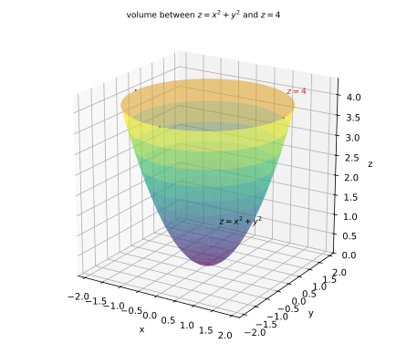
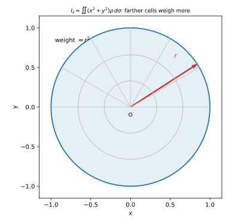
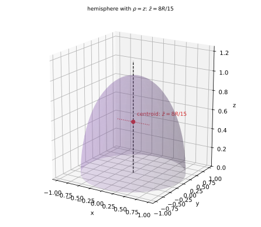

# 第 15 讲：重积分的应用

> **前置**：11–14 讲（二重积分、极坐标与雅可比、三重积分与柱面/球面坐标）；上册 27 讲（平面图形的矩）。
> **本讲解决什么**：重积分不是只能算“体积”。同一个积分，**换被积函数就换物理量**：被积函数取 $1$ 得面积/体积，取密度得质量，取“坐标 × 密度”得质心，取“距离平方 × 密度”得转动惯量。本讲把这几件事统一起来，每个公式都先说清“它是什么量”，再用具体几何体算到数。

## 一、一个统一视角：加权求和

> 11 讲 §0 先说清了“重积分”这个词：它是二重、三重及更高重积分的**统称**（“重”= 多重，区域是多维的），并把三者的对象列成一张表：**值 × 小块**（长度元/面积元/体积元）。本节把“值”具体化——取密度得质量，取坐标×密度得质心，取距离平方×密度得惯量。

重积分的本质是“把小块上的某个量加起来”：

$$\sum (\text{小块上的值})\times(\text{小块的大小})\ \longrightarrow\ \iint\text{或}\iiint.$$

**这些量不是四套公式，是同一个和换 $f$**：$\sum f\times(\text{小块})$ 里，$f=1$ 加出体积/面积；$f=\rho$ 加出质量；$f=x\rho$ 加出一阶矩（质心的分子）；$f=(x^2+y^2)\rho$ 加出二阶矩（转动惯量）。下面逐个说明。

“小块上的值”取什么，就得到什么物理量：

| 被积函数 | 得到的量 |
|---|---|
| $1$ | 面积（二重）或体积（三重） |
| $\rho$（密度） | 质量 |
| $x\rho$、$y\rho$、$z\rho$ | 一阶矩 → 质心坐标 |
| $(y^2+z^2)\rho$ 等 | 二阶矩 → 转动惯量 |

**所以本讲的公式不需要死记**：先问“我要的量 = 每小块贡献 × 小块大小”，再把“每小块贡献”写成被积函数。

## 二、面积与体积

### 2.1 面积

平面区域 $D$ 的面积：

$$A=\iint_D 1\,d\sigma.$$

**例（椭圆）**：求椭圆 $\dfrac{x^2}{a^2}+\dfrac{y^2}{b^2}\le1$ 的面积（$a,b>0$）。

用换元（第 13 讲）：$x=ar\cosθ$、$y=br\sinθ$，则 $|J|=abr$，区域变成 $0\leθ\le2π$、$0\le r\le1$。

$$A=\int_0^{2π}dθ\int_0^1 abr\,dr=2π\cdot\frac{ab}{2}=\pi ab.$$

（$a=b=R$ 时退化为圆面积 $\pi R^2$ ✓。）

### 2.2 体积：两种写法

**写法一（三重）**：$V=\iiint_\Omega1\,dV$。

**写法二（二重，曲顶柱体）**：若 $\Omega$ 夹在曲面 $z_{\text{下}}(x,y)$ 与 $z_{\text{上}}(x,y)$ 之间，则

$$V=\iint_D\big(z_{\text{上}}-z_{\text{下}}\big)d\sigma.$$

**两种写法是同一个体积**：二重写法就是三重写法先对 $z$ 积出来的结果（内层 $\int_{z_{\text{下}}}^{z_{\text{上}}}1\,dz=z_{\text{上}}-z_{\text{下}}$）。

**例（抛物面与平面）**：求 $z=x^2+y^2$ 与 $z=4$ 围成的体积。

投影是圆盘 $x^2+y^2\le4$；上边界 $z=4$、下边界 $z=x^2+y^2$。极坐标：

$$V=\iint_{x^2+y^2\le4}\big(4-(x^2+y^2)\big)d\sigma=\int_0^{2π}dθ\int_0^2(4-r^2)r\,dr.$$

内层：$\int_0^2(4r-r^3)dr=\Big[2r^2-\frac{r^4}{4}\Big]_0^2=8-4=4$。所以

$$V=2π\cdot4=8π.$$



*图 1：$z=x^2+y^2$（抛物面）与 $z=4$ 之间的体积；投影是半径 $2$ 的圆盘。*

## 三、质量与质心

### 3.1 质量

- 平面薄片，面密度 $\rho(x,y)$：$m=\iint_D\rho\,d\sigma$；
- 空间体，体密度 $\rho(x,y,z)$：$m=\iiint_\Omega\rho\,dV$。

**$\rho\equiv1$ 时**：质量 = 面积（或体积）——与 §2 一致。

### 3.2 质心：一阶矩除以质量

**质心是什么**：质量分布的“平衡点”——把物体支在这一点上，各方向的力矩正好抵消。

**先从离散情形理解**：质量 $m_i$、位置 $x_i$ 的质点组，质心

$$\overline{x}=\frac{\sum m_ix_i}{\sum m_i}.$$

连续情形把求和换成积分、质量换成 $\rho\,dV$：

$$\boxed{\overline{x}=\frac{1}{m}\iiint_\Omega x\rho\,dV,\qquad \overline{y}=\frac{1}{m}\iiint_\Omega y\rho\,dV,\qquad \overline{z}=\frac{1}{m}\iiint_\Omega z\rho\,dV.}$$

**一阶矩**（也叫静矩）：分子 $\iiint x\rho\,dV$ 叫“对 $yz$ 平面的矩”（因为它量的是“离 $yz$ 面有多远、有多重”）。命名与坐标的对应关系是：**对 $yz$ 面 ⇒ $\overline{x}$；对 $zx$ 面 ⇒ $\overline{y}$；对 $xy$ 面 ⇒ $\overline{z}$**。

**薄片版**：把 $\iiint\cdots dV$ 换成 $\iint\cdots d\sigma$，$z$ 分量没有。

### 3.3 形心与质心

**形心**是纯几何的中心（均匀密度的质心）。$\rho$ 为常数时，$\rho$ 在分子分母中约掉，质心 = 形心：

$$\overline{x}=\frac{\iint x\,d\sigma}{\iint1\,d\sigma}.$$

**所以“求形心”就是“取 $\rho=1$ 求质心”**，不需要另记公式。

## 四、转动惯量

### 4.1 定义与公式

**转动惯量是什么**：物体绕轴转动时“转动惯性”的度量——同样的力矩，惯量越大越难转起来。

**离散**：质点 $m_i$ 到转轴距离 $r_i$，转动惯量 $I=\sum m_ir_i^2$。

**为什么是距离平方**：转动动能是 $\frac12I\omega^2$、角动量是 $I\omega$——离轴越远，同样的角速度下线速度越大（$v=\omega r$），动能按 $v^2$ 增长，所以权重是 $r^2$。

**连续**：把 $m_i$ 换成 $\rho\,dV$、$r_i$ 换成“点到轴的距离”：

$$I=\iiint r^2\rho\,dV.$$

**与“矩”的关系**：$r^2\rho$ 的积分是**二阶矩**——零阶矩给质量（$f=1$ 时给面积/体积），一阶矩给质心分子，二阶矩给惯量。

### 4.2 三个坐标轴与原点

到各轴的距离平方：

- 到 $x$ 轴：$y^2+z^2$；
- 到 $y$ 轴：$x^2+z^2$；
- 到 $z$ 轴：$x^2+y^2$；
- 到原点：$x^2+y^2+z^2$。

所以

$$I_x=\iiint(y^2+z^2)\rho\,dV,\quad I_y=\iiint(x^2+z^2)\rho\,dV,\quad I_z=\iiint(x^2+y^2)\rho\,dV,$$

$$I_O=\iiint(x^2+y^2+z^2)\rho\,dV.$$

**一个常用关系**：把三式相加，

$$I_x+I_y+I_z=\iiint\big[2(x^2+y^2+z^2)\big]\rho\,dV=2I_O.$$



*图 2：圆盘绕 $z$ 轴转动时，离轴越远的块权重越大（$r^2$）；所以惯量不是“质量乘半径”，而是“质量按 $r^2$ 加权”。*

## 五、例题

**例 1**（面积）：求椭圆 $\dfrac{x^2}{a^2}+\dfrac{y^2}{b^2}\le1$ 的面积（$a,b>0$）。

**解**：换元 $x=ar\cosθ$、$y=br\sinθ$（$|J|=abr$），区域为 $0\leθ\le2π$、$0\le r\le1$：

$$A=\int_0^{2π}\int_0^1 abr\,dr\,dθ=2π\cdot\frac{ab}{2}=\pi ab.$$

**例 2**（体积）：求 $z=x^2+y^2$ 与 $z=4$ 围成的体积。

**解**：投影 $D:x^2+y^2\le4$；上边界 $z=4$、下边界 $z=x^2+y^2$。极坐标：

$$V=\int_0^{2π}dθ\int_0^2(4-r^2)r\,dr=2π\cdot\Big[2r^2-\frac{r^4}{4}\Big]_0^2=2π\cdot4=8π.$$

**例 3**（质量与质心）：半球 $\Omega:x^2+y^2+z^2\le R^2$、$z\ge0$，体密度 $\rho=z$。求质量与质心。

**解**：球面坐标：$0\leρ\le R$、$0\leφ\le\fracπ2$、$0\leθ\le2π$；$z=ρ\cosφ$，$dV=ρ^2\sinφ\,dρ\,dφ\,dθ$。

**质量**：

$$m=\iiint_\Omega z\,dV=\int_0^{2π}dθ\int_0^{π/2}\sinφ\cosφ\,dφ\int_0^Rρ^3dρ=2π\cdot\frac12\cdot\frac{R^4}{4}=\frac{\pi R^4}{4}.$$

**对 $xy$ 面的矩**：

$$M_{xy}=\iiint_\Omega z\cdot z\,dV=\int_0^{2π}dθ\int_0^{π/2}\sinφ\cos^2φ\,dφ\int_0^Rρ^4dρ.$$

其中 $\int_0^{π/2}\sinφ\cos^2φ\,dφ=\Big[-\frac{\cos^3φ}{3}\Big]_0^{π/2}=\frac13$；$\int_0^Rρ^4dρ=\frac{R^5}{5}$。所以

$$M_{xy}=2π\cdot\frac13\cdot\frac{R^5}{5}=\frac{2πR^5}{15}.$$

**质心**：

$$\overline{z}=\frac{M_{xy}}{m}=\frac{2πR^5/15}{\pi R^4/4}=\frac{8R}{15}.$$

由对称性（区域关于 $zx$ 面、$zy$ 面都对称，密度只依赖 $z$），$\overline{x}=\overline{y}=0$。



*图 3：半球（密度 $\rho=z$）的质心在 $z$ 轴上，高度 $\overline{z}=\frac{8R}{15}$（比均匀半球的 $\frac{3R}{8}$ 更高，因为密度随 $z$ 增大）。*

**例 4**（转动惯量）：均匀球 $\Omega:x^2+y^2+z^2\le R^2$（$\rho=1$），求 $I_z$。

**解**：球面坐标；$x^2+y^2=ρ^2\sin^2φ$，$dV=ρ^2\sinφ\,dρ\,dφ\,dθ$。

$$I_z=\iiint(x^2+y^2)\,dV=\int_0^{2π}dθ\int_0^{π}\sin^3φ\,dφ\int_0^Rρ^4dρ.$$

其中 $\int_0^{π}\sin^3φ\,dφ=\frac43$；$\int_0^Rρ^4dρ=\frac{R^5}{5}$。所以

$$I_z=2π\cdot\frac43\cdot\frac{R^5}{5}=\frac{8πR^5}{15}.$$

质量 $m=\frac{4πR^3}{3}$，于是

$$I_z=\frac{8πR^5/15}{4πR^3/3}=\frac{2}{5}·\frac{4πR^3}{3}·R^2=\frac25mR^2.$$

（均匀球对任意直径的转动惯量都是 $\frac25mR^2$；薄球壳是 $\frac23mR^2$。）

**例 5**（薄片的质量与惯量）：圆盘 $D:x^2+y^2\le R^2$，面密度 $\rho=x^2+y^2$。求质量与 $I_z$。

**解**：极坐标，$x^2+y^2=r^2$，$d\sigma=r\,dr\,dθ$。

$$m=\iint_D(x^2+y^2)\,d\sigma=\int_0^{2π}dθ\int_0^Rr^2\cdot r\,dr=2π\cdot\frac{R^4}{4}=\frac{\pi R^4}{2}.$$

$$I_z=\iint_D(x^2+y^2)\cdot(x^2+y^2)\,d\sigma=\int_0^{2π}dθ\int_0^Rr^4\cdot r\,dr=2π\cdot\frac{R^6}{6}=\frac{\pi R^6}{3}.$$

**例 6**（形心）：求半圆盘 $D:x^2+y^2\le R^2$、$y\ge0$ 的形心。

**解**：取 $\rho=1$；面积 $A=\frac{πR^2}{2}$。

对 $x$ 轴的矩（即 $\iint y\,d\sigma$）：极坐标 $y=r\sinθ$、$d\sigma=r\,dr\,dθ$，$0\leθ\leπ$：

$$\iint_D y\,d\sigma=\int_0^{π}\sinθ\,dθ\int_0^Rr^2dr=2\cdot\frac{R^3}{3}=\frac{2R^3}{3}.$$

$$\overline{y}=\frac{2R^3/3}{\pi R^2/2}=\frac{4R}{3\pi}.$$

由对称性 $\overline{x}=0$。

## 六、数值核对

用脚本核对本节结论（`scripts/lec15-02_verify_apps.py`，全脚本 0.00 秒）：

```
=== EXP1: area of the ellipse -> pi*a*b ===
  numeric = 6.28318531, exact = pi*a*b = 6.28318531, diff = 0.00e+00

=== EXP2: volume between z=x^2+y^2 and z=4 -> 8*pi ===
  numeric = 25.13274437, exact = 8*pi = 25.13274123, diff = 3.14e-06

=== EXP3: mass and centroid of the hemisphere with rho=z ===
  mass = 0.78539773, exact = pi/4 = 0.78539816
  z-bar = 0.53333188, exact = 8/15 = 0.53333333

=== EXP4: moment of inertia of the uniform ball -> 2/5 m R^2 ===
  I_z = 1.67550057, exact = 8*pi/15 = 1.67551608
  I_z/m = 0.39999630, exact = 2/5 = 0.40000000

=== EXP5: disk with rho=r^2: mass and I_z ===
  mass = 1.57079613, exact = pi/2 = 1.57079633
  I_z = 1.04719722, exact = pi/3 = 1.04719755
```

**核对点**：EXP1 完全精确（$|J|=abr$ 用对）；EXP2 差 $3.1\times10^{-6}$；EXP3 的 $m$ 差 $4\times10^{-7}$、$\overline{z}$ 差 $1.5\times10^{-6}$（得 $0.5333$ 与 $8/15$ 一致）；EXP4 的 $I_z/m=0.3999963$，与 $2/5$ 差 $3.7\times10^{-6}$；EXP5 的 $m$、$I_z$ 分别与 $\pi/2$、$\pi/3$ 差 $10^{-7}$ 量级。误差均来自中点法则的网格离散，不是公式错。

## 小结

- **统一视角**：重积分 = 加权求和；换被积函数就换物理量。
- **面积/体积**：$\iint1\,d\sigma$；$V=\iiint1\,dV=\iint(z_{\text{上}}-z_{\text{下}})d\sigma$。
- **质量**：$\iint\rho\,d\sigma$ 或 $\iiint\rho\,dV$。
- **质心**：一阶矩 ÷ 质量；$\rho$ 常数时质心 = 形心。
- **转动惯量**：$r^2\rho$ 的积分；$I_x+I_y+I_z=2I_O$。
- **对称性**：密度与区域都对称时，对应质心分量为 0、对应惯量相等——能省掉一半以上的计算。

## 作业

**说明**：答案平铺在每题下方（先做再对照）。只用上册与本讲已教内容。

**1.** 求由 $z=x^2+y^2$、$z=1$ 围成的体积。

**参考答案**：
投影 $x^2+y^2\le1$，上边界 $z=1$、下边界 $z=r^2$。
$V=\int_0^{2π}dθ\int_0^1(1-r^2)r\,dr=2π\Big[\frac{r^2}{2}-\frac{r^4}{4}\Big]_0^1=2π\cdot\frac14=\fracπ2$。

**2.** 求均匀半圆盘 $x^2+y^2\le R^2$、$y\ge0$ 对 $x$ 轴的转动惯量 $I_x$（$\rho=1$）。

**参考答案**：
$I_x=\iint y^2\,d\sigma=\int_0^{π}\sin^2θ\,dθ\int_0^Rr^3dr$。
$\int_0^{π}\sin^2θ\,dθ=\fracπ2$；$\int_0^Rr^3dr=\frac{R^4}{4}$。所以 $I_x=\frac{πR^4}{8}$。

**3.** 求半球 $x^2+y^2+z^2\le R^2$、$z\ge0$（$\rho=1$）的形心高度。

**参考答案**：
$V=\frac{2πR^3}{3}$；$M_{xy}=\iiint z\,dV=\int_0^{2π}dθ\int_0^{π/2}\sinφ\cosφ\,dφ\int_0^Rρ^3dρ=2π\cdot\frac12\cdot\frac{R^4}{4}=\frac{πR^4}{4}$。
$\overline{z}=\frac{πR^4/4}{2πR^3/3}=\frac{3R}{8}$。

**4.** 圆盘 $x^2+y^2\le R^2$，面密度 $\rho=x^2$，求质量。

**参考答案**：
$m=\iint x^2\,d\sigma=\int_0^{2π}\cos^2θ\,dθ\int_0^Rr^3dr=\pi\cdot\frac{R^4}{4}=\frac{πR^4}{4}$。

**5.**（概念）为什么质心公式要除以质量，而转动惯量公式不除？

**参考答案**：
质心是“加权平均位置”——平均必须除以总权重（质量）。转动惯量是“加权和”——它就是总的转动惯性，不需要平均；它的“平均”版本是 $I/m$（回转半径的平方）。

**6.**（概念）均匀薄片关于 $z$ 轴的转动惯量 $I_z$ 与关于原点的是 $I_O$ 有什么关系？平面薄片（$z=0$）时 $I_x,I_y,I_z,I_O$ 之间呢？

**参考答案**：
三维一般情形 $I_x+I_y+I_z=2I_O$。平面薄片 $z=0$ 时，$I_x=\iint y^2\rho\,d\sigma$、$I_y=\iint x^2\rho\,d\sigma$、$I_z=\iint(x^2+y^2)\rho\,d\sigma=I_x+I_y$，而 $I_O=I_z$（到原点距离平方就是到 $z$ 轴距离平方）。
