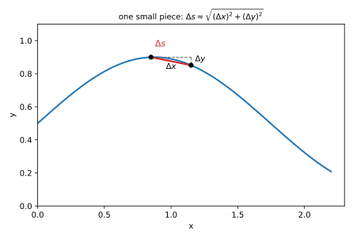
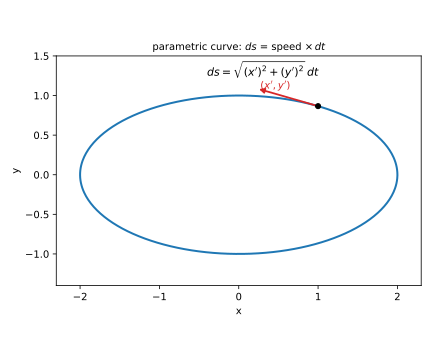
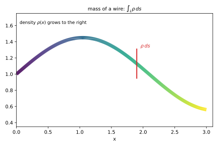
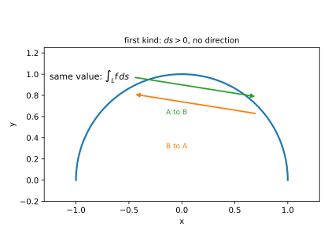

# 第 16 讲：第一类曲线积分（line integral of the first kind）（对弧长）

> **前置**：11–15 讲（重积分的对象、定义与计算）；上册定积分、弧长公式。
> **本讲解决什么**：前面的积分都在“平直的区域”上做（区间、平面区域、空间区域）。这一讲把积分区域换成**一条曲线**：沿曲线把“值 × 一小段弧长”加起来。核心只有两件事：**$ds$ 是什么、怎么把它换成参数 $t$ 的微分**。学会这两件，剩下的就是把定积分算出来。

## 一、弧长元（arc length element） $ds$ 从哪来

### 1.1 小段弦长：从“直线段”逼近“曲线段”

设 $L$ 是一条平面曲线。把它分成 $n$ 小段，第 $i$ 段从 $P_{i-1}$ 到 $P_i$。这一段曲线本身是弯的，但**段足够短时，可以用弦 $P_{i-1}P_i$ 近似**：

$$\Delta s_i\approx |P_{i-1}P_i|=\sqrt{(\Delta x_i)^2+(\Delta y_i)^2}.$$

这是勾股定理：横向走 $\Delta x$、纵向走 $\Delta y$，直线距离就是斜边。

**取极限**：让每段都缩到 0（最大弦长 → 0），弦长之和趋于曲线的**弧长**。这就是弧长公式的来源。



*图 1：曲线的一小段用弦近似；弦长由勾股定理给出 $\sqrt{(\Delta x)^2+(\Delta y)^2}$，段越短越接近真实弧长。*

### 1.2 三种写法：显式、参数、极坐标

**（1）显式 $y=f(x)$，$x\in[a,b]$**

把 $\Delta y\approx f'(x)\Delta x$ 代入勾股：

$$\Delta s\approx\sqrt{1+\big(f'(x)\big)^2}\,\Delta x\ \Longrightarrow\ ds=\sqrt{1+\big(f'(x)\big)^2}\,dx.$$

**（2）参数式 $x=x(t)$、$y=y(t)$，$t\in[\alpha,\beta]$**

$\Delta x\approx x'(t)\Delta t$、$\Delta y\approx y'(t)\Delta t$，所以

$$\boxed{ds=\sqrt{\big(x'(t)\big)^2+\big(y'(t)\big)^2}\,dt.}$$

这里用的是**一阶近似**：曲线短到可以当成它在该点的切线，所以横向增量约等于 $x'(t)\Delta t$，误差是 $o(\Delta t)$（$\Delta t\to0$ 时比 $\Delta t$ 更快趋于 0）。取极限后误差消失，$ds$ 才是精确的。

这是最常用的一条：**把曲线写成参数，$ds$ 就是“速度向量的模 × $dt$”**。



*图 2：参数曲线上，$(x'(t),y'(t))$ 是切向量（速度）；它的模乘 $dt$ 就是弧长元 $ds$。*

**（3）极坐标 $r=r(\theta)$**

由 $x=r\cos\theta$、$y=r\sin\theta$ 对 $\theta$ 求导：

$$x'=r'\cos\theta-r\sin\theta,\qquad y'=r'\sin\theta+r\cos\theta.$$

平方相加（交叉项抵消，$\cos^2+\sin^2=1$）：

$$(x')^2+(y')^2=(r')^2+r^2\ \Longrightarrow\ ds=\sqrt{r^2+(r')^2}\,d\theta.$$

**三种写法是同一个 $ds$**，只是曲线给的形式不同。做题时先看曲线怎么给，再选对应的 $ds$。

**先只练 $ds$（不积分）**：$L$：$y=x^2$ 上从 $(0,0)$ 到 $(1,1)$ 的一段。$y'=2x$，所以 $ds=\sqrt{1+4x^2}\,dx$——**到此为止**。这一步写错，后面全错。

**一个必须记住的差别**：$ds$ 是**弧长**元，$ds\ge0$；$dx$ 是横坐标的增量，可正可负。把 $ds$ 写成 $dx$ 是这一讲最常见的错误。

## 二、对弧长积分：定义与意义

### 2.1 定义

把曲线 $L$ 分成小段 $\Delta s_i$，每段任取一点 $P_i$，作和

$$\sum_{i=1}^{n} f(P_i)\,\Delta s_i,$$

令最大段长 → 0。若和趋于与分割、取点无关的常数，就记

$$\int_L f(x,y)\,ds.$$

**与定积分同构**：定积分是“区间切段、$f\Delta x$ 求和”，这里是“曲线切段、$f\Delta s$ 求和”。区别只在**小块从 $dx$ 换成了 $ds$**。

**逐句读这个定义**：

- “分成小段”：怎么分都行（等长、不等长、折线逼近都行）；
- “任取一点”：每段里挑哪个点都行；
- “**与分割、取点无关**”：这是可积的实质——不管怎么分、怎么挑，和都挤向同一个数；
- “最大段长 → 0”：要求**每段都变短**（不只是段数变多），否则可能出现“越分越细但某段始终很长”，和不一定收敛。

### 2.2 它算的是什么

- $f=1$：$\int_L1\,ds$ 是**曲线弧长**；
- $f$ 是**线密度**：$\int_L\rho\,ds$ 是细丝/铁丝的**质量**；
- $f$ 是**高度**：$\int_L f\,ds$ 是以 $L$ 为准线、高为 $f$ 的**柱面面积**（认识层，知道有这回事即可）。



*图 3：曲线颜色越亮表示线密度越大；一小段的质量是 $\rho\,ds$，累加得总质量。*

### 2.3 为什么不带方向

$\Delta s_i$ 是**长度**，永远非负；无论曲线从 $A$ 走到 $B$ 还是从 $B$ 走到 $A$，分出来的小段和它们的长度都一样。所以

$$\int_{L(A\to B)}f\,ds=\int_{L(B\to A)}f\,ds.$$

**这是第一类与第二类曲线积分的根本区别**：第二类（17 讲）带方向，走反了要变号。



*图 4：同一段弧，正走反走，$ds$ 都是长度，积分值相同；第二类则相反。*

## 三、怎么算

### 3.1 三步

1. **写参数化**：把 $L$ 写成 $x=x(t),y=y(t)$（或显式、极坐标）；
2. **算 $ds$**：代对应公式；
3. **代公式算定积分**：$\int_\alpha^\beta f\big(x(t),y(t)\big)\sqrt{x'^2+y'^2}\,dt$。

### 3.2 上下限一律从小到大

因为 $ds\ge0$，参数区间取 $[\alpha,\beta]$ 时**要求 $\alpha<\beta$**。若参数化让 $t$ 从大到小走，**把上下限对调成从小到大**，不要靠“曲线方向”定符号。

**例**：$L$ 是 $y=x$ 上从 $(1,1)$ 到 $(0,0)$ 的一段。参数化 $x=t,y=t$，$t$ 从 1 到 0——**写成 $\int_0^1$**，不是 $\int_1^0$。

### 3.3 对称性

与二重积分的对称性同构：

- 曲线关于 $y$ 轴对称，且 $f$ 关于 $x$ 是奇函数 ⇒ $\int_L f\,ds=0$；
- 偶函数 ⇒ 翻倍（只算右半）。

**注意**：必须**曲线对称**且**函数对相应变量奇/偶**，两个条件缺一不可。

**为什么**：曲线关于 $y$ 轴对称，左右两段上的 $ds$ 相同、$f$ 的值相反，逐段相加抵消。**例**：单位圆上 $\int_L x\,ds$——$f=x$ 关于 $x$ 是奇函数，圆关于 $y$ 轴对称，所以为 0；用参数化验证：$\int_0^{2\pi}\cos t\,dt=0$。

### 3.4 分段与封闭曲线

- 曲线由几段光滑弧组成：$\int_L=\sum\int_{L_i}$；
- 封闭曲线：分成几段分别算，再相加（注意第一类**不需要**统一“正向”）。

**例**：$L$ 是正方形 $|x|+|y|=1$ 的边界，求 $\int_L1\,ds$。四条边各长 $\sqrt2$，总长 $4\sqrt2$。

**不要**直接写 $\int_{-1}^1\sqrt2\,dx$——那只算了上、下两条边的一部分，左右两条边被漏掉了。

## 四、性质

与定积分同构：

1. **线性**：$\int_L(\alpha f+\beta g)\,ds=\alpha\int_L f\,ds+\beta\int_L g\,ds$；
2. **可加**：$L=L_1\cup L_2$（只在端点相接）⇒ $\int_L=\int_{L_1}+\int_{L_2}$；
3. **估值**：若 $m\le f\le M$，则 $m\cdot s_L\le\int_L f\,ds\le M\cdot s_L$（$s_L$ 是弧长）。

## 五、例题

**例 1**：$L$ 是单位圆 $x^2+y^2=1$，求 $\int_L(x^2+y^2)\,ds$。

**解**：参数化 $x=\cos t$、$y=\sin t$，$0\le t\le2\pi$；$x'=-\sin t$、$y'=\cos t$，$ds=\sqrt{\sin^2t+\cos^2t}\,dt=dt$。被积函数 $x^2+y^2=1$。

$$\int_L(x^2+y^2)\,ds=\int_0^{2\pi}1\,dt=2\pi.$$

（与“周长 $2\pi$”一致。）

**例 2**：$L$ 是 $y=x$ 上从 $(0,0)$ 到 $(1,1)$ 的一段，求 $\int_L x\,ds$。

**解**：参数化 $x=t$、$y=t$，$0\le t\le1$；$x'=1$、$y'=1$，$ds=\sqrt2\,dt$。

$$\int_L x\,ds=\int_0^1 t\cdot\sqrt2\,dt=\sqrt2\cdot\frac12=\frac{\sqrt2}{2}.$$

**例 3**：$L$ 是圆 $r=a$（$a>0$），求弧长。

**解**：极坐标 $r=a$，$r'=0$，$ds=\sqrt{a^2+0}\,d\theta=a\,d\theta$，$0\le\theta\le2\pi$：

$$s=\int_0^{2\pi}a\,d\theta=2\pi a.$$

**例 4**（对称性）：$L$ 是单位圆，求 $\int_L x\,ds$。

**解**：单位圆关于 $y$ 轴对称；$f=x$ 关于 $x$ 是奇函数（$f(-x,y)=-f(x,y)$）。所以积分 $=0$。

**验证**：参数化算 $\int_0^{2\pi}\cos t\,dt=0$ ✓。

**例 5**（质量）：半圆铁丝 $x^2+y^2=R^2$、$y\ge0$，线密度 $\rho=y$，求质量。

**解**：参数化 $x=R\cos\theta$、$y=R\sin\theta$，$0\le\theta\le\pi$；$ds=R\,d\theta$。

$$m=\int_L y\,ds=\int_0^{\pi}R\sin\theta\cdot R\,d\theta=R^2\Big[-\cos\theta\Big]_0^{\pi}=R^2(1+1)=2R^2.$$

**例 6**（分段）：$L$ 是正方形 $|x|+|y|=1$ 的边界，求 $\int_L1\,ds$（周长）。

**解**：四条边分别参数化，每条长 $\sqrt2$，总长 $4\sqrt2$。

（也可用对称性：一条边 $\int_0^1\sqrt{1+(-1)^2}\,dx=\sqrt2$。）

## 六、数值核对

用脚本核对本节结论（`scripts/lec16-02_verify_line.py`，全脚本 0.00 秒）：

```
=== EXP1: (x^2+y^2) on the unit circle -> 2*pi ===
  numeric = 6.28318531, exact = 2*pi = 6.28318531, diff = 8.88e-16

=== EXP2: x on y=x from (0,0) to (1,1) -> sqrt(2)/2 ===
  numeric = 0.70710678, exact = sqrt(2)/2 = 0.70710678, diff = 1.11e-16

=== EXP3: x on the unit circle -> 0 by symmetry ===
  numeric = -3.429e-16, exact = 0, diff = 3.43e-16

=== EXP4: arc length of r=a -> 2*pi*a ===
  numeric = 12.56637061, exact = 4*pi = 12.56637061, diff = 1.78e-15

=== EXP5: direction independence (same curve, reversed) ===
  forward = 2.00000000, backward = 2.00000000, diff = 0.00e+00
```

**核对点**：五个实验的误差都在 $10^{-15}$ 级（机器精度）：EXP1 $2\pi$、EXP2 $\frac{\sqrt2}{2}$、EXP4 $4\pi$ 全部对上；EXP3 是机器零（$-3.4\times10^{-16}$），验证“奇函数在对称圆上积分为 0”；EXP5 正反两个方向**完全相等**（差 0），验证第一类曲线积分与方向无关。

## 小结

- **$ds$ 的来源**：小段弦长 → 勾股 → 取极限；三种写法：$y=f(x)$ 用 $\sqrt{1+f'^2}\,dx$，参数用 $\sqrt{x'^2+y'^2}\,dt$，极坐标用 $\sqrt{r^2+r'^2}\,d\theta$。
- **第一类曲线积分**：$\int_L f\,ds$＝沿曲线“值 × 弧长”的累加；$f=1$ 得弧长，$f$ 是线密度得质量。
- **不带方向**：$ds\ge0$，正反走同值。
- **计算三步**：参数化 → 算 $ds$ → 代公式；上下限**从小到大**。
- **对称性**：曲线对称 + 函数奇偶，两个条件缺一不可。

## 作业

**说明**：答案平铺在每题下方（先做再对照）。只用上册与本讲已教内容。

**1.** $L$ 是 $y=x^2$ 上从 $(0,0)$ 到 $(1,1)$ 的一段，求 $\int_L x\,ds$。

**参考答案**：
参数化 $x=t$、$y=t^2$，$0\le t\le1$；$x'=1$、$y'=2t$，$ds=\sqrt{1+4t^2}\,dt$。
$\int_0^1 t\sqrt{1+4t^2}\,dt$：令 $u=1+4t^2$，$du=8t\,dt$，得 $\frac18\int_1^5\sqrt u\,du=\frac18\cdot\frac23u^{3/2}\Big|_1^5=\frac1{12}(5\sqrt5-1)$。

**2.** $L$ 是单位圆，求 $\int_L(x^2+y^2)^2\,ds$。

**参考答案**：
$x^2+y^2=1$，$ds=dt$，$0\le t\le2\pi$：$\int_0^{2\pi}1\,dt=2\pi$。

**3.** $L$ 是上半单位圆 $x^2+y^2=1$、$y\ge0$，求 $\int_L y\,ds$。

**参考答案**：
$x=\cos t$、$y=\sin t$，$0\le t\le\pi$，$ds=dt$：$\int_0^{\pi}\sin t\,dt=2$。

**4.** $L$ 是圆 $r=2$，求弧长。

**参考答案**：
$ds=\sqrt{r^2+r'^2}\,d\theta=\sqrt4\,d\theta=2\,d\theta$，$\int_0^{2\pi}2\,d\theta=4\pi$。

**5.**（概念）为什么第一类曲线积分与方向无关，而第二类有关？用 $ds$ 和 $dx$ 的区别说明。

**参考答案**：
$ds=\sqrt{dx^2+dy^2}\ge0$，是长度，切段无论怎么走长度都一样；第二类里的 $dx$、$dy$ 带符号，曲线反向时 $dx$ 变号，所以积分变号。

**6.**（概念）把 $ds$ 写成 $dx$ 会出什么问题？举一个能看出差别的例子。

**参考答案**：
$ds$ 是弧长元，$dx$ 只是横向增量。例：单位圆上 $ds=dt$，而 $dx=-\sin t\,dt$；若把 $\int_L1\,ds$ 写成 $\int_L1\,dx$，会得到 $\int_0^{2\pi}-\sin t\,dt=0$，而正确结果是弧长 $2\pi$。
