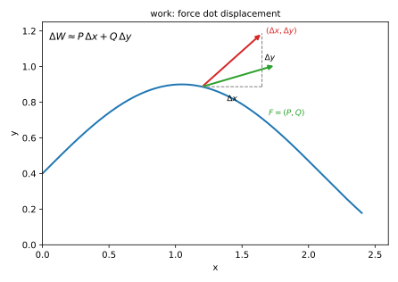
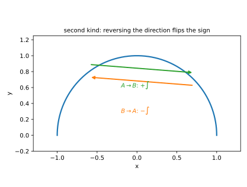
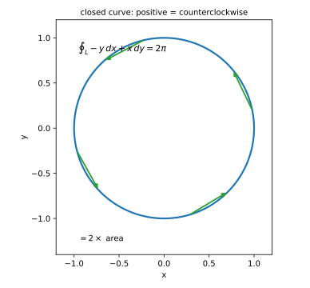
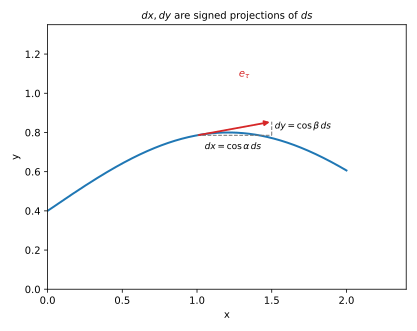

# 第 17 讲：第二类曲线积分（line integral of the second kind）（对坐标）

> **前置**：16 讲（第一类曲线积分、$ds$）；03 讲（向量）；12–15 讲（重积分）。
> **本讲解决什么**：16 讲的 $\int_L f\,ds$ 只关心“长度”，不关心“往哪走”。但物理里“力沿曲线做功”是有方向的：力与位移同向，功为正；反向，功为负。这一讲把“方向”装进积分，得到 $\int_L P\,dx+Q\,dy$，并讲清它与第一类的关系、以及计算时方向怎么定符号。

## 一、方向从哪来：做功

### 1.1 一小段上的功

设质点在力 $\mathbf F=(P,Q)$ 作用下沿曲线 $L$ 从 $A$ 走到 $B$。把 $L$ 分成小段，第 $i$ 段位移是向量

$$(\Delta x_i,\ \Delta y_i).$$

这一小段上，力做的功近似为**点积**：

$$\Delta W_i\approx \mathbf F(P_i)\cdot(\Delta x_i,\Delta y_i)=P(P_i)\,\Delta x_i+Q(P_i)\,\Delta y_i.$$

**为什么是点积**：只有沿位移方向的分力做功；垂直方向的分力不做功。点积正好只取“同向的那部分”。

累加、取极限：

$$\boxed{W=\int_L P\,dx+Q\,dy.}$$

**这就是第二类曲线积分**。它和第一类的区别一眼可见：第一类是 $f\,ds$（值 × 长度），第二类是 $P\,dx+Q\,dy$（力 × 位移分量），而 $dx,dy$ **带符号**。



*图 1：曲线一小段上，位移是 $(\Delta x,\Delta y)$；力 $\mathbf F=(P,Q)$ 做的功是点积 $P\Delta x+Q\Delta y$——分量同向为正、反向为负。*

### 1.2 曲线必须“有向”：定向（orientation）

$dx,dy$ 的符号取决于**往哪走**。所以第二类曲线积分的第一步是给曲线**定向**：

- 记 $L_{A\to B}$ 与 $L_{B\to A}$ 是**同一条曲线、相反方向**；
- 规定：$\int_{L_{A\to B}}P\,dx+Q\,dy=-\int_{L_{B\to A}}P\,dx+Q\,dy$。

**反向变号**，这是第二类与第一类最根本的差别。



*图 2：同一条弧，$A\to B$ 与 $B\to A$ 的积分互为相反数；第一类则相同。*

## 二、定义与计算

### 2.1 定义

把有向曲线 $L$ 分成小段，每段任取一点 $P_i$，作和

$$\sum_{i=1}^{n}\big[P(P_i)\,\Delta x_i+Q(P_i)\,\Delta y_i\big],$$

令最大段长 → 0。若和趋于与分割、取点无关的常数，记

$$\int_L P\,dx+Q\,dy.$$

（也可写成 $\int_L \mathbf F\cdot d\mathbf r$，其中 $d\mathbf r=(dx,dy)$。）

**逐句读这个定义**：

- “**有向**曲线”：$dx,dy$ 的符号由走向决定，反向时整体变号；
- “任取一点”：每段里挑哪个点都行；
- “与分割、取点无关”：可积的实质；
- “最大段长 → 0”：每段都变短，不只是段数变多。

### 2.2 怎么算：参数化

设 $L$ 的参数式 $x=x(t)$、$y=y(t)$，**$t$ 从起点 $\alpha$ 到终点 $\beta$**。则

$$dx=x'(t)\,dt,\qquad dy=y'(t)\,dt,$$

$$\boxed{\int_L P\,dx+Q\,dy=\int_\alpha^\beta\Big[P\big(x(t),y(t)\big)\,x'(t)+Q\big(x(t),y(t)\big)\,y'(t)\Big]dt.}$$

**注意上下限**：这里 $t$ 从**起点**到**终点**，$\alpha$ 不一定小于 $\beta$。**不要**像第一类那样强行“从小到大”——第二类的符号就是方向的一部分。

**例（先看一个具体计算）**：$L$：$y=x^2$ 从 $(0,0)$ 到 $(1,1)$，求 $\int_L y\,dx+x\,dy$。

参数化 $x=t$、$y=t^2$，$t:0\to1$；$dx=dt$、$dy=2t\,dt$：

$$\int_L y\,dx+x\,dy=\int_0^1\big[t^2\cdot1+t\cdot2t\big]dt=\int_0^1 3t^2\,dt=1.$$

**若反向**（从 $(1,1)$ 到 $(0,0)$）：$t:1\to0$，同一个原函数代上下限得 $0-1=-1$——与“反向变号”一致。

### 2.3 三类常见的曲线写法

1. **参数式**：直接代上面的公式；
2. **显式 $y=f(x)$**：把 $x$ 当参数，$dx=dx$、$dy=f'(x)\,dx$，$\int_{x_A}^{x_B}[P+Qf']dx$；
3. **闭合曲线**：记 $\oint_L$，并约定**正向**为“沿曲线走时区域在左手边”（平面闭曲线通常就是**逆时针**）。沿闭合曲线走一圈的第二类曲线积分也叫**环量**（circulation），记 $\oint_L P\,dx+Q\,dy$；它衡量场沿这个回路“推着走”的总效果。

**为什么是逆时针**：格林公式（18 讲）要求区域在行进方向左侧；逆时针走时区域在左，公式取正号。反向则整体变号。



*图 3：闭曲线取逆时针为正向；例 4 的 $\oint -y\,dx+x\,dy$ 等于 $2\times$ 圆面积。*

### 2.4 性质

1. **线性**：$\int(\alpha P_1+\beta P_2)dx+(\alpha Q_1+\beta Q_2)dy=\alpha\int P_1dx+Q_1dy+\beta\int P_2dx+Q_2dy$；
2. **可加（带方向）**：$L=L_1+L_2$（首尾相接、方向一致）⇒ $\int_L=\int_{L_1}+\int_{L_2}$；
3. **反向变号**：$\int_{-L}=-\int_L$。

## 三、两类曲线积分的关系

### 3.1 方向余弦（direction cosines）

设曲线在点处的**单位切向量**为

$$\mathbf e_\tau=(\cos\alpha,\ \cos\beta),$$

其中 $\alpha,\beta$ 是切向量与 $x,y$ 轴正向的夹角（方向余弦）。沿曲线走一小段 $ds$，**这段弧在 $x$ 轴上的投影是 $dx$、在 $y$ 轴上的投影是 $dy$**。因为 $ds$ 的方向就是切向 $(\cos\alpha,\cos\beta)$，所以投影分别是

$$dx=\cos\alpha\,ds,\qquad dy=\cos\beta\,ds.$$

（**这就是“$dx$ 带符号、$ds$ 不带”的几何解释**：$dx$ 是弧长在 $x$ 轴上的投影，投影有正负。）

### 3.2 互化公式

把 $dx,dy$ 代进第二类：

$$\boxed{\int_L P\,dx+Q\,dy=\int_L\big(P\cos\alpha+Q\cos\beta\big)ds.}$$

**读法**：第二类 = 第一类，被积函数换成“力在切向上的投影”。

**反过来**：知道第一类也能写成第二类，但需要曲线的切向。



*图 4：单位切向量 $(\cos\alpha,\cos\beta)$；$dx,dy$ 是 $ds$ 在坐标轴上的投影，所以带符号。*

### 3.3 什么时候用哪个

- **要算做功/环量、曲线给的是参数式**：直接用第二类——$P,Q$ 就是力的分量，$dx,dy$ 就是位移分量，不用先求切向。
- **被积函数只依赖到某点的距离、且题目不关心方向**：第一类更自然——$ds$ 直接是弧长，不必定方向；典型是求质量/弧长/柱面面积。
- **两类互化**：换之前先确认方向余弦；方向一变，$(\cos\alpha,\cos\beta)$ 整体变号。**不要**在没定方向时写 $dx=\cos\alpha\,ds$。

## 四、例题

**例 1**：$L$：$y=x^2$ 从 $(0,0)$ 到 $(1,1)$，求 $\int_L y\,dx+x\,dy$。

**解**：$x=t$、$y=t^2$，$t:0\to1$；$dx=dt$、$dy=2t\,dt$。

$$\int_L y\,dx+x\,dy=\int_0^1(t^2+2t^2)\,dt=\int_0^1 3t^2\,dt=1.$$

**例 2**（同起点终点、不同路径）：$L$：直线 $y=x$ 从 $(0,0)$ 到 $(1,1)$，求同一个积分。

**解**：$x=t$、$y=t$，$t:0\to1$；$dx=dy=dt$。

$$\int_L y\,dx+x\,dy=\int_0^1(t+t)\,dt=\int_0^1 2t\,dt=1.$$

**结果与例 1 相同**——这不是巧合：$P=y,Q=x$ 满足 $\frac{\partial Q}{\partial x}=1=\frac{\partial P}{\partial y}$，属于**路径无关**（path independence，18 讲）：起点终点固定时，换一条路径积分值不变。

**例 3**（反向）：$L$：$y=x^2$ 从 $(1,1)$ 到 $(0,0)$，求 $\int_L y\,dx+x\,dy$。

**解**：$x=t$、$y=t^2$，$t:1\to0$：

$$\int_1^0 3t^2\,dt=0-1=-1.$$

**例 4**（闭合曲线）：$L$ 是单位圆，取逆时针方向，求 $\oint_L -y\,dx+x\,dy$。

**解**：$x=\cos t$、$y=\sin t$，$t:0\to2\pi$（逆时针）；$dx=-\sin t\,dt$、$dy=\cos t\,dt$。

$$-y\,dx+x\,dy=(-\sin t)(-\sin t)+(\cos t)(\cos t)=\sin^2t+\cos^2t=1,$$

$$\oint_L -y\,dx+x\,dy=\int_0^{2\pi}1\,dt=2\pi.$$

（这个积分等于 $2\times$ 圆面积：$2\pi$。一般地，$\frac12\oint x\,dy-y\,dx$ 是区域面积——18 讲会讲。）

**若取顺时针**：参数化 $x=\cos t,y=\sin t$ 但 $t$ 从 $2\pi$ 走到 $0$。被积函数仍是 $1$，所以

$$\int_{2\pi}^{0}1\,dt=0-2\pi=-2\pi.$$

**方向一变，符号就变**——这与第一类（$ds$ 是长度、正反同值）正好相反。

**例 5**（两类互化验证）：$L$ 是单位圆逆时针，$P=-y$、$Q=x$。用两类公式各算一次。

**解**：第二类：例 4 已得 $2\pi$。

第一类：单位切向量 $\mathbf e_\tau=(-\sin t,\cos t)=(\cos\alpha,\cos\beta)$，所以 $\cos\alpha=-\sin t$、$\cos\beta=\cos t$，$ds=dt$：

$$\int_L(P\cos\alpha+Q\cos\beta)ds=\int_0^{2\pi}\big[(-\sin t)(-\sin t)+(\cos t)(\cos t)\big]dt=2\pi.$$

两者一致。

## 五、数值核对

用脚本核对本节结论（`scripts/lec17-02_verify_coord.py`，全脚本 0.00 秒）：

```
=== EXP1: y dx + x dy on y=x^2, (0,0)->(1,1) -> 1 ===
  numeric = 1.00000000, exact = 1, diff = 6.25e-12

=== EXP2: same integral on y=x, (0,0)->(1,1) -> 1 ===
  numeric = 1.00000000, exact = 1, diff = 0.00e+00

=== EXP3: reversed direction on y=x^2 -> -1 ===
  numeric = -1.00000000, exact = -1, diff = 6.25e-12

=== EXP4: closed unit circle, CCW: oint -y dx + x dy -> 2*pi ===
  numeric = 6.28318531, exact = 2*pi = 6.28318531, diff = 8.88e-16

=== EXP5: two kinds agree (second vs first with direction cosines) ===
  second = 6.28318531, first = 6.28318531, diff = 0.00e+00
```

**核对点**：EXP1/EXP3 差 $6.3\times10^{-12}$（中点法则），EXP2 精确；EXP4 差 $8.9\times10^{-16}$（机器精度）；**EXP5 两类曲线积分的结果完全相等（差 0）**，验证 $dx=\cos\alpha\,ds$、$dy=\cos\beta\,ds$ 的互化公式。

## 小结

- **第二类曲线积分**：$\int_L P\,dx+Q\,dy$＝“力 × 有向位移”的累加；功有正负。
- **方向**：反向变号；参数化时 $t$ 从起点到终点，**不强行从小到大**。
- **两类关系**：$dx=\cos\alpha\,ds$、$dy=\cos\beta\,ds$，所以 $\int Pdx+Qdy=\int(P\cos\alpha+Q\cos\beta)ds$。
- **闭合曲线**：$\oint$；平面正向通常取逆时针。
- **路径无关**：例 1/例 2 同值，是 18 讲的主题。

## 作业

**说明**：答案平铺在每题下方（先做再对照）。只用上册与本讲已教内容。

**1.** $L$：$y=x$ 从 $(0,0)$ 到 $(1,1)$，求 $\int_L x\,dx+y\,dy$。

**参考答案**：
$x=t$、$y=t$，$t:0\to1$；$dx=dy=dt$：$\int_0^1(t+t)dt=\int_0^1 2t\,dt=1$。

**2.** $L$：单位圆逆时针，求 $\oint_L x\,dx+y\,dy$。

**参考答案**：
$x=\cos t$、$y=\sin t$，$t:0\to2\pi$；$x\,dx+y\,dy=(-\cos t\sin t+\sin t\cos t)dt=0$，所以积分 $=0$。
（也可看出：这是 $\frac12d(x^2+y^2)$，在闭合曲线上积分为 0。）

**3.** $L$：$y=x^2$ 从 $(0,0)$ 到 $(1,1)$，求 $\int_L x\,dy$。

**参考答案**：
$x=t$、$y=t^2$，$dy=2t\,dt$：$\int_0^1 t\cdot2t\,dt=\frac23$。

**4.** 把第 3 题的积分换成反向（从 $(1,1)$ 到 $(0,0)$），结果是多少？

**参考答案**：
$t:1\to0$：$\int_1^0 2t^2dt=-\frac23$（反向变号）。

**5.**（概念）为什么第二类曲线积分反向要变号，而第一类不变？

**参考答案**：
第二类里的 $dx,dy$ 是**有向位移分量**（$ds$ 在坐标轴上的投影），反向时投影变号；第一类的 $ds$ 是**长度**，恒非负。

**6.**（概念）$\int_L P\,dx+Q\,dy$ 中的 $P,Q$ 如果是常数，积分等于什么？和路径有关吗？

**参考答案**：
$\int_L P\,dx+Q\,dy=P\int_L dx+Q\int_L dy=P(x_B-x_A)+Q(y_B-y_A)$，只与起点、终点有关，与路径无关（这是“保守力做功”的情形）。
