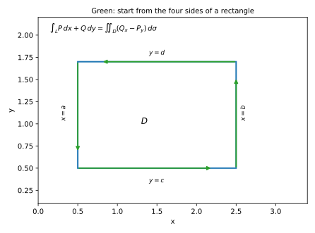
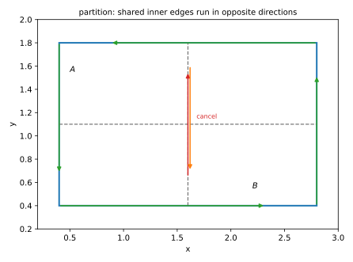
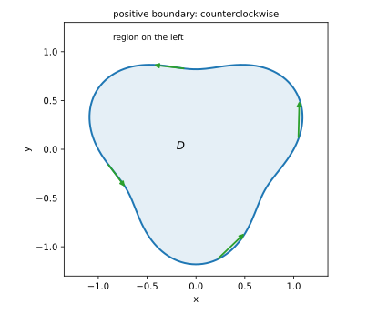
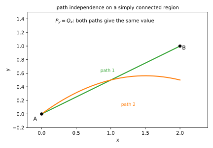
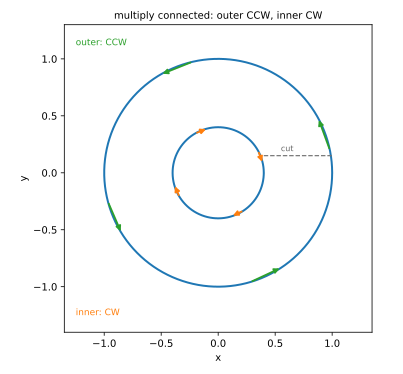

# 第 18 讲：格林公式与路径无关

> **前置**：17 讲（第二类曲线积分、方向、闭合曲线）；12–13 讲（二重积分、区域）。
> **本讲解决什么**：17 讲算闭曲线积分要一段一段参数化，很烦。格林公式给出另一条路：**闭曲线上的积分 = 区域内部的二重积分**。它顺便回答一个更基本的问题：什么时候“从 $A$ 到 $B$ 的积分与走哪条路无关”？答案是一个偏导等式，但**有前提**（单连通）。

## 一、格林公式：从矩形四边算起

### 1.1 矩形上的两边之和

设 $D=[a,b]\times[c,d]$，$L$ 是它的边界，取**逆时针**（正向）。先只看 $\oint_L P\,dx$。

四条边：

- 下边 $y=c$：$x$ 从 $a$ 到 $b$，$dy=0$，贡献 $\int_a^b P(x,c)\,dx$；
- 右边 $x=b$：$dx=0$，贡献 $0$；
- 上边 $y=d$：$x$ 从 $b$ 到 $a$（逆时针往回走），贡献 $\int_b^a P(x,d)\,dx$；
- 左边 $x=a$：$dx=0$，贡献 $0$。

合起来：

$$\oint_L P\,dx=\int_a^b P(x,c)\,dx-\int_a^b P(x,d)\,dx=-\int_a^b\big[P(x,d)-P(x,c)\big]dx.$$

而括号里正是 $P$ 沿 $y$ 的增量：由微积分基本定理，

$$P(x,d)-P(x,c)=\int_c^d \frac{\partial P}{\partial y}\,dy.$$

所以

$$\oint_L P\,dx=-\iint_D \frac{\partial P}{\partial y}\,d\sigma.$$

**几何意义**：一条边的“横向位移”贡献，等于内部 $P_y$ 的积分取负。

### 1.2 另一部分，合起来

同理看 $\oint_L Q\,dy$：

- 左边 $x=a$：$y$ 从 $d$ 到 $c$（逆时针），贡献 $-\int_c^d Q(a,y)\,dy$；
- 右边 $x=b$：$y$ 从 $c$ 到 $d$，贡献 $\int_c^d Q(b,y)\,dy$。

合起来：

$$\oint_L Q\,dy=\int_c^d\big[Q(b,y)-Q(a,y)\big]dy=\int_c^d\int_a^b\frac{\partial Q}{\partial x}\,dx\,dy=\iint_D\frac{\partial Q}{\partial x}\,d\sigma.$$

两式相加：

$$\boxed{\oint_L P\,dx+Q\,dy=\iint_D\left(\frac{\partial Q}{\partial x}-\frac{\partial P}{\partial y}\right)d\sigma.}$$

**这就是格林公式**（Green's theorem）。



*图 1：矩形逆时针边界；$P\,dx$ 只在下、上两边有贡献，$Q\,dy$ 只在左、右两边有贡献。*

### 1.3 一般区域与条件

**条件**（缺一不可）：

1. $D$ 是**闭区域**，边界 $L$ 分段光滑；
2. $L$ 取**正向**（沿边界走时区域在左手边；平面闭曲线通常就是逆时针）；
3. $P,Q$ 在 $D$ 上有**连续偏导**。

**一般区域**：把 $D$ 划成有限个“同时是 X 型和 Y 型”的小块。对每个小块用矩形结论，再把所有小块的公式相加。**相邻两块共享的那条内部边界，在小块 $A$ 的边界上是逆时针、在小块 $B$ 的边界上是顺时针**，两段积分正好抵消；加完只剩最外层边界。所以公式对一般区域仍成立。



*图 2：把区域划成小块；相邻两块共享的内部边界走向相反（红/橙箭头），相加时抵消，只剩外边界。*

**方向错了会怎样**：$L$ 取顺时针，右边整体变号。

### 1.4 面积公式

取 $P=-y$、$Q=x$：$\frac{\partial Q}{\partial x}-\frac{\partial P}{\partial y}=1-(-1)=2$，所以

$$\oint_L -y\,dx+x\,dy=2\iint_D1\,d\sigma=2A\ \Longrightarrow\ A=\frac12\oint_L x\,dy-y\,dx.$$

（等价地 $A=\oint_L x\,dy=-\oint_L y\,dx$。）

**这是格林公式最常用的推论**：用边界积分算面积。



*图 3：正向边界＝逆时针；区域在行进方向左侧。*

## 二、路径无关的四个等价条件

### 2.1 四个说法

在**单连通区域** $G$（没有“洞”的区域）上，以下四条等价：

1. $\int_L P\,dx+Q\,dy$ **与路径无关**（只与起点、终点有关）；
2. 沿 $G$ 内任意**闭曲线**积分为 $0$；
3. 存在函数 $u(x,y)$，使 $du=P\,dx+Q\,dy$（$P,Q$ 是某个函数的偏导）；
4. $\dfrac{\partial P}{\partial y}=\dfrac{\partial Q}{\partial x}$（$P,Q$ 有连续偏导）。

### 2.2 为什么等价（链条）

- **1 ⇔ 2**：两条从 $A$ 到 $B$ 的路径拼成一个闭曲线；路径无关 ⇒ 闭曲线积分为 0；反之亦然。
- **2 ⇒ 3**：固定起点 $A$，定义 $u(B)=\int_A^B P\,dx+Q\,dy$。路径无关保证这个定义合法；可以验证 $u_x=P$、$u_y=Q$。
- **3 ⇒ 4**：$u_x=P$、$u_y=Q$，所以 $P_y=u_{xy}$、$Q_x=u_{yx}$；偏导连续时 $u_{xy}=u_{yx}$。
- **4 ⇒ 1**：任取两条路径拼成闭曲线，格林公式给 $\oint=\iint(Q_x-P_y)d\sigma=0$。

**把 2 ⇒ 3 的“验证”真算一遍**：取折线路径，

$$u(x,y)=\int_{x_0}^{x}P(s,y_0)\,ds+\int_{y_0}^{y}Q(x,t)\,dt.$$

对 $x$ 求偏导：第一项由微积分基本定理得 $P(x,y_0)$；第二项里积分上限是 $x$、被积函数也含 $x$，对 $x$ 求导得 $\int_{y_0}^{y}Q_x(x,t)\,dt$。两项相加：

$$u_x=P(x,y_0)+\int_{y_0}^{y}Q_x(x,t)\,dt.$$

用 $P_y=Q_x$ 把 $Q_x$ 换成 $P_y$，后一项变成 $\int_{y_0}^{y}P_y(x,t)\,dt=P(x,y)-P(x,y_0)$。相加得 $u_x=P(x,y)$ ✓。同理 $u_y=Q$。



*图 4：单连通区域里，$A\to B$ 的两条路径积分相同；等价于“任意闭曲线积分为 0”。*

### 2.3 前提：单连通，不能省

**反例**（很重要）：

$$P=\frac{-y}{x^2+y^2},\qquad Q=\frac{x}{x^2+y^2}.$$

在**去掉原点**的平面上，直接算得 $P_y=Q_x$。但沿单位圆逆时针走一圈：

$$\oint_L P\,dx+Q\,dy=\int_0^{2\pi}\frac{(-\sin t)(-\sin t)+(\cos t)(\cos t)}{1}\,dt=\int_0^{2\pi}1\,dt=2\pi\ne0.$$

**为什么“条件 4 成立却闭曲线不为 0”**：区域是**挖掉原点的平面**，不单连通；格林公式的前提被破坏。**所以“$P_y=Q_x$ ⇒ 路径无关”只在单连通区域成立。**

### 2.4 全微分求积

若 $P_y=Q_x$（单连通），求 $u$ 使 $du=P\,dx+Q\,dy$：

$$u(x,y)=\int_{(x_0,y_0)}^{(x,y)}P\,dx+Q\,dy,$$

**路径可以任选**，最方便的是**折线**：先水平 $(x_0,y_0)\to(x,y_0)$，再竖直 $(x,y_0)\to(x,y)$。于是

$$u(x,y)=\int_{x_0}^{x}P(s,y_0)\,ds+\int_{y_0}^{y}Q(x,t)\,dt.$$

（也可以先竖直后水平，结果相同。）

## 三、多连通区域：挖洞与辅助线

### 3.1 环形区域的正向

区域 $D$ 是“外圆盘挖掉内圆盘”。正向边界的约定是“**区域在左手边**”：

- **外边界**：逆时针；
- **内边界**：**顺时针**（这样走时区域仍在左侧）。

于是格林公式写成

$$\oint_{\text{外}}P\,dx+Q\,dy+\oint_{\text{内（顺）}}P\,dx+Q\,dy=\iint_D(Q_x-P_y)\,d\sigma.$$

### 3.2 辅助线

若想对“两条闭曲线组成的边界”直接用单连通版本的公式，可以**加一条辅助线把环形剪开**：从内边界一点 $A$ 到外边界一点 $B$ 连一条线段。沿它从 $A$ 走到 $B$，再沿外边界逆时针走一圈，再沿原线段从 $B$ 走回 $A$，然后沿内边界顺时针走一圈。**线段 $AB$ 被正反各走一次，积分抵消**；剩下的是“外圈逆 + 内圈顺”，而剪开后的区域单连通，可以用格林公式。



*图 5：环形区域的外边界逆时针、内边界顺时针；虚线是“剪开”用的辅助线。*

## 四、例题

**例 1**：$L$ 是单位圆，逆时针，求 $\oint_L(x-y)dx+(x+y)dy$。

**解**：$P=x-y$、$Q=x+y$。

$$Q_x=1,\qquad P_y=-1\ \Longrightarrow\ Q_x-P_y=2.$$

由格林公式：

$$\oint_L(x-y)dx+(x+y)dy=\iint_D2\,d\sigma=2\cdot\pi=2\pi.$$

**例 2**（面积）：求椭圆 $\dfrac{x^2}{a^2}+\dfrac{y^2}{b^2}=1$ 的面积。

**解**：参数化 $x=a\cos t$、$y=b\sin t$，$t:0\to2\pi$（逆时针）。

$$A=\frac12\oint_L x\,dy-y\,dx=\frac12\int_0^{2\pi}\big[(a\cos t)(b\cos t)-(b\sin t)(-a\sin t)\big]dt.$$

括号内 $=ab(\cos^2t+\sin^2t)=ab$，所以

$$A=\frac12\int_0^{2\pi}ab\,dt=\pi ab.$$

**例 3**（路径无关）：求 $\int_{(0,0)}^{(1,1)}2xy\,dx+x^2\,dy$。

**解**：$P=2xy$、$Q=x^2$；$P_y=2x=Q_x$，且全平面单连通 ⇒ 路径无关。

**取折线** $(0,0)\to(1,0)\to(1,1)$：

- 第一段 $y=0$、$dy=0$：$\int_0^1 2x\cdot0\,dx=0$；
- 第二段 $x=1$、$dx=0$：$\int_0^1 1\,dy=1$。

所以积分 $=1$。

**用原函数验证**：$u=x^2y$ 满足 $u_x=2xy$、$u_y=x^2$，所以积分 $=u(1,1)-u(0,0)=1-0=1$ ✓。

**例 4**（多连通反例）：$L$ 是单位圆逆时针，求 $\oint_L\dfrac{-y\,dx+x\,dy}{x^2+y^2}$。

**解**：参数化后被积函数为 $1$（见 §2.3），所以积分 $=2\pi$。

**注意**：这不是算错——$\frac{\partial P}{\partial y}=\frac{\partial Q}{\partial x}$ 在**去掉原点**的区域成立，但该区域不单连通，格林公式不能用。

**例 5**（不闭合时补线）：$L$ 是从 $(1,0)$ 到 $(0,1)$ 的上半单位圆弧；$P=x^2-y$、$Q=x+y$。求 $\int_L P\,dx+Q\,dy$。

**解**：$L$ 不闭合，不能直接用 $\oint$。补上直线段 $L_1$：从 $(0,1)$ 到 $(1,0)$，使 $L+L_1$ 成为逆时针闭曲线（第一象限的四分之一圆边界）。

**闭曲线**（格林）：$Q_x=1$、$P_y=-1$，$Q_x-P_y=2$；区域是四分之一圆，面积 $\frac{\pi}{4}$：

$$\oint_{L+L_1}=\iint 2\,d\sigma=2\cdot\frac{\pi}{4}=\frac{\pi}{2}.$$

**补线 $L_1$**：参数化 $x=t$、$y=1-t$，$t:0\to1$；$dx=dt$、$dy=-dt$。

$$P=x^2-y=t^2-(1-t)=t^2+t-1,\qquad Q=x+y=1,$$

$$\int_{L_1}P\,dx+Q\,dy=\int_0^1\big[(t^2+t-1)-1\big]dt=\int_0^1(t^2+t-2)\,dt=\frac13+\frac12-2=-\frac76.$$

**相减**：

$$\int_L=\oint_{L+L_1}-\int_{L_1}=\frac{\pi}{2}-\Big(-\frac76\Big)=\frac{\pi}{2}+\frac76\approx2.7375.$$

**补线本身的方向要记清**：若补成顺时针，整个闭曲线的符号会反。

## 五、数值核对

用脚本核对本节结论（`scripts/lec18-02_verify_green.py`，全脚本 0.00 秒）：

```
=== EXP1: oint (x-y)dx+(x+y)dy on unit circle -> 2*pi ===
  numeric = 6.28318531, exact = 2*pi = 6.28318531, diff = 8.88e-16

=== EXP2: ellipse area by the boundary integral -> pi*a*b ===
  numeric = 6.28318531, exact = pi*a*b = 6.28318531, diff = 8.88e-16

=== EXP3: path independence: 2xy dx + x^2 dy, (0,0)->(1,1) -> 1 ===
  straight = 1.00000000, parabola = 1.00000000, exact = 1, diff = 6.25e-12

=== EXP4: vortex field around the origin -> 2*pi (not 0) ===
  numeric = 6.28318531, exact = 2*pi = 6.28318531, diff = 8.88e-16

=== EXP5: Green: boundary integral equals double integral ===
  boundary = 6.28318531, double = 6.28318531, diff = 8.88e-16
```

**核对点**：全部在 $10^{-16}$ 级（EXP3 差 $6.3\times10^{-12}$，中点法则）：EXP1 格林两边各算一次都是 $2\pi$；EXP2 椭圆面积 $\pi ab$；EXP3 两条路径（直线/抛物线）结果相同，验证路径无关；EXP4 **多连通反例**绕原点得 $2\pi$ 而不是 0。

## 小结

- **格林公式**：$\oint_L P\,dx+Q\,dy=\iint_D(Q_x-P_y)d\sigma$；条件：闭区域、**正向边界**、$P,Q$ 连续偏导。
- **面积公式**：$A=\frac12\oint_L x\,dy-y\,dx$。
- **路径无关四等价**（单连通）：路径无关 ⇔ 闭曲线为 0 ⇔ 存在原函数 ⇔ $P_y=Q_x$。
- **单连通不能省**：$\frac{-y}{x^2+y^2},\frac{x}{x^2+y^2}$ 绕原点一圈是 $2\pi$。
- **多连通**：外逆内顺；可用辅助线剪开。

## 作业

**说明**：答案平铺在每题下方（先做再对照）。只用上册与本讲已教内容。

**1.** $L$ 是正方形 $|x|+|y|=1$ 的边界，逆时针，求 $\oint_L x\,dy-y\,dx$。

**参考答案**：
$P=-y$、$Q=x$，$Q_x-P_y=2$；正方形面积 $=2$（对角线 2，边长 $\sqrt2$，面积 $(\sqrt2)^2=2$）。
$\oint x\,dy-y\,dx=2\iint1\,d\sigma=4$。

**2.** 求 $\int_{(0,0)}^{(2,1)}(2xy+1)dx+(x^2)dy$。

**参考答案**：
$P=2xy+1$、$Q=x^2$；$P_y=2x=Q_x$ ⇒ 路径无关。
折线：$(0,0)\to(2,0)\to(2,1)$。第一段 $y=0$：$\int_0^2 1\,dx=2$；第二段 $x=2$：$\int_0^1 4\,dy=4$。总和 $=6$。
原函数 $u=x^2y+x$：$u(2,1)-u(0,0)=4+2=6$ ✓。

**3.** 用格林公式求单位圆面积。

**参考答案**：
$A=\frac12\oint x\,dy-y\,dx=\frac12\int_0^{2\pi}(\cos^2t+\sin^2t)dt=\frac12\cdot2\pi=\pi$。

**4.**（概念）为什么 $P_y=Q_x$ 不能直接推出路径无关？需要什么条件？

**参考答案**：
还需要区域**单连通**（无洞）。反例：$P=\frac{-y}{x^2+y^2}$、$Q=\frac{x}{x^2+y^2}$ 在去掉原点的平面上满足 $P_y=Q_x$，但绕原点一圈积分 $2\pi\ne0$。

**5.**（概念）多连通区域的内边界为什么取顺时针？

**参考答案**：
正向的定义是“沿边界走时区域在左手边”。内边界顺时针走时，区域（环形部分）恰好在左侧；若取逆时针，区域在右侧，格林公式的符号会反。

**6.**（概念）格林公式里的“正向”能不能统一说成“逆时针”？外边界和内边界一样吗？

**参考答案**：
不能一概说逆时针。外边界逆时针、内边界顺时针；统一规则是“区域在左手边”。
