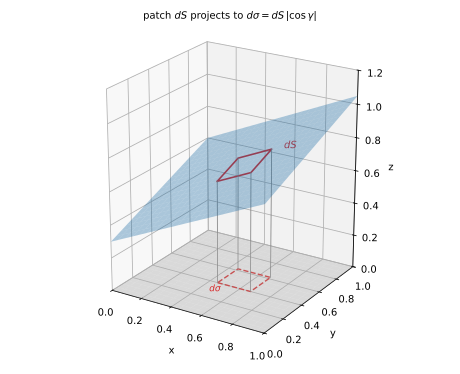
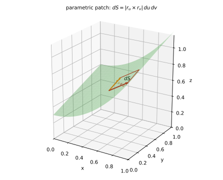
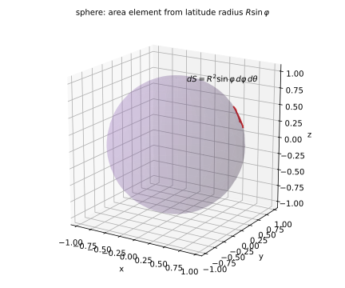
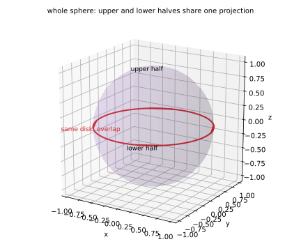

# 第 19 讲：第一类曲面积分（对面积）

> **前置**：16 讲（第一类曲线积分、$ds$）；12–14 讲（二重积分、球面/柱面）；07 讲（曲面法向）。
> **本讲解决什么**：16 讲把积分区域从区间换成曲线；这一讲再升一维，把区域换成**曲面**。核心仍然只有一件事：**面积元 $dS$ 是什么、怎么把它化成 $dx\,dy$**。学会这个，曲面积分就退化成二重积分。

## 一、面积元 $dS$ 从哪来

### 1.1 投影法：$dS$ 与 $d\sigma$ 的关系

设曲面 $\Sigma$ 由显式方程 $z=z(x,y)$ 给出，在 $xy$ 平面上的投影是区域 $D$。

在曲面上取一小块，面积记 $dS$；它在 $xy$ 平面上的**投影**面积记 $d\sigma=dx\,dy$。两块的关系是

$$d\sigma=dS\,|\cos\gamma|,$$

其中 $\gamma$ 是**曲面法向与 $z$ 轴的夹角**。

**为什么**：把小块看成平面片，它“斜着”放着；投影是它在地面上的影子。倾斜越厉害，影子越小；缩短因子就是 $|\cos\gamma|$。

**把 $\cos\gamma$ 算出来**：曲面 $z=z(x,y)$ 的一个法向量是（07 讲）

$$\mathbf n=(-z_x,\ -z_y,\ 1),\qquad |\mathbf n|=\sqrt{1+z_x^2+z_y^2}.$$

与 $z$ 轴单位向量 $\mathbf k=(0,0,1)$ 的夹角余弦：

$$\cos\gamma=\frac{\mathbf n\cdot\mathbf k}{|\mathbf n|}=\frac{1}{\sqrt{1+z_x^2+z_y^2}}.$$

于是

$$\boxed{dS=\sqrt{1+z_x^2+z_y^2}\;dx\,dy.}$$

**检查两个极端**：

- 曲面是水平平面 $z=\text{常数}$：$z_x=z_y=0$，$dS=dx\,dy$——不倾斜，面积等于投影；
- 曲面很陡（$z_x,z_y$ 很大）：根号很大，$dS\gg dx\,dy$——倾斜的面“摊开”后比影子大得多。



*图 1：曲面小块 $dS$ 与它在 $xy$ 面的投影 $d\sigma$；法向与 $z$ 轴夹角 $\gamma$，投影缩短因子 $|\cos\gamma|$。*

### 1.2 参数法：叉积的模

若曲面用参数给出

$$\mathbf r(u,v)=\big(x(u,v),\ y(u,v),\ z(u,v)\big),$$

则在 $(u,v)$ 处取小矩形 $du\times dv$，它映射到曲面上是一个小平行四边形，两条边是

$$\mathbf r_u\,du,\qquad \mathbf r_v\,dv.$$

平行四边形的面积 = 两向量叉积的模：

$$\boxed{dS=|\mathbf r_u\times\mathbf r_v|\,du\,dv.}$$

**与 16 讲同构**：曲线是一维的，小段长度 $=|\mathbf r'(t)|\,dt$；曲面是二维的，小面元面积 $=|\mathbf r_u\times\mathbf r_v|\,du\,dv$。**一维用模，二维用叉积的模**。



*图 2：参数曲面上，$\mathbf r_u$、$\mathbf r_v$ 张成一个小平行四边形，面积是 $|\mathbf r_u\times\mathbf r_v|\,du\,dv$。*

### 1.3 两个常用特例：球面与柱面

**球面**（半径 $R$）：参数化

$$\mathbf r(\varphi,\theta)=(R\sin\varphi\cos\theta,\ R\sin\varphi\sin\theta,\ R\cos\varphi),$$

$$\mathbf r_\varphi=(R\cos\varphi\cos\theta,\ R\cos\varphi\sin\theta,\ -R\sin\varphi),$$

$$\mathbf r_\theta=(-R\sin\varphi\sin\theta,\ R\sin\varphi\cos\theta,\ 0).$$

叉积的模（直接算）：

$$|\mathbf r_\varphi\times\mathbf r_\theta|=R^2\sin\varphi,$$

所以

$$\boxed{dS=R^2\sin\varphi\,d\varphi\,d\theta.}$$

（与 14 讲球面坐标的体积元 $dV=\rho^2\sin\varphi\,d\rho\,d\varphi\,d\theta$ 对照：把 $d\rho$ 换成 $R$ 的“厚度”，就是面积元。）

**柱面**（半径 $R$，母线平行 $z$ 轴）：参数化 $(R\cos\theta,R\sin\theta,z)$，两条切向是 $(-R\sin\theta,R\cos\theta,0)$ 与 $(0,0,1)$，叉积的模 $=R$：

$$dS=R\,d\theta\,dz.$$



*图 3：球面上 $dS=R^2\sin\varphi\,d\varphi\,d\theta$；$\sin\varphi$ 来自纬线半径 $R\sin\varphi$。*

## 二、定义与意义

### 2.1 定义

把曲面 $\Sigma$ 分成小块 $\Delta S_i$，每块任取一点 $P_i$，作和

$$\sum_{i=1}^{n} f(P_i)\,\Delta S_i,$$

令最大块直径 → 0。若和趋于与分割、取点无关的常数，记

$$\iint_\Sigma f(x,y,z)\,dS.$$

**逐句读**：

- “分成小块”：怎么分都行（网格、参数网格、不规则块都行）；
- “任取一点”：每块里挑哪个点都行；
- “与分割、取点无关”：可积的实质；
- “最大块直径 → 0”：要求每块都变小，不只是块数变多。

**与二重积分的区别**：二重积分的区域是**平面区域**，面积元是 $d\sigma=dx\,dy$；曲面积分的区域是**曲面**，面积元是 $dS$，一般 $dS\ne dx\,dy$。**这是最容易混的一处**。

### 2.2 它算的是什么

- $f=1$：$\iint_\Sigma1\,dS$ 是**曲面面积**；
- $f$ 是**面密度**：$\iint_\Sigma\rho\,dS$ 是薄壳的**质量**；
- $f$ 是**电荷面密度**：$\iint_\Sigma\sigma\,dS$ 是**总电荷**。

### 2.3 为什么不带方向

$\Delta S_i$ 是**面积**，恒非负；无论从曲面哪一侧看，小块面积都一样。所以

$$\iint_\Sigma f\,dS$$

**与曲面的“侧”无关**。这是第一类与第二类曲面积分的根本区别（20 讲的通量要定向，换侧变号）。

## 三、计算：化为二重积分

### 3.1 三步

1. **投影**：把 $\Sigma$ 投影到 $xy$ 平面，得 $D$（要求**单值**：一条竖线与曲面只交一次）；
2. **算 $dS$**：显式用 $\sqrt{1+z_x^2+z_y^2}\,dx\,dy$；参数式用 $|\mathbf r_u\times\mathbf r_v|\,du\,dv$；
3. **化二重积分**：

$$\iint_\Sigma f\,dS=\iint_D f\big(x,y,z(x,y)\big)\sqrt{1+z_x^2+z_y^2}\,dx\,dy,$$

再按 12 讲设限。

### 3.2 投影重叠怎么办

**症状**：一条竖线与曲面交**两次**（比如整球面投影到 $xy$ 面，上半球和下半球投到同一个圆盘）。

**处理**：

- **分片**：把曲面分成“上半、下半”，各自投影、各自算，再相加；
- **换投影面**：投影到 $xz$ 或 $yz$ 面（选“不重叠”的方向）；
- **参数化**：直接用 $dS=|\mathbf r_u\times\mathbf r_v|\,du\,dv$（球面用 $(\varphi,\theta)$ 参数化最省事）。



*图 4：整球面投影到 $xy$ 面会重叠（上下两半投到同一圆盘）；必须分片或用参数化。*

### 3.3 对称性

与 16 讲同构：

- 曲面关于 $xy$ 平面对称，且 $f$ 关于 $z$ 是奇函数 ⇒ $\iint_\Sigma f\,dS=0$；
- 偶函数 ⇒ 翻倍（只算上半）。

**注意**：必须**曲面对称**且**函数对相应变量奇/偶**，两个条件缺一不可。

## 四、例题

**例 1**（面积）：$\Sigma$ 是平面 $z=x+y$ 被圆柱 $x^2+y^2\le1$ 截出的部分，求面积。

**解**：$z_x=1$、$z_y=1$，所以 $dS=\sqrt{1+1+1}\,dx\,dy=\sqrt3\,dx\,dy$。投影是单位圆盘：

$$A=\iint_D\sqrt3\,dx\,dy=\sqrt3\cdot\pi=\sqrt3\pi.$$

**例 2**：$\Sigma$ 是平面 $z=1$ 上的单位圆盘，求 $\iint_\Sigma z\,dS$。

**解**：$z=1$ 是水平面，$dS=dx\,dy$；$z=1$：

$$\iint_\Sigma z\,dS=\iint_D1\,dx\,dy=\pi.$$

**例 3**（球面）：$\Sigma$ 是球面 $x^2+y^2+z^2=R^2$，求 $\iint_\Sigma z^2\,dS$。

**解**：球面参数化，$dS=R^2\sin\varphi\,d\varphi\,d\theta$；$z=R\cos\varphi$，所以 $z^2=R^2\cos^2\varphi$。$0\le\varphi\le\pi$、$0\le\theta\le2\pi$：

$$\iint_\Sigma z^2\,dS=\int_0^{2\pi}d\theta\int_0^{\pi}R^2\cos^2\varphi\cdot R^2\sin\varphi\,d\varphi=R^4\cdot2\pi\cdot\Big[-\frac{\cos^3\varphi}{3}\Big]_0^{\pi}.$$

$\Big[-\frac{\cos^3\varphi}{3}\Big]_0^{\pi}=\frac13-\big(-\frac13\big)=\frac23$。所以

$$\iint_\Sigma z^2\,dS=R^4\cdot2\pi\cdot\frac23=\frac{4\pi R^4}{3}.$$

**例 4**（对称性）：$\Sigma$ 是球面 $x^2+y^2+z^2=R^2$，求 $\iint_\Sigma z\,dS$。

**解**：球面关于 $xy$ 平面对称；$f=z$ 关于 $z$ 是奇函数（上下两半的值相反）。所以积分 $=0$。

**验证**：参数化 $\int_0^{\pi}\cos\varphi\sin\varphi\,d\varphi=\Big[\frac{\sin^2\varphi}{2}\Big]_0^{\pi}=0$ ✓。

**例 5**（质量）：$\Sigma$ 是上半球面 $z=\sqrt{R^2-x^2-y^2}$，面密度 $\rho=z$，求质量。

**解**：用球面参数化，上半球对应 $0\le\varphi\le\frac{\pi}{2}$：

$$m=\iint_\Sigma z\,dS=\int_0^{2\pi}d\theta\int_0^{\pi/2}R\cos\varphi\cdot R^2\sin\varphi\,d\varphi.$$

内层 $\int_0^{\pi/2}\sin\varphi\cos\varphi\,d\varphi=\frac12$。所以

$$m=2\pi\cdot R^3\cdot\frac12=\pi R^3.$$

**（也可用投影法验证）** $z_x=-x/z$、$z_y=-y/z$，$\sqrt{1+z_x^2+z_y^2}=\frac{R}{z}$，$dS=\frac{R}{z}dx\,dy$；于是 $\iint z\,dS=\iint R\,dx\,dy=R\cdot\pi R^2=\pi R^3$ ✓。

## 五、数值核对

用脚本核对本节结论（`scripts/lec19-02_verify_surface.py`，全脚本 0.00 秒）：

```
=== EXP1: area of the plane z=x+y over the unit disk -> sqrt(3)*pi ===
  numeric = 5.44139809, exact = sqrt(3)*pi = 5.44139809, diff = 8.88e-16

=== EXP2: z over the disk z=1 -> pi ===
  numeric = 3.14159265, exact = pi = 3.14159265, diff = 4.44e-16

=== EXP3: z^2 over the sphere -> 4*pi*R^4/3 ===
  numeric = 4.18882250, exact = 4*pi/3 = 4.18879020, diff = 3.23e-05

=== EXP4: z over the sphere -> 0 by symmetry ===
  numeric = -5.610e-17, exact = 0, diff = 5.61e-17

=== EXP5: mass of the upper hemisphere with rho=z -> pi*R^3 ===
  numeric = 3.14160073, exact = pi = 3.14159265, diff = 8.07e-06
```

**核对点**：EXP1/2 在 $10^{-16}$ 级（$\sqrt3\pi$、$\pi$）；EXP3/5 差 $3\times10^{-5}$、$8\times10^{-6}$（中点法则，$n=400$ 网格）；EXP4 是机器零（$-5.6\times10^{-17}$），验证球面上下对称抵消。

## 小结

- **$dS$ 的来源**：投影法 $\sqrt{1+z_x^2+z_y^2}\,dx\,dy$（法向与 $z$ 轴夹角）；参数法 $|\mathbf r_u\times\mathbf r_v|\,du\,dv$。
- **特例**：球面 $dS=R^2\sin\varphi\,d\varphi\,d\theta$；柱面 $dS=R\,d\theta\,dz$。
- **第一类曲面积分**：$\iint_\Sigma f\,dS$＝曲面上“值 × 面积”的累加；$f=1$ 面积、$f$ 面密度质量。
- **不带方向**：$dS\ge0$，与曲面的“侧”无关。
- **计算三步**：投影（单值）→ 算 $dS$ → 化二重积分；投影重叠要分片或参数化。

## 作业

**说明**：答案平铺在每题下方（先做再对照）。只用上册与本讲已教内容。

**1.** $\Sigma$ 是平面 $z=2x+2y$ 被 $x^2+y^2\le1$ 截出的部分，求面积。

**参考答案**：
$z_x=2$、$z_y=2$，$dS=\sqrt{1+4+4}\,dx\,dy=3\,dx\,dy$。
$A=\iint_D3\,dx\,dy=3\pi$。

**2.** $\Sigma$ 是球面 $x^2+y^2+z^2=R^2$，求 $\iint_\Sigma(x^2+y^2)\,dS$。

**参考答案**：
球面参数化，$x^2+y^2=R^2\sin^2\varphi$，$dS=R^2\sin\varphi\,d\varphi\,d\theta$：
$\int_0^{2\pi}d\theta\int_0^{\pi}R^2\sin^2\varphi\cdot R^2\sin\varphi\,d\varphi=2\pi R^4\cdot\frac43=\frac{8\pi R^4}{3}$。
（其中 $\int_0^{\pi}\sin^3\varphi\,d\varphi=\frac43$。）

**3.** $\Sigma$ 是圆柱面 $x^2+y^2=R^2$ 介于 $z=0$ 与 $z=h$ 之间的部分，求面积。

**参考答案**：
柱面 $dS=R\,d\theta\,dz$，$0\le\theta\le2\pi$、$0\le z\le h$：
$A=\int_0^{2\pi}\int_0^h R\,dz\,d\theta=2\pi Rh$。

**4.** $\Sigma$ 是上半球面 $z=\sqrt{R^2-x^2-y^2}$，求 $\iint_\Sigma z\,dS$。

**参考答案**：
球坐标 $0\le\varphi\le\frac{\pi}{2}$：$\int_0^{2\pi}\int_0^{\pi/2}R\cos\varphi\cdot R^2\sin\varphi\,d\varphi\,d\theta=\pi R^3$。

**5.**（概念）为什么 $dS=\sqrt{1+z_x^2+z_y^2}\,dx\,dy$，而不是 $dS=dx\,dy$？用投影缩短因子说明。

**参考答案**：
$dS$ 是斜着的小面元，$dx\,dy$ 是它在地面上的投影；投影 $=$ 面积 $\times|\cos\gamma|$，$\cos\gamma=1/\sqrt{1+z_x^2+z_y^2}$，所以 $dS=dx\,dy/|\cos\gamma|=\sqrt{1+z_x^2+z_y^2}\,dx\,dy$。

**6.**（概念）整球面投影到 $xy$ 面会重叠，怎么处理？至少说两种办法。

**参考答案**：
① 分片：上半球、下半球分别投影、分别算，再相加；② 换投影面（投到 $xz$ 或 $yz$ 面）；③ 直接用球面参数化 $dS=R^2\sin\varphi\,d\varphi\,d\theta$。
