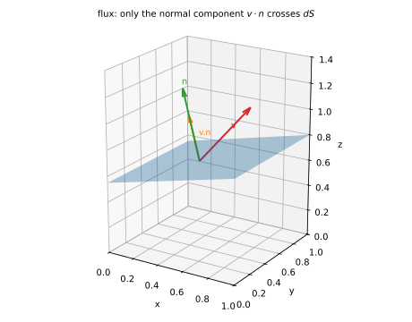
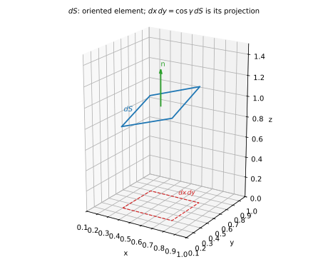
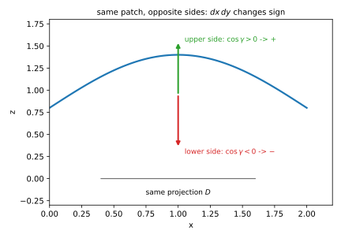
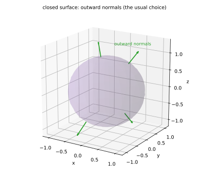

# 第 20 讲：第二类曲面积分（surface integral of the second kind）（通量）

> **前置**：16–17 讲（两类曲线积分）；19 讲（$dS$ 与投影）；07 讲（曲面法向）。
> **本讲解决什么**：19 讲算的是“曲面上值 × 面积”，**不带方向**；这一讲算的是“**穿过**曲面的量”，**必须定向**——同一块曲面，从上往下穿和从下往上穿，符号相反。核心只有两条：**通量为什么是点积**，**投影时符号怎么定**。

## 一、方向从哪来：通量

### 1.1 从“流量”到“通量”

设流体速度场 $\mathbf v(x,y,z)$，曲面 $\Sigma$。问：**单位时间穿过 $\Sigma$ 的流体体积**是多少？这个量叫**通量**（flux）。

取一小块面积 $dS$，法向单位向量 $\mathbf n$。**只有沿法向的速度分量能穿过去**，切向分量只是沿着曲面滑：

$$d\Phi=\mathbf v\cdot\mathbf n\,dS=|\mathbf v|\cos\theta\,dS,$$

其中 $\theta$ 是速度与**法向**的夹角。

**逐项看**：

- $\mathbf v\cdot\mathbf n=|\mathbf v|\cos\theta$：速度在法向上的投影；
- 若 $\mathbf v\parallel\mathbf n$（正着穿）：$\cos\theta=\pm1$，$d\Phi=\pm|\mathbf v|dS$；
- 若 $\mathbf v\perp\mathbf n$（擦着走）：$\cos\theta=0$，$d\Phi=0$——**不穿过去**。

**为什么要定向**：$\mathbf n$ 取反，$d\Phi$ 就变号。所以必须先说清“**从哪一侧穿到哪一侧**”：$\mathbf n$ 指向的那一侧是“出去”，反向就是“进来”。



*图 1：速度 $\mathbf v$ 穿过面元 $dS$；只有法向分量 $\mathbf v\cdot\mathbf n$ 贡献通量，切向分量不穿过去。*

### 1.2 有向面元

把“面积”和“方向”合成一个向量：

$$d\mathbf S=\mathbf n\,dS=(\cos\alpha,\ \cos\beta,\ \cos\gamma)\,dS,$$

其中 $\alpha,\beta,\gamma$ 是**法向**与 $x,y,z$ 轴正向的夹角（方向余弦）。

于是通量写成

$$\Phi=\iint_\Sigma \mathbf F\cdot d\mathbf S.$$

**与 17 讲同构**：曲线是 $\int\mathbf F\cdot(dx,dy)$，曲面是 $\iint\mathbf F\cdot(dy\,dz,dz\,dx,dx\,dy)$——**一维用 $dx,dy$，二维用三个投影**。

### 1.3 三个分量是什么

展开点积：

$$\mathbf F\cdot d\mathbf S=(P\cos\alpha+Q\cos\beta+R\cos\gamma)\,dS.$$

而 $dS$ 在三个坐标面上的**有向投影**分别是

$$dy\,dz=\cos\alpha\,dS,\qquad dz\,dx=\cos\beta\,dS,\qquad dx\,dy=\cos\gamma\,dS.$$

所以第二类曲面积分的常用记法：

$$\boxed{\iint_\Sigma P\,dy\,dz+Q\,dz\,dx+R\,dx\,dy.}$$

**注意**：$dy\,dz$ 不是“面积元”，它是**有向投影**——可正可负；$\cos\alpha$ 的符号就是它的符号。



*图 2：有向面元 $d\mathbf S$；它在三个坐标面上的投影 $dy\,dz$、$dz\,dx$、$dx\,dy$ 分别带方向余弦的符号。*

## 二、定义

把曲面 $\Sigma$ 分成小块 $\Delta S_i$，每块取一点 $P_i$、取定该块的法向 $\mathbf n_i$，作和

$$\sum_{i=1}^{n}\mathbf F(P_i)\cdot\mathbf n_i\,\Delta S_i,$$

令最大块直径 → 0。若和趋于与分割、取点无关的常数，记

$$\iint_\Sigma \mathbf F\cdot d\mathbf S=\iint_\Sigma P\,dy\,dz+Q\,dz\,dx+R\,dx\,dy.$$

这就是**第二类曲面积分**（surface integral of the second kind），也叫**通量积分**（flux integral）：把“穿过每个小面元的量”累加。

**逐句读**：

- “**定向**曲面”：每块的法向要连续地选同一侧，不能中途翻面；
- “任取一点”：每块里挑哪个点都行；
- “与分割、取点无关”：可积的实质；
- “最大块直径 → 0”：每块都变小。

**与第一类的区别**：19 讲的 $dS\ge0$，换侧不变；这里 $d\mathbf S$ 带方向，**换侧整体变号**。

## 三、计算：投影定号

### 3.1 核心一句话

由 $dx\,dy=\cos\gamma\,dS$，得

$$\iint_\Sigma R\,dx\,dy=\iint_\Sigma R\cos\gamma\,dS=\pm\iint_D R\big(x,y,z(x,y)\big)\,dx\,dy,$$

**符号由 $\cos\gamma$ 决定**：

- 法向**朝上**（$\cos\gamma>0$，取上侧）⇒ 取 **$+$**；
- 法向**朝下**（$\cos\gamma<0$，取下侧）⇒ 取 **$-$**。

同理：

$$\iint_\Sigma P\,dy\,dz=\pm\iint_{D_{yz}}P\,dy\,dz\quad(\text{符号看}\cos\alpha),$$

$$\iint_\Sigma Q\,dz\,dx=\pm\iint_{D_{zx}}Q\,dz\,dx\quad(\text{符号看}\cos\beta).$$



*图 3：同一块曲面，法向朝上时 $dx\,dy>0$，朝下时 $dx\,dy<0$；投影面积相同，符号相反。*

### 3.2 三步

1. **选侧**：题目说“上侧/下侧”“外侧/内侧”，据此定法向；
2. **投影**：投影到对应坐标面（要求**单值**；重叠就分片）；
3. **定号**：看法向与投影轴的夹角余弦，正取 $+$、负取 $-$。

### 3.3 闭合曲面

闭合曲面（球面、立方体表面）通常取**外侧**：法向朝外。这时“上侧/下侧”要逐块判断：上半球法向朝上、下半球朝下。



*图 4：闭合曲面通常取外侧；同一闭曲面上，上半球法向朝上、下半球朝下。*

## 四、两类关系与例题

### 4.1 互化公式

$$\iint_\Sigma P\,dy\,dz+Q\,dz\,dx+R\,dx\,dy=\iint_\Sigma(P\cos\alpha+Q\cos\beta+R\cos\gamma)\,dS.$$

左边是第二类（投影、带符号），右边是第一类（$dS$、方向余弦）。**换侧时两边同时变号**。

### 4.2 例题

**例 1**（球面外侧）：$\Sigma$ 是球面 $x^2+y^2+z^2=R^2$ 的外侧，求

$$\iint_\Sigma x\,dy\,dz+y\,dz\,dx+z\,dx\,dy.$$

**解**：先算 $z\,dx\,dy$。上半球 $z=\sqrt{R^2-x^2-y^2}$，法向朝外（朝上），$\cos\gamma>0$，取 $+$；下半球 $z=-\sqrt{R^2-x^2-y^2}$，法向朝外（朝下），$\cos\gamma<0$，取 $-$。投影都是圆盘 $D$：

$$\iint_\Sigma z\,dx\,dy=\iint_D\sqrt{R^2-r^2}\,dx\,dy-\iint_D\big(-\sqrt{R^2-r^2}\big)\,dx\,dy=2\iint_D\sqrt{R^2-r^2}\,dx\,dy.$$

极坐标：$\iint_D\sqrt{R^2-r^2}\,dx\,dy=\int_0^{2\pi}\int_0^R\sqrt{R^2-r^2}\,r\,dr\,d\theta=\frac{2\pi R^3}{3}$（内层令 $u=R^2-r^2$）。所以这一项是 $\frac{4\pi R^3}{3}$。

由对称性，$x\,dy\,dz$、$y\,dz\,dx$ 各也是 $\frac{4\pi R^3}{3}$。三项相加：

$$\iint_\Sigma=\frac{4\pi R^3}{3}\cdot3=4\pi R^3.$$

**例 2**（上侧）：$\Sigma$ 是平面 $z=1$ 上的单位圆盘，取上侧，求 $\iint_\Sigma z\,dx\,dy$。

**解**：上侧 $\cos\gamma>0$，取 $+$；$z=1$：

$$\iint_\Sigma z\,dx\,dy=+\iint_D1\,dx\,dy=\pi.$$

**例 3**（下侧）：同一块圆盘，取**下侧**，求 $\iint_\Sigma z\,dx\,dy$。

**解**：下侧 $\cos\gamma<0$，取 $-$：$=-\pi$。**换侧变号**，与第一类（$+\pi$）正好相反。

**例 4**（圆柱侧面）：$\Sigma$ 是圆柱面 $x^2+y^2=R^2$（$0\le z\le h$）的外侧，求 $\iint_\Sigma x\,dy\,dz$。

**解**：参数化 $x=R\cos\theta$、$y=R\sin\theta$、$z=z$；外侧法向 $\mathbf n=(\cos\theta,\sin\theta,0)$，所以 $\cos\alpha=\cos\theta$、$dS=R\,d\theta\,dz$：

$$\iint_\Sigma x\,dy\,dz=\int_0^{2\pi}\int_0^h R\cos\theta\cdot\cos\theta\cdot R\,d\theta\,dz=R^2h\int_0^{2\pi}\cos^2\theta\,d\theta=\pi R^2h.$$

**说明**：圆柱侧面投影到 $yz$ 面会重叠（左右两半），所以这里直接用参数化，比“投影定号”更清楚。

**例 5**（两类互化）：$\Sigma$ 是球面 $x^2+y^2+z^2=R^2$ 的外侧，用两类公式各算一次 $\iint_\Sigma z\,dx\,dy$。

**解**：第二类：例 1 的一项，$\frac{4\pi R^3}{3}$。

第一类：$\iint_\Sigma z\cos\gamma\,dS$。上半球 $\cos\gamma=\frac{z}{R}$（法向 $(x,y,z)/R$），$z=R\cos\gamma$ ⇒ $z\cos\gamma=\frac{z^2}{R}$；下半球 $\cos\gamma=\frac{z}{R}<0$，$z<0$，$z\cos\gamma=\frac{z^2}{R}$ 仍为正。所以

$$\iint_\Sigma z\cos\gamma\,dS=\frac{1}{R}\iint_\Sigma z^2\,dS=\frac1R\cdot\frac{4\pi R^4}{3}=\frac{4\pi R^3}{3}.$$

**两者一致** ✓。

### 4.3 什么时候用哪个

- **算“穿过”的量**（流量、电通量、磁通量）：第二类，直接点积；
- **曲面参数化方便、且已给方向余弦**：第一类，$dS$ 不用定号，方向余弦单独算；
- **投影会重叠**（球面、圆柱侧面）：优先参数化，别硬投影。

## 五、数值核对

用脚本核对本节结论（`scripts/lec20-02_verify_flux.py`，全脚本 0.00 秒）：

```
=== EXP1: sphere R=1, closed outward, x dydz + y dzdx + z dxdy -> 4*pi ===
  numeric = 12.56640291, exact = 4*pi = 12.56637061, diff = 3.23e-05

=== EXP2: disk z=1, upper side, z dxdy -> pi ===
  numeric = 3.14159265, exact = pi = 3.14159265, diff = 4.44e-16

=== EXP3: disk z=1, lower side, z dxdy -> -pi ===
  numeric = -3.14159265, exact = -pi = -3.14159265, diff = 4.44e-16

=== EXP4: cylinder side R=1 h=1, outer, x dydz -> pi ===
  numeric = 3.14159265, exact = pi = 3.14159265, diff = 0.00e+00

=== EXP5: sphere z dxdy by projection vs by (z cos gamma) dS -> same ===
  direct   = 4.18882250
  project  = 4.18892862
  exact    = 4*pi/3 = 4.18879020, diff = 1.06e-04
```

**核对点**：EXP2/3/4 在 $10^{-16}$ 级（$\pi$、$-\pi$ 精确变号）；EXP1 差 $3\times10^{-5}$（球面网格）；EXP5 两条路径差 $1\times10^{-4}$（离散误差），都与 $\frac{4\pi}{3}$ 吻合。

## 小结

- **通量**＝$\iint_\Sigma\mathbf F\cdot d\mathbf S$；只有法向分量穿过去，$\mathbf v\cdot\mathbf n$ 是点积。
- **有向面元** $d\mathbf S=(\cos\alpha,\cos\beta,\cos\gamma)dS$；三个投影 $dy\,dz,dz\,dx,dx\,dy$ **带符号**。
- **投影定号**：$\iint R\,dx\,dy=\pm\iint_D R\,dxdy$，符号由 $\cos\gamma$ 定（上侧 $+$、下侧 $-$）；其余两项同理。
- **换侧变号**，与第一类（$dS\ge0$）相反。
- **投影重叠就参数化**（球面、圆柱侧面）。

## 作业

**说明**：答案平铺在每题下方（先做再对照）。只用上册与本讲已教内容。

**1.** $\Sigma$ 是平面 $z=2$ 上的单位圆盘，取上侧，求 $\iint_\Sigma z\,dx\,dy$。

**参考答案**：
上侧 $\cos\gamma>0$，取 $+$；$z=2$：
$\iint_\Sigma z\,dx\,dy=2\iint_D1\,dxdy=2\pi$。

**2.** 同一圆盘取**下侧**，求 $\iint_\Sigma z\,dx\,dy$。

**参考答案**：
下侧 $\cos\gamma<0$，取 $-$：$-2\pi$。

**3.** $\Sigma$ 是球面 $x^2+y^2+z^2=R^2$ 的外侧，求 $\iint_\Sigma z\,dx\,dy$。

**参考答案**：
上半球 $+$、下半球 $-$，两项都是 $\iint_D\sqrt{R^2-r^2}dxdy=\frac{2\pi R^3}{3}$，相加得 $\frac{4\pi R^3}{3}$。

**4.** $\Sigma$ 是圆柱面 $x^2+y^2=R^2$（$0\le z\le h$）的外侧，求 $\iint_\Sigma y\,dz\,dx$。

**参考答案**：
参数化，$\cos\beta=\sin\theta$，$dS=R\,d\theta\,dz$：
$\int_0^{2\pi}\int_0^h R\sin\theta\cdot\sin\theta\cdot R\,dz\,d\theta=R^2h\cdot\pi=\pi R^2h$。

**5.**（概念）为什么第二类曲面积分换侧会变号，而第一类不变？

**参考答案**：
第二类算的是“穿过”的量，$d\mathbf S=\mathbf n\,dS$ 带方向；$\mathbf n$ 取反，点积变号。第一类算的是“值 × 面积”，$dS$ 是面积、恒正，与侧无关。

**6.**（概念）$\iint_\Sigma R\,dx\,dy$ 里的 $dx\,dy$ 是面积元吗？

**参考答案**：
不是。它是 $dS$ 在 $xy$ 面的**有向投影** $dx\,dy=\cos\gamma\,dS$，可正可负；面积元是 $dS$。
