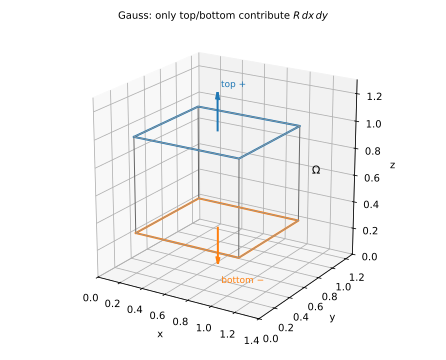
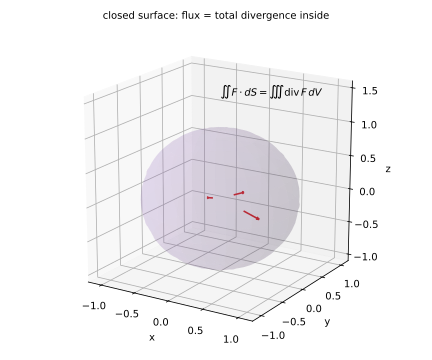
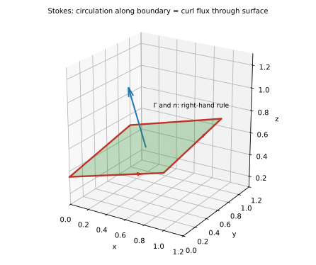

# 第 21 讲：高斯公式（Gauss's theorem）与斯托克斯公式（Stokes' theorem）

> **前置**：18 讲（格林公式）；20 讲（第二类曲面积分/通量）；14 讲（三重积分）。
> **本讲解决什么**：格林把“平面闭曲线积分”变成“平面区域上的二重积分”；这一讲把同一件事推到三维——**高斯**把“闭曲面积分”变成“三重积分”，**斯托克斯**把“空间闭曲线积分”变成“曲面积分”。三条公式其实是同一句话：**边界上的积分 = 内部的“源/旋”的总和**。

## 一、高斯公式：从通量到散度

### 1.1 先在一个长方体上推

设 $\Omega$ 是长方体 $[a,b]\times[c,d]\times[e,f]$，边界 $\Sigma$ 取**外侧**。考察通量中的 $R\,dx\,dy$ 项。

六个面里，**只有上、下两面**对 $R\,dx\,dy$ 有贡献：四个侧面的法向是水平的，$\cos\gamma=0$，所以 $dx\,dy=\cos\gamma\,dS=0$。

- **上面** $z=f$：法向朝上（外侧），$\cos\gamma>0$，取 $+$：
  $$\iint_{D}R(x,y,f)\,dx\,dy;$$
- **下面** $z=e$：法向朝下（外侧），$\cos\gamma<0$，取 $-$：
  $$-\iint_{D}R(x,y,e)\,dx\,dy.$$

两项相加，再用**微积分基本定理**（把 $R(x,y,f)-R(x,y,e)$ 写成 $R_z$ 的积分）：

$$\iint_D\big[R(x,y,f)-R(x,y,e)\big]dx\,dy=\iint_D\int_e^f R_z(x,y,z)\,dz\,dx\,dy=\iiint_\Omega R_z\,dV.$$

**同理**：

- $P\,dy\,dz$ 只在左、右两面有贡献 ⇒ $\iiint_\Omega P_x\,dV$；
- $Q\,dz\,dx$ 只在前、后两面有贡献 ⇒ $\iiint_\Omega Q_y\,dV$。

三式相加：

$$\boxed{\oiint_\Sigma P\,dy\,dz+Q\,dz\,dx+R\,dx\,dy=\iiint_\Omega(P_x+Q_y+R_z)\,dV.}$$

### 1.2 一般区域

把 $\Omega$ 分成有限个小长方体。对每个小长方体用上面的结论，再相加。**相邻两块共享的内部面，在块 $A$ 上是外侧、在块 $B$ 上是内侧**，两面的积分正好抵消；加完只剩最外层边界。所以公式对一般闭区域成立。

**条件**（三条，缺一不可）：

1. $\Omega$ 是**闭区域**（有界、边界是闭曲面）；
2. $P,Q,R$ 在 $\Omega$ 上有**连续偏导**；
3. $\Sigma$ 取**外侧**（法向朝外）。

**方向取反**：右边不变号，左边整体变号——所以必须说清“外侧”。

### 1.3 散度

定义**散度**（divergence）

$$\mathrm{div}\,\mathbf F=P_x+Q_y+R_z.$$

高斯公式写成向量形式：

$$\boxed{\oiint_\Sigma\mathbf F\cdot d\mathbf S=\iiint_\Omega\mathrm{div}\,\mathbf F\,dV.}$$

**怎么读**：闭曲面上的通量 = 内部每一点的“散度”加起来。散度为正的点像“源”（往外冒），为负像“汇”（往里吸）。



*图 1：长方体只有上、下两面贡献 $R\,dx\,dy$；两个面的差用微积分基本定理变成 $R_z$ 的体积分。*



*图 2：闭曲面上的通量等于内部散度的体积分；内部箭头表示“源”往外冒。*

## 二、高斯的应用与格林的关系

### 2.1 球面通量：一行算完

$\Sigma$ 是球面 $x^2+y^2+z^2=R^2$ 的外侧，$\mathbf F=(x,y,z)$。20 讲用投影分片算了三项；这里用高斯：

$$\mathrm{div}\,\mathbf F=1+1+1=3,\qquad \oiint_\Sigma\mathbf F\cdot d\mathbf S=\iiint_\Omega3\,dV=3\cdot\frac{4\pi R^3}{3}=4\pi R^3.$$

**对照**：20 讲例 1 的结果也是 $4\pi R^3$——**同一道题，高斯一行**。

### 2.2 立方体

$\Omega=[0,a]^3$，$\mathbf F=(x,y,z)$，$\Sigma$ 外侧：

$$\oiint_\Sigma\mathbf F\cdot d\mathbf S=\iiint_\Omega3\,dV=3a^3.$$

（可直接验证：每个面通量 $a^2\cdot$ 该面坐标值，六个面相加 $3a^3$。）

### 2.3 高斯和格林是什么关系

格林公式：

$$\oint_L P\,dx+Q\,dy=\iint_D(Q_x-P_y)\,d\sigma.$$

把平面向量场记成 $\mathbf F=(P,Q)$。逆时针边界上，外法向对应的弧长元是 $\mathbf n\,ds=(dy,-dx)$，所以

$$\oint_L\mathbf F\cdot\mathbf n\,ds=\oint_L P\,dy-Q\,dx.$$

在格林公式里代入“第一分量 $P_{\text{绿}}=-Q$、第二分量 $Q_{\text{绿}}=P$”，右边变成 $P_x-(-Q)_y=P_x+Q_y$，就得到**平面散度定理**：

$$\oint_L\mathbf F\cdot\mathbf n\,ds=\iint_D(P_x+Q_y)\,d\sigma.$$

**所以**：

- **格林** = 平面上的“边界 ↔ 内部”（二维散度）；
- **高斯** = 空间里的“边界 ↔ 内部”（三维散度）。

同一条思路，维数升一维。

## 三、斯托克斯公式：从环量到旋度

### 3.1 公式

设 $\Sigma$ 是**定向**曲面，$\Gamma$ 是它的边界（闭曲线），方向与法向 $\mathbf n$ 成**右手系**。则

$$\boxed{\oint_\Gamma P\,dx+Q\,dy+R\,dz=\iint_\Sigma(R_y-Q_z)\,dy\,dz+(P_z-R_x)\,dz\,dx+(Q_x-P_y)\,dx\,dy.}$$

右边三个系数组成**旋度**（curl）：

$$\nabla\times\mathbf F=(R_y-Q_z,\ P_z-R_x,\ Q_x-P_y),$$

所以斯托克斯也可写成

$$\oint_\Gamma\mathbf F\cdot d\mathbf r=\iint_\Sigma(\nabla\times\mathbf F)\cdot\mathbf n\,dS.$$

**第一性**：若 $\Sigma$ 是 $xy$ 平面上的片（$\mathbf n=(0,0,1)$、$R=0$），右边只剩 $(Q_x-P_y)\,dx\,dy$，就是格林公式。所以**斯托克斯是格林的曲面版**：把平面片弯成任意曲面，边界不变。

**一般曲面**：把 $\Sigma$ 分成小片，每片近似平面、用格林；相邻小片的**公共边**方向相反，抵消；只剩外边界 $\Gamma$。

### 3.2 右手法则

右手四指沿 $\Gamma$ 的方向弯曲，拇指指向 $\mathbf n$；等价地：**从 $\mathbf n$ 的尖端看，$\Gamma$ 是逆时针**。



*图 3：$\Gamma$ 的方向与 $\mathbf n$ 成右手系；换法向，$\Gamma$ 的方向也要跟着换。*

## 四、例题、三种公式对照与补面

### 4.1 例题

**例 1**（高斯，球面）：$\Sigma$ 是球面 $x^2+y^2+z^2=R^2$ 的外侧，求 $\oiint_\Sigma x\,dy\,dz+y\,dz\,dx+z\,dx\,dy$。

**解**：$\mathbf F=(x,y,z)$，$\mathrm{div}\,\mathbf F=3$；条件满足（闭、连续偏导、外侧）：

$$\oiint_\Sigma=3\cdot\frac{4\pi R^3}{3}=4\pi R^3.$$

**例 2**（高斯，立方体）：$\Sigma$ 是立方体 $[0,a]^3$ 的外侧，$\mathbf F=(x,y,z)$，求通量。

**解**：$\mathrm{div}\,\mathbf F=3$，体积 $a^3$：

$$\oiint_\Sigma=3a^3.$$

**例 3**（斯托克斯，三角形）：$\Gamma$ 是平面 $x+y+z=1$ 与三个坐标面的交线（三角形），从 $z$ 轴正方向看为逆时针；$\mathbf F=(y,z,x)$。求 $\oint_\Gamma y\,dx+z\,dy+x\,dz$。

**解**：先算旋度。$P=y$、$Q=z$、$R=x$：

$$R_y=0,\ Q_z=1\Rightarrow R_y-Q_z=-1;$$
$$P_z=0,\ R_x=1\Rightarrow P_z-R_x=-1;$$
$$Q_x=0,\ P_y=1\Rightarrow Q_x-P_y=-1.$$

所以 $\nabla\times\mathbf F=(-1,-1,-1)$。平面 $x+y+z=1$ 的法向取 $\mathbf n=(1,1,1)/\sqrt3$（朝上，与逆时针成右手系）：

$$(\nabla\times\mathbf F)\cdot\mathbf n=\frac{-1-1-1}{\sqrt3}=-\sqrt3.$$

三角形的三个顶点 $(1,0,0),(0,1,0),(0,0,1)$，边长 $\sqrt2$，面积 $\frac{\sqrt3}{4}(\sqrt2)^2=\frac{\sqrt3}{2}$。于是

$$\oint_\Gamma=-\sqrt3\cdot\frac{\sqrt3}{2}=-\frac32.$$

**逐边验证**：三段参数化：

- $(1,0,0)\to(0,1,0)$：$x=1-t$、$y=t$、$z=0$，$t:0\to1$；$dx=-dt$、$dy=dt$、$dz=0$：
  $$\int_0^1 t(-dt)=-\frac12;$$
- $(0,1,0)\to(0,0,1)$：$x=0$、$y=1-t$、$z=t$；$dy=-dt$、$dz=dt$：
  $$\int_0^1 t(-dt)=-\frac12;$$
- $(0,0,1)\to(1,0,0)$：$x=t$、$y=0$、$z=1-t$；$dx=dt$、$dz=-dt$：
  $$\int_0^1(1-t)(-dt)=-\frac12.$$

三段相加 $-\frac32$ ✓。

**例 4**（退化到格林）：$\Sigma$ 是 $xy$ 平面上的单位圆盘，$\Gamma$ 是单位圆逆时针，$\mathbf F=(-y,x,0)$。求 $\oint_\Gamma-y\,dx+x\,dy$。

**解**：$\nabla\times\mathbf F=(0,0,Q_x-P_y)=(0,0,1-(-1))=(0,0,2)$；$\mathbf n=(0,0,1)$：

$$\oint_\Gamma=\iint_\Sigma2\,dS=2\pi.$$

与 17 讲例 4 一致 ✓。

### 4.2 三种公式对照

| 公式 | 维度 | 边界 | 内部 | 公式 |
|---|---|---|---|---|
| 格林 | 2D | 闭曲线 $L$ | 平面区域 $D$ | $\oint_L P\,dx+Q\,dy=\iint_D(Q_x-P_y)\,d\sigma$ |
| 高斯 | 3D | 闭曲面 $\Sigma$ | 空间区域 $\Omega$ | $\oiint_\Sigma\mathbf F\cdot d\mathbf S=\iiint_\Omega\mathrm{div}\,\mathbf F\,dV$ |
| 斯托克斯 | 3D | 闭曲线 $\Gamma$ | 曲面 $\Sigma$ | $\oint_\Gamma\mathbf F\cdot d\mathbf r=\iint_\Sigma(\nabla\times\mathbf F)\cdot\mathbf n\,dS$ |

**怎么选**：

- 边界是**平面闭曲线**、内部是平面区域 → 格林；
- 边界是**闭曲面**、内部是空间区域 → 高斯（尤其通量）；
- 边界是**空间闭曲线**、内部是曲面 → 斯托克斯（尤其环量）。

### 4.3 曲面不封闭：补面

高斯公式要求 $\Sigma$ 是**闭曲面**。题目给的却是开口曲面（半球面、圆柱侧面等）时，常用做法是**补一块面** $\Sigma_1$ 把开口封上，使 $\Sigma+\Sigma_1$ 成为封闭曲面：

$$\oiint_{\Sigma+\Sigma_1}=\iiint_\Omega\mathrm{div}\,\mathbf F\,dV,$$

再减去补上的那块：$\iint_\Sigma=\oiint_{\Sigma+\Sigma_1}-\iint_{\Sigma_1}$。

**例 5**：$\Sigma$ 是上半球面 $z=\sqrt{R^2-x^2-y^2}$ 取上侧，$\mathbf F=(0,0,z)$，求 $\iint_\Sigma z\,dx\,dy$。

**解**：补上底面 $\Sigma_1$：$z=0$、$x^2+y^2\le R^2$，取**下侧**——这样 $\Sigma$（上侧）与 $\Sigma_1$（下侧）合起来正好是上半球的封闭外表面。

$\mathrm{div}\,\mathbf F=1$，所以

$$\oiint_{\Sigma+\Sigma_1}1\,dV=\iiint_\Omega1\,dV=\frac{2\pi R^3}{3}.$$

在 $\Sigma_1$ 上 $z=0$，所以 $\iint_{\Sigma_1}z\,dx\,dy=0$。于是

$$\iint_\Sigma z\,dx\,dy=\frac{2\pi R^3}{3}.$$

**验证**：直接投影，$\iint_D\sqrt{R^2-r^2}\,r\,dr\,d\theta=2\pi\cdot\frac{R^3}{3}=\frac{2\pi R^3}{3}$ ✓。

**补面的方向**：补面的侧要选得使整体成为封闭曲面的**外侧**；选反了，高斯公式左边就差一个负号。

## 五、数值核对

用脚本核对本节结论（`scripts/lec21-02_verify_gauss_stokes.py`，全脚本 0.00 秒）：

```
=== EXP1: sphere R=1, div F = 3 -> 4*pi ===
  Gaussian value = 12.56637061, exact = 4*pi = 12.56637061, diff = 0.00e+00

=== EXP2: cube [0,1]^3, div F = 3 -> 3 ===
  Gaussian value = 3.00000000, exact = 3, diff = 0.00e+00

=== EXP3: triangle circulation (Stokes + edge-by-edge) -> -3/2 ===
  Stokes   = -1.50000000, edges = -1.50000000, exact = -1.5, diff = 2.22e-16

=== EXP4: unit disk, F=(-y,x,0), circulation -> 2*pi ===
  Stokes value = 6.28318531, exact = 2*pi = 6.28318531, diff = 0.00e+00

=== EXP5: divergence and curl by finite differences at (1,2,3) ===
  div numeric = 8.000000, exact = 8
  curl numeric = [-2. -3. -1.], exact = [-2. -3. -1.]
```

**核对点**：EXP1/2/4 精确；EXP3 斯托克斯与逐边两种算法差 $2.2\times10^{-16}$；EXP5 的场取 $\mathbf F=(x^2y,yz,xz)$，在 $(1,2,3)$ 处差分与解析一致（注意 $Q=yz$ 给出 $Q_z=y=2$，不是 $z$）。

## 小结

- **高斯**：$\oiint_\Sigma\mathbf F\cdot d\mathbf S=\iiint_\Omega\mathrm{div}\,\mathbf F\,dV$；条件＝闭区域、连续偏导、**外侧**。
- **散度**：$\mathrm{div}\,\mathbf F=P_x+Q_y+R_z$。
- **斯托克斯**：$\oint_\Gamma\mathbf F\cdot d\mathbf r=\iint_\Sigma(\nabla\times\mathbf F)\cdot\mathbf n\,dS$；条件＝定向曲面、边界与法向**右手系**。
- **旋度**：$\nabla\times\mathbf F=(R_y-Q_z,P_z-R_x,Q_x-P_y)$。
- **三条公式是同一句话**：边界上的积分 = 内部“源/旋”的总和；格林是二维版，高斯/斯托克斯是三维版。
- **不封闭的曲面**：补一块面用高斯，再减去补面；补面的侧要使整体成为外表面。

## 作业

**说明**：答案平铺在每题下方（先做再对照）。只用上册与本讲已教内容。

**1.** $\Sigma$ 是球面 $x^2+y^2+z^2=R^2$ 的外侧，$\mathbf F=(2x,2y,2z)$，求通量。

**参考答案**：
$\mathrm{div}\,\mathbf F=2+2+2=6$；通量 $=6\cdot\frac{4\pi R^3}{3}=8\pi R^3$。

**2.** $\Sigma$ 是立方体 $[0,1]^3$ 的外侧，$\mathbf F=(x^2,y^2,z^2)$，求通量。

**参考答案**：
$\mathrm{div}\,\mathbf F=2x+2y+2z$；$\iiint_\Omega(2x+2y+2z)dV=2\cdot3\int_0^1x\,dx=6\cdot\frac12=3$。

**3.** $\Gamma$ 是 $xy$ 平面上单位圆逆时针，$\mathbf F=(0,0,x^2+y^2)$，求 $\oint_\Gamma\mathbf F\cdot d\mathbf r$。

**参考答案**：
$\nabla\times\mathbf F=(R_y-Q_z,P_z-R_x,Q_x-P_y)=(0,0,0)$（$P=Q=0$、$R=x^2+y^2$ 只含 $x,y$）；所以环量 $=0$。

**4.** $\Gamma$ 是平面 $z=1$ 上的单位圆逆时针（从上方看），$\mathbf F=(-y,x,0)$，求环量。

**参考答案**：
$\nabla\times\mathbf F=(0,0,2)$，$\mathbf n=(0,0,1)$：$\iint_\Sigma2\,dS=2\pi$。

**5.**（概念）高斯公式为什么要求“外侧”？取内侧会怎样？

**参考答案**：
外侧时 $d\mathbf S$ 朝外；取内侧，$\mathbf n$ 整体取反，左边通量变号，右边（散度体积分）不变，公式不再成立。要写内侧就左边加负号。

**6.**（概念）斯托克斯公式里，为什么曲线的方向必须和法向配套？

**参考答案**：
因为右边是“旋度在法向上的通量”，左边是“沿边界的有向环量”；两者要按右手系配套。方向反一个，等式两边就差一个负号。
