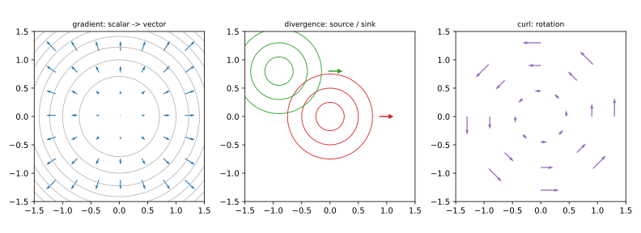
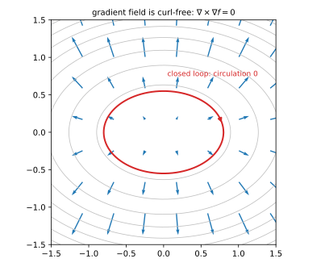
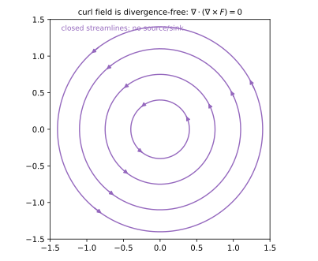

# 第 22 讲：场论初步（field theory）与综合

> **前置**：08 讲（梯度、方向导数）；18 讲（格林、路径无关）；21 讲（散度、旋度、高斯、斯托克斯）。
> **本讲解决什么**：08 讲了梯度，21 讲了散度、旋度。分开看都会算，但摆在桌上很容易乱：哪个吃标量、哪个吃向量，谁能套谁。这一讲就做三件事——**把三个算子摆成一张对照表**，**算两个“套起来必然为零”的组合**，**再看“先梯度再散度”这个不恒为零的组合**（拉普拉斯）。最后用一道题把三个算子各走一遍。

## 一、三个算子：梯度、散度、旋度

先说清“场”。**场就是“每个点放一个东西”**：每个点放一个数，叫**标量场**（scalar field，温度、压强）；每个点放一个箭头，叫**向量场**（vector field，风速、电场）。三个算子的区别，本质就是“吃什么、吐什么”。

### 1.1 梯度（gradient）：标量场 → 向量场

站在山坡上，你自然想问两件事：往哪个方向走最陡？坡度是多少？**梯度就是同时回答这两个问题的箭头**。

设 $f(x,y,z)$ 是标量场（每点一个数）。梯度定义为三个偏导拼成的向量：

$$\nabla f=(f_x,\ f_y,\ f_z).$$

**怎么读这个式子**：$f_x$ 是“只沿 $x$ 方向走一步，$f$ 变多快”，$f_y$、$f_z$ 同理；把这三个变化率当成一个箭头的三个分量。箭头的方向是 $f$ **增长最快**的方向，箭头的长度是那个最大变化率（08 讲推过）。

**例子**：$f=x^2+y^2+z^2$，$\nabla f=(2x,2y,2z)$。这个箭头从原点向外指，离原点越远越长——因为越往外，$f$ 涨得越快。

### 1.2 散度：向量场 → 标量场

看一个点附近的一群箭头：它们是**往外冒**，还是**往里收**？散度回答这个问题。

设 $\mathbf F=(P,Q,R)$ 是向量场。散度定义为

$$\mathrm{div}\,\mathbf F=\nabla\cdot\mathbf F=P_x+Q_y+R_z.$$

**为什么是这三项相加**：$P_x$ 是“$x$ 方向的箭头沿 $x$ 方向变化得多快”，$Q_y$、$R_z$ 是另外两个方向同样的量。三项相加，正好是“三个方向各自往外冒的速率之和”。21 讲推高斯公式时，长方体三个方向各贡献一项，加起来就是它——**这不是新定义，是那里已经算出来的东西**。

结果是**标量**：正为“源”（往外冒），负为“汇”（往里吸）。

**它与通量的定量关系**：高斯公式说 $\oiint_\Sigma\mathbf F\cdot d\mathbf S=\iiint_\Omega\mathrm{div}\,\mathbf F\,dV$。两边除以 $\Omega$ 的体积 $V$、再让 $\Omega$ 缩到一点，左边就是“单位体积往外冒的通量”，右边趋于该点的散度。所以散度是**通量密度**：它衡量每单位体积的源强度，而不只是“看上去在发散”。

**例子**：$\mathbf F=(x,y,z)$，$\mathrm{div}\,\mathbf F=1+1+1=3$。每个方向都以 1 的速率往外长，三个方向加起来是 3——每一点都在往外冒。

### 1.3 旋度：向量场 → 向量场

再看同一群箭头：它们是不是在**绕圈**？绕哪个轴、绕得多强？旋度回答这个。

旋度有三个分量：

$$\nabla\times\mathbf F=(R_y-Q_z,\ P_z-R_x,\ Q_x-P_y).$$

**先看结构再看公式**：三个分量分别对应“绕 $x$ 轴、绕 $y$ 轴、绕 $z$ 轴”的强弱。比如第一项 $R_y-Q_z$，用的是 $R$ 沿 $y$ 的变化和 $Q$ 沿 $z$ 的变化——这两个方向正好在 $yz$ 平面里，而 $yz$ 平面绕的就是 $x$ 轴。

结果是**向量**：方向是旋转轴（按右手法则），长度是旋转强弱。

**它与环量的定量关系**：斯托克斯公式说 $\oint_\Gamma\mathbf F\cdot d\mathbf r=\iint_\Sigma(\nabla\times\mathbf F)\cdot\mathbf n\,dS$。把 $\Sigma$ 缩到一点、两边除以面积，左边是“单位面积的环量”，右边趋于 $(\nabla\times\mathbf F)\cdot\mathbf n$。所以旋度在法向 $\mathbf n$ 上的投影就是**绕该法向的环量密度**（circulation density）；旋度的方向是使这个密度最大的法向。

**行列式记法**（只是帮助记忆，展开和上面的定义完全一致）：

$$\nabla\times\mathbf F=\begin{vmatrix}\mathbf i&\mathbf j&\mathbf k\\[2pt]\partial_x&\partial_y&\partial_z\\[2pt]P&Q&R\end{vmatrix}.$$

按第一行展开：$\mathbf i(R_y-Q_z)-\mathbf j(R_x-P_z)+\mathbf k(Q_x-P_y)$。**注意中间那项前面是减号**，所以中间分量是 $P_z-R_x$，不是 $R_x-P_z$。这是全套公式里最容易写错符号的一处。

**例子**：$\mathbf F=(-y,x,0)$——箭头绕 $z$ 轴逆时针转。代入：$R_y-Q_z=0$、$P_z-R_x=0$、$Q_x-P_y=1-(-1)=2$，所以旋度是 $(0,0,2)$：绕 $z$ 轴，强度 2。

### 1.4 一张对照表

| 算子 | 符号 | 输入 | 输出 | 一句话 |
|---|---|---|---|---|
| 梯度 | $\nabla f$ | 标量场 | 向量场 | 最速上升方向 |
| 散度 | $\nabla\cdot\mathbf F$ | 向量场 | **标量场** | 源/汇强弱 |
| 旋度 | $\nabla\times\mathbf F$ | 向量场 | 向量场 | 旋转强弱与轴 |

**记法**：把 $\nabla=(\partial_x,\partial_y,\partial_z)$ 当成一个“形式向量”（只是把三个偏导摆成一排，不是真的向量）。和标量乘，得到向量（梯度）；和向量**点乘**，得到一个数（散度）；和向量**叉乘**，得到向量（旋度）。



*图 1：梯度吃标量吐向量；散度吃向量吐标量；旋度吃向量吐向量。*

**接下来要问的问题**：三个算子能互相套。先梯度、再旋度，会得到什么？先旋度、再散度，又会得到什么？下一节把这两个组合各算一遍——结果是两个零。这不是巧合，是它们结构的必然。

## 二、两个恒等式

### 2.1 梯度的旋度为零

先看第一个组合：**先对 $f$ 求梯度，再对得到的向量场求旋度**。

$$\boxed{\nabla\times(\nabla f)=\mathbf 0.}$$

**逐项算**。$\nabla f=(f_x,f_y,f_z)$，把它当成 $\mathbf F$ 代入旋度定义（此时 $P=f_x$、$Q=f_y$、$R=f_z$）：

$$R_y-Q_z=f_{zy}-f_{yz},\qquad P_z-R_x=f_{xz}-f_{zx},\qquad Q_x-P_y=f_{yx}-f_{xy}.$$

三个分量都是“两个混合偏导之差”。只要二阶偏导连续，混合偏导就相等（$f_{zy}=f_{yz}$ 等），每一项都是 0，所以整个向量是 $\mathbf 0$。

**这个零意味着什么**：梯度场**没有旋**。把这句话翻译成积分，就是“沿任何闭合路径走一圈，环量为 0”。**这一步不能只靠嘴说，要写出来**：

$$\oint_\Gamma\nabla f\cdot d\mathbf r=\oint_\Gamma df=f(B)-f(A)=0.$$

**逐项读这个式子**：$\nabla f\cdot d\mathbf r$ 就是全微分 $df$（沿路径走一小步，$f$ 变化多少）；沿闭路走一圈回到起点，$f$ 的总变化当然是 0。所以环量为 0——“没有旋”和“环量为 0”是同一件事的两种说法。

**和 18 讲接上**：18 讲在平面上判路径无关，用的是 $P_y=Q_x$。如果向量场恰好是某个函数的梯度，即 $\mathbf F=\nabla f$，那么 $P=f_x$、$Q=f_y$，于是 $P_y=f_{xy}$、$Q_x=f_{yx}$——二阶偏导连续时相等，**条件自动满足**。所以“梯度场”一定是“路径无关场”，18 讲的那个判据在这里有了一个现成的来源。

### 2.2 旋度的散度为零

再看第二个组合：**先求旋度，再对得到的向量场求散度**。

$$\boxed{\nabla\cdot(\nabla\times\mathbf F)=0.}$$

**逐项算**。$\nabla\times\mathbf F=(R_y-Q_z,\ P_z-R_x,\ Q_x-P_y)$，再求散度：

$$\partial_x(R_y-Q_z)+\partial_y(P_z-R_x)+\partial_z(Q_x-P_y)$$

$$=R_{yx}-Q_{zx}+P_{zy}-R_{xy}+Q_{xz}-P_{yz}.$$

按混合偏导配对：$R_{yx}=R_{xy}$、$Q_{zx}=Q_{xz}$、$P_{zy}=P_{yz}$，三对相消，结果为 0。

**这个零意味着什么**：旋度场**没有源**。同样，这句话要落到积分上：任取一个闭曲面，用高斯公式（21 讲）：

$$\oiint_\Sigma(\nabla\times\mathbf F)\cdot d\mathbf S=\iiint_\Omega\nabla\cdot(\nabla\times\mathbf F)\,dV=\iiint_\Omega0\,dV=0.$$

**逐项读**：左边是“旋度场穿过闭曲面的通量”，右边是“内部散度的总和”；散度恒为 0，所以通量恒为 0。**不是“看起来没有源”，是算出来没有源。**

**记法**：**“梯无旋，旋无散”**。



*图 2：梯度场（等高线的法向）沿闭合路径环流为 0——梯无旋。*



*图 3：旋度场是闭合的流线，没有起点终点——旋无散。*

**接下来要问的问题**：这两个组合都恒为零，那“先梯度、再散度”呢？这个组合**不恒为零**，而且它有名字、有用途——下一节。

## 三、拉普拉斯算子与调和函数

把“先梯度、再散度”合成一个算子，叫**拉普拉斯算子**（Laplacian）：

$$\Delta f=\nabla\cdot\nabla f=f_{xx}+f_{yy}+f_{zz}.$$

**为什么关心它**：它衡量“这个点的值，和周围一圈的平均值差多少”。如果 $\Delta f=0$，说明这个点恰好等于周围的平均——物理里的稳态温度、静电场电势都满足这个条件。所以这个组合不是随便拼的，它有明确的对象。

它吃标量、吐标量（梯度吐向量，散度再吃向量吐标量，正好接上）。满足

$$\Delta f=0$$

的函数叫**调和函数**（harmonic function）。“调和”在这里的意思就是“处处等于周围平均”，没有局部的高点或低点。

**例**：$f=x^2+y^2-2z^2$：

$$f_{xx}=2,\qquad f_{yy}=2,\qquad f_{zz}=-4,\qquad \Delta f=2+2-4=0.$$

所以它是调和的。

**一个容易误解的地方**：有人会把 $\Delta$ 当成“$\nabla$ 的平方”，直接套平方公式。**方向对，但不能这么算**：$\Delta$ 是“先梯度、再散度”两步；只有在直角坐标下，两步合起来才恰好是 $f_{xx}+f_{yy}+f_{zz}$。换到球坐标、柱坐标，会多出因子（14 讲的球坐标体积元里就见过这种因子）。本课程只用直角坐标下的这个表达式；球坐标、柱坐标的 $\Delta$ 形式不同（会多出含 $1/r$、$1/r^2$ 的项），需要时查表，不要求背。

## 四、综合例题

### 4.1 例 1：一题走完三个算子

**例 1**：$\mathbf F=(x^2y,\ yz,\ xz)$，求散度、旋度，并验证旋度的散度为 0；再求在 $(1,2,3)$ 的值。

**解**：先把三个分量对号入座：$P=x^2y$、$Q=yz$、$R=xz$。

**散度**（三个偏导相加）：

$$\mathrm{div}\,\mathbf F=P_x+Q_y+R_z=2xy+z+x.$$

**旋度**（按三个分量逐个算）：

$$R_y-Q_z=0-z=-z,$$
$$P_z-R_x=0-z=-z,$$
$$Q_x-P_y=0-x^2=-x^2.$$

所以 $\nabla\times\mathbf F=(-z,-z,-x^2)$。

**验证**（把旋度再求散度）：

$$\nabla\cdot(\nabla\times\mathbf F)=\partial_x(-z)+\partial_y(-z)+\partial_z(-x^2)=0+0+0=0.$$

**在 $(1,2,3)$**：散度 $=2\cdot1\cdot2+3+1=8$；旋度 $=(-3,-3,-1)$。

### 4.2 例 2：保守场与势函数

**例 2**：$\mathbf F=(2xy,\ x^2+3y^2,\ 0)$，判断是否为**保守场**（conservative field），若是求**势函数**（potential function）$u$。

**解**：$P=2xy$、$Q=x^2+3y^2$、$R=0$。

先算旋度：

$$R_y-Q_z=0-0=0,\qquad P_z-R_x=0-0=0,\qquad Q_x-P_y=2x-2x=0.$$

旋度为零，且 $\mathbf F$ 定义在整个平面（单连通），所以是保守场。

**说明边界**：这是**平面场**的结论（18 讲）。三维也有“旋度为零 + 单连通 ⇒ 存在势函数”，但本课程只要求平面版会做；三维版知道有这回事即可。

**求 $u$**：由 $u_x=2xy$，对 $x$ 积分：

$$u=\int2xy\,dx=x^2y+\varphi(y).$$

**为什么是 $\varphi(y)$ 而不是常数 $C$**：对 $x$ 积分时，$y$ 被当成常数，所以“积分常数”可以随 $y$ 变——它只是“对 $x$ 而言是常数”。写成 $\varphi(y)$ 才对，写成 $C$ 会漏掉一部分。

再用 $u_y$ 定 $\varphi$：

$$u_y=x^2+\varphi'(y)=x^2+3y^2\ \Rightarrow\ \varphi'(y)=3y^2\ \Rightarrow\ \varphi(y)=y^3+C.$$

所以

$$u=x^2y+y^3+C.$$

**验证**：$u_x=2xy$ ✓、$u_y=x^2+3y^2$ ✓。

## 五、数值核对

用脚本核对本节结论（`scripts/lec22-02_verify_field.py`，全脚本 0.00 秒）：

```
=== EXP1: curl(grad f) = 0 for f=x^2 y + y z^2 at (1,2,3) ===
  grad = [ 4. 10. 12.]
  curl(grad) = [0. 0. 0.], expect = [0 0 0]

=== EXP2: div(curl F) = 0 for F=(x^2 y, y z, x z) ===
  curl F = [-2. -3. -1.]
  div(curl F) = 0.000000e+00, expect = 0

=== EXP3: Laplacian of f=x^2+y^2-2z^2 -> 0 (harmonic) ===
  Laplacian = 0.000000e+00, expect = 0

=== EXP4: conservative check for F=(2xy, x^2+3y^2) and potential ===
  P_y = 2.000000, Q_x = 2.000000 (equal -> conservative)
  potential u = x^2 y + y^3; at (1,2): u = 10.0
  u_x = 4.000000 (P = 4.0), u_y = 13.000000 (Q = 13.0)

=== EXP5: div and curl at (1,1,1) vs finite differences ===
  div = 4.000000, exact = 4
  curl = [-1. -1. -1.], exact = [-1 -1 -1]
```

**核对点**：五个 EXP 全部与解析值一致（差分误差在 $10^{-6}$ 以下）：梯度的旋度为 0、旋度的散度为 0、调和函数拉普拉斯为 0、保守场 $P_y=Q_x$ 且势函数 $u$ 的两个偏导各自等于 $P,Q$、散度/旋度手算与差分一致（EXP5 用同一个场 $\mathbf F=(x^2y,yz,xz)$ 在 $(1,1,1)$ 处核对）。

## 小结

- **三个算子**：梯度（标量→向量）、散度（向量→**标量**）、旋度（向量→向量）。记法：$\nabla$ 点乘降维，叉乘保维。
- **两个恒等式**：∇×(∇f)=0（梯无旋）、∇·(∇×F)=0（旋无散），都靠**混合偏导相等**。
- **两个零的积分版本**：$\oint\nabla f\cdot d\mathbf r=\oint df=f(B)-f(A)=0$；$\oiint(\nabla\times\mathbf F)\cdot d\mathbf S=\iiint0\,dV=0$。**结论前面都有这一步**。
- **拉普拉斯**：$\Delta f=\nabla\cdot\nabla f=f_{xx}+f_{yy}+f_{zz}$；$\Delta f=0$ 叫调和，意思是“处处等于周围平均”。
- **保守场**：平面场上旋度为 0 + 单连通 ⇒ 存在势函数（三维版知道有这回事即可）。
- **记符号**：旋度中间分量是 $P_z-R_x$（行列式展开的 $-\mathbf j$ 项），别写成 $R_x-P_z$。

## 作业

**说明**：答案平铺在每题下方（先做再对照）。只用上册与本讲已教内容。

**1.** $f=x^3y+yz$，求 $\nabla f$ 与 $\nabla\times\nabla f$。

**参考答案**：
先求梯度：$\nabla f=(3x^2y,\ x^3+z,\ y)$。
再求旋度（三个分量都是混合偏导之差）：
$f_{zy}-f_{yz}=1-1=0$；$f_{xz}-f_{zx}=0-0=0$；$f_{yx}-f_{xy}=3x^2-3x^2=0$ ⇒ $\mathbf 0$。

**2.** $\mathbf F=(xy,\ yz,\ zx)$，求散度与旋度。

**参考答案**：
散度：$P_x+Q_y+R_z=y+z+x$。
旋度：$R_y-Q_z=0-z=-z$；$P_z-R_x=0-x=-x$；$Q_x-P_y=0-x=-x$ ⇒ $(-z,-x,-x)$。

**3.** $\mathbf F=(y^2,\ 2xy,\ 0)$ 是否保守？若是，求势函数。

**参考答案**：
旋度：$R_y-Q_z=0$；$P_z-R_x=0$；$Q_x-P_y=2y-2y=0$ ⇒ 为零，且定义在整个平面，保守。
由 $u_x=y^2$ 对 $x$ 积分：$u=xy^2+\varphi(y)$（$y$ 当常数，所以“常数”可随 $y$ 变）。
再由 $u_y=2xy+\varphi'(y)=2xy$ ⇒ $\varphi'(y)=0$、$\varphi=C$。
$u=xy^2+C$。

**4.** 验证 $f=x^2-y^2$ 是调和的。

**参考答案**：
$f_{xx}=2$、$f_{yy}=-2$、$f_{zz}=0$；$\Delta f=2-2+0=0$，所以调和。

**5.**（概念）为什么梯度的旋度恒为零？关键用了什么条件？

**参考答案**：
旋度三个分量都是“两个混合偏导之差”（$f_{zy}-f_{yz}$ 等）；二阶偏导连续时混合偏导相等，所以每项为 0。关键是**二阶偏导连续**。

**6.**（概念）散度和旋度分别作用在什么场上？输出是什么？

**参考答案**：
散度作用在向量场，输出标量（源/汇强弱）；旋度作用在向量场，输出向量（旋转强弱与轴）。
