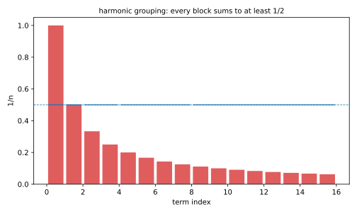
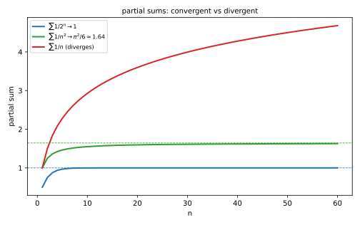
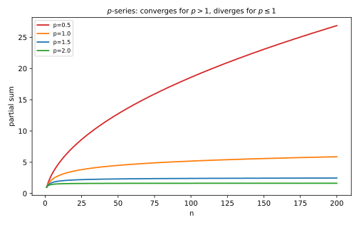

# 第 23 讲：数项级数：收敛与性质

> **前置**：数列极限（上册）；本讲不依赖前面的重积分/场论。
> **本讲解决什么**：把“无穷多项加起来”这件事说清楚。先看两个例子——$\frac12+\frac14+\frac18+\cdots$ 加出来是 1，而 $1+\frac12+\frac13+\cdots$ 却加不出任何有限的数。**两者的项都趋于 0**，为什么一个收敛、一个发散？这一讲就回答这个问题，并给出判断收敛的两把基本工具（比较、比值）。

## 一、级数是什么：无限加下去，能不能加出一个数

### 1.1 部分和：把“无限”拆成一串“有限”

“$a_1+a_2+a_3+\cdots$”这个写法本身没有直接的操作意义——你没法真的加完无穷多项。能操作的只有**前 $n$ 项的和**：

$$S_n=a_1+a_2+\cdots+a_n,$$

叫**部分和**。$n=1,2,3,\dots$ 给出一个数列 $S_1,S_2,S_3,\dots$。

**级数收敛**，就是指这串部分和**有极限**：

$$\lim_{n\to\infty}S_n=S.$$

这时把 $S$ 叫级数的**和**，记 $\sum_{n=1}^\infty a_n=S$。如果部分和没有极限（包括趋于无穷、振荡），就叫**发散**。

**这一步是整个级数理论的起点**：把“无限多项相加”换成了“一串有限和的极限”——后者是上册已经会的数列极限。

### 1.2 几何级数：第一个能算出和的

取 $a_n=q^{n-1}$（$q$ 是常数），级数

$$\sum_{n=1}^\infty q^{n-1}=1+q+q^2+\cdots$$

叫**几何级数**（geometric series）。它的部分和有现成公式。**推导**：把 $S_n$ 乘以 $q$，再相减：

$$S_n=1+q+\cdots+q^{n-1},$$
$$qS_n=q+q^2+\cdots+q^n,$$
$$(1-q)S_n=1-q^n\ \Rightarrow\ S_n=\frac{1-q^n}{1-q}\quad(q\ne1).$$

**看 $q^n$ 的走向**：

- $|q|<1$：$q^n\to0$，所以 $S_n\to\frac{1}{1-q}$——**收敛**；
- $q=1$：$S_n=n\to\infty$——**发散**；
- $q=-1$：$S_n=0,1,0,1,\dots$ 振荡——**发散**；
- $|q|>1$：$|q^n|\to\infty$——**发散**。

**例**：$q=\frac12$：$S_n=\frac{1-(1/2)^n}{1/2}=2(1-2^{-n})\to2$。也就是说

$$\frac12+\frac14+\frac18+\cdots=1.$$

（这里从 $q^1$ 开始，和是 $\frac{1/2}{1-1/2}=1$；从 $q^0$ 开始则是 2，注意起点。）

### 1.3 调和级数：项越来越小，和却无限大

现在看另一个级数：

$$\sum_{n=1}^\infty\frac1n=1+\frac12+\frac13+\frac14+\cdots$$

它叫**调和级数**（harmonic series）。它的项 $1/n\to0$，而且越来越小。**直觉会说“应该收敛”**。但它**发散**。

**分组证明**（这是本讲最重要的一段，不要跳）：

$$1+\frac12+\Big(\frac13+\frac14\Big)+\Big(\frac15+\frac16+\frac17+\frac18\Big)+\cdots$$

从第三项起，按 $2,4,8,\dots$ 分组。**每一组都不少于 $\frac12$**：

- $\frac13+\frac14>\frac14+\frac14=\frac12$；
- $\frac15+\cdots+\frac18>\frac18\times4=\frac12$；
- 一般地，第 $k$ 组有 $2^{k-1}$ 项，每项 $\ge\frac{1}{2^k}$，所以和 $\ge2^{k-1}\cdot\frac{1}{2^k}=\frac12$。

于是前 $2^k$ 项的和至少是 $1+\frac{k}{2}$。**$k$ 想多大就多大**，部分和无界，所以发散。



*图 2：调和级数按 $2,4,8,\dots$ 分组，每一组的和都不少于 $\frac12$（蓝线段）；组数任意多，总和就无界。*

**这个反例说明什么**：**“项趋于 0”不足以让级数收敛**。项变小是必要的，但不够——变小得**足够快**才行。多快算够？这是下一节和下一讲要回答的。



*图 1：三条部分和曲线——几何级数趋于 1，$\sum1/n^2$ 趋于约 1.64，调和级数持续增长。*

## 二、收敛的必要条件与性质

### 2.1 必要条件：项必须趋于 0

若 $\sum a_n$ 收敛到 $S$，则

$$a_n=S_n-S_{n-1}\to S-S=0.$$

**逐项读**：第 $n$ 项就是“前 $n$ 项的和”减去“前 $n-1$ 项的和”；两个部分和都趋于 $S$，差就趋于 0。

**这个条件的用法**：**只用来判发散**。

- 若 $a_n\not\to0$（包括趋于非零常数、趋于无穷、振荡），则级数**一定发散**；
- 例：$\sum(-1)^n$，项在 $-1,1$ 之间跳，不趋于 0 ⇒ 发散；
- 例：$\sum\frac{n}{n+1}$，项 $\to1\ne0$ ⇒ 发散。

### 2.2 但它不是充分条件

调和级数就是现成的反例：$1/n\to0$，级数却发散（§1.3 证过）。所以：

> **项趋于 0 是“入场券”，不是“通行证”。**

**问题桥**：那什么样的级数一定能收敛？先看一个特殊但极重要的子类——**正项级数**。

### 2.3 正项级数：有上界就收敛

若所有 $a_n\ge0$，部分和 $S_n$ 就**单调递增**（每加一项不会变小）。单调递增数列的收敛性有一条现成判据（上册）：

$$S_n\text{ 单调递增且有上界}\ \Longleftrightarrow\ S_n\text{ 收敛}.$$

所以对正项级数：

$$\boxed{\sum a_n\text{ 收敛}\ \Longleftrightarrow\ \text{部分和 }S_n\text{ 有上界}.}$$

**为什么这条重要**：它把“求极限”换成了“找个上界”。后面所有正项级数的判别法（比较、比值、根值、积分），本质都是在**找一个能压住 $S_n$ 的上界**，或者证明找不到。

### 2.4 三条基本性质

1. **线性**：若 $\sum a_n=A$、$\sum b_n=B$ 都收敛，则 $\sum(\alpha a_n+\beta b_n)=\alpha A+\beta B$。
   **为什么**：部分和也做同样的线性组合，再取极限。
2. **改变有限项不影响收敛性**（但会改变和）。
   **为什么**：有限项只改变某个 $S_N$ 之后的整体平移；尾巴的收敛性不变。
3. **收敛级数任意加括号仍收敛，和不变**。
   **为什么**：加括号只是把部分和的一个子列拿出来取极限；原数列收敛，子列也收敛到同一个值。
   **反过来不成立**：$1-1+1-1+\cdots$ 本身发散（部分和 $1,0,1,0,\dots$），但加括号成 $(1-1)+(1-1)+\cdots$ 就“变成” 0。**所以不能靠加括号把发散的级数救活。**

**问题桥**：正项级数“有上界就收敛”，可上界往往找不出来。下一节给两把常用的工具：一把用来**比较**，一把用来**看相邻项的比**。

## 三、两个判别法

### 3.1 比较判别法（comparison test）

设 $0\le a_n\le b_n$。则

- $\sum b_n$ 收敛 ⇒ $\sum a_n$ 收敛（**大的都收敛了，小的更收敛**）；
- $\sum a_n$ 发散 ⇒ $\sum b_n$ 发散（**小的都发散，大的更发散**）。

**为什么**：部分和逐项比较，$S_n^{(a)}\le S_n^{(b)}$；$S_n^{(b)}$ 有上界，$S_n^{(a)}$ 也就有上界（§2.3）。

**p 级数**（p-series，最常用的比较对象）：

$$\sum_{n=1}^\infty\frac{1}{n^p}\quad\begin{cases}p>1:&\text{收敛}\\p\le1:&\text{发散}\end{cases}$$

**怎么记**：$p=1$ 是调和级数（发散）；$p$ 再大一点，$1/n^p$ 缩得够快，就收敛了。$p>1$ 的证明要用积分判别法（下一讲），这里先用结论。



*图 3：$p=0.5,1$ 的部分和持续增长；$p=1.5,2$ 趋于水平——分界线就在 $p=1$。*

**例**：$\sum\frac{1}{n^2+1}$。因为 $\frac{1}{n^2+1}<\frac{1}{n^2}$，而 $\sum\frac1{n^2}$（$p=2$）收敛，所以原级数收敛。

### 3.2 比值判别法（ratio test）

设 $a_n>0$，且

$$\lim_{n\to\infty}\frac{a_{n+1}}{a_n}=\rho.$$

则

- $\rho<1$：**收敛**；
- $\rho>1$：**发散**；
- $\rho=1$：**失效**（可能收敛也可能发散，要换方法）。

**为什么**：比值是“后一项是前一项的几倍”。$\rho<1$ 说明项大致按几何级数衰减（像 $q^n$，$q<1$），而几何级数收敛；$\rho>1$ 说明项越来越大，不可能趋于 0，由 §2.1 发散。

**$\rho=1$ 为什么失效**：$\sum1/n$ 的比值 $\frac{n}{n+1}\to1$，发散；$\sum1/n^2$ 的比值 $\left(\frac{n}{n+1}\right)^2\to1$，收敛。**同样是 1，一个收敛一个发散**——所以 $\rho=1$ 时这个判别法给不出结论。

**例**：$\sum\frac{n}{2^n}$。比值

$$\frac{(n+1)/2^{n+1}}{n/2^n}=\frac{n+1}{2n}\to\frac12<1,$$

所以收敛。

### 3.3 怎么选

| 级数的样子 | 先试 |
|---|---|
| 含 $n!$、$a^n$、$n$ 的幂与指数混在一起 | 比值 |
| 含 $n^p$、能和 $1/n^p$ 比较 | 比较 + $p$ 级数 |
| 分式能拆成两项之差 | 裂项（直接算部分和） |
| 项不趋于 0 | 直接用必要条件判发散 |

**$\rho=1$ 时**：换比较、换积分判别（下一讲），或者直接算部分和。

## 四、例题

**例 1**（几何）：$\sum_{n=1}^\infty\frac{1}{2^n}$。

**解**：这是 $q=\frac12$ 的几何级数（从 $q^1$ 开始）：

$$S_n=\frac12\cdot\frac{1-(1/2)^n}{1-1/2}=1-2^{-n}\to1.$$

**例 2**（裂项）：$\sum_{n=1}^\infty\frac{1}{n(n+1)}$。

**解**：先拆项：

$$\frac{1}{n(n+1)}=\frac1n-\frac1{n+1}.$$

于是部分和** telescoping**（中间项两两抵消）：

$$S_n=\Big(1-\frac12\Big)+\Big(\frac12-\frac13\Big)+\cdots+\Big(\frac1n-\frac1{n+1}\Big)=1-\frac1{n+1}\to1.$$

**例 3**（比值）：$\sum_{n=1}^\infty\frac{n}{2^n}$。

**解**：比值 $\frac{n+1}{2n}\to\frac12<1$，收敛。**和**可以用公式 $\sum_{n=1}^\infty nq^n=\frac{q}{(1-q)^2}$（$q=\frac12$）得 $2$；这个公式的推导在幂级数那一讲，这里先接受结论，数值核对会验证。

**例 4**（p 级数）：$\sum_{n=1}^\infty\frac{1}{\sqrt n}$。

**解**：$p=\frac12\le1$，发散。也可以直接比较：$\frac{1}{\sqrt n}\ge\frac1n$，而调和级数发散，所以原级数发散。

**例 5**（必要条件）：$\sum_{n=1}^\infty(-1)^n$。

**解**：项在 $-1,1$ 之间振荡，不趋于 0。由必要条件，发散。

## 五、数值核对

用脚本核对本节结论（`scripts/lec23-02_verify_series.py`，全脚本 0.00 秒）：

```
=== EXP1: geometric 1/2 + 1/4 + ... -> 1 ===
  partial sum (N=60) = 1.000000000000, exact = 1, diff = 0.00e+00

=== EXP2: harmonic partial sums grow (H_10, H_100, H_1000, H_10000) ===
  H_10     = 2.928968   (ln N + gamma = 2.879801)
  H_100    = 5.187378   (ln N + gamma = 5.182386)
  H_1000   = 7.485471   (ln N + gamma = 7.484971)
  H_10000  = 9.787606   (ln N + gamma = 9.787556)
  -> slow growth, no bound

=== EXP3: sum 1/n^2 -> pi^2/6 ===
  partial sum (N=1000000) = 1.6449330668, exact = 1.6449340668, diff = 1.00e-06

=== EXP4: sum n/2^n -> 2 ===
  partial sum (N=80) = 2.000000000000, exact = 2, diff = 0.00e+00

=== EXP5: telescoping sum 1/(n(n+1)) -> 1 ===
  partial sum (N=100000) = 0.999990000100, exact = 1, diff = 1.00e-05
```

**核对点**：EXP1/4 精确；EXP3 差 $10^{-6}$（截断误差，尾巴约 $1/N$）；EXP5 差 $10^{-5}$（尾巴 $1/(N+1)$）；EXP2 与 $\ln N+\gamma$ 对照，误差随 $N$ 减小，但部分和**没有上界**——正是“发散”。

## 小结

- **级数**：部分和 $S_n$ 的极限；收敛 ⇔ $S_n\to S$，$S$ 叫和。
- **几何级数**：$|q|<1$ 收敛到 $\frac{1}{1-q}$；$|q|\ge1$ 发散。
- **调和级数发散**（分组证明，每组 $\ge\frac12$）——**项趋于 0 不够**。
- **必要条件**：收敛 ⇒ $a_n\to0$；**只能判发散**。
- **正项级数**：收敛 ⇔ 部分和有上界（单调有界）。
- **比较**：$0\le a_n\le b_n$；$p$ 级数 $p>1$ 收敛、$p\le1$ 发散。
- **比值**：$\rho<1$ 收敛、$\rho>1$ 发散、$\rho=1$ 失效。
- **加括号**：收敛级数加括号仍收敛；反过来不成立。

## 作业

**说明**：答案平铺在每题下方（先做再对照）。只用已教内容。

**1.** 判断 $\sum_{n=1}^\infty\frac{3}{4^n}$ 的收敛性，并求和。

**参考答案**：
几何级数，$q=\frac14$，从 $n=1$ 开始：
和 $=\frac{3/4}{1-1/4}=\frac{3/4}{3/4}=1$。

**2.** 判断 $\sum_{n=1}^\infty\frac{1}{n+2}$ 的收敛性。

**参考答案**：
这是调和级数去掉前两项，仍发散（改变有限项不影响收敛性）。

**3.** 判断 $\sum_{n=1}^\infty\frac{2^n}{n!}$ 的收敛性。

**参考答案**：
比值：$\frac{2^{n+1}/(n+1)!}{2^n/n!}=\frac{2}{n+1}\to0<1$，收敛。

**4.** 判断 $\sum_{n=1}^\infty\frac{n}{n^2+1}$ 的收敛性。

**参考答案**：
$n$ 大时 $\frac{n}{n^2+1}\sim\frac1n$；且 $\frac{n}{n^2+1}\ge\frac{n}{n^2+n^2}=\frac{1}{2n}$（$n\ge1$），而调和级数发散，所以发散。

**5.** 判断 $\sum_{n=1}^\infty\frac{1}{n^2+3}$ 的收敛性。

**参考答案**：
$\frac{1}{n^2+3}<\frac{1}{n^2}$，$p=2>1$ 收敛，所以原级数收敛。

**6.**（概念）为什么“项趋于 0”不能推出级数收敛？举一个反例。

**参考答案**：
调和级数 $\sum1/n$：项 $1/n\to0$，但分组后每组 $\ge\frac12$，部分和无界，发散。
