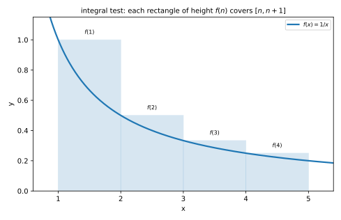
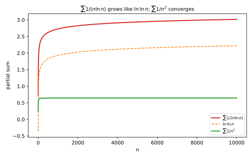

# 第 24 讲：正项级数判别法

> **前置**：23 讲（级数、部分和、p 级数、比较与比值）。
> **本讲解决什么**：23 讲把“收敛”翻译成“部分和有上界”。可真做题时，这个上界往往写不出来——$\sum\frac{1}{n^2+1}$ 的部分和没有闭式，你没法直接说“它有上界”。这一讲给四个工具（**适合正项级数**，positive-term series），**都不需要求出部分和**：极限比较（limit comparison test）、根值（root test）、积分判别（integral test）（比较与比值在 23 讲已有）。它们的共同思路是：**拿一个已知敛散的级数或积分当尺子，看要判的对象“长得像不像”它**。

## 一、为什么还要判别法

23 讲的核心结论是：

$$\text{正项级数收敛}\ \Longleftrightarrow\ \text{部分和 }S_n\text{ 有上界}.$$

这句话在理论上很干净，但在操作上有两个难处：

1. **上界不好找**：$S_n$ 通常没有闭式（比如 $1+\frac14+\frac19+\cdots$），你怎么“看出”它不超过某个数？
2. **上界即使存在，也未必好写**：有时你能感觉到“它应该收敛”，但写不出一个具体的 $M$。

所以需要一套**不直接碰部分和**的判据。下面四个工具，本质都是“**换一把尺子**”：

- 极限比较：找**同阶**的已知级数；
- 根值：看 $a_n$ 是否像 $\rho^n$；
- 积分判别：把离散的“和”换成连续的“面积”。

**问题桥**：先看最常用的一把——极限比较。

## 二、极限比较判别法（limit comparison test）

### 2.1 从“比较”的局限说起

23 讲的比较判别法要求**不等式** $0\le a_n\le b_n$。这个不等式有时很难凑。但很多时候，我们其实能看出“$a_n$ 和某个 $b_n$ **差不多大**”——只是说不出严格的大小关系。

**极限比较**就是把这个“差不多”变成判据。

**定理**：设 $a_n>0$、$b_n>0$，且

$$\lim_{n\to\infty}\frac{a_n}{b_n}=c,\qquad 0<c<\infty.$$

则 $\sum a_n$ 与 $\sum b_n$ **同敛散**。

**证明**（这一步不能省，它解释了“为什么同敛散”）：由极限的定义，当 $n$ 足够大时，比值被夹在 $\frac c2$ 和 $2c$ 之间：

$$\frac c2<\frac{a_n}{b_n}<2c\ \Longrightarrow\ \frac c2 b_n<a_n<2c\,b_n.$$

于是 $a_n$ 被 $b_n$ 的**两个常数倍**夹住。如果 $\sum b_n$ 收敛，右边给出 $a_n<2cb_n$，由比较判别法 $\sum a_n$ 收敛；如果 $\sum b_n$ 发散，左边给出 $a_n>\frac c2b_n$，$\sum a_n$ 也发散。两边都通。

**推论（最常用）**：若 $a_n\sim b_n$（即比值 $\to1$），则同敛散。这个关系有正式名字，叫**等价无穷小**（equivalent infinitesimals）：两个正项 $a_n,b_n$ 的比值趋于 1 时，称它们在 $n\to\infty$ 时等价，记 $a_n\sim b_n$。注意它是“比值趋于 1”，不是“两项都很小”。

### 2.2 例子

**例**：$\sum\sin\frac1n$。

**解**：$\frac{\sin(1/n)}{1/n}\to1$（$\sin x\sim x$），所以与调和级数 $\sum\frac1n$ 同敛散——**发散**。

**例**：$\sum\left(1-\cos\frac1n\right)$。

**解**：$1-\cos x\sim\frac{x^2}{2}$，所以 $\frac{1-\cos(1/n)}{1/(2n^2)}\to1$。与 $\sum\frac{1}{2n^2}$ 同敛散，而后者是收敛的 $p$ 级数（$p=2$）——**收敛**。

### 2.3 边界：$c=0$ 与 $c=\infty$

- $c=0$：$a_n$ 比 $b_n$ **小得多**。此时 $\sum b_n$ 收敛 ⇒ $\sum a_n$ 收敛；但 $\sum b_n$ 发散**推不出** $\sum a_n$ 发散（小的可能自己收敛）。
- $c=\infty$：反过来，$a_n$ 比 $b_n$ 大得多；$\sum b_n$ 发散 ⇒ $\sum a_n$ 发散。

**只有 $0<c<\infty$ 才能“同敛散”**。

**问题桥**：极限比较要找一个“长得像”的对象。如果级数里是指数、阶乘、$n$ 次方，找对象不容易——下一把尺子直接看“相邻项的比”。

## 三、根值判别法（root test）

**定理**：设 $a_n>0$，且

$$\lim_{n\to\infty}\sqrt[n]{a_n}=\rho.$$

则 $\rho<1$ 收敛、$\rho>1$ 发散、$\rho=1$ 失效。

**为什么**：$\sqrt[n]{a_n}\approx\rho$ 意味着 $a_n\approx\rho^n$——**项大致按几何级数增长/衰减**。$\rho<1$ 时像收敛的几何级数；$\rho>1$ 时项越来越大，不可能趋于 0，由必要条件发散。

**例**：$\sum\left(\frac{n}{3n+1}\right)^n$。

**解**：

$$\sqrt[n]{a_n}=\frac{n}{3n+1}\to\frac13<1,$$

所以**收敛**。

**$\rho=1$ 为什么失效**：$\sum\frac1n$ 的 $\sqrt[n]{1/n}\to1$，**发散**；$\sum\frac1{n^2}$ 的 $\sqrt[n]{1/n^2}\to1$，**收敛**。同样是 1，结论相反。

**与比值判别法的关系（认识层）**：只要比值判别法的极限存在，根值判别法的极限也存在且相等；反过来不一定。所以根值判别法**不弱于**比值判别法。做题时哪个好算用哪个。

**问题桥**：根值判别法和比值判别法都盯着“项怎么变”。还有一类级数，项里带 $\ln n$，指数/比值都不好用——这时换“面积”。

## 四、积分判别法（integral test）

### 4.1 用面积夹住和

设 $f$ 在 $[1,\infty)$ 上**正、连续、单调递减**，$a_n=f(n)$。把 $f$ 的图像画出来，用宽为 1 的矩形去盖：

- 在 $[n,n+1]$ 上，因为 $f$ 递减，$f(x)\le f(n)$，所以 $\int_n^{n+1}f(x)dx\le f(n)$。对 $n=1,\dots,N$ 求和：

$$\int_1^{N+1}f(x)\,dx\le\sum_{n=1}^N f(n).$$

- 另一边，$f(x)\ge f(n+1)$，所以 $\int_n^{n+1}f(x)dx\ge f(n+1)$。求和得

$$\sum_{n=1}^N f(n)\le f(1)+\int_1^N f(x)\,dx.$$

两边一夹：**部分和与积分 $\int_1^N f$ 只差一个有界量**。所以

$$\boxed{\sum_{n=1}^\infty f(n)\ \text{与}\ \int_1^\infty f(x)\,dx\ \text{同敛散}.}$$



*图 1：递减函数下，每个矩形的面积夹住一段曲线下的面积；级数与积分只差一个有界量。*

### 4.2 补上 p 级数的证明（p-series）

23 讲直接给了结论，现在能证了。取 $f(x)=x^{-p}$：

- $p\ne1$：$\int_1^\infty x^{-p}dx=\left[\frac{x^{1-p}}{1-p}\right]_1^\infty$——$p>1$ 时 $x^{1-p}\to0$，积分收敛；$p<1$ 时 $x^{1-p}\to\infty$，积分发散。
- $p=1$：$\int_1^\infty\frac{dx}{x}=\ln x\big|_1^\infty=\infty$，发散。

所以 $p>1$ 收敛、$p\le1$ 发散——和 23 讲的结论一致。

### 4.3 一个新例子：$\sum\frac{1}{n\ln n}$

这个级数用 $p$ 级数判不了（它不是 $1/n^p$ 的形式）。用积分：

$$\int_2^\infty\frac{dx}{x\ln x}=\ln\ln x\Big|_2^\infty=\infty,$$

所以**发散**。

**这个例子的意义**：$\frac{1}{n\ln n}$ 比 $\frac1n$ 小，但**还是不够快**——它正好卡在“发散”这一侧。这也说明 p 级数的分界线 $p=1$ 不是随意的。



*图 2：$\sum1/(n\ln n)$ 的部分和与 $\ln\ln N$ 同步增长；对比 $\sum1/n^2$ 趋于水平。*

### 4.4 条件不能省

积分判别要求 $f$ **正、连续、单调递减**：

- 不单调（比如振荡）：矩形盖不住，夹逼失效；
- 有负项：面积比较的方向会乱。

**问题桥**：四个工具都有了，做题时怎么选？

## 五、四个工具怎么选

| 级数的样子 | 先试 | 理由 |
|---|---|---|
| 和某个已知级数同阶（含 $\sin$、$\ln(1+x)$、根式） | 极限比较判别法（limit comparison test） | 找等价无穷小最直接 |
| 含 $n!$、$a^n$、$n^n$、$n$ 次方 | 比值判别法（ratio test，23 讲）/ 根值判别法（root test） | 相邻比或开 $n$ 次方能约掉 |
| 项是 $f(n)$，$f$ 可积且单调递减 | 积分判别法（integral test） | 直接算反常积分 |
| 有显然的不等式 | 比较判别法（comparison test，23 讲） | 最快 |

**例题**：

**例 1**：$\sum\frac{1}{2n+1}$。

**解**：$\frac{1}{2n+1}\sim\frac{1}{2n}$，与调和级数（harmonic series，23 讲）同敛散——**发散**。

**例 2**：$\sum\frac{n}{n^2+1}$。

**解**：$\frac{n}{n^2+1}\sim\frac1n$，**发散**。

**例 3**：$\sum\frac{1}{n^2+n}$。

**解**：$\frac{1}{n^2+n}\sim\frac1{n^2}$，$p=2$ 收敛——**收敛**。

**例 4**：$\sum\frac{2^n}{n!}$。

**解**：比值 $\frac{2^{n+1}/(n+1)!}{2^n/n!}=\frac{2}{n+1}\to0<1$，**收敛**。

**例 5**：$\sum\frac{1}{n\ln n}$。

**解**：积分判别，$\int_2^\infty\frac{dx}{x\ln x}=\infty$，**发散**。

**例 6**：$\sum\left(\frac{n}{3n+1}\right)^n$。

**解**：根值 $\frac{n}{3n+1}\to\frac13<1$，**收敛**。

## 六、数值核对

用脚本核对本节结论（`scripts/lec24-02_verify_tests.py`，全脚本 0.00 秒）：

```
=== EXP1: sum 1/(2n+1) grows like (1/2) ln N ===
  N=100   : sum=2.289317   0.5 ln N=2.302585
  N=1000  : sum=3.436132   0.5 ln N=3.453878
  N=10000 : sum=4.586975   0.5 ln N=4.605170
  -> both grow; difference is bounded

=== EXP2: sum n/(n^2+1) grows like ln N ===
  N=100   : sum=4.515561   ln N=4.605170
  N=1000  : sum=6.813605   ln N=6.907755
  N=10000 : sum=9.115740   ln N=9.210340

=== EXP3: sum 1/(n ln n) grows like ln ln N ===
  N=100   : sum=2.322942   ln ln N=1.527180
  N=1000  : sum=2.727396   ln ln N=1.932645
  N=10000 : sum=3.015011   ln ln N=2.220327

=== EXP4: sum (1-cos(1/n)) converges (limit ~0.7788) ===
  partial sum (N=2000000) = 0.7787583296
  pi^2/12 = 0.8224670334 (only the leading 1/(2n^2) term; difference is the n^-4 term)

=== EXP5: sum (n/(3n+1))^n converges ===
  partial sum (N=400) = 0.3720629035
  next 100 terms add   = 5.08e-192
```

**核对点**：EXP1/2/3 都是“与对照量同步增长、差有界”——这正说明它们发散（若收敛，部分和会趋于水平线）。EXP1 的差约 0.018、EXP2 约 0.09、EXP3 约 0.8（常数偏移，来自求和起点）。EXP4 **收敛到约 0.7788**；注意它**不等于** $\pi^2/12=0.8225$——$1-\cos x$ 除了 $\frac{x^2}{2}$ 还有 $-\frac{x^4}{24}$ 项，后者的和为 $\frac{\pi^4}{2160}\approx0.044$，正好解释了差值。EXP5 后 100 项只贡献 $5\times10^{-192}$，收敛极快。

## 小结

- **极限比较**：$a_n/b_n\to c\in(0,\infty)$ ⇒ 同敛散；$c=0$ 或 $\infty$ 只有单向结论。
- **根值**：$\sqrt[n]{a_n}\to\rho$；$\rho<1$ 收敛、$\rho>1$ 发散、$\rho=1$ 失效。
- **积分判别**：$f$ 正、连续、单调递减时，$\sum f(n)$ 与 $\int_1^\infty f$ 同敛散；由此可证 p 级数。
- **$\sum1/(n\ln n)$ 发散**——比 $1/n$ 小还不够，要小得“够快”。
- **选择**：同阶→极限比较；阶乘/指数→比值或根值；可积且单调→积分；有不等式→比较。

## 作业

**说明**：答案平铺在每题下方（先做再对照）。只用已教内容。

**1.** 判断 $\sum_{n=1}^\infty\frac{1}{3n+2}$ 的收敛性。

**参考答案**：
$\frac{1}{3n+2}\sim\frac{1}{3n}$，与调和级数同敛散 ⇒ 发散。

**2.** 判断 $\sum_{n=1}^\infty\frac{1}{n^2+2n}$ 的收敛性。

**参考答案**：
$\frac{1}{n^2+2n}\sim\frac1{n^2}$，$p=2>1$ ⇒ 收敛。

**3.** 判断 $\sum_{n=1}^\infty\frac{n^2}{2^n}$ 的收敛性。

**参考答案**：
比值：$\frac{(n+1)^2/2^{n+1}}{n^2/2^n}=\frac{(n+1)^2}{2n^2}\to\frac12<1$ ⇒ 收敛。

**4.** 判断 $\sum_{n=1}^\infty\left(\frac{2n+1}{3n+2}\right)^n$ 的收敛性。

**参考答案**：
根值：$\frac{2n+1}{3n+2}\to\frac23<1$ ⇒ 收敛。

**5.** 判断 $\sum_{n=2}^\infty\frac{1}{n(\ln n)^2}$ 的收敛性。

**参考答案**：
积分判别：$\int_2^\infty\frac{dx}{x(\ln x)^2}=\left[-\frac{1}{\ln x}\right]_2^\infty=\frac{1}{\ln2}$，收敛 ⇒ 级数收敛。

**6.**（概念）为什么积分判别要求 $f$ 单调递减？

**参考答案**：
夹逼要用“矩形在曲线上方/下方”：递减时 $f(n)\ge f(x)\ (x\in[n,n+1])$，才能把每项与积分比较；不单调时矩形与曲线会交叉，夹逼失效。
