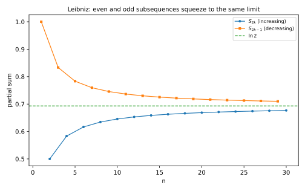
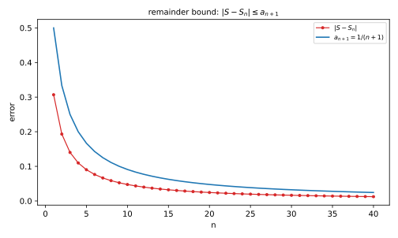
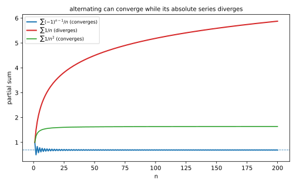

# 第 25 讲：交错级数（alternating series）与绝对收敛（absolute convergence）

> **前置**：23 讲（级数、收敛、加括号）；24 讲（正项级数判别法）。
> **本讲解决什么**：前面讲的判别法都要求**项为正**——部分和只增不减，所以“有上界就收敛”。但 $1-\frac12+\frac13-\frac14+\cdots$ 的项正负交替，部分和来回摆，那些判别法不能直接用。这一讲处理两件事：**交错级数怎么判**（莱布尼茨判别法），以及**“收敛”其实分两档**——绝对收敛和条件收敛。

## 一、交错级数：正负交替

**交错级数**（alternating series）的形状是

$$
\sum_{n=1}^\infty(-1)^{n-1}a_n=a_1-a_2+a_3-a_4+\cdots,\qquad a_n>0.
$$

也就是“正、负、正、负”交替，每项的绝对值是 $a_n$。

**为什么它可能收敛**：正项往上加、负项往下减。如果后面的摆动幅度越来越小，部分和就会在一个数附近来回，摆幅趋于 0，于是收敛。**这不是证明，只是直觉**；下一节的子列夹逼才是证明。

**注意**：**“交错”本身不保证收敛**。$\sum(-1)^{n-1}$（即 $1-1+1-\cdots$）也是交错的，但部分和 $1,0,1,0,\dots$ 振荡，发散。**必须再加条件**。

**问题桥**：加什么条件？——项越来越小、且趋于 0。

## 二、莱布尼茨判别法（Leibniz test）

**定理**：若

1. $a_n$ **单调递减**：$a_1\ge a_2\ge a_3\ge\cdots$；
2. $a_n\to0$，

则交错级数 $\sum(-1)^{n-1}a_n$ **收敛**。并且余项满足

$$
|S-S_n|\le a_{n+1}.
$$

### 2.1 为什么收敛：两个子列夹住

把部分和按奇偶分开看。

**偶数项部分和**：

$$
S_{2k}=S_{2k-2}+(a_{2k-1}-a_{2k}).
$$

因为 $a_{2k-1}\ge a_{2k}$，括号非负，所以 $S_{2k}\ge S_{2k-2}$——偶数子列**单调递增**。

**奇数项部分和**：

$$
S_{2k+1}=S_{2k-1}-(a_{2k}-a_{2k+1}).
$$

因为 $a_{2k}\ge a_{2k+1}$，括号非负，所以 $S_{2k+1}\le S_{2k-1}$——奇数子列**单调递减**。

**两个子列还互相夹住**：$S_{2k}=S_{2k-1}-a_{2k}\le S_{2k-1}$，即偶数项总不超过前一个奇数项。

于是：

- 偶数子列递增、有上界（被 $S_1$ 压住）⇒ 收敛，记极限 $S_{\text{even}}$；
- 奇数子列递减、有下界（被 $S_2$ 托住）⇒ 收敛，记极限 $S_{\text{odd}}$；
- 两者之差：$S_{2k-1}-S_{2k}=a_{2k}\to0$，所以 $S_{\text{even}}=S_{\text{odd}}=S$。

两个子列挤到同一个数，整个部分和就收敛到 $S$。



*图 1：偶数子列递增、奇数子列递减，两者之差趋于 0，夹出同一个 $S$。*

### 2.2 余项估计

$S$ 被夹在 $S_n$ 与 $S_{n+1}$ 之间，两者的距离是 $a_{n+1}$，所以

$$
|S-S_n|\le a_{n+1}.
$$

**这句话的用法**：想保证误差小于某个数，只需让下一项小于它。

**例**：$\sum\frac{(-1)^{n-1}}{n}$，取前 9 项，误差不超过 $\frac{1}{10}=0.1$。



*图 2：实际误差 $|S-S_n|$ 始终在 $a_{n+1}$ 之下（虚线）。*

### 2.3 条件缺一不可

**只要求“项趋于 0”不够**。反例：令

$$
a_n=\begin{cases}\frac1n,&n\text{ 为奇数}\\[2pt]\frac1{n^2},&n\text{ 为偶数}\end{cases}
$$

这个 $a_n\to0$，但**不单调**。对应的交错级数

$$
\sum(-1)^{n-1}a_n=1-\frac14+\frac13-\frac1{16}+\frac15-\cdots
$$

正项部分是调和级数的奇数项，**发散**；负项部分收敛。所以整个级数**发散**。**“单调递减”这个条件不能丢**。

**另一个极端**：$a_n$ 不趋于 0（比如 $a_n=\frac{n}{n+1}\to1$），那连必要条件都不满足，直接发散。

### 2.4 两个例子

**例**：$\sum_{n=1}^\infty\frac{(-1)^{n-1}}{n}$。

**解**：$a_n=\frac1n$ 单调递减、趋于 0，满足莱布尼茨条件——**收敛**（它的和是 $\ln2$，数值核对会验证）。

**例**：$\sum_{n=1}^\infty\frac{(-1)^{n-1}}{\sqrt n}$。

**解**：$a_n=\frac{1}{\sqrt n}$ 单调递减、趋于 0——**收敛**。注意它的项比 $1/n$ 大（收敛得更慢），但莱布尼茨只要求“递减 + 趋于 0”，没要求多快。

**问题桥**：这两个例子都收敛，但它们的“收敛强度”一样吗？把绝对值加起来会怎样？——下一节。

## 三、绝对收敛与条件收敛

### 3.1 定义

对任意项级数 $\sum a_n$（项可正可负）：

- 若 $\sum|a_n|$ **收敛**，称 $\sum a_n$ **绝对收敛**（absolutely convergent）；
- 若 $\sum a_n$ **收敛**但 $\sum|a_n|$ **发散**，称 $\sum a_n$ **条件收敛**（conditionally convergent）。

**顺序不能反**：先看原级数收不收敛，再看绝对值。**“绝对收敛”是比“收敛”更强的要求**。

### 3.2 绝对收敛 ⇒ 收敛

**定理**：若 $\sum|a_n|$ 收敛，则 $\sum a_n$ 收敛。

**证明**（这一步要写，不能只给结论）：对每一项，

$$
0\le a_n+|a_n|\le2|a_n|.
$$

（$a_n\ge0$ 时左边是 $2a_n$；$a_n<0$ 时左边是 0。）由比较判别法，$\sum(a_n+|a_n|)$ 收敛。而

$$
a_n=(a_n+|a_n|)-|a_n|,
$$

两个收敛级数之差，所以 $\sum a_n$ 收敛。

**逆命题不成立**：$\sum\frac{(-1)^{n-1}}{n}$ 收敛（莱布尼茨），但 $\sum\frac1n$ 发散——它是**条件收敛**。

### 3.3 判别流程

拿到一个任意项级数：

1. **先看 $\sum|a_n|$**（这是正项级数，用 23/24 讲的工具）：
   - 收敛 ⇒ **绝对收敛**，结束；
   - 发散 ⇒ 进第 2 步。
2. **回到原级数**：
   - 是交错级数 ⇒ 莱布尼茨；
   - 其他 ⇒ 用定义、性质或部分和。
3. 原级数收敛、绝对值发散 ⇒ **条件收敛**；原级数也发散 ⇒ 发散。

### 3.4 三个例子

**例**：$\sum\frac{(-1)^{n-1}}{n^2}$。

**解**：$\sum\frac1{n^2}$ 是 $p=2$ 的 p 级数，收敛 ⇒ **绝对收敛**。

**例**：$\sum\frac{(-1)^{n-1}}{n}$。

**解**：$\sum\frac1n$ 发散；但原级数由莱布尼茨收敛 ⇒ **条件收敛**。

**例**：$\sum\frac{(-1)^{n-1}}{\sqrt n}$。

**解**：$\sum\frac1{\sqrt n}$ 是 $p=\frac12$ 的 p 级数，发散；原级数由莱布尼茨收敛 ⇒ **条件收敛**。



*图 3：$\sum(-1)^{n-1}/n$ 收敛到 $\ln2$，但把绝对值加起来（$\sum1/n$）就发散；对比 $\sum1/n^2$ 收敛。*

**问题桥**：绝对收敛和条件收敛，除了“绝对值收不收敛”，还有别的区别吗？——有，而且很反直觉。

## 四、条件收敛的性质（认识层）

### 4.1 重排会改变和

**绝对收敛**的级数，任意重排（打乱顺序）后**和不变**。

**条件收敛**的级数，**重排可能改变和**——这就是**黎曼重排定理**（Riemann rearrangement theorem）：条件收敛级数可以通过重排得到任意指定的和，甚至可以让它发散。

**例**：$\sum\frac{(-1)^{n-1}}{n}=\ln2\approx0.6931$。如果按“两正一负”重排：

$$
1+\frac13-\frac12+\frac15+\frac17-\frac14+\cdots=\frac32\ln2\approx1.0397.
$$

**同一堆数，只是换了顺序，和变了。** 原因是条件收敛时正项总和、负项总和都发散，重排可以改变“正负抵消的节奏”。

**这条对做题的意义**：**条件收敛的级数不能随意交换项的顺序**；绝对收敛才可以。

### 4.2 加括号仍然收敛

23 讲说过：收敛级数任意加括号仍收敛（和不变）。这条对条件收敛也成立——**加括号只是取部分和的子列**。

但要记住 23 讲的反例：$1-1+1-\cdots$ 发散，加括号成 $(1-1)+(1-1)+\cdots$ 后“看起来”是 0——**不能靠加括号把发散级数救活**。

## 五、例题

**例 1**：判断 $\sum_{n=1}^\infty\frac{(-1)^{n-1}}{n}$ 的收敛类型。

**解**：$a_n=\frac1n$ 单调递减、趋于 0 ⇒ 莱布尼茨 ⇒ 收敛；$\sum\frac1n$ 发散 ⇒ **条件收敛**。

**例 2**：判断 $\sum_{n=1}^\infty\frac{(-1)^{n-1}}{n^2}$ 的收敛类型。

**解**：$\sum\frac1{n^2}$ 收敛（$p=2$）⇒ **绝对收敛**。

**例 3**：判断 $\sum_{n=1}^\infty\frac{(-1)^{n-1}}{\sqrt n}$ 的收敛类型。

**解**：莱布尼茨 ⇒ 收敛；$\sum\frac1{\sqrt n}$ 发散（$p=\frac12$）⇒ **条件收敛**。

**例 4**：判断 $\sum_{n=1}^\infty\frac{(-1)^n n}{n+1}$ 的收敛性。

**解**：项 $\frac{n}{n+1}\to1\ne0$，不满足必要条件 ⇒ **发散**。**先查必要条件**，能省很多事。

**例 5**：判断 $\sum_{n=2}^\infty\frac{(-1)^{n-1}}{n\ln n}$ 的收敛类型。

**解**：$a_n=\frac{1}{n\ln n}$ 单调递减（$n\ge2$）、趋于 0 ⇒ 莱布尼茨 ⇒ 收敛；而 $\sum\frac1{n\ln n}$ 由 24 讲积分判别**发散** ⇒ **条件收敛**。

## 六、数值核对

用脚本核对本节结论（`scripts/lec25-02_verify_alternating.py`，全脚本 0.00 秒）：

```
=== EXP1: alternating harmonic -> ln 2 ===
  partial sum (N=1000000) = 0.6931466806, ln 2 = 0.6931471806, diff = 5.00e-07

=== EXP2: remainder bound |S - S_n| <= a_{n+1} ===
  n=10   : |S-S_n|=4.751226e-02   a_(n+1)=1/11=9.090909e-02
  n=100  : |S-S_n|=4.975001e-03   a_(n+1)=1/101=9.900990e-03
  n=1000 : |S-S_n|=4.997500e-04   a_(n+1)=1/1001=9.990010e-04

=== EXP3: alternating 1/n^2 -> pi^2/12 ===
  partial sum = 0.8224670334, pi^2/12 = 0.8224670334, diff = 5.00e-13

=== EXP4: alternating 1/sqrt(n) converges (slowly) ===
  N=1000   : partial sum = 0.589091
  N=10000  : partial sum = 0.599899
  N=100000 : partial sum = 0.603318
  -> oscillates with shrinking amplitude; limit ~0.6049

=== EXP5: rearrangement changes the sum (ln 2 vs 1.5 ln 2) ===
  rearranged partial sum = 1.0397195208
  1.5*ln2 = 1.0397207708, ln2 = 0.6931471806
```

**核对点**：EXP1 差 $5\times10^{-7}$——交错调和的误差约 $1/N$，收敛不快。EXP2 实际误差始终小于 $a_{n+1}$（约为它的一半）。EXP3 到 $5\times10^{-13}$。EXP4 收敛更慢（误差约 $1/\sqrt N$）：$N=10^5$ 才到 $0.6033$，极限约 $0.6049$。EXP5 是重点：同一堆数换成“两正一负”的顺序，和从 $0.6931$ 变成 $1.0397=\frac32\ln2$——**重排确实改变了和**。

## 小结

- **交错级数**：$\sum(-1)^{n-1}a_n$；光“交错”不保证收敛（$1-1+1-\cdots$ 发散）。
- **莱布尼茨判别法（Leibniz test）**：$a_n$ 单调递减、$a_n\to0$ ⇒ 收敛；余项 $|S-S_n|\le a_{n+1}$。
- **绝对收敛**：$\sum|a_n|$ 收敛；**绝对 ⇒ 收敛**（$a_n+|a_n|\le2|a_n|$）。
- **条件收敛**：原级数收敛、绝对值发散（如 $\sum\frac{(-1)^{n-1}}{n}$）。
- **判别流程**：先绝对值，再原级数。
- **条件收敛的性质**：重排会改变和（黎曼重排定理）；加括号仍收敛。

## 作业

**说明**：答案平铺在每题下方（先做再对照）。只用已教内容。

**1.** 判断 $\sum_{n=1}^\infty\frac{(-1)^{n-1}}{2n-1}$ 的收敛类型。

**参考答案**：
$a_n=\frac{1}{2n-1}$ 单调递减、趋于 0 ⇒ 莱布尼茨 ⇒ 收敛；$\sum\frac1{2n-1}$ 与调和同阶，发散 ⇒ **条件收敛**。

**2.** 判断 $\sum_{n=1}^\infty\frac{(-1)^{n-1}}{n^3}$ 的收敛类型。

**参考答案**：
$\sum\frac1{n^3}$ 收敛（$p=3$）⇒ **绝对收敛**。

**3.** 判断 $\sum_{n=1}^\infty\frac{(-1)^n}{\ln n}$（$n\ge2$）的收敛类型。

**参考答案**：
$a_n=\frac1{\ln n}$ 单调递减、趋于 0 ⇒ 莱布尼茨 ⇒ 收敛。绝对值级数 $\sum\frac1{\ln n}$：因为 $\ln n<n$（$n\ge2$），所以 $\frac1{\ln n}>\frac1n$，与调和级数比较 ⇒ 发散。所以是 **条件收敛**。

**4.** 判断 $\sum_{n=1}^\infty(-1)^{n-1}\frac{2n}{n+2}$ 的收敛性。

**参考答案**：
项 $\frac{2n}{n+2}\to2\ne0$，不满足必要条件 ⇒ **发散**。

**5.**（概念）为什么绝对收敛能推出收敛，而反过来不行？

**参考答案**：
绝对收敛时 $a_n+|a_n|\le2|a_n|$，由比较判别法 $\sum(a_n+|a_n|)$ 收敛，而 $a_n=(a_n+|a_n|)-|a_n|$ 是两个收敛级数之差，所以 $\sum a_n$ 收敛。反过来，$\sum\frac{(-1)^{n-1}}{n}$ 收敛但 $\sum\frac1n$ 发散，说明收敛不必绝对。

**6.**（概念）莱布尼茨判别法为什么要求 $a_n$ 单调递减？只用“$a_n\to0$”行不行？

**参考答案**：
不行。证明靠奇偶两个子列分别单调、互相夹住；不单调时子列不再单调，夹逼失效。反例：$a_n=\frac1n$（奇）、$\frac1{n^2}$（偶），$a_n\to0$ 但级数发散。
