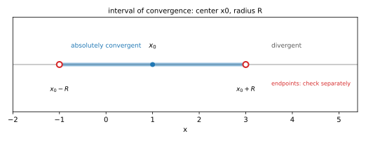
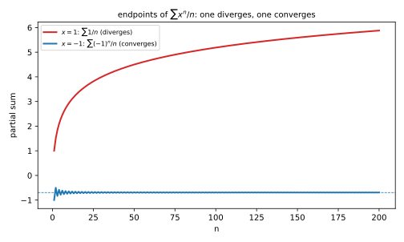
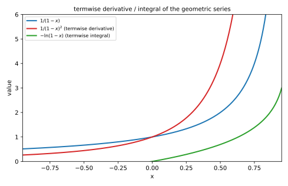

# 第 26 讲：幂级数

> **前置**：23–25 讲（数项级数的收敛、判别法、交错与绝对收敛）。
> **本讲解决什么**：前面级数的项都是**数**；这一讲的项带 $x$——$\sum a_n(x-x_0)^n$。同一个级数，$x$ 取不同值，敛散可能完全不同：$\sum x^n$ 在 $x=\frac12$ 收敛，在 $x=2$ 发散。所以要回答两个问题：**$x$ 取哪些值收敛？**（收敛域）**收敛时和是多少？**（和函数）。

## 一、幂级数是什么

**幂级数**（power series）的形状是

$$\sum_{n=0}^\infty a_n(x-x_0)^n=a_0+a_1(x-x_0)+a_2(x-x_0)^2+\cdots,$$

其中 $x_0$ 叫**展开点**，$a_n$ 叫**系数**（都是常数）。

**为什么要减 $x_0$**：我们通常关心的是函数在某个点附近的行为。把 $(x-x_0)$ 当作“离展开点多远”，级数就围绕 $x_0$ 组织；$x_0=0$ 时就是 $\sum a_nx^n$。27 讲把函数展开成幂级数时，这个 $x_0$ 就是“在哪个点展开”。

**注意**：固定一个 $x$，幂级数就退化成**数项级数**——前面所有判别法都能用。幂级数的特殊性在于：**它对不同的 $x$ 有不同的敛散性**。

**问题桥**：那这些“不同的 $x$”是怎么分布的？会不会有的收敛有的发散、乱七八糟？——下一节的阿贝尔定理说：不会，收敛的 $x$ 恰好是一个区间。

## 二、收敛域的形状：阿贝尔定理与收敛半径

### 2.1 先看一个例子

$\sum_{n=0}^\infty x^n$：

- $|x|<1$：几何级数，收敛到 $\frac{1}{1-x}$；
- $|x|\ge1$：项不趋于 0，发散。

所以收敛的 $x$ 恰好是 $(-1,1)$——**一个区间**。

### 2.2 阿贝尔定理（Abel's theorem）

这不是巧合。**阿贝尔定理**说：

- 若幂级数在 $x_1$ **收敛**，则对一切满足 $|x-x_0|<|x_1-x_0|$ 的 $x$，它**绝对收敛**；
- 若在 $x_2$ **发散**，则对一切满足 $|x-x_0|>|x_2-x_0|$ 的 $x$，它**发散**。

**为什么**（第一句）：设在 $x_1$ 收敛，则 $a_n(x_1-x_0)^n\to0$，所以有界：$|a_n(x_1-x_0)^n|\le M$。于是对 $|x-x_0|<|x_1-x_0|$，

$$|a_n(x-x_0)^n|=|a_n(x_1-x_0)^n|\cdot\left|\frac{x-x_0}{x_1-x_0}\right|^n\le Mq^n,\qquad q=\left|\frac{x-x_0}{x_1-x_0}\right|<1.$$

右边是收敛的几何级数，由比较判别法，原级数绝对收敛。

### 2.3 收敛半径

由阿贝尔定理，收敛的 $x$ 一定构成一个以 $x_0$ 为中心的区间。记这个区间的半长为**收敛半径** $R$（radius of convergence）：

- $|x-x_0|<R$：**绝对收敛**；
- $|x-x_0|>R$：**发散**；
- $|x-x_0|=R$：**要单独判断**（可能收敛、可能发散、可能一端收敛一端发散）。

$R$ 有三种情况：$R=0$（只在 $x=x_0$ 收敛）、$R$ 有限、$R=\infty$（整个数轴都收敛）。



*图 1：收敛域以 $x_0$ 为中心、半径 $R$；内部绝对收敛，外部发散，两个端点要单独判。*

**问题桥**：$R$ 怎么算？——把幂级数当数项级数，用比值或根值。

## 三、求收敛半径：比值与根值

### 3.1 比值法

设 $a_n\ne0$，且

$$\lim_{n\to\infty}\left|\frac{a_{n+1}}{a_n}\right|=\rho.$$

则

$$R=\frac{1}{\rho}.$$

（$\rho=0$ 时 $R=\infty$；$\rho=\infty$ 时 $R=0$。）

**推导**：把 $u_n=a_n(x-x_0)^n$ 代入比值判别法：

$$\left|\frac{u_{n+1}}{u_n}\right|=\left|\frac{a_{n+1}}{a_n}\right||x-x_0|\to\rho|x-x_0|.$$

比值 $<1$ 等价于 $|x-x_0|<\frac1\rho$——这就是绝对收敛的范围。

### 3.2 根值法

$$\lim_{n\to\infty}\sqrt[n]{|a_n|}=\rho\ \Longrightarrow\ R=\frac{1}{\rho}.$$

同样，$\rho=0$ 对应 $R=\infty$，$\rho=\infty$ 对应 $R=0$。

### 3.3 端点必须单独判

**$R$ 只决定开区间**。两个端点 $x_0\pm R$ 处，比值/根值判别法都失效（因为 $\rho|x-x_0|=1$），必须把端点代回，当成**数项级数**重新判。

### 3.4 四个例子

**例 1**：$\sum x^n$。

**解**：$a_n=1$，$\rho=1$，$R=1$。端点：$x=1$ 时 $\sum1$ 发散；$x=-1$ 时 $\sum(-1)^n$ 发散。收敛域 $(-1,1)$。

**例 2**：$\sum\frac{x^n}{n}$。

**解**：$a_n=\frac1n$，$\left|\frac{a_{n+1}}{a_n}\right|=\frac{n}{n+1}\to1$，$R=1$。

- $x=1$：$\sum\frac1n$ 发散；
- $x=-1$：$\sum\frac{(-1)^n}{n}$ 收敛（25 讲莱布尼茨）。

收敛域 $[-1,1)$。



*图 2：$x=1$ 时是调和级数（发散）；$x=-1$ 时是交错调和（收敛到 $-\ln2$）。同一个级数，两个端点两种结果。*

**例 3**：$\sum\frac{x^n}{n^2}$。

**解**：$\left|\frac{a_{n+1}}{a_n}\right|=\frac{n^2}{(n+1)^2}\to1$，$R=1$。

- $x=1$：$\sum\frac1{n^2}$ 收敛；
- $x=-1$：$\sum\frac{(-1)^n}{n^2}$ 绝对收敛。

收敛域 $[-1,1]$。

**例 4**：$\sum n!x^n$。

**解**：$\left|\frac{a_{n+1}}{a_n}\right|=n+1\to\infty$，所以 $R=0$——只在 $x=0$ 收敛。

**例 5**：$\sum\frac{x^n}{n!}$。

**解**：$\left|\frac{a_{n+1}}{a_n}\right|=\frac{1}{n+1}\to0$，所以 $R=\infty$——整个数轴收敛（这个级数的和是 $e^x$，27 讲会讲）。

## 四、逐项求导与积分

### 4.1 定理

幂级数在**收敛区间内部**（$|x-x_0|<R$）可以逐项求导、逐项积分，**收敛半径不变**：

$$\left(\sum a_n(x-x_0)^n\right)'=\sum na_n(x-x_0)^{n-1},$$

$$\int\sum a_n(x-x_0)^n\,dx=\sum\frac{a_n}{n+1}(x-x_0)^{n+1}+C.$$

**为什么只能在内部**：端点处级数可能只是条件收敛，求导后可能发散（端点本身就要单独判）。**区间内部是绝对收敛的**，逐项运算才安全。

**端点会怎样**：求导可能“丢掉”端点（原来收敛的端点，求导后可能发散）；积分可能“补上”端点。所以逐项运算后，**端点要重新判**。

### 4.2 从 $\frac{1}{1-x}$ 出发

在 $|x|<1$ 时，

$$\frac{1}{1-x}=\sum_{n=0}^\infty x^n.$$

**求导**：

$$\frac{1}{(1-x)^2}=\sum_{n=1}^\infty nx^{n-1}=\sum_{n=0}^\infty(n+1)x^n.$$

**积分**（从 0 到 $x$）：

$$-\ln(1-x)=\sum_{n=0}^\infty\frac{x^{n+1}}{n+1}=\sum_{n=1}^\infty\frac{x^n}{n}.$$

这两个式子是最常用的“和函数”来源。



*图 3：$\frac1{1-x}$ 逐项求导得 $\frac1{(1-x)^2}$，逐项积分得 $-\ln(1-x)$；三者在 $|x|<1$ 内一致。*

### 4.3 求幂级数的和函数

**思路**：把级数通过逐项求导/积分，凑成已知的 $\sum x^n$，再算回来。

**例**：$\sum_{n=1}^\infty nx^n$。

**解**：提出一个 $x$：

$$\sum_{n=1}^\infty nx^n=x\sum_{n=1}^\infty nx^{n-1}=x\cdot\frac{1}{(1-x)^2}=\frac{x}{(1-x)^2},\qquad |x|<1.$$

**例**：$\sum_{n=1}^\infty\frac{x^n}{n}$。

**解**：直接由 4.2 的积分公式：

$$\sum_{n=1}^\infty\frac{x^n}{n}=-\ln(1-x),\qquad |x|<1.$$

**问题桥**：既然幂级数能表示 $\frac{1}{1-x}$、$-\ln(1-x)$，那别的函数能不能也写成幂级数？——这是 27 讲（泰勒级数）。

## 五、例题

**例 1**：求 $\sum_{n=1}^\infty\frac{(x-1)^n}{n2^n}$ 的收敛域。

**解**：$a_n=\frac{1}{n2^n}$，展开点 $x_0=1$。

$$\left|\frac{a_{n+1}}{a_n}\right|=\frac{n2^n}{(n+1)2^{n+1}}\to\frac12,$$

所以 $R=2$，开区间 $(-1,3)$。**端点**：

- $x=-1$：$\sum\frac{(-2)^n}{n2^n}=\sum\frac{(-1)^n}{n}$ 收敛；
- $x=3$：$\sum\frac{2^n}{n2^n}=\sum\frac1n$ 发散。

收敛域 $[-1,3)$。

**例 2**：求 $\sum_{n=1}^\infty\frac{x^n}{n!}$ 的收敛域。

**解**：$\left|\frac{a_{n+1}}{a_n}\right|=\frac{1}{n+1}\to0$，$R=\infty$，收敛域 $(-\infty,\infty)$。

**例 3**：求 $\sum_{n=1}^\infty nx^n$ 的和函数（$|x|<1$）。

**解**：见 4.3，$\frac{x}{(1-x)^2}$。

## 六、数值核对

用脚本核对本节结论（`scripts/lec26-02_verify_power.py`，全脚本 0.00 秒）：

```
=== EXP1: sum x^n at x=0.5 -> 2 ===
  partial sum (N=100) = 2.000000000000, exact = 1/(1-x) = 2.000000000000, diff = 0.00e+00

=== EXP2: sum x^n/n at x=-0.5 -> -ln(1.5) ===
  partial sum (N=100000) = -0.405465108108, exact = -0.405465108108, diff = 5.55e-17

=== EXP3: radius of sum (x-1)^n/(n 2^n) -> R = 2 ===
  n=10   : |a_n/a_(n+1)| = 2.200000 -> R = 2
  n=100  : |a_n/a_(n+1)| = 2.020000 -> R = 2
  n=1000 : |a_n/a_(n+1)| = 2.002000 -> R = 2
  x=2.9: |x-1|/2 = 0.950 < 1 -> converges
  x=3.1: |x-1|/2 = 1.050 > 1 -> diverges

=== EXP4: derivative sum n x^(n-1) at x=0.5 -> 1/(1-0.5)^2 = 4 ===
  partial sum (N=200) = 4.000000000000, exact = 1/(1-x)^2 = 4.000000000000, diff = 0.00e+00

=== EXP5: endpoint x=1 diverges, x=-1 converges ===
  N=100   : x=1 sum=5.187378 (growing)   x=-1 sum=-0.688172 (-> -ln2=-0.693147)
  N=1000  : x=1 sum=7.485471 (growing)   x=-1 sum=-0.692647 (-> -ln2=-0.693147)
  N=10000 : x=1 sum=9.787606 (growing)   x=-1 sum=-0.693097 (-> -ln2=-0.693147)
```

**核对点**：EXP1/4 精确，EXP2 到机器精度。EXP3 的系数比随 $n$ 增大趋向 $2$（$2.2\to2.02\to2.002$）；再用 $|x-1|/2$ 判：$x=2.9$ 得 $0.95<1$（收敛）、$x=3.1$ 得 $1.05>1$（发散），与 $R=2$ 一致。EXP5 两个端点一个发散、一个收敛到 $-\ln2$。

## 小结

- **幂级数**：$\sum a_n(x-x_0)^n$；固定 $x$ 后退化成数项级数。
- **阿贝尔定理**：收敛的 $x$ 构成以 $x_0$ 为中心的区间——内部绝对收敛、外部发散。
- **收敛半径**：$R=\lim|a_n/a_{n+1}|$ 或 $1/\lim\sqrt[n]{|a_n|}$；$R=0$、有限、$\infty$ 三种。
- **端点**：$R$ 只定开区间；端点代回**单独判**（可能收敛、可能发散、可能一端一另端）。
- **逐项求导/积分**：只在区间内部，$R$ 不变；端点要重判。
- **常用和函数**：$\frac{1}{1-x}=\sum x^n$；求导得 $\sum nx^{n-1}=\frac1{(1-x)^2}$；积分得 $\sum\frac{x^n}{n}=-\ln(1-x)$。

## 作业

**说明**：答案平铺在每题下方（先做再对照）。只用已教内容。

**1.** 求 $\sum_{n=1}^\infty\frac{x^n}{3^n}$ 的收敛域。

**参考答案**：
$a_n=\frac1{3^n}$，$\left|\frac{a_{n+1}}{a_n}\right|=\frac13$，$R=3$，开区间 $(-3,3)$。
端点：$x=3$ 时 $\sum1$ 发散；$x=-3$ 时 $\sum(-1)^n$ 发散。收敛域 $(-3,3)$。

**2.** 求 $\sum_{n=1}^\infty\frac{x^n}{n3^n}$ 的收敛域。

**参考答案**：
$\left|\frac{a_{n+1}}{a_n}\right|=\frac{n3^n}{(n+1)3^{n+1}}\to\frac13$，$R=3$，开区间 $(-3,3)$。
$x=3$：$\sum\frac1n$ 发散；$x=-3$：$\sum\frac{(-1)^n}{n}$ 收敛。收敛域 $[-3,3)$。

**3.** 求 $\sum_{n=0}^\infty\frac{x^n}{(2n)!}$ 的收敛半径。

**参考答案**：
$\left|\frac{a_{n+1}}{a_n}\right|=\frac{(2n)!}{(2n+2)!}=\frac{1}{(2n+2)(2n+1)}\to0$，所以 $R=\infty$。

**4.** 求 $\sum_{n=1}^\infty n^2x^n$ 的和函数（$|x|<1$）。

**参考答案**：
先算 $\sum nx^n=\frac{x}{(1-x)^2}$，再逐项求导：
$\frac{d}{dx}\frac{x}{(1-x)^2}=\frac{(1-x)^2+2x(1-x)}{(1-x)^4}=\frac{1+x}{(1-x)^3}$。
而 $\frac{d}{dx}\sum nx^n=\sum n^2x^{n-1}$，所以 $\sum n^2x^n=x\cdot\frac{1+x}{(1-x)^3}=\frac{x(1+x)}{(1-x)^3}$。

**5.**（概念）为什么收敛半径只决定开区间，端点必须单独判？

**参考答案**：
比值/根值判别法在 $|x-x_0|=R$ 时给出 $\rho|x-x_0|=1$，判别法失效；端点处级数可能收敛也可能发散（如 $\sum x^n/n$ 在 $x=-1$ 收敛、$x=1$ 发散），只能代回用数项级数的方法判。

**6.**（概念）为什么逐项求导只能在收敛区间内部进行？

**参考答案**：
内部是绝对收敛的，逐项运算有保障；端点处可能只是条件收敛，求导后可能发散（端点本身还要单独判）。
