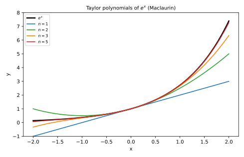
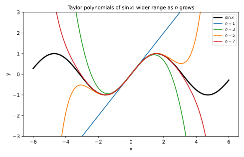
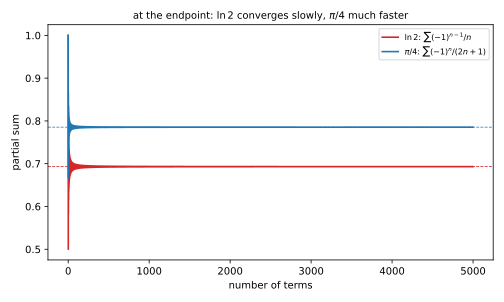

# 第 27 讲：函数展开成幂级数（Taylor series）

> **前置**：26 讲（幂级数、收敛半径、逐项求导与积分）；上册（泰勒公式）。
> **本讲解决什么**：26 讲是“给幂级数，求收敛域与和”；这一讲反过来——**给函数，找它的幂级数**。动机很实际：多项式只有加减乘，计算机能直接算；把 $e^x$、$\sin x$ 换成多项式，$e^{0.1}$ 才能算出来，$\int e^{-x^2}dx$ 才能积出来。要回答：**系数怎么定？展开一定收敛到原函数吗？有没有不用硬算导数的办法？**

## 一、为什么要展开

**三个用途**：

1. **算数值**：$e^{0.1}$ 没有简单的十进制表达式，但 $1+0.1+\frac{0.1^2}{2!}+\cdots$ 可以算到任意精度；
2. **算积分**：$\int e^{-x^2}dx$ 没有初等原函数，但展开后可以逐项积分；
3. **解方程**：微分方程的解有时只能写成幂级数（认识层）。

**问题**：给定 $f$，它的幂级数系数 $a_n$ 怎么定？——下一节用一个很巧的办法：**逐项求导，令 $x=x_0$**。

## 二、泰勒级数与系数

### 2.1 系数怎么定

假设在 $x_0$ 附近

$$f(x)=\sum_{n=0}^\infty a_n(x-x_0)^n.$$

对两边**逐项求导 $k$ 次**：

$$f^{(k)}(x)=\sum_{n=k}^\infty n(n-1)\cdots(n-k+1)a_n(x-x_0)^{n-k}.$$

**令 $x=x_0$**：右边只剩 $n=k$ 那一项（其余都含 $(x-x_0)$ 的正幂），所以

$$f^{(k)}(x_0)=k!\,a_k\ \Longrightarrow\ \boxed{a_k=\frac{f^{(k)}(x_0)}{k!}.}$$

**这一步很关键**：它说明系数**完全由 $f$ 在 $x_0$ 的各阶导数决定**，没有别的选择。

### 2.2 唯一性与麦克劳林级数

**唯一性**：同一个函数在同一个点展开，系数只能是这样——**不管用什么方法算出来，结果必须一样**。这条给了下一节“间接展开”的合法性：用代换/积分算出来的级数，和硬算导数得到的级数必然相同。

**泰勒级数**：

$$\sum_{n=0}^\infty\frac{f^{(n)}(x_0)}{n!}(x-x_0)^n.$$

$x_0=0$ 时叫**麦克劳林级数**（Maclaurin series）：

$$\sum_{n=0}^\infty\frac{f^{(n)}(0)}{n!}x^n.$$

### 2.3 第一个例子：$e^x$

$f(x)=e^x$，$f^{(k)}(x)=e^x$，所以 $f^{(k)}(0)=1$：

$$e^x=\sum_{n=0}^\infty\frac{x^n}{n!}=1+x+\frac{x^2}{2!}+\frac{x^3}{3!}+\cdots.$$



*图 1：$n=1,2,3,5$ 的泰勒多项式逐步贴合 $e^x$；阶数越高，贴合范围越宽。*

**问题桥**：这个级数一定等于 $e^x$ 吗？还是只是“形式上的展开”？——需要看余项。

## 三、余项与收敛

### 3.1 泰勒公式与余项

上册的**泰勒公式**（Taylor's formula，带拉格朗日余项）：设 $f$ 在含 $x_0$ 与 $x$ 的区间上有 $n+1$ 阶导数，则

$$f(x)=\sum_{k=0}^{n}\frac{f^{(k)}(x_0)}{k!}(x-x_0)^k+R_n(x),$$

$$R_n(x)=\frac{f^{(n+1)}(\xi)}{(n+1)!}(x-x_0)^{n+1},$$

其中 $\xi$ 在 $x_0$ 与 $x$ 之间。

**泰勒级数收敛到 $f$**，当且仅当

$$\lim_{n\to\infty}R_n(x)=0.$$

**注意**：**“级数收敛”和“收敛到 $f$”是两件事**。级数可能收敛，但收敛到别的函数。下一小节给一个反例。

### 3.2 一个反例（认识层）

$$f(x)=\begin{cases}e^{-1/x^2},&x\ne0\\0,&x=0\end{cases}$$

这个函数在 $x=0$ 处**所有阶导数都是 0**。理由：对 $x\ne0$，每求一次导，结果都是“$\frac1x$ 的多项式乘以 $e^{-1/x^2}$”这种形状；而 $e^{-1/x^2}$ 趋于 0 比任何 $\frac1{x^k}$ 都快，所以各阶导数在 $x\to0$ 时都趋于 0，按导数定义 $f^{(k)}(0)=0$。于是它的麦克劳林级数**恒为 0**：

$$\sum_{n=0}^\infty\frac{f^{(n)}(0)}{n!}x^n=0.$$

但 $f(x)\ne0$（$x\ne0$ 时为正）。所以**泰勒级数处处收敛到 0，却不等于 $f$**。

**这说明**：泰勒级数只是“按导数形式写出来的级数”，它是否代表原函数，要靠余项判断。考试中常见的 $e^x$、$\sin x$、$\ln(1+x)$ 等，余项都趋于 0，可以放心用。

### 3.3 常用展开为什么收敛

以 $e^x$ 为例：$|f^{(n+1)}(\xi)|=e^\xi\le e^{|x|}$（$\xi$ 在 $0,x$ 之间），所以

$$|R_n(x)|\le\frac{e^{|x|}}{(n+1)!}|x|^{n+1}\to0\quad(\text{阶乘比幂快}).$$

所以 $e^x$ 的泰勒级数对一切 $x$ 收敛到 $e^x$。

## 四、常用展开（必须会背）

| 函数 | 展开 | 收敛域 |
|---|---|---|
| $e^x$ | $\sum_{n=0}^\infty\frac{x^n}{n!}$ | $\mathbb R$ |
| $\sin x$ | $\sum_{n=0}^\infty\frac{(-1)^nx^{2n+1}}{(2n+1)!}$ | $\mathbb R$ |
| $\cos x$ | $\sum_{n=0}^\infty\frac{(-1)^nx^{2n}}{(2n)!}$ | $\mathbb R$ |
| $\frac{1}{1-x}$ | $\sum_{n=0}^\infty x^n$ | $|x|<1$ |
| $\ln(1+x)$ | $\sum_{n=1}^\infty\frac{(-1)^{n-1}x^n}{n}$ | $|x|<1$（$x=1$ 也收敛） |
| $(1+x)^\alpha$ | $1+\sum_{n=1}^\infty\frac{\alpha(\alpha-1)\cdots(\alpha-n+1)}{n!}x^n$ | $|x|<1$ |

**怎么记**（不是硬背六条，而是记住“一条主线 + 三种变化”）：

1. **主线 $e^x$**：$\sum\frac{x^n}{n!}$。它的特点：**求导等于自己**，所以系数是 $\frac1{n!}$。
2. **$\sin/\cos$**：由导数循环 $\sin'=\cos$、$\cos'=-\sin$ 逐阶求导得到——$\sin$ 在 0 处的偶数阶导数全是 0、奇数阶交替为 $\pm1$，所以只剩奇次项且符号交替；$\cos$ 同理只剩偶次项。分母仍是阶乘。
3. **几何 $\frac1{1-x}$**：$\sum x^n$。**求导**得 $\frac1{(1-x)^2}=\sum(n+1)x^n$；**积分**得 $-\ln(1-x)=\sum\frac{x^n}{n}$（把 $x$ 换成 $-x$ 就是 $\ln(1+x)$）。
4. **$(1+x)^\alpha$**：二项式展开的推广，$\alpha$ 可以是任意实数（$\alpha=\frac12$ 时就是 $\sqrt{1+x}$）。



*图 2：$\sin x$ 的 $n=1,3,5,7$ 次多项式；阶数越高，在越宽的区间内贴合。*

## 五、间接展开：不硬算导数

**原则**：由唯一性，只要用**已知展开 + 合法运算**得到幂级数，它就是泰勒级数——**不用算 $n$ 阶导数**。

### 5.1 代换

**例**：$e^{-x^2}$。把 $e^t=\sum\frac{t^n}{n!}$ 中的 $t$ 换成 $-x^2$：

$$e^{-x^2}=\sum_{n=0}^\infty\frac{(-x^2)^n}{n!}=\sum_{n=0}^\infty\frac{(-1)^nx^{2n}}{n!},\qquad x\in\mathbb R.$$

**例**：$\frac{1}{1+x^2}$。把 $\frac1{1-t}=\sum t^n$ 中的 $t$ 换成 $-x^2$：

$$\frac{1}{1+x^2}=\sum_{n=0}^\infty(-x^2)^n=\sum_{n=0}^\infty(-1)^nx^{2n},\qquad |x|<1.$$

**注意收敛域**：代换会改变收敛域。这里 $|-x^2|<1$ 等价于 $|x|<1$，所以还是 $|x|<1$；如果是 $t=2x$，就变成 $|x|<\frac12$。**每次代换都要重新解不等式**。

### 5.2 逐项积分

**例**：$\arctan x$。因为

$$\arctan x=\int_0^x\frac{dt}{1+t^2},$$

把 $\frac1{1+t^2}=\sum(-1)^nt^{2n}$（$|t|<1$）逐项积分：

$$\arctan x=\sum_{n=0}^\infty\frac{(-1)^nx^{2n+1}}{2n+1}=x-\frac{x^3}{3}+\frac{x^5}{5}-\cdots,\qquad |x|<1.$$

**端点**：$x=1$ 时右边是 $\sum\frac{(-1)^n}{2n+1}$，交错、递减、趋于 0 ⇒ 收敛（莱布尼茨）；$x=-1$ 同理。所以收敛域可以扩到 $[-1,1]$（积分可能“补上”端点）。

**例**：$\ln(1+x)$。因为

$$\ln(1+x)=\int_0^x\frac{dt}{1+t},$$

而 $\frac1{1+t}=\sum(-1)^nt^n$（$|t|<1$），逐项积分：

$$\ln(1+x)=\sum_{n=0}^\infty\frac{(-1)^nx^{n+1}}{n+1}=\sum_{n=1}^\infty\frac{(-1)^{n-1}x^n}{n},\qquad |x|<1.$$

**端点**：$x=1$ 时是 $\sum\frac{(-1)^{n-1}}{n}$，收敛（莱布尼茨）；$x=-1$ 时是 $-\sum\frac1n$，发散。所以收敛域 $(-1,1]$。



*图 3：同样在端点，$\ln2$ 的级数误差约 $1/N$，$\pi/4$ 的级数误差约 $1/(2N)$——后者快一倍。*

### 5.3 逐项求导

**例**：$\frac{1}{(1-x)^2}$。由 $\frac1{1-x}=\sum x^n$ 求导：

$$\frac{1}{(1-x)^2}=\sum_{n=1}^\infty nx^{n-1}=\sum_{n=0}^\infty(n+1)x^n,\qquad |x|<1.$$

### 5.4 小结：间接法的三条纪律

1. **每次代换/积分/求导后，重新求收敛域**（代换可能缩放 $R$，积分可能补端点，求导可能丢端点）；
2. **端点单独判**（代回数项级数）；
3. **运算必须在收敛域内部进行**（26 讲：逐项运算只在 $|x-x_0|<R$ 内合法）。

## 六、例题

**例 1**：把 $f(x)=e^{-x^2}$ 展开成麦克劳林级数，并求收敛域。

**解**：代换 $t=-x^2$：

$$e^{-x^2}=\sum_{n=0}^\infty\frac{(-1)^nx^{2n}}{n!},\qquad x\in\mathbb R.$$

**例 2**：把 $f(x)=\frac{1}{1+x^2}$ 展开，并求收敛域。

**解**：代换 $t=-x^2$：

$$\frac{1}{1+x^2}=\sum_{n=0}^\infty(-1)^nx^{2n},\qquad |x|<1.$$

端点 $x=\pm1$：通项 $(-1)^n$ 不趋于 0 ⇒ 发散。收敛域 $(-1,1)$。

**例 3**：把 $f(x)=\arctan x$ 展开，并求收敛域。

**解**：见 5.2：

$$\arctan x=\sum_{n=0}^\infty\frac{(-1)^nx^{2n+1}}{2n+1},\qquad |x|\le1.$$

（$x=\pm1$ 由莱布尼茨收敛。）

**例 4**：把 $f(x)=\ln(1+x)$ 展开，并求收敛域。

**解**：见 5.2：

$$\ln(1+x)=\sum_{n=1}^\infty\frac{(-1)^{n-1}x^n}{n},\qquad -1<x\le1.$$

**例 5**：求 $\int_0^x e^{-t^2}dt$ 的幂级数展开。

**解**：先展开被积函数（例 1），再逐项积分：

$$\int_0^x e^{-t^2}dt=\sum_{n=0}^\infty\frac{(-1)^n}{n!}\int_0^xt^{2n}dt=\sum_{n=0}^\infty\frac{(-1)^nx^{2n+1}}{n!(2n+1)},\qquad x\in\mathbb R.$$

## 七、数值核对

用脚本核对本节结论（`scripts/lec27-02_verify_taylor.py`，全脚本 0.00 秒）：

```
=== EXP1: e^x at x=1, partial sums ===
  n=5  : partial sum = 2.716666666667, e = 2.718281828459, diff = 1.62e-03
  n=10 : partial sum = 2.718281801146, e = 2.718281828459, diff = 2.73e-08
  n=20 : partial sum = 2.718281828459, e = 2.718281828459, diff = 0.00e+00

=== EXP2: sin x at x=1, partial sums ===
  n=3  : partial sum = 0.833333333333, sin 1 = 0.841470984808, diff = 8.14e-03
  n=5  : partial sum = 0.841666666667, sin 1 = 0.841470984808, diff = 1.96e-04
  n=7  : partial sum = 0.841468253968, sin 1 = 0.841470984808, diff = 2.73e-06

=== EXP3: ln(1+x) at x=1 (slow) -> ln 2 ===
  N=10    : partial sum = 0.6456349206, ln2 = 0.6931471806, diff = 4.75e-02
  N=100   : partial sum = 0.6881721793, ln2 = 0.6931471806, diff = 4.98e-03
  N=1000  : partial sum = 0.6926474306, ln2 = 0.6931471806, diff = 5.00e-04
  N=10000 : partial sum = 0.6930971831, ln2 = 0.6931471806, diff = 5.00e-05
  -> error ~ 1/N: slow

=== EXP4: arctan 1 (alternating) -> pi/4 ===
  N=10   : partial sum = 0.8080789524, pi/4 = 0.7853981634, diff = 2.27e-02
  N=100  : partial sum = 0.7878733503, pi/4 = 0.7853981634, diff = 2.48e-03
  N=1000 : partial sum = 0.7856479136, pi/4 = 0.7853981634, diff = 2.50e-04
  -> error ~ 1/(2N): faster than ln2

=== EXP5: integral of e^{-x^2} on [0,1] via series vs quadrature ===
  series     = 0.746824132812
  quadrature = 0.746824132811
  diff = 1.53e-12
```

**核对点**：EXP1 阶乘级数收敛极快（$n=10$ 就差 $10^{-8}$）。EXP2 阶数增加，误差从 $10^{-2}$ 降到 $10^{-6}$。EXP3 端点 $x=1$ 时误差约 $1/N$，到 $N=10^4$ 才到 $5\times10^{-5}$——很慢。EXP4 误差约 $1/(2N)$，同样项数下比 $\ln2$ 快约一倍。EXP5 级数与数值积分吻合到 $10^{-12}$，验证了“先展开、再逐项积分”可行。

## 小结

- **泰勒系数**：$a_k=\frac{f^{(k)}(x_0)}{k!}$，由逐项求导、令 $x=x_0$ 得到；系数**唯一**。
- **泰勒级数收敛到 $f$** ⇔ 余项 $R_n\to0$；**级数收敛 ≠ 收敛到 $f$**（$e^{-1/x^2}$ 反例）。
- **六个常用展开**：$e^x$、$\sin x$、$\cos x$、$\frac1{1-x}$、$\ln(1+x)$、$(1+x)^\alpha$；从 $e^x$ 和几何级数两条主线记。
- **间接展开**：代换/求导/积分，靠唯一性保证正确；**每次都要重求收敛域**，端点单独判。
- **常用收敛域**：$e^x,\sin x,\cos x$ 全轴；$\frac1{1-x}$、$(1+x)^\alpha$ 是 $|x|<1$；$\ln(1+x)$ 是 $(-1,1]$；$\arctan x$ 是 $[-1,1]$。

## 作业

**说明**：答案平铺在每题下方（先做再对照）。只用已教内容。

**1.** 把 $f(x)=\sin x$ 展开成麦克劳林级数，并写出收敛域。

**参考答案**：
$\sin x=x-\frac{x^3}{3!}+\frac{x^5}{5!}-\cdots=\sum_{n=0}^\infty\frac{(-1)^nx^{2n+1}}{(2n+1)!}$，收敛域 $\mathbb R$。

**2.** 把 $f(x)=\cos x$ 展开成麦克劳林级数。

**参考答案**：
$\cos x=1-\frac{x^2}{2!}+\frac{x^4}{4!}-\cdots=\sum_{n=0}^\infty\frac{(-1)^nx^{2n}}{(2n)!}$，收敛域 $\mathbb R$。

**3.** 把 $f(x)=\frac{1}{1-2x}$ 展开，并求收敛域。

**参考答案**：
代换 $t=2x$：$\sum(2x)^n=\sum2^nx^n$，收敛条件 $|2x|<1$，即 $|x|<\frac12$。

**4.** 把 $f(x)=\ln(1-x)$ 展开，并求收敛域。

**参考答案**：
由 $\ln(1+x)$ 把 $x$ 换成 $-x$：$\ln(1-x)=-\sum_{n=1}^\infty\frac{x^n}{n}$，$|x|<1$；端点 $x=-1$ 时是 $-\sum\frac{(-1)^n}{n}$ 收敛，$x=1$ 时是 $-\sum\frac1n$ 发散。收敛域 $[-1,1)$。

**5.** 求 $\int_0^x\cos t^2\,dt$ 的幂级数（到 $x^5$ 项为止）。

**参考答案**：
$\cos t^2=1-\frac{t^4}{2!}+\cdots$；逐项积分：$\int_0^x\cos t^2dt=x-\frac{x^5}{5\cdot2!}+\cdots=x-\frac{x^5}{10}+\cdots$。

**6.**（概念）为什么求泰勒系数时要除以 $k!$？用 $e^x$ 的 $x^2$ 项说明。

**参考答案**：
逐项求导 $k$ 次后，$(x-x_0)^k$ 这一项变成 $k!a_k$，其余项还含 $(x-x_0)$ 的正幂，令 $x=x_0$ 后只剩 $k!a_k$。所以 $a_k=f^{(k)}(x_0)/k!$。以 $e^x$ 为例，$f''(0)=1$，但 $x^2$ 的系数是 $\frac1{2!}$，必须除以 $2!$。
