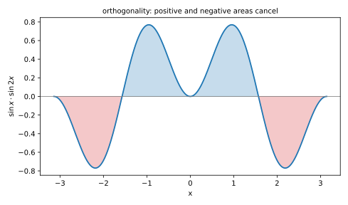
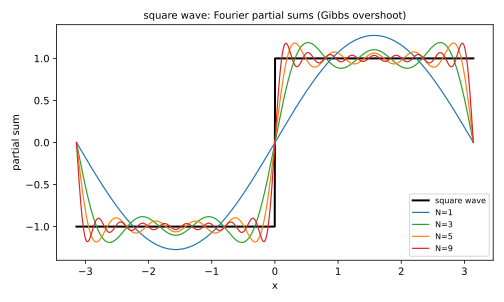
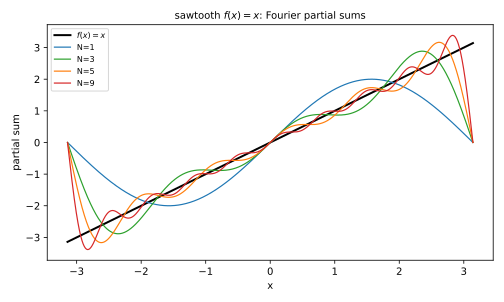

# 第 28 讲：傅里叶级数（Fourier series）

> **前置**：上册（三角函数、积化和差）；23–27 讲（级数、幂级数）。
> **本讲解决什么**：27 讲的幂级数用 $x^n$ 叠加，适合**光滑**函数；但方波、三角波这类**周期函数**有间断、不光滑，幂级数展不开。傅里叶的做法是**改用 $\sin nx$、$\cos nx$ 叠加**——它们本身就是周期的，天生适合周期现象。这一讲回答：**为什么用正余弦**、**系数怎么求**、**间断点处收敛到什么**。

## 一、为什么需要傅里叶级数

对比一下两种展开：

| | 幂级数 | 傅里叶级数 |
|---|---|---|
| 积木 | $x^n$ | $\sin nx$、$\cos nx$ |
| 适合 | 一点附近的光滑函数 | 整个周期上的函数（允许间断） |
| 典型例子 | $e^x$、$\sin x$ | 方波、三角波、交流电 |

**方波的例子**：$f(x)$ 在 $(-\pi,0)$ 上等于 $-1$，在 $(0,\pi)$ 上等于 $+1$，周期 $2\pi$。它在 $x=0$ 处**跳变**，不是光滑函数——**幂级数在这一点根本展不开**。但傅里叶级数可以表示它（间断点处收敛到中点，下一节说）。

**问题桥**：为什么偏偏选 $\sin$、$\cos$？——因为它们之间有一个很好的性质：**正交**。

## 二、三角函数系的正交性

### 2.1 什么叫正交

考虑函数系

$$1,\ \cos x,\ \sin x,\ \cos 2x,\ \sin 2x,\ \dots,\ \cos nx,\ \sin nx,\ \dots$$

在区间 $[-\pi,\pi]$ 上。**正交**是指：**任意两个不同的函数，乘积在整周期上的积分为 0**：

$$\int_{-\pi}^{\pi}\phi_m(x)\phi_n(x)\,dx=0\quad(m\ne n).$$

### 2.2 验证一个

取 $\sin mx$ 与 $\sin nx$（$m\ne n$）。用**积化和差**：

$$\sin mx\sin nx=\frac12\big[\cos(m-n)x-\cos(m+n)x\big].$$

在 $[-\pi,\pi]$ 上积分：$\cos kx$（$k\ne0$）在一个整周期上的积分为 0（正负抵消），所以

$$\int_{-\pi}^{\pi}\sin mx\sin nx\,dx=0.$$

同理 $\int_{-\pi}^{\pi}\cos mx\cos nx\,dx=0$（$m\ne n$），$\int_{-\pi}^{\pi}\sin mx\cos nx\,dx=0$（**任何** $m,n$，奇偶性）。

### 2.3 自己的“长度”

同一函数乘自己，积分不为 0：

$$\int_{-\pi}^{\pi}\sin^2 nx\,dx=\pi,\qquad \int_{-\pi}^{\pi}\cos^2 nx\,dx=\pi,\qquad \int_{-\pi}^{\pi}1^2\,dx=2\pi.$$

**这三个数很关键**：它们是后面系数公式里的分母。



*图 1：$\sin x\cdot\sin 2x$ 在 $[-\pi,\pi]$ 上正负面积相等，积分为 0。*

**问题桥**：正交有什么用？——它可以**把某一项的系数“筛”出来**。

## 三、系数公式

### 3.1 设出级数

设

$$f(x)=\frac{a_0}{2}+\sum_{n=1}^{\infty}\big(a_n\cos nx+b_n\sin nx\big).$$

**为什么第一项写 $\frac{a_0}{2}$**：为了让 $a_0$ 的公式和 $a_n$ 统一（下面会看到，都除以 $\pi$）。如果写成 $a_0$，公式就变成 $\frac{1}{2\pi}$，多一个因子。

### 3.2 求 $a_k$：乘 $\cos kx$ 再积分

两边乘 $\cos kx$，在 $[-\pi,\pi]$ 上积分。右边逐项积分：

- $a_n\cos nx\cdot\cos kx$：$n\ne k$ 时积分为 0（正交），$n=k$ 时为 $a_k\pi$；
- $b_n\sin nx\cdot\cos kx$：**全为 0**（正交）；
- 常数项 $\frac{a_0}{2}\cdot\cos kx$：$\cos kx$ 整周期积分为 0（$k\ne0$）。

于是右边只剩 $a_k\pi$：

$$\boxed{a_k=\frac{1}{\pi}\int_{-\pi}^{\pi}f(x)\cos kx\,dx,\qquad k=1,2,\dots}$$

### 3.3 求 $a_0$

乘 $1$（即不乘）再积分：右边只剩 $\frac{a_0}{2}\cdot2\pi=a_0\pi$：

$$\boxed{a_0=\frac{1}{\pi}\int_{-\pi}^{\pi}f(x)\,dx.}$$

**这就是写 $\frac{a_0}{2}$ 的好处**：$a_0$ 和 $a_k$ 的公式形式完全一样（都是 $\frac1\pi\int f\cdot$ 某个东西，$k=0$ 时“某个东西”是 1）。

### 3.4 求 $b_k$

乘 $\sin kx$ 再积分：正交性同样把 $n\ne k$ 的正弦项和所有余弦项积成 0，只剩 $b_k\pi$，所以

$$\boxed{b_k=\frac{1}{\pi}\int_{-\pi}^{\pi}f(x)\sin kx\,dx,\qquad k=1,2,\dots}$$

### 3.5 一句话总结

**想求哪个系数，就乘那个系数对应的函数，再在整周期上积分**——正交性会把其他项全部积成 0。

**直觉**：这像“筛子”——同一频率的留下，不同频率的相互抵消。**但严格依据是上面的积分计算，不是类比。**

**问题桥**：系数算出来了，级数一定收敛到 $f$ 吗？在间断点呢？

## 四、收敛性：狄利克雷条件

**狄利克雷条件**（Dirichlet conditions）：若 $f$ 在 $[-\pi,\pi]$ 上**分段光滑**（有限个极值点、有限个第一类间断点），则它的傅里叶级数处处收敛，并且

- **连续点**：收敛到 $f(x)$；
- **间断点**：收敛到左右极限的平均
  $$\frac{f(x^-)+f(x^+)}{2}.$$

**为什么是平均**：级数的每一项在跳变处都“够不着”两边的值；部分和在跳变处取两个方向的中间。严格的证明超出本课（认识层），但**结论要会用**。

### 4.1 方波的例子

$$f(x)=\begin{cases}-1,&-\pi<x<0\\[2pt]+1,&0<x<\pi\end{cases},\qquad f(x+2\pi)=f(x).$$

**系数**：$f$ 是奇函数，所以 $a_0=0$、$a_n=0$。只算 $b_n$：

$$b_n=\frac1\pi\int_{-\pi}^{\pi}f(x)\sin nx\,dx=\frac2\pi\int_0^{\pi}\sin nx\,dx=\frac{2(1-\cos n\pi)}{n\pi}.$$

$\cos n\pi=(-1)^n$，所以

$$b_n=\begin{cases}\frac{4}{n\pi},&n\text{ 为奇数}\\[2pt]0,&n\text{ 为偶数}\end{cases}$$

于是

$$f(x)\sim\frac{4}{\pi}\Big(\sin x+\frac{\sin 3x}{3}+\frac{\sin 5x}{5}+\cdots\Big).$$

**在 $x=0$**：右边每一项 $\sin(n\cdot0)=0$，级数为 0；而 $f$ 的左极限 $-1$、右极限 $+1$，平均为 0——**吻合**。

### 4.2 吉布斯现象（认识层）

用部分和逼近方波时，跳变附近会出现**过冲**：峰值超过 1 约 9%。**增加项数不会让过冲消失**，只会让它更窄。这叫**吉布斯现象**（Gibbs phenomenon）。它说明：**逐点收敛不等于一致收敛**——在跳变附近，误差不会整体趋于 0。



*图 2：$N=1,3,5,9$ 项的部分和；项数增加，逼近更好，但跳变处的过冲仍在。*

## 五、奇偶延拓、半幅与一般周期

### 5.1 奇函数：正弦级数

若 $f$ 是**奇函数**，则 $f\cos nx$ 是奇函数，在对称区间上积分为 0，所以 $a_0=a_n=0$，只剩正弦项：

$$f(x)\sim\sum_{n=1}^\infty b_n\sin nx.$$

### 5.2 偶函数：余弦级数

若 $f$ 是**偶函数**，则 $f\sin nx$ 是奇函数，$b_n=0$，只剩余弦项：

$$f(x)\sim\frac{a_0}{2}+\sum_{n=1}^\infty a_n\cos nx.$$

### 5.3 半幅展开

如果只给了 $f$ 在 $[0,\pi]$ 上的值，想展成傅里叶级数，有两种办法：

- **奇延拓**：定义 $f(-x)=-f(x)$，得到正弦级数；
- **偶延拓**：定义 $f(-x)=f(x)$，得到余弦级数。

**两种都可以**（在 $[0,\pi]$ 上都等于原函数），但**级数不同**、收敛速度也不同。题目会指定用哪一种。

**例**：$f(x)=x$ 在 $[0,\pi]$ 上。

**正弦级数**：

$$b_n=\frac2\pi\int_0^\pi x\sin nx\,dx=\frac{2(-1)^{n-1}}{n},$$

$$x\sim2\Big(\sin x-\frac{\sin 2x}{2}+\frac{\sin 3x}{3}-\cdots\Big),\qquad 0<x<\pi.$$

**余弦级数**：

$$a_0=\frac2\pi\int_0^\pi x\,dx=\pi,\qquad a_n=\frac2\pi\int_0^\pi x\cos nx\,dx=\frac{2\big((-1)^n-1\big)}{\pi n^2}.$$

（$n$ 为偶数时 $a_n=0$；$n$ 为奇数时 $a_n=-\frac{4}{\pi n^2}$。）

### 5.4 周期不是 $2\pi$：换元

前面所有公式都默认周期是 $2\pi$。若 $f$ 的周期是 $2l$（$l>0$），做一个缩放换元：

$$t=\frac{\pi x}{l}\quad\Longleftrightarrow\quad x=\frac{lt}{\pi}.$$

这样 $x$ 走一个周期 $[-l,l]$ 时，$t$ 正好走 $[-\pi,\pi]$。令 $F(t)=f(lt/\pi)$，则 $F$ 是周期 $2\pi$ 的函数，可以用前面的公式：

$$F(t)\sim\frac{a_0}{2}+\sum_{n=1}^\infty\big(a_n\cos nt+b_n\sin nt\big),$$

$$a_n=\frac1\pi\int_{-\pi}^{\pi}F(t)\cos nt\,dt,\qquad b_n=\frac1\pi\int_{-\pi}^{\pi}F(t)\sin nt\,dt.$$

换回 $x$：$dt=\frac{\pi}{l}dx$，$F(t)=f(x)$，$\cos nt=\cos\frac{n\pi x}{l}$，于是

$$\boxed{f(x)\sim\frac{a_0}{2}+\sum_{n=1}^\infty\Big(a_n\cos\frac{n\pi x}{l}+b_n\sin\frac{n\pi x}{l}\Big),}$$

$$\boxed{a_n=\frac1l\int_{-l}^{l}f(x)\cos\frac{n\pi x}{l}\,dx,\qquad b_n=\frac1l\int_{-l}^{l}f(x)\sin\frac{n\pi x}{l}\,dx.}$$

**记法**：把 $2\pi$ 周期公式里的 $\frac1\pi$ 换成 $\frac1l$、$nx$ 换成 $\frac{n\pi x}{l}$。$l=\pi$ 时退回原公式。

**例**：$f(x)=x$（$-l<x<l$），求傅里叶级数。

**解**：$f$ 是奇函数，$a_0=a_n=0$。令 $u=\frac{n\pi x}{l}$，则 $x=\frac{lu}{n\pi}$、$dx=\frac{l}{n\pi}du$：

$$b_n=\frac2l\int_0^l x\sin\frac{n\pi x}{l}\,dx=\frac2l\cdot\frac{l^2}{n^2\pi^2}\int_0^{n\pi}u\sin u\,du.$$

而 $\int u\sin u\,du=\sin u-u\cos u$，代入上下限：

$$\int_0^{n\pi}u\sin u\,du=\big[\sin u-u\cos u\big]_0^{n\pi}=-n\pi\cos n\pi=(-1)^{n+1}n\pi.$$

所以

$$b_n=\frac2l\cdot\frac{l^2}{n^2\pi^2}\cdot(-1)^{n+1}n\pi=\frac{2l(-1)^{n+1}}{n\pi},$$

$$x\sim\frac{2l}{\pi}\sum_{n=1}^\infty\frac{(-1)^{n+1}}{n}\sin\frac{n\pi x}{l},\qquad -l<x<l.$$

（$l=\pi$ 时正是例 2 的 $2\sum(-1)^{n+1}\sin nx/n$。）

**半幅展开的 $[0,l]$ 版**：若只给 $[0,l]$ 上的 $f$，奇/偶延拓后的系数是

$$a_n=\frac2l\int_0^l f(x)\cos\frac{n\pi x}{l}\,dx,\qquad b_n=\frac2l\int_0^l f(x)\sin\frac{n\pi x}{l}\,dx.$$

## 六、例题

**例 1**：求方波（$f=-1$ 在 $(-\pi,0)$、$f=+1$ 在 $(0,\pi)$）的傅里叶级数，并说明 $x=0$ 处收敛到什么。

**解**：见 4.1：

$$f\sim\frac4\pi\Big(\sin x+\frac{\sin3x}{3}+\frac{\sin5x}{5}+\cdots\Big);$$

$x=0$ 处收敛到 $\frac{-1+1}{2}=0$。

**例 2**：求 $f(x)=x$（$-\pi<x<\pi$）的傅里叶级数。

**解**：$f$ 是奇函数，$a_0=a_n=0$；

$$b_n=\frac1\pi\int_{-\pi}^{\pi}x\sin nx\,dx=\frac{2(-1)^{n-1}}{n},$$

$$x\sim2\Big(\sin x-\frac{\sin2x}{2}+\frac{\sin3x}{3}-\cdots\Big),\qquad -\pi<x<\pi.$$

（在 $x=\pm\pi$ 处收敛到中点 0。）



*图 3：$f(x)=x$ 的 $N=1,3,5,9$ 项部分和；在 $(-\pi,\pi)$ 内逐步贴合，端点附近仍有跳变。*

**例 3**：求 $f(x)=x^2$（$-\pi\le x\le\pi$）的傅里叶级数。

**解**：$f$ 是偶函数，$b_n=0$；

$$a_0=\frac1\pi\int_{-\pi}^{\pi}x^2dx=\frac{2\pi^2}{3},\qquad a_n=\frac1\pi\int_{-\pi}^{\pi}x^2\cos nx\,dx=\frac{4(-1)^n}{n^2}.$$

$$x^2\sim\frac{\pi^2}{3}+4\sum_{n=1}^\infty\frac{(-1)^n}{n^2}\cos nx.$$

**例 4**：把 $f(x)=1$（$0\le x\le\pi$）分别展成正弦级数和余弦级数，并说明两者为什么不同。

**解**：**正弦级数**（奇延拓）：$a_0=a_n=0$，

$$b_n=\frac2\pi\int_0^\pi\sin nx\,dx=\frac{2}{n\pi}\big(1-\cos n\pi\big)=\frac{2}{n\pi}\big(1-(-1)^n\big).$$

所以 $b_n=\frac{4}{n\pi}$（$n$ 奇）、$0$（$n$ 偶）：

$$1\sim\frac4\pi\Big(\sin x+\frac{\sin3x}{3}+\frac{\sin5x}{5}+\cdots\Big),\qquad 0<x<\pi.$$

**余弦级数**（偶延拓）：$b_n=0$，

$$a_0=\frac2\pi\int_0^\pi1\,dx=2,\qquad a_n=\frac2\pi\int_0^\pi\cos nx\,dx=\frac{2\sin n\pi}{n\pi}=0,$$

所以级数就是常数项 $\frac{a_0}{2}=1$。

**为什么不同**：两个级数在 $(0,\pi)$ 上都等于 1，但延拓方式不同——正弦级数在端点 $x=0,\pi$ 处对应奇延拓的跳变，收敛到 0；余弦级数没有跳变，处处等于 1。同一个函数可以有两种傅里叶展开，题目指定哪一种就用哪一种。

## 七、数值核对

用脚本核对本节结论（`scripts/lec28-02_verify_fourier.py`，全脚本 0.00 秒）：

```
=== EXP1: square wave partial sums at x=0.5 ===
  N=1  : partial sum = 0.6104235545  (square wave = 1)
  N=3  : partial sum = 1.1861732554  (square wave = 1)
  N=5  : partial sum = 0.9840765934  (square wave = 1)
  N=9  : partial sum = 1.0629039024  (square wave = 1)
  N=50 : partial sum = 0.9872598427  (square wave = 1)

=== EXP2: sawtooth f(x)=x at x=1 ===
  N=1   : partial sum = 1.6829419696  (f(x) = 1)
  N=3   : partial sum = 0.8677245482  (f(x) = 1)
  N=5   : partial sum = 0.8625560860  (f(x) = 1)
  N=9   : partial sum = 0.9876473661  (f(x) = 1)
  N=100 : partial sum = 1.0003202214  (f(x) = 1)

=== EXP3: x^2 cosine series at x=0 ===
  N=10    : partial sum = 0.0180194313  (f(0) = 0)
  N=100   : partial sum = 0.0001980002  (f(0) = 0)
  N=1000  : partial sum = 0.0000019980  (f(0) = 0)
  N=10000 : partial sum = 0.0000000200  (f(0) = 0)

=== EXP4: orthogonality integral sin x sin 2x ===
  integral = 0.000e+00  (expect 0)
  integral sin^2 x = 3.1415926536  (expect pi = 3.1415926536)

=== EXP5: square wave at the jump x=0 -> midpoint 0 ===
  N=1  : partial sum at x=0 = 0.000e+00  (midpoint = 0)
  N=3  : partial sum at x=0 = 0.000e+00  (midpoint = 0)
  N=9  : partial sum at x=0 = 0.000e+00  (midpoint = 0)
  N=99 : partial sum at x=0 = 0.000e+00  (midpoint = 0)
```

**核对点**：EXP1/EXP2 的部分和是**振荡逼近**：$N=3$ 时方波在 $x=0.5$ 过冲到 $1.186$，$N=1$ 时锯齿在 $x=1$ 过冲到 $1.683$——这就是吉布斯现象；项数加到 50/100 后回到接近 1。EXP3 误差是 $O(1/N^2)$（$0.018\to2\times10^{-8}$）。EXP4 正交积分精确为 0，$\int\sin^2x=\pi$ 也吻合。EXP5 间断点处部分和恒为 0，正是左右极限的平均。

## 小结

- **傅里叶 vs 幂级数**：积木换成 $\sin nx,\cos nx$；适合周期函数、允许间断。
- **正交性**：不同频率乘积积分为 0；$\int\sin^2=\int\cos^2=\pi$，$\int1=2\pi$。
- **系数**：$a_k=\frac1\pi\int f\cos kx$、$b_k=\frac1\pi\int f\sin kx$、$a_0=\frac1\pi\int f$；写法用 $\frac{a_0}{2}$ 是为了公式统一。
- **收敛**：分段光滑 ⇒ 连续点收敛到 $f$，**间断点收敛到左右极限的平均**。
- **奇偶**：奇 → 正弦级数，偶 → 余弦级数；半幅可用奇延拓或偶延拓。
- **一般周期**：周期 $2l$ 时，把 $\frac1\pi$ 换成 $\frac1l$、$nx$ 换成 $\frac{n\pi x}{l}$。
- **吉布斯现象**：跳变处过冲约 9%，增加项数不消失（只是变窄）。

## 作业

**说明**：答案平铺在每题下方（先做再对照）。只用已教内容。

**1.** 求 $f(x)=|x|$（$-\pi\le x\le\pi$）的傅里叶级数。

**参考答案**：
$f$ 是偶函数，$b_n=0$。
$a_0=\frac1\pi\int_{-\pi}^{\pi}|x|dx=\pi$；$a_n=\frac2\pi\int_0^\pi x\cos nx\,dx=\frac{2((-1)^n-1)}{\pi n^2}$（$n$ 奇为 $-\frac{4}{\pi n^2}$，$n$ 偶为 0）。
$|x|\sim\frac{\pi}{2}-\frac4\pi\sum_{k=1}^\infty\frac{\cos(2k-1)x}{(2k-1)^2}$。

**2.** 求 $f(x)=\sin x$（$-\pi<x<\pi$）的傅里叶级数。

**参考答案**：
$f$ 本身就是一项 $\sin x$，所以 $b_1=1$、其余系数全为 0，级数就是 $\sin x$。

**3.** 方波在 $x=\pi$ 处收敛到什么？

**参考答案**：
$x=\pi$ 是间断点（周期延拓后），左极限 $+1$、右极限 $-1$，平均为 0。

**4.** 为什么 $a_0$ 的公式里是 $\frac1\pi$，而常数项写成 $\frac{a_0}{2}$？

**参考答案**：
因为常数项 $\frac{a_0}{2}$ 在 $[-\pi,\pi]$ 上积分为 $\frac{a_0}{2}\cdot2\pi=a_0\pi$，所以 $a_0=\frac1\pi\int f$——和 $a_k$ 的公式形式一致。若常数项直接写 $a_0$，公式会变成 $\frac1{2\pi}$。

**5.**（概念）为什么求系数时要“乘一个函数再积分”？用正交性解释。

**参考答案**：
乘 $\cos kx$ 后，右边只有 $a_k\cos^2kx$ 这一项的积分不为 0，其他项（不同频率）积分为 0；于是方程里只剩 $a_k$，可以解出来。

**6.**（概念）傅里叶级数在间断点为什么收敛到左右极限的平均，而不是 $f$ 的值？

**参考答案**：
间断点处 $f$ 没有唯一值（左右极限不同）；部分和由有限个连续的正弦/余弦组成，在跳变处取两个方向的中间，极限就是左右极限的平均。
