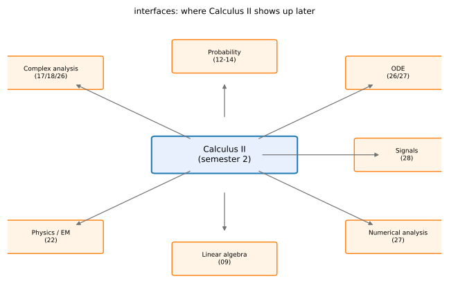

# 第 29 讲：与后续课程的接口（interfaces to later courses）

> **前置**：全部 01–28 讲。
> **本讲解决什么**：这一讲**不教新公式**。它只做一件事：把下册的哪些结论，**接到后续课程的哪一节**，每条都给一个**具体例子**。目的是让你在学复变、概率、信号时，能认出来“这不是新东西，我在高数下见过”。

## 一、复变：曲线积分 → 复积分

### 1.1 复积分就是两类曲线积分

设 $f(z)=u+iv$，$dz=dx+i\,dy$。沿曲线 $\Gamma$：

$$\int_\Gamma f(z)\,dz=\int_\Gamma(u+iv)(dx+i\,dy)=\int_\Gamma(u\,dx-v\,dy)+i\int_\Gamma(v\,dx+u\,dy).$$

右边是**两个第二类曲线积分**（17 讲）。所以复积分不是全新对象，**是实部、虚部分开算的两条线积分**。

### 1.2 柯西-黎曼方程就是格林的条件

$f=u+iv$ **解析**（可导）的条件是**柯西-黎曼方程**（Cauchy–Riemann equations）：

$$u_x=v_y,\qquad u_y=-v_x.$$

取 $P=u$、$Q=-v$，则 $P_y=u_y$、$Q_x=-v_x$——**CR 方程正好是 $P_y=Q_x$**（18 讲的路径无关条件）。

**柯西积分定理**：解析函数沿闭路积分为 0。用格林写就是

$$\oint_\Gamma u\,dx-v\,dy=\iint_D\big((-v)_x-u_y\big)\,dxdy=-\iint_D(v_x+u_y)\,dxdy=0,$$

最后一步用 $u_y=-v_x$。**这就是格林 + CR**。

### 1.3 留数就是洛朗级数的 $z^{-1}$ 系数

$$\oint_{|z|=1}\frac{dz}{z}=2\pi i.$$

**为什么**：把 $\frac1z$ 看成**洛朗级数**（Laurent series，允许负次幂的幂级数）的 $z^{-1}$ 项；沿单位圆一圈，只有这一项积分不为 0（$\oint z^{k}dz=0$，$k\ne-1$）。**这正是 26 讲“逐项积分”的复数版**，也是复变里“留数定理”的雏形：留数就是 $z^{-1}$ 项的系数（乘 $2\pi i$ 后给出积分值）。

**一句话**：复变不是新数学，是**把 17/18/26 讲换成复数写法**。

## 二、概率：重积分 → 联合分布

### 2.1 联合密度

二维随机变量 $(X,Y)$ 的**联合密度**（joint density）$f(x,y)$ 满足

$$P\big((X,Y)\in D\big)=\iint_D f(x,y)\,dx\,dy.$$

**这就是 12 讲的二重积分**，只是被积函数叫“密度”。

**边缘密度**：

$$f_X(x)=\int_{-\infty}^{\infty}f(x,y)\,dy.$$

**这就是“化累次积分、先对 $y$ 积掉”**（12 讲）。

### 2.2 期望

$$E[g(X,Y)]=\iint_{\mathbb R^2}g(x,y)f(x,y)\,dx\,dy.$$

**例（均匀分布）**：$(X,Y)$ 在单位圆盘上均匀分布，$f=\frac1\pi$。求 $P(X>0)$：

$$P(X>0)=\iint_{D\cap\{x>0\}}\frac1\pi\,dxdy=\frac1\pi\cdot\frac{\pi}{2}=\frac12.$$

**面积比**——就是二重积分算面积。

**一句话**：概率里的“求概率”，一大半是**算重积分**。

## 三、微分方程与信号：幂级数、傅里叶

### 3.1 幂级数解微分方程

设 $y=\sum a_nx^n$，代入方程，比较同次幂系数。

**例**：$y''+y=0$。代入得

$$\sum(n+2)(n+1)a_{n+2}x^n+\sum a_nx^n=0,$$

所以 $a_{n+2}=-\frac{a_n}{(n+1)(n+2)}$。取 $a_0=1,a_1=0$ 得 $\cos x$；取 $a_0=0,a_1=1$ 得 $\sin x$。

**这就是 27 讲的泰勒展开反过来用**。

### 3.2 傅里叶与信号

**方波的频谱**：28 讲例 1 的级数

$$f\sim\frac4\pi\Big(\sin x+\frac{\sin3x}{3}+\frac{\sin5x}{5}+\cdots\Big)$$

说明方波只含**奇次谐波**，幅度按 $\frac1n$ 衰减。**信号与系统**里的“频谱”，就是把每个 $\sin nx$ 的幅度画出来。

**热方程**：分离变量后，温度分布的时间衰减因子对应傅里叶系数——**傅里叶级数是解偏微分方程的工具**。

**一句话**：傅里叶级数是**频域**的第一课。

## 四、数值与线代：泰勒、Hessian

### 4.1 泰勒 → 截断误差

27 讲的余项 $R_n=\frac{f^{(n+1)}(\xi)}{(n+1)!}(x-x_0)^{n+1}$，在数值分析里就是**截断误差**：

- 用 $n$ 项泰勒算 $e^x$，误差量级 $\frac{|x|^{n+1}}{(n+1)!}$；
- 数值积分（梯形、Simpson）的误差公式，也是把函数泰勒展开后逐项积分得到的（认识层）。

### 4.2 Hessian → 极值判据

09 讲的 $AC-B^2$ 判据，本质是**二阶导矩阵（Hessian）的行列式**：

$$H=\begin{pmatrix}f_{xx}&f_{xy}\\f_{xy}&f_{yy}\end{pmatrix},\qquad \det H=AC-B^2.$$

- $\det H>0$ 且 $f_{xx}>0$：正定 ⇒ 极小；
- $\det H>0$ 且 $f_{xx}<0$：负定 ⇒ 极大；
- $\det H<0$：不定 ⇒ 鞍点。

**所以 $AC-B^2$ 不是背出来的口诀，是 Hessian 的行列式**——线代里的“正定/负定/不定”正好对应三种极值情形。

**一句话**：09 讲的判据，在线代里叫“二次型的定性”。

## 五、一张接口地图

| 后续课程 | 用到的下册内容 | 具体连接 |
|---|---|---|
| 复变函数 | 17、18、26 讲 | 复积分 = 两类曲线积分；CR 方程 = 格林条件；留数 = 洛朗级数系数 |
| 概率统计 | 12–14 讲 | 联合密度 = 二重积分；期望 = 重积分；边缘密度 = 累次积分 |
| 常微分方程 | 26、27 讲 | 幂级数解；比较系数 |
| 信号与系统 | 28 讲 | 傅里叶级数 = 频谱；谐波分解 |
| 数值分析 | 27 讲 | 泰勒余项 = 截断误差；数值积分误差 |
| 线性代数 | 09 讲 | Hessian = 二次型矩阵；$AC-B^2$ = 行列式 |
| 大学物理（电磁） | 22 讲 | 梯度/散度/旋度；高斯、斯托克斯的积分形式 |



*图 1：下册的结论分别流向哪些后续课程。*

**问题桥**：接口列完了，最后一讲把整门课的题型和易错点收成一张表。

## 六、数值核对

用脚本核对本节结论（`scripts/lec29-02_verify_interfaces.py`，全脚本 0.00 秒）：

```
=== EXP1: closed contour integral of 1/z on |z|=1 -> 2*pi*i ===
  numeric = 1.736836e-19 + 6.283185i
  exact   = 0 + 6.283185i, diff = 1.74e-19

=== EXP2: uniform on unit disk, P(X>0) -> 1/2 ===
  Monte Carlo = 0.500200, exact = 0.5, diff = 2.00e-04

=== EXP3: Hessian determinant test at the origin ===
  f=x^2+y^2 : H = [[2,0],[0,2]], det = 4 > 0, f_xx = 2 > 0 -> local min
  f=x^2-y^2 : H = [[2,0],[0,-2]], det = -4 < 0 -> saddle
```

**核对点**：EXP1 实部是机器零（$10^{-19}$）、虚部 $2\pi$，说明“绕一圈只留下 $z^{-1}$ 项”。EXP2 蒙特卡洛用 $5\times10^5$ 个样本，误差 $2\times10^{-4}$（随机误差量级 $1/\sqrt M$）。EXP3 两个二维例子分别给出正定（极小）与不定（鞍点），对应 $AC-B^2$ 的符号。

## 小结

- **复变**：复积分 = 两类曲线积分；CR 方程 = $P_y=Q_x$；留数 = 洛朗系数。
- **概率**：联合密度、期望、边缘密度都是重积分。
- **ODE/信号**：幂级数解方程；傅里叶级数 = 频谱。
- **数值/线代**：泰勒余项 = 截断误差；$AC-B^2$ = Hessian 行列式。
- **物理**：场论三算子 + 高斯/斯托克斯的积分形式。

## 作业

**说明**：答案平铺在每题下方（先做再对照）。只用已教内容。

**1.** 把 $\int_\Gamma f(z)dz$ 写成实部、虚部两个实积分。

**参考答案**：
$\int_\Gamma(u\,dx-v\,dy)+i\int_\Gamma(v\,dx+u\,dy)$。

**2.** 验证 $f(z)=z^2$ 满足 CR 方程。

**参考答案**：
$z^2=(x^2-y^2)+i(2xy)$，$u=x^2-y^2$、$v=2xy$；$u_x=2x=v_y$、$u_y=-2y=-v_x$ ✓。

**3.** 二维均匀分布 $f=\frac1{\pi}$ 在单位圆盘上，求 $P(X^2+Y^2<1/4)$。

**参考答案**：
区域是半径 $1/2$ 的圆盘，面积 $\frac\pi4$；概率 $=\frac1\pi\cdot\frac\pi4=\frac14$。

**4.** 写出 $f(x,y)=x^2+y^2$ 在 $(0,0)$ 的 Hessian，并判断极值。

**参考答案**：
$f_{xx}=2$、$f_{yy}=2$、$f_{xy}=0$；$H=\begin{pmatrix}2&0\\0&2\end{pmatrix}$，$\det=4>0$、$f_{xx}>0$ ⇒ 极小。

**5.**（概念）为什么说“复积分不是新东西”？

**参考答案**：
$f=u+iv$、$dz=dx+i\,dy$ 展开后，实部和虚部各是一个第二类曲线积分；柯西定理也由格林公式加 CR 方程得到。
