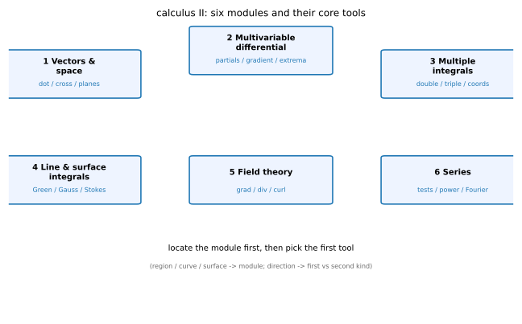

# 第 30 讲：总复习与题型总表

> **前置**：全部 01–29 讲。
> **本讲解决什么**：不教新知识。把整门课收成三张表——**题型全景**（拿到题往哪想）、**易错总表**（哪些坑最容易踩）、**时间分配**（考试怎么排）。最后 10 道跨模块自测，答案附在题下。

## 一、题型全景

### 1.1 六个模块

| 模块 | 核心工具 | 典型题 |
|---|---|---|
| 1 向量与空间 | 点积、叉积、平面/直线方程、距离 | 求平面方程、异面直线距离、判断位置关系 |
| 2 多元微分 | 偏导、全微分、链式法则、方向导数/梯度、无条件/条件极值、闭区域最值 | 求梯度与方向导数、$AC-B^2$ 判极值、拉格朗日乘子 |
| 3 重积分 | 直角坐标、极坐标、柱/球坐标、换序、几何/物理应用 | 交换积分次序、算体积、质心、转动惯量 |
| 4 曲线与曲面积分 | 两类线积分、两类面积分、格林、高斯、斯托克斯 | 格林求面积、高斯求通量、斯托克斯求环量 |
| 5 场论 | 梯度/散度/旋度、两个恒等式、拉普拉斯 | 算散度/旋度、验证 $\nabla\times\nabla f=0$ |
| 6 级数 | 数项级数判敛、幂级数收敛域/和函数、泰勒、傅里叶 | 判敛、求收敛域、展开、求傅里叶系数 |

### 1.2 拿到题怎么定位

**三步**：

1. **看“积什么”**：
   - 区间 → 定积分（上册）；
   - 平面区域 → 二重（模块 3）；
   - 空间区域 → 三重（模块 3）；
   - 曲线 → 线积分（模块 4）；
   - 曲面 → 面积分（模块 4）。
2. **看“有没有方向”**：
   - 有向曲线/曲面 → **第二类**（换向变号）；
   - 无向 → 第一类（$ds$、$dS$ 恒正）。
3. **看“是不是无穷项”**：
   - 是 → 模块 6（判敛/展开）；
   - 不是，但有 $x$ 的幂 → 幂级数；
   - 有周期、要分解 → 傅里叶。

*图 1：六个模块与它们的核心工具。*

## 二、易错总表

**每条写成“错误 → 正确”**，按模块排。

### 2.1 多元微分

| 错误 | 正确 |
|---|---|
| 偏导存在 ⇒ 可微 | **错**；可微 ⇒ 偏导存在，反之不然（需 $\Delta z=A\Delta x+B\Delta y+o(\rho)$） |
| 方向导数是 $\nabla f\cdot\mathbf l$（$\mathbf l$ 任意） | $\mathbf l$ 必须是**单位向量** |
| $AC-B^2=0$ 就判“不是极值” | **失效**，要另判（定义、配方、邻域符号） |
| 条件极值只解 $\nabla f=\lambda\nabla g$ | **还要加约束方程** $g=0$ |
| 闭区域最值只算内部驻点 | **还要算边界**（参数化或拉格朗日） |

### 2.2 重积分

| 错误 | 正确 |
|---|---|
| 极坐标 $dxdy=dr\,d\theta$ | $dxdy=r\,dr\,d\theta$（**漏 $r$**） |
| 球坐标 $\varphi$ 从 $xy$ 面量 | $\varphi$ 从 **$z$ 轴**量起；体积元 $\rho^2\sin\varphi$ |
| 交换次序不画区域 | **先画 $D$**，再重写上下限 |
| 三重积分先一后二/先二后一混用 | 先定“先积哪个变量”，再写截面/投影 |

### 2.3 曲线与曲面积分

| 错误 | 正确 |
|---|---|
| 第一类曲线积分换向变号 | **不变号**（$ds\ge0$） |
| 第二类曲线积分换向不变号 | **变号** |
| 第一类曲面积分 $dS=dxdy$ | $dS=\sqrt{1+z_x^2+z_y^2}\,dxdy$ |
| 第二类曲面积分 $dxdy$ 当面积 | $dxdy=\cos\gamma\,dS$，**带符号** |
| 格林公式不检查正向 | 区域在**左手边**（通常逆时针）；反向变号 |
| 格林公式不检查单连通 | **有洞不能用**（$(-y,x)/(x^2+y^2)$ 反例） |
| 高斯公式取内侧 | 必须**外侧** |
| 斯托克斯曲线方向与法向不配套 | **右手系** |

### 2.4 级数

| 错误 | 正确 |
|---|---|
| $a_n\to0$ ⇒ 收敛 | **不够**（调和级数） |
| 比值 $\rho=1$ 就判收敛 | **失效**（$\sum1/n$ 与 $\sum1/n^2$ 都为 1） |
| 收敛半径就是收敛域 | $R$ 只给**开区间**；端点单独判 |
| 泰勒系数 $a_k=f^{(k)}(x_0)$ | 要**除以 $k!$** |
| 傅里叶常数项写 $a_0$ | 写 $\frac{a_0}{2}$（公式才统一） |
| 傅里叶在间断点收敛到 $f$ | 收敛到**左右极限平均** |
| 条件收敛可以随意重排 | **不能**（黎曼重排会改变和） |

## 三、限时建议

### 3.1 时间分配（以 120 分钟为例）

| 题型 | 建议时间 | 策略 |
|---|---|---|
| 选择/填空 | 35–40 分钟 | 会就写，不会先标记 |
| 计算题 | 50–55 分钟 | 按模块顺序，先熟后生 |
| 证明/综合 | 20–25 分钟 | 先写关键步骤，能拿的分先拿 |
| 检查 | 10 分钟 | 优先查符号、上下限、方向 |

### 3.2 跳题规则

**3 分钟没有方向感就跳**。回头时用 1.2 的“三步定位”：**先确定模块，再想该模块的第一工具**。很多时候不是不会，是**一开始选错了模块**（比如把面积分当重积分）。

### 3.3 检查顺序

1. **符号**：方向、上下限、$dxdy$ 的 $\cos\gamma$；
2. **条件**：格林单连通、高斯外侧、级数端点；
3. **量纲/量级**：面积应为正、概率在 $[0,1]$、收敛半径为正。

## 四、一页纸公式卡

只列**最核心、最容易忘**的；完整定义与条件见 `AA_一览.md`。

- **全微分**：$dz=f_xdx+f_ydy+o(\rho)$；
- **方向导数**：$\frac{\partial f}{\partial\mathbf l}=\nabla f\cdot\mathbf l$（$\mathbf l$ 单位）；
- **极值**：$AC-B^2>0$ 且 $A>0$ 极小、$A<0$ 极大；$<0$ 鞍点；
- **极坐标**：$dxdy=r\,dr\,d\theta$；
- **柱坐标**：$dV=r\,dr\,d\theta\,dz$；
- **球坐标**：$dV=\rho^2\sin\varphi\,d\rho\,d\varphi\,d\theta$；
- **第一类线/面**：$ds=\sqrt{x'^2+y'^2}dt$；$dS=\sqrt{1+z_x^2+z_y^2}dxdy$；
- **格林**：$\oint_L Pdx+Qdy=\iint_D(Q_x-P_y)d\sigma$；
- **高斯**：$\oiint_\Sigma\mathbf F\cdot d\mathbf S=\iiint_\Omega(P_x+Q_y+R_z)dV$；
- **斯托克斯**：$\oint_\Gamma\mathbf F\cdot d\mathbf r=\iint_\Sigma(\nabla\times\mathbf F)\cdot\mathbf n\,dS$；
- **散度/旋度**：$\nabla\cdot\mathbf F=P_x+Q_y+R_z$；$\nabla\times\mathbf F=(R_y-Q_z,P_z-R_x,Q_x-P_y)$；
- **几何级数**：$\sum q^n=\frac1{1-q}$（$|q|<1$）；
- **p 级数**：$p>1$ 收敛、$p\le1$ 发散；
- **常用展开**：$e^x$、$\sin x$、$\cos x$、$\ln(1+x)$、$\frac1{1-x}$；
- **傅里叶系数**：$a_k=\frac1\pi\int f\cos kx$、$b_k=\frac1\pi\int f\sin kx$。

## 五、综合自测（10 题）

**说明**：跨模块；答案平铺在题下。建议限时 60 分钟。

**1.**（模块 1）求过点 $(1,2,3)$ 且与平面 $x+y+z=1$ 平行的平面方程。

**参考答案**：
法向 $(1,1,1)$，过 $(1,2,3)$：$(x-1)+(y-2)+(z-3)=0$，即 $x+y+z=6$。

**2.**（模块 2）$f=x^2+y^2-2xy$，求在 $(0,0)$ 的极值情况。

**参考答案**：
$f=(x-y)^2\ge0$，在 $(0,0)$ 取最小值 0（$AC-B^2=0$，判据失效，用配方）。

**3.**（模块 2）$f=x^2+y^2$ 在 $(1,2)$，求沿 $\mathbf l=(3,4)$ 的方向导数。

**参考答案**：
单位化 $\mathbf l=(\frac35,\frac45)$；$\nabla f=(2x,2y)=(2,4)$；方向导数 $=2\cdot\frac35+4\cdot\frac45=\frac65+\frac{16}5=\frac{22}5$。

**4.**（模块 3）交换积分次序：$\int_0^1dx\int_x^1f(x,y)dy$。

**参考答案**：
区域 $0\le x\le1$、$x\le y\le1$，即 $0\le y\le1$、$0\le x\le y$：
$\int_0^1dy\int_0^y f(x,y)dx$。

**5.**（模块 3）求 $\iiint_\Omega z\,dV$，$\Omega$ 是上半球 $x^2+y^2+z^2\le R^2$、$z\ge0$。

**参考答案**：
球坐标：$\int_0^{2\pi}d\theta\int_0^{\pi/2}d\varphi\int_0^R \rho\cos\varphi\cdot\rho^2\sin\varphi\,d\rho=\frac{\pi R^4}{4}$。

**6.**（模块 4）$L$ 是单位圆逆时针，求 $\oint_L -y\,dx+x\,dy$。

**参考答案**：
格林：$Q_x-P_y=1-(-1)=2$；$\iint_D2\,d\sigma=2\pi$。

**7.**（模块 4）$\Sigma$ 是球面 $x^2+y^2+z^2=R^2$ 外侧，求 $\oiint_\Sigma z\,dxdy$。

**参考答案**：
高斯：$R_z=1$，$\iiint_\Omega1\,dV=\frac{4\pi R^3}{3}$。

**8.**（模块 5）$\mathbf F=(x^2y,yz,xz)$，求散度与旋度。

**参考答案**：
散度 $2xy+z+x$；旋度 $(-z,-z,-x^2)$。

**9.**（模块 6）判断 $\sum\frac{n}{2^n}$ 的收敛性。

**参考答案**：
比值 $\frac{n+1}{2n}\to\frac12<1$ ⇒ 收敛。

**10.**（模块 6）求 $\sum\frac{x^n}{n}$ 的收敛域。

**参考答案**：
$R=1$；$x=1$ 发散、$x=-1$ 收敛 ⇒ $[-1,1)$。

## 结课

- 三个层次：**会算**（题型表）、**不踩坑**（易错表）、**知道往哪想**（模块定位）。
- 需要查定义/条件时翻 `AA_一览.md`；需要看推导过程时翻对应讲次。
- 下册的主线其实是一条：**从“局部”到“整体”**——偏导看一点附近，重积分把局部加起来，线面积分再把“边界”和“内部”连起来（格林/高斯/斯托克斯），级数则用无穷多项逼近函数。
