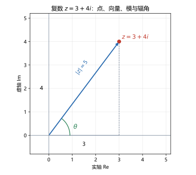
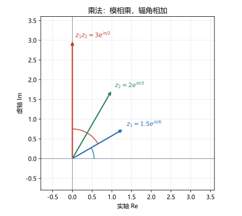

# 第 01 讲 复数：代数形式与几何表示

> **前置**：高中复数的四则运算（$i^2=-1$，$a+bi$ 的加减乘除）。模与辐角如果还有印象更好；忘了也没关系，本讲从头定义。
> **预计时间**：约 2.5 小时（含作业）。
> **本讲回答**：复数到底是什么？为什么乘法的模和辐角规则长这样？辐角主值为什么要限定区间？单连通和多连通差在哪？

## 本讲要解决什么

高中你学过 $i^2=-1$，也学过 $(a+bi)(c+di)$ 怎么展开。但那时复数更像一个记号：把两个实数绑在一起，按一套规则运算。

这一讲要把这个记号变成一张图。学完之后，你应该能做到：

- 看到 $z=a+bi$，立刻想到复平面上的点 $(a,b)$，而不是两个孤立的数；
- 说清 $|z|$ 和 $\arg z$ 是什么，为什么辐角有无穷多个、主值要限定区间；
- 不用展开就知道 $z_1z_2$ 的模等于模相乘、辐角等于辐角相加，并且能解释为什么；
- 会用棣莫弗公式算乘幂，会求一个复数的 $n$ 个 $n$ 次方根，并说出这些根在复平面上怎么排布；
- 认出开集、区域、单连通这些词，知道它们是第 06 讲柯西定理的前提。

---

## 1. 从"负数开方"到平面上的点

### 1.1 为什么需要 $i$

在实数范围内，方程

$$x^2+1=0$$

没有解。这不是因为我们不够聪明，而是因为任何实数的平方都非负。

数学上的处理是引入一个新数 $i$，规定

$$i^2=-1.$$

然后把形如

$$z=a+bi,\qquad a,b\in\mathbb R$$

的对象称为**复数**（complex number）。$a$ 叫**实部**（real part），记作 $\operatorname{Re}z$；$b$ 叫**虚部**（imaginary part），记作 $\operatorname{Im}z$。注意虚部是一个实数，不是 $bi$。

当 $b=0$ 时，$z=a$ 就是实数；当 $a=0$ 且 $b\ne0$ 时，$z=bi$ 叫**纯虚数**。

两个复数相等，当且仅当实部和虚部分别相等：

$$a+bi=c+di\iff a=c\ \text{且}\ b=d.$$

这条规则后面天天用：比较两个复数的实部虚部，是解复数方程的基本手段。

### 1.2 复数是一个数，不是两个数

一个容易卡住的问题：$3+4i$ 到底是一个数，还是两个数 $3$ 和 $4$ 拼在一起？

答案是：它是一个数。$3+4i$ 可以整体参与加法、乘法、除法，运算结果仍然是一个复数。它不能像实数那样比较大小，但这不妨碍它成为一个数。

**为什么复数不能比大小？** 因为不存在一种全序关系，能同时兼容加法和乘法。简单验证一下：

- 如果规定 $i>0$，两边同乘 $i$（正数乘不等式不改变方向），得到 $i^2>0$，即 $-1>0$，矛盾。
- 如果规定 $i<0$，那么 $-i>0$，两边平方得 $(-i)^2>0$，即 $-1>0$，同样矛盾。

所以 $i$ 与 $0$ 不能比大小，进而任意两个复数也不能比大小。这不是我们暂时没想到办法，而是这条路被堵死了。后面凡是需要"大小"的地方，用的都是模 $|z|$，它是一个非负实数。

### 1.3 复平面

既然复数由一对有序实数 $(a,b)$ 决定，就可以把它画在平面上：横轴表示实部，纵轴表示虚部。这个平面叫**复平面**（complex plane），横轴叫**实轴**，纵轴叫**虚轴**。

于是 $z=3+4i$ 对应平面上的点 $(3,4)$。从原点指向这个点的箭头，就是这个复数对应的**向量**。



**点与向量是同一个复数的两种看法**：

- 看成点：方便说"$z$ 在哪个区域""$z$ 离谁近"；
- 看成向量：方便说"加法是平行四边形法则""乘法是旋转加伸缩"。

这两种看法会贯穿整门课。遇到一个复变函数的问题，先问自己：现在该用点的眼光，还是向量的眼光？

### 1.4 加法就是向量加法

设 $z_1=a_1+b_1i$，$z_2=a_2+b_2i$，则

$$z_1+z_2=(a_1+a_2)+(b_1+b_2)i.$$

实部加实部，虚部加虚部。几何上，这就是把两个向量首尾相接，或者按平行四边形法则合成。

减法同理：$z_1-z_2$ 对应从 $z_2$ 指向 $z_1$ 的向量。因此 $|z_1-z_2|$ 就是两点之间的距离。这个事实后面判断"点集是不是开集"时会反复用到。

---

## 2. 模与辐角：给点定位的两种坐标

### 2.1 模

复数 $z=a+bi$ 到原点的距离叫**模**（modulus），记作 $|z|$：

$$|z|=\sqrt{a^2+b^2}.$$

模是非负实数，$|z|=0$ 当且仅当 $z=0$。

模有两条常用性质：

$$|z_1z_2|=|z_1|\,|z_2|,\qquad \left|\frac{z_1}{z_2}\right|=\frac{|z_1|}{|z_2|}\quad(z_2\ne0).$$

这两条现在可以先记住，第 5 节会用三角形式证明。

还有**三角不等式**：

$$\bigl\lvert\,\lvert z_1\rvert-\lvert z_2\rvert\,\bigr\rvert\le\lvert z_1+z_2\rvert\le\lvert z_1\rvert+\lvert z_2\rvert.$$

右边是"两边之和大于第三边"，左边是"两边之差小于第三边"，都是平面几何里的三角形不等式，只是换成了复数的写法。

**数值核对**（脚本 `scripts/lec01-01_verify_complex_algebra.py`，EXP6）：取 $z_1=3+4i$，$z_2=1-2i$，则

$$\lvert z_1+z_2\rvert=4.472136,\qquad \bigl\lvert\,\lvert z_1\rvert-\lvert z_2\rvert\,\bigr\rvert=2.763932,\qquad \lvert z_1\rvert+\lvert z_2\rvert=7.236068.$$

$4.472$ 确实落在 $2.764$ 和 $7.236$ 之间。

### 2.2 辐角

从正实轴转到向量 $z$ 的角度叫**辐角**（argument），记作 $\arg z$。

因为转一整圈 $2\pi$ 会回到同一个方向，辐角不唯一：如果 $\theta$ 是一个辐角，那么

$$\theta+2k\pi,\qquad k\in\mathbb Z$$

都是辐角。所以 $\arg z$ 严格说是一个集合：

$$\arg z=\{\operatorname{Arg}z+2k\pi:k\in\mathbb Z\}.$$

其中落在区间 $(-\pi,\pi]$ 内的那一个，叫**辐角主值**（principal value），记作 $\operatorname{Arg}z$。

**口径声明**：本课程统一取 $\operatorname{Arg}z\in(-\pi,\pi]$。有些教材取 $[0,2\pi)$，两者只差 $2\pi$ 的整数倍，性质完全一样，但做题时要跟教材统一。本课程从这一讲起固定用 $(-\pi,\pi]$。

几个必须记牢的值：

| $z$ | $1$ | $i$ | $-1$ | $-i$ |
|---|---|---|---|---|
| $\operatorname{Arg}z$ | $0$ | $\pi/2$ | $\pi$ | $-\pi/2$ |

特别注意 $\operatorname{Arg}(-1)=\pi$，不是 $-\pi$。因为主值区间是 $(-\pi,\pi]$，右端点是闭的，$\pi$ 取得到，$-\pi$ 取不到。

**数值核对**（EXP7）：

| $z$ | $\operatorname{Arg}z$（弧度） | 角度 |
|---|---|---|
| $1+i$ | $0.785398$ | $45^\circ$ |
| $-1+i$ | $2.356194$ | $135^\circ$ |
| $-1-i$ | $-2.356194$ | $-135^\circ$ |
| $1-i$ | $-0.785398$ | $-45^\circ$ |
| $-1$ | $3.141593$ | $180^\circ$ |

$z=0$ 的辐角没有定义，因为零向量没有方向。这一点在除法、对数、幂函数里都会冒出来，要养成习惯：**先看是不是零**。

### 2.3 模与辐角合起来确定一个复数

给定 $r=|z|\ge0$ 和 $\theta=\arg z$，复数就唯一确定了（$r=0$ 时 $\theta$ 任意）：

$$a=r\cos\theta,\qquad b=r\sin\theta.$$

所以

$$z=r(\cos\theta+i\sin\theta).$$

这就是**三角形式**。它和代数形式 $z=a+bi$ 描述同一个点，只是坐标系统不同：代数形式用直角坐标，三角形式用极坐标。

---

## 3. 共轭：把虚部翻个号

### 3.1 定义

复数 $z=a+bi$ 的**共轭**（conjugate）记作 $\bar z$，定义为

$$\bar z=a-bi.$$

几何上，$\bar z$ 是 $z$ 关于实轴的对称点。

### 3.2 四条常用性质

$$\overline{z_1\pm z_2}=\bar z_1\pm\bar z_2,$$

$$\overline{z_1z_2}=\bar z_1\,\bar z_2,\qquad \overline{\left(\frac{z_1}{z_2}\right)}=\frac{\bar z_1}{\bar z_2},$$

$$z\bar z=|z|^2,$$

$$\operatorname{Re}z=\frac{z+\bar z}{2},\qquad \operatorname{Im}z=\frac{z-\bar z}{2i}.$$

前三条说明共轭与四则运算可以交换次序：先算再共轭，等于先共轭再算。第四条最有用，它把模的平方变成了一个没有根号的复数乘积。

### 3.3 用共轭做除法

复数的除法不引入新规则，而是把分母变成实数：

$$\frac{z_1}{z_2}=\frac{z_1\bar z_2}{z_2\bar z_2}=\frac{z_1\bar z_2}{|z_2|^2}.$$

**例 1.1** 计算 $\dfrac{3+4i}{1-2i}$。

分子分母同乘 $1+2i$：

$$\frac{(3+4i)(1+2i)}{(1-2i)(1+2i)}=\frac{3+6i+4i+8i^2}{1+4}=\frac{-5+10i}{5}=-1+2i.$$

**数值核对**（EXP1）：脚本输出 `z1 / z2 = (-1+2j)`，与手算一致。再把结果乘回 $z_2$：

$$(-1+2i)(1-2i)=-1+2i+2i-4i^2=-1+4i+4=3+4i,$$

回到 $z_1$，除法正确。

---

## 4. 乘法：这一讲的核心

### 4.1 先按代数形式展开

$$(a+bi)(c+di)=ac+adi+bci+bdi^2=(ac-bd)+(ad+bc)i.$$

这条公式你高中就会。但它只告诉你"怎么算"，不告诉你"为什么长这样"。下面用三角形式看。

### 4.2 三角形式：模相乘，辐角相加

设

$$z_1=r_1(\cos\theta_1+i\sin\theta_1),\qquad z_2=r_2(\cos\theta_2+i\sin\theta_2).$$

相乘并整理：

$$
\begin{aligned}
z_1z_2
&=r_1r_2\bigl[(\cos\theta_1\cos\theta_2-\sin\theta_1\sin\theta_2)\\
&\qquad\qquad +i(\sin\theta_1\cos\theta_2+\cos\theta_1\sin\theta_2)\bigr].
\end{aligned}
$$

括号里的两项正好是和角公式：

$$\cos(\theta_1+\theta_2)=\cos\theta_1\cos\theta_2-\sin\theta_1\sin\theta_2,$$

$$\sin(\theta_1+\theta_2)=\sin\theta_1\cos\theta_2+\cos\theta_1\sin\theta_2.$$

所以

$$z_1z_2=r_1r_2\bigl[\cos(\theta_1+\theta_2)+i\sin(\theta_1+\theta_2)\bigr].$$

这就是结论：

> **两个复数相乘，模相乘，辐角相加。**



图里 $z_1=1.5e^{i\pi/6}$，$z_2=2e^{i\pi/3}$，乘积是 $3e^{i\pi/2}$。模从 $1.5$ 和 $2$ 变成 $3$，辐角从 $\pi/6$ 和 $\pi/3$ 变成 $\pi/2$。蓝色弧是 $z_1$ 的辐角，红色弧是从 $z_1$ 再转到乘积的增量，两段加起来正好是 $\pi/2$。

### 4.3 这个结论能推出什么

**乘以 $i$ 等于逆时针转 $90^\circ$。** 因为 $i=e^{i\pi/2}$，模为 $1$，辐角为 $\pi/2$。所以 $iz$ 的模不变，辐角加 $\pi/2$。例如 $i(1)=i$，$i(i)=-1$，$i(-1)=-i$，四次回到原位。

**乘以正实数只伸缩不旋转。** 正实数的辐角为 $0$，所以只改变模。

**乘以 $-1$ 等于转 $180^\circ$。** $-1=e^{i\pi}$。

**乘法满足交换律。** 模相乘、辐角相加都不依赖顺序，所以 $z_1z_2=z_2z_1$。这从代数展开也能看出来，但几何解释更直接。

### 4.4 除法

由乘法规则反推：$z_1/z_2$ 的模是 $r_1/r_2$，辐角是 $\theta_1-\theta_2$。写成公式：

$$\frac{z_1}{z_2}=\frac{r_1}{r_2}\bigl[\cos(\theta_1-\theta_2)+i\sin(\theta_1-\theta_2)\bigr].$$

**例 1.2** 用几何意义核对例 1.1。$z_1=3+4i$ 的模为 $5$，辐角约 $0.9273$；$z_2=1-2i$ 的模为 $\sqrt5\approx2.2361$，辐角约 $-1.1071$。商：

- 模：$5/\sqrt5=\sqrt5\approx2.2361$；
- 辐角：$0.9273-(-1.1071)=2.0344$。

而 $-1+2i$ 的模是 $\sqrt{1+4}=\sqrt5$，辐角是 $\pi-\arctan2\approx2.0344$。与手算结果 $-1+2i$ 一致。

**数值核对**（EXP2）：脚本输出

```
|z1| * |z2| = 11.180340, |z1*z2| = 11.180340
arg z1 + arg z2 = -0.179853 rad, arg(z1*z2) = -0.179853 rad
```

两个模完全相等，两个辐角相差 $5.551\times10^{-17}$ 弧度，这是浮点舍入误差，不是理论误差。

### 4.5 电路里的 $j$

电路课习惯把虚数单位写成 $j$，原因是 $i$ 已经用来表示电流。$j$ 和 $i$ 是同一个数：

$$j=i,\qquad j^2=-1.$$

所以电路里的阻抗 $Z=R+jX$ 就是本讲的复数 $R+Xi$。串联阻抗相加，就是复数相加；并联阻抗的公式

$$Z=\frac{Z_1Z_2}{Z_1+Z_2}$$

就是复数乘除法。你在电路课里用的那套运算，和本讲完全一致，只是换了字母。

---

## 5. 指数形式与欧拉公式

### 5.1 欧拉公式

定义

$$e^{i\theta}=\cos\theta+i\sin\theta.$$

这就是**欧拉公式**（Euler's formula）。于是三角形式可以写成更紧凑的**指数形式**：

$$z=re^{i\theta},\qquad r=|z|,\ \theta=\arg z.$$

**这里需要说明**：欧拉公式为什么成立、$e^z$ 对复数怎么定义，第 04 讲会完整讲。现在你只需要把它当成"单位圆上辐角为 $\theta$ 的点的另一种写法"。它带来的最大好处是：乘法规则变成了指数相加，

$$r_1e^{i\theta_1}\cdot r_2e^{i\theta_2}=r_1r_2e^{i(\theta_1+\theta_2)},$$

和实数的指数运算法则完全一致。

### 5.2 三种形式的转换

| 形式 | 写法 | 什么时候好用 |
|---|---|---|
| 代数形式 | $a+bi$ | 加减法、比较实部虚部 |
| 三角形式 | $r(\cos\theta+i\sin\theta)$ | 需要看清模和辐角时 |
| 指数形式 | $re^{i\theta}$ | 乘除、乘幂、开方 |

转换的关键是两个公式：

$$r=\sqrt{a^2+b^2},\qquad \tan\theta=\frac{b}{a}.$$

用 $\tan\theta=b/a$ 求 $\theta$ 时，必须结合 $a,b$ 的符号判断象限，不能只按计算器。例如 $a=-1,b=-1$ 时 $\tan\theta=1$，但 $\theta$ 在第三象限，应该是 $-3\pi/4$，不是 $\pi/4$。

**例 1.3** 把 $z=1-i$ 写成指数形式。

$r=\sqrt{1+1}=\sqrt2$。点在第四象限，$\theta=-\pi/4$。所以

$$z=\sqrt2\,e^{-i\pi/4}.$$

验算：$\sqrt2(\cos(-\pi/4)+i\sin(-\pi/4))=\sqrt2(\frac{\sqrt2}{2}-i\frac{\sqrt2}{2})=1-i$，正确。

### 5.3 共轭的指数写法

若 $z=re^{i\theta}$，则

$$\bar z=re^{-i\theta}.$$

因为共轭只把虚部翻号，模不变，辐角取相反数。

---

## 6. 乘幂与方根

### 6.1 棣莫弗公式

对 $z=re^{i\theta}$ 连续乘 $n$ 次，模乘 $n$ 次，辐角加 $n$ 次：

$$z^n=r^n e^{in\theta}=r^n(\cos n\theta+i\sin n\theta).$$

取 $r=1$，得到**棣莫弗公式**（de Moivre's formula）：

$$(\cos\theta+i\sin\theta)^n=\cos n\theta+i\sin n\theta,\qquad n\in\mathbb Z.$$

**数值核对**（EXP4）：取 $z=2e^{i\pi/6}$，$n=5$。脚本输出

```
z^5 = -27.712813+16.000000j
2^5 * exp(i*5*pi/6) = -27.712813+16.000000j
```

两边逐位一致。手算也能核对：$2^5=32$，$5\pi/6=150^\circ$，$32\cos150^\circ=-27.7128$，$32\sin150^\circ=16$。

### 6.2 方根：为什么有 $n$ 个

求 $w$ 使 $w^n=z$。设 $z=re^{i\theta}$，$w=\rho e^{i\varphi}$，则

$$\rho^n e^{in\varphi}=re^{i\theta}.$$

模必须相等：$\rho^n=r$，所以 $\rho=r^{1/n}$（取正实根）。辐角满足

$$n\varphi=\theta+2k\pi,\qquad k\in\mathbb Z,$$

即

$$\varphi=\frac{\theta+2k\pi}{n}.$$

$k$ 取 $0,1,\dots,n-1$ 时，得到 $n$ 个不同的辐角；再往后就重复了。所以

$$w_k=r^{1/n}\exp\left(i\frac{\theta+2k\pi}{n}\right),\qquad k=0,1,\dots,n-1.$$

**几何图景**：这 $n$ 个根均匀分布在以原点为圆心、半径为 $r^{1/n}$ 的圆上，相邻两个根的夹角是 $2\pi/n$。它们构成一个正 $n$ 边形的顶点。

**例 1.4** 求 $z^3=1$ 的全部根。

$1=1\cdot e^{i0}$，所以 $r=1,\theta=0$，三个根为

$$w_0=1,\qquad w_1=e^{i2\pi/3}=-\frac12+\frac{\sqrt3}{2}i,\qquad w_2=e^{i4\pi/3}=-\frac12-\frac{\sqrt3}{2}i.$$

三个点构成复平面上的正三角形。

**例 1.5** 求 $z^2=3+4i$ 的全部根。

$|3+4i|=5$，所以根的模是 $\sqrt5$。辐角 $\theta=\arctan(4/3)\approx0.9273$，半角为 $0.4636$。于是

$$w_0=\sqrt5\,e^{i0.4636},\qquad w_1=-w_0.$$

用半角公式精确算：

$$\cos\frac{\theta}{2}=\sqrt{\frac{1+\cos\theta}{2}}=\sqrt{\frac{1+3/5}{2}}=\sqrt{0.8},$$

$$\sin\frac{\theta}{2}=\sqrt{\frac{1-\cos\theta}{2}}=\sqrt{\frac{1-3/5}{2}}=\sqrt{0.2}.$$

而 $\sqrt5\cdot\sqrt{0.8}=\sqrt4=2$，$\sqrt5\cdot\sqrt{0.2}=\sqrt1=1$，所以

$$w_0=2+i,\qquad w_1=-2-i.$$

验算：$(2+i)^2=4+4i+i^2=3+4i$，正确。

**数值核对**（EXP5）：求 $32e^{i\pi/6}$ 的五个五次方根，脚本输出的五个根的模全是 $2.000000$，每个根的五次方都等于 $27.712813+16.000000j$，即原数。

---

## 7. 复平面上的点集：为柯西定理做准备

这一节看起来和计算无关，但第 06 讲柯西积分定理的条件会直接用到。先把词认全。

### 7.1 邻域

点 $z_0$ 的 $\delta$-**邻域**（neighborhood）是

$$U(z_0,\delta)=\{z:|z-z_0|<\delta\},$$

也就是以 $z_0$ 为圆心、$\delta$ 为半径的开圆盘（不含圆周）。

**去心邻域**是 $0<|z-z_0|<\delta$，把圆心挖掉。

### 7.2 开集与闭集

设 $D$ 是复平面上的点集。

- 如果 $D$ 中每一点都有一个完全含在 $D$ 内的邻域，称 $D$ 是**开集**（open set）。
- 如果 $D$ 的补集是开集，称 $D$ 是**闭集**（closed set）。

直观判断：开集不包含自己的边界，闭集包含边界。

- $\{z:|z|<1\}$ 是开集，圆周 $|z|=1$ 上的点不属于它；
- $\{z:|z|\le1\}$ 是闭集；
- $\{z:|z|<1\}\cup\{z:|z|=1\}$ 也是闭集，它其实等于 $\{z:|z|\le1\}$。

### 7.3 连通与区域

如果 $D$ 中任意两点都能用一条完全落在 $D$ 内的折线连起来，称 $D$ 是**连通的**（connected）。

**区域**（domain）的定义是：连通的非空开集。

- $\{z:|z|<1\}$ 是区域；
- 两个不相交的开圆盘并在一起，不是区域，因为不连通。

### 7.4 单连通与多连通

这是本讲最重要的拓扑概念。

如果区域 $D$ 内任意一条简单闭曲线，都能在 $D$ 内连续收缩为一点，称 $D$ 是**单连通**（simply connected）的；否则称**多连通**（multiply connected）。

直观判断：

- 圆盘、上半平面、整个复平面都是单连通的；
- 圆环 $\{z:1<|z|<2\}$ 是多连通的，因为绕中间空洞的闭曲线收缩不过去；
- 去掉原点的复平面 $\mathbb C\setminus\{0\}$ 也是多连通的。

这里说的"洞"，就是区域里没有包含进来的部分。判断单连通，数洞的个数：没有洞就是单连通，有洞就是多连通。

**为什么现在要学这个？** 第 06 讲的柯西积分定理说："函数在单连通区域内解析，则沿区域内任意闭曲线的积分为零。"如果区域有洞，结论可能不成立。第 05 讲会算出一个例子：

$$\oint_{|z|=1}\frac{dz}{z}=2\pi i\ne0.$$

被积函数 $\frac1z$ 在 $z=0$ 没有定义，而 $z=0$ 正好是 $|z|<1$ 这个圆盘的中心。圆盘本身是单连通的，但函数在洞（原点）处不解析，所以柯西定理用不了。到时候你会看到，"单连通"和"函数在区域内解析"这两个条件是配套的。

---

## 8. 本讲小结

| 概念 | 定义 | 几何意义 | 用在哪 |
|---|---|---|---|
| 复数 $z=a+bi$ | 一对有序实数 | 复平面上的点或向量 | 全课程 |
| 模 $\lvert z\rvert$ | $\sqrt{a^2+b^2}$ | 到原点的距离 | 三角不等式、收敛半径 |
| 辐角 $\arg z$ | 多值，相差 $2k\pi$ | 与正实轴的夹角 | 乘法、对数、幂函数 |
| 主值 $\operatorname{Arg}z$ | 取 $(-\pi,\pi]$ | 唯一的那个角 | 计算、分支切割 |
| 共轭 $\bar z$ | $a-bi$ | 关于实轴对称 | 除法、模的平方 |
| 乘法 | 模相乘、辐角相加 | 旋转加伸缩 | 乘幂、方根 |
| 指数形式 $re^{i\theta}$ | 欧拉公式 | 极坐标 | 乘除、开方 |
| 区域 | 连通开集 | 一块没有孤立点的地盘 | 解析、积分 |
| 单连通 | 无洞 | 闭曲线可收缩为点 | 柯西定理 |

三句话带走：

1. 复数是平面上的点，不是两个数拼起来的记号。
2. 乘法的全部几何内容就是"模相乘、辐角相加"，乘以 $i$ 就是转 $90^\circ$。
3. 辐角的多值性现在就记住，第 04 讲讲复对数时会正式处理。

---

## 9. 掌握度自测

能全部打勾，再去做作业：

- [ ] 能把 $a+bi$ 和 $r(\cos\theta+i\sin\theta)$ 互相转换，并说出 $\theta$ 在哪个象限。
- [ ] 能说出 $\operatorname{Arg}(-1)$ 为什么是 $\pi$ 而不是 $-\pi$。
- [ ] 能不展开就判断 $z_1z_2$ 的模和辐角。
- [ ] 能解释为什么复数不能比大小。
- [ ] 能用共轭把分母实数化。
- [ ] 能写出棣莫弗公式，并说出它为什么成立。
- [ ] 能说出 $z^n=w$ 为什么有 $n$ 个根，以及它们在复平面上怎么排布。
- [ ] 能判断一个点集是开集还是闭集，是单连通还是多连通。

---

## 作业

### 基础

**1.** 把 $z=1-i$ 写成三角形式与指数形式，并写出 $|z|$ 与 $\operatorname{Arg}z$。

**参考答案：**

$|z|=\sqrt{1^2+(-1)^2}=\sqrt2$。点在第四象限，$\operatorname{Arg}z=-\pi/4$。

三角形式：$z=\sqrt2\left(\cos\frac{\pi}{4}-i\sin\frac{\pi}{4}\right)$。

指数形式：$z=\sqrt2\,e^{-i\pi/4}$。

验算：$\sqrt2(\frac{\sqrt2}{2}-i\frac{\sqrt2}{2})=1-i$。

---

**2.** 计算 $(1+i)(2-3i)$ 与 $\dfrac{1+i}{1-i}$。

**参考答案：**

$$(1+i)(2-3i)=2-3i+2i-3i^2=2-i+3=5-i.$$

$$\frac{1+i}{1-i}=\frac{(1+i)^2}{(1-i)(1+i)}=\frac{1+2i+i^2}{2}=\frac{2i}{2}=i.$$

验算：$i(1-i)=i-i^2=i+1=1+i$。

---

**3.** 计算 $(1+i)^8$。

**参考答案：**

$1+i=\sqrt2\,e^{i\pi/4}$，所以

$$(1+i)^8=(\sqrt2)^8e^{i8\pi/4}=16e^{i2\pi}=16.$$

验算：$(1+i)^2=2i$，$(2i)^4=16i^4=16$。

---

**4.** 求 $z^3=1$ 的全部根，并画在复平面上。

**参考答案：**

三个根为

$$1,\qquad -\frac12+\frac{\sqrt3}{2}i,\qquad -\frac12-\frac{\sqrt3}{2}i.$$

它们均匀分布在单位圆上，相邻夹角 $2\pi/3$，构成正三角形。

验算：$(-\frac12+\frac{\sqrt3}{2}i)^2=\frac14-\frac{\sqrt3}{2}i-\frac34=-\frac12-\frac{\sqrt3}{2}i$，再乘一次得 $1$。

---

### 提高

**5.** 证明平行四边形恒等式

$$|z_1+z_2|^2+|z_1-z_2|^2=2\left(|z_1|^2+|z_2|^2\right),$$

并说明它的几何意义。

**参考答案：**

用 $|w|^2=w\bar w$ 展开：

$$|z_1+z_2|^2=(z_1+z_2)(\bar z_1+\bar z_2)=|z_1|^2+z_1\bar z_2+\bar z_1z_2+|z_2|^2,$$

$$|z_1-z_2|^2=(z_1-z_2)(\bar z_1-\bar z_2)=|z_1|^2-z_1\bar z_2-\bar z_1z_2+|z_2|^2.$$

两式相加，交叉项抵消，得 $2(|z_1|^2+|z_2|^2)$。

几何意义：平行四边形两条对角线的平方和，等于四条边的平方和。这里对角线对应 $z_1+z_2$ 与 $z_1-z_2$，四条边对应 $|z_1|,|z_2|$ 各两次。

---

**6.** 已知 $|z|=2$，$\operatorname{Arg}z=\pi/3$，求 $z^4$ 的代数形式。

**参考答案：**

$z=2e^{i\pi/3}$，所以

$$z^4=2^4e^{i4\pi/3}=16\left(\cos\frac{4\pi}{3}+i\sin\frac{4\pi}{3}\right)=16\left(-\frac12-\frac{\sqrt3}{2}i\right)=-8-8\sqrt3\,i.$$

验算：$4\pi/3$ 在第三象限，实部虚部都为负，与结果一致。

---

**7.** 判断下列点集是开集还是闭集，是否连通，是否单连通：

(1) $\{z:|z-1|<1\}$；(2) $\{z:1<|z|<2\}$；(3) $\{z:\operatorname{Im}z>0\}$。

**参考答案：**

(1) 开集（不包含圆周），连通，单连通。它是圆盘，没有洞。

(2) 开集（两个边界圆都不包含），连通，多连通。中间有一个洞 $|z|\le1$。

(3) 开集，连通，单连通。上半平面没有洞，任意闭曲线都能向上收缩。

---

**8.** 用棣莫弗公式证明三倍角公式

$$\cos3\theta=4\cos^3\theta-3\cos\theta.$$

**参考答案：**

由棣莫弗公式，

$$(\cos\theta+i\sin\theta)^3=\cos3\theta+i\sin3\theta.$$

左边按二项式展开：

$$\cos^3\theta+3i\cos^2\theta\sin\theta-3\cos\theta\sin^2\theta-i\sin^3\theta.$$

比较实部：

$$\cos3\theta=\cos^3\theta-3\cos\theta\sin^2\theta=\cos^3\theta-3\cos\theta(1-\cos^2\theta)=4\cos^3\theta-3\cos\theta.$$

---

### 综合

**9.** 求所有满足 $z^2=3+4i$ 的 $z$，并用乘法验算。

**参考答案：**

$|3+4i|=5$，$\operatorname{Arg}(3+4i)=\arctan(4/3)\approx0.9273$。两个根的模为 $\sqrt5$，辐角为 $\pm0.4636$。

用半角公式：$\cos(\theta/2)=\sqrt{0.8}$，$\sin(\theta/2)=\sqrt{0.2}$，所以

$$z_0=\sqrt5(\sqrt{0.8}+i\sqrt{0.2})=2+i,\qquad z_1=-2-i.$$

验算：$(2+i)^2=4+4i+i^2=3+4i$；$(-2-i)^2=(2+i)^2=3+4i$。

---

**10.** 证明：若 $|z|=1$，则 $z+\dfrac1z$ 是实数。

**参考答案：**

$|z|=1$ 意味着 $z\bar z=1$，所以 $\dfrac1z=\bar z$。于是

$$z+\frac1z=z+\bar z=2\operatorname{Re}z,$$

这是实数。

几何解释：单位圆上的点与其共轭关于实轴对称，两者之和落在实轴上。

---

**11.** 两个阻抗 $Z_1=3+4j\ \Omega$ 与 $Z_2=1-2j\ \Omega$ 串联，求总阻抗 $Z=Z_1+Z_2$ 的模与辐角。

**参考答案：**

$$Z=(3+1)+(4-2)j=4+2j\ \Omega.$$

$$|Z|=\sqrt{4^2+2^2}=\sqrt{20}=4.4721\ \Omega,$$

$$\operatorname{Arg}Z=\arctan\frac{2}{4}\approx0.4636\ \text{rad}\approx26.57^\circ.$$

验算：$4.4721\cos26.57^\circ\approx4.000$，$4.4721\sin26.57^\circ\approx2.000$，回到 $4+2j$。

这里只需要把阻抗当成复数做加法；阻抗的物理含义、为什么用复数表示，第 26 讲会讲。

---

## 下一讲预告

这一讲我们把复数看成了平面上的点。下一讲要更进一步：让点动起来，考虑函数 $w=f(z)$。一个复变函数会把 $z$ 平面上的区域映成 $w$ 平面上的区域，这种"映射"怎么画、怎么理解，以及极限为什么要求"从任何方向逼近都一样"，是第 02 讲的内容。
