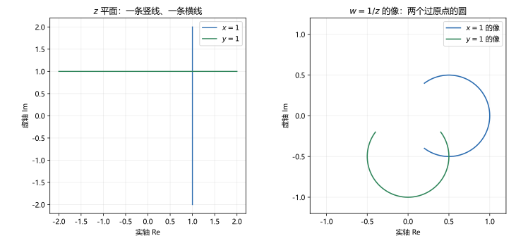
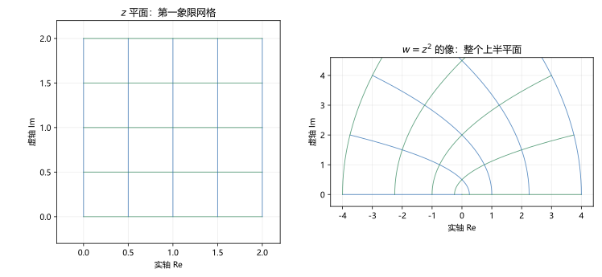

# 第 02 讲 复变函数与映射：极限与连续

> **前置**：第 01 讲（复数、复平面、模与辐角、邻域、开集与区域）。
> **预计时间**：约 2.5 小时（含作业）。
> **本讲回答**：复变函数到底是什么？画不出三维图像怎么理解它？极限为什么要求"路径无关"？连续和极限差在哪？为什么 $\operatorname{Arg}z$ 在负实轴上有断点？

## 本讲要解决什么

第 01 讲把复数看成了平面上的点。这一讲让点动起来：一个复变函数 $w=f(z)$ 把 $z$ 平面上的点送到 $w$ 平面上的点，把一块区域送到另一块区域。

学完之后，你应该能做到：

- 把任意一个复变函数拆成两个二元实函数 $u(x,y)$、$v(x,y)$，并说出它们各自是什么；
- 不画三维图像，也能用网格变形看出一个映射把区域送到了哪里；
- 写出复变函数极限的 $\varepsilon$-$\delta$ 定义，并解释"路径无关"比实函数的左右极限强在哪里；
- 用两条路径证明一个极限不存在；
- 判断一个函数在哪些点连续，特别能说清 $\operatorname{Arg}z$ 为什么在负实轴上不连续。

---

## 1. 复变函数：输入一个复数，输出一个复数

### 1.1 定义

设 $D$ 是复平面上的一个点集。如果对 $D$ 中每一个复数 $z$，按照某个规则 $f$，都有唯一确定的复数 $w$ 与之对应，就说 $f$ 是定义在 $D$ 上的**复变函数**（complex function），记作

$$w=f(z),\qquad z\in D.$$

$z$ 叫自变量，$w$ 叫因变量，$D$ 叫定义域。

几个例子：

- $f(z)=z^2$，定义域是整个复平面；
- $f(z)=\dfrac{1}{z}$，定义域是 $\mathbb C\setminus\{0\}$；
- $f(z)=\bar z$，定义域是整个复平面；
- $f(z)=|z|$，定义域是整个复平面，但取值是非负实数。

**注意**：这里只讨论**单值函数**，即每个 $z$ 只对应一个 $w$。像 $\arg z$ 这种一个 $z$ 对应无穷多个值的，叫多值函数，第 04 讲会专门处理。本讲出现的 $\operatorname{Arg}z$ 是取了主值之后的单值分支。

### 1.2 拆成两个二元实函数

设 $z=x+iy$，$w=u+iv$，其中 $x,y,u,v$ 都是实数。那么

$$f(z)=u(x,y)+iv(x,y).$$

也就是说，一个复变函数等价于一对二元实函数：

$$u=u(x,y)=\operatorname{Re}f(z),\qquad v=v(x,y)=\operatorname{Im}f(z).$$

**例 2.1** 把 $f(z)=z^2$ 拆开。

$$z^2=(x+iy)^2=x^2-y^2+2xy\,i.$$

所以

$$u(x,y)=x^2-y^2,\qquad v(x,y)=2xy.$$

**例 2.2** 把 $f(z)=\dfrac1z$ 拆开（$z\ne0$）。

$$\frac1z=\frac{1}{x+iy}=\frac{x-iy}{x^2+y^2}.$$

所以

$$u(x,y)=\frac{x}{x^2+y^2},\qquad v(x,y)=-\frac{y}{x^2+y^2}.$$

**例 2.3** 把 $f(z)=\bar z$ 拆开。

$$\bar z=x-iy,$$

所以 $u=x$，$v=-y$。

**这有什么用？** 复变函数的很多性质（极限、连续、可导）都可以翻译成 $u,v$ 的性质。翻译之后，问题就变成了你熟悉的高数问题。第 03 讲的柯西-黎曼条件就是这么来的。

**但要注意**：$u$ 和 $v$ 不是两个独立的函数，它们由同一个 $f$ 绑在一起。随便拿两个二元函数拼成 $u+iv$，不一定来自一个"好"的复变函数。第 03 讲会给出这个"绑在一起"的精确条件。

### 1.3 为什么画不出图像

实函数 $y=f(x)$ 的图像是平面上的一条曲线，二元实函数 $z=f(x,y)$ 的图像是空间中的一张曲面。

复变函数 $w=f(z)$ 需要两个实变量 $x,y$ 确定输入，又输出两个实数 $u,v$，一共四个实维度。我们画不出四维图像。

所以复变函数不能靠"看曲线"来理解。替代办法是：**看它把 $z$ 平面上的图形变成了 $w$ 平面上的什么图形**。这就是下一节的映射。

---

## 2. 映射：用网格看函数

### 2.1 两种平面

把 $z=x+iy$ 所在的原平面叫 **$z$ 平面**，把 $w=u+iv$ 所在的平面叫 **$w$ 平面**。复变函数 $w=f(z)$ 就是从 $z$ 平面的一块区域到 $w$ 平面的一块区域的**映射**（mapping）。

具体做法：

1. 在 $z$ 平面上画一组网格线（例如 $x=0,0.5,1,\dots$ 和 $y=0,0.5,1,\dots$）；
2. 把每条网格线按 $w=f(z)$ 映到 $w$ 平面；
3. 看像的形状、方向、疏密。

网格的变形能透露很多信息：哪里被拉伸、哪里被压缩、哪里角度不变、哪里发生折叠。

### 2.2 四个基本映射

这四个映射后面会反复出现，先把它们的几何效果记住。

**平移** $w=z+a$。所有点朝同一个方向移动同样的距离。网格整体平移，形状不变。

**旋转与伸缩** $w=az$，$a\ne0$。设 $a=\rho e^{i\varphi}$，则

$$w=\rho e^{i\varphi}\cdot re^{i\theta}=\rho r\,e^{i(\theta+\varphi)}.$$

模乘以 $\rho$，辐角加 $\varphi$。所以整个平面绕原点旋转 $\varphi$，再以原点为中心伸缩 $\rho$ 倍。

**反演** $w=\dfrac1z$。设 $z=re^{i\theta}$，则

$$w=\frac1r e^{-i\theta}.$$

模取倒数，辐角变号。单位圆内的点跑到单位圆外，圆外的点跑到圆内，辐角关于实轴翻转。

反演有一个漂亮的几何性质：**直线映成圆（或直线），圆映成圆（或直线）**。图 2 是一条竖线和一条横线的像：两条直线都变成了过原点的圆。



图中 $x=1$ 的像是圆心在 $(1/2,0)$、半径为 $1/2$ 的圆；$y=1$ 的像是圆心在 $(0,-1/2)$、半径为 $1/2$ 的圆。两个圆都经过原点。图中只画了线段 $y\in[-2,2]$，所以圆只出现一段；线段向两端无限延伸时，像会闭合到原点。

**共轭** $w=\bar z$。关于实轴翻折。它把上半平面映到下半平面，把逆时针方向变成顺时针。

### 2.3 例：$w=z^2$ 把第一象限张满上半平面

设 $z=re^{i\theta}$，则

$$w=z^2=r^2e^{2i\theta}.$$

- 模平方：$|w|=r^2$；
- 辐角加倍：$\arg w=2\theta$。

如果 $z$ 在第一象限，$\theta\in(0,\pi/2)$，那么 $2\theta\in(0,\pi)$，正好是上半平面。所以 $z^2$ 把第一象限映成整个上半平面。



图中左边是第一象限的方格网，右边是它的像。可以看到：

- 整个第一象限被展开成上半平面：$z$ 平面里张角 $90^\circ$ 的扇形，像里张角变成 $180^\circ$；
- 但在原点以外的每个交点处，两条网格线的夹角仍然是 $90^\circ$。这是保角性，第 15 讲会证明；
- 靠近原点的格子被压得很小，远离原点的格子被拉得很大。

这里要区分两件事："张角加倍"说的是从原点出发的射线方向角 $\theta\to2\theta$；"保角"说的是任意两条曲线在交点处的夹角不变。两者不矛盾：原点是 $f'(0)=0$ 的特殊点，只有在那里角度才被放大；在 $z\ne0$ 处，局部夹角保持不变。

### 2.4 映射的眼光有什么用

后面几乎每个概念都能用映射解释：

- 解析函数是"局部看起来像旋转加伸缩"的映射（第 03、15 讲）；
- 分式线性映射把圆映成圆，用来把复杂区域化成标准区域（第 15、16 讲）；
- 保角映射在电磁场里用来把难算的边界化成好算的边界（第 28 讲）。

现在先建立"函数就是搬东西"的意识，不要只把它当成一条公式。

---

## 3. 极限：所有路径必须给同一个答案

### 3.1 定义

设函数 $f$ 在 $z_0$ 的某个去心邻域内有定义。如果存在复数 $A$，使得对任意给定的 $\varepsilon>0$，都存在 $\delta>0$，当

$$0<|z-z_0|<\delta$$

时，恒有

$$|f(z)-A|<\varepsilon,$$

就说当 $z$ 趋于 $z_0$ 时 $f(z)$ 的**极限**是 $A$，记作

$$\lim_{z\to z_0}f(z)=A.$$

逐字对照：

- $\varepsilon$ 是"你要求的误差范围"，由对方给出；
- $\delta$ 是"我找到的靠近程度"，由我给出；
- $0<|z-z_0|$ 表示 $z\ne z_0$，即**去心**：函数在 $z_0$ 本身有没有定义、取什么值，都不影响极限；
- $|f(z)-A|<\varepsilon$ 表示函数值落进以 $A$ 为圆心、$\varepsilon$ 为半径的圆盘。

这个定义和实函数极限的形式一模一样，唯一的区别是绝对值变成了复数的模，而 $z\to z_0$ 可以来自平面上的任何方向。

### 3.2 路径无关：比左右极限强得多

实函数 $x\to x_0$ 只有两个方向：从左边来，从右边来。所以实函数极限存在，等价于左极限和右极限都存在且相等。

复平面上，$z\to z_0$ 有**无穷多条路径**：沿实轴来、沿虚轴来、沿任何一条曲线来。极限存在，要求**所有路径**都给出同一个 $A$。

这就带来一个重要的推论：

> **要证明极限不存在，只需要找到两条路径，使 $f(z)$ 沿它们趋于不同的值。**

这比实函数方便：实函数要检查左右两个方向，复变函数只需要挑两条方便的路径。

### 3.3 例：一个极限不存在的函数

设

$$f(z)=\frac{\bar z}{z},\qquad z\ne0.$$

研究 $z\to0$ 时的极限。

取 $z=re^{i\theta}$，则 $\bar z=re^{-i\theta}$，所以

$$f(z)=\frac{re^{-i\theta}}{re^{i\theta}}=e^{-2i\theta}.$$

结果只与方向 $\theta$ 有关，与距离 $r$ 无关。

- 沿正实轴（$\theta=0$）：$f=1$；
- 沿正虚轴（$\theta=\pi/2$）：$f=e^{-i\pi}=-1$；
- 沿 $\theta=\pi/4$：$f=e^{-i\pi/2}=-i$。

三条路径给出三个不同的值，所以极限不存在。

**数值核对**（脚本 `scripts/lec02-01_verify_mapping_limit.py`，EXP1）：取 $r=10^{-6}$，改变方向：

| $\theta$ | $0^\circ$ | $30^\circ$ | $45^\circ$ | $60^\circ$ | $90^\circ$ | $135^\circ$ | $180^\circ$ |
|---|---|---|---|---|---|---|---|
| $f(z)$ | $1$ | $0.5-0.866i$ | $-i$ | $-0.5-0.866i$ | $-1$ | $i$ | $1$ |

这些值绕单位圆跑了一圈，没有任何要收敛到同一点的迹象。注意 $\theta=0$ 和 $\theta=180^\circ$ 都给 $1$，因为 $e^{-2i\theta}$ 的周期是 $\pi$，不是 $2\pi$。但这不影响结论：只要有两组方向给出不同值，极限就不存在。

### 3.4 极限存在的例子：$z^2$ 在 $z_0=1+i$

$$f(z)=z^2,\qquad z_0=1+i.$$

直接代入得 $f(z_0)=(1+i)^2=2i$。下面验证沿不同方向趋近，结果都趋于 $2i$。

设 $z=z_0+re^{i\theta}$，当 $r\to0$ 时 $z\to z_0$。展开：

$$z^2=(z_0+re^{i\theta})^2=z_0^2+2z_0re^{i\theta}+r^2e^{2i\theta}.$$

后两项都含 $r$ 或 $r^2$，当 $r\to0$ 时趋于 $0$，与 $\theta$ 无关。所以极限是 $z_0^2=2i$。

**数值核对**（EXP2）：取 $r=10^{-3}$，沿 $0^\circ,45^\circ,90^\circ,180^\circ,270^\circ$ 五个方向：

```
dir=  0 deg: f=0.002001000+2.002000000j
dir= 45 deg: f=0.000000000+2.002829427j
dir= 90 deg: f=-0.002001000+2.002000000j
dir=180 deg: f=-0.001999000+1.998000000j
dir=270 deg: f=0.001999000+1.998000000j
```

五个值都围绕 $2j$ 波动，最大偏差约 $0.0028$。这个偏差来自展开式中的 $2z_0re^{i\theta}$ 项，它正比于 $r$；把 $r$ 缩小到 $10^{-9}$，实部虚部都落在 $2.000000002$ 以内（见脚本最后一行）。偏差随 $r$ 减小而消失，正是极限存在的表现。

### 3.5 极限与实部虚部的关系

设 $f(z)=u(x,y)+iv(x,y)$，$A=\alpha+i\beta$。则

$$\lim_{z\to z_0}f(z)=A$$

等价于

$$\lim_{(x,y)\to(x_0,y_0)}u(x,y)=\alpha,\qquad \lim_{(x,y)\to(x_0,y_0)}v(x,y)=\beta.$$

**为什么？** 用两个不等式：

$$|u-\alpha|\le|f-A|,\qquad |v-\beta|\le|f-A|,$$

以及

$$|f-A|=\sqrt{(u-\alpha)^2+(v-\beta)^2}\le|u-\alpha|+|v-\beta|.$$

如果 $|f-A|\to0$，那么 $|u-\alpha|$ 和 $|v-\beta|$ 都被夹在 $0$ 与 $|f-A|$ 之间，也趋于 $0$。反过来，如果 $|u-\alpha|\to0$ 且 $|v-\beta|\to0$，那么它们的和趋于 $0$，把 $|f-A|$ 夹住，也趋于 $0$。

这个等价关系把复极限拆成两个实极限，计算时很好用。但它有一个前提：$(x,y)\to(x_0,y_0)$ 必须是**二重极限**，也就是从平面上任何方向趋近都行，不能只沿 $x$ 轴或 $y$ 轴。

### 3.6 极限的四则运算

如果 $\lim_{z\to z_0}f(z)=A$，$\lim_{z\to z_0}g(z)=B$，那么

$$\lim(f\pm g)=A\pm B,\qquad \lim(fg)=AB,\qquad \lim\frac{f}{g}=\frac AB\quad(B\ne0).$$

证明与实函数完全一样，用 $\varepsilon$-$\delta$ 或直接用 3.5 的等价关系翻译成实极限即可。这里不重复。

---

## 4. 连续：极限值等于函数值

### 4.1 定义

如果

$$\lim_{z\to z_0}f(z)=f(z_0),$$

就说 $f$ 在 $z_0$ **连续**（continuous）。

这个定义包含三层意思：

1. $f$ 在 $z_0$ 有定义；
2. 极限存在；
3. 极限值恰好等于函数值。

三者缺一不可。极限存在但函数值没定义（如 $\frac{\bar z}{z}$ 在 $0$），或者极限值与函数值不等，都不算连续。

如果 $f$ 在区域 $D$ 内每一点都连续，就说 $f$ 在 $D$ 内连续。

### 4.2 连续的判据

由 3.5 节，$f=u+iv$ 在 $z_0=x_0+iy_0$ 连续，等价于 $u(x,y)$ 和 $v(x,y)$ 都在 $(x_0,y_0)$ 连续。

所以判断复变函数的连续性，可以拆成两个二元实函数来判断。

**例 2.4** $f(z)=z^2$ 处处连续。

$u=x^2-y^2$，$v=2xy$ 都是多项式，处处连续，所以 $f$ 处处连续。

**例 2.5** $f(z)=\dfrac1z$ 在 $\mathbb C\setminus\{0\}$ 内连续。

$u=\dfrac{x}{x^2+y^2}$，$v=-\dfrac{y}{x^2+y^2}$ 在分母不为零时连续。在 $z=0$ 处函数无定义，谈不上连续。

**例 2.6** $f(z)=\bar z$ 处处连续。

$u=x$，$v=-y$，都是多项式。

### 4.3 连续函数的运算

连续函数的和、差、积、商（分母不为零）仍连续；连续函数的复合仍连续。

所以多项式、有理函数在其有定义的地方都连续。这条规则和实函数一样，不用重新证明。

### 4.4 $\operatorname{Arg}z$ 的断点

$\operatorname{Arg}z$ 取主值，范围是 $(-\pi,\pi]$。它在大部分点连续，但在**负实轴**上出问题。

取 $z_0=-1$。从上半平面趋近：

$$z=-1+i\varepsilon,\qquad \operatorname{Arg}z\to\pi.$$

从下半平面趋近：

$$z=-1-i\varepsilon,\qquad \operatorname{Arg}z\to-\pi.$$

两个方向的极限分别是 $\pi$ 和 $-\pi$，相差 $2\pi$，不相等。所以 $\operatorname{Arg}z$ 在 $z=-1$ 不连续。

**数值核对**（EXP3）：

```
eps=1e-03: Arg(-1+i*eps)=+3.140593, Arg(-1-i*eps)=-3.140593
eps=1e-06: Arg(-1+i*eps)=+3.141592, Arg(-1-i*eps)=-3.141592
```

$\varepsilon$ 越小，上下两侧分别逼近 $+\pi$ 和 $-\pi$，中间的跳跃始终保持 $2\pi$，不会消失。

**这不是因为定义没选好。** 换一个主值区间（比如 $[0,2\pi)$），断点会跑到正实轴上去，但总会有一条射线断开。原因是：绕原点转一圈，辐角连续增加 $2\pi$，要让它回到原来的值，必须有一个地方"跳回去"。这条跳回去的射线叫**分支切割**（branch cut），第 04 讲讲复对数时会正式使用。

**负实轴上的其他点**也一样不连续；$z=0$ 没有定义。所以 $\operatorname{Arg}z$ 的连续区域是

$$\mathbb C\setminus\{z:\operatorname{Im}z=0,\ \operatorname{Re}z\le0\}.$$

### 4.5 有界闭集上的性质

这条只要求知道结论，不要求证明：

> 如果 $f$ 在有界闭集 $D$ 上连续，那么 $f$ 在 $D$ 上有界，并且能取到最大模和最小模。

它和实函数"闭区间上连续函数有最大值最小值"是同一个定理的复数版本。第 08 讲讲最大模原理时会再遇到相关结论。

---

## 5. 本讲小结

| 概念 | 要点 | 用在哪 |
|---|---|---|
| 复变函数 | 一个 $z$ 对应一个 $w$；可拆成 $u(x,y)+iv(x,y)$ | 全课程 |
| 映射 | 看 $z$ 平面的图形被送到 $w$ 平面哪里 | 保角映射、区域变换 |
| 四个基本映射 | 平移、旋转伸缩、反演 $1/z$、共轭 | 第 15、16 讲 |
| 极限 | $\varepsilon$-$\delta$，要求所有路径给同一答案 | 可导、连续 |
| 路径无关 | 两条路径给不同值 $\Rightarrow$ 极限不存在 | 判断题、反例 |
| 极限与实部虚部 | 复极限等价于两个实二重极限 | 计算、证明 |
| 连续 | 极限值等于函数值；等价于 $u,v$ 连续 | 第 03 讲 |
| $\operatorname{Arg}z$ 的断点 | 负实轴上跳跃 $2\pi$ | 第 04 讲分支切割 |

三句话带走：

1. 复变函数画不出四维图像，用"网格被搬到哪里"来看它。
2. 复极限比实极限强：不是左右两个方向，而是所有方向。
3. 连续 = 极限存在 + 函数有定义 + 两者相等；$\operatorname{Arg}z$ 在负实轴上断了，这个断点以后会变成分支切割。

---

## 6. 掌握度自测

- [ ] 能说出 $f(z)=z^2$、$\frac1z$、$\bar z$ 各自的 $u,v$。
- [ ] 能解释为什么复变函数画不出图像，以及映射图怎么看。
- [ ] 能复述极限的 $\varepsilon$-$\delta$ 定义，并指出"去心"的作用。
- [ ] 能构造两条路径，证明 $\frac{\bar z}{z}$ 在 $0$ 的极限不存在。
- [ ] 能说出复极限与两个实二重极限的等价关系。
- [ ] 能判断一个复变函数在哪些点连续。
- [ ] 能解释 $\operatorname{Arg}z$ 在负实轴上为什么不连续，以及为什么换主值区间也躲不掉。

---

## 作业

### 基础

**1.** 写出 $f(z)=z^2+2z$ 的实部 $u(x,y)$ 与虚部 $v(x,y)$。

**参考答案：**

设 $z=x+iy$。

$$z^2=x^2-y^2+2xy\,i,\qquad 2z=2x+2y\,i.$$

所以

$$u(x,y)=x^2-y^2+2x,\qquad v(x,y)=2xy+2y.$$

验算：取 $z=1+i$，$z^2=2i$，$2z=2+2i$，和为 $2+4i$。代入 $u(1,1)=1-1+2=2$，$v(1,1)=2+2=4$，一致。

---

**2.** 判断 $f(z)=|z|^2$ 在哪些点连续。

**参考答案：**

$|z|^2=x^2+y^2$。这是关于 $x,y$ 的多项式，处处连续，所以 $f$ 在整个复平面上连续。

注意 $f$ 的取值是非负实数，即虚部恒为 $0$；这不妨碍它作为复变函数处处连续。

---

**3.** 用 $\varepsilon$-$\delta$ 定义证明 $\displaystyle\lim_{z\to1}(2z+1)=3$。

**参考答案：**

要证：对任意 $\varepsilon>0$，存在 $\delta>0$，当 $0<|z-1|<\delta$ 时，$|(2z+1)-3|<\varepsilon$。

化简：

$$|(2z+1)-3|=|2z-2|=2|z-1|.$$

取 $\delta=\varepsilon/2$。当 $0<|z-1|<\delta$ 时，

$$|(2z+1)-3|=2|z-1|<2\cdot\frac{\varepsilon}{2}=\varepsilon.$$

证毕。

---

**4.** 说明 $f(z)=\dfrac1z$ 在 $z=0$ 不连续。

**参考答案：**

连续的定义要求函数在 $z_0$ 有定义。$f(z)=1/z$ 在 $z=0$ 没有定义，所以谈不上连续。

补一句：即使强行规定 $f(0)$ 为某个值，当 $z\to0$ 时 $|f(z)|=1/|z|\to\infty$，极限不存在，仍然不连续。

---

### 提高

**5.** 用两条路径证明 $\displaystyle\lim_{z\to0}\frac{\bar z}{z}$ 不存在。

**参考答案：**

路径一：沿实轴，$z=x>0$，则

$$\frac{\bar z}{z}=\frac{x}{x}=1\to1.$$

路径二：沿虚轴，$z=iy$，$y>0$，则 $\bar z=-iy$，

$$\frac{\bar z}{z}=\frac{-iy}{iy}=-1\to-1.$$

两条路径给出不同的极限值，所以极限不存在。

---

**6.** 讨论 $f(z)=\dfrac{z}{|z|}$（$z\ne0$）在 $z\to0$ 时的极限。

**参考答案：**

设 $z=re^{i\theta}$，则 $|z|=r$，

$$f(z)=\frac{re^{i\theta}}{r}=e^{i\theta}.$$

结果只依赖方向 $\theta$。沿正实轴得 $1$，沿正虚轴得 $i$，两者不等，所以极限不存在。

---

**7.** 找出 $\operatorname{Arg}z$ 的全部连续点。

**参考答案：**

连续区域是

$$\mathbb C\setminus\{z:\operatorname{Im}z=0,\ \operatorname{Re}z\le0\},$$

即去掉负实轴（包括原点）后的复平面。

理由：在不是负实轴的点上，$\operatorname{Arg}z$ 可以局部写成 $\arctan\frac{y}{x}$ 的连续组合（按象限调整），所以连续。在负实轴上，从上下两侧趋近分别得到 $\pi$ 与 $-\pi$，跳跃 $2\pi$；原点没有定义。

---

**8.** $f(z)=z^2$ 把单位圆 $|z|=1$ 映成什么？

**参考答案：**

设 $z=e^{i\theta}$，$\theta\in[0,2\pi)$，则

$$w=z^2=e^{2i\theta}.$$

当 $\theta$ 从 $0$ 走到 $2\pi$ 时，$2\theta$ 从 $0$ 走到 $4\pi$，所以 $w$ 在单位圆上绕**两圈**。

像是整个单位圆 $|w|=1$，但每个点被访问两次：$e^{i\theta}$ 与 $e^{i(\theta+\pi)}$ 都映到 $e^{2i\theta}$。这说明 $z^2$ 在单位圆上不是一一映射。

---

### 综合

**9.** 证明：$\displaystyle\lim_{z\to z_0}f(z)=A=\alpha+i\beta$ 等价于

$$\lim_{(x,y)\to(x_0,y_0)}u(x,y)=\alpha,\qquad \lim_{(x,y)\to(x_0,y_0)}v(x,y)=\beta.$$

**参考答案：**

记 $f=u+iv$。

**必要性**：若 $|f-A|\to0$，则

$$|u-\alpha|\le|f-A|\to0,\qquad |v-\beta|\le|f-A|\to0,$$

所以 $u\to\alpha$，$v\to\beta$。

**充分性**：若 $u\to\alpha$，$v\to\beta$，则

$$|f-A|=\sqrt{(u-\alpha)^2+(v-\beta)^2}\le|u-\alpha|+|v-\beta|\to0,$$

所以 $f\to A$。

两个方向都成立，等价。

注意这里用的是二重极限：$(x,y)$ 必须从平面上任意方向趋近 $(x_0,y_0)$。如果只沿 $x$ 轴或 $y$ 轴，结论不成立。

---

**10.** 研究 $f(z)=\dfrac{z}{|z|^2}$（$z\ne0$）在 $z\to0$ 时的行为，并说明它在 $0$ 是否连续。

**参考答案：**

设 $z=re^{i\theta}$，则 $|z|^2=r^2$，

$$f(z)=\frac{re^{i\theta}}{r^2}=\frac1r e^{i\theta}.$$

当 $r\to0$ 时，$|f(z)|=1/r\to+\infty$，函数无界，极限不存在（更谈不上有限极限）。

所以在 $z=0$ 不连续。补一句：$f(z)=z/|z|^2=1/\bar z$，它在 $\mathbb C\setminus\{0\}$ 内连续，因为 $u=\frac{x}{x^2+y^2}$、$v=\frac{y}{x^2+y^2}$ 在分母非零时连续。

---

**11.** $f(z)=\dfrac1z$ 把直线 $x=1$ 映成什么？给出像的方程。

**参考答案：**

直线上 $z=1+iy$，$y\in\mathbb R$。则

$$w=\frac{1}{1+iy}=\frac{1-iy}{1+y^2}.$$

记 $w=u+iv$，则

$$u=\frac{1}{1+y^2},\qquad v=-\frac{y}{1+y^2}.$$

消去 $y$。由 $u=\frac{1}{1+y^2}$ 得 $1+y^2=\frac1u$；由 $v=-\frac{y}{1+y^2}$ 得 $y=-\frac{v}{u}$。代入：

$$1+\frac{v^2}{u^2}=\frac1u.$$

两边乘 $u^2$：

$$u^2+v^2=u,$$

即

$$\left(u-\frac12\right)^2+v^2=\frac14.$$

所以像是圆心在 $(1/2,0)$、半径为 $1/2$ 的圆，且经过原点。

验算：取 $y=0$，$w=1$；取 $y=1$，$w=\frac{1-i}{2}=0.5-0.5i$；取 $y=-1$，$w=0.5+0.5i$。三点都在圆 $(u-0.5)^2+v^2=0.25$ 上。

---

## 下一讲预告

这一讲我们建立了"极限"和"连续"，用的仍然是实函数那套 $\varepsilon$-$\delta$ 语言。下一讲要加一个复变函数独有的要求：差商 $\frac{f(z)-f(z_0)}{z-z_0}$ 的极限不仅要存在，而且要对所有方向都一样。这个要求会逼出一个方程——柯西-黎曼条件。它是整门课的分水岭：满足它的函数叫解析函数，后面所有的积分定理、级数展开、留数，都建立在"解析"这两个字上。
