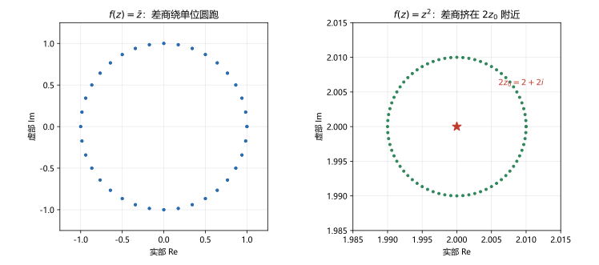

# 第 03 讲 解析函数：导数与柯西-黎曼条件

> **前置**：第 01 讲（复数、复平面、模与辐角）、第 02 讲（复变函数、极限、连续）。
> **预计时间**：约 3 小时（含作业；本讲是整门课的分水岭，建议慢读）。
> **本讲回答**：复可导比实可导多了什么要求？柯西-黎曼条件从哪来？可导和解析差在哪？为什么解析函数的实部虚部满足拉普拉斯方程？

## 本讲要解决什么

第 02 讲建立了复变函数的极限与连续。这一讲加一个复变函数独有的要求：**差商不仅要有极限，而且沿任何方向逼近都要给出同一个极限**。

这个要求看起来只是把实函数的"左右极限相等"换成了"所有方向一致"，但它会逼出一个非常强的方程——柯西-黎曼条件（Cauchy-Riemann equations，简称 C-R 条件）。满足这个条件的函数叫**解析函数**，整门课后面的柯西积分定理、泰勒展开、留数定理，全部建立在"解析"这两个字上。

学完之后，你应该能做到：

- 用定义判断一个复变函数在哪些点可导；
- 独立推出 C-R 条件，并说清它为什么是必要条件；
- 用 C-R 条件快速判断可导性，知道它单独不够、还缺什么；
- 区分"在某点可导"和"在某点解析"；
- 由解析函数的实部求出虚部，并验证结果满足 C-R。

---

## 1. 导数：差商极限

### 1.1 定义

设函数 $f$ 在 $z_0$ 的某个邻域内有定义。如果极限

$$\lim_{\Delta z\to0}\frac{f(z_0+\Delta z)-f(z_0)}{\Delta z}$$

存在，就说 $f$ 在 $z_0$ **可导**（differentiable），这个极限值叫 $f$ 在 $z_0$ 的**导数**，记作

$$f'(z_0)=\lim_{\Delta z\to0}\frac{f(z_0+\Delta z)-f(z_0)}{\Delta z}.$$

$\Delta z$ 是复数，可以从任何方向趋于 $0$。所以这个定义比实函数的导数多了一层要求：

> 差商沿**所有方向**逼近，必须得到同一个值。

实函数的差商只有左右两个方向，两个方向一致就够了。复变函数有无穷多个方向，任何一个方向给出不同的值，导数就不存在。

### 1.2 例：$f(z)=z^2$

在 $z_0$ 处：

$$
\frac{f(z_0+\Delta z)-f(z_0)}{\Delta z}
=\frac{(z_0+\Delta z)^2-z_0^2}{\Delta z}
=\frac{2z_0\Delta z+(\Delta z)^2}{\Delta z}
=2z_0+\Delta z.
$$

当 $\Delta z\to0$ 时，无论从哪个方向，$\Delta z\to0$，所以差商趋于 $2z_0$。因此

$$(z^2)'=2z.$$

**数值核对**（脚本 `scripts/lec03-01_verify_derivative_cr.py`，EXP1）：取 $z_0=1+i$，$\Delta z=10^{-6}e^{i\theta}$，沿八个方向：

| 方向 | $0^\circ$ | $45^\circ$ | $90^\circ$ | $135^\circ$ | $180^\circ$ | $225^\circ$ | $270^\circ$ | $315^\circ$ |
|---|---|---|---|---|---|---|---|---|
| 差商 | $2.000001+2i$ | $2.000001+2.000001i$ | $2+2.000001i$ | $1.999999+2.000001i$ | $1.999999+2i$ | $1.999999+1.999999i$ | $2+1.999999i$ | $2.000001+1.999999i$ |

八个值都在 $2+2i=2z_0$ 附近，偏差是 $10^{-6}$ 量级，等于 $|\Delta z|$。这正是导数存在的表现：差商与极限值的差随 $|\Delta z|$ 一起趋于零。

### 1.3 例：$f(z)=\bar z$

在 $z_0$ 处：

$$
\frac{\overline{z_0+\Delta z}-\bar z_0}{\Delta z}
=\frac{\bar z_0+\overline{\Delta z}-\bar z_0}{\Delta z}
=\frac{\overline{\Delta z}}{\Delta z}.
$$

设 $\Delta z=re^{i\theta}$，则 $\overline{\Delta z}=re^{-i\theta}$，所以

$$\frac{\overline{\Delta z}}{\Delta z}=e^{-2i\theta}.$$

结果只与方向 $\theta$ 有关。沿实轴（$\theta=0$）得 $1$，沿虚轴（$\theta=\pi/2$）得 $-1$，沿 $45^\circ$ 得 $-i$。方向不同，值不同，所以 $\bar z$ 在**任何点都不可导**（$z_0$ 根本没出现在结果里）。

**数值核对**（EXP2）：八个方向的差商模长全是 $1.000000$，值绕单位圆跑了一圈：

```
0 deg:   +1
45 deg:  -i
90 deg:  -1
135 deg: +i
180 deg: +1
```

图 1 把两个例子并排画出来：左边 $\bar z$ 的差商随方向绕单位圆，右边 $z^2$ 的差商始终落在 $2z_0$ 附近的小圆里。



右图的小圆半径等于 $|\Delta z|=0.01$，不是误差，而是差商中的 $\Delta z$ 项。把 $|\Delta z|$ 缩小，这个圆就向 $2z_0$ 收缩。导数存在，说的就是"这些值能缩进任意小的圆盘"。

### 1.4 可导蕴含连续

如果 $f$ 在 $z_0$ 可导，那么

$$
f(z)-f(z_0)=\frac{f(z)-f(z_0)}{z-z_0}\cdot(z-z_0).
$$

当 $z\to z_0$ 时，第一个因子趋于 $f'(z_0)$（有限值），第二个因子趋于 $0$，所以乘积趋于 $0$，即 $f(z)\to f(z_0)$。

所以可导比连续强。反过来不成立：$\bar z$ 处处连续，但处处不可导。

### 1.5 求导法则

下面这些法则与实函数完全一样：

$$(f\pm g)'=f'\pm g',\qquad (fg)'=f'g+fg',\qquad \left(\frac fg\right)'=\frac{f'g-fg'}{g^2}\quad(g\ne0),$$

$$(f\circ g)'(z)=f'(g(z))\,g'(z).$$

**为什么可以照搬？** 因为这些法则的证明只用到极限的四则运算和复合极限，而复数极限的四则运算与实数完全同构（第 02 讲 3.6 节）。证明过程一个字都不用改，只需要把绝对值换成复数的模。

由此可得：

$$(z^n)'=nz^{n-1},\qquad \left(\frac1z\right)'=-\frac{1}{z^2}\quad(z\ne0).$$

多项式在整个复平面可导；有理函数在分母不为零的点可导。

---

## 2. 柯西-黎曼条件

### 2.1 从两个方向算差商

设 $f(z)=u(x,y)+iv(x,y)$ 在 $z_0=x_0+iy_0$ 可导。既然导数对所有方向都一样，就挑两个最方便的方向来算。

**沿实轴方向**：取 $\Delta z=\Delta x$，$\Delta x$ 是实数。

$$
\frac{f(z_0+\Delta x)-f(z_0)}{\Delta x}
=\frac{u(x_0+\Delta x,y_0)-u(x_0,y_0)}{\Delta x}
+i\frac{v(x_0+\Delta x,y_0)-v(x_0,y_0)}{\Delta x}.
$$

当 $\Delta x\to0$ 时，两个差商分别趋于偏导数，所以

$$f'(z_0)=u_x(x_0,y_0)+iv_x(x_0,y_0).$$

**沿虚轴方向**：取 $\Delta z=i\Delta y$，$\Delta y$ 是实数。

$$
\frac{f(z_0+i\Delta y)-f(z_0)}{i\Delta y}
=\frac{u(x_0,y_0+\Delta y)-u(x_0,y_0)}{i\Delta y}
+i\frac{v(x_0,y_0+\Delta y)-v(x_0,y_0)}{i\Delta y}.
$$

注意 $\frac1i=-i$，所以

$$
f'(z_0)=-iu_y(x_0,y_0)+v_y(x_0,y_0)
=v_y(x_0,y_0)-iu_y(x_0,y_0).
$$

**两个结果必须相等**：

$$u_x+iv_x=v_y-iu_y.$$

比较实部和虚部：

$$\boxed{u_x=v_y,\qquad u_y=-v_x.}$$

这就是**柯西-黎曼条件**（Cauchy-Riemann equations）。

### 2.2 它的含义

C-R 条件不是两个孤立的等式，它说的是：$f$ 作为从 $\mathbb R^2$ 到 $\mathbb R^2$ 的映射，其雅可比矩阵

$$
J=\begin{pmatrix}u_x&u_y\\v_x&v_y\end{pmatrix}
$$

必须具有

$$
J=\begin{pmatrix}a&-b\\b&a\end{pmatrix}
$$

的形式，其中 $a=u_x$，$b=v_x$。这种矩阵对应的线性变换是"旋转加均匀伸缩"：

$$
\begin{pmatrix}a&-b\\b&a\end{pmatrix}
=\sqrt{a^2+b^2}
\begin{pmatrix}\cos\varphi&-\sin\varphi\\\sin\varphi&\cos\varphi\end{pmatrix},
\qquad \tan\varphi=\frac ba.
$$

**所以复可导的几何含义是：在局部，这个映射不能把圆压成椭圆，只能整体旋转并均匀放大或缩小。** 这条性质第 15 讲会正式命名为"保角"。

### 2.3 例：$\bar z$ 不满足 C-R

$f(z)=\bar z=x-iy$，所以 $u=x$，$v=-y$。

$$u_x=1,\qquad v_y=-1.$$

$u_x\ne v_y$，C-R 不成立，所以不可导。这与 1.3 节直接算差商得到的结论一致。

### 2.4 例：$|z|^2$ 只在原点满足 C-R

$f(z)=|z|^2=x^2+y^2$，所以 $u=x^2+y^2$，$v=0$。

$$u_x=2x,\quad u_y=2y,\quad v_x=0,\quad v_y=0.$$

C-R 要求

$$2x=0,\qquad 2y=0,$$

只有 $x=y=0$ 时成立。所以 C-R 只在原点成立。

而原点确实可导：差商

$$\frac{|0+\Delta z|^2-0}{\Delta z}=\frac{|\Delta z|^2}{\Delta z}=\overline{\Delta z}\to0.$$

所以 $f'(0)=0$。在其他点，差商依赖方向，不可导。

**数值核对**（EXP4）：在 $z_0=0$ 处，四个方向的差商都趋于 $0$；在 $z_0=1$ 处，四个方向分别给 $2$、$1-i$、$0$、$2$，明显不一致。

---

## 3. 可导的充要条件

### 3.1 定理

> 设 $f(z)=u(x,y)+iv(x,y)$ 在 $z_0=x_0+iy_0$ 的某个邻域内有定义。则 $f$ 在 $z_0$ 可导，当且仅当：
>
> 1. $u,v$ 在 $(x_0,y_0)$ **可微**；
> 2. 在 $(x_0,y_0)$ 满足 C-R 条件 $u_x=v_y$，$u_y=-v_x$。
>
> 此时
> $$f'(z_0)=u_x+iv_x=v_y-iu_y.$$

注意第一条：**可微**，不是"偏导数存在"。这两个概念在实函数里就有区别，这里必须分清。

### 3.2 证明思路

设 $u,v$ 在 $(x_0,y_0)$ 可微，记 $\Delta z=\Delta x+i\Delta y$，则

$$\Delta u=u_x\Delta x+u_y\Delta y+o(|\Delta z|),$$

$$\Delta v=v_x\Delta x+v_y\Delta y+o(|\Delta z|).$$

于是

$$
\Delta f=\Delta u+i\Delta v
=(u_x+iv_x)\Delta x+(u_y+iv_y)\Delta y+o(|\Delta z|).
$$

用 C-R 把 $u_y$ 换成 $-v_x$，把 $v_y$ 换成 $u_x$：

$$
\Delta f=(u_x+iv_x)\Delta x+(-v_x+iu_x)\Delta y+o(|\Delta z|).
$$

注意

$$(-v_x+iu_x)\Delta y=i(u_x+iv_x)\Delta y,$$

所以

$$
\Delta f=(u_x+iv_x)(\Delta x+i\Delta y)+o(|\Delta z|)
=(u_x+iv_x)\Delta z+o(|\Delta z|).
$$

两边除以 $\Delta z$：

$$\frac{\Delta f}{\Delta z}=u_x+iv_x+\frac{o(|\Delta z|)}{\Delta z}\to u_x+iv_x.$$

所以可导，且 $f'(z_0)=u_x+iv_x$。

### 3.3 C-R 单独不够：一个反例

条件 1（可微）不能省。看这个函数：

$$
f(z)=\sqrt{|xy|},\qquad z\ne0,
$$

并规定 $f(0)=0$。这里 $v\equiv0$，$u=\sqrt{|xy|}$。

在原点：

$$u_x(0,0)=\lim_{x\to0}\frac{\sqrt{|x\cdot0|}-0}{x}=0,$$

同理 $u_y(0,0)=0$。而 $v_x=v_y=0$，所以 C-R 在原点成立。

但差商沿直线 $y=x$：

$$
\frac{f(x+ix)-f(0)}{x+ix}
=\frac{\sqrt{|x^2|}}{x(1+i)}
=\frac{|x|}{x(1+i)}
=\frac{\operatorname{sgn}x}{1+i}.
$$

当 $x>0$ 时趋于 $\frac{1}{1+i}$，当 $x<0$ 时趋于 $-\frac{1}{1+i}$，两者不等。所以不可导。

**问题出在哪？** $u=\sqrt{|xy|}$ 在原点偏导数存在，但**不可微**：它的增量不能写成线性主部加 $o(|\Delta z|)$。所以 C-R 成立，定理的条件 1 不满足，结论不成立。

**结论**：判断可导性时，C-R 是必要条件，不是充分条件；必须同时检查 $u,v$ 的可微性。对于多项式、有理函数、指数函数这类"光滑"函数，可微性通常自动满足，这时 C-R 就够用了。

### 3.4 极坐标形式（提高）

在极坐标 $z=re^{i\theta}$ 下，C-R 条件写成

$$u_r=\frac1r v_\theta,\qquad v_r=-\frac1r u_\theta.$$

导数公式为

$$f'(z)=e^{-i\theta}(u_r+iv_r).$$

推导只需把 $x=r\cos\theta$、$y=r\sin\theta$ 代入直角坐标的 C-R，用链式法则展开。计算圆形区域上的问题时，极坐标形式更方便。本课程后面主要用直角坐标形式，这里知道有这回事即可。

---

## 4. 解析函数

### 4.1 定义

如果 $f$ 在 $z_0$ **及其某个邻域内处处可导**，就说 $f$ 在 $z_0$ **解析**（analytic）。

如果 $f$ 在区域 $D$ 内每一点都解析，就说 $f$ 在 $D$ 内解析，或称 $f$ 是 $D$ 内的**解析函数**。

**口径声明**：本课程的"解析"与"全纯"（holomorphic）同义，都指在区域内处处可导。后面统一用"解析"。

### 4.2 可导与解析的区别

关键在"邻域"两个字：

- 在一点可导：只要求差商极限在该点存在；
- 在一点解析：要求该点**以及周围一小圈内每一点**都可导。

所以解析比可导强。

**例 3.1** $f(z)=|z|^2$ 在 $z=0$ 可导，但在 $z=0$ 不解析。因为它在原点的任何邻域内，除原点外都不可导。

**例 3.2** 多项式、有理函数（分母非零处）、$z^n$ 都在其定义域内解析。

**例 3.3** $\bar z$ 处处连续，处处不可导，所以在任何点都不解析。

### 4.3 解析函数的运算

两个解析函数的和、差、积仍是解析函数；商在分母不为零处解析；复合仍解析。

所以：

- 多项式在整个复平面解析；
- 有理函数在分母不为零的地方解析；
- 由多项式与有理函数复合得到的函数，在定义域内解析。

这条规则后面天天用。第 04 讲会证明指数函数、三角函数也是解析函数。

### 4.4 两个后面才会证明的强结论

先记住结论，第 08、10 讲会证明：

1. **解析函数无穷次可导**。实函数没有这条性质：$f(x)=x^2\sin(1/x)$（补定义 $f(0)=0$）处处可导，但导数在 $0$ 不连续。复变函数只要在区域内解析，就自动在区域内无穷次可导。注意前提是"区域内处处可导"，不是"在某一点可导一次"：$\lvert z\rvert^2$ 在原点可导，但它不解析，也不无穷次可导。
2. **解析函数在每一点的邻域内都能展开成幂级数**。这直接导致泰勒级数、洛朗级数、留数理论。

这两条是复变函数与实函数最大的分水岭。它们的根源都在 C-R 条件：C-R 把两个实函数的偏导数锁死，锁得太紧，以至于函数被迫具有极高的光滑性。

---

## 5. 调和函数与由实部求虚部

### 5.1 拉普拉斯方程

二元函数 $u(x,y)$ 如果满足

$$\Delta u=u_{xx}+u_{yy}=0,$$

就说 $u$ 是**调和函数**（harmonic function）。$\Delta$ 叫拉普拉斯算子。

### 5.2 解析函数的实部虚部都是调和函数

设 $f=u+iv$ 解析，则 $u,v$ 满足 C-R：

$$u_x=v_y,\qquad u_y=-v_x.$$

对第一式关于 $x$ 求导，第二式关于 $y$ 求导：

$$u_{xx}=v_{yx},\qquad u_{yy}=-v_{xy}.$$

解析函数的 $u,v$ 有二阶连续偏导（后面会证明），所以混合偏导相等：$v_{yx}=v_{xy}$。相加得

$$u_{xx}+u_{yy}=v_{yx}-v_{xy}=0.$$

同理

$$v_{xx}+v_{yy}=u_{xy}-u_{yx}=0.$$

所以：

> **解析函数的实部和虚部都是调和函数。**

反过来，如果 $u$ 调和，能不能找到一个 $v$ 使 $u+iv$ 解析？在单连通区域内可以，这个 $v$ 叫 $u$ 的**共轭调和函数**（conjugate harmonic function），相差一个常数。

### 5.3 由实部求虚部的方法

已知调和函数 $u(x,y)$，求 $v$。步骤：

1. 由 C-R 的 $v_y=u_x$，对 $y$ 积分：
   $$v(x,y)=\int u_x(x,y)\,dy+\varphi(x),$$
   其中 $\varphi(x)$ 是待定的函数（对 $y$ 积分时，$x$ 被当成常数）。
2. 把上式对 $x$ 求导，利用 C-R 的 $v_x=-u_y$：
   $$v_x=\frac{\partial}{\partial x}\int u_x\,dy+\varphi'(x)=-u_y.$$
   由此解出 $\varphi'(x)$，再积分得 $\varphi(x)$。

**例 3.4** 已知 $u=x^2-y^2$，求解析函数 $f=u+iv$。

先验证 $u$ 调和：

$$u_x=2x,\quad u_{xx}=2;\qquad u_y=-2y,\quad u_{yy}=-2;\qquad u_{xx}+u_{yy}=0.$$

可以求 $v$。

由 $v_y=u_x=2x$，对 $y$ 积分：

$$v=2xy+\varphi(x).$$

对 $x$ 求导：

$$v_x=2y+\varphi'(x).$$

C-R 要求 $v_x=-u_y=2y$，所以 $\varphi'(x)=0$，$\varphi(x)=C$。

因此

$$v=2xy+C,\qquad f(z)=x^2-y^2+i(2xy+C)=z^2+iC.$$

最后一步用了 $(x+iy)^2=x^2-y^2+2xy\,i$。

**数值核对**（EXP5）：在 $z=1+3i$ 处，$u=-8$，$v=6$，$u_x=2$，$v_y=2$，$u_y=-6$，$-v_x=-6$，C-R 成立。

**例 3.5** 已知 $u=e^x\cos y$，求 $v$。

验证调和：

$$u_x=e^x\cos y,\quad u_{xx}=e^x\cos y;\qquad u_y=-e^x\sin y,\quad u_{yy}=-e^x\cos y;\qquad u_{xx}+u_{yy}=0.$$

由 $v_y=u_x=e^x\cos y$，对 $y$ 积分：

$$v=e^x\sin y+\varphi(x).$$

对 $x$ 求导：

$$v_x=e^x\sin y+\varphi'(x).$$

C-R 要求 $v_x=-u_y=e^x\sin y$，所以 $\varphi'(x)=0$，$\varphi=C$。

因此

$$v=e^x\sin y+C,\qquad f(z)=e^x(\cos y+i\sin y)+iC=e^z+iC.$$

这里用了欧拉公式，第 04 讲会正式展开。

### 5.4 一个提醒

如果给定的 $u$ 不调和，那么不存在这样的 $v$。所以做题时先验证 $u_{xx}+u_{yy}=0$，再动手积分。这一步能省掉很多白算。

---

## 6. 本讲小结

| 概念 | 要点 | 用在哪 |
|---|---|---|
| 复可导 | 差商极限存在，且对所有方向一致 | 解析的定义 |
| 求导法则 | 与实函数完全相同 | 计算 |
| C-R 条件 | $u_x=v_y$，$u_y=-v_x$ | 判断可导、求导 |
| 可导充要条件 | $u,v$ 可微 + C-R | 判定题 |
| C-R 单独不够 | 需要可微性；反例 $\sqrt{\lvert xy\rvert}$ | 防错 |
| 解析 | 某点及邻域内处处可导 | 后续所有定理 |
| 可导 vs 解析 | 解析多要求一个邻域 | 概念题 |
| 调和函数 | $u_{xx}+u_{yy}=0$ | 由实部求虚部 |
| 共轭调和函数 | 与 $u$ 一起构成解析函数的 $v$ | 构造解析函数 |

三句话带走：

1. 复可导 = 差商极限存在且与方向无关；这个要求会逼出 C-R。
2. C-R 是必要条件，不是充分条件；还要 $u,v$ 可微。
3. 解析 = 邻域内处处可导；解析函数的实部虚部都调和，可以由一个求另一个。

---

## 7. 掌握度自测

- [ ] 能用定义求 $z^2$、$1/z$ 的导数。
- [ ] 能解释为什么 $\bar z$ 处处不可导。
- [ ] 能独立推出 C-R 条件，并说清"沿实轴"和"沿虚轴"两步。
- [ ] 能说出 C-R 条件的几何含义（旋转加均匀伸缩）。
- [ ] 能判断一个函数在哪些点可导，并区分可导与解析。
- [ ] 能举出"C-R 成立但不可导"的反例，并指出缺的是可微性。
- [ ] 能由调和函数 $u$ 求出 $v$，并验证结果满足 C-R。

---

## 作业

### 基础

**1.** 用定义求 $f(z)=z^2$ 在任意点 $z_0$ 的导数。

**参考答案：**

$$
\frac{f(z_0+\Delta z)-f(z_0)}{\Delta z}
=\frac{(z_0+\Delta z)^2-z_0^2}{\Delta z}
=2z_0+\Delta z\to2z_0.
$$

所以 $f'(z_0)=2z_0$，即 $(z^2)'=2z$。这个极限与 $\Delta z$ 的方向无关。

---

**2.** 验证 $f(z)=z^3$ 满足 C-R 条件，并求 $f'(z)$。

**参考答案：**

$$z^3=(x+iy)^3=x^3-3xy^2+i(3x^2y-y^3).$$

所以

$$u=x^3-3xy^2,\qquad v=3x^2y-y^3.$$

偏导：

$$u_x=3x^2-3y^2,\qquad v_y=3x^2-3y^2,$$

$$u_y=-6xy,\qquad v_x=6xy.$$

所以 $u_x=v_y$，$u_y=-v_x$，C-R 处处成立。

$$f'(z)=u_x+iv_x=3x^2-3y^2+6xy\,i=3(x+iy)^2=3z^2.$$

---

**3.** 判断 $f(z)=x^2+iy^2$ 在哪些点可导。

**参考答案：**

$u=x^2$，$v=y^2$，所以

$$u_x=2x,\quad u_y=0,\quad v_x=0,\quad v_y=2y.$$

C-R 要求

$$2x=2y,\qquad 0=0,$$

即 $x=y$。

$u,v$ 都是多项式，处处可微。所以 $f$ 在直线 $y=x$ 上每一点可导，在其他点不可导。

在 $y=x$ 上，

$$f'(z)=u_x+iv_x=2x.$$

注意：可导点集是一条直线，不是区域，所以 $f$ 在任何点都不解析。

---

**4.** 求 $f(z)=\dfrac1z$（$z\ne0$）的导数。

**参考答案：**

用定义：

$$
\frac{1/(z_0+\Delta z)-1/z_0}{\Delta z}
=\frac{z_0-(z_0+\Delta z)}{z_0(z_0+\Delta z)\Delta z}
=\frac{-1}{z_0(z_0+\Delta z)}\to-\frac{1}{z_0^2}.
$$

所以 $f'(z)=-1/z^2$。

---

### 提高

**5.** 证明：若 $f$ 在 $z_0$ 可导，则 $f$ 在 $z_0$ 连续。

**参考答案：**

由可导的定义，差商极限 $f'(z_0)$ 存在且有限。于是

$$
f(z)-f(z_0)=\frac{f(z)-f(z_0)}{z-z_0}\cdot(z-z_0).
$$

当 $z\to z_0$ 时，第一个因子趋于 $f'(z_0)$，第二个因子趋于 $0$，所以

$$\lim_{z\to z_0}[f(z)-f(z_0)]=f'(z_0)\cdot0=0,$$

即 $f(z)\to f(z_0)$，连续。

---

**6.** 判断 $f(z)=|z|^2$ 的可导点，并说明它是否解析。

**参考答案：**

$u=x^2+y^2$，$v=0$。

$$u_x=2x,\quad v_y=0\Rightarrow x=0;$$

$$u_y=2y,\quad v_x=0\Rightarrow y=0.$$

C-R 只在原点成立。$u,v$ 可微，所以在原点可导：

$$f'(0)=\lim_{\Delta z\to0}\frac{|\Delta z|^2}{\Delta z}=\lim\overline{\Delta z}=0.$$

在其他点不可导。

因为原点的任何邻域内都有不可导的点，所以 $f$ 在原点不解析，在任何点都不解析。

---

**7.** 已知 $u=x^3-3xy^2$，求解析函数 $f=u+iv$。

**参考答案：**

先验证调和：

$$u_x=3x^2-3y^2,\quad u_{xx}=6x;\qquad u_y=-6xy,\quad u_{yy}=-6x;\qquad u_{xx}+u_{yy}=0.$$

由 $v_y=u_x=3x^2-3y^2$，对 $y$ 积分：

$$v=3x^2y-y^3+\varphi(x).$$

对 $x$ 求导：

$$v_x=6xy+\varphi'(x).$$

C-R 要求 $v_x=-u_y=6xy$，所以 $\varphi'(x)=0$，$\varphi=C$。

因此

$$v=3x^2y-y^3+C,\qquad f(z)=z^3+iC.$$

验算：$z^3=x^3-3xy^2+i(3x^2y-y^3)$，实部正是 $u$。

---

**8.** 用极坐标 C-R 条件验证 $f(z)=z^2$。

**参考答案：**

$z^2=r^2(\cos2\theta+i\sin2\theta)$，所以

$$u=r^2\cos2\theta,\qquad v=r^2\sin2\theta.$$

偏导：

$$u_r=2r\cos2\theta,\qquad v_\theta=2r^2\cos2\theta,$$

$$v_r=2r\sin2\theta,\qquad u_\theta=-2r^2\sin2\theta.$$

验证：

$$u_r=\frac1r v_\theta\iff2r\cos2\theta=2r\cos2\theta,$$

$$v_r=-\frac1r u_\theta\iff2r\sin2\theta=2r\sin2\theta.$$

两条都成立。导数：

$$f'(z)=e^{-i\theta}(u_r+iv_r)=e^{-i\theta}\cdot2r(\cos2\theta+i\sin2\theta)=2re^{i\theta}=2z.$$

---

### 综合

**9.** 证明 $f(z)=\sqrt{|xy|}$（$z\ne0$，$f(0)=0$）在原点满足 C-R 条件，但不可导。

**参考答案：**

$u=\sqrt{|xy|}$，$v=0$。

在原点：

$$u_x(0,0)=\lim_{x\to0}\frac{\sqrt{|x\cdot0|}-0}{x}=0,$$

$$u_y(0,0)=\lim_{y\to0}\frac{\sqrt{|0\cdot y|}-0}{y}=0.$$

$v_x=v_y=0$，所以 C-R 成立。

但沿 $y=x$ 的差商：

$$
\frac{f(x+ix)-f(0)}{x+ix}
=\frac{\sqrt{|x^2|}}{x(1+i)}
=\frac{|x|}{x(1+i)}
=\frac{\operatorname{sgn}x}{1+i}.
$$

$x\to0^+$ 时趋于 $\frac{1}{1+i}$，$x\to0^-$ 时趋于 $-\frac{1}{1+i}$，两者不等，所以不可导。

原因：$u$ 在原点偏导存在但不可微，不满足定理的条件 1。

---

**10.** 设 $f=u+iv$ 在区域 $D$ 内解析，且 $|f|$ 为常数，证明 $f$ 为常数。

**参考答案：**

设 $u^2+v^2=C$（常数）。

若 $C=0$，则 $u=v=0$，$f\equiv0$，结论成立。

若 $C>0$，对 $u^2+v^2=C$ 两边求偏导：

$$2uu_x+2vv_x=0,\qquad 2uu_y+2vv_y=0.$$

用 C-R：$v_y=u_x$，$v_x=-u_y$。第二式变为

$$uu_y+v u_x=0.$$

与第一式联立：

$$
\begin{cases}
u\,u_x+v\,v_x=0,\\
v\,u_x-u\,v_x=0.
\end{cases}
$$

这是关于 $u_x,v_x$ 的齐次线性方程组，系数行列式

$$\begin{vmatrix}u&v\\v&-u\end{vmatrix}=-u^2-v^2=-C\ne0.$$

所以只有零解：$u_x=v_x=0$。同理 $u_y=v_y=0$。

因此 $u,v$ 在 $D$ 内为常数，$f$ 为常数。

---

**11.** 设 $f=u+iv$ 解析，证明 $u$ 的等值线与 $v$ 的等值线在交点处正交（梯度非零时）。

**参考答案：**

$u$ 的等值线法向量是梯度 $(u_x,u_y)$，$v$ 的等值线法向量是 $(v_x,v_y)$。

两族等值线正交，等价于两个梯度正交：

$$(u_x,u_y)\cdot(v_x,v_y)=u_xv_x+u_yv_y.$$

用 C-R：$v_x=-u_y$，$v_y=u_x$。代入：

$$u_x(-u_y)+u_yu_x=0.$$

所以两个梯度垂直，等值线在交点处正交。

---

## 下一讲预告

这一讲我们知道了：解析函数的实部虚部都满足拉普拉斯方程，而且 C-R 把偏导数锁得很死。下一讲要把这套判断用到具体的函数上：指数函数 $e^z$、对数函数 $\operatorname{Ln}z$、幂函数 $z^a$、三角函数 $\sin z$ 和 $\cos z$。

其中最重要的是复对数：它会第一次把"多值性"摆到台面上。$\ln(-1)$ 不是一个数，而是一串数；要得到单值函数，必须选分支、画分支切割。第 02 讲看到的 $\operatorname{Arg}z$ 在负实轴上的跳跃，到那里会得到完整解释。
