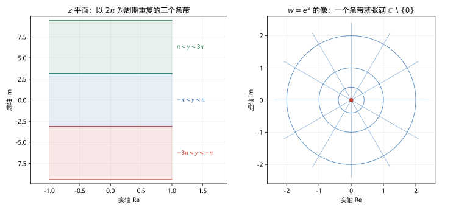
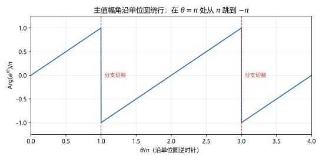

# 第 04 讲 初等函数：指数、对数、幂与三角

> **前置**：第 01 讲（指数形式、欧拉公式）、第 03 讲（解析、C-R 条件、调和函数）。
> **预计时间**：约 3 小时（含作业；本讲的多值性第一次出现，建议慢读）。
> **本讲回答**：$e^z$ 为什么是周期的？复对数为什么有无穷多个值？$i^i$ 为什么是实数？$\sin z$ 为什么会超过 $1$？

## 本讲要解决什么

前三讲建立了复数、复变函数、解析函数这三层地基。这一讲把实数轴上熟悉的四个函数——指数、对数、幂、三角——搬到复平面上。

搬的过程不是简单地把 $x$ 换成 $z$。有两个地方会发生质变：

1. **指数函数变成周期的**。实指数 $e^x$ 单调、一对一；复指数 $e^z$ 每隔 $2\pi i$ 重复一次。
2. **对数变成多值的**。实对数 $\ln x$ 只有一个值；复对数 $\operatorname{Ln}z$ 有无穷多个值，相差 $2\pi i$ 的整数倍。

这两个变化是连在一起的：正因为指数周期，反解出来的对数才多值。学完之后，你应该能做到：

- 写出 $e^z$ 的定义，并说清它的周期性、模与辐角；
- 求 $\operatorname{Ln}z$ 的全部值，区分多值记号 $\operatorname{Ln}$ 与主值记号 $\ln$；
- 说清分支切割为什么必须存在，以及它画在哪里；
- 计算 $z^a$ 和 $i^i$，并判断结果有几个值；
- 写出 $\sin z$、$\cos z$ 的定义，解释它们为什么无界。

---

## 1. 复指数函数

### 1.1 定义

对 $z=x+iy$，定义

$$e^z=e^{x+iy}=e^x(\cos y+i\sin y).$$

右边是一个复数：模是 $e^x$，辐角是 $y$。

这个定义不是随便写的。它要求两件事：

1. 当 $y=0$ 时，$e^x(\cos0+i\sin0)=e^x$，与实指数一致；
2. 当 $x=0$ 时，$e^{iy}=\cos y+i\sin y$，正是第 01 讲用过的欧拉公式。

所以复指数是"实指数"和"欧拉公式"拼起来的。

### 1.2 欧拉公式欠你的一个解释

第 01 讲说"欧拉公式为什么成立，第 04 讲会讲"。现在兑现。

最干净的定义方式是用幂级数：

$$e^z=\sum_{n=0}^{\infty}\frac{z^n}{n!}=1+z+\frac{z^2}{2!}+\frac{z^3}{3!}+\cdots.$$

这个级数在整个复平面上收敛（第 09 讲会讲收敛半径，第 10 讲会证明它等于上面的定义）。把 $z=iy$ 代入，按 $i$ 的幂次分开：

$$
e^{iy}=1+iy-\frac{y^2}{2!}-i\frac{y^3}{3!}+\frac{y^4}{4!}+i\frac{y^5}{5!}-\cdots
$$

实部是

$$1-\frac{y^2}{2!}+\frac{y^4}{4!}-\cdots=\cos y,$$

虚部是

$$y-\frac{y^3}{3!}+\frac{y^5}{5!}-\cdots=\sin y.$$

所以 $e^{iy}=\cos y+i\sin y$。

**这段推导依赖幂级数，而幂级数在第 09 讲才系统讲。** 现在你只需要知道：欧拉公式不是硬规定的，它可以从指数函数的级数定义推出来；这个推导的每一步，后面都会补齐。在此之前，把 $e^{x+iy}=e^x(\cos y+i\sin y)$ 当作定义使用即可。

### 1.3 基本性质

**加法公式**：

$$e^{z_1+z_2}=e^{z_1}e^{z_2}.$$

证明：设 $z_1=x_1+iy_1$，$z_2=x_2+iy_2$，则

$$
e^{z_1}e^{z_2}
=e^{x_1}(\cos y_1+i\sin y_1)\cdot e^{x_2}(\cos y_2+i\sin y_2)
=e^{x_1+x_2}\bigl[\cos(y_1+y_2)+i\sin(y_1+y_2)\bigr]
=e^{z_1+z_2}.
$$

第二步用了三角和角公式，第三步用了定义。

**周期性**：

$$e^{z+2\pi i}=e^z.$$

因为 $e^{2\pi i}=\cos2\pi+i\sin2\pi=1$。更一般地，

$$e^{z+2k\pi i}=e^z,\qquad k\in\mathbb Z.$$

**模与辐角**：

$$|e^z|=e^x=e^{\operatorname{Re}z},\qquad \operatorname{Arg}e^z=y+2k\pi.$$

特别地，$e^z\ne0$，因为 $e^x>0$。

**解析性**：

$$u=e^x\cos y,\qquad v=e^x\sin y.$$

偏导：

$$u_x=e^x\cos y,\quad u_y=-e^x\sin y,\quad v_x=e^x\sin y,\quad v_y=e^x\cos y.$$

所以 $u_x=v_y$，$u_y=-v_x$，C-R 处处成立；$u,v$ 可微，因此 $e^z$ 在全平面解析，且

$$(e^z)'=u_x+iv_x=e^x\cos y+ie^x\sin y=e^z.$$

复指数函数是它自己的导数，和实指数一样。

### 1.4 与实指数的区别

| 性质 | 实指数 $e^x$ | 复指数 $e^z$ |
|---|---|---|
| 取值 | 正实数 | 非零复数 |
| 单调性 | 严格单调递增 | 没有单调性 |
| 周期性 | 无 | 周期 $2\pi i$ |
| 一对一 | 是 | 否，每个非零值被取无穷多次 |

**为什么周期会导致"多对一"？** 因为 $e^z$ 只依赖 $y$ 的正弦余弦，而正弦余弦每隔 $2\pi$ 重复。所以 $z$ 和 $z+2\pi i$ 给出同一个 $w$。图 1 左边画了三个高度为 $2\pi$ 的水平条带，右边是其中一个条带的像：一个条带就已经张满整个挖去原点的平面。另外两个条带映到完全相同的地方。



这张图是后面所有多值现象的根源。记住它：**指数把一条条水平带子卷到同一个平面上，卷了无穷多层。**

### 1.5 数值核对

**周期性**（脚本 `scripts/lec04-01_verify_elementary.py`，EXP1）：取 $z=0.7+0.4i$，

```
exp(z)        = 1.854789+0.784192j
exp(z+2*pi*i) = 1.854789+0.784192j
exp(z-2*pi*i) = 1.854789+0.784192j
```

三者逐位相同。

**模与辐角**（EXP2）：

| $z$ | $\lvert e^z\rvert$ | $e^{\operatorname{Re}z}$ | $\operatorname{Arg}e^z$ | $\operatorname{Im}z$ |
|---|---|---|---|---|
| $0$ | $1.000000$ | $1.000000$ | $0$ | $0$ |
| $1+i\pi/2$ | $2.718282$ | $2.718282$ | $1.570796$ | $1.570796$ |
| $-1+i\pi$ | $0.367879$ | $0.367879$ | $3.141593$ | $3.141593$ |
| $0.5-i\pi/3$ | $1.648721$ | $1.648721$ | $-1.047198$ | $-1.047198$ |

模完全等于 $e^{\operatorname{Re}z}$，辐角等于 $\operatorname{Im}z$ 折回 $(-\pi,\pi]$。

---

## 2. 复对数：指数函数的反函数

### 2.1 从 $e^w=z$ 反解

给定 $z\ne0$，求 $w$ 使

$$e^w=z.$$

设 $w=u+iv$，$z=re^{i\theta}$。则

$$e^u(\cos v+i\sin v)=r(\cos\theta+i\sin\theta).$$

比较模和辐角：

$$e^u=r\Rightarrow u=\ln r,$$

$$v=\theta+2k\pi,\qquad k\in\mathbb Z.$$

所以

$$w=\ln r+i(\theta+2k\pi).$$

把 $r=|z|$、$\theta=\operatorname{Arg}z$ 代回，得到**复对数**：

$$\operatorname{Ln}z=\ln|z|+i(\operatorname{Arg}z+2k\pi),\qquad k\in\mathbb Z.$$

### 2.2 多值性

$\operatorname{Ln}z$ 不是一个数，而是一个集合：对每个整数 $k$，都有一个值，相邻两个值相差 $2\pi i$。

**例 4.1** 求 $\operatorname{Ln}(-1)$。

$|-1|=1$，$\operatorname{Arg}(-1)=\pi$，所以

$$\operatorname{Ln}(-1)=i(\pi+2k\pi)=i(2k+1)\pi.$$

具体写出：

$$\cdots,\ -3\pi i,\ -\pi i,\ \pi i,\ 3\pi i,\ 5\pi i,\ \cdots$$

**数值核对**（EXP3）：$k=-2,\dots,2$ 时依次为 $-9.424778i$、$-3.141593i$、$3.141593i$、$9.424778i$、$15.707963i$，正是 $\pi i$ 的奇数倍。

### 2.3 主值

为了得到一个单值函数，必须从无穷多个值里挑一个。标准做法是限制辐角取主值：

$$\ln z=\ln|z|+i\operatorname{Arg}z,\qquad \operatorname{Arg}z\in(-\pi,\pi].$$

这个 $\ln z$ 叫**主值**（principal value）。

**记号声明**：本课程用大写 $\operatorname{Ln}$ 表示多值对数，小写 $\ln$ 表示主值。有些教材反过来，做题时先看教材的约定。

**例 4.2** 求 $\ln(-1)$、$\ln i$、$\ln(1+i)$。

- $\ln(-1)=i\pi$；
- $\ln i=i\pi/2$；
- $1+i=\sqrt2e^{i\pi/4}$，所以 $\ln(1+i)=\ln\sqrt2+i\pi/4=\frac12\ln2+i\frac{\pi}{4}$。

### 2.4 分支切割

主值 $\ln z$ 在负实轴上出问题，因为 $\operatorname{Arg}z$ 在那里从 $\pi$ 跳到 $-\pi$（第 02 讲 4.4 节）。

图 2 把这件事画成曲线：沿单位圆逆时针走，$\theta$ 从 $0$ 增加到 $2\pi$，$\operatorname{Arg}$ 从 $0$ 升到 $\pi$，然后在 $\theta=\pi$ 处**竖直掉到 $-\pi$**，再继续升回 $0$。每绕一圈，掉一次。



这条发生跳跃的射线（负实轴）叫**分支切割**（branch cut）。切掉它，剩下的区域

$$D=\mathbb C\setminus\{z:\operatorname{Im}z=0,\ \operatorname{Re}z\le0\}$$

就是主值 $\ln z$ 的解析区域。

**为什么非要切一刀？** 因为绕原点一圈，辐角增加 $2\pi$，要让函数值回到原处，必须有一个地方跳回去。这不是定义没选好：换任何一条从原点出发的射线作切割，问题就搬到那条射线上，总得切一刀。这条射线就是"多值性付的过路费"。

### 2.5 解析性与导数

在 $D$ 内，$\ln z$ 解析，且

$$(\ln z)'=\frac1z.$$

**证明**：$\ln z$ 是 $e^w$ 的反函数。设 $w=\ln z$，则 $z=e^w$。由反函数求导法则，

$$\frac{dw}{dz}=\frac{1}{dz/dw}=\frac{1}{e^w}=\frac1z.$$

这里用到了 $e^w\ne0$，所以分母永远不为零。

### 2.6 运算性质要小心

对实数对数，$\ln(ab)=\ln a+\ln b$ 无条件成立。对复对数，要分两种记号说。

**多值记号**下，集合相等：

$$\operatorname{Ln}(z_1z_2)=\operatorname{Ln}z_1+\operatorname{Ln}z_2.$$

这里的加号表示两个集合逐项相加。因为两边的辐角都允许加任意 $2k\pi$，集合是同一个。

**主值记号**下，等式一般不成立。反例：

$$\ln\bigl((-1)(-1)\bigr)=\ln1=0,$$

$$\ln(-1)+\ln(-1)=i\pi+i\pi=2\pi i.$$

$0\ne2\pi i$。原因：两个主值辐角都是 $\pi$，加起来是 $2\pi$，超出了主值区间，必须减去 $2\pi$ 才能折回主值。

所以做题时，**先看用的是 $\operatorname{Ln}$ 还是 $\ln$**。前者可以拆，后者拆完要检查是否需要 $\pm2\pi i$ 修正。

### 2.7 数值核对

EXP5 验证分支切割两侧：

```
eps=1e-03: ln(-1+i*eps)=0.000000+3.140593j, ln(-1-i*eps)=0.000000-3.140593j
eps=1e-06: ln(-1+i*eps)=0.000000+3.141592j, ln(-1-i*eps)=0.000000-3.141592j
```

$\varepsilon$ 越小，两侧越贴近 $+\pi$ 和 $-\pi$，跳跃始终是 $2\pi$。

---

## 3. 复幂函数

### 3.1 定义

对复数 $a$，定义

$$z^a=e^{a\operatorname{Ln}z},\qquad z\ne0.$$

因为 $\operatorname{Ln}z$ 多值，$z^a$ 一般也多值。值的个数取决于 $a$。

### 3.2 整数幂：单值

如果 $a=n\in\mathbb Z$，则

$$z^n=e^{n\operatorname{Ln}z}=e^{n(\ln|z|+i\operatorname{Arg}z+2k\pi i)}=e^{n\ln|z|}e^{in\operatorname{Arg}z}e^{2nk\pi i}.$$

最后一项 $e^{2nk\pi i}=1$ 对任何整数 $k$ 都成立，所以 $k$ 消失了，$z^n$ 单值。这与第 01 讲的乘幂一致。

### 3.3 分数幂：有限多个值

如果 $a=p/q$（$p,q$ 互素，$q>1$），则

$$z^{p/q}=e^{(p/q)\ln|z|}e^{i(p/q)\operatorname{Arg}z}e^{2kp\pi i/q}.$$

最后一项随 $k$ 取 $q$ 个不同的值（$k=0,1,\dots,q-1$），之后重复。所以有 $q$ 个值。第 01 讲的 $n$ 次方根就是 $a=1/n$ 的特例。

### 3.4 一般幂：无穷多值

如果 $a$ 不是有理数（例如 $a=i$、$a=\sqrt2$），$e^{2ka\pi i}$ 对不同的 $k$ 给出不同的值，所以有无穷多个值。

### 3.5 $i^i$：看起来是复数，算出来是实数

取 $z=i$，$a=i$。

$$i=e^{i\pi/2},\qquad \operatorname{Ln}i=i\left(\frac{\pi}{2}+2k\pi\right).$$

所以

$$
i^i=e^{i\operatorname{Ln}i}
=e^{i\cdot i(\pi/2+2k\pi)}
=e^{-(\pi/2+2k\pi)}.
$$

这是一个**正实数**，因为指数是实数。主值（$k=0$）为

$$i^i=e^{-\pi/2}\approx0.207879576.$$

**数值核对**（EXP4）：

| $k$ | $-2$ | $-1$ | $0$ | $1$ | $2$ |
|---|---|---|---|---|---|
| $i^i$ | $59609.741$ | $111.317778$ | $0.207879576$ | $0.000388203$ | $0.000000725$ |

主值是 $0.207879576$，其他值随 $k$ 指数级增大或减小。所以 $i^i$ 不是"一个数"，而是一串正实数；说"$i^i$ 等于 $0.2079$"时，默认指主值。

### 3.6 一个容易忽略的前提

$z^a$ 的定义要求 $z\ne0$。$0^a$ 要单独讨论：正整数次幂为 $0$，其他情况可能无定义或趋于无穷。做题时先看底数是不是零。

---

## 4. 复三角函数与双曲函数

### 4.1 定义

对复数 $z$，定义

$$\sin z=\frac{e^{iz}-e^{-iz}}{2i},\qquad \cos z=\frac{e^{iz}+e^{-iz}}{2}.$$

**为什么这样定义？** 当 $z$ 是实数时，由欧拉公式，

$$e^{iz}=\cos z+i\sin z,\qquad e^{-iz}=\cos z-i\sin z.$$

两式相减除以 $2i$ 得 $\sin z$，相加除以 $2$ 得 $\cos z$。所以这个定义在实轴上与实三角函数一致。

### 4.2 性质

**解析性与导数**：由 $e^{iz}$ 的解析性和链式法则，

$$(\sin z)'=\frac{ie^{iz}+ie^{-iz}}{2i}=\frac{e^{iz}+e^{-iz}}{2}=\cos z,$$

$$(\cos z)'=\frac{ie^{iz}-ie^{-iz}}{2}=i\cdot\frac{e^{iz}-e^{-iz}}{2}=-\sin z.$$

**和角公式**：与实三角完全一样，例如

$$\sin(z_1+z_2)=\sin z_1\cos z_2+\cos z_1\sin z_2.$$

证明只需把定义代入，展开 $e^{i(z_1+z_2)}$。

**周期性**：$\sin(z+2\pi)=\sin z$，$\cos(z+2\pi)=\cos z$。因为 $e^{iz}$ 的周期是 $2\pi i$，除以 $i$ 后变成 $2\pi$。

**无界性**：这是与实三角最大的区别。取 $z=iy$：

$$
\sin(iy)=\frac{e^{i\cdot iy}-e^{-i\cdot iy}}{2i}
=\frac{e^{-y}-e^{y}}{2i}
=i\frac{e^{y}-e^{-y}}{2}
=i\sinh y.
$$

当 $y\to+\infty$ 时，$\sinh y\to+\infty$，所以 $|\sin(iy)|\to+\infty$。

**数值核对**（EXP6）：

| $y$ | $0.5$ | $1.0$ | $2.0$ | $3.0$ |
|---|---|---|---|---|
| $\lvert\sin(iy)\rvert$ | $0.521095$ | $1.175201$ | $3.626860$ | $10.017875$ |
| $\sinh y$ | $0.521095$ | $1.175201$ | $3.626860$ | $10.017875$ |

两者逐位相同，模长随 $y$ 指数增长。所以"$|\sin z|\le1$"在复平面上不成立，只在实轴上成立。

### 4.3 双曲函数

定义

$$\sinh z=\frac{e^z-e^{-z}}{2},\qquad \cosh z=\frac{e^z+e^{-z}}{2}.$$

它们与三角函数的关系是

$$\sin(iz)=i\sinh z,\qquad \cos(iz)=\cosh z.$$

双曲函数的周期是 $2\pi i$（因为 $e^z$ 的周期是 $2\pi i$），而三角函数的周期是 $2\pi$。这个差别来自定义里有没有乘 $i$。

### 4.4 反三角函数（认识层）

反三角函数可以用对数表示，例如

$$\arcsin z=-i\operatorname{Ln}\left(iz+\sqrt{1-z^2}\right).$$

因为右边含 $\operatorname{Ln}$ 和平方根，$\arcsin z$ 一般多值。这一块本课程不展开，只需要知道：**反三角函数在复数里也是多值的，原因还是对数多值**。考试如果遇到，按题目指定的分支计算。

---

## 5. 本讲小结

| 函数 | 定义 | 关键性质 | 多值性 |
|---|---|---|---|
| $e^z$ | $e^x(\cos y+i\sin y)$ | 周期 $2\pi i$；$\lvert e^z\rvert=e^x$；解析，导数为自身 | 单值 |
| $\operatorname{Ln}z$ | $\ln\lvert z\rvert+i(\operatorname{Arg}z+2k\pi)$ | 指数函数的反函数 | 无穷多值，相差 $2\pi i$ |
| $\ln z$ | $\ln\lvert z\rvert+i\operatorname{Arg}z$ | 主值，在 $\mathbb C\setminus(-\infty,0]$ 解析 | 单值 |
| $z^a$ | $e^{a\operatorname{Ln}z}$ | 整数幂单值；分数幂 $q$ 个值；其他无穷多值 | 看 $a$ |
| $\sin z,\cos z$ | 用 $e^{iz}$ 定义 | 周期 $2\pi$；无界；导数为 $\cos z,-\sin z$ | 单值 |
| $\sinh z,\cosh z$ | 用 $e^z$ 定义 | 周期 $2\pi i$；$\sin(iz)=i\sinh z$ | 单值 |

三句话带走：

1. $e^z$ 的周期 $2\pi i$ 是所有多值现象的源头。
2. 复对数多值，必须选分支；主值分支的切割线在负实轴。
3. 复三角函数无界，$|\sin z|\le1$ 只在实轴上成立。

---

## 6. 掌握度自测

- [ ] 能写出 $e^z$ 的定义，并说出 $\lvert e^z\rvert$、$\operatorname{Arg}e^z$。
- [ ] 能解释 $e^z$ 为什么周期，以及周期怎样导致对数多值。
- [ ] 能求 $\operatorname{Ln}(-1)$、$\operatorname{Ln}i$、$\ln(1+i)$ 的全部值或主值。
- [ ] 能说清 $\ln z$ 的分支切割为什么在负实轴，换一条射线行不行。
- [ ] 能判断 $z^a$ 有几个值，会算 $i^i$ 的主值。
- [ ] 能写出 $\sin z$、$\cos z$ 的定义，并解释无界性。
- [ ] 能说出 $\ln(z_1z_2)=\ln z_1+\ln z_2$ 什么时候不成立。

---

## 作业

### 基础

**1.** 求 $e^{1+i\pi/2}$。

**参考答案：**

$$e^{1+i\pi/2}=e^1(\cos\frac{\pi}{2}+i\sin\frac{\pi}{2})=e(0+i)=ei.$$

---

**2.** 求 $\operatorname{Ln}(-1)$ 的全部值与主值。

**参考答案：**

$|-1|=1$，$\operatorname{Arg}(-1)=\pi$。

$$\operatorname{Ln}(-1)=i(\pi+2k\pi)=i(2k+1)\pi,\qquad k\in\mathbb Z.$$

主值：$\ln(-1)=i\pi$。

---

**3.** 求 $\ln(1+i)$。

**参考答案：**

$|1+i|=\sqrt2$，$\operatorname{Arg}(1+i)=\pi/4$。

$$\ln(1+i)=\ln\sqrt2+i\frac{\pi}{4}=\frac12\ln2+i\frac{\pi}{4}.$$

---

**4.** 求 $\sin i$。

**参考答案：**

$$\sin i=\frac{e^{i\cdot i}-e^{-i\cdot i}}{2i}=\frac{e^{-1}-e^{1}}{2i}.$$

利用 $\frac1i=-i$：

$$\sin i=-i\frac{e^{-1}-e}{2}=i\frac{e-e^{-1}}{2}=i\sinh1\approx1.175201i.$$

---

### 提高

**5.** 证明 $e^{z_1+z_2}=e^{z_1}e^{z_2}$。

**参考答案：**

设 $z_1=x_1+iy_1$，$z_2=x_2+iy_2$。

$$
e^{z_1}e^{z_2}
=e^{x_1}(\cos y_1+i\sin y_1)\cdot e^{x_2}(\cos y_2+i\sin y_2)
=e^{x_1+x_2}\bigl[\cos y_1\cos y_2-\sin y_1\sin y_2
+i(\sin y_1\cos y_2+\cos y_1\sin y_2)\bigr].
$$

用和角公式：

$$=e^{x_1+x_2}\bigl[\cos(y_1+y_2)+i\sin(y_1+y_2)\bigr]=e^{(x_1+x_2)+i(y_1+y_2)}=e^{z_1+z_2}.$$

---

**6.** 求 $(1+i)^i$ 的全部值，并写出主值。

**参考答案：**

$1+i=\sqrt2e^{i\pi/4}$，所以

$$\operatorname{Ln}(1+i)=\ln\sqrt2+i\left(\frac{\pi}{4}+2k\pi\right).$$

乘 $i$：

$$i\operatorname{Ln}(1+i)=i\ln\sqrt2-\left(\frac{\pi}{4}+2k\pi\right).$$

取指数：

$$(1+i)^i=e^{-\pi/4-2k\pi}\cdot e^{i\ln\sqrt2}.$$

模为 $e^{-\pi/4-2k\pi}$，辐角为 $\ln\sqrt2$。主值（$k=0$）：

$$(1+i)^i=e^{-\pi/4}e^{i\ln\sqrt2}\approx0.455938\cdot e^{i0.346574}.$$

---

**7.** 证明 $\sin z$ 在复平面上无界。

**参考答案：**

取 $z=iy$，$y>0$。则

$$\sin(iy)=\frac{e^{-y}-e^{y}}{2i}=i\sinh y.$$

所以

$$|\sin(iy)|=\sinh y=\frac{e^y-e^{-y}}{2}.$$

当 $y\to+\infty$ 时，$\sinh y\to+\infty$。因此 $\sin z$ 在整个复平面上无界，$|\sin z|\le1$ 只在实轴上成立。

---

**8.** 解方程 $e^z=1+i$。

**参考答案：**

$1+i=\sqrt2e^{i\pi/4}$，所以

$$z=\ln\sqrt2+i\left(\frac{\pi}{4}+2k\pi\right),\qquad k\in\mathbb Z.$$

验算：$e^z=e^{\ln\sqrt2}e^{i(\pi/4+2k\pi)}=\sqrt2e^{i\pi/4}=1+i$。

---

### 综合

**9.** 证明 $\operatorname{Ln}(z_1z_2)=\operatorname{Ln}z_1+\operatorname{Ln}z_2$ 在集合意义下成立，并举例说明主值等式不成立。

**参考答案：**

设 $z_1=r_1e^{i\theta_1}$，$z_2=r_2e^{i\theta_2}$。则

$$\operatorname{Ln}(z_1z_2)=\ln(r_1r_2)+i(\theta_1+\theta_2+2k\pi),$$

$$\operatorname{Ln}z_1+\operatorname{Ln}z_2=\ln r_1+i(\theta_1+2m\pi)+\ln r_2+i(\theta_2+2n\pi).$$

后者化为

$$\ln(r_1r_2)+i(\theta_1+\theta_2+2(m+n)\pi).$$

由于 $k$ 和 $m+n$ 都跑遍所有整数，两个集合相等。

主值反例：$z_1=z_2=-1$。

$$\ln((-1)(-1))=\ln1=0,$$

$$\ln(-1)+\ln(-1)=i\pi+i\pi=2\pi i\ne0.$$

所以主值等式不成立。

---

**10.** 证明 $\ln z$（主值）在 $\mathbb C\setminus(-\infty,0]$ 内解析，且导数为 $1/z$。

**参考答案：**

设 $w=\ln z$，则 $z=e^w$。在区域 $D=\mathbb C\setminus(-\infty,0]$ 内，$\ln z$ 是单值连续的，且 $e^w$ 的导数处处为 $e^w\ne0$。

由反函数求导法则：

$$\frac{dw}{dz}=\frac{1}{dz/dw}=\frac{1}{e^w}=\frac1z.$$

因为 $e^w\ne0$，分母不为零，所以导数存在且连续。因此 $\ln z$ 在 $D$ 内解析，导数为 $1/z$。

---

**11.** 解方程 $z^i=1$。

**参考答案：**

由定义，

$$z^i=e^{i\operatorname{Ln}z}=1.$$

于是

$$i\operatorname{Ln}z=2k\pi i,\qquad k\in\mathbb Z.$$

两边除以 $i$：

$$\operatorname{Ln}z=2k\pi.$$

取指数：

$$z=e^{2k\pi},\qquad k\in\mathbb Z.$$

所以解是无穷多个正实数：$\dots,e^{-2\pi},1,e^{2\pi},e^{4\pi},\dots$。

验算：取 $z=e^{2k\pi}$，则 $\ln z=2k\pi$，所以

$$z^i=e^{i\ln z}=e^{i\cdot2k\pi}=e^{2k\pi i}=1.$$

解集是 $\{e^{2k\pi}:k\in\mathbb Z\}$。

---

## 下一讲预告

初等函数到这里就齐了。下一讲开始进入复积分：沿一条路径把复变函数加起来。

复积分和实积分最大的区别是**路径**：从 $A$ 到 $B$ 可以走无数条路，积分值可能随路径改变。第 05 讲会算出一个关键例子

$$\oint_{|z|=1}\frac{dz}{z}=2\pi i,$$

它与圆的半径无关，只与"绕了原点一圈"有关。这个数会在第 06 讲的柯西定理、第 13 讲的留数定理里反复出现。
