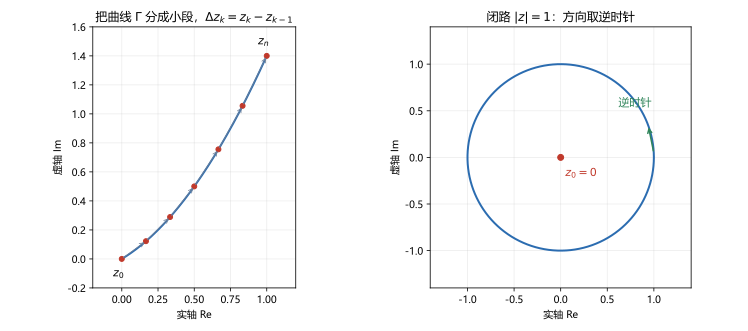

# 第 05 讲 复变函数的积分：路径积分

> **前置**：第 01 讲（复平面点集、单连通）、第 04 讲（复初等函数）。
> **预计时间**：约 3 小时（含作业）。
> **本讲回答**：复积分到底是什么？为什么不是面积？怎么算？为什么有的积分与路径无关、有的有关？$\oint dz/z$ 为什么等于 $2\pi i$？

## 本讲要解决什么

前四讲解决的是"点"和"函数"：复数是点，复变函数把点搬到点，解析函数是性质最好的一类。这一讲开始"沿路径累加"。

学完之后，你应该能做到：

- 写出复积分的定义，说清它与实线积分的关系；
- 把一条路径参数化，把复积分化成定积分算出来；
- 用方向性质、路径可加性和线性性拆分积分；
- 用 ML 不等式估计积分的模；
- 判断两个积分是否与路径有关，并说清判断依据；
- 独立算出 $\oint_{\lvert z-z_0\rvert=r}\frac{dz}{(z-z_0)^n}$ 的两种结果。

---

## 1. 复积分的定义

### 1.1 从"求和取极限"开始

设 $\Gamma$ 是复平面上一条**有向曲线**：从起点到终点，方向已经指定。在 $\Gamma$ 上从起点到终点依次取分点

$$z_0,z_1,\dots,z_n,$$

把曲线分成 $n$ 小段。第 $k$ 段的增量是

$$\Delta z_k=z_k-z_{k-1}.$$

在每一小段上任取一点 $\zeta_k$，作和

$$S_n=\sum_{k=1}^{n}f(\zeta_k)\Delta z_k.$$

令所有小段长度的最大值

$$\lambda=\max_{1\le k\le n}\lvert\Delta z_k\rvert\to0.$$

如果 $S_n$ 的极限存在，且与分法、$\zeta_k$ 的取法都无关，就称这个极限为 $f$ 沿 $\Gamma$ 的**积分**，记作

$$\int_\Gamma f(z)\,dz=\lim_{\lambda\to0}\sum_{k=1}^{n}f(\zeta_k)\Delta z_k.$$

如果 $\Gamma$ 是闭合曲线，积分记作

$$\oint_\Gamma f(z)\,dz.$$



左边是把曲线分成小段、每段用 $\Delta z_k$ 近似；右边是闭路积分，方向取逆时针。

**口径声明**：本课程中，闭路积分默认取**逆时针**方向；如果题目指定顺时针，积分值加负号。这个约定来自复平面上的正方向定义，后面留数定理会一直用到。

### 1.2 与实线积分的关系

把 $f=u+iv$ 和 $dz=dx+i\,dy$ 代入：

$$
f\,dz=(u+iv)(dx+i\,dy)=(u\,dx-v\,dy)+i(v\,dx+u\,dy).
$$

所以

$$\int_\Gamma f\,dz=\int_\Gamma(u\,dx-v\,dy)+i\int_\Gamma(v\,dx+u\,dy).$$

右边是两个实的第二类曲线积分。这个式子说明：**复积分可以用实线积分来算**，但通常参数化更直接。

### 1.3 复积分是复数，不是面积

实积分 $\int_a^b f(x)\,dx$ 在 $f\ge0$ 时可以理解为面积。复积分没有这个含义：

- 被积函数是复数，$dz$ 也是复数，乘起来还是复数；
- 积分结果是一个复数，不是实数；
- 路径的方向会改变符号，面积不会。

所以不要把"面积"的直觉搬到复积分上。复积分更像"沿路径把一堆带方向的小复数加起来"。

---

## 2. 参数化计算

### 2.1 公式

设曲线 $\Gamma$ 由参数方程

$$z(t)=x(t)+iy(t),\qquad a\le t\le b$$

给出，且 $z(t)$ 连续可导、$z'(t)\ne0$（分段光滑即可，分段处分开积）。则

$$\int_\Gamma f(z)\,dz=\int_a^b f\bigl(z(t)\bigr)z'(t)\,dt.$$

**为什么？** 因为 $\Delta z_k\approx z'(t_k)\Delta t_k$，把求和换成对 $t$ 的黎曼和，取极限即得。

### 2.2 例：沿直线积 $z^2$

计算

$$\int_\Gamma z^2\,dz,$$

其中 $\Gamma$ 是从 $0$ 到 $1+i$ 的直线段。

参数化：$z(t)=(1+i)t$，$t\in[0,1]$，$z'(t)=1+i$。

$$
\int_\Gamma z^2\,dz
=\int_0^1(1+i)^2t^2\cdot(1+i)\,dt
=(1+i)^3\int_0^1t^2\,dt
=\frac{(1+i)^3}{3}.
$$

而

$$(1+i)^2=2i,\qquad (1+i)^3=2i(1+i)=-2+2i.$$

所以

$$\int_\Gamma z^2\,dz=\frac{-2+2i}{3}=-\frac23+\frac23i.$$

**数值核对**（脚本 `scripts/lec05-01_verify_path_integral.py`，EXP6）：数值积分给 $-0.666667+0.666667i$，与解析值一致。

### 2.3 例：沿单位圆积 $1/z$

计算

$$\oint_{\lvert z\rvert=1}\frac{dz}{z}.$$

参数化：$z(t)=e^{it}$，$t\in[0,2\pi]$，$z'(t)=ie^{it}$。

$$
\oint\frac{dz}{z}
=\int_0^{2\pi}\frac{1}{e^{it}}\cdot ie^{it}\,dt
=i\int_0^{2\pi}dt
=2\pi i.
$$

注意中间 $e^{it}$ 完全约掉了，只剩下 $i$ 对 $t$ 积分。所以结果与圆的半径无关：换任何半径 $r>0$，参数化 $z=re^{it}$，$dz=ire^{it}dt$，

$$\oint_{\lvert z\rvert=r}\frac{dz}{z}=\int_0^{2\pi}\frac{ire^{it}}{re^{it}}dt=2\pi i.$$

**数值核对**（EXP1、EXP2）：

```
r=0.5: integral = 0.000000+6.283185j
r=1.0: integral = 0.000000+6.283185j
r=2.0: integral = 0.000000+6.283185j
r=3.0: integral = 0.000000+6.283185j
```

$6.283185=2\pi$。四个半径给出同一个值。

### 2.4 例：不含原点的圆

如果圆不围住原点，结果会变。取圆心在 $2$、半径为 $1$ 的圆：

$$\oint_{\lvert z-2\rvert=1}\frac{dz}{z}.$$

参数化：$z=2+e^{it}$，$t\in[0,2\pi]$，$dz=ie^{it}dt$。

$$\oint\frac{dz}{z}=\int_0^{2\pi}\frac{ie^{it}}{2+e^{it}}dt.$$

这个积分不能像上面那样直接约掉。数值积分给

```
integral = 0.000000e+00 - 1.665335e-16j
```

在浮点误差范围内是 $0$。**为什么是零，第 06 讲会回答**：因为 $1/z$ 在 $\lvert z-2\rvert<1$ 内解析，柯西定理说闭路积分为零。

这个对比很重要：

- 围着原点转：$2\pi i$；
- 不围原点转：$0$。

差别不在函数，而在**路径是否围住了函数的奇点**。

### 2.5 一个通用公式

对任意整数 $n$，考虑

$$\oint_{\lvert z-z_0\rvert=r}\frac{dz}{(z-z_0)^n}.$$

参数化 $z=z_0+re^{it}$，$dz=ire^{it}dt$：

$$
\oint\frac{dz}{(z-z_0)^n}
=\int_0^{2\pi}\frac{ire^{it}}{r^ne^{int}}dt
=ir^{1-n}\int_0^{2\pi}e^{i(1-n)t}dt.
$$

分两种情况：

- $n=1$：被积函数是 $1$，积分是 $2\pi$，乘 $i$ 得 $2\pi i$；
- $n\ne1$：$\int_0^{2\pi}e^{i(1-n)t}dt=0$，因为指数函数在一个整周期上的积分为零（$1-n$ 是非零整数）。

所以

$$
\oint_{\lvert z-z_0\rvert=r}\frac{dz}{(z-z_0)^n}=
\begin{cases}
2\pi i,&n=1,\\
0,&n\ne1,\ n\in\mathbb Z.
\end{cases}
$$

**这个结果要背下来。** 第 06 讲用它证明柯西定理，第 11 讲用它算洛朗系数，第 13 讲用它证明留数定理。整门课的核心数字就是 $2\pi i$。

---

## 3. 积分的基本性质

### 3.1 线性性

$$\int_\Gamma\bigl[\alpha f(z)+\beta g(z)\bigr]dz=\alpha\int_\Gamma f(z)\,dz+\beta\int_\Gamma g(z)\,dz,$$

其中 $\alpha,\beta$ 是复常数。由定义的求和直接可得。

### 3.2 方向反转

设 $-\Gamma$ 表示与 $\Gamma$ 方向相反的曲线，则

$$\int_{-\Gamma}f(z)\,dz=-\int_\Gamma f(z)\,dz.$$

因为每一段的 $\Delta z_k$ 都变号。

### 3.3 路径可加

如果 $\Gamma$ 由 $\Gamma_1$ 和 $\Gamma_2$ 首尾相接组成，则

$$\int_\Gamma f\,dz=\int_{\Gamma_1}f\,dz+\int_{\Gamma_2}f\,dz.$$

### 3.4 ML 不等式

设 $f$ 在 $\Gamma$ 上连续，且

$$\lvert f(z)\rvert\le M\quad(z\in\Gamma),\qquad L=\text{$\Gamma$ 的长度},$$

则

$$\left\lvert\int_\Gamma f(z)\,dz\right\rvert\le ML.$$

**证明**：对任意分法，

$$
\left\lvert\sum f(\zeta_k)\Delta z_k\right\rvert
\le\sum\lvert f(\zeta_k)\rvert\,\lvert\Delta z_k\rvert
\le M\sum\lvert\Delta z_k\rvert.
$$

而 $\sum\lvert\Delta z_k\rvert$ 是折线长度，取极限趋于曲线长度 $L$。所以积分模不超过 $ML$。

**例 5.1** 估计

$$\left\lvert\oint_{\lvert z\rvert=2}\frac{dz}{z^2+1}\right\rvert.$$

在 $\lvert z\rvert=2$ 上，

$$\lvert z^2+1\rvert\ge\lvert z\rvert^2-1=3,$$

所以 $\lvert f\rvert\le1/3$。曲线长度 $L=2\pi\cdot2=4\pi$。于是

$$\left\lvert\oint\frac{dz}{z^2+1}\right\rvert\le\frac13\cdot4\pi=\frac{4\pi}{3}\approx4.1888.$$

**数值核对**（EXP7）：实际积分的模是 $1.57\times10^{-16}$，远小于上界。ML 不等式只给上界，不给等号；上界宽松是正常的。实际值为什么接近零，同样是第 06 讲的问题。

---

## 4. 路径无关与路径相关

### 4.1 与路径无关的例子：$f(z)=z$

计算从 $z_0=0$ 到 $z_1=1+i$ 的积分。

**路径一：直线** $z=(1+i)t$，$t\in[0,1]$。

$$\int_\Gamma z\,dz=\int_0^1(1+i)t\cdot(1+i)\,dt=(1+i)^2\int_0^1t\,dt=\frac{(1+i)^2}{2}=i.$$

**路径二：折线** 先沿实轴从 $0$ 到 $1$，再竖直从 $1$ 到 $1+i$。

第一段：$z=t$，$t\in[0,1]$，$dz=dt$，

$$\int_0^1t\,dt=\frac12.$$

第二段：$z=1+it$，$t\in[0,1]$，$dz=i\,dt$，

$$\int_0^1(1+it)i\,dt=\int_0^1(i-t)\,dt=i-\frac12.$$

两段相加：

$$\frac12+i-\frac12=i.$$

与直线结果相同。

**为什么？** 因为 $z$ 有原函数 $z^2/2$，积分只依赖端点：

$$\int_{z_0}^{z_1}z\,dz=\left[\frac{z^2}{2}\right]_{z_0}^{z_1}=\frac{z_1^2-z_0^2}{2}=\frac{(1+i)^2}{2}=i.$$

**数值核对**（EXP4）：直线、折线、公式三者都给 $0+1.000000i$。

### 4.2 与路径有关的例子：$f(z)=\bar z$

同样从 $0$ 到 $1+i$。

**路径一：直线** $z=(1+i)t$，$\bar z=(1-i)t$，$dz=(1+i)dt$。

$$\int_0^1(1-i)t\cdot(1+i)\,dt=\int_0^12t\,dt=1.$$

**路径二：折线**。

第一段：$z=t$，$\bar z=t$，$dz=dt$，

$$\int_0^1t\,dt=\frac12.$$

第二段：$z=1+it$，$\bar z=1-it$，$dz=i\,dt$，

$$\int_0^1(1-it)i\,dt=\int_0^1(i+t)\,dt=i+\frac12.$$

两段相加：

$$\frac12+i+\frac12=1+i.$$

两个结果不同：$1\ne1+i$。所以 $\bar z$ 的积分与路径有关。

**数值核对**（EXP5）：直线给 $1.000000$，折线给 $1.000000+1.000000i$，与手算一致。

### 4.3 差在哪里

$z$ 解析，$\bar z$ 不解析（第 03 讲）。

但"解析"单独还不够，还要看区域有没有洞。第 06、07 讲会给出完整结论：

> 如果 $f$ 在**单连通区域** $D$ 内解析，那么 $D$ 内任意两条连接相同起终点的路径，积分值相同。

这就是**路径无关**的条件。$1/z$ 在挖去原点的平面上解析，但那不是单连通区域，所以沿着围住原点和没围住原点的两条路径，积分值不同（$2\pi i$ 对 $0$）。两个条件缺一不可。

---

## 5. 本讲小结

| 概念 | 要点 | 用在哪 |
|---|---|---|
| 复积分 | 沿有向曲线对 $f(z)\Delta z$ 求和取极限 | 全课程 |
| 参数化 | $\int_\Gamma f\,dz=\int_a^b f(z(t))z'(t)dt$ | 计算 |
| 方向 | 反向积分变号；闭路默认逆时针 | 留数定理 |
| 线性与可加 | 可拆路径、可拆函数 | 计算 |
| ML 不等式 | $\left\lvert\int_\Gamma f\,dz\right\rvert\le ML$ | 估计、证明极限为零 |
| 路径无关 | 解析 + 单连通时成立 | 第 06、07 讲 |
| 核心积分 | $\oint dz/(z-z_0)=2\pi i$，$n\ne1$ 时为 $0$ | 第 06、11、13 讲 |

三句话带走：

1. 复积分是沿路径累加复数，不是面积。
2. 参数化是通用算法：把 $z$ 写成 $t$ 的函数，$dz=z'(t)dt$。
3. $\oint dz/z=2\pi i$ 只与"是否围住原点"有关，与半径无关。

---

## 6. 掌握度自测

- [ ] 能写出复积分的定义，并解释 $\lambda\to0$ 的含义。
- [ ] 能把直线、圆、折线参数化并代入积分。
- [ ] 能独立算出 $\oint_{\lvert z\rvert=1}dz/z=2\pi i$。
- [ ] 能说出为什么换半径结果不变。
- [ ] 能用 ML 不等式给出积分的上界。
- [ ] 能判断 $z$ 与 $\bar z$ 的积分是否路径相关，并说出理由。
- [ ] 能默写 $\oint dz/(z-z_0)^n$ 的两种结果。

---

## 作业

### 基础

**1.** 沿从 $0$ 到 $2+i$ 的直线计算 $\displaystyle\int_\Gamma z\,dz$。

**参考答案：**

参数化 $z=(2+i)t$，$t\in[0,1]$，$dz=(2+i)dt$。

$$
\int_\Gamma z\,dz=\int_0^1(2+i)t(2+i)\,dt=(2+i)^2\int_0^1t\,dt=\frac{(2+i)^2}{2}.
$$

$$(2+i)^2=4+4i-1=3+4i,$$

所以积分等于

$$\frac{3+4i}{2}=1.5+2i.$$

验算：用原函数 $z^2/2$，端点 $2+i$ 与 $0$，得 $(2+i)^2/2$，一致。

---

**2.** 沿单位圆上半部分（从 $1$ 逆时针到 $-1$）计算 $\displaystyle\int_\Gamma\frac{dz}{z}$。

**参考答案：**

参数化 $z=e^{it}$，$0\le t\le\pi$，$dz=ie^{it}dt$。

$$\int_\Gamma\frac{dz}{z}=\int_0^\pi\frac{ie^{it}}{e^{it}}dt=i\pi.$$

注意这不是闭路，所以结果不是 $2\pi i$，而是一半。

---

**3.** 沿两条路径计算 $\displaystyle\int_\Gamma\bar z\,dz$，说明路径相关。

**参考答案：**

取起点 $0$、终点 $1+i$。

直线：$z=(1+i)t$，$\bar z=(1-i)t$，$dz=(1+i)dt$，

$$\int_0^1(1-i)(1+i)t\,dt=2\int_0^1t\,dt=1.$$

折线：先实轴到 $1$，再竖直。

第一段：$z=t$，$\bar z=t$，$dz=dt$，积分 $=\int_0^1t\,dt=\frac12$。

第二段：$z=1+it$，$\bar z=1-it$，$dz=i\,dt$，

$$\int_0^1(1-it)i\,dt=\int_0^1(i+t)\,dt=i+\frac12.$$

合计 $1+i$。

$1\ne1+i$，所以路径相关。原因：$\bar z$ 不解析。

---

**4.** 用 ML 不等式估计 $\displaystyle\left\lvert\oint_{\lvert z\rvert=2}\frac{dz}{z^2+1}\right\rvert$。

**参考答案：**

在 $\lvert z\rvert=2$ 上，$\lvert z^2+1\rvert\ge\lvert z\rvert^2-1=3$，所以

$$\left\lvert\frac{1}{z^2+1}\right\rvert\le\frac13.$$

曲线长度 $L=4\pi$。所以

$$\left\lvert\oint\frac{dz}{z^2+1}\right\rvert\le\frac13\cdot4\pi=\frac{4\pi}{3}\approx4.189.$$

这是上界，实际值可能更小。

---

### 提高

**5.** 计算 $\displaystyle\oint_{\lvert z\rvert=1}z^n\,dz$，$n$ 为整数。

**参考答案：**

参数化 $z=e^{it}$，$dz=ie^{it}dt$：

$$\oint z^n\,dz=\int_0^{2\pi}e^{int}\cdot ie^{it}dt=i\int_0^{2\pi}e^{i(n+1)t}dt.$$

- 若 $n=-1$：被积函数为 $1$，积分 $=2\pi i$；
- 若 $n\ne-1$：$n+1$ 是非零整数，$\int_0^{2\pi}e^{i(n+1)t}dt=0$。

所以

$$
\oint_{\lvert z\rvert=1}z^n\,dz=
\begin{cases}
2\pi i,&n=-1,\\
0,&n\ne-1.
\end{cases}
$$

---

**6.** 计算 $\displaystyle\int_\Gamma(z^2+1)\,dz$，$\Gamma$ 是从 $0$ 到 $i$ 的任意路径。

**参考答案：**

$z^2+1$ 有原函数 $z^3/3+z$，所以积分与路径无关：

$$
\int_0^i(z^2+1)\,dz=\left[\frac{z^3}{3}+z\right]_0^i
=\frac{i^3}{3}+i=-\frac{i}{3}+i=\frac{2i}{3}.
$$

---

**7.** 证明

$$\int_\Gamma f(z)\,dz=\int_\Gamma(u\,dx-v\,dy)+i\int_\Gamma(v\,dx+u\,dy).$$

**参考答案：**

由 $f=u+iv$，$dz=dx+i\,dy$：

$$
f\,dz=(u+iv)(dx+i\,dy)=u\,dx+iu\,dy+iv\,dx+i^2v\,dy.
$$

用 $i^2=-1$ 合并：

$$=(u\,dx-v\,dy)+i(v\,dx+u\,dy).$$

两边沿 $\Gamma$ 积分，实部虚部分别对应两个实线积分。

---

**8.** 计算 $\displaystyle\oint_{\lvert z-1\rvert=1}\frac{dz}{(z-1)^2}$。

**参考答案：**

这是 $n=2$ 的情形，由本讲 2.5 节的公式：

$$\oint_{\lvert z-z_0\rvert=r}\frac{dz}{(z-z_0)^n}=0,\qquad n\ne1.$$

取 $z_0=1$，$n=2$，结果为 $0$。

直接验算：$z=1+e^{it}$，$dz=ie^{it}dt$，

$$\int_0^{2\pi}\frac{ie^{it}}{e^{2it}}dt=i\int_0^{2\pi}e^{-it}dt=0.$$

---

### 综合

**9.** 计算 $\displaystyle\oint_{\lvert z\rvert=2}\frac{2z+1}{z}\,dz$。

**参考答案：**

拆开：

$$\oint\frac{2z+1}{z}\,dz=\oint2\,dz+\oint\frac{dz}{z}.$$

第一项：常数 $2$ 有原函数 $2z$，闭路积分为 $0$。

第二项：路径 $\lvert z\rvert=2$ 围住原点，由核心公式为 $2\pi i$。

所以总积分为 $2\pi i$。

---

**10.** 证明 ML 不等式：若 $\lvert f(z)\rvert\le M$ 在 $\Gamma$ 上成立，$\Gamma$ 的长度为 $L$，则

$$\left\lvert\int_\Gamma f(z)\,dz\right\rvert\le ML.$$

**参考答案：**

对任意分法，

$$
\left\lvert\sum_{k=1}^nf(\zeta_k)\Delta z_k\right\rvert
\le\sum_{k=1}^n\lvert f(\zeta_k)\rvert\,\lvert\Delta z_k\rvert
\le M\sum_{k=1}^n\lvert\Delta z_k\rvert.
$$

右边是内接折线的长度，当分点越来越密时趋于曲线长度 $L$。所以

$$\left\lvert\int_\Gamma f\,dz\right\rvert=\lim\left\lvert\sum f(\zeta_k)\Delta z_k\right\rvert\le ML.$$

---

**11.** 沿两条路径计算 $\displaystyle\int_\Gamma\operatorname{Re}z\,dz$，说明路径相关，并解释原因。

**参考答案：**

起点 $0$，终点 $1+i$。

直线：$z=(1+i)t$，$\operatorname{Re}z=t$，$dz=(1+i)dt$，

$$\int_0^1t(1+i)\,dt=\frac{1+i}{2}.$$

折线：先实轴到 $1$，再竖直。

第一段：$z=t$，$\operatorname{Re}z=t$，$dz=dt$，积分 $=\frac12$。

第二段：$z=1+it$，$\operatorname{Re}z=1$，$dz=i\,dt$，积分 $=i$。

合计 $\frac12+i$。

两者不同，所以路径相关。

原因：$\operatorname{Re}z=(z+\bar z)/2$ 不是解析函数（它只取实部，虚部恒为零，不满足 C-R），所以不能指望路径无关。

---

## 下一讲预告

这一讲我们算了两个关键结果：

$$\oint_{\lvert z\rvert=1}\frac{dz}{z}=2\pi i,\qquad \oint_{\lvert z-2\rvert=1}\frac{dz}{z}=0.$$

两个积分用的是同一个函数，差别只在路径有没有围住原点。下一讲要把这个现象变成一个定理：**如果函数在单连通区域内解析，那么沿区域内任意闭曲线的积分都是零**。这就是柯西积分定理。它是整门课的中心定理，后面的柯西公式、泰勒展开、留数定理，都是它的推论。
