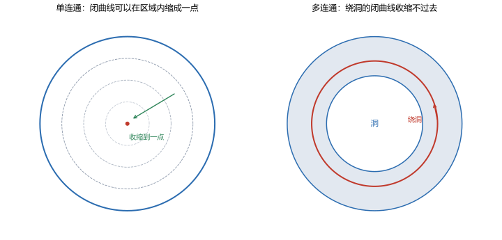

# 第 06 讲 柯西积分定理

> **前置**：第 03 讲（解析、C-R 条件）、第 05 讲（复积分、路径参数化、$\oint dz/z=2\pi i$）。
> **预计时间**：约 3 小时（含作业；本讲是全课程的中心定理，证明要自己推一遍）。
> **本讲回答**：为什么解析函数的闭路积分为零？"单连通"和"解析"两个条件各管什么？缺一个会怎样？什么时候积分与路径无关、什么时候有原函数？

## 本讲要解决什么

第 05 讲算了两个积分：

$$\oint_{\lvert z\rvert=1}\frac{dz}{z}=2\pi i,\qquad \oint_{\lvert z-2\rvert=1}\frac{dz}{z}=0.$$

同一个函数，一个不为零，一个为零。差别只在路径有没有围住原点。

这一讲把这个现象变成定理。学完之后，你应该能做到：

- 完整陈述柯西积分定理，并说出三个条件；
- 用格林公式独立写出证明；
- 对任意一个闭路积分，判断能否直接用定理判零；
- 说出条件缺失时会发生什么，并举出反例；
- 用定理推出路径无关、原函数存在和牛顿-莱布尼茨公式。

---

## 1. 定理的陈述

### 1.1 柯西积分定理

> **柯西积分定理**（Cauchy integral theorem）：设 $f$ 在**单连通区域** $D$ 内**解析**，$\Gamma$ 是 $D$ 内一条**闭曲线**，则
>
> $$\oint_\Gamma f(z)\,dz=0.$$

三个条件缺一不可：

1. $D$ 是单连通的，也就是没有洞；
2. $f$ 在 $D$ 内处处解析；
3. $\Gamma$ 完全落在 $D$ 内，不能穿过洞或边界。

第 2 节给证明，第 3 节给反例。

### 1.2 等价形式：路径无关

如果 $f$ 在单连通区域 $D$ 内解析，那么 $D$ 内任意两条从 $z_0$ 到 $z_1$ 的路径，积分值相同。

**为什么等价？** 设 $\Gamma_1$ 和 $\Gamma_2$ 是两条同起终点的路径。把 $\Gamma_1$ 和 $-\Gamma_2$ 接起来，得到一条闭曲线 $\Gamma$。由柯西定理，

$$0=\oint_\Gamma f\,dz=\int_{\Gamma_1}f\,dz-\int_{\Gamma_2}f\,dz.$$

所以两个积分相等。

反过来，如果积分与路径无关，那么沿任意闭曲线取起点和终点重合，积分必须为零。所以两个说法是一回事。

### 1.3 为什么它是中心定理

后面几乎所有结论都从它推出来：

- 第 07 讲：区域有洞时，把洞挖掉再用它；
- 第 08 讲：由它推出柯西积分公式，进而证明解析函数无穷次可导；
- 第 10 讲：由它推出泰勒级数；
- 第 13 讲：由它推出留数定理。

如果只能记住一个定理，就记这一个。

---

## 2. 证明：用格林公式

### 2.1 回顾格林公式

设 $D$ 是由分段光滑闭曲线 $\Gamma$ 围成的单连通区域，$\Gamma$ 取逆时针方向，$P,Q$ 在 $D$ 上有连续偏导。则

$$\oint_\Gamma P\,dx+Q\,dy=\iint_D\left(\frac{\partial Q}{\partial x}-\frac{\partial P}{\partial y}\right)dx\,dy.$$

这个公式把闭路积分变成二重积分。

### 2.2 把复积分拆成两个实线积分

由第 05 讲 1.2 节，

$$\oint_\Gamma f\,dz=\oint_\Gamma(u\,dx-v\,dy)+i\oint_\Gamma(v\,dx+u\,dy).$$

对第一个积分，取 $P=u$，$Q=-v$。由格林公式，

$$\oint_\Gamma(u\,dx-v\,dy)=\iint_D\left(-v_x-u_y\right)dx\,dy.$$

对第二个积分，取 $P=v$，$Q=u$：

$$\oint_\Gamma(v\,dx+u\,dy)=\iint_D\left(u_x-v_y\right)dx\,dy.$$

### 2.3 用 C-R 条件让两个二重积分为零

因为 $f$ 解析，C-R 成立：

$$u_x=v_y,\qquad u_y=-v_x.$$

代入：

$$-v_x-u_y=-v_x-(-v_x)=0,$$

$$u_x-v_y=u_x-u_x=0.$$

所以两个二重积分都是零，于是

$$\oint_\Gamma f\,dz=0.$$

证毕。

### 2.4 这个证明要求什么

格林公式要求 $P,Q$ 有连续偏导，对应到这里就是 $u,v$ 有连续偏导，也就是 $f'$ 连续。

**柯西-古萨定理**（Cauchy-Goursat theorem）去掉了"$f'$ 连续"这个额外要求，只要求 $f$ 解析。证明需要更细的三角形分割和一致连续论证，超出本课程范围。本课程使用"$f'$ 连续"的版本，结论相同；做题时按"解析"使用即可。

### 2.5 数值核对

**解析函数绕单位圆**（脚本 `scripts/lec06-01_verify_cauchy.py`，EXP1、EXP2）：

```
z^2:  integral = 0.000e+00 - 1.110e-16j
exp:  integral = 4.441e-16 - 7.772e-16j
```

在浮点误差范围内都是零。

**不同形状的闭路**（EXP5）：

```
z^2 绕正方形: +1.110e-16 + 2.220e-16j
z^2 绕三角形: +0.000e+00 + 1.039e-09j
```

都趋于零。三角形的虚部误差略大（$10^{-9}$），因为三角形由三段直线拼成，在顶点处不光滑，数值积分的误差比光滑圆大一个量级。这是数值方法的误差，不是定理的问题。

---

## 3. 条件缺一不可

### 3.1 缺"函数在内部解析"

取 $D=\{|z|<1\}$，这是单连通区域。取 $f(z)=1/z$。

$1/z$ 在 $D$ 内除了 $z=0$ 之外都解析，但 $z=0$ 在 $D$ 内，所以 $f$ 在 $D$ 内**不解析**。柯西定理用不了。

实际计算：

$$\oint_{\lvert z\rvert=1}\frac{dz}{z}=2\pi i\ne0.$$

这正是第 05 讲的结果。如果只看到"$D$ 单连通"就套定理，会得到错误结论。

### 3.2 缺"区域单连通"

取 $D=\mathbb C\setminus\{0\}$，这是多连通区域。取 $f(z)=1/z$。

$1/z$ 在 $D$ 内处处解析，没有奇点。但 $D$ 有洞，不单连通。柯西定理用不了。

实际计算：

$$\oint_{\lvert z\rvert=1}\frac{dz}{z}=2\pi i\ne0.$$

两个反例用的是同一个函数、同一个积分，但缺的条件不同：

| 情形 | 区域 | 函数 | 缺哪个条件 | 积分 |
|---|---|---|---|---|
| 3.1 | 圆盘（单连通） | $1/z$ | $f$ 在内部解析 | $2\pi i$ |
| 3.2 | 挖心平面（多连通） | $1/z$ | 区域单连通 | $2\pi i$ |

这说明两个条件各管一件事，不能互相替代。



左图是单连通区域：任意闭曲线可以缩成一点。右图是多连通区域：绕洞的闭曲线收缩不过去。柯西定理只对左图这种区域成立。

### 3.3 奇点在外部时，定理仍然可用

取 $D=\{|z-2|<1\}$，这是单连通区域。取 $f(z)=1/z$。

$f$ 的奇点在 $z=0$，不在 $D$ 内。所以在 $D$ 内 $f$ 处处解析，柯西定理适用：

$$\oint_{\lvert z-2\rvert=1}\frac{dz}{z}=0.$$

**数值核对**（EXP4）：

```
integral = 0.000e+00 - 1.665e-16j
```

零。

**判断流程**：拿到一个闭路积分，先画图，标出被积函数的奇点，再看闭路内部有没有奇点：

- 内部无奇点，且闭路围成的区域单连通：积分为零；
- 内部有奇点：不能用柯西定理，需要第 07、13 讲的方法。

### 3.4 数值核对：围住奇点的情况

EXP3：

```
integral = 0.000000 + 6.283185j
```

$6.283185=2\pi$。与第 05 讲一致。

---

## 4. 路径无关、原函数与牛顿-莱布尼茨公式

### 4.1 路径无关

由 1.2 节，柯西定理等价于：在单连通区域内，解析函数的积分只依赖起点和终点，不依赖路径。

**例 6.1** $f(z)=e^z$ 在全平面解析。从 $0$ 到 $1+i$ 的积分，沿直线和沿折线应该相同。

**数值核对**（EXP6）：

```
straight    = +0.468694 + 2.287355j
broken      = +0.468694 + 2.287355j
F(z1)-F(z0) = +0.468694 + 2.287355j
```

三者一致。第三行用原函数 $F(z)=e^z$ 算：

$$e^{1+i}-e^0=e(\cos1+i\sin1)-1.$$

### 4.2 原函数存在定理

设 $f$ 在单连通区域 $D$ 内解析。固定 $z_0\in D$，定义

$$F(z)=\int_{z_0}^{z}f(\zeta)\,d\zeta,$$

其中积分沿 $D$ 内任意一条从 $z_0$ 到 $z$ 的路径。由于积分与路径无关，$F(z)$ 是良定义的。可以证明 $F$ 在 $D$ 内解析，且

$$F'(z)=f(z).$$

所以 $F$ 是 $f$ 的一个**原函数**。

**证明思路**：算差商

$$\frac{F(z+\Delta z)-F(z)}{\Delta z}=\frac{1}{\Delta z}\int_z^{z+\Delta z}f(\zeta)\,d\zeta.$$

把 $f(\zeta)$ 写成 $f(z)+[f(\zeta)-f(z)]$，第一项积出 $f(z)$，第二项用 $f$ 的连续性证明它趋于零。细节略，思路是"从 $z$ 到 $z+\Delta z$ 走直线段"。

### 4.3 牛顿-莱布尼茨公式

如果 $F$ 是 $f$ 在单连通区域 $D$ 内的原函数，则对 $D$ 内任意从 $a$ 到 $b$ 的路径，

$$\int_a^b f(z)\,dz=F(b)-F(a).$$

证明与实函数相同：把路径参数化，用链式法则：

$$\frac{d}{dt}F(z(t))=F'(z(t))z'(t)=f(z(t))z'(t),$$

再对 $t$ 积分。

**例 6.2** 计算 $\displaystyle\int_0^i z^2\,dz$。

$z^2$ 有原函数 $z^3/3$，所以

$$\int_0^i z^2\,dz=\left[\frac{z^3}{3}\right]_0^i=\frac{i^3}{3}=-\frac{i}{3}.$$

### 4.4 一个重要的反面：$1/z$ 没有原函数

在挖心平面 $D=\mathbb C\setminus\{0\}$ 上，$1/z$ 解析，但**没有原函数**。

**为什么？** 如果存在 $F$ 使 $F'=1/z$，那么由牛顿-莱布尼茨公式，

$$\oint_{\lvert z\rvert=1}\frac{dz}{z}=F(1)-F(1)=0.$$

但实际积分是 $2\pi i\ne0$，矛盾。所以原函数不存在。

这个例子说明：**"解析"不足以保证有原函数，还需要区域单连通。** 单连通是"没有洞"的拓扑条件，正好对应"绕着洞积一圈回不来"的现象。

### 4.5 什么时候能用牛顿-莱布尼茨公式

判断顺序：

1. 先找 $f$ 的原函数 $F$。如果 $F$ 是初等函数（多项式、指数、三角等），通常可以直接用；
2. 再检查积分路径是否完全落在 $F$ 的解析区域内。如果路径绕过了 $f$ 的奇点，公式可能失效；
3. 如果路径穿过奇点或绕奇点一圈，改用留数法（第 13、14 讲）。

**例 6.3** $\displaystyle\int_{-1}^{1}\frac{dz}{z}$ 沿上半单位圆。

$1/z$ 的原函数是 $\ln z$，但 $\ln z$ 在负实轴上有分支切割。路径的起点 $-1$ 就在切割线上，所以要先确定用哪一个分支：沿上半圆趋近时，$\operatorname{Arg}(-1)$ 应取 $\pi$，不是 $-\pi$。

实际上参数化 $z=e^{it}$，$t$ 从 $\pi$ 到 $0$：

$$\int_\pi^0\frac{ie^{it}}{e^{it}}dt=\int_\pi^0i\,dt=-i\pi.$$

与 $\ln1-\ln(-1)$ 一致，但这是因为路径没有绕原点整圈。如果绕整圈，结果就是 $2\pi i$，与端点无关。

---

## 5. 闭路变形原理（预告）

柯西定理还有一个几何版本：

> 如果两条闭曲线 $\Gamma_1,\Gamma_2$ 围成的环形区域内没有 $f$ 的奇点，那么
>
> $$\oint_{\Gamma_1}f\,dz=\oint_{\Gamma_2}f\,dz.$$

也就是说，闭曲线可以在不越过奇点的前提下任意变形，积分值不变。

这个原理是第 07 讲"复合闭路定理"的基础。它把"有洞的区域"化成"绕着洞的小圆"，从而把复杂积分变成第 05 讲已经算过的标准积分。

---

## 6. 本讲小结

| 内容 | 要点 | 条件 |
|---|---|---|
| 柯西积分定理 | $\oint_\Gamma f\,dz=0$ | 单连通区域 + $f$ 解析 + 闭路在区域内 |
| 路径无关 | 同起终点积分相等 | 同上 |
| 原函数存在 | $F(z)=\int_{z_0}^z f\,d\zeta$，$F'=f$ | 单连通 + 解析 |
| 牛顿-莱布尼茨 | $\int_a^b f\,dz=F(b)-F(a)$ | $F$ 是 $f$ 的原函数，路径不越过奇点 |
| $1/z$ 的反例 | 解析但无原函数 | 区域多连通 |

三句话带走：

1. 柯西定理的三个条件：单连通、解析、闭路在区域内，缺一不可。
2. 有洞的区域不能用，$1/z$ 绕原点是标准反例。
3. 单连通 + 解析 ⇒ 路径无关 ⇒ 有原函数 ⇒ 可用牛顿-莱布尼茨公式。

---

## 7. 掌握度自测

- [ ] 能完整陈述柯西定理，并说出三个条件。
- [ ] 能用格林公式写出证明，并指出证明要求 $f'$ 连续。
- [ ] 能判断一个闭路积分能否直接判零，并画出奇点位置。
- [ ] 能说出两个反例分别缺哪个条件。
- [ ] 能解释为什么 $1/z$ 在挖心平面上没有原函数。
- [ ] 能用牛顿-莱布尼茨公式计算解析函数的积分。
- [ ] 能说出闭路变形原理，并知道它将在第 07 讲使用。

---

## 作业

### 基础

**1.** 计算 $\displaystyle\oint_{\lvert z\rvert=1}(z^3+2z+1)\,dz$。

**参考答案：**

被积函数是多项式，在全平面解析；$\lvert z\rvert=1$ 是单连通区域内的闭曲线。由柯西定理，积分为 $0$。

也可以拆开：$\oint z^3=0$，$\oint2z=0$，$\oint1=0$，三项都为零。

---

**2.** 计算 $\displaystyle\oint_{\lvert z\rvert=1}e^z\,dz$。

**参考答案：**

$e^z$ 在全平面解析，单位圆盘单连通。由柯西定理，积分为 $0$。

---

**3.** 计算 $\displaystyle\oint_{\lvert z\rvert=2}\frac{dz}{z-3}$。

**参考答案：**

$f(z)=1/(z-3)$ 的奇点是 $z=3$。圆 $\lvert z\rvert=2$ 的内部是 $\lvert z\rvert<2$，不包含 $3$。所以 $f$ 在圆盘内解析，圆盘单连通，由柯西定理：

$$\oint_{\lvert z\rvert=2}\frac{dz}{z-3}=0.$$

---

**4.** 用牛顿-莱布尼茨公式计算 $\displaystyle\int_0^i z^2\,dz$。

**参考答案：**

原函数 $F(z)=z^3/3$。

$$\int_0^i z^2\,dz=\frac{i^3}{3}-0=-\frac{i}{3}.$$

---

### 提高

**5.** 说明 $\displaystyle\oint_{\lvert z\rvert=1}\frac{dz}{z}=2\pi i$ 为什么不违反柯西定理。

**参考答案：**

柯西定理要求 $f$ 在整个圆盘 $\lvert z\rvert<1$ 内解析。$f(z)=1/z$ 在 $z=0$ 没有定义，更不解析，而 $z=0$ 在圆盘内部。

所以"$f$ 在区域内解析"这个条件不满足，定理不能用。积分不为零并不矛盾。

---

**6.** 计算 $\displaystyle\oint_{\lvert z\rvert=1}\frac{z+1}{z^2+4}\,dz$。

**参考答案：**

分母的零点是 $z=\pm2i$。两点都在 $\lvert z\rvert=1$ 的外部（模为 $2$）。

所以在圆盘 $\lvert z\rvert<1$ 内，被积函数解析；圆盘单连通。由柯西定理，积分为 $0$。

---

**7.** 证明：若 $f$ 在单连通区域 $D$ 内解析，$z_0,z_1\in D$，则 $D$ 内任意两条从 $z_0$ 到 $z_1$ 的路径积分相等。

**参考答案：**

设两条路径为 $\Gamma_1,\Gamma_2$。把 $\Gamma_1$ 与 $-\Gamma_2$ 首尾相接，得到 $D$ 内一条闭曲线 $\Gamma$。

由柯西定理，

$$0=\oint_\Gamma f\,dz=\int_{\Gamma_1}f\,dz+\int_{-\Gamma_2}f\,dz=\int_{\Gamma_1}f\,dz-\int_{\Gamma_2}f\,dz.$$

所以两个积分相等。

---

**8.** 计算 $\displaystyle\int_\Gamma(2z+1)\,dz$，$\Gamma$ 是从 $0$ 到 $1+i$ 的任意路径。

**参考答案：**

被积函数在全平面解析，原函数 $F(z)=z^2+z$。路径可任意，因为全平面单连通。

$$F(1+i)-F(0)=(1+i)^2+(1+i)=2i+1+i=1+3i.$$

---

### 综合

**9.** 用格林公式证明柯西积分定理。

**参考答案：**

设 $f=u+iv$ 在单连通区域 $D$ 内解析，$\Gamma$ 是 $D$ 内逆时针闭曲线。

$$\oint_\Gamma f\,dz=\oint_\Gamma(u\,dx-v\,dy)+i\oint_\Gamma(v\,dx+u\,dy).$$

对第一项用格林公式，取 $P=u$，$Q=-v$：

$$\oint_\Gamma(u\,dx-v\,dy)=\iint_D(-v_x-u_y)\,dx\,dy.$$

对第二项，取 $P=v$，$Q=u$：

$$\oint_\Gamma(v\,dx+u\,dy)=\iint_D(u_x-v_y)\,dx\,dy.$$

由 C-R 条件 $u_x=v_y$，$u_y=-v_x$：

$$-v_x-u_y=-v_x+v_x=0,\qquad u_x-v_y=u_x-u_x=0.$$

所以两个二重积分都为零，$\oint_\Gamma f\,dz=0$。

---

**10.** 计算 $\displaystyle\oint_{\lvert z\rvert=1}\frac{dz}{z^2-4}$，并说明理由。

**参考答案：**

$z^2-4=(z-2)(z+2)$，奇点在 $z=\pm2$。

两点都在 $\lvert z\rvert=1$ 外部。圆盘 $\lvert z\rvert<1$ 内被积函数解析，圆盘单连通。由柯西定理，积分为 $0$。

---

**11.** 设 $f$ 在 $\lvert z\rvert\le1$ 上解析，证明对任意 $0<r<1$，

$$\oint_{\lvert z\rvert=r}f(z)\,dz=0.$$

**参考答案：**

对固定的 $r\in(0,1)$，闭路 $\lvert z\rvert=r$ 围成的圆盘 $\lvert z\rvert<r$ 包含在 $\lvert z\rvert<1$ 内。

$f$ 在 $\lvert z\rvert<1$ 内解析，所以在 $\lvert z\rvert<r$ 内也解析。圆盘单连通。由柯西定理，积分为 $0$。

---

## 下一讲预告

柯西定理要求区域单连通。但实际遇到的区域经常有洞，例如圆环、挖去几个点的平面。

下一讲处理这种情况：把洞"挖掉"，沿外边界和各洞的边界分别积分，得到**复合闭路定理**。它的直接后果是"闭路可以任意变形，只要不越过奇点"，于是复杂路径上的积分可以换成小圆上的积分。第 05 讲已经算过的

$$\oint_{\lvert z-z_0\rvert=r}\frac{dz}{z-z_0}=2\pi i$$

会成为最常用的替换工具。
