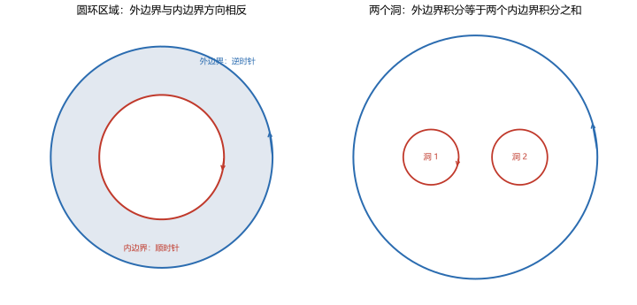

# 第 07 讲 复合闭路定理与原函数

> **前置**：第 05 讲（参数化积分、$\oint dz/(z-z_0)^n$）、第 06 讲（柯西积分定理、单连通、原函数）。
> **预计时间**：约 3 小时（含作业）。
> **本讲回答**：区域有洞时柯西定理怎么用？内边界的方向为什么与外边界相反？为什么 $1/z$ 没有原函数而 $1/z^2$ 有？多连通区域上什么时候仍存在原函数？

## 本讲要解决什么

第 06 讲的柯西定理要求区域单连通。但实际问题里的区域经常有洞：

- 圆环 $\{1<\lvert z\rvert<2\}$；
- 挖去原点的平面 $\mathbb C\setminus\{0\}$；
- 挖去几个奇点的区域。

这些区域是多连通的，柯西定理不能直接用。这一讲给出补救办法：**沿着所有边界一起积分**。

学完之后，你应该能做到：

- 画出复合闭路的方向：外边界逆时针，内边界顺时针；
- 写出复合闭路定理，并用割线说明它为什么成立；
- 把复杂路径上的积分变形为小圆上的积分；
- 用四步流程计算挖心区域上的积分；
- 判断一个多连通区域上的解析函数有没有原函数。

---

## 1. 多连通区域的困难

### 1.1 柯西定理为什么用不了

取圆环

$$D=\{z:1<\lvert z\rvert<2\}.$$

这是多连通区域，中间的洞 $\lvert z\rvert\le1$ 不在 $D$ 内。

取 $f(z)=1/z$。它在 $D$ 内处处解析，没有奇点。但柯西定理要求 $D$ 单连通，所以不能直接得到

$$\oint_{\lvert z\rvert=1.5}\frac{dz}{z}=0.$$

实际计算这个积分是 $2\pi i$（第 05 讲），确实不为零。所以定理的限制是实质性的，不是形式上的。

### 1.2 思路：把洞也围起来

单连通的问题在于"洞没被围住"。如果沿着外边界走一圈，再沿着内边界反向走一圈，两部分合起来就是一个"复合闭路"，它把整个圆环区域围在中间。

关键在于**方向**：

- 沿外边界逆时针走，区域在左手边；
- 沿内边界顺时针走，区域仍在左手边。

如果内边界也取逆时针，区域就在右手边，两个边界的贡献会相减而不是相加。所以内边界必须反过来。

---

## 2. 复合闭路定理

### 2.1 方向约定

对于由外边界 $\Gamma$ 和若干个内边界 $\gamma_1,\dots,\gamma_n$ 围成的区域 $D$，规定：

- $\Gamma$ 取**逆时针**；
- 每个 $\gamma_k$ 取**顺时针**（相对于洞而言）。

这样沿每一条边界行走时，区域 $D$ 都在左手边。这个"区域在左"的约定与格林公式、曲线积分的方向约定一致。

### 2.2 定理

> **复合闭路定理**：设 $D$ 是由外边界 $\Gamma$ 和内边界 $\gamma_1,\dots,\gamma_n$ 围成的多连通区域，$f$ 在 $D$ 内及所有边界上解析，则
>
> $$\oint_\Gamma f(z)\,dz+\sum_{k=1}^{n}\oint_{\gamma_k^-}f(z)\,dz=0,$$
>
> 其中 $\Gamma$ 逆时针，$\gamma_k^-$ 表示顺时针方向。

把内边界移到等号右边，并注意反向积分变号：

$$\oint_\Gamma f\,dz=\sum_{k=1}^{n}\oint_{\gamma_k}f\,dz,$$

右边每个 $\gamma_k$ 都取**逆时针**。

**用一句话说**：沿外边界逆时针的积分，等于沿每个洞的边界逆时针积分之和。

### 2.3 证明思路：一条割线

把多连通区域变成单连通，只需要切一刀。

从外边界某点 $A$ 到内边界某点 $B$ 画一条割线，把圆环切开。切开后的区域是单连通的，边界由四段组成：

1. 外边界从 $A$ 逆时针绕一整圈回到 $A$；
2. 割线从 $A$ 到 $B$；
3. 内边界从 $B$ 顺时针绕一整圈回到 $B$；
4. 割线从 $B$ 返回 $A$。

对切开后的单连通区域用柯西定理，沿这四段的积分之和为零。

但第 2 段和第 4 段是同一条割线，方向相反，积分正好抵消。剩下

$$\oint_\Gamma f\,dz+\oint_{\gamma^-}f\,dz=0.$$

这就是复合闭路定理。多个洞时，从每个洞各切一刀，割线两两抵消，结论相同。



左图是圆环：外边界逆时针，内边界顺时针。右图是两个洞的情形：外边界一圈，每个洞各一圈，方向相反。

### 2.4 数值核对

**外边界与内边界相等**（脚本 `scripts/lec07-01_verify_multiply_connected.py`，EXP1）：取 $f(z)=1/z$。

```
outer |z|=2: 0.000000 + 6.283185j
inner |z|=1: 0.000000 + 6.283185j
```

两个边界都围住原点。外边界单独积分是 $2\pi i$，内边界单独积分也是 $2\pi i$，所以"外边界等于内边界"成立。

**两个洞的情形**（EXP3）：取

$$g(z)=\frac{2z+1}{z(z-1)}.$$

外边界 $\lvert z\rvert=2$ 围住两个奇点 $0$ 和 $1$。用两个小圆分别围住它们：

```
outer        = 0.000000 + 12.566371j
inner z=0    = 0.000000 - 6.283185j
inner z=1    = 0.000000 + 18.849556j
sum of inner = 0.000000 + 12.566371j
```

$12.566371=4\pi$，$6.283185=2\pi$，$18.849556=6\pi$。外边界等于两个内边界之和，与定理一致。

---

## 3. 闭路变形原理

复合闭路定理有一个更直观的几何版本。

### 3.1 陈述

> 如果两条闭曲线 $\Gamma_1,\Gamma_2$ 围成的环形区域内没有 $f$ 的奇点，那么
>
> $$\oint_{\Gamma_1}f\,dz=\oint_{\Gamma_2}f\,dz.$$

也就是说，闭曲线可以在不越过奇点的前提下任意变形，积分值不变。

### 3.2 为什么

把 $\Gamma_1$ 和 $\Gamma_2$ 看成同一个多连通区域的两条边界。由复合闭路定理，沿外边界逆时针的积分等于沿内边界逆时针的积分。

### 3.3 应用：把复杂路径换成小圆

这是计算积分的核心技巧。遇到一个形状复杂的闭路，不需要真的沿它积分，只要：

1. 看清闭路围住了哪些奇点；
2. 在每个奇点周围画一个足够小的圆；
3. 把小圆代替原路径，积分值不变。

**数值核对**（EXP4）：$1/z$ 沿正方形 $[-2,2]\times[-2,2]$ 和沿圆 $\lvert z\rvert=2$：

```
square path = 0.000000 + 6.283185j
circle path = 0.000000 + 6.283185j
```

形状完全不同，积分值相同。

### 3.4 什么时候不能变形

变形过程中不能越过奇点。例如 $1/z$ 的奇点在原点：

- 从 $\lvert z\rvert=2$ 变形到 $\lvert z\rvert=1$，可以，值都是 $2\pi i$；
- 从 $\lvert z\rvert=2$ 变形到 $\lvert z-2\rvert=1$，不行，因为变形过程中必须跨过原点，而原点不在解析区域内。

跨过奇点后，积分会从 $2\pi i$ 变成 $0$（第 06 讲 3.3 节）。

---

## 4. 标准算法：挖心积分

### 4.1 四步流程

计算

$$\oint_\Gamma f(z)\,dz,$$

其中 $\Gamma$ 是闭曲线，$f$ 在 $\Gamma$ 内部有若干奇点。

**第一步**：求出 $f$ 的全部奇点，画在图上。

**第二步**：判断哪些奇点在 $\Gamma$ 内部，哪些在外部。外部的奇点不影响积分。

**第三步**：对每个内部奇点 $z_k$，画一个足够小的圆 $\gamma_k$，使每个小圆只围住一个奇点，且互不相交。

**第四步**：用复合闭路定理把 $\Gamma$ 上的积分化成各小圆上的积分之和：

$$\oint_\Gamma f\,dz=\sum_k\oint_{\gamma_k}f\,dz.$$

每个小圆只围一个奇点，被积函数在圆内可以写成

$$f(z)=\frac{A_k}{z-z_k}+\text{解析部分},$$

于是

$$\oint_{\gamma_k}f\,dz=A_k\cdot2\pi i.$$

系数 $A_k$ 用部分分式或代入法求。第 13 讲会把它正式命名为"留数"，现在先用部分分式。

### 4.2 例：两个奇点都在内部

计算

$$\oint_{\lvert z\rvert=2}\frac{2z+1}{z(z-1)}\,dz.$$

奇点是 $z=0$ 和 $z=1$，都在 $\lvert z\rvert<2$ 内。

部分分式：

$$\frac{2z+1}{z(z-1)}=\frac{A}{z}+\frac{B}{z-1}.$$

通分：

$$2z+1=A(z-1)+Bz.$$

令 $z=0$：$1=-A$，所以 $A=-1$。

令 $z=1$：$3=B$，所以 $B=3$。

因此

$$\frac{2z+1}{z(z-1)}=-\frac1z+\frac{3}{z-1}.$$

由复合闭路定理，原积分等于两个小圆积分之和：

$$\oint_{\lvert z\rvert=2}=-\oint_{\lvert z\rvert=r}\frac{dz}{z}+3\oint_{\lvert z-1\rvert=r}\frac{dz}{z-1}.$$

第一个积分 $=2\pi i$，第二个也 $=2\pi i$。所以

$$-2\pi i+3\cdot2\pi i=4\pi i.$$

**数值核对**（EXP2）：数值积分给 $0+12.566371i$，即 $4\pi i$。

### 4.3 注意：围住的奇点多，不代表积分大

看这个例子：

$$\oint_{\lvert z\rvert=3}\frac{dz}{z^2-1}.$$

奇点是 $\pm1$，都在内部。部分分式：

$$\frac{1}{z^2-1}=\frac12\left(\frac{1}{z-1}-\frac{1}{z+1}\right).$$

于是

$$\oint=\frac12(2\pi i-2\pi i)=0.$$

围住了两个奇点，积分却是零，因为两个奇点的贡献正好抵消。

**所以不能凭"围住了几个奇点"猜结果，必须逐个算贡献。** 第 13 讲的留数定理会把这个"逐个算"写成统一公式。

### 4.4 例：奇点在外部的部分不算

计算

$$\oint_{\lvert z\rvert=1}\frac{dz}{z^2-4}.$$

奇点是 $\pm2$，都在 $\lvert z\rvert=1$ 外部。圆内没有奇点，被积函数解析，圆盘单连通，由柯西定理积分为 $0$。

---

## 5. 原函数：多连通区域上的判断

### 5.1 回顾单连通情形

第 06 讲证明了：

> 单连通区域 + 解析 $\Rightarrow$ 积分与路径无关 $\Rightarrow$ 有原函数。

### 5.2 多连通区域不一定没有原函数

"多连通"只是说区域有洞，不直接说明原函数不存在。真正的判据是闭路积分：

> **判据**：$f$ 在区域 $D$ 内解析。$f$ 在 $D$ 内有原函数，当且仅当对 $D$ 内任意闭曲线 $\Gamma$，
>
> $$\oint_\Gamma f\,dz=0.$$

必要性由牛顿-莱布尼茨公式直接得到；充分性由构造

$$F(z)=\int_{z_0}^{z}f(\zeta)\,d\zeta$$

得到，闭路积分为零保证这个积分与路径无关。

对多连通区域，只需检查绕每个洞一圈的积分是否为零。因为任意闭曲线都可以分解成绕各个洞的若干圈，其他部分的积分由柯西定理化为零。

### 5.3 例：$1/z$ 与 $1/z^2$ 的对比

在同一个区域 $D=\mathbb C\setminus\{0\}$ 上：

**$1/z$**：绕原点一圈

$$\oint_{\lvert z\rvert=1}\frac{dz}{z}=2\pi i\ne0.$$

所以没有原函数。

**$1/z^2$**：绕原点一圈

$$\oint_{\lvert z\rvert=1}\frac{dz}{z^2}=0.$$

所以可能有原函数。直接验证：

$$\left(-\frac1z\right)'=\frac{1}{z^2}.$$

确实有原函数 $F(z)=-1/z$。

**数值核对**（EXP5）：

```
closed integral of 1/z   = 0.000000 + 6.283185j
closed integral of 1/z^2 = 2.220e-16 - 5.551e-16j
```

第一个非零，第二个在浮点误差内为零。

### 5.4 为什么会有这种差别

$1/z$ 绕原点一圈，积分不为零，说明"绕一圈回不到原来的值"，路径无关被破坏。

$1/z^2$ 绕原点一圈，积分虽然经过奇点附近，但正负贡献抵消，绕一圈回到原值，所以仍可定义原函数。

**几何上**：$1/z$ 的对数是多值的，绕一圈增加 $2\pi i$；$1/z^2$ 的原函数 $-1/z$ 是单值的，绕一圈回到原处。

### 5.5 一个常见误解

"多连通区域上的解析函数都没有原函数"是错的。$1/z^2$ 就是反例。

正确的说法是：**多连通区域上，解析函数可能有原函数，也可能没有，取决于绕洞的积分是否为零。**

---

## 6. 本讲小结

| 内容 | 要点 |
|---|---|
| 复合闭路定理 | 沿外边界逆时针的积分 = 沿各内边界逆时针积分之和 |
| 方向约定 | 外边界逆时针，内边界顺时针（区域在左） |
| 证明 | 用割线把区域切成单连通，割线两侧抵消 |
| 闭路变形 | 不越过奇点时，闭路可任意变形，积分不变 |
| 挖心四步 | 找奇点 → 判内外 → 画小圆 → 化小圆积分 |
| 原函数判据 | 区域内任意闭路积分为零 ⇔ 有原函数 |
| $1/z$ vs $1/z^2$ | 前者无原函数，后者有原函数 $-1/z$ |

三句话带走：

1. 有洞就用复合闭路：外边界的积分等于各洞边界积分之和，内边界方向反过来。
2. 闭路变形只在"不越过奇点"时成立，这是挖心算法的依据。
3. 多连通区域上，解析函数有没有原函数，看绕洞的积分是否为零。

---

## 7. 掌握度自测

- [ ] 能画出圆环区域的复合闭路，并标对外边界和内边界的方向。
- [ ] 能写出复合闭路定理，并解释内边界为什么取顺时针。
- [ ] 能用割线说明定理的证明思路。
- [ ] 能用四步流程计算含多个奇点的闭路积分。
- [ ] 能说清"围住奇点多不等于积分大"，并举出积分为零的例子。
- [ ] 能判断 $1/z$、$1/z^2$ 在挖心平面上有没有原函数。
- [ ] 能说出多连通区域上原函数存在的判据。

---

## 作业

### 基础

**1.** 计算 $\displaystyle\oint_{\lvert z\rvert=3}\frac{dz}{z^2-1}$。

**参考答案：**

奇点 $\pm1$ 都在内部。部分分式：

$$\frac{1}{z^2-1}=\frac12\left(\frac{1}{z-1}-\frac{1}{z+1}\right).$$

两个小圆的积分都是 $2\pi i$，所以

$$\oint=\frac12(2\pi i-2\pi i)=0.$$

这个例子说明围住两个奇点，积分也可能为零。

---

**2.** 计算 $\displaystyle\oint_{\lvert z\rvert=2}\frac{dz}{z(z-1)}$。

**参考答案：**

部分分式：

$$\frac{1}{z(z-1)}=-\frac1z+\frac{1}{z-1}.$$

奇点 $0,1$ 都在内部。两个小圆各给 $2\pi i$：

$$\oint=-2\pi i+2\pi i=0.$$

---

**3.** 计算 $\displaystyle\oint_{\lvert z\rvert=1}\frac{dz}{z-2}$。

**参考答案：**

奇点 $z=2$ 在圆外。圆内被积函数解析，圆盘单连通。由柯西定理，积分为 $0$。

---

**4.** 判断 $f(z)=\dfrac{1}{z^2}$ 在 $\mathbb C\setminus\{0\}$ 上有没有原函数；若有，写出来。

**参考答案：**

绕原点一圈：

$$\oint_{\lvert z\rvert=1}\frac{dz}{z^2}=0.$$

区域只有一个洞，绕洞积分为零，所以有原函数。

直接验证：

$$\left(-\frac1z\right)'=\frac{1}{z^2}.$$

原函数是 $F(z)=-1/z+C$。

---

### 提高

**5.** 计算 $\displaystyle\oint_{\lvert z\rvert=3}\frac{z+1}{z(z-2)}\,dz$。

**参考答案：**

部分分式：

$$\frac{z+1}{z(z-2)}=\frac{A}{z}+\frac{B}{z-2}.$$

$z=0$：$1=-2A$，$A=-1/2$。

$z=2$：$3=2B$，$B=3/2$。

所以

$$\oint=-\frac12\oint\frac{dz}{z}+\frac32\oint\frac{dz}{z-2}=-\frac12(2\pi i)+\frac32(2\pi i)=2\pi i.$$

---

**6.** 用复合闭路定理说明

$$\oint_{\lvert z\rvert=2}\frac{dz}{z}=\oint_{\lvert z\rvert=1}\frac{dz}{z}.$$

**参考答案：**

取圆环区域 $D=\{1<\lvert z\rvert<2\}$。$1/z$ 在 $D$ 内解析。

外边界 $\lvert z\rvert=2$ 逆时针，内边界 $\lvert z\rvert=1$ 顺时针。由复合闭路定理：

$$\oint_{\lvert z\rvert=2}\frac{dz}{z}+\oint_{\lvert z\rvert=1,\text{顺时针}}\frac{dz}{z}=0.$$

第二个积分等于 $-\oint_{\lvert z\rvert=1,\text{逆时针}}\frac{dz}{z}$。移项得两个逆时针积分相等。

---

**7.** 计算 $\displaystyle\oint_{\lvert z-1\rvert=0.5}\frac{dz}{z^2-1}$。

**参考答案：**

圆内只有奇点 $z=1$（$-1$ 在圆外）。

在圆内，

$$\frac{1}{z^2-1}=\frac{1}{(z-1)(z+1)}=\frac{1}{z-1}\cdot\frac{1}{z+1}.$$

$\frac{1}{z+1}$ 在 $z=1$ 附近解析，且 $\frac{1}{1+1}=\frac12$。所以

$$\oint=\frac12\cdot2\pi i=\pi i.$$

---

**8.** 说明 $1/z$ 与 $1/z^2$ 在挖心平面上的原函数存在性差异。

**参考答案：**

区域都是 $D=\mathbb C\setminus\{0\}$。

$1/z$：绕原点一圈的积分为 $2\pi i\ne0$，所以无原函数。

$1/z^2$：绕原点一圈的积分为 $0$，且有 $(-1/z)'=1/z^2$，所以有原函数。

差别来自绕洞一圈的积分是否为零，而不是"区域多连通"本身。

---

### 综合

**9.** 证明复合闭路定理（用割线）。

**参考答案：**

设区域 $D$ 由外边界 $\Gamma$ 和内边界 $\gamma$ 围成。从 $\Gamma$ 上一点 $A$ 到 $\gamma$ 上一点 $B$ 画一条割线，把 $D$ 切成单连通区域 $D'$。

$D'$ 的边界由四段组成：$\Gamma$（从 $A$ 逆时针回到 $A$）、割线 $AB$、$\gamma$（从 $B$ 顺时针回到 $B$）、割线 $BA$。

由柯西定理，沿这四段的积分之和为零。割线 $AB$ 与 $BA$ 方向相反，积分抵消，剩下

$$\oint_\Gamma f\,dz+\oint_{\gamma^-}f\,dz=0.$$

多个洞时，从每个洞各切一条割线，割线两两抵消，结论相同。

---

**10.** 计算 $\displaystyle\oint_{\lvert z\rvert=2}\frac{z^2+1}{z(z-1)}\,dz$。

**参考答案：**

先做多项式除法：

$$z^2+1=z(z-1)+(z+1),$$

所以

$$\frac{z^2+1}{z(z-1)}=1+\frac{z+1}{z(z-1)}.$$

常数 $1$ 的闭路积分为零。剩下的部分分式：

$$\frac{z+1}{z(z-1)}=-\frac1z+\frac{2}{z-1}.$$

两个奇点都在内部：

$$\oint= -2\pi i+2\cdot2\pi i=2\pi i.$$

---

**11.** 判断 $f(z)=\dfrac{1}{z^2}+\dfrac{1}{(z-1)^2}$ 在 $\mathbb C\setminus\{0,1\}$ 上有没有原函数；若有，写出来。

**参考答案：**

区域有两个洞 $0$ 和 $1$。分别绕每个洞积分：

$$\oint_{\lvert z\rvert=0.3}\left(\frac{1}{z^2}+\frac{1}{(z-1)^2}\right)dz=0+0=0,$$

因为 $\frac{1}{(z-1)^2}$ 在 $\lvert z\rvert<0.3$ 内解析；同理绕 $z=1$ 的小圆积分也为零。

绕两个洞的积分都为零，所以有原函数。

直接验证：

$$\left(-\frac1z-\frac{1}{z-1}\right)'=\frac{1}{z^2}+\frac{1}{(z-1)^2}.$$

原函数是

$$F(z)=-\frac1z-\frac{1}{z-1}+C.$$

---

## 下一讲预告

这一讲我们把"有洞的区域"处理成了"若干小圆上的积分"。小圆上的积分又可以用第 05 讲的公式算出来。

但有一类积分还无法处理：被积函数形如

$$\frac{f(z)}{z-z_0},$$

其中 $f$ 在 $z_0$ 附近解析，但 $z_0$ 在闭路内部。这类积分的值不是简单的 $2\pi i$，而是 $2\pi i\,f(z_0)$。

下一讲证明这个公式——**柯西积分公式**。它会带来一个惊人的推论：解析函数不仅无穷次可导，而且它在内部任意一点的值，完全由边界上的值决定。
