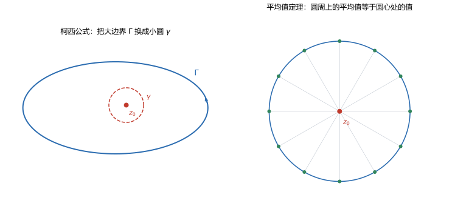

# 第 08 讲 柯西积分公式与高阶导数

> **前置**：第 05 讲（核心积分 $\oint dz/(z-z_0)=2\pi i$）、第 06 讲（柯西定理）、第 07 讲（复合闭路定理）。
> **预计时间**：约 3 小时（含作业）。
> **本讲回答**：为什么解析函数在内部一点的值由边界积分决定？为什么解析函数无穷次可导？平均值定理在说什么？刘维尔定理和最大模原理是怎么来的？

## 本讲要解决什么

第 07 讲把多连通区域化成了若干小圆。但有一类积分还没处理：

$$\oint_\Gamma\frac{f(z)}{z-z_0}\,dz,$$

其中 $f$ 在 $\Gamma$ 内部解析，$z_0$ 也在内部。被积函数在 $z_0$ 有奇点，柯西定理不能直接用。

这一讲证明：这个积分等于 $2\pi i\,f(z_0)$。由此得到三个重要结论：

1. 解析函数在内部的值完全由边界值决定；
2. 解析函数无穷次可导；
3. 平均值定理、刘维尔定理、最大模原理。

学完之后，你应该能做到：

- 陈述并证明柯西积分公式；
- 用公式计算形如 $\oint f(z)/(z-z_0)\,dz$ 的积分；
- 用高阶导数公式计算 $\oint f(z)/(z-z_0)^{n+1}\,dz$；
- 说清"解析函数无穷次可导"为什么成立，以及它与实函数的区别；
- 陈述平均值定理、刘维尔定理和最大模原理，并说出它们的用途。

---

## 1. 柯西积分公式

### 1.1 从复合闭路出发

设 $f$ 在简单闭曲线 $\Gamma$ 的内部及 $\Gamma$ 上解析，$z_0$ 在 $\Gamma$ 内部。

考虑

$$\oint_\Gamma\frac{f(z)}{z-z_0}\,dz.$$

被积函数在 $z_0$ 没有定义，所以不能直接用柯西定理。

**第一步：用小圆替换大边界。**

以 $z_0$ 为圆心、$r$ 为半径画一个小圆 $\gamma$，使 $\gamma$ 完全落在 $\Gamma$ 内部。由复合闭路定理（第 07 讲），

$$\oint_\Gamma\frac{f(z)}{z-z_0}\,dz=\oint_\gamma\frac{f(z)}{z-z_0}\,dz.$$

方向都取逆时针。图 1 左边画了这个替换。



**第二步：把 $f(z)$ 拆成 $f(z_0)$ 加一个小量。**

$$f(z)=f(z_0)+[f(z)-f(z_0)].$$

于是

$$\oint_\gamma\frac{f(z)}{z-z_0}\,dz=f(z_0)\oint_\gamma\frac{dz}{z-z_0}+\oint_\gamma\frac{f(z)-f(z_0)}{z-z_0}\,dz.$$

第一项由第 05 讲的核心公式：

$$f(z_0)\oint_\gamma\frac{dz}{z-z_0}=f(z_0)\cdot2\pi i.$$

**第三步：估计第二项。**

因为 $f$ 在 $z_0$ 连续，对任意 $\varepsilon>0$，只要 $r$ 足够小，就有

$$\lvert f(z)-f(z_0)\rvert<\varepsilon\qquad(z\in\gamma).$$

而 $\lvert z-z_0\rvert=r$，所以

$$\left\lvert\frac{f(z)-f(z_0)}{z-z_0}\right\rvert<\frac{\varepsilon}{r}.$$

由 ML 不等式，第二项的模不超过

$$\frac{\varepsilon}{r}\cdot2\pi r=2\pi\varepsilon.$$

$\varepsilon$ 可以任意小，所以第二项为零。

**结论**：

$$\oint_\Gamma\frac{f(z)}{z-z_0}\,dz=2\pi i\,f(z_0).$$

### 1.2 公式

把上式两边除以 $2\pi i$：

$$\boxed{f(z_0)=\frac{1}{2\pi i}\oint_\Gamma\frac{f(z)}{z-z_0}\,dz.}$$

这就是**柯西积分公式**（Cauchy integral formula）。

**条件清单**：

1. $f$ 在 $\Gamma$ 内部及 $\Gamma$ 上解析；
2. $z_0$ 在 $\Gamma$ 内部；
3. $\Gamma$ 取逆时针方向；
4. $\Gamma$ 是简单闭曲线（或有限条简单闭曲线的复合）。

### 1.3 它说的是什么

公式右边只用到 $f$ 在边界 $\Gamma$ 上的值。左边是 $f$ 在内部一点 $z_0$ 的值。

所以：

> **解析函数在内部任意一点的值，完全由它在边界上的值决定。**

这是一个非常强的约束。对一般的二元实函数，内部值可以独立变化；对解析函数，边界一确定，内部就全定了。

### 1.4 用法：反过来算积分

公式更常见的用法是反解：

$$\oint_\Gamma\frac{f(z)}{z-z_0}\,dz=2\pi i\,f(z_0).$$

**例 8.1** 计算

$$\oint_{\lvert z\rvert=1}\frac{e^z}{z}\,dz.$$

这里 $f(z)=e^z$，$z_0=0$，都在单位圆内解析。所以

$$\oint=2\pi i\,e^0=2\pi i.$$

**例 8.2** 计算

$$\oint_{\lvert z-(1+i)\rvert=1}\frac{z^2+1}{z-(1+i)}\,dz.$$

$z_0=1+i$ 是圆心，当然在圆内；$f(z)=z^2+1$ 在全平面解析。

$$f(1+i)=(1+i)^2+1=2i+1=1+2i.$$

所以

$$\oint=2\pi i(1+2i)=2\pi i-4\pi=-4\pi+2\pi i.$$

**数值核对**（脚本 `scripts/lec08-01_verify_cauchy_formula.py`，EXP1、EXP2）：

```
exp 在 0:    integral = 0.000000 + 6.283185j
(z^2+1) 在 1+i: integral = -12.566371 + 6.283185j
```

第一组是 $2\pi i$；第二组是 $-4\pi+2\pi i$，与手算一致。

### 1.5 一个容易踩的坑

公式要求 $z_0$ 在**内部**。如果 $z_0$ 在外部，被积函数在 $\Gamma$ 内部解析，由柯西定理积分是 $0$，不是 $2\pi i f(z_0)$。

**数值核对**（EXP6）：$\oint_{\lvert z\rvert=1}\frac{e^z}{z-2}dz$，$z_0=2$ 在外部：

```
integral = -2.220e-16 + 7.216e-16j
```

零。

**判断流程**：先画图，标出 $z_0$ 和 $\Gamma$，确认 $z_0$ 在内部，再用公式。

---

## 2. 平均值定理

### 2.1 陈述

设 $f$ 在圆盘 $\lvert z-z_0\rvert\le r$ 上解析，则

$$f(z_0)=\frac{1}{2\pi}\int_0^{2\pi}f(z_0+re^{i\theta})\,d\theta.$$

右边是 $f$ 在圆周上所有值的平均。所以：

> **解析函数在圆心的值，等于它在圆周上值的平均。**

### 2.2 推导

把柯西积分公式中的 $\Gamma$ 取成圆 $z=z_0+re^{i\theta}$，$\theta$ 从 $0$ 到 $2\pi$。

$$dz=ire^{i\theta}d\theta.$$

代入：

$$
f(z_0)=\frac{1}{2\pi i}\int_0^{2\pi}\frac{f(z_0+re^{i\theta})}{re^{i\theta}}\cdot ire^{i\theta}\,d\theta
=\frac{1}{2\pi}\int_0^{2\pi}f(z_0+re^{i\theta})\,d\theta.
$$

$r$ 和 $e^{i\theta}$ 都约掉了。

### 2.3 数值核对

**例 8.3** $f(z)=e^z$，$z_0=0$，$r=1$。

EXP5 在圆周上取 20 万个点求平均：

```
average on circle = +1.000000000 + 0.000000000j
f(0) = 1.000000000
```

完全一致。

**例 8.4** $f(z)=z^3$，$z_0=0.5+0.3i$，$r=0.4$。

EXP7：

```
average = -0.010000000 + 0.198000000j
z0^3   = -0.010000000 + 0.198000000j
```

一致。注意 $f$ 不是常数，平均值仍然等于中心值；这不是"平均掉波动"，而是解析函数的特殊性质。

### 2.4 它为什么强

对一般函数，"圆心值等于圆周平均"显然不成立。例如 $f(z)=\operatorname{Re}z$ 在单位圆上平均是 $0$，但圆心值也是 $0$，这个例子碰巧成立；换成 $f(z)=(\operatorname{Re}z)^2$，圆周平均是 $1/2$，圆心值是 $0$，就不成立。

解析函数满足这个性质，说明它在每个圆上的取值分布非常均匀：不能在某处高、某处低而平均值不变。

### 2.5 推论：最大模原理（认识层）

由平均值定理可以推出：

> **最大模原理**：如果 $f$ 在区域 $D$ 内解析且非常数，那么 $\lvert f\rvert$ 在 $D$ 内不能取到最大值。

直观理由：假设 $\lvert f\rvert$ 在 $z_0$ 取到最大值 $M$。平均值定理说 $f(z_0)$ 是圆周上值的平均，所以 $M=\lvert f(z_0)\rvert$ 不超过圆周上 $\lvert f\rvert$ 的平均，而后者不超过 $M$。两头都等于 $M$，说明圆周上每一点的 $\lvert f\rvert$ 都等于 $M$。这对任意小的圆都成立，于是 $f$ 在 $z_0$ 的一个邻域内模长恒为 $M$，推出 $f$ 在该邻域内为常数，再由解析性延拓到整个区域，与"非常数"矛盾。

这个证明的最后一步（"局部常数推出整体常数"）需要连通性论证，本课程不展开。记住陈述和用途即可：最大模原理说明解析函数的模最大值只能在边界上取到，这在估计和不等式里很有用。

---

## 3. 高阶导数公式

### 3.1 从柯西公式求导

柯西公式

$$f(z_0)=\frac{1}{2\pi i}\oint_\Gamma\frac{f(z)}{z-z_0}\,dz$$

对 $z_0$ 求导。形式上把积分号下的分母对 $z_0$ 求导：

$$\frac{\partial}{\partial z_0}\frac{1}{z-z_0}=\frac{1}{(z-z_0)^2}.$$

所以

$$f'(z_0)=\frac{1}{2\pi i}\oint_\Gamma\frac{f(z)}{(z-z_0)^2}\,dz.$$

再求一次：

$$f''(z_0)=\frac{2}{2\pi i}\oint_\Gamma\frac{f(z)}{(z-z_0)^3}\,dz.$$

一般地，

$$\boxed{f^{(n)}(z_0)=\frac{n!}{2\pi i}\oint_\Gamma\frac{f(z)}{(z-z_0)^{n+1}}\,dz.}$$

这就是**高阶导数公式**。

### 3.2 求导为什么合法

"积分号下求导"不是无条件成立的。需要证明差商

$$\frac{f(z_0+h)-f(z_0)}{h}=\frac{1}{2\pi i}\oint_\Gamma f(z)\cdot\frac{1}{h}\left(\frac{1}{z-z_0-h}-\frac{1}{z-z_0}\right)dz$$

在 $h\to0$ 时趋于

$$\frac{1}{2\pi i}\oint_\Gamma\frac{f(z)}{(z-z_0)^2}\,dz.$$

把括号通分：

$$\frac{1}{h}\cdot\frac{h}{(z-z_0-h)(z-z_0)}=\frac{1}{(z-z_0-h)(z-z_0)}.$$

当 $h\to0$ 时，它趋于 $1/(z-z_0)^2$。关键是要证明这个收敛对 $z\in\Gamma$ 是**一致**的，这样才能把极限移进积分号。

因为 $z_0$ 与 $\Gamma$ 有正距离 $d>0$，当 $\lvert h\rvert<d/2$ 时，

$$\left\lvert\frac{1}{(z-z_0-h)(z-z_0)}-\frac{1}{(z-z_0)^2}\right\rvert\le\frac{C\lvert h\rvert}{d^3},$$

其中 $C$ 是与 $h$ 无关的常数。再乘 $\lvert f(z)\rvert$ 的界和弧长，用 ML 不等式，差商的极限就是所要的积分。

**这个估计对所有阶都成立**，所以可以一直求导下去。细节略，结论是：只要 $f$ 在 $\Gamma$ 上连续，$f$ 就有任意阶导数。

### 3.3 用法：算积分

公式反解：

$$\oint_\Gamma\frac{f(z)}{(z-z_0)^{n+1}}\,dz=\frac{2\pi i}{n!}f^{(n)}(z_0).$$

**例 8.5** 计算

$$\oint_{\lvert z\rvert=1}\frac{e^z}{z^3}\,dz.$$

这里 $f(z)=e^z$，$z_0=0$，$n+1=3$，所以 $n=2$。

$f''(z)=e^z$，$f''(0)=1$。因此

$$\oint=\frac{2\pi i}{2!}\cdot1=\pi i.$$

**数值核对**（EXP3）：

```
integral = -0.000000 + 3.141593j
```

$\pi\approx3.141593$，一致。

**例 8.6** 计算

$$\oint_{\lvert z\rvert=1}\frac{\sin z}{z^4}\,dz.$$

$f(z)=\sin z$，$z_0=0$，$n=3$。

$f'(z)=\cos z$，$f''(z)=-\sin z$，$f'''(z)=-\cos z$，所以 $f'''(0)=-1$。

$$\oint=\frac{2\pi i}{3!}\cdot(-1)=-\frac{\pi i}{3}.$$

**数值核对**（EXP4）：

```
integral = 0.000000 - 1.047198j
```

$-1.047198=-\pi/3$，一致。

---

## 4. 解析函数无穷次可导

### 4.1 结论

由高阶导数公式，只要 $f$ 在 $\Gamma$ 内部及边界上解析，$f^{(n)}(z_0)$ 对所有 $n$ 都存在。

所以：

> **解析函数在区域内无穷次可导，且每一阶导数仍然解析。**

第 03 讲预告过这个结论，现在有了证明。

### 4.2 与实函数的区别

实函数可导一次，不一定可导两次。经典例子：

$$f(x)=x^2\sin\frac1x\quad(x\ne0),\qquad f(0)=0.$$

它在 $x=0$ 可导（$f'(0)=0$），在 $x\ne0$ 也可导，所以处处可导。但

$$f'(x)=2x\sin\frac1x-\cos\frac1x\quad(x\ne0),$$

当 $x\to0$ 时 $-\cos(1/x)$ 振荡，$f'$ 在 $0$ 不连续，更谈不上二阶可导。

复变函数没有这种现象。只要在一个区域内解析，就自动无穷次可导。

### 4.3 为什么差这么多

根源还是 C-R 条件。

实函数的可导只约束一个方向（$x$ 方向）的差商。复可导约束所有方向，等价于两个偏微分方程 $u_x=v_y$、$u_y=-v_x$。这两个方程把 $u,v$ 锁得太紧，以至于解被迫非常光滑。

从公式看更直接：$f^{(n)}(z_0)$ 被写成边界积分。只要 $f$ 在边界上连续，积分对任何 $n$ 都有意义，所以导数永远存在。

### 4.4 后面怎么用

- **第 10 讲**：泰勒展开需要各阶导数，无穷次可导保证展开可以写到任意阶；
- **刘维尔定理**：用 $n=1$ 的高阶导数公式加 ML 估计；
- **最大模原理**：用平均值定理，平均值定理来自柯西公式；
- **第 13 讲**：留数计算需要洛朗系数，而洛朗展开的存在性也依赖解析性。

---

## 5. 两个认识层结论

### 5.1 刘维尔定理

> **刘维尔定理**（Liouville）：如果 $f$ 在整个复平面上解析（称为**整函数**），并且有界，那么 $f$ 是常数。

**证明思路**：对任意 $z_0$ 和任意 $r>0$，由高阶导数公式（$n=1$），

$$f'(z_0)=\frac{1}{2\pi i}\oint_{\lvert z-z_0\rvert=r}\frac{f(z)}{(z-z_0)^2}\,dz.$$

设 $\lvert f(z)\rvert\le M$。在圆周上 $\lvert z-z_0\rvert=r$，所以被积函数的模不超过 $M/r^2$，弧长 $2\pi r$。由 ML 不等式，

$$\lvert f'(z_0)\rvert\le\frac{1}{2\pi}\cdot\frac{M}{r^2}\cdot2\pi r=\frac Mr.$$

$r$ 可以任意大，所以 $\lvert f'(z_0)\rvert=0$。$z_0$ 任意，所以 $f'\equiv0$，$f$ 是常数。

**用途**：证明代数基本定理（见作业第 11 题）；判断某些整函数只能是常数。

### 5.2 最大模原理

前面 2.5 节已经给出陈述和直观证明。再说一遍用途：

- 估计解析函数的最大值，只需看边界；
- 证明"如果解析函数在区域内某点取到最大模，则它是常数"；
- 在调和函数、偏微分方程里也有对应版本。

### 5.3 这两个结论的要求

只要求知道**陈述、条件和用途**，不要求独立证明。考试如果考到，通常是"叙述并说明理由"或"用刘维尔定理证明某某"，不会要求从头构造证明。

---

## 6. 本讲小结

| 内容 | 公式 / 陈述 | 条件 |
|---|---|---|
| 柯西积分公式 | $f(z_0)=\dfrac{1}{2\pi i}\oint_\Gamma\dfrac{f(z)}{z-z_0}dz$ | $f$ 在内部及边界解析，$z_0$ 在内部 |
| 算积分 | $\oint_\Gamma\dfrac{f(z)}{z-z_0}dz=2\pi i f(z_0)$ | 同上 |
| 平均值定理 | $f(z_0)=\dfrac{1}{2\pi}\int_0^{2\pi}f(z_0+re^{i\theta})d\theta$ | 圆盘内解析 |
| 高阶导数 | $f^{(n)}(z_0)=\dfrac{n!}{2\pi i}\oint_\Gamma\dfrac{f(z)}{(z-z_0)^{n+1}}dz$ | 同上 |
| 算积分（高阶） | $\oint_\Gamma\dfrac{f(z)}{(z-z_0)^{n+1}}dz=\dfrac{2\pi i}{n!}f^{(n)}(z_0)$ | 同上 |
| 无穷次可导 | 解析 $\Rightarrow$ 任意阶导数存在且解析 | 区域内解析 |
| 刘维尔定理 | 有界整函数必为常数 | 全平面解析 + 有界 |
| 最大模原理 | 非常数解析函数的模不能在内部取最大 | 区域内解析 |

三句话带走：

1. 解析函数内部的值由边界值决定：$f(z_0)=\frac{1}{2\pi i}\oint\frac{f(z)}{z-z_0}dz$。
2. 由此推出无穷次可导，这是复变与实变最大的区别。
3. 平均值定理、刘维尔定理、最大模原理都是这条公式的推论。

---

## 7. 掌握度自测

- [ ] 能写出柯西积分公式，并列出四个条件。
- [ ] 能用"小圆 + 估计"证明柯西公式。
- [ ] 能用公式计算 $\oint f(z)/(z-z_0)dz$，并先判断 $z_0$ 在不在内部。
- [ ] 能写出高阶导数公式，并用它计算 $\oint f(z)/(z-z_0)^{n+1}dz$。
- [ ] 能解释解析函数为什么无穷次可导。
- [ ] 能说出实函数反例 $x^2\sin(1/x)$ 为什么在复变里不会发生。
- [ ] 能陈述平均值定理、刘维尔定理、最大模原理，并各说出一个用途。

---

## 作业

### 基础

**1.** 计算 $\displaystyle\oint_{\lvert z\rvert=1}\frac{e^z}{z}\,dz$。

**参考答案：**

$f(z)=e^z$ 在单位圆内及边界解析，$z_0=0$ 在内部。由柯西积分公式：

$$\oint=2\pi i\,f(0)=2\pi i.$$

---

**2.** 计算 $\displaystyle\oint_{\lvert z\rvert=2}\frac{z^2+1}{z-1}\,dz$。

**参考答案：**

$f(z)=z^2+1$ 全平面解析，$z_0=1$ 在 $\lvert z\rvert<2$ 内。

$$f(1)=1+1=2.$$

所以

$$\oint=2\pi i\cdot2=4\pi i.$$

---

**3.** 计算 $\displaystyle\oint_{\lvert z\rvert=1}\frac{\sin z}{z^2}\,dz$。

**参考答案：**

这是高阶导数公式中 $n=1$ 的情形：$f(z)=\sin z$，$z_0=0$。

$$f'(z)=\cos z,\qquad f'(0)=1.$$

所以

$$\oint=\frac{2\pi i}{1!}\cdot1=2\pi i.$$

---

**4.** 计算 $\displaystyle\oint_{\lvert z\rvert=3}\frac{e^z}{z-1}\,dz$。

**参考答案：**

$f(z)=e^z$ 全平面解析，$z_0=1$ 在 $\lvert z\rvert<3$ 内。

$$\oint=2\pi i\,e^1=2\pi e\,i.$$

---

### 提高

**5.** 计算 $\displaystyle\oint_{\lvert z\rvert=1}\frac{e^z}{z^3}\,dz$。

**参考答案：**

$f(z)=e^z$，$z_0=0$，$n=2$。

$$f''(z)=e^z,\qquad f''(0)=1.$$

所以

$$\oint=\frac{2\pi i}{2!}\cdot1=\pi i.$$

---

**6.** 计算 $\displaystyle\oint_{\lvert z\rvert=2}\frac{\cos z}{z-\pi}\,dz$。

**参考答案：**

$f(z)=\cos z$ 全平面解析，$z_0=\pi$ 在 $\lvert z\rvert<2$ 内（$\pi\approx3.14$？注意 $\pi>2$）。

**这里要小心**：$\pi\approx3.1416>2$，所以 $z_0=\pi$ 在圆 $\lvert z\rvert=2$ 的**外部**。

因此被积函数在圆内解析，由柯西定理积分为 $0$。

**这道题考的就是先判断内外。** 如果 $z_0$ 在内部，答案会是 $2\pi i\cos\pi=-2\pi i$；但这里在外部，答案是 $0$。

---

**7.** 用平均值定理说明：非常数解析函数不能在内部取到最大模。

**参考答案：**

设 $f$ 在区域 $D$ 内解析且非常数，假设 $\lvert f\rvert$ 在 $z_0\in D$ 取到最大值 $M$。

取足够小的 $r$，使圆盘 $\lvert z-z_0\rvert\le r$ 含于 $D$。由平均值定理，

$$f(z_0)=\frac{1}{2\pi}\int_0^{2\pi}f(z_0+re^{i\theta})\,d\theta.$$

两边取模，用积分不等式：

$$M=\lvert f(z_0)\rvert\le\frac{1}{2\pi}\int_0^{2\pi}\lvert f(z_0+re^{i\theta})\rvert\,d\theta\le M.$$

两端都等于 $M$，所以中间的积分必须处处等于 $M$，即圆周上 $\lvert f\rvert\equiv M$。对任意小的 $r$ 都成立，说明 $f$ 在 $z_0$ 的邻域内模长恒为 $M$，进而 $f$ 在该邻域内为常数。由解析性延拓，$f$ 在 $D$ 内为常数，与假设矛盾。

所以非常数解析函数不能在内部取到最大模。

---

**8.** 计算 $\displaystyle\oint_{\lvert z\rvert=1}\frac{z^3+2z+1}{z-i}\,dz$。

**参考答案：**

$f(z)=z^3+2z+1$ 全平面解析，$z_0=i$ 在单位圆内。

$$f(i)=i^3+2i+1=-i+2i+1=1+i.$$

所以

$$\oint=2\pi i(1+i)=2\pi i+2\pi i^2=-2\pi+2\pi i.$$

---

### 综合

**9.** 证明柯西积分公式。

**参考答案：**

设 $f$ 在 $\Gamma$ 内部及 $\Gamma$ 上解析，$z_0$ 在内部。

以 $z_0$ 为圆心、$r$ 为半径作小圆 $\gamma$，使其含于 $\Gamma$ 内部。由复合闭路定理：

$$\oint_\Gamma\frac{f(z)}{z-z_0}dz=\oint_\gamma\frac{f(z)}{z-z_0}dz.$$

把 $f(z)$ 写成 $f(z_0)+[f(z)-f(z_0)]$：

$$\oint_\gamma\frac{f(z)}{z-z_0}dz=f(z_0)\oint_\gamma\frac{dz}{z-z_0}+\oint_\gamma\frac{f(z)-f(z_0)}{z-z_0}dz.$$

第一项 $=f(z_0)\cdot2\pi i$。

第二项：由 $f$ 在 $z_0$ 连续，对任意 $\varepsilon>0$，当 $r$ 足够小时，$\lvert f(z)-f(z_0)\rvert<\varepsilon$ 在 $\gamma$ 上成立。于是被积函数的模不超过 $\varepsilon/r$，弧长 $2\pi r$，由 ML 不等式，第二项的模不超过 $2\pi\varepsilon$。$\varepsilon$ 任意小，所以第二项为零。

因此

$$\oint_\Gamma\frac{f(z)}{z-z_0}dz=2\pi i f(z_0).$$

---

**10.** 证明高阶导数公式中 $n=1$ 的情形：

$$f'(z_0)=\frac{1}{2\pi i}\oint_\Gamma\frac{f(z)}{(z-z_0)^2}\,dz.$$

**参考答案：**

由柯西公式，对 $h\ne0$，

$$
\frac{f(z_0+h)-f(z_0)}{h}
=\frac{1}{2\pi i h}\oint_\Gamma f(z)\left(\frac{1}{z-z_0-h}-\frac{1}{z-z_0}\right)dz.
$$

通分括号：

$$\frac{1}{z-z_0-h}-\frac{1}{z-z_0}=\frac{h}{(z-z_0-h)(z-z_0)}.$$

所以

$$\frac{f(z_0+h)-f(z_0)}{h}=\frac{1}{2\pi i}\oint_\Gamma\frac{f(z)}{(z-z_0-h)(z-z_0)}dz.$$

当 $h\to0$ 时，被积函数在 $\Gamma$ 上一致趋于 $f(z)/(z-z_0)^2$（因为 $z_0$ 与 $\Gamma$ 有正距离，分母不会接近零）。于是极限可以移进积分号：

$$f'(z_0)=\frac{1}{2\pi i}\oint_\Gamma\frac{f(z)}{(z-z_0)^2}dz.$$

---

**11.** 用刘维尔定理证明代数基本定理：任何次数 $n\ge1$ 的复系数多项式至少有一个零点。

**参考答案：**

设 $p(z)=a_nz^n+\cdots+a_0$，$a_n\ne0$，$n\ge1$。反设 $p(z)$ 没有零点。

考虑

$$g(z)=\frac{1}{p(z)}.$$

因为 $p$ 没有零点，$g$ 在整个复平面上解析（整函数）。

当 $\lvert z\rvert\to\infty$ 时，

$$\lvert p(z)\rvert=\lvert z\rvert^n\left\lvert a_n+\frac{a_{n-1}}{z}+\cdots+\frac{a_0}{z^n}\right\rvert\to\infty,$$

所以 $\lvert g(z)\rvert\to0$。特别地，存在 $R>0$，当 $\lvert z\rvert>R$ 时 $\lvert g(z)\rvert<1$。

在闭圆盘 $\lvert z\rvert\le R$ 上，$g$ 连续，所以有界，设 $\lvert g\rvert\le M$。

于是 $g$ 在整个复平面上有界（上界为 $\max\{1,M\}$）。

由刘维尔定理，$g$ 是常数，所以 $p$ 是常数，与 $n\ge1$ 矛盾。

因此 $p$ 至少有一个零点。

---

## 下一讲预告

到这里，复变函数的"微分 + 积分"部分基本完成。下一讲进入级数。

回忆第 03 讲和第 08 讲的两个结论：解析函数无穷次可导，并且各阶导数可以用边界积分表示。这两条合起来，就能把解析函数展开成幂级数：

$$f(z)=\sum_{n=0}^{\infty}a_n(z-z_0)^n.$$

但要把这件事说清楚，需要先补级数的基础。第 09 讲会从实数项级数的收敛定义讲起——因为级数部分如果不牢，后面的泰勒展开和洛朗展开都会变成背公式。这一讲会从头建立：什么是收敛、几何级数与 $p$ 级数、绝对收敛与条件收敛、比值与根值判别，然后进入复数项级数和收敛圆。
