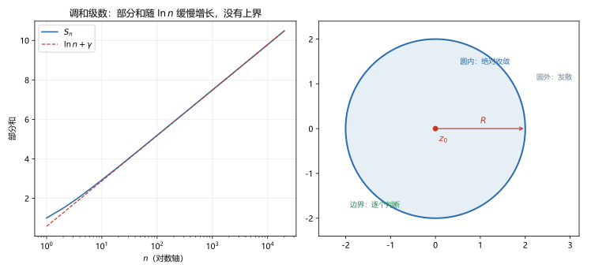

# 第 09 讲 级数基础：从实数项到幂级数

> **前置**：第 01 讲（复数运算、模）、第 04 讲（复指数）、第 08 讲（解析函数与高阶导数）。级数部分**不要求记得高数内容**，本讲从部分和重新建立。
> **预计时间**：约 3.5 小时（含作业；本讲是模块 C 的地基，建议慢读）。
> **本讲回答**：级数收敛到底是什么意思？通项趋于零为什么不够？几何级数和 $p$ 级数怎么用？绝对收敛和条件收敛差在哪？幂级数的收敛半径是什么、边界怎么办？

## 本讲要解决什么

第 08 讲末尾说：解析函数可以展开成幂级数。但要把这句话讲清楚，得先知道"级数收敛"是什么意思。

这一讲从头建立级数的基础。顺序是：

1. 部分和与收敛的定义；
2. 两个基准级数：几何级数、$p$ 级数；
3. 正项级数的三种判别法；
4. 交错级数、绝对收敛与条件收敛；
5. 复数项级数；
6. 幂级数、收敛半径、收敛圆与边界行为。

学完之后，你应该能做到：

- 说出级数收敛的严格定义，并解释为什么"通项趋于零"只是必要条件；
- 判断几何级数与 $p$ 级数的敛散；
- 用比较、比值、根值三种方法判断正项级数；
- 区分绝对收敛与条件收敛；
- 把复数项级数拆成实部虚部判断；
- 求幂级数的收敛半径，并单独讨论收敛圆边界；
- 说出幂级数在收敛圆内为什么解析、为什么能逐项求导。

---

## 1. 从"无限相加"到部分和

### 1.1 部分和

给定数列 $a_1,a_2,\dots$，把前 $n$ 项加起来：

$$S_n=a_1+a_2+\cdots+a_n.$$

这个 $S_n$ 叫**部分和**（partial sum）。$n=1,2,3,\dots$ 给出一个部分和数列

$$S_1,\ S_2,\ S_3,\ \dots$$

例如 $a_n=1/2^n$：

$$S_1=\frac12,\quad S_2=\frac34,\quad S_3=\frac78,\quad S_4=\frac{15}{16},\ \dots$$

### 1.2 收敛的定义

> 如果部分和数列 $\{S_n\}$ 有有限极限 $S$，就说级数 $\sum_{n=1}^{\infty}a_n$ **收敛**，并称 $S$ 为它的**和**，记作
>
> $$\sum_{n=1}^{\infty}a_n=S.$$
>
> 如果 $\{S_n\}$ 没有有限极限（趋于无穷或振荡），就说级数**发散**。

**关键点**：级数的和不是"把无穷多项加完"（这做不到），而是"部分和的极限"。所有的判断都归结为：$\{S_n\}$ 有没有极限。

上例 $a_n=1/2^n$，$S_n=1-1/2^n\to1$，所以

$$\sum_{n=1}^{\infty}\frac{1}{2^n}=1.$$

### 1.3 收敛的必要条件：通项必须趋于零

如果 $\sum a_n$ 收敛，和为 $S$，那么

$$a_n=S_n-S_{n-1}\to S-S=0.$$

所以：

> **收敛的必要条件**：$\lim_{n\to\infty}a_n=0$。

反过来不成立。通项趋于零，级数不一定收敛。这就是下一节的调和级数。

**用法**：如果 $a_n$ 不趋于零，级数一定发散。这是最快的判断，先查这一条。

例如 $\sum\frac{n}{n+1}$，通项趋于 $1$，不为零，所以发散。

### 1.4 通项趋于零不够：调和级数

**调和级数**（harmonic series）是

$$\sum_{n=1}^{\infty}\frac1n=1+\frac12+\frac13+\frac14+\cdots$$

通项 $1/n\to0$，但级数**发散**。

**证明（分组法）**：把项按 $2$ 的幂分组：

$$
1+\frac12+\left(\frac13+\frac14\right)+\left(\frac15+\cdots+\frac18\right)+\cdots
$$

第 $k$ 组有 $2^{k-1}$ 项，每项都不小于该组最后一项 $1/2^k$，所以第 $k$ 组的和至少是

$$2^{k-1}\cdot\frac{1}{2^k}=\frac12.$$

每组都不少于 $1/2$，而组数无限，所以部分和无界，级数发散。

**另一种写法**：比较 $S_{2n}$ 与 $S_n$：

$$
S_{2n}-S_n=\frac{1}{n+1}+\frac{1}{n+2}+\cdots+\frac{1}{2n}\ge n\cdot\frac{1}{2n}=\frac12.
$$

每把项数翻倍，部分和至少增加 $1/2$。所以 $S_n\to+\infty$。

**数值上它有多慢**（脚本 `scripts/lec09-01_verify_series.py`，EXP1）：

| $n$ | $S_n$ | $\ln n+\gamma$ | 差 |
|---|---|---|---|
| $10$ | $2.928968$ | $2.879801$ | $+0.049167$ |
| $100$ | $5.187378$ | $5.182386$ | $+0.004992$ |
| $1000$ | $7.485471$ | $7.484971$ | $+0.000500$ |
| $10^4$ | $9.787606$ | $9.787556$ | $+0.000050$ |
| $10^6$ | $14.392727$ | $14.392726$ | $+0.000000$ |

$\gamma\approx0.577216$ 是欧拉常数。部分和与 $\ln n+\gamma$ 几乎重合，差值趋于零。

**所以调和级数发散，但增长极慢**：到 $n=10^6$ 才加到 $14.4$。这就是为什么很多人误以为它收敛。图 1 左边把两条曲线画在一起，看上去像一条，但它在对数横轴上一直上升，没有水平渐近线。



---

## 2. 两个基准级数

判断别的级数时，通常拿这两个当尺子。

### 2.1 几何级数

$$\sum_{n=0}^{\infty}r^n=1+r+r^2+\cdots$$

部分和：

$$S_n=\frac{1-r^{n+1}}{1-r}\qquad(r\ne1).$$

- 若 $\lvert r\rvert<1$，则 $r^{n+1}\to0$，$S_n\to\dfrac{1}{1-r}$，**收敛**；
- 若 $\lvert r\rvert\ge1$，则通项 $r^n$ 不趋于零（$\lvert r\rvert>1$ 时无界，$\lvert r\rvert=1$ 时不趋零），**发散**。

所以

$$\sum_{n=0}^{\infty}r^n=\frac{1}{1-r},\qquad \lvert r\rvert<1.$$

**数值核对**（EXP2）：取 $200$ 项，

- $r=0.5$：部分和 $2.000000$，极限 $2$；
- $r=0.9$：部分和 $10.000000$，极限 $10$；
- $r=1.0$：部分和 $201$，因为每项都是 $1$；
- $r=1.1$：部分和约 $2.09\times10^9$，爆炸。

### 2.2 $p$ 级数

$$\sum_{n=1}^{\infty}\frac{1}{n^p},\qquad p>0.$$

结论：

> $p>1$ 时收敛，$0<p\le1$ 时发散。

**为什么？** 分三段理解：

1. $p=1$ 是调和级数，发散；
2. $p<1$ 时 $1/n^p\ge1/n$，比调和级数还大，必发散；
3. $p>1$ 时，用积分比较：$1/n^p$ 与 $\int_n^{n+1}x^{-p}dx$ 比较，可得部分和有上界，所以收敛。

第 3 条的严格证明需要积分判别法，本课程只要求会用结论。$p=2$ 时和是

$$\sum_{n=1}^{\infty}\frac{1}{n^2}=\frac{\pi^2}{6}\approx1.644934.$$

**数值核对**（EXP3）：

| $p$ | $n=1000$ | $n=10^5$ | 行为 |
|---|---|---|---|
| $2.0$ | $1.643935$ | $1.644924$ | 收敛到 $1.644934$ |
| $1.5$ | $2.549146$ | $2.606051$ | 收敛很慢 |
| $1.0$ | $7.485471$ | $12.090146$ | 发散 |
| $0.5$ | $61.801009$ | $630.996759$ | 发散更快 |

注意 $p=1.5$ 的收敛非常慢：到 $10^5$ 项还没稳定，但它在缓慢逼近一个有限值（约 $2.612$）。这也是"数值看起来像发散，其实收敛"的例子。

---

## 3. 正项级数的判别法

以下假设 $a_n\ge0$。

### 3.1 比较判别

如果 $0\le a_n\le b_n$ 对所有足够大的 $n$ 成立：

- $\sum b_n$ 收敛 $\Rightarrow$ $\sum a_n$ 收敛；
- $\sum a_n$ 发散 $\Rightarrow$ $\sum b_n$ 发散。

**用法**：找一个已知敛散的级数作为参照。常用参照就是几何级数和 $p$ 级数。

**例 9.1** 判断 $\sum\dfrac{1}{n^2+n}$。

因为

$$\frac{1}{n^2+n}<\frac{1}{n^2},$$

而 $\sum1/n^2$ 收敛，所以原级数收敛。

### 3.2 比值判别

设 $a_n>0$，且

$$\lim_{n\to\infty}\frac{a_{n+1}}{a_n}=L.$$

- $L<1$：收敛；
- $L>1$：发散；
- $L=1$：失效，需要换方法。

**为什么？** $L<1$ 时，取 $q$ 使 $L<q<1$，当 $n$ 足够大时 $a_{n+1}/a_n<q$，于是 $a_n$ 被几何级数控制。$L>1$ 时通项不趋于零。

**例 9.2** 判断 $\sum\dfrac{n!}{n^n}$。

$$\frac{a_{n+1}}{a_n}=\frac{(n+1)!}{(n+1)^{n+1}}\cdot\frac{n^n}{n!}=\frac{n+1}{(n+1)^{n+1}}\cdot n^n=\left(\frac{n}{n+1}\right)^n\to\frac1e<1.$$

所以收敛。

### 3.3 根值判别

设 $a_n\ge0$，且

$$\lim_{n\to\infty}\sqrt[n]{a_n}=L.$$

（严格说应取上极限；本课程遇到的级数极限都存在，不深入这个细节。）

- $L<1$：收敛；
- $L>1$：发散；
- $L=1$：失效。

**例 9.3** 判断 $\sum\left(\dfrac{n}{2n+1}\right)^n$。

$$\sqrt[n]{a_n}=\frac{n}{2n+1}\to\frac12<1,$$

所以收敛。

### 3.4 用哪个

- 含 $n!$、$n^n$、指数：优先比值法；
- 含 $n$ 次方整体：优先根值法；
- 含 $n$ 的多项式分式：优先比较法，与 $p$ 级数比；
- 三种都得 $1$：说明这一层的信息不够，需要更细的比较（例如与 $1/(n\ln n)$ 比）。本课程不深入。

---

## 4. 交错级数与条件收敛

### 4.1 莱布尼茨判别

如果 $a_n>0$ 满足：

1. $a_n$ 单调递减；
2. $a_n\to0$，

那么交错级数

$$\sum_{n=1}^{\infty}(-1)^{n-1}a_n=a_1-a_2+a_3-a_4+\cdots$$

收敛。

**直观**：部分和在两根线之间来回摆，摆幅越来越小，所以收敛。

**例 9.4** $\sum\dfrac{(-1)^{n-1}}{n}$ 收敛。

$a_n=1/n$ 单调递减趋于零，满足条件。

它的和是 $\ln2\approx0.693147$。

**数值核对**（EXP5）：交错和到 $10^5$ 项为 $-0.693142$（这里按从 $n=1$ 起 $(-1)^n/n$ 算，和是 $-\ln2$）。

### 4.2 绝对收敛与条件收敛

设 $\sum a_n$ 是任意项级数（可以有正有负，也可以是复数）。

- 如果 $\sum\lvert a_n\rvert$ 收敛，称 $\sum a_n$ **绝对收敛**；
- 如果 $\sum a_n$ 收敛但 $\sum\lvert a_n\rvert$ 发散，称 $\sum a_n$ **条件收敛**。

**例 9.5** $\sum\dfrac{(-1)^{n-1}}{n}$ 条件收敛。

它本身收敛，但绝对值级数是调和级数，发散。

**例 9.6** $\sum\dfrac{(-1)^{n-1}}{n^2}$ 绝对收敛。

绝对值级数是 $p=2$ 的 $p$ 级数，收敛。

### 4.3 绝对收敛蕴含收敛

> 如果 $\sum\lvert a_n\rvert$ 收敛，那么 $\sum a_n$ 收敛。

**证明思路**：对任意 $n$，考虑部分和的差

$$\left\lvert\sum_{k=m+1}^{n}a_k\right\rvert\le\sum_{k=m+1}^{n}\lvert a_k\rvert.$$

右边是绝对值级数的尾段。因为绝对值级数收敛，它的尾段可以任意小（柯西准则）。所以原级数的部分和也满足柯西准则，收敛。

反过来不成立：条件收敛就是反例。

### 4.4 为什么区分这两件事

绝对收敛的级数可以任意重排、可以逐项相乘，性质像有限和。条件收敛的级数不行：重排会改变和（黎曼重排定理）。

本课程后面用到的幂级数，在收敛圆内都是绝对收敛的，所以可以放心逐项运算。

---

## 5. 复数项级数

### 5.1 定义

设 $z_n$ 是复数，部分和

$$S_n=z_1+\cdots+z_n.$$

如果 $\{S_n\}$ 有有限极限 $S$，就说 $\sum z_n$ 收敛，和为 $S$。

### 5.2 实部虚部分别收敛

设 $z_n=x_n+iy_n$，$S_n=X_n+iY_n$，其中

$$X_n=\sum_{k=1}^{n}x_k,\qquad Y_n=\sum_{k=1}^{n}y_k.$$

由第 02 讲的"复极限等价于两个实极限"：

> $\sum z_n$ 收敛，当且仅当 $\sum x_n$ 和 $\sum y_n$ 都收敛。

而且

$$\sum z_n=\sum x_n+i\sum y_n.$$

这条把复数项级数的问题化成了两个实数项级数的问题，前面所有判别法都能用。

### 5.3 绝对收敛

如果 $\sum\lvert z_n\rvert$ 收敛，称 $\sum z_n$ 绝对收敛。

同样有：绝对收敛 $\Rightarrow$ 收敛。

而且 $\lvert z_n\rvert=\sqrt{x_n^2+y_n^2}$，所以绝对值级数是一个正项级数，可以用比较、比值、根值判别。

### 5.4 一个例子

取 $z=0.6+0.8i$，$\lvert z\rvert=1$。考虑

$$\sum_{n=0}^{\infty}z^n.$$

因为 $\lvert z\rvert=1$，通项不趋于零（$\lvert z^n\rvert=1$），所以发散。

**数值核对**（EXP6）：部分和在复平面上绕圈，不趋于任何点：

```
n_max=5:  -0.535040 + 0.577280j
n_max=10:  0.156995 + 2.064118j
n_max=20:  0.678119 - 0.103754j
n_max=40:  0.339940 - 0.106517j
```

它围着某个中心转，但永远不停下来。

注意：如果有人按几何级数公式算出 $1/(1-z)=0.5+i$，那是"形式上的和"，只在 $\lvert z\rvert<1$ 时成立。这里 $\lvert z\rvert=1$，不能套。

---

## 6. 幂级数

### 6.1 定义

形如

$$\sum_{n=0}^{\infty}a_n(z-z_0)^n=a_0+a_1(z-z_0)+a_2(z-z_0)^2+\cdots$$

的级数叫**幂级数**（power series）。$a_n$ 是复系数，$z_0$ 是展开中心。

### 6.2 阿贝尔定理

> 如果幂级数在 $z_1\ne z_0$ 处收敛，那么它在所有满足 $\lvert z-z_0\rvert<\lvert z_1-z_0\rvert$ 的 $z$ 处**绝对收敛**。
>
> 如果它在 $z_2$ 处发散，那么它在所有满足 $\lvert z-z_0\rvert>\lvert z_2-z_0\rvert$ 的 $z$ 处发散。

**直观**：收敛性只由"离中心多远"决定，与方向无关。离中心近的点一定比远的点更容易收敛。

### 6.3 收敛半径与收敛圆

由阿贝尔定理，存在一个数 $R\in[0,+\infty]$，使得：

- $\lvert z-z_0\rvert<R$：绝对收敛；
- $\lvert z-z_0\rvert>R$：发散；
- $\lvert z-z_0\rvert=R$：**不能确定**，要单独讨论。

这个 $R$ 叫**收敛半径**（radius of convergence），圆 $\lvert z-z_0\rvert=R$ 叫**收敛圆**。

三种极端情况：

- $R=0$：只在中心 $z_0$ 收敛；
- $R=+\infty$：在整个复平面收敛；
- $0<R<+\infty$：在圆内收敛，圆外发散。


### 6.4 求收敛半径

**比值法**：如果

$$\lim_{n\to\infty}\left\lvert\frac{a_{n+1}}{a_n}\right\rvert=L,$$

则

$$R=\frac1L.$$

（$L=0$ 时 $R=+\infty$；$L=+\infty$ 时 $R=0$。）

**根值法**：如果

$$\lim_{n\to\infty}\sqrt[n]{\lvert a_n\rvert}=L,$$

则同样 $R=1/L$。

**为什么？** 把幂级数看成数项级数，用比值判别：相邻两项之比的极限是

$$\left\lvert\frac{a_{n+1}(z-z_0)^{n+1}}{a_n(z-z_0)^n}\right\rvert=\left\lvert\frac{a_{n+1}}{a_n}\right\rvert\lvert z-z_0\rvert\to L\lvert z-z_0\rvert.$$

要收敛需 $L\lvert z-z_0\rvert<1$，即 $\lvert z-z_0\rvert<1/L$。

**例 9.7** 求 $\sum\dfrac{z^n}{n!}$ 的收敛半径。

$$\left\lvert\frac{a_{n+1}}{a_n}\right\rvert=\frac{1/(n+1)!}{1/n!}=\frac{1}{n+1}\to0.$$

所以 $R=+\infty$，全平面收敛。

**数值核对**（EXP4）：在 $\lvert z\rvert=10$ 处取前 $40$ 项，部分和稳定在 $2.202647\times10^4$，而 $e^{10}\approx22026.47$，说明即使 $\lvert z\rvert=10$ 也收敛。

**例 9.8** 求 $\sum n!\,z^n$ 的收敛半径。

$$\left\lvert\frac{a_{n+1}}{a_n}\right\rvert=\frac{(n+1)!}{n!}=n+1\to+\infty.$$

所以 $R=0$，只在 $z=0$ 收敛。

**数值核对**（EXP4）：在 $\lvert z\rvert=0.1$ 处，前 $35$ 项部分和已经到 $1.453945\times10^5$，明显爆炸。

**例 9.9** 求 $\sum\dfrac{(z-i)^n}{n^2}$ 的收敛半径。

$a_n=1/n^2$，

$$\left\lvert\frac{a_{n+1}}{a_n}\right\rvert=\frac{n^2}{(n+1)^2}\to1.$$

所以 $R=1$，收敛圆是 $\lvert z-i\rvert=1$。

### 6.5 边界行为：三种典型情况

下面三个级数的收敛半径都是 $1$，但边界行为完全不同。

**情况一：边界处处发散**

$$\sum_{n=0}^{\infty}z^n.$$

在 $\lvert z\rvert=1$ 上，$\lvert z^n\rvert=1$，通项不趋于零，发散。

**情况二：边界处处绝对收敛**

$$\sum_{n=1}^{\infty}\frac{z^n}{n^2}.$$

在 $\lvert z\rvert=1$ 上，$\lvert z^n/n^2\rvert=1/n^2$，而 $\sum1/n^2$ 收敛，所以绝对收敛。

**情况三：边界部分收敛、部分发散**

$$\sum_{n=1}^{\infty}\frac{z^n}{n}.$$

在 $z=1$ 处是调和级数，发散；在 $z=-1$ 处是交错级数，收敛（条件收敛）。

**所以"收敛圆"只告诉你圆内和圆外，不告诉你圆上。** 边界必须逐个点单独判断。这是做题时最容易漏的一步。

**数值核对**（EXP5）：

```
n=100000: sum 1/n^2=1.644924, sum 1/n=12.090146, sum (-1)^n/n=-0.693142
```

第一个收敛到 $\pi^2/6$，第二个持续增长，第三个收敛到 $-\ln2$。

### 6.6 幂级数在收敛圆内解析

> 幂级数在收敛圆内表示一个解析函数，并且可以逐项求导、逐项积分，收敛半径不变。

具体地，若

$$f(z)=\sum_{n=0}^{\infty}a_n(z-z_0)^n,\qquad \lvert z-z_0\rvert<R,$$

则

$$f'(z)=\sum_{n=1}^{\infty}na_n(z-z_0)^{n-1},\qquad \lvert z-z_0\rvert<R.$$

逐项求导后的级数收敛半径仍是 $R$。

**这条为什么重要**：它把"级数"和"解析函数"接上了。第 10 讲要反过来用：先知道 $f$ 解析，再证明它能写成幂级数。两个方向合起来，就是"解析 $\iff$ 能展开成幂级数"。

**一个推论**：幂级数在收敛圆内可以求任意阶导数，且

$$a_n=\frac{f^{(n)}(z_0)}{n!}.$$

这是第 10 讲泰勒系数的来源。

---

## 7. 本讲小结

| 概念 | 要点 |
|---|---|
| 收敛 | 部分和数列有有限极限 |
| 必要条件 | 通项趋于零；不充分（调和级数） |
| 几何级数 | $\lvert r\rvert<1$ 收敛，和为 $1/(1-r)$ |
| $p$ 级数 | $p>1$ 收敛，$p\le1$ 发散 |
| 比较判别 | 与已知级数比大小 |
| 比值 / 根值 | 极限 $<1$ 收敛，$>1$ 发散，$=1$ 失效 |
| 交错级数 | 递减趋零则收敛（莱布尼茨） |
| 绝对收敛 | $\sum\lvert a_n\rvert$ 收敛；绝对收敛 $\Rightarrow$ 收敛 |
| 条件收敛 | 本身收敛，绝对值发散 |
| 复数项级数 | 实部虚部分别收敛 |
| 幂级数 | 收敛半径 $R$，圆内绝对收敛，圆外发散 |
| 边界 | $R$ 上必须单独判断，三种情况都可能 |
| 逐项运算 | 圆内可逐项求导、积分，半径不变 |

三句话带走：

1. 收敛是部分和的极限，不是"加完"；通项趋零只是必要条件。
2. 幂级数有收敛圆，圆内绝对收敛、圆外发散，圆上必须逐点判断。
3. 圆内可以逐项求导，这条把级数和解析函数接了起来。

---

## 8. 掌握度自测

- [ ] 能写出收敛的定义，并解释为什么 $\sum1/n$ 发散。
- [ ] 能默写几何级数的和与收敛条件。
- [ ] 能说出 $p$ 级数的结论，并用它判断几个简单级数。
- [ ] 能熟练使用比值法，尤其遇到 $n!$、$n^n$ 时。
- [ ] 能区分绝对收敛与条件收敛，并各举一例。
- [ ] 能把复数项级数拆成实部虚部。
- [ ] 能求幂级数的收敛半径，并单独讨论边界。
- [ ] 能说出幂级数逐项求导的条件。

---

## 作业

### 基础

**1.** 判断 $\displaystyle\sum_{n=1}^{\infty}\frac{1}{n^2}$ 的敛散。

**参考答案：**

这是 $p=2$ 的 $p$ 级数。$p>1$，所以收敛。和为 $\pi^2/6\approx1.644934$。

---

**2.** 判断 $\displaystyle\sum_{n=1}^{\infty}\frac{1}{n^{1.5}}$ 的敛散。

**参考答案：**

$p=1.5>1$，所以收敛。

数值上收敛很慢：到 $10^5$ 项约为 $2.606051$，还在缓慢逼近极限（约 $2.612$）。

---

**3.** 判断 $\displaystyle\sum_{n=1}^{\infty}\frac{(-1)^{n-1}}{n}$ 的敛散，并说明是绝对收敛还是条件收敛。

**参考答案：**

$a_n=1/n$ 单调递减且趋于零，由莱布尼茨判别，级数收敛。

但绝对值级数 $\sum1/n$ 是调和级数，发散。

所以是**条件收敛**。

---

**4.** 求 $\displaystyle\sum_{n=0}^{\infty}\frac{z^n}{2^n}$ 的收敛半径。

**参考答案：**

$a_n=1/2^n$。

$$\left\lvert\frac{a_{n+1}}{a_n}\right\rvert=\frac{2^n}{2^{n+1}}=\frac12\to\frac12.$$

所以

$$R=\frac{1}{1/2}=2.$$

收敛圆是 $\lvert z\rvert=2$。

---

### 提高

**5.** 判断 $\displaystyle\sum_{n=1}^{\infty}\frac{n!}{n^n}$ 的敛散。

**参考答案：**

用比值法：

$$
\frac{a_{n+1}}{a_n}
=\frac{(n+1)!}{(n+1)^{n+1}}\cdot\frac{n^n}{n!}
=\frac{(n+1)n^n}{(n+1)^{n+1}}
=\left(\frac{n}{n+1}\right)^n.
$$

而

$$\left(\frac{n}{n+1}\right)^n=\frac{1}{(1+1/n)^n}\to\frac1e<1.$$

所以收敛。

---

**6.** 求 $\displaystyle\sum_{n=1}^{\infty}nz^n$ 的收敛半径，并在 $\lvert z\rvert<1$ 时求和。

**参考答案：**

$a_n=n$，

$$\left\lvert\frac{a_{n+1}}{a_n}\right\rvert=\frac{n+1}{n}\to1,$$

所以 $R=1$。

求和：由几何级数

$$\sum_{n=0}^{\infty}z^n=\frac{1}{1-z},\qquad \lvert z\rvert<1.$$

两边求导：

$$\sum_{n=1}^{\infty}nz^{n-1}=\frac{1}{(1-z)^2}.$$

两边乘 $z$：

$$\sum_{n=1}^{\infty}nz^n=\frac{z}{(1-z)^2}.$$

---

**7.** 讨论 $\displaystyle\sum_{n=1}^{\infty}\frac{z^n}{n}$ 在收敛圆边界上的行为。

**参考答案：**

收敛半径 $R=1$，边界是 $\lvert z\rvert=1$。

- $z=1$：级数为 $\sum1/n$，调和级数，发散；
- $z=-1$：级数为 $\sum(-1)^n/n$，交错级数，收敛（条件收敛）；
- 其他 $\lvert z\rvert=1$ 的点需要用狄利克雷判别，结论是除 $z=1$ 外都收敛。

所以边界上有一个点发散，其余点收敛。

---

**8.** 求 $\displaystyle\sum_{n=1}^{\infty}\frac{(z-i)^n}{n^2}$ 的收敛圆，并说明边界行为。

**参考答案：**

$a_n=1/n^2$，

$$\left\lvert\frac{a_{n+1}}{a_n}\right\rvert=\frac{n^2}{(n+1)^2}\to1,$$

所以 $R=1$，收敛圆是 $\lvert z-i\rvert=1$。

边界上 $\lvert z-i\rvert=1$，$\lvert (z-i)^n/n^2\rvert=1/n^2$，而 $\sum1/n^2$ 收敛，所以边界上**处处绝对收敛**。

---

### 综合

**9.** 证明调和级数 $\displaystyle\sum_{n=1}^{\infty}\frac1n$ 发散。

**参考答案：**

**方法一（分组）**：把项分组：

$$
1+\frac12+\left(\frac13+\frac14\right)+\left(\frac15+\cdots+\frac18\right)+\cdots
$$

第 $k$ 组有 $2^{k-1}$ 项，每项不小于 $1/2^k$，所以第 $k$ 组的和至少是 $2^{k-1}\cdot2^{-k}=1/2$。

无限多组，每组至少 $1/2$，部分和无界，发散。

**方法二（部分和差）**：

$$S_{2n}-S_n=\frac{1}{n+1}+\cdots+\frac{1}{2n}\ge n\cdot\frac{1}{2n}=\frac12.$$

每翻倍一次，部分和至少增加 $1/2$，所以 $S_n\to+\infty$。

---

**10.** 证明：若 $\sum\lvert a_n\rvert$ 收敛，则 $\sum a_n$ 收敛。

**参考答案：**

用柯西准则。对任意 $\varepsilon>0$，因为 $\sum\lvert a_n\rvert$ 收敛，存在 $N$，当 $n>m>N$ 时，

$$\sum_{k=m+1}^{n}\lvert a_k\rvert<\varepsilon.$$

于是

$$\left\lvert\sum_{k=m+1}^{n}a_k\right\rvert\le\sum_{k=m+1}^{n}\lvert a_k\rvert<\varepsilon.$$

这说明 $\sum a_n$ 的部分和满足柯西准则，所以收敛。

---

**11.** 求 $\displaystyle\sum_{n=1}^{\infty}n^2z^n$ 的收敛半径，并在 $\lvert z\rvert<1$ 时求和。

**参考答案：**

$a_n=n^2$，

$$\left\lvert\frac{a_{n+1}}{a_n}\right\rvert=\frac{(n+1)^2}{n^2}\to1,$$

所以 $R=1$。

求和：从

$$\sum_{n=0}^{\infty}z^n=\frac{1}{1-z}$$

出发，先求导乘 $z$：

$$\sum_{n=1}^{\infty}nz^n=\frac{z}{(1-z)^2}.$$

再对 $\sum nz^{n-1}=1/(1-z)^2$ 求导：

$$\sum_{n=1}^{\infty}n(n-1)z^{n-2}=\frac{2}{(1-z)^3}.$$

两边乘 $z^2$：

$$\sum_{n=1}^{\infty}n(n-1)z^n=\frac{2z^2}{(1-z)^3}.$$

而

$$\sum n^2z^n=\sum n(n-1)z^n+\sum nz^n,$$

所以

$$
\sum_{n=1}^{\infty}n^2z^n
=\frac{2z^2}{(1-z)^3}+\frac{z}{(1-z)^2}
=\frac{2z^2+z(1-z)}{(1-z)^3}
=\frac{z(1+z)}{(1-z)^3}.
$$

---

## 下一讲预告

级数基础补齐了。下一讲回到解析函数：证明它在收敛圆内可以展开成幂级数

$$f(z)=\sum_{n=0}^{\infty}a_n(z-z_0)^n,\qquad a_n=\frac{f^{(n)}(z_0)}{n!}.$$

这就是**泰勒级数**。核心工具是第 08 讲的柯西积分公式和高阶导数公式。下一讲会讲清三件事：

1. 为什么解析函数一定能展开；
2. 收敛半径为什么等于展开中心到最近奇点的距离；
3. 怎么用已知展开式拼出新展开，而不必每次求导。
