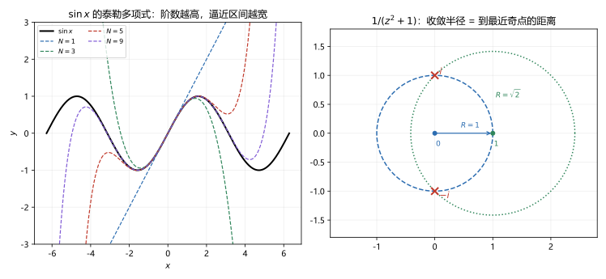

# 第 10 讲 泰勒级数

> **前置**：第 08 讲（柯西积分公式、高阶导数公式）、第 09 讲（幂级数、收敛半径、边界行为）。
> **预计时间**：约 3 小时（含作业）。
> **本讲回答**：解析函数为什么一定能展开成幂级数？收敛半径为什么等于到最近奇点的距离？怎么用已知展开式拼出新展开？复泰勒和实泰勒到底差在哪？

## 本讲要解决什么

第 08 讲证明了：解析函数无穷次可导，且各阶导数可以用边界积分表示。第 09 讲建立了幂级数：圆内可以逐项求导，收敛半径由系数决定。

这两件事合起来，就能回答本课程开头埋下的问题：

> 解析函数能不能写成幂级数？

答案是能，而且在收敛圆内直接相等。学完之后，你应该能做到：

- 陈述泰勒定理，并用柯西公式写出证明；
- 说出收敛半径等于展开中心到最近奇点的距离，并会用这个结论；
- 默写 $e^z$、$\sin z$、$\cos z$、$1/(1-z)$、$\ln(1+z)$ 的展开；
- 用代换、求导、积分、部分分式做间接展开；
- 说清复泰勒与实泰勒的区别，并解释 $e^{-1/x^2}$ 的反例为什么在复变里不会发生。

---

## 1. 泰勒定理

### 1.1 陈述

> **泰勒定理**：设 $f$ 在圆盘 $\lvert z-z_0\rvert<R$ 内解析，则在该圆盘内
>
> $$f(z)=\sum_{n=0}^{\infty}a_n(z-z_0)^n,$$
>
> 其中
>
> $$a_n=\frac{f^{(n)}(z_0)}{n!},$$
>
> 而且这个幂级数的收敛半径至少是 $R$。

$R$ 可以取到 $z_0$ 到 $f$ 的最近奇点的距离。第 2 节说明为什么。

### 1.2 证明

固定 $z$ 满足 $\lvert z-z_0\rvert<R$。取 $r$ 使

$$\lvert z-z_0\rvert<r<R,$$

并取圆 $\Gamma:\lvert \zeta-z_0\rvert=r$，方向逆时针。由柯西积分公式（第 08 讲），

$$f(z)=\frac{1}{2\pi i}\oint_\Gamma\frac{f(\zeta)}{\zeta-z}\,d\zeta.$$

**关键一步**：把分母改写成可以展开的形式。

$$\zeta-z=(\zeta-z_0)-(z-z_0)=(\zeta-z_0)\left(1-\frac{z-z_0}{\zeta-z_0}\right).$$

所以

$$\frac{1}{\zeta-z}=\frac{1}{\zeta-z_0}\cdot\frac{1}{1-\dfrac{z-z_0}{\zeta-z_0}}.$$

因为 $\zeta$ 在圆周上，$\lvert\zeta-z_0\rvert=r$，而 $\lvert z-z_0\rvert<r$，所以

$$\left\lvert\frac{z-z_0}{\zeta-z_0}\right\rvert=\frac{\lvert z-z_0\rvert}{r}=q<1.$$

于是可以用几何级数展开：

$$\frac{1}{1-q}=\sum_{n=0}^{\infty}q^n,\qquad \lvert q\rvert<1.$$

把 $q=(z-z_0)/(\zeta-z_0)$ 代回：

$$\frac{1}{\zeta-z}=\sum_{n=0}^{\infty}\frac{(z-z_0)^n}{(\zeta-z_0)^{n+1}}.$$

这个级数对 $\zeta\in\Gamma$ **一致收敛**（因为比值被 $q<1$ 控制），所以可以逐项积分。代入柯西公式：

$$
f(z)=\frac{1}{2\pi i}\oint_\Gamma f(\zeta)\sum_{n=0}^{\infty}\frac{(z-z_0)^n}{(\zeta-z_0)^{n+1}}\,d\zeta
=\sum_{n=0}^{\infty}(z-z_0)^n\cdot\frac{1}{2\pi i}\oint_\Gamma\frac{f(\zeta)}{(\zeta-z_0)^{n+1}}\,d\zeta.
$$

由高阶导数公式（第 08 讲），

$$\frac{1}{2\pi i}\oint_\Gamma\frac{f(\zeta)}{(\zeta-z_0)^{n+1}}\,d\zeta=\frac{f^{(n)}(z_0)}{n!}.$$

所以

$$f(z)=\sum_{n=0}^{\infty}\frac{f^{(n)}(z_0)}{n!}(z-z_0)^n.$$

证毕。

### 1.3 这个证明做了什么

三步：

1. 用柯西公式把 $f(z)$ 写成边界积分；
2. 把 $1/(\zeta-z)$ 展开成几何级数；
3. 逐项积分，用高阶导数公式把积分认出来。

第 2 步的几何级数是整个证明的核心。它成立的条件是 $\lvert z-z_0\rvert<r$，也就是 $z$ 在圆内。这就是为什么泰勒级数只在圆内成立。

### 1.4 系数公式

$$a_n=\frac{f^{(n)}(z_0)}{n!}.$$

这条把"函数在一点的各阶导数"和"幂级数系数"直接对应起来。第 09 讲 6.6 节从另一个方向得到过同样的公式：幂级数逐项求导后令 $z=z_0$，得到 $a_n=f^{(n)}(z_0)/n!$。两个方向一致。

**例 10.1** $f(z)=e^z$ 在 $z_0=0$。

$f^{(n)}(z)=e^z$，所以 $f^{(n)}(0)=1$，$a_n=1/n!$。

$$e^z=\sum_{n=0}^{\infty}\frac{z^n}{n!}=1+z+\frac{z^2}{2!}+\frac{z^3}{3!}+\cdots.$$

**例 10.2** $f(z)=\sin z$ 在 $z_0=0$。

导数循环：$\sin\to\cos\to-\sin\to-\cos\to\sin$。在 $0$ 处取值：

$$0,\ 1,\ 0,\ -1,\ 0,\ 1,\dots$$

所以只有奇次项，符号交替：

$$\sin z=z-\frac{z^3}{3!}+\frac{z^5}{5!}-\frac{z^7}{7!}+\cdots=\sum_{n=0}^{\infty}\frac{(-1)^n}{(2n+1)!}z^{2n+1}.$$

### 1.5 展开式唯一

如果

$$f(z)=\sum_{n=0}^{\infty}a_n(z-z_0)^n=\sum_{n=0}^{\infty}b_n(z-z_0)^n$$

在 $z_0$ 的某个邻域内成立，那么 $a_n=b_n$ 对所有 $n$ 成立。

**为什么？** 令 $z=z_0$，得 $a_0=b_0$。两边求导后令 $z=z_0$，得 $a_1=b_1$。依次求导，得所有系数相等。

所以**展开式唯一**。这很重要：不管你用什么方法得到展开，只要它在某个圆内收敛到 $f$，它就是泰勒展开。

**这条给间接展开开了门**：不需要每次求 $n$ 阶导数，可以用已知展开式拼。

---

## 2. 收敛半径等于到最近奇点的距离

### 2.1 定理

> 设 $f$ 在 $z_0$ 解析，$R$ 是 $z_0$ 到 $f$ 的**最近奇点**的距离（如果 $f$ 是整函数，规定 $R=+\infty$）。则 $f$ 在 $z_0$ 的泰勒级数收敛半径为 $R$。

**为什么至少是 $R$？** 对任意 $r<R$，圆盘 $\lvert z-z_0\rvert<r$ 内没有奇点，$f$ 在其中解析。由泰勒定理，级数在 $\lvert z-z_0\rvert<r$ 内收敛。$r$ 可以任意接近 $R$，所以级数在 $\lvert z-z_0\rvert<R$ 内收敛。因此收敛半径不小于 $R$。

**为什么不超过 $R$？** 设最近奇点是 $z_1$，$\lvert z_1-z_0\rvert=R$。如果收敛半径大于 $R$，那么 $z_1$ 落在收敛圆**内部**，级数在 $z_1$ 的邻域内解析，和函数 $g$ 在 $z_1$ 解析。但在 $\lvert z-z_0\rvert<R$ 内 $g=f$，由解析延拓，$f$ 在 $z_1$ 也应解析，与 "$z_1$ 是奇点" 矛盾。所以收敛半径不能大于 $R$。

两者合起来，收敛半径恰好等于 $R$。

### 2.2 例：$1/(1-z)$

$f(z)=1/(1-z)$ 的奇点是 $z=1$。

**在 $z_0=0$ 展开**：到奇点的距离是 $1$，所以 $R=1$。

$$\frac{1}{1-z}=\sum_{n=0}^{\infty}z^n,\qquad \lvert z\rvert<1.$$

**在 $z_0=2$ 展开**：到奇点 $1$ 的距离是 $1$，所以 $R=1$。

把 $1/(1-z)$ 改写成以 $z-2$ 为变量：

$$\frac{1}{1-z}=\frac{1}{1-(z-2)-2}=\frac{1}{-1-(z-2)}=-\frac{1}{1+(z-2)}.$$

用几何级数 $1/(1+w)=\sum(-1)^nw^n$，$w=z-2$：

$$\frac{1}{1-z}=-\sum_{n=0}^{\infty}(-1)^n(z-2)^n=\sum_{n=0}^{\infty}(-1)^{n+1}(z-2)^n.$$

展开前几项：

$$\frac{1}{1-z}=-1+(z-2)-(z-2)^2+(z-2)^3-\cdots,\qquad \lvert z-2\rvert<1.$$

**数值核对**（脚本 `scripts/lec10-01_verify_taylor.py`，EXP3）：取 $40$ 项，在 $z=1.5,1.9,2.1,2.5$ 处误差都在 $10^{-12}$ 以下。这四个点都满足 $\lvert z-2\rvert<1$。

### 2.3 例：$1/(z^2+1)$

$f(z)=1/(z^2+1)$ 的奇点是 $z=\pm i$。

**在 $z_0=0$ 展开**：到 $\pm i$ 的距离都是 $1$，所以 $R=1$。

$$\frac{1}{1+z^2}=\sum_{n=0}^{\infty}(-1)^nz^{2n}=1-z^2+z^4-z^6+\cdots,\qquad \lvert z\rvert<1.$$

**在 $z_0=1$ 展开**：到 $i$ 的距离是 $\lvert i-1\rvert=\sqrt2$，到 $-i$ 的距离是 $\lvert-i-1\rvert=\sqrt2$，所以 $R=\sqrt2\approx1.414$。

**在 $z_0=2$ 展开**：到 $i$ 的距离是 $\sqrt{1^2+2^2}=\sqrt5\approx2.236$，所以 $R=\sqrt5$。

**数值核对**（EXP4）：

```
center=0: nearest distance=1.000000
center=1: nearest distance=1.414214
center=2: nearest distance=2.236068
```



右图画出了两个收敛圆：以 $0$ 为圆心、半径 $1$ 的圆（经过 $\pm i$），和以 $1$ 为圆心、半径 $\sqrt2$ 的圆（也经过 $\pm i$）。**收敛圆总是被最近的奇点挡住**。

### 2.4 为什么实函数也有这个现象

考虑实函数

$$f(x)=\frac{1}{1+x^2}.$$

它在整个实轴上光滑，没有任何奇点。但它的麦克劳林级数

$$1-x^2+x^4-x^6+\cdots$$

只在 $\lvert x\rvert<1$ 收敛。为什么是 $1$？

实变量看不出原因：函数在实轴上好好的。但把它看成复变函数 $f(z)=1/(1+z^2)$，奇点在 $z=\pm i$，距离原点 $1$。收敛半径被复平面上的奇点限制住了。

**这是复变函数解释实函数收敛半径的经典例子。** 实轴上没有奇点，不代表复平面上没有；幂级数的收敛半径由复平面决定。

### 2.5 数值核对：边界附近收敛慢

EXP5 用 $30$ 项展开 $1/(1+z^2)$：

| $z$ | 部分和 | 精确值 | 误差 |
|---|---|---|---|
| $0.4$ | $0.862068966$ | $0.862068966$ | $0$ |
| $0.9$ | $0.553290375$ | $0.552486188$ | $8.0\times10^{-4}$ |
| $0.99$ | $0.775853858$ | $0.505024999$ | $2.7\times10^{-1}$ |

$z=0.99$ 离收敛圆边界很近，$30$ 项还不够。这不是发散，是收敛慢。越靠近边界，需要的项数越多。

---

## 3. 常用展开式

这些要能默写。$R$ 一栏是收敛半径。

| 函数 | 展开 | $R$ |
|---|---|---|
| $e^z$ | $\displaystyle\sum_{n=0}^{\infty}\frac{z^n}{n!}$ | $+\infty$ |
| $\sin z$ | $\displaystyle\sum_{n=0}^{\infty}\frac{(-1)^n}{(2n+1)!}z^{2n+1}$ | $+\infty$ |
| $\cos z$ | $\displaystyle\sum_{n=0}^{\infty}\frac{(-1)^n}{(2n)!}z^{2n}$ | $+\infty$ |
| $\dfrac{1}{1-z}$ | $\displaystyle\sum_{n=0}^{\infty}z^n$ | $1$ |
| $\dfrac{1}{1+z}$ | $\displaystyle\sum_{n=0}^{\infty}(-1)^nz^n$ | $1$ |
| $\ln(1+z)$ | $\displaystyle\sum_{n=1}^{\infty}\frac{(-1)^{n+1}}{n}z^n$ | $1$ |
| $\dfrac{1}{1+z^2}$ | $\displaystyle\sum_{n=0}^{\infty}(-1)^nz^{2n}$ | $1$ |

**$\ln(1+z)$ 怎么来的**：对 $1/(1+z)$ 的展开逐项积分：

$$\ln(1+z)=\int_0^z\frac{d\zeta}{1+\zeta}=\int_0^z\sum_{n=0}^{\infty}(-1)^n\zeta^n\,d\zeta=\sum_{n=0}^{\infty}\frac{(-1)^n}{n+1}z^{n+1}.$$

令 $m=n+1$，就是 $\sum_{m=1}^{\infty}(-1)^{m-1}z^m/m$。收敛半径不变，仍是 $1$。

---

## 4. 间接展开法

有了唯一性和上面的表，就不必每次求导。

### 4.1 代换

把已知展开中的 $z$ 换成另一个表达式。

**例 10.3** 展开 $\dfrac{1}{1+z^2}$。

在 $1/(1-w)=\sum w^n$ 中令 $w=-z^2$：

$$\frac{1}{1+z^2}=\sum_{n=0}^{\infty}(-z^2)^n=\sum_{n=0}^{\infty}(-1)^nz^{2n}.$$

收敛条件 $\lvert w\rvert<1$，即 $\lvert z\rvert<1$。

### 4.2 求导

对已知展开求导，得到新的展开。

**例 10.4** 展开 $\dfrac{z}{(1-z)^2}$。

从 $1/(1-z)=\sum z^n$ 求导：

$$\frac{1}{(1-z)^2}=\sum_{n=1}^{\infty}nz^{n-1}.$$

两边乘 $z$：

$$\frac{z}{(1-z)^2}=\sum_{n=1}^{\infty}nz^n=z+2z^2+3z^3+\cdots.$$

收敛半径仍是 $1$。

### 4.3 积分

**例 10.5** 展开 $\arctan z$。

$$\arctan z=\int_0^z\frac{d\zeta}{1+\zeta^2}=\int_0^z\sum_{n=0}^{\infty}(-1)^n\zeta^{2n}\,d\zeta=\sum_{n=0}^{\infty}\frac{(-1)^n}{2n+1}z^{2n+1}.$$

收敛半径 $1$（奇点 $\pm i$）。

### 4.4 部分分式

**例 10.6** 展开 $\dfrac{1}{z(z-1)}$ 在 $z_0=2$。

先部分分式：

$$\frac{1}{z(z-1)}=-\frac1z+\frac{1}{z-1}.$$

分别展开：

$$-\frac1z=-\frac{1}{2+(z-2)}=-\frac12\cdot\frac{1}{1+\frac{z-2}{2}}=-\frac12\sum_{n=0}^{\infty}(-1)^n\frac{(z-2)^n}{2^n},$$

收敛半径 $2$（奇点 $0$ 到 $2$ 的距离）。

$$\frac{1}{z-1}=\frac{1}{1+(z-2)}=\sum_{n=0}^{\infty}(-1)^n(z-2)^n,$$

收敛半径 $1$（奇点 $1$ 到 $2$ 的距离）。

两项都收敛时才能相加，所以总收敛半径取小的：$R=1$。

合并前几项：

$$\frac{1}{z(z-1)}=\frac12-\frac34(z-2)+\frac78(z-2)^2-\cdots,\qquad \lvert z-2\rvert<1.$$

**注意**：两个展开各自的半径不同，合并后取交集。这是做部分分式展开时容易漏的一步。

### 4.5 在非零点展开的通用流程

1. 令 $w=z-z_0$，把函数改写成 $w$ 的表达式；
2. 用已知展开式（几何级数最常用）；
3. 把 $w$ 换回 $z-z_0$；
4. 写出收敛条件，确定半径。

---

## 5. 复泰勒与实泰勒的区别

### 5.1 实泰勒有余项，复泰勒没有

实函数的泰勒公式是

$$f(x)=\sum_{k=0}^{n}\frac{f^{(k)}(x_0)}{k!}(x-x_0)^k+R_n(x),$$

带一个余项 $R_n$。只有在 $R_n\to0$ 时，才能写成无穷级数。而且即使 $R_n\to0$，也可能只在某个区间内成立。

复泰勒在收敛圆内**直接等于**，没有余项问题。定理说的是等式，不是近似。

### 5.2 实泰勒可能收敛到别的函数

经典反例：

$$f(x)=\begin{cases}e^{-1/x^2},&x\ne0,\\0,&x=0.\end{cases}$$

这个函数在实轴上无穷次可导，且

$$f^{(n)}(0)=0\qquad(n=0,1,2,\dots).$$

所以它的麦克劳林级数是

$$0+0\cdot x+0\cdot x^2+\cdots=0.$$

级数处处收敛，但收敛到 $0$，不等于 $f(x)$（当 $x\ne0$ 时 $f(x)>0$）。

**这个函数不是解析函数。** 把它看成复变函数，$z=0$ 是本性奇点（第 12 讲会定义），在 $0$ 的任何邻域内都不解析。所以泰勒定理不适用。

**复变不会出现这种情况**：只要 $f$ 在圆内解析，泰勒级数就一定收敛到 $f$。这就是"解析"比"实轴无穷次可导"强的地方。

### 5.3 一句话总结

| | 实泰勒 | 复泰勒 |
|---|---|---|
| 形式 | 有限项 + 余项 | 无穷级数，直接相等 |
| 收敛 | 可能只在某区间 | 收敛圆内一定收敛到 $f$ |
| 反例 | $e^{-1/x^2}$ | 不存在（解析保证） |
| 半径 | 没有统一公式 | 到最近奇点的距离 |

---

## 6. 本讲小结

| 内容 | 要点 |
|---|---|
| 泰勒定理 | 圆内解析 $\Rightarrow$ $f(z)=\sum\frac{f^{(n)}(z_0)}{n!}(z-z_0)^n$ |
| 证明 | 柯西公式 + 几何级数展开 + 逐项积分 |
| 系数 | $a_n=f^{(n)}(z_0)/n!$ |
| 唯一性 | 展开式唯一，可用间接法 |
| 收敛半径 | 等于展开中心到最近奇点的距离 |
| 常用展开 | $e^z,\sin z,\cos z,1/(1-z),\ln(1+z)$ |
| 间接展开 | 代换、求导、积分、部分分式 |
| 与实泰勒的区别 | 复泰勒无余项，收敛圆内直接相等 |

三句话带走：

1. 解析函数的泰勒级数在收敛圆内直接等于它自己，没有余项。
2. 收敛半径由最近奇点决定，实轴上看不见的复奇点也算。
3. 有了唯一性，展开可以拼，不必每次求导。

---

## 7. 掌握度自测

- [ ] 能陈述泰勒定理，并说出系数公式。
- [ ] 能用柯西公式写出证明的三步。
- [ ] 能默写 $e^z$、$\sin z$、$\cos z$、$1/(1-z)$、$\ln(1+z)$ 的展开。
- [ ] 能由最近奇点判断收敛半径。
- [ ] 能用代换、求导、积分做间接展开。
- [ ] 能用部分分式展开，并正确处理两个展开半径不同的情况。
- [ ] 能解释 $1/(1+x^2)$ 的实麦克劳林级数为什么半径是 $1$。
- [ ] 能说出 $e^{-1/x^2}$ 为什么不是反例。

---

## 作业

### 基础

**1.** 写出 $e^z$ 在 $z=0$ 的泰勒级数，并说明收敛半径。

**参考答案：**

$$e^z=\sum_{n=0}^{\infty}\frac{z^n}{n!}=1+z+\frac{z^2}{2!}+\frac{z^3}{3!}+\cdots.$$

$e^z$ 是整函数，没有奇点，所以 $R=+\infty$。

---

**2.** 写出 $\sin z$ 在 $z=0$ 的泰勒级数。

**参考答案：**

$$\sin z=\sum_{n=0}^{\infty}\frac{(-1)^n}{(2n+1)!}z^{2n+1}=z-\frac{z^3}{3!}+\frac{z^5}{5!}-\cdots.$$

$R=+\infty$。

---

**3.** 写出 $\dfrac{1}{1-z}$ 在 $z=0$ 的展开，并说明收敛半径。

**参考答案：**

$$\frac{1}{1-z}=\sum_{n=0}^{\infty}z^n=1+z+z^2+\cdots.$$

奇点在 $z=1$，到 $0$ 的距离为 $1$，所以 $R=1$。

---

**4.** 写出 $\dfrac{1}{1-z}$ 在 $z=2$ 的展开，并说明收敛半径。

**参考答案：**

$$\frac{1}{1-z}=\sum_{n=0}^{\infty}(-1)^{n+1}(z-2)^n=-1+(z-2)-(z-2)^2+\cdots.$$

奇点在 $z=1$，到 $2$ 的距离为 $1$，所以 $R=1$。

---

### 提高

**5.** 展开 $\dfrac{1}{1+z^2}$ 在 $z=0$，并说明收敛半径。

**参考答案：**

在 $1/(1-w)=\sum w^n$ 中令 $w=-z^2$：

$$\frac{1}{1+z^2}=\sum_{n=0}^{\infty}(-1)^nz^{2n}=1-z^2+z^4-\cdots.$$

奇点 $\pm i$ 到 $0$ 的距离为 $1$，所以 $R=1$。

---

**6.** 展开 $\ln(1+z)$ 在 $z=0$，并说明收敛半径。

**参考答案：**

$$\ln(1+z)=\int_0^z\frac{d\zeta}{1+\zeta}=\int_0^z\sum_{n=0}^{\infty}(-1)^n\zeta^n\,d\zeta=\sum_{n=1}^{\infty}\frac{(-1)^{n-1}}{n}z^n.$$

即

$$\ln(1+z)=z-\frac{z^2}{2}+\frac{z^3}{3}-\frac{z^4}{4}+\cdots.$$

奇点在 $z=-1$，到 $0$ 的距离为 $1$，所以 $R=1$。

---

**7.** 展开 $\dfrac{1}{z(z-1)}$ 在 $z=2$，并说明收敛半径。

**参考答案：**

部分分式：

$$\frac{1}{z(z-1)}=-\frac1z+\frac{1}{z-1}.$$

第一项：

$$-\frac1z=-\frac{1}{2+(z-2)}=-\frac12\sum_{n=0}^{\infty}(-1)^n\frac{(z-2)^n}{2^n},\qquad R=2.$$

第二项：

$$\frac{1}{z-1}=\frac{1}{1+(z-2)}=\sum_{n=0}^{\infty}(-1)^n(z-2)^n,\qquad R=1.$$

两项都收敛需 $\lvert z-2\rvert<1$，所以总收敛半径 $R=1$。

前几项：

$$\frac{1}{z(z-1)}=\frac12-\frac34(z-2)+\frac78(z-2)^2-\cdots.$$

---

**8.** 展开 $\dfrac{z}{(1-z)^2}$ 在 $z=0$。

**参考答案：**

从 $1/(1-z)=\sum z^n$ 求导：

$$\frac{1}{(1-z)^2}=\sum_{n=1}^{\infty}nz^{n-1}.$$

乘 $z$：

$$\frac{z}{(1-z)^2}=\sum_{n=1}^{\infty}nz^n=z+2z^2+3z^3+\cdots.$$

收敛半径 $1$（奇点 $z=1$）。

---

### 综合

**9.** 证明泰勒定理。

**参考答案：**

设 $f$ 在 $\lvert z-z_0\rvert<R$ 内解析。取 $r<R$，$\Gamma:\lvert\zeta-z_0\rvert=r$，并取 $\lvert z-z_0\rvert<r$。

由柯西积分公式：

$$f(z)=\frac{1}{2\pi i}\oint_\Gamma\frac{f(\zeta)}{\zeta-z}d\zeta.$$

把分母写成

$$\zeta-z=(\zeta-z_0)\left(1-\frac{z-z_0}{\zeta-z_0}\right).$$

因为 $\lvert(z-z_0)/(\zeta-z_0)\rvert=\lvert z-z_0\rvert/r<1$，用几何级数：

$$\frac{1}{\zeta-z}=\sum_{n=0}^{\infty}\frac{(z-z_0)^n}{(\zeta-z_0)^{n+1}}.$$

该级数对 $\zeta\in\Gamma$ 一致收敛，可以逐项积分：

$$f(z)=\sum_{n=0}^{\infty}(z-z_0)^n\cdot\frac{1}{2\pi i}\oint_\Gamma\frac{f(\zeta)}{(\zeta-z_0)^{n+1}}d\zeta.$$

由高阶导数公式，积分等于 $f^{(n)}(z_0)/n!$。所以

$$f(z)=\sum_{n=0}^{\infty}\frac{f^{(n)}(z_0)}{n!}(z-z_0)^n.$$

证毕。

---

**10.** 求 $\dfrac{1}{z^2+1}$ 在 $z=1$ 的泰勒展开前四项，并说明收敛半径。

**参考答案：**

令 $w=z-1$，则 $z=1+w$，

$$z^2+1=(1+w)^2+1=2+2w+w^2=2\left(1+w+\frac{w^2}{2}\right).$$

所以

$$\frac{1}{z^2+1}=\frac12\cdot\frac{1}{1+w+w^2/2}.$$

用 $1/(1+u)=1-u+u^2-\cdots$，取 $u=w+w^2/2$，展开到 $w^2$：

$$
\frac{1}{1+w+w^2/2}
=1-\left(w+\frac{w^2}{2}\right)+\left(w+\frac{w^2}{2}\right)^2-\cdots
=1-w+\frac{w^2}{2}+\cdots.
$$

所以

$$\frac{1}{z^2+1}=\frac12-\frac{w}{2}+\frac{w^2}{4}+\cdots
=\frac12-\frac{z-1}{2}+\frac{(z-1)^2}{4}+\cdots.$$

收敛半径：奇点 $\pm i$，到 $1$ 的距离都是 $\sqrt2$，所以 $R=\sqrt2$。

---

**11.** 用泰勒展开证明欧拉公式 $e^{iz}=\cos z+i\sin z$。

**参考答案：**

$$e^{iz}=\sum_{n=0}^{\infty}\frac{(iz)^n}{n!}=\sum_{n=0}^{\infty}\frac{i^nz^n}{n!}.$$

把 $n$ 按奇偶分开。

偶数 $n=2k$：$i^{2k}=(-1)^k$，

$$\sum_{k=0}^{\infty}\frac{(-1)^kz^{2k}}{(2k)!}=\cos z.$$

奇数 $n=2k+1$：$i^{2k+1}=i(-1)^k$，

$$\sum_{k=0}^{\infty}\frac{i(-1)^kz^{2k+1}}{(2k+1)!}=i\sin z.$$

两项相加：

$$e^{iz}=\cos z+i\sin z.$$

这就兑现了第 04 讲欠的推导：欧拉公式不是硬规定的，它从指数函数的级数定义直接得到。

---

## 下一讲预告

泰勒级数要求函数在展开中心解析。但很多函数在中心本身就有奇点，例如

$$\frac{1}{z(z-1)}$$

在 $z=0$ 和 $z=1$ 都没有定义。

这类函数在奇点附近不能展开成泰勒级数，但可以在**圆环域**内展开成带负幂项的级数：

$$f(z)=\sum_{n=-\infty}^{\infty}a_n(z-z_0)^n.$$

这就是**洛朗级数**。下一讲会讲清：负幂项从哪来、同一个函数为什么在不同圆环有不同展开、展开域怎么确定。它是第 12 讲奇点分类和第 13 讲留数定理的直接基础。
