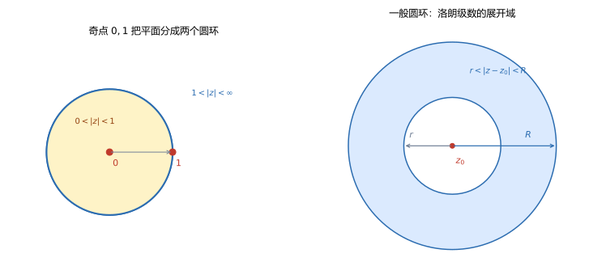

# 第 11 讲 洛朗级数

> **前置**：第 09 讲（几何级数、收敛半径）、第 10 讲（泰勒级数、到最近奇点的距离）。
> **预计时间**：约 3 小时（含作业）。
> **本讲回答**：中心本身是奇点时怎么展开？负幂项从哪里来？同一个函数为什么在不同圆环有不同展开？展开域怎么确定？洛朗系数为什么不能写成 $f^{(n)}(z_0)/n!$？

## 本讲要解决什么

第 10 讲的泰勒级数要求函数在展开中心解析。但很多函数在中心本身就有奇点：

$$\frac{1}{z},\qquad \frac{1}{z(z-1)},\qquad e^{1/z}.$$

这些函数在 $z=0$ 没有定义，不能展开成只有非负幂的泰勒级数。

但它们在**圆环域**内仍然可以展开，代价是允许负幂项：

$$f(z)=\sum_{n=-\infty}^{\infty}a_n(z-z_0)^n.$$

这就是**洛朗级数**（Laurent series）。学完之后，你应该能做到：

- 陈述洛朗定理，说出展开域和系数公式；
- 找出函数的所有奇点，用奇点把平面划分成若干圆环；
- 在每个圆环内用几何级数做展开；
- 说清同一函数在不同圆环的展开为什么不同；
- 认出负幂项的最高次数与奇点类型的关系。

---

## 1. 泰勒级数不够用

### 1.1 中心是奇点

取 $f(z)=1/z$，想在 $z_0=0$ 展开。

泰勒系数需要 $f^{(n)}(0)$，但 $f$ 在 $0$ 没有定义，导数无从谈起。所以泰勒定理用不了。

可是函数本身在 $0$ 附近（除 $0$ 外）是有定义的，而且很规整。能不能用一个含 $1/z$ 的级数表示它？

### 1.2 圆环的想法

把展开中心 $z_0$ 挖掉，考虑圆环

$$0<\lvert z-z_0\rvert<R.$$

在这个圆环内，$f$ 可能处处解析。于是可以问：能不能用 $\sum a_n(z-z_0)^n$ 表示，其中 $n$ 允许取负整数？

答案是能。这就是洛朗级数。

对 $1/z$，它本身就是 $z^{-1}$，已经是洛朗级数（只有一项）。

对更复杂的函数，负幂项会有好几项，甚至无穷多项。

---

## 2. 洛朗定理

### 2.1 陈述

> **洛朗定理**：设 $f$ 在圆环
>
> $$D=\{z:r<\lvert z-z_0\rvert<R\}$$
>
> 内解析，其中 $0\le r<R\le+\infty$。则在该圆环内
>
> $$f(z)=\sum_{n=-\infty}^{\infty}a_n(z-z_0)^n,$$
>
> 其中
>
> $$a_n=\frac{1}{2\pi i}\oint_C\frac{f(\zeta)}{(\zeta-z_0)^{n+1}}\,d\zeta,$$
>
> $C$ 是圆环内任意一条绕 $z_0$ 一圈的逆时针闭曲线。

$r=0$ 时，圆环是"挖去中心的圆盘"；$R=+\infty$ 时，圆环是"圆外区域"。



左图的奇点 $0$ 和 $1$ 把平面分成两个圆环：$0<\lvert z\rvert<1$ 和 $1<\lvert z\rvert<+\infty$。右图是一般圆环 $r<\lvert z-z_0\rvert<R$。

### 2.2 系数公式

$$a_n=\frac{1}{2\pi i}\oint_C\frac{f(\zeta)}{(\zeta-z_0)^{n+1}}\,d\zeta.$$

这个公式对**所有整数** $n$ 都成立，包括负数。

$C$ 可以取圆环内任意一条绕 $z_0$ 的闭路，因为由复合闭路定理，不同的这种闭路给出的积分相同（它们之间的环形区域内没有奇点）。

### 2.3 为什么不能写成 $f^{(n)}(z_0)/n!$

泰勒系数是 $a_n=f^{(n)}(z_0)/n!$，因为 $f$ 在 $z_0$ 解析，可以用高阶导数公式。

洛朗系数不行：$f$ 在 $z_0$ 可能根本没有定义，$f^{(n)}(z_0)$ 不存在。

**唯一的例外**：如果 $f$ 在 $z_0$ 解析（即 $r=0$ 且 $f$ 可以补定义成解析），那么负幂项全为零，$a_n=f^{(n)}(z_0)/n!$，洛朗级数退化为泰勒级数。这时两个公式一致。

**做题提醒**：看到 $a_n=f^{(n)}(z_0)/n!$，先确认 $f$ 在 $z_0$ 解析。不解析就不能用。

### 2.4 证明思路

证明比泰勒定理多一步：要同时处理"离中心远"和"离中心近"两部分。

取两个圆：

$$C_R:\lvert\zeta-z_0\rvert=R',\qquad C_r:\lvert\zeta-z_0\rvert=r',$$

其中 $r<r'<\lvert z-z_0\rvert<R'<R$。$z$ 夹在两个圆之间。

用复合闭路定理和柯西积分公式，把 $f(z)$ 写成两个积分之差：

$$f(z)=\frac{1}{2\pi i}\oint_{C_R}\frac{f(\zeta)}{\zeta-z}\,d\zeta-\frac{1}{2\pi i}\oint_{C_r}\frac{f(\zeta)}{\zeta-z}\,d\zeta.$$

第一个积分：$\lvert z-z_0\rvert<\lvert\zeta-z_0\rvert$，像泰勒定理那样展开：

$$\frac{1}{\zeta-z}=\sum_{n=0}^{\infty}\frac{(z-z_0)^n}{(\zeta-z_0)^{n+1}},$$

得到**非负幂项**。

第二个积分：$\lvert z-z_0\rvert>\lvert\zeta-z_0\rvert$，展开方向反过来：

$$\frac{1}{\zeta-z}=-\sum_{n=0}^{\infty}\frac{(\zeta-z_0)^n}{(z-z_0)^{n+1}},$$

前面还有一个负号，乘起来得到**负幂项**。

两部分合起来，就是 $\sum_{n=-\infty}^{\infty}a_n(z-z_0)^n$。把两个圆上的积分合并成绕 $z_0$ 的任意闭路 $C$，就是系数公式。

**关键点**：负幂项来自内圆上的积分。因为在 $z$ 靠近内圆时，$\lvert z-z_0\rvert$ 比 $\lvert\zeta-z_0\rvert$ 大，几何级数必须按 $\zeta-z_0$ 展开，于是 $z-z_0$ 跑到分母上，变成负幂。

### 2.5 唯一性

在给定圆环内，洛朗展开唯一。

证明与泰勒唯一性类似：在圆环内任取一点，两边乘以适当的因子再积分，利用 $\oint(\zeta-z_0)^k d\zeta$ 在 $k\ne-1$ 时为零、$k=-1$ 时为 $2\pi i$，可以逐项定出系数。

**所以展开结果不依赖你用什么方法**。用几何级数拼出来的，就是洛朗级数。

---

## 3. 负幂项从哪里来

### 3.1 几何级数的两种展开

同一个几何级数，在不同区域有不同展开。

**在 $\lvert z\rvert<1$ 内**：

$$\frac{1}{1-z}=\sum_{n=0}^{\infty}z^n=1+z+z^2+\cdots$$

这是正幂。

**在 $\lvert z\rvert>1$ 内**，把 $z$ 提出来：

$$\frac{1}{1-z}=-\frac{1}{z}\cdot\frac{1}{1-\frac1z}=-\frac1z\sum_{n=0}^{\infty}\frac{1}{z^n}=-\sum_{n=0}^{\infty}\frac{1}{z^{n+1}}.$$

这是负幂：

$$\frac{1}{1-z}=-\frac1z-\frac{1}{z^2}-\frac{1}{z^3}-\cdots,\qquad \lvert z\rvert>1.$$

**两个展开都正确，只是适用区域不同。** 洛朗级数的负幂项，基本都来自这种"在圆外按 $1/z$ 展开"的操作。

### 3.2 决定展开的是圆环，不是函数

同一个函数，在不同的圆环里有不同的洛朗展开。选择哪个展开，取决于题目指定的圆环。

**做题第一步永远是：找出所有奇点，画出圆环。**

### 3.3 例：$\dfrac{1}{z(z-1)}$ 的两个展开

奇点是 $z=0$ 和 $z=1$，它们把平面分成两个圆环：

$$0<\lvert z\rvert<1,\qquad 1<\lvert z\rvert<+\infty.$$

**圆环一：$0<\lvert z\rvert<1$**

这时 $\lvert z\rvert<1$，所以 $1/(1-z)$ 用正幂展开：

$$
\frac{1}{z(z-1)}
=\frac{1}{z}\cdot\frac{1}{z-1}
=-\frac1z\cdot\frac{1}{1-z}
=-\frac1z\sum_{n=0}^{\infty}z^n
=-\sum_{n=0}^{\infty}z^{n-1}.
$$

写开来：

$$\frac{1}{z(z-1)}=-\frac1z-1-z-z^2-\cdots,\qquad 0<\lvert z\rvert<1.$$

负幂只有一项 $-1/z$。

**圆环二：$1<\lvert z\rvert<+\infty$**

这时 $\lvert z\rvert>1$，所以 $1/(1-z)$ 用负幂展开，或者把 $1/(z-1)$ 写成 $1/z\cdot1/(1-1/z)$：

$$
\frac{1}{z(z-1)}
=\frac{1}{z^2}\cdot\frac{1}{1-\frac1z}
=\frac{1}{z^2}\sum_{n=0}^{\infty}\frac{1}{z^n}
=\sum_{n=0}^{\infty}\frac{1}{z^{n+2}}.
$$

写开来：

$$\frac{1}{z(z-1)}=\frac{1}{z^2}+\frac{1}{z^3}+\frac{1}{z^4}+\cdots,\qquad 1<\lvert z\rvert<+\infty.$$

没有非负幂项，全是负幂。

**同一个函数，两个完全不同的展开。** 第一个在原点附近好用，第二个在无穷远附近好用；在 $0<\lvert z\rvert<1$ 内第一个收敛、第二个发散；在 $\lvert z\rvert>1$ 内反过来。

**数值核对**（脚本 `scripts/lec11-01_verify_laurent.py`，EXP1、EXP2）：

```
圆环一 z=0.5: 部分和 = -4.000000000，精确值 = -4.000000000
圆环二 z=2.0: 部分和 =  0.500000000，精确值 =  0.500000000
```

两边都对。

### 3.4 一个容易混的点

在圆环一里，$1/(z-1)$ 的展开是

$$\frac{1}{z-1}=-\frac{1}{1-z}=-\sum z^n,$$

在圆环二里是

$$\frac{1}{z-1}=\frac1z\cdot\frac{1}{1-1/z}=\sum_{n=0}^{\infty}\frac{1}{z^{n+1}}.$$

同一个分式，两种展开。判断用哪一种，只看 $\lvert z\rvert$ 比 $1$ 大还是小。

---

## 4. 展开流程与例题

### 4.1 四步流程

1. **找奇点**：分母为零的点、对数/幂函数的支点等；
2. **画圆环**：奇点按到 $z_0$ 的距离排序，相邻距离之间就是一个圆环；
3. **部分分式**：把函数拆成若干个简单分式；
4. **逐项展开**：对每个分式，根据当前圆环内 $\lvert z-z_0\rvert$ 与奇点距离的大小关系，选择正幂或负幂展开。

最后写出收敛范围。

### 4.2 例：$\dfrac{1}{z^2(z-1)}$ 在 $0<\lvert z\rvert<1$

奇点 $0$（二阶）和 $1$。

在 $0<\lvert z\rvert<1$ 内，$\lvert z\rvert<1$，所以 $1/(1-z)$ 用正幂：

$$
\frac{1}{z^2(z-1)}
=-\frac{1}{z^2}\cdot\frac{1}{1-z}
=-\frac{1}{z^2}\sum_{n=0}^{\infty}z^n
=-\sum_{n=0}^{\infty}z^{n-2}.
$$

展开：

$$\frac{1}{z^2(z-1)}=-\frac{1}{z^2}-\frac1z-1-z-z^2-\cdots.$$

负幂最高是 $z^{-2}$，对应二阶极点。

**数值核对**（EXP5）：$z=0.5$ 时部分和 $-8.000000000$，精确值也是 $-8$。

### 4.3 例：$\dfrac{1}{z^2+1}$ 在 $\lvert z\rvert>1$

奇点 $\pm i$，模都是 $1$。所以圆环有两个：$\lvert z\rvert<1$ 和 $\lvert z\rvert>1$。

在 $\lvert z\rvert>1$ 内，把 $z^2$ 提出来：

$$
\frac{1}{z^2+1}
=\frac{1}{z^2}\cdot\frac{1}{1+\frac{1}{z^2}}
=\frac{1}{z^2}\sum_{n=0}^{\infty}\frac{(-1)^n}{z^{2n}}
=\sum_{n=0}^{\infty}\frac{(-1)^n}{z^{2n+2}}.
$$

展开：

$$\frac{1}{z^2+1}=\frac{1}{z^2}-\frac{1}{z^4}+\frac{1}{z^6}-\cdots,\qquad \lvert z\rvert>1.$$

**数值核对**（EXP6）：$z=2$ 时部分和 $0.200000000$，精确值 $1/5=0.2$。

### 4.4 例：$e^{1/z}$

$e^{1/z}$ 在 $z=0$ 没有定义。把 $e^w=\sum w^n/n!$ 中的 $w$ 换成 $1/z$：

$$e^{1/z}=\sum_{n=0}^{\infty}\frac{1}{n!\,z^n}=1+\frac1z+\frac{1}{2!z^2}+\frac{1}{3!z^3}+\cdots.$$

展开域是 $0<\lvert z\rvert<+\infty$（除原点外全平面）。

**负幂项有无穷多项**，而且系数是 $1/n!$。这种奇点叫**本性奇点**，第 12 讲会定义。

**数值核对**（EXP3）：$z=2$ 时部分和 $1.648721271$，等于 $e^{1/2}$。

### 4.5 例：$\sin z/z$

$\sin z/z$ 在 $z=0$ 没有定义（分母为零），但把 $\sin z$ 的展开除下来：

$$\frac{\sin z}{z}=\frac{1}{z}\left(z-\frac{z^3}{3!}+\frac{z^5}{5!}-\cdots\right)=1-\frac{z^2}{3!}+\frac{z^4}{5!}-\cdots.$$

**没有负幂项。** 这说明 $z=0$ 不是真正的奇点：补定义 $f(0)=1$ 后，函数在 $0$ 解析。这种奇点叫**可去奇点**，第 12 讲会讲。

**数值核对**（EXP4）：$z=1$ 时部分和 $0.841470985$，等于 $\sin1$。

### 4.6 圆环边界的注意事项

圆环的边界由奇点决定，不能随便取。

**例**：$1/(z(z-1))$ 在 $0<\lvert z\rvert<1$ 展开时，虽然有"挖去原点"的洞，但展开里可以出现 $-1/z$。这是因为原点本身就是奇点，圆环边界穿过它。

**如果题目说"在 $z=0$ 去心邻域内展开"**，就是 $0<\lvert z\rvert<1$。

**如果题目说"在圆环 $1<\lvert z\rvert<2$ 内展开"**，先确认这个圆环里没有奇点。例如 $1/(z(z-1))$ 的奇点是 $0,1$：$0$ 在圆环外部（$\lvert 0\rvert<1$），$1$ 在圆环边界上（$\lvert 1\rvert=1$），圆环内部没有奇点，可以展开。

**如果指定的圆环内有奇点**，那要么题目给错了，要么你漏看了奇点。比如 $1/(z(z-1)(z-2.5))$ 在 $1<\lvert z\rvert<3$ 内就有一个奇点 $2.5$，不能直接在该圆环内展开——需要先把圆环缩小到 $1<\lvert z\rvert<2.5$ 或 $2.5<\lvert z\rvert<3$。

---

## 5. 洛朗级数与奇点类型（预告）

洛朗级数的负幂部分

$$\sum_{n=1}^{\infty}\frac{a_{-n}}{(z-z_0)^n}$$

叫 $f$ 在 $z_0$ 处的**主部**（principal part）。主部的形态决定了奇点的类型。

| 主部形态 | 奇点类型 | 例子 |
|---|---|---|
| 没有负幂项 | 可去奇点 | $\sin z/z$ |
| 只有有限项，最高为 $(z-z_0)^{-m}$ | $m$ 阶极点 | $1/z^2$（二阶），$1/z$（一阶） |
| 有无穷多项 | 本性奇点 | $e^{1/z}$ |

这三类奇点是第 12 讲的主题。洛朗展开是判断奇点类型的基本工具：**先展开，再看负幂项有几项。**

---

## 6. 泰勒是洛朗的特例

如果 $f$ 在 $z_0$ 解析，那么可以取 $r=0$，圆环变成 $0\le\lvert z-z_0\rvert<R$（即圆盘）。

这时洛朗级数的负幂项系数

$$a_{-n}=\frac{1}{2\pi i}\oint_C f(\zeta)(\zeta-z_0)^{n-1}\,d\zeta\qquad(n\ge1)$$

中被积函数 $f(\zeta)(\zeta-z_0)^{n-1}$ 在圆盘内解析，由柯西定理，积分为零。

所以负幂项全为零，洛朗级数只剩非负幂，就是泰勒级数。

**一句话**：洛朗级数是泰勒级数的推广，把"只能在解析点展开"放宽到"可以在圆环内展开"。

---

## 7. 本讲小结

| 内容 | 要点 |
|---|---|
| 洛朗级数 | $\sum_{n=-\infty}^{\infty}a_n(z-z_0)^n$，允许负幂 |
| 展开域 | 圆环 $r<\lvert z-z_0\rvert<R$，边界由奇点决定 |
| 系数 | $a_n=\frac{1}{2\pi i}\oint_C\frac{f(\zeta)}{(\zeta-z_0)^{n+1}}d\zeta$ |
| 系数陷阱 | 不能写成 $f^{(n)}(z_0)/n!$，除非 $f$ 在 $z_0$ 解析 |
| 负幂来源 | 内圆上按 $\zeta-z_0$ 展开几何级数 |
| 唯一性 | 给定圆环内展开唯一 |
| 展开流程 | 找奇点 → 画圆环 → 部分分式 → 逐项展开 |
| 主部 | 负幂部分；形态决定奇点类型 |

三句话带走：

1. 泰勒要求中心解析，洛朗只要求圆环内解析；代价是允许负幂项。
2. 决定展开的是圆环，不是函数；先画奇点，再选正幂或负幂。
3. 负幂项的最高次数就是极点的阶数，无穷多负幂就是本性奇点。

---

## 8. 掌握度自测

- [ ] 能陈述洛朗定理，并说出展开域和系数公式。
- [ ] 能说清洛朗系数为什么不能写成 $f^{(n)}(z_0)/n!$。
- [ ] 能找出函数的奇点，并把平面划分成圆环。
- [ ] 能在指定圆环内用几何级数做展开。
- [ ] 能解释同一函数在不同圆环的展开为什么不同。
- [ ] 能写出 $e^{1/z}$、$\sin z/z$、$1/z^2$ 的洛朗展开，并说出主部。
- [ ] 能说出主部形态与奇点类型的对应关系。

---

## 作业

### 基础

**1.** 求 $\dfrac{1}{z-1}$ 在 $1<\lvert z\rvert<+\infty$ 内的洛朗展开。

**参考答案：**

$$\frac{1}{z-1}=\frac1z\cdot\frac{1}{1-\frac1z}=\frac1z\sum_{n=0}^{\infty}\frac{1}{z^n}=\sum_{n=0}^{\infty}\frac{1}{z^{n+1}}.$$

即

$$\frac{1}{z-1}=\frac1z+\frac{1}{z^2}+\frac{1}{z^3}+\cdots,\qquad \lvert z\rvert>1.$$

---

**2.** 求 $\dfrac{1}{z(z-1)}$ 在 $0<\lvert z\rvert<1$ 内的洛朗展开。

**参考答案：**

$$
\frac{1}{z(z-1)}=-\frac1z\cdot\frac{1}{1-z}=-\frac1z\sum_{n=0}^{\infty}z^n=-\sum_{n=0}^{\infty}z^{n-1}.
$$

即

$$\frac{1}{z(z-1)}=-\frac1z-1-z-z^2-\cdots,\qquad 0<\lvert z\rvert<1.$$

---

**3.** 求 $\dfrac{1}{z(z-1)}$ 在 $1<\lvert z\rvert<+\infty$ 内的洛朗展开。

**参考答案：**

$$
\frac{1}{z(z-1)}=\frac{1}{z^2}\cdot\frac{1}{1-\frac1z}=\frac{1}{z^2}\sum_{n=0}^{\infty}\frac{1}{z^n}=\sum_{n=0}^{\infty}\frac{1}{z^{n+2}}.
$$

即

$$\frac{1}{z(z-1)}=\frac{1}{z^2}+\frac{1}{z^3}+\frac{1}{z^4}+\cdots,\qquad \lvert z\rvert>1.$$

---

**4.** 求 $e^{1/z}$ 在 $0<\lvert z\rvert<+\infty$ 内的洛朗展开。

**参考答案：**

把 $e^w=\sum w^n/n!$ 中的 $w$ 换成 $1/z$：

$$e^{1/z}=\sum_{n=0}^{\infty}\frac{1}{n!\,z^n}=1+\frac1z+\frac{1}{2!z^2}+\frac{1}{3!z^3}+\cdots.$$

负幂项有无穷多项。

---

### 提高

**5.** 求 $\dfrac{1}{z^2+1}$ 在 $\lvert z\rvert>1$ 内的洛朗展开。

**参考答案：**

$$
\frac{1}{z^2+1}=\frac{1}{z^2}\cdot\frac{1}{1+\frac{1}{z^2}}=\frac{1}{z^2}\sum_{n=0}^{\infty}\frac{(-1)^n}{z^{2n}}=\sum_{n=0}^{\infty}\frac{(-1)^n}{z^{2n+2}}.
$$

即

$$\frac{1}{z^2+1}=\frac{1}{z^2}-\frac{1}{z^4}+\frac{1}{z^6}-\cdots,\qquad \lvert z\rvert>1.$$

---

**6.** 求 $\dfrac{1}{z^2(z-1)}$ 在 $0<\lvert z\rvert<1$ 内的洛朗展开。

**参考答案：**

$$
\frac{1}{z^2(z-1)}=-\frac{1}{z^2}\cdot\frac{1}{1-z}=-\frac{1}{z^2}\sum_{n=0}^{\infty}z^n=-\sum_{n=0}^{\infty}z^{n-2}.
$$

即

$$\frac{1}{z^2(z-1)}=-\frac{1}{z^2}-\frac1z-1-z-z^2-\cdots.$$

主部最高负幂是 $z^{-2}$，所以 $z=0$ 是二阶极点。

---

**7.** 求 $\dfrac{\sin z}{z^2}$ 在 $0<\lvert z\rvert<+\infty$ 内的洛朗展开。

**参考答案：**

$$
\frac{\sin z}{z^2}=\frac{1}{z^2}\left(z-\frac{z^3}{3!}+\frac{z^5}{5!}-\cdots\right)=\frac1z-\frac{z}{3!}+\frac{z^3}{5!}-\cdots.
$$

负幂只有 $1/z$ 一项，所以 $z=0$ 是一阶极点。

---

**8.** 求 $\dfrac{1}{(z-1)(z-2)}$ 在 $1<\lvert z\rvert<2$ 和 $\lvert z\rvert>2$ 内的洛朗展开。

**参考答案：**

部分分式：

$$\frac{1}{(z-1)(z-2)}=-\frac{1}{z-1}+\frac{1}{z-2}.$$

**在 $1<\lvert z\rvert<2$ 内**：$\lvert z\rvert>1$，所以 $1/(z-1)$ 用负幂；$\lvert z\rvert<2$，所以 $1/(z-2)$ 用正幂。

$$-\frac{1}{z-1}=-\sum_{n=0}^{\infty}\frac{1}{z^{n+1}},$$

$$\frac{1}{z-2}=-\frac12\cdot\frac{1}{1-\frac z2}=-\sum_{n=0}^{\infty}\frac{z^n}{2^{n+1}}.$$

所以

$$
f(z)=-\sum_{n=0}^{\infty}\frac{1}{z^{n+1}}-\sum_{n=0}^{\infty}\frac{z^n}{2^{n+1}},\qquad 1<\lvert z\rvert<2.
$$

**在 $\lvert z\rvert>2$ 内**：两项都用负幂。

$$-\frac{1}{z-1}=-\sum_{n=0}^{\infty}\frac{1}{z^{n+1}},$$

$$\frac{1}{z-2}=\frac1z\cdot\frac{1}{1-\frac2z}=\sum_{n=0}^{\infty}\frac{2^n}{z^{n+1}}.$$

所以

$$
f(z)=\sum_{n=0}^{\infty}\frac{2^n-1}{z^{n+1}}=\frac{1}{z^2}+\frac{3}{z^3}+\frac{7}{z^4}+\cdots,\qquad \lvert z\rvert>2.
$$

---

### 综合

**9.** 说明洛朗系数为什么不能一般地写成 $a_n=\dfrac{f^{(n)}(z_0)}{n!}$。

**参考答案：**

泰勒系数公式 $a_n=f^{(n)}(z_0)/n!$ 的推导依赖于 $f$ 在 $z_0$ 解析，从而可以用高阶导数公式把边界积分认成导数。

洛朗级数的展开中心 $z_0$ 可以是奇点。这时 $f$ 在 $z_0$ 没有定义，$f^{(n)}(z_0)$ 不存在，公式无法使用。

例如 $f(z)=1/z$ 在 $z_0=0$ 的洛朗展开是 $1/z$，$a_{-1}=1$，但 $f(0)$ 无定义，谈不上 $f^{(n)}(0)$。

只有在 $f$ 于 $z_0$ 解析时，负幂项才全为零，洛朗级数退化为泰勒级数，两个公式才一致。

---

**10.** 求 $\dfrac{1}{z^2-1}$ 在 $0<\lvert z-1\rvert<2$ 内的洛朗展开。

**参考答案：**

$$\frac{1}{z^2-1}=\frac{1}{(z-1)(z+1)}.$$

把 $z+1$ 用 $z-1$ 表示：$z+1=(z-1)+2=2\left(1+\frac{z-1}{2}\right)$。

因为 $\lvert z-1\rvert<2$，有

$$
\frac{1}{z+1}=\frac{1}{2}\cdot\frac{1}{1+\frac{z-1}{2}}
=\frac12\sum_{n=0}^{\infty}(-1)^n\left(\frac{z-1}{2}\right)^n
=\sum_{n=0}^{\infty}\frac{(-1)^n(z-1)^n}{2^{n+1}}.
$$

所以

$$
\frac{1}{z^2-1}
=\frac{1}{z-1}\sum_{n=0}^{\infty}\frac{(-1)^n(z-1)^n}{2^{n+1}}
=\sum_{n=0}^{\infty}\frac{(-1)^n(z-1)^{n-1}}{2^{n+1}}.
$$

展开前几项：

$$\frac{1}{z^2-1}=\frac{1}{2(z-1)}-\frac14+\frac{z-1}{8}-\cdots.$$

主部只有 $1/(2(z-1))$，所以 $z=1$ 是一阶极点。

---

**11.** 求 $f(z)=\dfrac{1}{z(z-1)}$ 在 $z=0$ 的洛朗级数，并指出主部。

**参考答案：**

$z=0$ 附近的圆环是 $0<\lvert z\rvert<1$。

$$\frac{1}{z(z-1)}=-\frac1z\cdot\frac{1}{1-z}=-\frac1z\sum_{n=0}^{\infty}z^n=-\frac1z-1-z-z^2-\cdots.$$

主部是负幂部分：

$$-\frac1z.$$

只有一项，所以 $z=0$ 是一阶极点。

---

## 下一讲预告

洛朗展开里，负幂部分的形态透露了奇点的类型：

- 没有负幂项：$z_0$ 不是真奇点，补一个值就解析；
- 有限项负幂，最高是 $(z-z_0)^{-m}$：$m$ 阶极点；
- 无穷多项负幂：本性奇点。

下一讲把这些形态变成定义和判据，并给出快速判断的方法。奇点分类是留数定理的前置：留数的计算方式取决于奇点类型。
