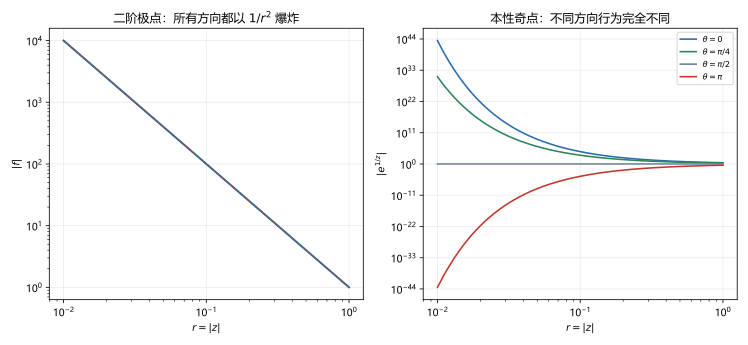

# 第 12 讲 孤立奇点及其分类

> **前置**：第 11 讲（洛朗级数、主部）、第 10 讲（泰勒展开、零点）。
> **预计时间**：约 2.5 小时（含作业）。
> **本讲回答**：奇点有几种？凭什么按洛朗展开分类？可去奇点为什么"可去"？极点的阶数怎么定？本性奇点到底有多坏？无穷远点怎么处理？

## 本讲要解决什么

第 11 讲把函数在圆环内展开成洛朗级数。洛朗级数的负幂部分（主部）包含了奇点的全部信息。

这一讲把主部的形态变成分类：**可去奇点、极点、本性奇点**。学完之后，你应该能做到：

- 判断一个点是不是孤立奇点；
- 用洛朗展开或极限判断奇点类型；
- 确定极点的阶数；
- 用"零点阶数"快速判断极点阶数；
- 判断函数在无穷远点的类型。

---

## 1. 孤立奇点

### 1.1 定义

如果存在 $R>0$，使得 $f$ 在去心邻域

$$0<\lvert z-z_0\rvert<R$$

内处处解析，但在 $z_0$ 本身不解析（包括没有定义），就说 $z_0$ 是 $f$ 的一个**孤立奇点**（isolated singularity）。

"孤立"的意思是：$z_0$ 附近没有别的奇点，它是单独一个。

例子：

- $1/z$ 在 $0$：去心邻域内解析，$0$ 是孤立奇点；
- $1/(z^2+1)$ 在 $i$ 和 $-i$：各是一个孤立奇点；
- $e^{1/z}$ 在 $0$：去心邻域内解析，$0$ 是孤立奇点。

### 1.2 非孤立奇点

有些奇点不孤立：在它附近还有无穷多个奇点。

**例**：$f(z)=\dfrac{1}{\sin(1/z)}$。

分母为零当 $1/z=n\pi$，即

$$z=\frac{1}{n\pi},\qquad n=\pm1,\pm2,\dots$$

这些点都趋于 $0$。所以在 $0$ 的任何去心邻域内，都有无穷多个奇点。$0$ 不是孤立奇点。

这类奇点本课程不展开。下面说的"奇点"都指孤立奇点。

---

## 2. 三类奇点

设 $z_0$ 是 $f$ 的孤立奇点，$f$ 在 $0<\lvert z-z_0\rvert<R$ 内的洛朗展开为

$$f(z)=\sum_{n=-\infty}^{\infty}a_n(z-z_0)^n.$$

负幂部分

$$\sum_{n=1}^{\infty}\frac{a_{-n}}{(z-z_0)^n}$$

叫**主部**（principal part）。主部的形态决定奇点类型。

### 2.1 可去奇点

如果主部**没有负幂项**，即

$$f(z)=a_0+a_1(z-z_0)+a_2(z-z_0)^2+\cdots,$$

就说 $z_0$ 是**可去奇点**（removable singularity）。

**例 12.1** $f(z)=\dfrac{\sin z}{z}$ 在 $z=0$。

$$\frac{\sin z}{z}=1-\frac{z^2}{3!}+\frac{z^4}{5!}-\cdots.$$

没有负幂项，所以 $0$ 是可去奇点。

**为什么叫"可去"？** 因为只要补充定义 $f(z_0)=a_0$，函数就在 $z_0$ 解析了。奇点被"去掉"了。

对 $\sin z/z$，补定义 $f(0)=1$，函数在全平面解析。

**极限特征**：

$$\lim_{z\to z_0}f(z)=a_0,$$

极限存在且有限。

### 2.2 极点

如果主部有**有限项**负幂，最高的一项是

$$\frac{a_{-m}}{(z-z_0)^m},\qquad a_{-m}\ne0,$$

就说 $z_0$ 是 $f$ 的 **$m$ 阶极点**（pole of order $m$）。

一阶极点也叫**简单极点**（simple pole）。

**例 12.2** $f(z)=\dfrac{1}{z^2}$ 在 $z=0$。

展开就是

$$\frac{1}{z^2}.$$

负幂最高是 $z^{-2}$，所以是二阶极点。

**例 12.3** $f(z)=\dfrac{1}{z}$ 在 $z=0$。

一阶极点。

**例 12.4** $f(z)=\dfrac{1}{z(z-1)}$ 在 $z=0$。

第 11 讲算过，在 $0<\lvert z\rvert<1$ 内

$$\frac{1}{z(z-1)}=-\frac1z-1-z-\cdots.$$

负幂最高是 $z^{-1}$，所以是一阶极点。

**极限特征**：

$$\lim_{z\to z_0}f(z)=\infty.$$

注意这里的"$\infty$"是扩充复平面上的无穷远点，意思是模趋于无穷，方向不限。

### 2.3 本性奇点

如果主部有**无穷多项**负幂，就说 $z_0$ 是**本性奇点**（essential singularity）。

**例 12.5** $f(z)=e^{1/z}$ 在 $z=0$。

$$e^{1/z}=1+\frac1z+\frac{1}{2!z^2}+\frac{1}{3!z^3}+\cdots.$$

负幂项无穷多，所以是本性奇点。

**极限特征**：极限不存在，而且不趋于无穷。沿不同方向趋近，行为完全不同：

- 沿正实轴 $z=r>0$：$e^{1/r}\to+\infty$；
- 沿负实轴 $z=-r$：$e^{-1/r}\to0$；
- 沿虚轴 $z=ir$：$\lvert e^{-i/r}\rvert=1$，模不趋于零也不趋于无穷。

**数值核对**（脚本 `scripts/lec12-01_verify_singularities.py`，EXP2）：取 $r=10^{-6}$，

```
dir=  0: |f|=inf
dir= 90: |f|=1.000000e+00
dir=180: |f|=0.000000e+00
dir=270: |f|=1.000000e+00
```

同一个点、同样的距离，四个方向给出四种结果。这就是"极限不存在"的具体含义。

图 1 右边把四个方向的模画在一起：正实轴爆炸，负实轴趋于零，虚轴恒为 $1$，中间方向介于两者之间。



左图是二阶极点 $1/z^2$：所有方向的曲线完全重合，都以 $1/r^2$ 爆炸。**极点的行为与方向无关**，这是它与本性奇点的根本区别。

### 2.4 皮卡定理（认识层）

本性奇点的"坏"还可以更极端。**皮卡大定理**（Picard's great theorem）说：

> 在本性奇点的任意去心邻域内，函数取到**除至多一个值以外**的所有复数值，而且每个值取到无穷多次。

例如 $e^{1/z}$ 在 $0$ 的任意去心邻域内，能取到除 $0$ 以外的所有非零复数。这不是"偶尔取到"，而是无穷多次。

这个定理本课程不证明，只需要知道：本性奇点附近的函数值极其混乱，没有任何"趋向某个值"的规律。

### 2.5 三类对照

| 类型 | 主部 | 极限 $\lim_{z\to z_0}f(z)$ | 例子 |
|---|---|---|---|
| 可去奇点 | 无负幂项 | 存在且有限 | $\sin z/z$ |
| $m$ 阶极点 | 有限项，最高 $(z-z_0)^{-m}$ | $\infty$ | $1/z^2$ |
| 本性奇点 | 无穷多项负幂 | 不存在（也不趋于 $\infty$） | $e^{1/z}$ |

---

## 3. 极限判据

洛朗展开有时不好算。极限判据更方便。

### 3.1 定理

> 设 $z_0$ 是 $f$ 的孤立奇点。则：
>
> - $z_0$ 是可去奇点 $\iff$ $\lim_{z\to z_0}f(z)$ 存在且有限；
> - $z_0$ 是极点 $\iff$ $\lim_{z\to z_0}f(z)=\infty$；
> - $z_0$ 是本性奇点 $\iff$ 极限不存在，且不趋于 $\infty$。

这三条与洛朗判据等价。证明思路：把洛朗展开代入，看主部对极限的贡献。

- 无负幂：$f(z)\to a_0$；
- 最高负幂 $-m$：$f(z)\sim a_{-m}/(z-z_0)^m\to\infty$；
- 无穷负幂：不同方向贡献不同，极限不存在。

### 3.2 用法

**例 12.6** 判断 $f(z)=\dfrac{z^2-1}{z-1}$ 在 $z=1$ 的类型。

约分：

$$\frac{z^2-1}{z-1}=z+1\qquad(z\ne1).$$

所以

$$\lim_{z\to1}f(z)=2,$$

极限存在且有限，$z=1$ 是可去奇点。

**例 12.7** 判断 $f(z)=\dfrac{1}{z^3}$ 在 $z=0$ 的类型。

$$\lim_{z\to0}\frac{1}{z^3}=\infty,$$

所以是极点。展开只有 $z^{-3}$，所以是三阶极点。

**例 12.8** 判断 $f(z)=\dfrac{z}{\sin z}$ 在 $z=0$ 的类型。

$\sin z\sim z$，所以

$$\lim_{z\to0}\frac{z}{\sin z}=1.$$

可去奇点。

### 3.3 什么时候用哪个判据

- 能约分、能直接算极限：用极限判据；
- 需要知道极点的**阶数**：用洛朗展开或零点判据（下一节）；
- 极限算不出来：展开。

---

## 4. 零点与极点的关系

### 4.1 零点的阶

如果 $f$ 在 $z_0$ 解析，且

$$f(z_0)=0,$$

就说 $z_0$ 是 $f$ 的**零点**（zero）。

如果

$$f(z_0)=f'(z_0)=\cdots=f^{(m-1)}(z_0)=0,\qquad f^{(m)}(z_0)\ne0,$$

就说 $z_0$ 是 **$m$ 阶零点**。

等价地，$f$ 可以写成

$$f(z)=(z-z_0)^m g(z),$$

其中 $g$ 在 $z_0$ 解析且 $g(z_0)\ne0$。

### 4.2 定理

> 如果 $f$ 在 $z_0$ 有 $m$ 阶零点，那么 $1/f$ 在 $z_0$ 有 $m$ 阶极点。

**为什么？** 由 $f(z)=(z-z_0)^m g(z)$，$g(z_0)\ne0$，

$$\frac{1}{f(z)}=\frac{1}{(z-z_0)^m}\cdot\frac{1}{g(z)}.$$

而 $1/g(z)$ 在 $z_0$ 解析且不为零。所以 $1/f$ 的洛朗展开中，负幂最高是 $(z-z_0)^{-m}$，即 $m$ 阶极点。

### 4.3 用法：快速判断极点阶数

**例 12.9** $f(z)=\dfrac{1}{z^2+1}$ 在 $z=i$。

分母 $z^2+1=(z-i)(z+i)$。在 $z=i$ 处：

- $z^2+1$ 的值为 $0$；
- 导数 $2z$ 在 $i$ 处为 $2i\ne0$。

所以 $z=i$ 是分母的一阶零点，因此是 $f$ 的**一阶极点**。

**例 12.10** $f(z)=\dfrac{1}{\sin z}$ 在 $z=0$。

$\sin z$ 在 $0$ 是一阶零点（$\sin0=0$，$\cos0=1\ne0$），所以 $f$ 在 $0$ 是一阶极点。

**例 12.11** $f(z)=\dfrac{z}{(z^2+1)^2}$ 在 $z=i$。

分母 $(z^2+1)^2=(z-i)^2(z+i)^2$，在 $i$ 处是二阶零点。分子 $z$ 在 $i$ 处为 $i\ne0$。所以是**二阶极点**。

### 4.4 数值核对

EXP3 验证 $z^2+1$ 的零点：

```
f(z0)=0, f'(z0)=2j -> simple zero
1/f near z0: |1/f'(z0)|=0.500000 -> simple pole
```

$f'$ 在零点不为零，所以是一阶零点；倒过来是一阶极点。

---

## 5. 无穷远点

### 5.1 定义

复平面加上一个无穷远点，得到扩充复平面。$f$ 在 $\infty$ 附近的行为，通过变换

$$t=\frac1z$$

化成 $t=0$ 附近的行为。

具体地，定义

$$g(t)=f\left(\frac1t\right).$$

$f$ 在 $\infty$ 的类型，就是 $g$ 在 $t=0$ 的类型。

### 5.2 例

**$f(z)=z$**：

$$g(t)=f(1/t)=\frac1t.$$

$t=0$ 是一阶极点，所以 $z=\infty$ 是一阶极点。

**$f(z)=\dfrac1z$**：

$$g(t)=f(1/t)=t.$$

$t=0$ 是解析的（一阶零点），所以 $z=\infty$ 是**可去奇点**（或者说一阶零点）。

**$f(z)=\dfrac{1}{z^2}$**：

$$g(t)=t^2.$$

$t=0$ 是二阶零点，所以 $z=\infty$ 是可去奇点（二阶零点）。

**$f(z)=e^z$**：

$$g(t)=e^{1/t}.$$

$t=0$ 是本性奇点，所以 $z=\infty$ 是本性奇点。

### 5.3 数值核对

EXP4 在 $t=10^{-6}$ 处看 $g(t)$：

```
z:     f(1/t) = 1.000000e+06      -> 爆炸，极点
1/z:   f(1/t) = 1.000000e-06      -> 趋于零，可去（零点）
1/z^2: f(1/t) = 1.000000e-12      -> 更快趋于零，可去（二阶零点）
e^z:   f(1/t) = inf               -> 本性
```

### 5.4 多项式与有理函数在无穷远

**$n$ 次多项式**在 $\infty$ 是 $n$ 阶极点。

因为 $g(t)=a_n t^{-n}+\cdots$，负幂最高是 $t^{-n}$。

**有理函数** $R(z)=P(z)/Q(z)$：

- 分子的次数大于分母：$\infty$ 是极点，阶数为次数差；
- 次数相等：$\infty$ 是可去奇点，极限为首项系数之比；
- 分子次数小于分母：$\infty$ 是可去奇点（零点），阶数为次数差。

**例 12.12** $R(z)=\dfrac{z^2+1}{z^3-1}$。

分子次数 $2$，分母次数 $3$，差 $1$。$\infty$ 是一阶零点（可去奇点）。

**例 12.13** $R(z)=\dfrac{z^3+1}{z-1}$。

分子次数 $3$，分母次数 $1$，差 $2$。$\infty$ 是二阶极点。

---

## 6. 本讲小结

| 内容 | 要点 |
|---|---|
| 孤立奇点 | 去心邻域内解析，本身不解析；附近没有别的奇点 |
| 可去奇点 | 主部无负幂；极限存在有限；补定义后解析 |
| $m$ 阶极点 | 主部最高 $(z-z_0)^{-m}$；极限为 $\infty$ |
| 本性奇点 | 无穷多项负幂；极限不存在；皮卡定理 |
| 极限判据 | 三类分别对应：有限、$\infty$、不存在 |
| 零点判据 | $m$ 阶零点 $\Rightarrow$ 倒数是 $m$ 阶极点 |
| 无穷远点 | 令 $t=1/z$，看 $t=0$ |
| 多项式在 $\infty$ | $n$ 次多项式是 $n$ 阶极点 |

三句话带走：

1. 看主部：无负幂是可去，有限项是极点，无穷项是本性。
2. 极点阶数 = 分母零点的阶数（分子在该点不为零时）。
3. 无穷远点用 $t=1/z$ 搬回原点判断。

---

## 7. 掌握度自测

- [ ] 能定义孤立奇点，并举一个非孤立奇点的例子。
- [ ] 能写出三类奇点的主部形态。
- [ ] 能用极限判据判断类型。
- [ ] 能用零点阶数确定极点阶数。
- [ ] 能写出 $e^{1/z}$ 的洛朗展开，并解释为什么极限不存在。
- [ ] 能用 $t=1/z$ 判断无穷远点的类型。
- [ ] 能判断多项式与有理函数在 $\infty$ 的类型。

---

## 作业

### 基础

**1.** 判断 $\dfrac{\sin z}{z}$ 在 $z=0$ 的奇点类型。

**参考答案：**

展开：

$$\frac{\sin z}{z}=1-\frac{z^2}{3!}+\frac{z^4}{5!}-\cdots.$$

无负幂项，所以是可去奇点。补定义 $f(0)=1$ 后解析。

---

**2.** 判断 $\dfrac{1}{z^3}$ 在 $z=0$ 的奇点类型。

**参考答案：**

展开就是 $z^{-3}$，负幂最高为 $-3$，所以是三阶极点。

极限 $\lvert 1/z^3\rvert\to\infty$，也符合极点。

---

**3.** 判断 $e^{1/z}$ 在 $z=0$ 的奇点类型。

**参考答案：**

$$e^{1/z}=\sum_{n=0}^{\infty}\frac{1}{n!\,z^n}=1+\frac1z+\frac{1}{2!z^2}+\cdots.$$

负幂项无穷多，所以是本性奇点。沿正实轴趋于 $\infty$，沿负实轴趋于 $0$，极限不存在。

---

**4.** 判断 $\dfrac{z^2-1}{z-1}$ 在 $z=1$ 的奇点类型。

**参考答案：**

约分：

$$\frac{z^2-1}{z-1}=z+1\qquad(z\ne1).$$

极限为 $2$，存在且有限。所以是可去奇点。

---

### 提高

**5.** 判断 $\dfrac{1}{z^2+1}$ 在 $z=i$ 的奇点类型与阶数。

**参考答案：**

分母 $z^2+1=(z-i)(z+i)$。

在 $z=i$：$z^2+1=0$，导数 $2z=2i\ne0$，所以分母在 $i$ 是一阶零点。

分子为 $1\ne0$。因此 $f$ 在 $i$ 是一阶极点。

---

**6.** 判断 $\dfrac{z}{\sin z}$ 在 $z=0$ 的奇点类型。

**参考答案：**

$\sin z$ 在 $0$ 是一阶零点，所以

$$\lim_{z\to0}\frac{z}{\sin z}=\lim_{z\to0}\frac{1}{\sin z/z}=1.$$

极限存在且有限，所以是可去奇点。

---

**7.** 判断 $\dfrac{1-\cos z}{z^2}$ 在 $z=0$ 的奇点类型。

**参考答案：**

展开：

$$1-\cos z=\frac{z^2}{2!}-\frac{z^4}{4!}+\cdots.$$

除以 $z^2$：

$$\frac{1-\cos z}{z^2}=\frac12-\frac{z^2}{4!}+\cdots.$$

无负幂项，所以是可去奇点。极限为 $1/2$。

---

**8.** 判断 $f(z)=z^3$ 在 $z=\infty$ 的奇点类型。

**参考答案：**

令 $t=1/z$，

$$g(t)=f(1/t)=\frac{1}{t^3}.$$

$t=0$ 是三阶极点，所以 $z=\infty$ 是三阶极点。

也可以用多项式结论：三次多项式在 $\infty$ 是三阶极点。

---

### 综合

**9.** 证明：$z_0$ 是可去奇点，当且仅当 $\lim_{z\to z_0}f(z)$ 存在且有限。

**参考答案：**

设 $f$ 在 $0<\lvert z-z_0\rvert<R$ 内的洛朗展开为

$$f(z)=\sum_{n=-\infty}^{\infty}a_n(z-z_0)^n.$$

**必要性**：若 $z_0$ 是可去奇点，则 $a_{-n}=0$ 对所有 $n\ge1$ 成立，所以

$$f(z)=a_0+a_1(z-z_0)+\cdots\to a_0,$$

极限存在且有限。

**充分性**：若极限存在且有限，设极限为 $A$。若主部有某项 $a_{-m}\ne0$（$m\ge1$），则

$$f(z)=\frac{a_{-m}}{(z-z_0)^m}+\text{更低阶的项},$$

当 $z\to z_0$ 时模趋于无穷，与极限有限矛盾。所以所有 $a_{-m}=0$，即 $z_0$ 是可去奇点。

---

**10.** 判断 $f(z)=\dfrac{z^2+1}{z^4-1}$ 的所有有限奇点及其类型。

**参考答案：**

分母

$$z^4-1=(z^2-1)(z^2+1)=(z-1)(z+1)(z-i)(z+i).$$

分子 $z^2+1=(z-i)(z+i)$。

约分：

$$\frac{z^2+1}{z^4-1}=\frac{1}{z^2-1}\qquad(z\ne\pm i).$$

- $z=i$ 和 $z=-i$：约分后解析，是可去奇点；
- $z=1$：$z^2-1=(z-1)(z+1)$ 在 $1$ 是一阶零点，所以是一阶极点；
- $z=-1$：同理，一阶极点。

---

**11.** 判断 $f(z)=\dfrac{1}{e^z-1}$ 在 $z=0$ 的奇点类型。

**参考答案：**

展开分母：

$$e^z-1=z+\frac{z^2}{2!}+\frac{z^3}{3!}+\cdots=z\left(1+\frac z2+\frac{z^2}{6}+\cdots\right).$$

括号内的因子在 $z=0$ 处等于 $1\ne0$，所以分母在 $0$ 是一阶零点。

分子为 $1\ne0$，所以 $f$ 在 $0$ 是一阶极点。

---

## 下一讲预告

奇点分类完成后，就可以处理留数了。

留数的定义非常短：它是洛朗展开中 $(z-z_0)^{-1}$ 项的系数 $a_{-1}$。但它带来一个很强的定理：

$$\oint_\Gamma f(z)\,dz=2\pi i\sum_k\operatorname{Res}[f,z_k].$$

闭路积分等于 $2\pi i$ 乘内部所有奇点留数之和。这样，第 05 讲里那个反复出现的 $2\pi i$ 终于有了统一解释：它不是巧合，而是每个奇点贡献的 $a_{-1}$ 项累加的结果。

下一讲会给出留数的定义、各类奇点的计算公式，以及留数定理的证明。
