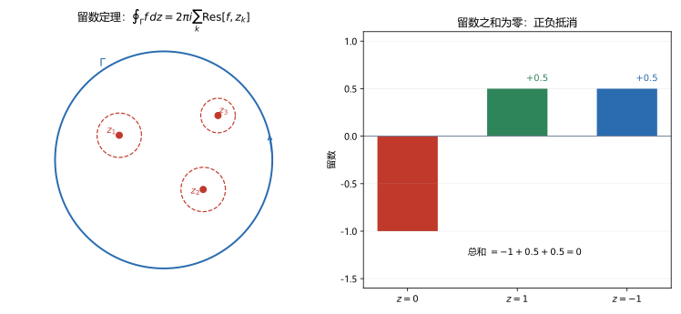

# 第 13 讲 留数定理

> **前置**：第 11 讲（洛朗级数、主部）、第 12 讲（奇点分类、极点阶数）、第 07 讲（复合闭路定理）。
> **预计时间**：约 3 小时（含作业）。
> **本讲回答**：留数是什么？为什么只关心洛朗系数 $a_{-1}$？各类奇点的留数怎么算？为什么闭路积分等于 $2\pi i$ 乘留数和？无穷远点的留数怎么定义？

## 本讲要解决什么

第 12 讲把奇点分成了三类。这一讲从洛朗展开里取出一个系数，用它把所有闭路积分归结为代数求和。

学完之后，你应该能做到：

- 写出留数的定义，并解释为什么只有 $a_{-1}$ 项在积分后留下；
- 用一阶极点公式、高阶极点公式、$P/Q$ 公式计算留数；
- 陈述并证明留数定理；
- 按"找奇点、判内外、算留数、求和"的流程计算闭路积分；
- 计算无穷远点的留数，并用"留数总和为零"检验结果。

---

## 1. 留数的定义

### 1.1 为什么只有 $a_{-1}$ 项留下

设 $z_0$ 是 $f$ 的孤立奇点，$f$ 在 $0<\lvert z-z_0\rvert<R$ 内的洛朗展开为

$$f(z)=\sum_{n=-\infty}^{\infty}a_n(z-z_0)^n.$$

沿一个小圆 $\gamma:\lvert z-z_0\rvert=r$ 逐项积分。由第 05 讲的核心公式，

$$\oint_\gamma(z-z_0)^n\,dz=
\begin{cases}
2\pi i,&n=-1,\\
0,&n\ne-1.
\end{cases}$$

所以

$$\oint_\gamma f(z)\,dz=\sum_{n=-\infty}^{\infty}a_n\oint_\gamma(z-z_0)^n\,dz=2\pi i\,a_{-1}.$$

**所有项里只有 $a_{-1}$ 活下来。** 这就是留数的来源。

### 1.2 定义

> 设 $z_0$ 是 $f$ 的孤立奇点。$f$ 在 $z_0$ 处的**留数**（residue）定义为洛朗展开中 $(z-z_0)^{-1}$ 项的系数：
>
> $$\operatorname{Res}[f(z),z_0]=a_{-1}.$$

**口径声明**：本课程用 $\operatorname{Res}[f,z_0]$ 表示留数。有些教材写作 $\operatorname{Res}_{z=z_0}f(z)$，含义相同。

由上面的计算，留数也等于

$$\operatorname{Res}[f,z_0]=\frac{1}{2\pi i}\oint_\gamma f(z)\,dz,$$

其中 $\gamma$ 是 $z_0$ 周围足够小的逆时针圆。这个式子可以作为定义的等价形式。

### 1.3 留数抓住了什么

留数只取洛朗展开的一个系数，看起来很"偏"。但它是唯一在闭路积分后留下的系数，所以恰好是所有积分的"净贡献"。

其他系数 $a_{-2},a_{-3},\dots$ 虽然在描述奇点类型时有用，但对闭路积分没有直接贡献。

---

## 2. 留数的计算

### 2.1 一阶极点

如果 $z_0$ 是**一阶极点**，洛朗展开为

$$f(z)=\frac{a_{-1}}{z-z_0}+a_0+a_1(z-z_0)+\cdots.$$

两边乘 $(z-z_0)$：

$$(z-z_0)f(z)=a_{-1}+a_0(z-z_0)+\cdots.$$

令 $z\to z_0$，后面的项都趋于零：

$$\boxed{\operatorname{Res}[f,z_0]=\lim_{z\to z_0}(z-z_0)f(z).}$$

**例 13.1** $f(z)=\dfrac{1}{z-1}$，$z_0=1$。

$$\operatorname{Res}[f,1]=\lim_{z\to1}(z-1)\cdot\frac{1}{z-1}=1.$$

**例 13.2** $f(z)=\dfrac{z}{z^2+1}$，$z_0=i$。

$z^2+1=(z-i)(z+i)$，所以

$$\operatorname{Res}[f,i]=\lim_{z\to i}(z-i)\frac{z}{(z-i)(z+i)}=\lim_{z\to i}\frac{z}{z+i}=\frac{i}{2i}=\frac12.$$

### 2.2 $P/Q$ 公式

如果 $f(z)=\dfrac{P(z)}{Q(z)}$，$P,Q$ 在 $z_0$ 解析，$P(z_0)\ne0$，$Q(z_0)=0$，$Q'(z_0)\ne0$（即 $Q$ 有一阶零点），那么

$$\boxed{\operatorname{Res}[f,z_0]=\frac{P(z_0)}{Q'(z_0)}.}$$

**推导**：$Q$ 在 $z_0$ 有一阶零点，可写成

$$Q(z)=(z-z_0)Q_1(z),\qquad Q_1(z_0)=Q'(z_0)\ne0.$$

于是

$$(z-z_0)f(z)=\frac{P(z)}{Q_1(z)}\to\frac{P(z_0)}{Q'(z_0)}.$$

**例 13.3** 用 $P/Q$ 公式重算例 13.2。

$P(z)=z$，$Q(z)=z^2+1$，$Q'(z)=2z$。

$$\operatorname{Res}[f,i]=\frac{P(i)}{Q'(i)}=\frac{i}{2i}=\frac12.$$

与直接算一致。$P/Q$ 公式通常更快。

**例 13.4** $f(z)=\dfrac{1}{\sin z}$，$z_0=0$。

$P=1$，$Q=\sin z$，$Q'=\cos z$。

$$\operatorname{Res}[f,0]=\frac{1}{\cos0}=1.$$

**例 13.5** $f(z)=\cot z=\dfrac{\cos z}{\sin z}$，$z_0=0$。

$$\operatorname{Res}[f,0]=\frac{\cos0}{\cos0}=1.$$

### 2.3 $m$ 阶极点

如果 $z_0$ 是 **$m$ 阶极点**，洛朗展开的主部到 $(z-z_0)^{-m}$ 为止：

$$f(z)=\frac{a_{-m}}{(z-z_0)^m}+\cdots+\frac{a_{-1}}{z-z_0}+a_0+\cdots.$$

两边乘 $(z-z_0)^m$：

$$(z-z_0)^mf(z)=a_{-m}+a_{-m+1}(z-z_0)+\cdots+a_{-1}(z-z_0)^{m-1}+a_0(z-z_0)^m+\cdots.$$

要取出 $a_{-1}$，需要求 $m-1$ 阶导数再令 $z\to z_0$：

$$\boxed{\operatorname{Res}[f,z_0]=\frac{1}{(m-1)!}\lim_{z\to z_0}\frac{d^{m-1}}{dz^{m-1}}\left[(z-z_0)^mf(z)\right].}$$

$m=1$ 时退化为 2.1 节的一阶公式。

**例 13.6** $f(z)=\dfrac{1}{z^2}$，$z_0=0$。

$m=2$，$(z-0)^2f(z)=1$，导数为 $0$，所以

$$\operatorname{Res}[f,0]=\frac{1}{1!}\cdot0=0.$$

这个结果符合直觉：$\dfrac{1}{z^2}$ 的洛朗展开没有 $z^{-1}$ 项。

**例 13.7** $f(z)=\dfrac{1}{z^2(z-1)}$，$z_0=0$。

$m=2$，$(z-0)^2f(z)=\dfrac{1}{z-1}$。

求一阶导：

$$\frac{d}{dz}\frac{1}{z-1}=-\frac{1}{(z-1)^2}.$$

令 $z=0$：

$$\operatorname{Res}[f,0]=\frac{1}{1!}\cdot\left(-\frac{1}{(0-1)^2}\right)=-1.$$

**数值核对**（脚本 `scripts/lec13-01_verify_residue.py`，EXP2）：数值留数为 $-1.000000$。

### 2.4 本性奇点

本性奇点没有通用公式，只能把洛朗展开写出来，取 $a_{-1}$。

**例 13.8** $f(z)=e^{1/z}$，$z_0=0$。

$$e^{1/z}=1+\frac1z+\frac{1}{2!z^2}+\frac{1}{3!z^3}+\cdots.$$

$z^{-1}$ 的系数是 $1$，所以

$$\operatorname{Res}[f,0]=1.$$

**数值核对**（EXP3）：数值留数为 $1.000000$。

### 2.5 计算顺序

拿到一个留数，先判断奇点类型：

1. 一阶极点：用 $\lim(z-z_0)f$ 或 $P/Q$ 公式；
2. $m$ 阶极点：用求导公式；
3. 本性奇点：展开。

判断类型的方法见第 12 讲：看零点阶数、看极限。

---

## 3. 留数定理

### 3.1 陈述

> **留数定理**：设 $f$ 在简单闭曲线 $\Gamma$ 的内部及 $\Gamma$ 上除有限个孤立奇点 $z_1,\dots,z_n$ 外解析，则
>
> $$\oint_\Gamma f(z)\,dz=2\pi i\sum_{k=1}^{n}\operatorname{Res}[f,z_k],$$
>
> 其中 $\Gamma$ 取逆时针方向。

**用一句话说**：闭路积分等于 $2\pi i$ 乘内部所有奇点留数之和。



左图是几何图像：外圈 $\Gamma$ 围住三个奇点，每个奇点用一个小圆孤立起来。右图是代数结果：以 $1/(z^3-z)$ 为例，三个有限留数 $-1,+0.5,+0.5$ 正负抵消，和为零。

### 3.2 证明

对每个奇点 $z_k$ 画一个足够小的圆 $\gamma_k$，使 $\gamma_k$ 互不相交，且都落在 $\Gamma$ 内部。

由复合闭路定理（第 07 讲），

$$\oint_\Gamma f\,dz=\sum_{k=1}^{n}\oint_{\gamma_k}f\,dz.$$

对每个小圆，由 1.1 节的计算，

$$\oint_{\gamma_k}f\,dz=2\pi i\,a_{-1}^{(k)}=2\pi i\operatorname{Res}[f,z_k].$$

所以

$$\oint_\Gamma f\,dz=2\pi i\sum_{k=1}^{n}\operatorname{Res}[f,z_k].$$

证毕。

### 3.3 数值核对

**例 13.9** 计算

$$\oint_{\lvert z\rvert=2}\frac{2z+1}{z(z-1)}\,dz.$$

奇点 $0$ 和 $1$ 都在内部。

留数：

$$\operatorname{Res}[f,0]=\lim_{z\to0}z\cdot\frac{2z+1}{z(z-1)}=\frac{1}{-1}=-1,$$

$$\operatorname{Res}[f,1]=\lim_{z\to1}(z-1)\cdot\frac{2z+1}{z(z-1)}=\frac{3}{1}=3.$$

所以

$$\oint=2\pi i(-1+3)=4\pi i.$$

**数值核对**（EXP4）：

```
direct integral       = 0.000000 + 12.566371j
2*pi*i*(res0 + res1)  = 12.566371j
```

直接积分与留数求和一致。$12.566371=4\pi$。

### 3.4 使用流程

1. **找奇点**：求出 $f$ 的全部奇点；
2. **判内外**：画图，判断哪些在 $\Gamma$ 内部。外部的不算；
3. **算留数**：对每个内部奇点，按类型选公式；
4. **求和乘 $2\pi i$**。

**注意**：第 2 步最容易出错。如果奇点在外部，它的留数不进入求和；如果奇点在 $\Gamma$ 上，积分本身可能发散，题目通常不会这样出。

---

## 4. 无穷远点的留数

### 4.1 定义

设 $f$ 在 $\lvert z\rvert>R$ 内解析（除 $\infty$ 外没有奇点）。$f$ 在无穷远的洛朗展开为

$$f(z)=\sum_{n=-\infty}^{\infty}a_nz^n,\qquad \lvert z\rvert>R.$$

定义

$$\operatorname{Res}[f,\infty]=-a_{-1}.$$

**注意负号**。这个负号是为了让下面的"留数总和为零"成立。

### 4.2 计算公式

令 $t=1/z$，则

$$\operatorname{Res}[f,\infty]=-\operatorname{Res}\left[\frac{1}{t^2}f\left(\frac1t\right),0\right].$$

**推导**：$f(1/t)=\sum a_n t^{-n}$，所以

$$\frac{1}{t^2}f\left(\frac1t\right)=\sum a_n t^{-n-2}.$$

其中 $t^{-1}$ 的项对应 $-n-2=-1$，即 $n=-1$，系数为 $a_{-1}$。因此这个函数在 $0$ 的留数是 $a_{-1}$，取负号就是 $-a_{-1}$。

### 4.3 留数总和为零

> **定理**：设 $f$ 在扩充复平面上只有有限个奇点，则
>
> $$\sum_{k}\operatorname{Res}[f,z_k]+\operatorname{Res}[f,\infty]=0,$$
>
> 其中求和跑遍所有有限奇点。

**为什么？** 取一个足够大的圆 $\Gamma$，把所有有限奇点包住。由留数定理，

$$\oint_\Gamma f\,dz=2\pi i\sum_k\operatorname{Res}[f,z_k].$$

另一方面，$\Gamma$ 是绕 $\infty$ 的顺时针闭路（从 $\infty$ 看），所以

$$\oint_\Gamma f\,dz=-2\pi i\operatorname{Res}[f,\infty].$$

两者相等，移项得总和为零。

### 4.4 例子

**例 13.10** $f(z)=\dfrac1z$。

有限奇点 $0$：$\operatorname{Res}[f,0]=1$。

在 $\lvert z\rvert>0$ 展开 $f=1/z$，$a_{-1}=1$，所以

$$\operatorname{Res}[f,\infty]=-1.$$

总和 $1+(-1)=0$。

**例 13.11** $f(z)=z$。

有限奇点：无。$\operatorname{Res}[f,\infty]=-a_{-1}=0$。

总和 $0$。

**例 13.12** $f(z)=\dfrac{1}{z^3-z}$。

奇点 $0,1,-1$。留数：

$$\operatorname{Res}[f,0]=\frac{1}{(0-1)(0+1)}=-1,$$

$$\operatorname{Res}[f,1]=\frac{1}{1\cdot2}=\frac12,$$

$$\operatorname{Res}[f,-1]=\frac{1}{(-1)(-2)}=\frac12.$$

有限留数和 $=0$。

在 $\lvert z\rvert>1$ 展开：

$$\frac{1}{z^3-z}=\frac{1}{z^3}\cdot\frac{1}{1-\frac{1}{z^2}}=\frac{1}{z^3}+\frac{1}{z^5}+\cdots.$$

没有 $z^{-1}$ 项，$a_{-1}=0$，所以 $\operatorname{Res}[f,\infty]=0$。

总和 $0$。一致。

**数值核对**（EXP5、EXP6）：

```
Res at 0  = -1.000000
Res at 1  = +0.500000
Res at -1 = +0.500000
sum       = 0.000e+00

Res[1/z, inf] = -1
Res[z, inf]   = 0
Res[1/z^2, inf] = 0
```

### 4.5 用途

- **检验**：算完所有有限留数后，看和是否等于 $-\operatorname{Res}[f,\infty]$；
- **计算**：有时 $\operatorname{Res}[f,\infty]$ 比所有有限留数都好算，可以用总和为零反推；
- **理论**：证明某些恒等式。

---

## 5. 留数定理与柯西公式

### 5.1 柯西公式是特例

取

$$f(z)=\frac{g(z)}{z-z_0},$$

其中 $g$ 在 $z_0$ 解析。$z_0$ 是一阶极点，留数为

$$\operatorname{Res}[f,z_0]=\lim_{z\to z_0}(z-z_0)\frac{g(z)}{z-z_0}=g(z_0).$$

由留数定理，

$$\oint_\Gamma\frac{g(z)}{z-z_0}\,dz=2\pi i\,g(z_0).$$

这正是柯西积分公式。

所以柯西公式是留数定理在一阶极点情形下的特例。

### 5.2 $2\pi i$ 的统一解释

第 05 讲第一次遇到 $2\pi i$：

$$\oint_{\lvert z\rvert=1}\frac{dz}{z}=2\pi i.$$

当时的解释是"参数化后 $e^{it}$ 约掉，剩下 $i$ 对 $t$ 积分"。

现在可以看得更清楚：$1/z$ 在 $0$ 的留数是 $1$，所以积分是 $2\pi i\cdot1$。**$2\pi i$ 不是巧合，它是每个奇点贡献的单位量。**

后面所有闭路积分，都是这个单位量乘以留数之和。

### 5.3 与第 07 讲挖心算法的关系

第 07 讲的"挖心四步"是留数定理的雏形：把复杂闭路化成小圆，每个小圆贡献一个 $2\pi i$ 乘系数。第 13 讲只是给那个系数正式命名为"留数"，并给出了统一的计算公式。

---

## 6. 本讲小结

| 内容 | 公式 / 要点 |
|---|---|
| 留数 | $\operatorname{Res}[f,z_0]=a_{-1}$ |
| 一阶极点 | $\lim_{z\to z_0}(z-z_0)f(z)$ |
| $P/Q$ 公式 | $\dfrac{P(z_0)}{Q'(z_0)}$，$Q$ 一阶零点 |
| $m$ 阶极点 | $\dfrac{1}{(m-1)!}\lim\dfrac{d^{m-1}}{dz^{m-1}}[(z-z_0)^mf]$ |
| 本性奇点 | 展开取 $a_{-1}$ |
| 留数定理 | $\oint_\Gamma f\,dz=2\pi i\sum\operatorname{Res}$ |
| 无穷远留数 | $\operatorname{Res}[f,\infty]=-a_{-1}$ |
| 总和为零 | 有限留数和 $+\operatorname{Res}[f,\infty]=0$ |

三句话带走：

1. 留数是洛朗系数 $a_{-1}$，是唯一在闭路积分后留下的项。
2. 留数定理：闭路积分 $=2\pi i$ 乘内部留数之和；外部奇点不算。
3. 所有留数（含无穷远）之和为零，这是最好的验算工具。

---

## 7. 掌握度自测

- [ ] 能写出留数的定义，并解释为什么只有 $a_{-1}$ 有贡献。
- [ ] 能用一阶极点公式和 $P/Q$ 公式算留数。
- [ ] 能用 $m$ 阶极点公式算留数，特别是二阶。
- [ ] 能对 $e^{1/z}$ 这类本性奇点展开取留数。
- [ ] 能陈述并证明留数定理。
- [ ] 能按四步流程算闭路积分，并先判断奇点内外。
- [ ] 能算无穷远留数，并用总和为零验算。

---

## 作业

### 基础

**1.** 求 $\dfrac{1}{z-1}$ 在 $z=1$ 的留数。

**参考答案：**

一阶极点：

$$\operatorname{Res}[f,1]=\lim_{z\to1}(z-1)\cdot\frac{1}{z-1}=1.$$

---

**2.** 求 $\dfrac{z}{z^2+1}$ 在 $z=i$ 的留数。

**参考答案：**

用 $P/Q$ 公式：$P(z)=z$，$Q(z)=z^2+1$，$Q'(z)=2z$。

$$\operatorname{Res}[f,i]=\frac{P(i)}{Q'(i)}=\frac{i}{2i}=\frac12.$$

---

**3.** 求 $\dfrac{1}{z^2}$ 在 $z=0$ 的留数。

**参考答案：**

洛朗展开就是 $z^{-2}$，没有 $z^{-1}$ 项，所以留数为 $0$。

用公式验证：$m=2$，

$$\operatorname{Res}=\lim_{z\to0}\frac{d}{dz}\left[z^2\cdot\frac{1}{z^2}\right]=\lim_{z\to0}\frac{d}{dz}(1)=0.$$

---

**4.** 求 $e^{1/z}$ 在 $z=0$ 的留数。

**参考答案：**

$$e^{1/z}=1+\frac1z+\frac{1}{2!z^2}+\cdots.$$

$z^{-1}$ 的系数是 $1$，所以

$$\operatorname{Res}[e^{1/z},0]=1.$$

---

### 提高

**5.** 求 $\dfrac{1}{z^2(z-1)}$ 在 $z=0$ 和 $z=1$ 的留数。

**参考答案：**

**$z=0$**：二阶极点。$(z-0)^2f(z)=\dfrac{1}{z-1}$，所以

$$\operatorname{Res}[f,0]=\lim_{z\to0}\frac{d}{dz}\frac{1}{z-1}=\lim_{z\to0}\left(-\frac{1}{(z-1)^2}\right)=-1.$$

**$z=1$**：一阶极点。

$$\operatorname{Res}[f,1]=\lim_{z\to1}(z-1)\frac{1}{z^2(z-1)}=\lim_{z\to1}\frac{1}{z^2}=1.$$

---

**6.** 求 $\cot z$ 在 $z=0$ 的留数。

**参考答案：**

$\cot z=\dfrac{\cos z}{\sin z}$。$\sin z$ 在 $0$ 是一阶零点，$\cos0=1\ne0$。

用 $P/Q$ 公式：

$$\operatorname{Res}[\cot z,0]=\frac{\cos0}{\cos0}=1.$$

---

**7.** 求 $\dfrac{1}{\sin z}$ 在 $z=0$ 的留数。

**参考答案：**

$P=1$，$Q=\sin z$，$Q'=\cos z$。

$$\operatorname{Res}\left[\frac{1}{\sin z},0\right]=\frac{1}{\cos0}=1.$$

---

**8.** 用留数定理计算 $\displaystyle\oint_{\lvert z\rvert=2}\frac{dz}{z^2-1}$。

**参考答案：**

奇点 $\pm1$ 都在内部。部分分式：

$$\frac{1}{z^2-1}=\frac12\left(\frac{1}{z-1}-\frac{1}{z+1}\right).$$

留数：

$$\operatorname{Res}[f,1]=\frac12,\qquad \operatorname{Res}[f,-1]=-\frac12.$$

和为零，所以

$$\oint=2\pi i\cdot0=0.$$

---

### 综合

**9.** 证明留数定理。

**参考答案：**

设 $f$ 在 $\Gamma$ 内部及 $\Gamma$ 上除 $z_1,\dots,z_n$ 外解析。

对每个 $z_k$ 取足够小的圆 $\gamma_k$，互不相交，都在 $\Gamma$ 内部。由复合闭路定理：

$$\oint_\Gamma f\,dz=\sum_{k=1}^{n}\oint_{\gamma_k}f\,dz.$$

在每个小圆上，$f$ 的洛朗展开为

$$f(z)=\sum_{m=-\infty}^{\infty}a_m^{(k)}(z-z_k)^m.$$

逐项积分，由 $\oint_{\gamma_k}(z-z_k)^m dz=2\pi i$（$m=-1$）、$0$（$m\ne-1$），得

$$\oint_{\gamma_k}f\,dz=2\pi i\,a_{-1}^{(k)}=2\pi i\operatorname{Res}[f,z_k].$$

所以

$$\oint_\Gamma f\,dz=2\pi i\sum_{k=1}^{n}\operatorname{Res}[f,z_k].$$

---

**10.** 求 $f(z)=\dfrac{1}{z^3-z}$ 的全部留数（含无穷远），并验证总和为零。

**参考答案：**

奇点 $0,1,-1$，都是一阶极点。

$$z^3-z=z(z-1)(z+1).$$

$$\operatorname{Res}[f,0]=\frac{1}{(0-1)(0+1)}=-1,$$

$$\operatorname{Res}[f,1]=\frac{1}{1\cdot2}=\frac12,$$

$$\operatorname{Res}[f,-1]=\frac{1}{(-1)(-2)}=\frac12.$$

有限留数和：

$$-1+\frac12+\frac12=0.$$

无穷远：在 $\lvert z\rvert>1$ 展开

$$\frac{1}{z^3-z}=\frac{1}{z^3}\cdot\frac{1}{1-\frac1{z^2}}=\frac{1}{z^3}+\frac{1}{z^5}+\cdots.$$

$a_{-1}=0$，所以 $\operatorname{Res}[f,\infty]=0$。

总和 $0+0=0$，验证成立。

---

**11.** 计算 $\displaystyle\oint_{\lvert z\rvert=2}\frac{z+1}{z^2(z-1)}\,dz$。

**参考答案：**

奇点 $0$（二阶）和 $1$（一阶）都在内部。

**$z=0$**：

$$\operatorname{Res}[f,0]=\lim_{z\to0}\frac{d}{dz}\left[z^2\cdot\frac{z+1}{z^2(z-1)}\right]=\lim_{z\to0}\frac{d}{dz}\frac{z+1}{z-1}.$$

$$\frac{d}{dz}\frac{z+1}{z-1}=\frac{(z-1)-(z+1)}{(z-1)^2}=\frac{-2}{(z-1)^2}.$$

在 $z=0$ 处为 $-2$，所以留数 $-2$。

**$z=1$**：

$$\operatorname{Res}[f,1]=\lim_{z\to1}(z-1)\frac{z+1}{z^2(z-1)}=\frac{2}{1}=2.$$

留数和 $-2+2=0$，所以

$$\oint=0.$$

---

## 下一讲预告

留数定理把闭路积分变成了留数求和。下一讲把它用到实积分上。

三类实积分可以化成复平面上的闭路积分：

1. 有理函数在 $(-\infty,+\infty)$ 上的积分；
2. 三角有理式在 $[0,2\pi]$ 上的积分；
3. 含 $e^{iax}$ 的积分。

共同套路是：**选一条合适的闭路，让"补上的那部分"积分趋于零，剩下的实轴积分就等于留数求和。** 下一讲会逐类讲清闭路怎么选、补上的部分怎么估计、实轴上有奇点时怎么处理。
