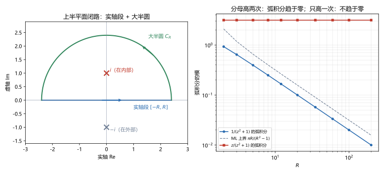

# 第 14 讲 留数计算实积分

> **前置**：第 05 讲（参数化、ML 不等式）、第 13 讲（留数的计算、留数定理）。
> **预计时间**：约 3.5 小时（含作业；三类积分各有一套闭路，建议每类做完例题再往下读）。
> **本讲回答**：实轴上的积分怎么变成复平面上的闭路积分？补上的大半圆为什么能丢掉？三角有理式为什么令 $z=e^{i\theta}$？含 $e^{iax}$ 的积分为什么只能用上半平面？实轴上有奇点时怎么办？

## 本讲要解决什么

第 13 讲的留数定理算的是复平面上的闭路积分。这一讲把它用到**实积分**上，处理三类在高数里很难算、甚至算不出来的积分：

| 类型 | 典型形式 | 例子 |
|---|---|---|
| 一 | 有理函数在整条实轴上的积分 | $\displaystyle\int_{-\infty}^{\infty}\frac{dx}{x^4+1}$ |
| 二 | 三角有理式在一个周期上的积分 | $\displaystyle\int_0^{2\pi}\frac{d\theta}{2+\cos\theta}$ |
| 三 | 有理函数乘 $\cos ax$ 或 $\sin ax$ | $\displaystyle\int_{-\infty}^{\infty}\frac{\cos x}{x^2+1}dx$ |

第一类在高数里要靠部分分式和 $\arctan$ 硬拆，第二类要用万能代换 $t=\tan(\theta/2)$，第三类在实变量里基本没有初等原函数可用。用留数，三类都是同一个套路。

学完之后，你应该能做到：

- 说出三类积分各自的适用条件和选用的闭路；
- 用 ML 不等式证明大半圆上的积分趋于零，并说清"分母比分子高两次"这个条件从哪来；
- 用 $z=e^{i\theta}$ 把三角积分化成单位圆上的闭路积分；
- 陈述约当引理，说清含 $e^{iax}$（$a>0$）的积分为什么必须用上半平面；
- 处理实轴上的一阶极点，算出 $\displaystyle\int_{-\infty}^{\infty}\frac{\sin x}{x}dx=\pi$。

---

## 1. 共同套路

### 1.1 三步

留数定理只管闭路。实积分的路径（实轴或一个区间）不是闭路，所以要做三件事：

1. **补成闭路**：在实积分路径外再接一段曲线，围成一个闭路 $\Gamma$；
2. **用留数定理**：$\oint_\Gamma f\,dz=2\pi i\sum\operatorname{Res}$（只算闭路内部的奇点）；
3. **处理补上的那段**：证明它的积分趋于零，或者能单独算出来。

做完第 3 步，剩下的就是要求的实积分。

### 1.2 为什么能把 $x$ 换成 $z$

在实轴上 $z=x$，$dz=dx$，所以复变函数 $f(z)$ 沿实轴的积分就是实积分 $\int f(x)\,dx$。只要 $f(z)$ 在实轴上取的值等于原来的实被积函数（或者它的实部、虚部等于原来的被积函数），就可以把实积分看成复积分的一段。

本讲所有方法的区别，只在第 1 步"补什么曲线"和第 3 步"补的那段怎么处理"。

---

## 2. 类型一：有理函数在实轴上的积分

### 2.1 形式与条件

$$\int_{-\infty}^{\infty}R(x)\,dx,\qquad R(x)=\frac{P(x)}{Q(x)},$$

$P,Q$ 是多项式。条件有两个：

1. $Q(x)$ 在实轴上没有零点（被积函数在实轴上没有奇点）；
2. $\deg Q\ge\deg P+2$（分母比分子至少高两次）。

第二个条件保证积分收敛，也保证下面的大半圆积分趋于零。它不是随便规定的，2.6 节会给出它不满足时的反例。

### 2.2 闭路：实轴段加上半圆

取 $R$ 足够大，使 $R(z)$ 在上半平面的全部极点都在半径 $R$ 的圆内。闭路 $\Gamma$ 由两段组成：

- 实轴段 $[-R,R]$，从左到右；
- 上半圆 $C_R:\ z=Re^{i\theta}$，$\theta$ 从 $0$ 到 $\pi$。

左图以 $1/(z^2+1)$ 为例：两个极点 $\pm i$，只有 $i$ 被闭路围住，$-i$ 在下半平面，不算。

由留数定理，

$$\int_{-R}^{R}R(x)\,dx+\int_{C_R}R(z)\,dz=2\pi i\sum_{\operatorname{Im}z_k>0}\operatorname{Res}[R,z_k].$$

右边是常数（$R$ 足够大后不再变化）。

### 2.3 大半圆上的估计

设 $\deg Q=\deg P+m$，$m\ge2$。当 $\lvert z\rvert=R$ 很大时，分子大约是 $\lvert z\rvert^{\deg P}$，分母大约是 $\lvert z\rvert^{\deg Q}$，所以存在常数 $C$，使得在 $C_R$ 上

$$\lvert R(z)\rvert\le\frac{C}{R^m}\le\frac{C}{R^2}.$$

半圆长度是 $\pi R$。由 ML 不等式（第 05 讲），

$$\left\lvert\int_{C_R}R(z)\,dz\right\rvert\le\frac{C}{R^2}\cdot\pi R=\frac{C\pi}{R}\to0.$$

所以令 $R\to\infty$，

$$\boxed{\int_{-\infty}^{\infty}R(x)\,dx=2\pi i\sum_{\operatorname{Im}z_k>0}\operatorname{Res}[R,z_k].}$$

**这里的关键数字是 $m\ge2$**：分母比分子每多高一次，$\lvert R(z)\rvert$ 就多一个 $1/R$；弧长贡献一个 $R$；要剩下至少一个 $1/R$ 才能趋于零，所以至少要高两次。

**数值核对**（脚本 `scripts/lec14-01_verify_real_integrals.py`，EXP2）：$f=1/(z^2+1)$ 在上半圆上，$\lvert z^2+1\rvert\ge R^2-1$，ML 上界为 $\pi R/(R^2-1)$。

| $R$ | $2$ | $5$ | $10$ | $50$ | $200$ |
|---|---|---|---|---|---|
| 弧积分的模 | $0.9273$ | $0.3948$ | $0.1993$ | $0.03999$ | $0.01000$ |
| ML 上界 | $2.0944$ | $0.6545$ | $0.3173$ | $0.06286$ | $0.01571$ |

实际值始终在上界之下，两者都按 $1/R$ 减小。图 1 右边蓝线就是这一行。

### 2.4 例题

**例 14.1** 计算 $\displaystyle\int_{-\infty}^{\infty}\frac{dx}{x^2+1}$。

上半平面只有一个极点 $z=i$，一阶。用 $P/Q$ 公式（第 13 讲）：

$$\operatorname{Res}\left[\frac{1}{z^2+1},i\right]=\frac{1}{2z}\bigg|_{z=i}=\frac{1}{2i}.$$

所以

$$\int_{-\infty}^{\infty}\frac{dx}{x^2+1}=2\pi i\cdot\frac{1}{2i}=\pi.$$

这和高数里 $[\arctan x]_{-\infty}^{\infty}=\pi$ 一致。

**例 14.2** 计算 $\displaystyle\int_{-\infty}^{\infty}\frac{dx}{(x^2+1)^2}$。

$z=i$ 是二阶极点。把被积函数写成

$$\frac{1}{(z-i)^2(z+i)^2}.$$

用二阶极点公式：

$$
\operatorname{Res}[f,i]=\lim_{z\to i}\frac{d}{dz}\frac{1}{(z+i)^2}
=\lim_{z\to i}\frac{-2}{(z+i)^3}
=\frac{-2}{(2i)^3}=\frac{-2}{-8i}=\frac{1}{4i}.
$$

所以积分 $=2\pi i\cdot\dfrac{1}{4i}=\dfrac{\pi}{2}$。

**例 14.3** 计算 $\displaystyle\int_{-\infty}^{\infty}\frac{dx}{x^4+1}$。

分母的零点满足 $z^4=-1=e^{i\pi}$，即

$$z_k=e^{i(\pi/4+k\pi/2)},\qquad k=0,1,2,3.$$

上半平面的两个是 $z_0=e^{i\pi/4}$ 和 $z_1=e^{i3\pi/4}$，都是一阶极点。

用 $P/Q$ 公式，$Q'(z)=4z^3$：

$$\operatorname{Res}[f,z_k]=\frac{1}{4z_k^3}=\frac{z_k}{4z_k^4}=\frac{z_k}{4\cdot(-1)}=-\frac{z_k}{4}.$$

第二个等号把分子分母同乘 $z_k$，第三个用了 $z_k^4=-1$。这样做避免了直接算 $z_k^3$。

两个留数之和：

$$-\frac14\left(e^{i\pi/4}+e^{i3\pi/4}\right)=-\frac14\left(\frac{\sqrt2}{2}+\frac{\sqrt2}{2}i-\frac{\sqrt2}{2}+\frac{\sqrt2}{2}i\right)=-\frac{\sqrt2}{4}i.$$

所以

$$\int_{-\infty}^{\infty}\frac{dx}{x^4+1}=2\pi i\cdot\left(-\frac{\sqrt2}{4}i\right)=\frac{\sqrt2}{2}\pi=\frac{\pi}{\sqrt2}\approx2.221441.$$

这个积分在高数里要把 $x^4+1$ 分解成 $(x^2+\sqrt2x+1)(x^2-\sqrt2x+1)$ 再拆部分分式，计算量大得多。

**数值核对**（EXP1）：

| 积分 | 数值积分 | 留数结果 |
|---|---|---|
| $\int dx/(x^2+1)$ | $3.141592654$ | $\pi$ |
| $\int dx/(x^2+1)^2$ | $1.570796327$ | $\pi/2$ |
| $\int dx/(x^4+1)$ | $2.221441469$ | $\pi/\sqrt2$ |

三行逐位一致。

### 2.5 用下半平面也可以

也可以补下半圆。这时闭路是顺时针的，公式变成

$$\int_{-\infty}^{\infty}R(x)\,dx=-2\pi i\sum_{\operatorname{Im}z_k<0}\operatorname{Res}[R,z_k].$$

两种结果一定相等。以例 14.1 为例：下半平面的极点是 $-i$，留数 $1/(2\cdot(-i))=-1/(2i)$，乘 $-2\pi i$ 得 $\pi$，和上半平面结果一样。

一般习惯用上半平面，只是为了统一。到第 4 节类型三时，两个半平面就**不再等价**了。

### 2.6 条件不满足会怎样

取 $R(z)=\dfrac{z}{z^2+1}$，分母只比分子高一次。

上半平面极点 $i$，留数 $\dfrac{i}{2i}=\dfrac12$。闭路积分 $=2\pi i\cdot\dfrac12=\pi i$。

实轴段 $\int_{-R}^{R}\dfrac{x}{x^2+1}dx=0$，因为被积函数是奇函数，对称区间上积分为零。所以对任何 $R>1$，

$$\int_{C_R}\frac{z}{z^2+1}dz=\pi i-0=\pi i.$$

**弧积分始终是 $\pi i$，不随 $R$ 变小。** 数值核对（EXP7）：$R=5,50,500$ 时弧积分都是 $0+3.141593i$。图 1 右边红线是这一组，水平不动。

而且这个实积分本身是发散的：

$$\int_0^{R}\frac{x}{x^2+1}dx=\frac12\ln(R^2+1)\to\infty.$$

对称截断时左右两半抵消得到 $0$，但这只是"对称取极限"的结果，不是收敛的反常积分。所以 $\deg Q\ge\deg P+2$ 这个条件既保证积分收敛，又保证弧积分趋于零，两件事缺一不可。

---

## 3. 类型二：三角有理式在 $[0,2\pi]$ 上的积分

### 3.1 形式

$$\int_0^{2\pi}R(\cos\theta,\sin\theta)\,d\theta,$$

$R$ 是 $\cos\theta$ 和 $\sin\theta$ 的有理函数。

### 3.2 代换 $z=e^{i\theta}$

当 $\theta$ 从 $0$ 走到 $2\pi$，$z=e^{i\theta}$ 沿单位圆 $\lvert z\rvert=1$ 逆时针走一圈。由欧拉公式，

$$\cos\theta=\frac{e^{i\theta}+e^{-i\theta}}{2}=\frac12\left(z+\frac1z\right),$$

$$\sin\theta=\frac{e^{i\theta}-e^{-i\theta}}{2i}=\frac{1}{2i}\left(z-\frac1z\right),$$

$$dz=ie^{i\theta}d\theta=iz\,d\theta\quad\Longrightarrow\quad d\theta=\frac{dz}{iz}.$$

代入后，原积分变成单位圆上的闭路积分：

$$\int_0^{2\pi}R(\cos\theta,\sin\theta)\,d\theta=\oint_{\lvert z\rvert=1}R\left(\frac{z+z^{-1}}{2},\frac{z-z^{-1}}{2i}\right)\frac{dz}{iz}.$$

被积函数是 $z$ 的有理函数。

**这一类不需要补曲线**：参数化之后，路径本身就是闭路。也不需要估计弧积分。只需要算单位圆**内部**的留数。

### 3.3 条件

被积函数在单位圆上不能有奇点，也就是原来的 $R(\cos\theta,\sin\theta)$ 对所有实数 $\theta$ 都有定义（分母不为零）。

例如 $\dfrac{1}{2+\cos\theta}$，分母最小是 $1$，满足；$\dfrac{1}{1+\cos\theta}$ 在 $\theta=\pi$ 处分母为零，不满足，积分本身也发散。

### 3.4 例题

**例 14.4** 计算 $\displaystyle\int_0^{2\pi}\frac{d\theta}{2+\cos\theta}$。

代换：

$$2+\cos\theta=2+\frac{z^2+1}{2z}=\frac{z^2+4z+1}{2z}.$$

所以

$$\frac{1}{2+\cos\theta}\cdot\frac{dz}{iz}=\frac{2z}{z^2+4z+1}\cdot\frac{dz}{iz}=\frac{2}{i(z^2+4z+1)}dz.$$

分母的零点：$z=-2\pm\sqrt3$。

- $z_1=-2+\sqrt3\approx-0.268$，在单位圆内；
- $z_2=-2-\sqrt3\approx-3.732$，在单位圆外。

只算 $z_1$ 的留数。$z_1$ 是一阶极点：

$$\operatorname{Res}[f,z_1]=\frac{2}{i(z_1-z_2)}=\frac{2}{i\cdot2\sqrt3}=\frac{1}{i\sqrt3}.$$

所以

$$\int_0^{2\pi}\frac{d\theta}{2+\cos\theta}=2\pi i\cdot\frac{1}{i\sqrt3}=\frac{2\pi}{\sqrt3}\approx3.627599.$$

**检查**：两个根的乘积是 $1$（常数项），所以一个在圆内、一个在圆外，这是这类积分的常见结构。如果两个根都在圆上，说明被积函数在实轴上有奇点，违反了 3.3 节的条件。

**例 14.5** 计算 $\displaystyle\int_0^{2\pi}\frac{d\theta}{5+3\sin\theta}$。

代换：

$$5+3\sin\theta=5+\frac{3}{2i}\left(z-\frac1z\right)=\frac{10iz+3z^2-3}{2iz}.$$

所以

$$\frac{1}{5+3\sin\theta}\cdot\frac{dz}{iz}=\frac{2iz}{3z^2+10iz-3}\cdot\frac{dz}{iz}=\frac{2}{3z^2+10iz-3}dz.$$

解 $3z^2+10iz-3=0$：

$$z=\frac{-10i\pm\sqrt{(10i)^2+36}}{6}=\frac{-10i\pm\sqrt{-64}}{6}=\frac{-10i\pm8i}{6}.$$

得 $z_1=-i/3$（圆内），$z_2=-3i$（圆外）。

$$\operatorname{Res}[f,z_1]=\frac{2}{3(z_1-z_2)}=\frac{2}{3\cdot\frac{8i}{3}}=\frac{1}{4i}.$$

所以积分 $=2\pi i\cdot\dfrac{1}{4i}=\dfrac{\pi}{2}$。

**例 14.6** 设 $0<p<1$，计算 $\displaystyle\int_0^{2\pi}\frac{d\theta}{1-2p\cos\theta+p^2}$。

代换：

$$1-2p\cos\theta+p^2=1-p\left(z+\frac1z\right)+p^2=\frac{-pz^2+(1+p^2)z-p}{z}=\frac{(1-pz)(z-p)}{z}.$$

最后一步可以展开验证：$(1-pz)(z-p)=z-p-pz^2+p^2z$。

所以被积函数变成

$$\frac{z}{(1-pz)(z-p)}\cdot\frac{1}{iz}=\frac{1}{i(1-pz)(z-p)}.$$

极点 $z=p$（圆内）和 $z=1/p$（圆外）。

$$\operatorname{Res}[f,p]=\frac{1}{i(1-p^2)}.$$

所以积分 $=\dfrac{2\pi}{1-p^2}$。

**数值核对**（EXP3）：

| 积分 | 数值积分 | 留数结果 |
|---|---|---|
| $\int_0^{2\pi}d\theta/(2+\cos\theta)$ | $3.627598728$ | $2\pi/\sqrt3$ |
| $\int_0^{2\pi}d\theta/(5+3\sin\theta)$ | $1.570796327$ | $\pi/2$ |
| $\int_0^{2\pi}d\theta/(1-2p\cos\theta+p^2)$，$p=0.5$ | $8.377580410$ | $2\pi/0.75$ |

### 3.5 操作要点

1. 把 $\cos\theta$、$\sin\theta$、$d\theta$ 全部换掉，整理成一个 $z$ 的有理函数；
2. 解分母零点，**判断哪些在单位圆内**；
3. 只算圆内留数，乘 $2\pi i$。

最容易错的是第 1 步漏乘 $\dfrac{1}{iz}$。

还有一个容易漏的点：**$z=0$ 处是否有极点要单独检查**。上面三个例子的分子都是常数，代换后 $z=0$ 不是极点。但如果分子里有 $\cos^2\theta$、$\cos2\theta$ 这类项，代换后会出现 $z^{-2}$ 等负幂，$z=0$ 就成了极点。它在单位圆内，留数必须算进去。例如 $\cos2\theta=\dfrac{z^2+z^{-2}}{2}$，乘上 $\dfrac{1}{iz}$ 后含 $\dfrac{1}{2iz^3}$，$z=0$ 是三阶极点。

---

## 4. 类型三：含 $e^{iax}$ 的积分

### 4.1 形式

$$\int_{-\infty}^{\infty}R(x)\cos ax\,dx,\qquad \int_{-\infty}^{\infty}R(x)\sin ax\,dx,\qquad a>0.$$

处理方法：先算

$$\int_{-\infty}^{\infty}R(x)e^{iax}\,dx,$$

再分别取实部和虚部。因为 $e^{iax}=\cos ax+i\sin ax$，当 $R(x)$ 是实函数时，

$$\int R(x)\cos ax\,dx=\operatorname{Re}\int R(x)e^{iax}dx,\qquad \int R(x)\sin ax\,dx=\operatorname{Im}\int R(x)e^{iax}dx.$$

**为什么不直接用 $\cos az$？** 因为 $\cos az=\dfrac{e^{iaz}+e^{-iaz}}{2}$，其中一项在上半平面增大、另一项在下半平面增大，无论补哪个半圆都有一项不趋于零。用 $e^{iaz}$ 只有一项，可以选它衰减的那一边。

### 4.2 为什么必须用上半平面

设 $z=x+iy$，则

$$\lvert e^{iaz}\rvert=\lvert e^{iax}e^{-ay}\rvert=e^{-ay}.$$

- 上半平面 $y>0$：$e^{-ay}<1$，越往上越小；
- 下半平面 $y<0$：$e^{-ay}>1$，越往下越大。

所以当 $a>0$ 时，只有上半圆上 $e^{iaz}$ 是有界的。如果 $a<0$，情况反过来，改用下半平面（或者先取共轭，把 $a$ 变成正的）。

### 4.3 约当引理

类型一的 ML 估计要求 $\lvert R(z)\rvert\le C/R^2$。但类型三里经常只有 $\lvert R(z)\rvert\le C/R$，例如 $R(z)=z/(z^2+1)$。这时 ML 不等式给出的上界是

$$\frac{C}{R}\cdot\pi R=C\pi,$$

不趋于零，不够用。需要更精细的估计。

> **约当引理**（Jordan's lemma）：设 $a>0$，$C_R$ 为上半圆 $z=Re^{i\theta}$，$0\le\theta\le\pi$。若
>
> $$M(R)=\max_{z\in C_R}\lvert R(z)\rvert\to0\quad(R\to\infty),$$
>
> 则
>
> $$\left\lvert\int_{C_R}R(z)e^{iaz}\,dz\right\rvert\le\frac{\pi}{a}M(R)\to0.$$

和 ML 不等式比较：ML 的上界是 $M(R)\cdot\pi R$，约当引理的上界是 $M(R)\cdot\pi/a$。**弧长带来的那个 $R$ 被 $e^{iaz}$ 的衰减抵消掉了**，所以只要 $R(z)\to0$（分母比分子高一次就够），弧积分就趋于零。

**证明**。在 $C_R$ 上，$z=Re^{i\theta}$，$dz=iRe^{i\theta}d\theta$，$\lvert e^{iaz}\rvert=e^{-aR\sin\theta}$。所以

$$
\left\lvert\int_{C_R}R(z)e^{iaz}dz\right\rvert
\le\int_0^{\pi}M(R)\,e^{-aR\sin\theta}R\,d\theta
=2M(R)R\int_0^{\pi/2}e^{-aR\sin\theta}d\theta.
$$

最后一步用了 $\sin\theta$ 关于 $\theta=\pi/2$ 对称。

在 $[0,\pi/2]$ 上，$\sin\theta$ 是凹函数，图像在连接 $(0,0)$ 和 $(\pi/2,1)$ 的弦之上，所以

$$\sin\theta\ge\frac{2\theta}{\pi},\qquad 0\le\theta\le\frac{\pi}{2}.$$

这个不等式叫**约当不等式**。代入：

$$
\int_0^{\pi/2}e^{-aR\sin\theta}d\theta\le\int_0^{\pi/2}e^{-2aR\theta/\pi}d\theta
=\frac{\pi}{2aR}\left(1-e^{-aR}\right)<\frac{\pi}{2aR}.
$$

所以

$$\left\lvert\int_{C_R}R(z)e^{iaz}dz\right\rvert<2M(R)R\cdot\frac{\pi}{2aR}=\frac{\pi}{a}M(R).$$

证毕。

**直观**：$e^{-aR\sin\theta}$ 只在半圆的两端（$\theta$ 接近 $0$ 或 $\pi$）不小，中间部分被指数压到几乎为零。真正有贡献的弧长不是 $\pi R$，而是两端大约 $1/(aR)$ 量级的一小段，乘上 $R$ 后只剩常数 $1/a$。

### 4.4 公式

在约当引理的条件下（$R(z)$ 在实轴上无奇点，且 $R(z)\to0$），

$$\boxed{\int_{-\infty}^{\infty}R(x)e^{iax}dx=2\pi i\sum_{\operatorname{Im}z_k>0}\operatorname{Res}\left[R(z)e^{iaz},z_k\right],\qquad a>0.}$$

### 4.5 例题

**例 14.7** 计算 $\displaystyle\int_{-\infty}^{\infty}\frac{\cos x}{x^2+1}dx$。

算 $\displaystyle\int\frac{e^{ix}}{x^2+1}dx$。上半平面极点 $i$：

$$\operatorname{Res}\left[\frac{e^{iz}}{z^2+1},i\right]=\frac{e^{i\cdot i}}{2i}=\frac{e^{-1}}{2i}.$$

所以

$$\int_{-\infty}^{\infty}\frac{e^{ix}}{x^2+1}dx=2\pi i\cdot\frac{e^{-1}}{2i}=\frac{\pi}{e}.$$

结果是实数，取实部：

$$\int_{-\infty}^{\infty}\frac{\cos x}{x^2+1}dx=\frac{\pi}{e}\approx1.155727.$$

顺带得到虚部为零：$\int\dfrac{\sin x}{x^2+1}dx=0$，这与被积函数是奇函数一致。

**例 14.8** 计算 $\displaystyle\int_{-\infty}^{\infty}\frac{x\sin x}{x^2+1}dx$。

这里 $R(z)=\dfrac{z}{z^2+1}$，分母只比分子高一次。类型一的 ML 估计不够用（2.6 节已经看到），必须用约当引理：$M(R)\le\dfrac{R}{R^2-1}\to0$，满足条件。

$$\operatorname{Res}\left[\frac{ze^{iz}}{z^2+1},i\right]=\frac{ie^{-1}}{2i}=\frac{1}{2e}.$$

$$\int_{-\infty}^{\infty}\frac{xe^{ix}}{x^2+1}dx=2\pi i\cdot\frac{1}{2e}=\frac{\pi i}{e}.$$

取虚部：

$$\int_{-\infty}^{\infty}\frac{x\sin x}{x^2+1}dx=\frac{\pi}{e}\approx1.155727.$$

**例 14.9** 计算 $\displaystyle\int_{-\infty}^{\infty}\frac{\cos2x}{x^2+1}dx$。

$a=2$：

$$\operatorname{Res}\left[\frac{e^{2iz}}{z^2+1},i\right]=\frac{e^{-2}}{2i}.$$

积分 $=2\pi i\cdot\dfrac{e^{-2}}{2i}=\pi e^{-2}\approx0.425168$。

和例 14.7 比较：频率 $a$ 从 $1$ 变成 $2$，结果从 $\pi e^{-1}$ 变成 $\pi e^{-2}$。一般地，$\displaystyle\int\frac{\cos ax}{x^2+1}dx=\pi e^{-a}$。这个"频率越高、积分越小、按指数衰减"的规律，第 18 讲讲傅里叶变换时会再遇到。

**数值核对**（EXP4）：

| 积分 | 数值积分 | 留数结果 |
|---|---|---|
| $\int\cos x/(x^2+1)$ | $1.155727350$ | $\pi/e$ |
| $\int x\sin x/(x^2+1)$ | $1.155727350$ | $\pi/e$ |
| $\int\cos2x/(x^2+1)$ | $0.425168332$ | $\pi/e^2$ |

### 4.6 实测：上半圆与下半圆

用 $g(z)=\dfrac{ze^{iz}}{z^2+1}$（例 14.8 的被积函数）在两个半圆上分别算弧积分（EXP5）。

**上半圆**：

| $R$ | $5$ | $10$ | $20$ | $40$ | $80$ | $160$ |
|---|---|---|---|---|---|---|
| 弧积分的模 | $0.0440$ | $0.1733$ | $0.0450$ | $0.0324$ | $0.00307$ | $0.0122$ |
| $2\lvert\cos R\rvert/R$ | $0.1135$ | $0.1678$ | $0.0408$ | $0.0334$ | $0.00276$ | $0.0122$ |

弧积分整体趋于零，但不是单调减小，而是跟着 $2\lvert\cos R\rvert/R$ 起伏。原因：由闭路关系，上弧积分 $=\dfrac{\pi i}{e}-\displaystyle\int_{-R}^{R}g(x)\,dx$，也就是实积分截断到 $[-R,R]$ 后丢掉的尾巴。$\displaystyle\int\frac{x\sin x}{x^2+1}dx$ 的尾巴大约是 $\dfrac{2\cos R}{R}$，这是被积函数里 $\sin x$ 振荡带来的。从 $R=10$ 起，两行数字基本吻合。

**下半圆**：

> 一个预想偏差：动笔前我以为下半圆的弧积分会随 $R$ 爆炸，因为在 $z=-iR$ 处 $\lvert e^{iz}\rvert=e^{R}$，被积函数本身是指数大小。
>
> 实测：
>
> | $R$ | $5$ | $10$ | $15$ | $20$ | $30$ |
> |---|---|---|---|---|---|
> | 下弧积分 | $-9.651i$ | $-9.869i$ | $-9.790i$ | $-9.651i$ | $-9.687i$ |
>
> 它没有爆炸，而是在 $-9.7i$ 附近振荡。
>
> 原因：下半圆和实轴段组成一个顺时针闭路，里面只有一个极点 $-i$，留数为 $\dfrac{(-i)e^{1}}{-2i}=\dfrac{e}{2}$。所以
>
> $$\int_{-R}^{R}g(x)dx+\int_{\text{下弧}}g\,dz=-2\pi i\cdot\frac e2=-\pi ie.$$
>
> 实轴段趋于 $\pi i/e$，所以下弧积分趋于 $-\pi i\left(e+e^{-1}\right)\approx-9.695i$。被积函数在弧中部确实大到 $e^R$，但它同时在高速振荡，正负贡献几乎全部抵消，只剩一个有界的净值。
>
> **结论不变**：这个净值不是零，所以下半圆不能当作"可以丢掉的补线"，类型三必须用上半平面。
>
> 另外，$R\ge40$ 时这个数值无法用双精度算出：被积函数峰值约 $e^{40}\approx2.4\times10^{17}$，乘上双精度的相对误差 $2.2\times10^{-16}$，舍入误差已经超过 $1$，大于要算的净值本身的有效位。所以脚本只算到 $R=30$。

---

## 5. 实轴上有奇点：主值积分

### 5.1 问题

计算

$$\int_{-\infty}^{\infty}\frac{\sin x}{x}dx.$$

被积函数 $\dfrac{\sin x}{x}$ 在 $x=0$ 处是可去奇点（第 12 讲），积分本身没有问题。

按类型三的做法，应该考虑 $\dfrac{e^{iz}}{z}$。但 $\dfrac{e^{iz}}{z}$ 在 $z=0$ 是**一阶极点**，而且就在实轴上，也就是在积分路径上。类型一、三的公式都要求实轴上没有奇点，这里不满足。

### 5.2 柯西主值

对实轴上有一阶极点 $x_0$ 的积分，定义**柯西主值**（Cauchy principal value）：

$$\operatorname{PV}\int_{-\infty}^{\infty}f(x)\,dx=\lim_{\varepsilon\to0^+,\ R\to\infty}\left(\int_{-R}^{x_0-\varepsilon}+\int_{x_0+\varepsilon}^{R}\right)f(x)\,dx.$$

即在奇点两侧**对称地**挖掉长 $\varepsilon$ 的一段再取极限。对 $\dfrac{e^{ix}}{x}$，实部 $\dfrac{\cos x}{x}$ 在 $0$ 处发散，单独积分不存在，但对称挖掉后左右抵消，主值存在且为 $0$；虚部 $\dfrac{\sin x}{x}$ 本身就可积。

### 5.3 小半圆引理

> 设 $x_0$ 是 $f$ 的**一阶极点**，$\gamma_\varepsilon$ 是以 $x_0$ 为圆心、半径 $\varepsilon$ 的上半圆，方向从 $x_0-\varepsilon$ 经上方到 $x_0+\varepsilon$（顺时针）。则
>
> $$\lim_{\varepsilon\to0}\int_{\gamma_\varepsilon}f(z)\,dz=-\pi i\operatorname{Res}[f,x_0].$$

**证明**。一阶极点附近，

$$f(z)=\frac{a_{-1}}{z-x_0}+g(z),$$

$g$ 在 $x_0$ 附近解析，因而有界，设 $\lvert g\rvert\le K$。

第一部分：$z=x_0+\varepsilon e^{i\theta}$，$\theta$ 从 $\pi$ 到 $0$，

$$\int_{\gamma_\varepsilon}\frac{a_{-1}}{z-x_0}dz=\int_\pi^0\frac{a_{-1}}{\varepsilon e^{i\theta}}\,i\varepsilon e^{i\theta}d\theta=a_{-1}\,i\,(0-\pi)=-\pi i\,a_{-1}.$$

第二部分：$\left\lvert\int_{\gamma_\varepsilon}g\,dz\right\rvert\le K\cdot\pi\varepsilon\to0$。

相加即得。证毕。

**和整圈的关系**：绕一阶极点逆时针一整圈是 $2\pi i\operatorname{Res}$；这里是顺时针半圈，所以是 $-\pi i\operatorname{Res}$。

### 5.4 例：$\displaystyle\int_{-\infty}^{\infty}\frac{\sin x}{x}dx=\pi$

取 $f(z)=\dfrac{e^{iz}}{z}$。闭路由四段组成：

1. 实轴 $[-R,-\varepsilon]$；
2. 小上半圆 $\gamma_\varepsilon$（顺时针，绕开原点）；
3. 实轴 $[\varepsilon,R]$；
4. 大上半圆 $C_R$。

闭路内部没有奇点（原点被小半圆挖在外面），由柯西定理，四段之和为零：

$$\left(\int_{-R}^{-\varepsilon}+\int_{\varepsilon}^{R}\right)\frac{e^{ix}}{x}dx+\int_{\gamma_\varepsilon}f\,dz+\int_{C_R}f\,dz=0.$$

令 $\varepsilon\to0$，$R\to\infty$：

- 前两项合起来是主值 $\operatorname{PV}\displaystyle\int\frac{e^{ix}}{x}dx$；
- 小半圆项 $\to-\pi i\cdot\operatorname{Res}[f,0]=-\pi i\cdot1=-\pi i$；
- 大半圆项 $\to0$（约当引理，$R(z)=1/z\to0$）。

所以

$$\operatorname{PV}\int_{-\infty}^{\infty}\frac{e^{ix}}{x}dx=\pi i.$$

取虚部：

$$\int_{-\infty}^{\infty}\frac{\sin x}{x}dx=\pi.$$

实部给出 $\operatorname{PV}\displaystyle\int\frac{\cos x}{x}dx=0$，和奇函数对称挖掉后抵消一致。

**数值核对**（EXP6）：

- $2\displaystyle\int_0^\infty\frac{\sin x}{x}dx$ 数值积分为 $3.141592654$；
- 小半圆上 $\displaystyle\int_{\gamma_\varepsilon}\frac{e^{iz}}{z}dz$：

| $\varepsilon$ | $0.1$ | $0.01$ | $0.001$ |
|---|---|---|---|
| 小半圆积分 | $-2.9417i$ | $-3.1216i$ | $-3.1396i$ |

趋于 $-\pi i=-3.1416i$。与极限的差大约是 $2\varepsilon$：$e^{iz}/z=1/z+i+\cdots$，第二项 $i$ 沿半圆积分贡献 $i\cdot(\text{终点}-\text{起点})=i\cdot2\varepsilon$。

### 5.5 一般公式

若 $f$ 在上半平面有极点 $z_k$，在实轴上有**一阶**极点 $x_j$，且大半圆积分趋于零，则

$$\boxed{\operatorname{PV}\int_{-\infty}^{\infty}f(x)\,dx=2\pi i\sum_{\operatorname{Im}z_k>0}\operatorname{Res}[f,z_k]+\pi i\sum_j\operatorname{Res}[f,x_j].}$$

实轴上的极点只贡献"半个" $2\pi i$。

**条件提醒**：实轴上的极点必须是一阶的。如果是二阶或更高阶，小半圆积分不收敛到有限值，主值也不存在。

---

## 6. 选路对照表

| 类型 | 形式 | 闭路 | 补线怎么处理 | 结果 |
|---|---|---|---|---|
| 一 | $\int_{-\infty}^{\infty}\frac{P}{Q}dx$，$\deg Q\ge\deg P+2$，$Q$ 无实根 | 实轴 + 上半圆 | ML 估计，弧积分 $\le C\pi/R\to0$ | $2\pi i\sum_{\text{上}}\operatorname{Res}$ |
| 二 | $\int_0^{2\pi}R(\cos\theta,\sin\theta)d\theta$，单位圆上无奇点 | 单位圆（代换 $z=e^{i\theta}$） | 不需要补线 | $2\pi i\sum_{\lvert z\rvert<1}\operatorname{Res}$ |
| 三 | $\int_{-\infty}^{\infty}R(x)e^{iax}dx$，$a>0$，$R\to0$ | 实轴 + 上半圆 | 约当引理，弧积分 $\le\frac{\pi}{a}M(R)\to0$ | $2\pi i\sum_{\text{上}}\operatorname{Res}[Re^{iaz}]$ |
| 实轴有一阶极点 | 上述一或三，实轴上有一阶极点 | 再加小半圆绕开 | 小半圆 $\to-\pi i\operatorname{Res}$ | 上半平面 $2\pi i\sum$ + 实轴 $\pi i\sum$ |

做题时先判断属于哪一类，再检查条件，最后才算留数。

---

## 7. 本讲小结

| 内容 | 要点 |
|---|---|
| 共同套路 | 补成闭路 → 留数定理 → 补线趋于零或可算 |
| 类型一 | 上半圆；分母高两次保证弧积分 $\to0$ |
| 类型一反例 | $z/(z^2+1)$ 的弧积分恒为 $\pi i$ |
| 类型二 | $z=e^{i\theta}$，$\cos\theta=\frac{z+z^{-1}}{2}$，$\sin\theta=\frac{z-z^{-1}}{2i}$，$d\theta=\frac{dz}{iz}$ |
| 类型三 | 先算 $\int Re^{iax}$ 再取实虚部；$a>0$ 必须用上半平面 |
| 约当引理 | 弧积分 $\le\frac{\pi}{a}\max\lvert R\rvert$；只要 $R\to0$ |
| 约当不等式 | $\sin\theta\ge\frac{2\theta}{\pi}$，$0\le\theta\le\frac{\pi}{2}$ |
| 小半圆引理 | 一阶极点上方顺时针半圆 $\to-\pi i\operatorname{Res}$ |
| 主值公式 | 上半平面 $2\pi i\sum$ + 实轴一阶极点 $\pi i\sum$ |

三句话带走：

1. 实积分变闭路积分，关键在补上的那段：要么趋于零，要么能单独算出来。
2. 有理函数要求分母高两次；乘了 $e^{iax}$ 后只要高一次，但必须选 $e^{iaz}$ 衰减的那个半平面。
3. 实轴上的一阶极点用小半圆绕开，贡献 $\pi i$ 乘留数，是整圈的一半。

---

## 8. 掌握度自测

- [ ] 能说出类型一的两个条件，并解释"高两次"从哪来。
- [ ] 能用 ML 不等式写出大半圆积分的估计。
- [ ] 能独立算出 $\int dx/(x^4+1)=\pi/\sqrt2$。
- [ ] 能写出 $z=e^{i\theta}$ 代换下 $\cos\theta$、$\sin\theta$、$d\theta$ 的表达式，并判断哪些极点在单位圆内。
- [ ] 能说明类型三为什么要先算 $\int Re^{iax}$ 再取实部，而不是直接用 $\cos az$。
- [ ] 能陈述约当引理，并说出它比 ML 不等式强在哪里。
- [ ] 能用小半圆绕开实轴上的一阶极点，算出 $\int\sin x/x\,dx=\pi$。

---

## 作业

> 本节所有数值答案都能在脚本 `scripts/lec14-01_verify_real_integrals.py` 的 EXP8 中找到数值积分的对照。

### 基础

**1.** 计算 $\displaystyle\int_{-\infty}^{\infty}\frac{dx}{x^2+4}$。

**参考答案：**

属于类型一：分母比分子高两次，实轴上无零点。上半平面极点 $2i$，一阶。

$$\operatorname{Res}\left[\frac{1}{z^2+4},2i\right]=\frac{1}{2z}\bigg|_{z=2i}=\frac{1}{4i}.$$

$$\int_{-\infty}^{\infty}\frac{dx}{x^2+4}=2\pi i\cdot\frac{1}{4i}=\frac{\pi}{2}\approx1.570796.$$

验算：$\int\frac{dx}{x^2+4}=\frac12\arctan\frac x2$，从 $-\infty$ 到 $\infty$ 得 $\frac12\cdot\pi=\frac\pi2$。

---

**2.** 计算 $\displaystyle\int_0^{2\pi}\frac{d\theta}{3+\cos\theta}$。

**参考答案：**

代换 $z=e^{i\theta}$：

$$3+\cos\theta=\frac{z^2+6z+1}{2z},\qquad \frac{1}{3+\cos\theta}\cdot\frac{dz}{iz}=\frac{2}{i(z^2+6z+1)}dz.$$

零点 $z=-3\pm2\sqrt2$。$z_1=-3+2\sqrt2\approx-0.172$ 在圆内，$z_2=-3-2\sqrt2$ 在圆外。$z_1-z_2=4\sqrt2$。

$$\operatorname{Res}[f,z_1]=\frac{2}{i\cdot4\sqrt2}=\frac{1}{2\sqrt2\,i}.$$

$$\int_0^{2\pi}\frac{d\theta}{3+\cos\theta}=2\pi i\cdot\frac{1}{2\sqrt2\,i}=\frac{\pi}{\sqrt2}\approx2.221441.$$

---

**3.** 计算 $\displaystyle\int_{-\infty}^{\infty}\frac{\cos x}{x^2+4}dx$。

**参考答案：**

类型三，$a=1$。算 $\int\frac{e^{ix}}{x^2+4}dx$，上半平面极点 $2i$：

$$\operatorname{Res}\left[\frac{e^{iz}}{z^2+4},2i\right]=\frac{e^{i\cdot2i}}{2\cdot2i}=\frac{e^{-2}}{4i}.$$

$$\int_{-\infty}^{\infty}\frac{e^{ix}}{x^2+4}dx=2\pi i\cdot\frac{e^{-2}}{4i}=\frac{\pi e^{-2}}{2}.$$

结果为实数，取实部：

$$\int_{-\infty}^{\infty}\frac{\cos x}{x^2+4}dx=\frac{\pi}{2e^2}\approx0.212584.$$

---

**4.** 说明为什么不能用类型一的公式计算 $\displaystyle\int_{-\infty}^{\infty}\frac{x}{x^2+1}dx$。

**参考答案：**

分母只比分子高一次，不满足 $\deg Q\ge\deg P+2$。

后果有两个：

1. 积分本身发散：$\int_0^R\frac{x}{x^2+1}dx=\frac12\ln(R^2+1)\to\infty$；
2. 大半圆积分不趋于零：上半平面极点 $i$ 的留数为 $\frac12$，闭路积分为 $\pi i$；而对称截断的实轴段为 $0$（奇函数），所以大半圆积分恒为 $\pi i$。

如果硬套公式，会得到 $2\pi i\cdot\frac12=\pi i$，一个纯虚数，与"实函数的积分是实数"矛盾，这本身就说明公式用错了。

---

### 提高

**5.** 计算 $\displaystyle\int_{-\infty}^{\infty}\frac{dx}{(x^2+1)(x^2+4)}$。

**参考答案：**

上半平面极点 $i$ 和 $2i$，都是一阶。

$$\operatorname{Res}[f,i]=\frac{1}{2i\cdot(i^2+4)}=\frac{1}{2i\cdot3}=\frac{1}{6i},$$

$$\operatorname{Res}[f,2i]=\frac{1}{((2i)^2+1)\cdot4i}=\frac{1}{(-3)\cdot4i}=-\frac{1}{12i}.$$

和为 $\frac{1}{6i}-\frac{1}{12i}=\frac{1}{12i}$。

$$\int_{-\infty}^{\infty}\frac{dx}{(x^2+1)(x^2+4)}=2\pi i\cdot\frac{1}{12i}=\frac{\pi}{6}\approx0.523599.$$

验算：部分分式 $\frac{1}{(x^2+1)(x^2+4)}=\frac13\left(\frac{1}{x^2+1}-\frac{1}{x^2+4}\right)$，积分为 $\frac13\left(\pi-\frac\pi2\right)=\frac\pi6$。

---

**6.** 设 $a>\lvert b\rvert>0$，证明

$$\int_0^{2\pi}\frac{d\theta}{a+b\cos\theta}=\frac{2\pi}{\sqrt{a^2-b^2}},$$

并用 $a=5,b=3$ 验证。

**参考答案：**

代换 $z=e^{i\theta}$：

$$a+b\cos\theta=\frac{bz^2+2az+b}{2z},\qquad \frac{1}{a+b\cos\theta}\cdot\frac{dz}{iz}=\frac{2}{i(bz^2+2az+b)}dz.$$

分母零点：

$$z_{1,2}=\frac{-a\pm\sqrt{a^2-b^2}}{b}.$$

两根之积 $z_1z_2=b/b=1$，且两根都是实数、不相等（因为 $a^2-b^2>0$），所以一个在单位圆内、一个在圆外。圆内的是绝对值较小的那个，设为 $z_1$，则 $z_1-z_2=\pm\dfrac{2\sqrt{a^2-b^2}}{b}$，符号取决于 $b$ 的正负。

以 $b>0$ 为例：$z_1=\frac{-a+\sqrt{a^2-b^2}}{b}$（模小于 1），$z_1-z_2=\frac{2\sqrt{a^2-b^2}}{b}$。

$$\operatorname{Res}[f,z_1]=\frac{2}{ib(z_1-z_2)}=\frac{2}{i\cdot2\sqrt{a^2-b^2}}=\frac{1}{i\sqrt{a^2-b^2}}.$$

积分 $=2\pi i\cdot\dfrac{1}{i\sqrt{a^2-b^2}}=\dfrac{2\pi}{\sqrt{a^2-b^2}}$。

$b<0$ 时，令 $\theta=\varphi+\pi$，$\cos\theta=-\cos\varphi$，化为 $b>0$ 的情形，结果相同。

验证 $a=5,b=3$：$\dfrac{2\pi}{\sqrt{25-9}}=\dfrac{2\pi}{4}=\dfrac\pi2\approx1.570796$。

---

**7.** 计算 $\displaystyle\int_{-\infty}^{\infty}\frac{x\sin x}{x^2+4}dx$。

**参考答案：**

$R(z)=\dfrac{z}{z^2+4}$ 只比分子高一次，需要约当引理：$\max_{C_R}\lvert R\rvert\le\dfrac{R}{R^2-4}\to0$，满足。

$$\operatorname{Res}\left[\frac{ze^{iz}}{z^2+4},2i\right]=\frac{2i\cdot e^{-2}}{4i}=\frac{e^{-2}}{2}.$$

$$\int_{-\infty}^{\infty}\frac{xe^{ix}}{x^2+4}dx=2\pi i\cdot\frac{e^{-2}}{2}=\pi e^{-2}\,i.$$

取虚部：

$$\int_{-\infty}^{\infty}\frac{x\sin x}{x^2+4}dx=\pi e^{-2}\approx0.425168.$$

---

**8.** 计算 $\displaystyle\int_{-\infty}^{\infty}\frac{\sin x}{x(x^2+1)}dx$。

**参考答案：**

被积函数在 $x=0$ 处是可去奇点（$\sin x/x\to1$），积分本身收敛。

取 $f(z)=\dfrac{e^{iz}}{z(z^2+1)}$。它在实轴上有一阶极点 $0$，在上半平面有一阶极点 $i$。用 5.5 节的公式：

$$\operatorname{Res}[f,i]=\frac{e^{-1}}{i\cdot2i}=-\frac{1}{2e},\qquad \operatorname{Res}[f,0]=\frac{e^0}{0^2+1}=1.$$

大半圆：$R(z)=\dfrac{1}{z(z^2+1)}\to0$，约当引理成立。

$$\operatorname{PV}\int_{-\infty}^{\infty}\frac{e^{ix}}{x(x^2+1)}dx=2\pi i\left(-\frac{1}{2e}\right)+\pi i\cdot1=\pi i\left(1-\frac1e\right).$$

取虚部：

$$\int_{-\infty}^{\infty}\frac{\sin x}{x(x^2+1)}dx=\pi\left(1-\frac1e\right)\approx1.985865.$$

实部为 $0$，与 $\dfrac{\cos x}{x(x^2+1)}$ 是奇函数一致。

---

### 综合

**9.** 证明约当引理：若 $a>0$，$M(R)=\max_{C_R}\lvert R(z)\rvert$，则

$$\left\lvert\int_{C_R}R(z)e^{iaz}dz\right\rvert\le\frac{\pi}{a}M(R).$$

**参考答案：**

在 $C_R$ 上，$z=Re^{i\theta}$，$0\le\theta\le\pi$，$dz=iRe^{i\theta}d\theta$，$\lvert dz\rvert=R\,d\theta$，且

$$\lvert e^{iaz}\rvert=e^{\operatorname{Re}(iaz)}=e^{-aR\sin\theta}.$$

所以

$$\left\lvert\int_{C_R}R(z)e^{iaz}dz\right\rvert\le M(R)R\int_0^\pi e^{-aR\sin\theta}d\theta=2M(R)R\int_0^{\pi/2}e^{-aR\sin\theta}d\theta.$$

在 $[0,\pi/2]$ 上，$\sin\theta$ 是凹函数，图像在弦 $y=\frac{2\theta}{\pi}$ 之上，即 $\sin\theta\ge\frac{2\theta}{\pi}$。于是

$$\int_0^{\pi/2}e^{-aR\sin\theta}d\theta\le\int_0^{\pi/2}e^{-2aR\theta/\pi}d\theta=\frac{\pi}{2aR}\left(1-e^{-aR}\right)<\frac{\pi}{2aR}.$$

代回：

$$\left\lvert\int_{C_R}R(z)e^{iaz}dz\right\rvert<2M(R)R\cdot\frac{\pi}{2aR}=\frac{\pi}{a}M(R).$$

---

**10.** 设 $a>0$，$b>0$，证明

$$\int_0^{\infty}\frac{\cos ax}{x^2+b^2}dx=\frac{\pi}{2b}e^{-ab},$$

并计算 $a=2,b=3$ 时的值。

**参考答案：**

被积函数是偶函数，所以

$$\int_0^{\infty}\frac{\cos ax}{x^2+b^2}dx=\frac12\int_{-\infty}^{\infty}\frac{\cos ax}{x^2+b^2}dx.$$

算 $\displaystyle\int\frac{e^{iax}}{x^2+b^2}dx$，上半平面极点 $bi$：

$$\operatorname{Res}\left[\frac{e^{iaz}}{z^2+b^2},bi\right]=\frac{e^{ia\cdot bi}}{2bi}=\frac{e^{-ab}}{2bi}.$$

$$\int_{-\infty}^{\infty}\frac{e^{iax}}{x^2+b^2}dx=2\pi i\cdot\frac{e^{-ab}}{2bi}=\frac{\pi}{b}e^{-ab}.$$

取实部再除以 2：

$$\int_0^{\infty}\frac{\cos ax}{x^2+b^2}dx=\frac{\pi}{2b}e^{-ab}.$$

$a=2,b=3$：$\dfrac{\pi}{6}e^{-6}\approx0.001298$。

---

**11.** 对所有实数 $\omega$，计算

$$F(\omega)=\int_{-\infty}^{\infty}\frac{e^{-i\omega t}}{1+t^2}dt,$$

并说明 $\omega>0$ 和 $\omega<0$ 时闭路为什么要选在不同的半平面。

**参考答案：**

把 $t$ 换成复变量 $z$，被积函数 $\dfrac{e^{-i\omega z}}{1+z^2}$，极点 $\pm i$。

$\lvert e^{-i\omega z}\rvert=e^{\omega\operatorname{Im}z}$（令 $z=x+iy$，$-i\omega z=-i\omega x+\omega y$）。

**$\omega<0$**：$e^{\omega y}$ 在 $y>0$ 时衰减，选上半平面。极点 $i$：

$$\operatorname{Res}=\frac{e^{-i\omega\cdot i}}{2i}=\frac{e^{\omega}}{2i},\qquad F(\omega)=2\pi i\cdot\frac{e^{\omega}}{2i}=\pi e^{\omega}=\pi e^{-\lvert\omega\rvert}.$$

**$\omega>0$**：$e^{\omega y}$ 在 $y<0$ 时衰减，选下半平面，闭路顺时针。极点 $-i$：

$$\operatorname{Res}=\frac{e^{-i\omega\cdot(-i)}}{2\cdot(-i)}=\frac{e^{-\omega}}{-2i},\qquad F(\omega)=-2\pi i\cdot\frac{e^{-\omega}}{-2i}=\pi e^{-\omega}=\pi e^{-\lvert\omega\rvert}.$$

**$\omega=0$**：类型一，$F(0)=\pi$。

三种情况合起来：

$$F(\omega)=\pi e^{-\lvert\omega\rvert}.$$

数值：$F(\pm1.5)=\pi e^{-1.5}\approx0.700984$，$F(0)=\pi$。

闭路选在哪一侧，由 $e^{-i\omega z}$ 在哪一侧衰减决定，也就是由 $\omega$ 的符号决定。这是第 4.2 节"$a<0$ 时改用下半平面"的具体例子。第 18 讲会看到，这个 $F(\omega)$ 就是函数 $\dfrac{1}{1+t^2}$ 的傅里叶变换。

---

## 下一讲预告

到这里，留数的主要用途已经讲完：算闭路积分、算实积分。模块 C 结束。

下一讲换一个角度看复变函数：不看它的积分和级数，而看它作为**映射**的几何性质。第 02 讲提到过，$w=z^2$ 在 $z\ne0$ 处保持两条曲线的夹角不变。第 15 讲会把这件事变成定理：解析函数在导数不为零的点处是**保角**的。然后引入一类特别好用的映射——分式线性映射，它把圆映成圆，是第 16 讲构造区域映射的基本工具。
