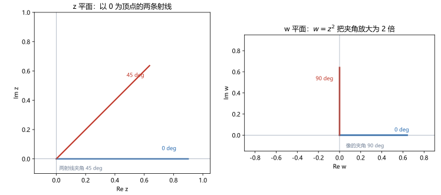
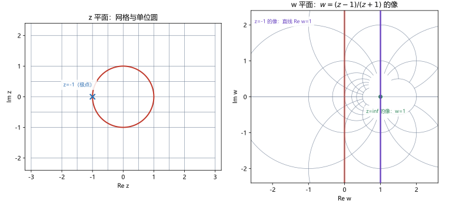

# 第 15 讲 保角映射与分式线性映射

> **前置**：第 01 讲（复平面、扩充复平面的无穷远点）、第 02 讲（映射观点、极限）、第 03 讲（导数、柯西-黎曼条件）、第 04 讲（$1/z$、幂函数）。
> **预计时间**：约 3 小时（含作业；第 2、4、6 节的计算建议各动手一遍）。
> **本讲回答**：导数的模和辐角在几何上分别是什么？为什么解析函数在导数不为零处保角，而 $z^2$ 在 $0$ 处不保角？分式线性映射为什么能拆成四步？它为什么把圆映成圆？三对点凭什么唯一确定一个映射？

## 本讲要解决什么

前十四讲都在算：算积分、算级数、算留数。这一讲换一个角度，把解析函数看成**平面到平面的映射**，问两个几何问题：

1. 一个解析函数在一点附近，把图形怎么变形？
2. 有没有一类函数，能把圆、半平面、角形域这些区域灵活地搬来搬去？

第一个问题的答案是：在导数不为零的点附近，映射只做两件事——按 $\lvert f'(z_0)\rvert$ 放大（或缩小），再旋转 $\arg f'(z_0)$。因此两条曲线的夹角不变，这叫**保角**。

第二个问题的答案是：**分式线性映射**

$$w=\frac{az+b}{cz+d},\qquad ad-bc\ne0 .$$

它由平移、反演、旋转伸缩、再平移这四步复合而成，把圆映成圆（直线算过无穷远点的圆），并且由三对对应点唯一确定。

**口径声明**：本课程的"保角映射"与"共形映射"（conformal mapping）是同一个意思，指在区域内解析、导数处处不为零的映射。这个定义同时保证了夹角的大小和方向都不变。第 16 讲会用它来构造区域之间的映射。

学完之后，你应该能做到：

- 给一个解析函数和一点，算出该点的伸缩率与旋转角，并说明这是"局部"结论；
- 判断一个映射在某点是否保角，能说出 $f'(z_0)=0$ 时夹角被放大成几倍；
- 把任一分式线性映射分解成四步基本映射，并说出每一步的几何效果；
- 用保圆性、保对称性、不动点三条性质快速画出像区域；
- 用待定系数法或交比，由三对点写出映射。

---

## 1. 导数的几何意义：伸缩率与旋转角

### 1.1 从差商到局部线性

设 $f$ 在 $z_0$ 可导，$f'(z_0)\ne0$。按定义

$$f'(z_0)=\lim_{\Delta z\to0}\frac{\Delta w}{\Delta z},\qquad \Delta w=f(z_0+\Delta z)-f(z_0).$$

极限存在意味着：当 $\Delta z$ 很小时，

$$\Delta w\approx f'(z_0)\,\Delta z. \tag{15.1}$$

这个近似式就是本讲的全部出发点。它说：在 $z_0$ 附近，$f$ 的作用近似于"乘一个固定的复数 $f'(z_0)$"。而乘以一个复数，在几何上只有两种效果——模相乘、辐角相加（第 01 讲）。把 (15.1) 两边取模、取辐角：

$$\lvert\Delta w\rvert\approx\lvert f'(z_0)\rvert\,\lvert\Delta z\rvert,\qquad
\arg\Delta w\approx\arg f'(z_0)+\arg\Delta z. \tag{15.2}$$

于是得到两个几何量：

- $\lvert f'(z_0)\rvert$ 是**伸缩率**：$z_0$ 附近的一小段长度，经过映射后被放大（$\lvert f'\rvert>1$）或缩小（$\lvert f'\rvert<1$）的倍数；
- $\arg f'(z_0)$ 是**旋转角**：$z_0$ 处的一个小方向，经过映射后被逆时针转过的角度。

两个量都只由 $z_0$ 决定，与 $\Delta z$ 的方向无关。这一点很关键：**同一个点附近，所有方向被放大同样的倍数、转过同样的角度**。

### 1.2 为什么必须强调"局部"

(15.1) 是 $\Delta z\to0$ 时的近似，只在 $z_0$ 的无穷小邻域内成立。离开这个邻域，映射就不再是简单的"乘一个常数"了。

另外，$f'(z_0)$ 随 $z_0$ 变化。同一个函数在不同点，伸缩率和旋转角都不同。比如 $f(z)=z^2$，$f'(z)=2z$：在 $z=2$ 处伸缩率是 $4$、旋转角是 $0$；在 $z=1+i$ 处伸缩率是 $2\sqrt2$、旋转角是 $45^\circ$。

### 1.3 例题

**例 15.1** 设 $f(z)=z^2$，求它在 $z_0=1+i$ 处的伸缩率与旋转角；再求在 $z_0=2$ 处的对应值。

**解**：先求导：

$$f'(z)=2z,\qquad f'(1+i)=2(1+i)=2+2i .$$

伸缩率是模：

$$\lvert f'(1+i)\rvert=\lvert 2+2i\rvert=\sqrt{4+4}=2\sqrt2\approx2.8284 .$$

旋转角是辐角。$2+2i$ 在第一象限，与正实轴成 $45^\circ$：

$$\arg f'(1+i)=\frac{\pi}{4}=45^\circ .$$

所以 $z=1+i$ 附近的一小段，被放大为原来的 $2\sqrt2$ 倍，并逆时针旋转 $45^\circ$。

再看 $z_0=2$：$f'(2)=4$，模为 $4$，辐角为 $0$。所以伸缩率 $4$、旋转角 $0$。同一个函数，两个点的几何效果完全不同。

**数值核对**（脚本 `scripts/lec15-01_verify_conformal.py`，EXP1）：取 $h=10^{-6}$，沿 $0^\circ,30^\circ,60^\circ,90^\circ$ 四个方向计算差商 $(f(z_0+h e^{i\alpha})-f(z_0))/(h e^{i\alpha})$：

| 方向 $\alpha$ | $0^\circ$ | $30^\circ$ | $60^\circ$ | $90^\circ$ |
|---|---|---|---|---|
| 差商的模 | $2.828428$ | $2.828428$ | $2.828428$ | $2.828428$ |
| 差商的辐角 | $45.0000^\circ$ | $45.0000^\circ$ | $45.0000^\circ$ | $45.0000^\circ$ |

四个方向给出同一个数 $2.828427+2.828427i$ 附近的值，与 $f'(1+i)=2+2i$ 的模 $2\sqrt2=2.828427$、辐角 $45^\circ$ 一致。**方向被消掉了**——这正是"导数存在"的含义。

### 1.4 一个容易混的地方

"旋转角是 $\arg f'$"说的是**切向**被转了 $\arg f'$，不是"整条曲线绕某点转了 $\arg f'$"。曲线各点的切向本来就不一样，映射后每点的切向各自加上 $\arg f'(z)$（在不同的 $z$ 处加不同的角），曲线整体形状可以变得很复杂。

---

## 2. 保角性：定义与条件

### 2.1 两条曲线的夹角

设两条曲线 $\Gamma_1,\Gamma_2$ 都经过 $z_0$，且在该点有切线。它们在 $z_0$ 的**有向夹角**，定义为两条切线的切向角之差 $\theta_2-\theta_1$（模 $2\pi$）；只看大小时，取它在 $0$ 到 $\pi$ 之间的代表。

### 2.2 保角性的定义

设 $f$ 在 $z_0$ 的邻域内有定义。若 $f$ 把过 $z_0$ 的任意两条曲线的夹角，映成过 $f(z_0)$ 的两条像曲线的**同样大小、同样方向**的夹角，就说 $f$ 在 $z_0$ **保角**（conformal）。

"同样方向"是指：若从 $\Gamma_1$ 到 $\Gamma_2$ 是逆时针转 $\varphi$，则从像曲线 $\Gamma_1'$ 到 $\Gamma_2'$ 也是逆时针转 $\varphi$。只保大小、把方向反过来（顺时针变逆时针）的映射，叫**反保角**（反共形）。

### 2.3 定理：解析且导数非零就保角

**定理 15.1** 若 $f$ 在 $z_0$ 解析且 $f'(z_0)\ne0$，则 $f$ 在 $z_0$ 保角；并且任意方向的微小长度都被放大 $\lvert f'(z_0)\rvert$ 倍。

**证明**：设 $\Gamma$ 是过 $z_0$ 的光滑曲线，参数化为 $z(t)$，$z(0)=z_0$，$z'(0)\ne0$。像曲线是 $w(t)=f(z(t))$。由复合函数求导（第 03 讲），

$$w'(0)=f'(z_0)\,z'(0).$$

取辐角：

$$\arg w'(0)=\arg f'(z_0)+\arg z'(0). \tag{15.3}$$

现在取两条曲线 $\Gamma_1,\Gamma_2$，切向角为 $\theta_1,\theta_2$。由 (15.3)，像曲线的切向角是

$$\theta_1'=\arg f'(z_0)+\theta_1,\qquad \theta_2'=\arg f'(z_0)+\theta_2 .$$

两者相减：

$$\theta_2'-\theta_1'=\theta_2-\theta_1 .$$

夹角不变。再看长度：$\lvert w'(0)\rvert=\lvert f'(z_0)\rvert\,\lvert z'(0)\rvert$，所以每个方向的微小弧长都被乘上同一个 $\lvert f'(z_0)\rvert$。

证明里只用了两件事：$f$ 可导，且 $f'(z_0)\ne0$（否则 (15.3) 中 $\arg f'$ 没有定义）。所以**导数非零这个条件是必需的**。下一节看它不成立时会怎样。

### 2.4 例题：$z^2$ 在 $0$ 处发生了什么

**例 15.2** 设 $f(z)=z^2$。判断它在 $z_0=0$ 处是否保角；若不保角，求两条射线 $0^\circ$ 与 $45^\circ$ 的夹角被放大成多少。

**解**：$f'(z)=2z$，$f'(0)=0$。定理 15.1 的条件不满足，但"条件不满足"不等于"一定不保角"，还要直接算。

取射线 $z=t$（$t>0$，方向 $0^\circ$），像为 $w=t^2$，仍是正实轴，方向 $0^\circ$。

取射线 $z=te^{i\pi/4}$（方向 $45^\circ$），像为

$$w=t^2e^{i\pi/2}=i\,t^2,$$

是正虚轴，方向 $90^\circ$。

两条射线的夹角原来是 $45^\circ$，像的夹角是 $90^\circ$。夹角被**放大成 2 倍**，不是不变。所以 $z^2$ 在 $0$ 处不保角。

一般地，$f(z)=z^n$ 在 $0$ 处：

$$(te^{i\alpha})^n=t^ne^{in\alpha},$$

方向从 $\alpha$ 变成 $n\alpha$，夹角被放大 $n$ 倍。$n$ 就是 $f$ 在 $0$ 处泰勒展开里第一个非零项的阶数——这里 $f'=0$，第一个非零项是 $z^2$ 项，所以放大 $2$ 倍。

**数值核对**（EXP3）：$z^2$ 把 $0^\circ$ 与 $30^\circ$ 的夹角（$30^\circ$）映成 $0^\circ$ 与 $60^\circ$（$60^\circ$）；$z^3$ 把同样的 $30^\circ$ 映成 $90^\circ$。倍数分别是 $2$ 和 $3$。

图 1 画的是 $z^2$ 在原点：左图两条射线夹角 $45^\circ$，右图它们的像夹角 $90^\circ$。

### 2.5 保角不保长度

定理 15.1 说的是"所有方向的微小长度都被放大同一个倍数"，不是"长度不变"。$\lvert f'(z_0)\rvert$ 一般不等于 $1$。例 15.1 里 $z^2$ 在 $1+i$ 处把长度放大 $2\sqrt2$ 倍，角度却保持不变。

面积也不保。把 $z_0$ 附近的一个小正方形看成边长 $h$ 的图形，映射后两条邻边都乘 $\lvert f'\rvert$，夹角不变（仍是直角），所以面积乘 $\lvert f'(z_0)\rvert^2$。只有 $\lvert f'(z_0)\rvert=1$ 时面积才不变。

另外，保角也不是解析函数的专利。反射 $w=\bar z$ 把 $(x,y)$ 映成 $(x,-y)$，它保持夹角的大小，但把逆时针变成顺时针——它是反保角的，不是本课程说的保角映射。$w=\bar z$ 不解析（第 03 讲的 C-R 条件不成立），所以它也不在定理 15.1 的适用范围里。这两件事要分开记：**保角性是一个几何性质，解析性是函数性质**；定理 15.1 给出的是"解析 + 导数非零 ⇒ 保角"这一条通道。

### 2.6 数值核对（EXP2）

取 $z_0=1+i$，沿 $0^\circ$ 与 $40^\circ$ 两个方向各取一小段，算出像曲线的切向角 $45.0000^\circ$ 与 $85.0000^\circ$，两者之差 $40.0000^\circ$，与原来两方向的夹角 $40^\circ$ 一致；两条像曲线的切向长度都等于 $2.828428$（即 $\lvert f'\rvert$ 乘原步长）。角度不变、长度同比缩放，两件事同时在数据里。

---

## 3. 分式线性映射：定义与退化

### 3.1 定义

形如

$$w=\frac{az+b}{cz+d},\qquad a,b,c,d\in\mathbb C,\quad ad-bc\ne0 \tag{15.4}$$

的映射，叫**分式线性映射**（fractional linear mapping），也叫默比乌斯变换（Möbius transformation）。

"分式线性"是说：分子、分母都是 $z$ 的一次式。

### 3.2 $ad-bc\ne0$ 管什么

若 $ad-bc=0$。当 $c\ne0$ 时，由 $ad=bc$ 得 $\dfrac ac=\dfrac bd$，于是

$$az+b=\frac ac(cz+d),$$

分子是分母的常数倍，$w\equiv\dfrac ac$。当 $c=0$ 时，$ad=0$；又因 $d\ne0$（否则分母恒为零），故 $a=0$，$w\equiv\dfrac bd$。两种情形都退化为常数，把整个平面压成一个点，不再是一一对应。所以必须要求 $ad-bc\ne0$。

### 3.3 在扩充复平面上它是双射

分母在 $z=-d/c$ 处为零（$c\ne0$ 时），这个点没有有限像。但若把无穷远点 $\infty$ 也当作一个点（第 01 讲提过：把平面补一点成球面），就能把定义补全：

- $c\ne0$ 时：$z=-d/c\ \mapsto\ \infty$，$z=\infty\ \mapsto\ a/c$；
- $c=0$ 时：$w=\frac ad z+\frac bd$ 是线性映射，$\infty\mapsto\infty$，没有有限点被送到无穷远。

补全之后，(15.4) 是扩充复平面到自身的一一对应（双射）。这也解释了为什么第 16 讲能用它做区域映射：它把"边界上的点"和"无穷远"一起搬，不会漏掉。

### 3.4 例题

**例 15.3** 设 $w=\dfrac{2z+1}{z-1}$。求：(1) 哪个点映到无穷远；(2) $z=0$ 与 $z=\infty$ 的像；(3) 反函数。

**解**：这里 $a=2,b=1,c=1,d=-1$，$ad-bc=2\cdot(-1)-1\cdot1=-3\ne0$，非退化。

(1) 分母为零：$z-1=0$，即 $z=1$ 映到 $\infty$。

(2) $z=0$：$w=\dfrac{1}{-1}=-1$。

$z=\infty$ 的像按 $a/c$ 算：$w=\dfrac21=2$。也可以直接看 $z$ 很大时分子分母都近似 $2z$ 与 $z$，比值趋于 $2$。

(3) 从 $w=\dfrac{2z+1}{z-1}$ 解出 $z$：

$$w(z-1)=2z+1\ \Longrightarrow\ wz-w=2z+1\ \Longrightarrow\ z(w-2)=w+1\ \Longrightarrow\ z=\frac{w+1}{w-2}.$$

反函数仍是分式线性映射，它的系数行列式是 $1\cdot(-2)-1\cdot1=-3$，仍然非零。这不是巧合：非零行列式的矩阵可逆，而反函数的系数矩阵正是原矩阵的逆矩阵（差一个常数倍）。

**数值核对**（EXP4）：$z=-2,0,2,3,1+i$ 五点上，直接代入与四步分解（下一节）的结果差为 $0$；$z=1$ 处取 $z=1+10^{-9}$，$\lvert w\rvert\approx3\times10^{9}$，验证"趋于无穷"；$z=\infty$ 的像为 $2$。

### 3.5 易错

- 忘记检查 $ad-bc\ne0$。行列式为零时不是"特殊的分式线性映射"，而是常数映射，谈不上保角、保圆。
- 把 $z=-d/c$ 当普通点代入，得到"分母为零"，然后认为函数无意义。正确做法是：在扩充复平面上，它的像是 $\infty$。
- 认为 $z=\infty$ 不能代。按 $a/c$ 算（$c\ne0$），或令 $z\to\infty$ 取极限。

---

## 4. 四种基本映射的分解

### 4.1 代数变形

设 $c\ne0$。把 (15.4) 的分子按分母配凑：

$$\frac{az+b}{cz+d}=\frac ac+\frac{b-\frac{ad}{c}}{cz+d}=\frac ac+\frac{bc-ad}{c^2}\cdot\frac{1}{z+\frac dc}. \tag{15.5}$$

验证：右边通分，

$$\frac ac+\frac{bc-ad}{c^2(z+d/c)}=\frac{a(z+d/c)}{c(z+d/c)}+\frac{bc-ad}{c^2(z+d/c)}
=\frac{az+ad/c+(bc-ad)/c}{c(z+d/c)}
=\frac{az+b}{cz+d}.$$

所以任一分式线性映射都可以写成

$$w=\frac ac+\frac{bc-ad}{c^2}\cdot\frac{1}{z+\frac dc}. \tag{15.6}$$

### 4.2 四步与每步的几何效果

把 (15.6) 从里往外读，映射分成四步：

| 步骤 | 映射 | 几何效果 |
|---|---|---|
| 1 | $\zeta_1=z+\dfrac dc$ | 平移 |
| 2 | $\zeta_2=\dfrac{1}{\zeta_1}$ | 反演（关于单位圆）+ 关于实轴反射 |
| 3 | $\zeta_3=k\zeta_2$，$k=\dfrac{bc-ad}{c^2}$ | 旋转 $\arg k$、伸缩 $\lvert k\rvert$ |
| 4 | $w=\zeta_3+\dfrac ac$ | 再平移 |

四步都是"圆映成圆、保角"的映射，复合起来也保圆、保角。这就是分式线性映射的两条主要性质的来源。

第 2 步的 $1/\zeta$ 需要单独说明。它不是"取倒数"这么简单：设 $\zeta=re^{i\theta}$，则

$$\frac1\zeta=\frac{1}{r}e^{-i\theta}.$$

模从 $r$ 变成 $1/r$（关于单位圆的反演），辐角从 $\theta$ 变成 $-\theta$（关于实轴的反射）。两件事合起来才是 $1/\zeta$。

### 4.3 例题

**例 15.4** 把 $w=\dfrac{2z+1}{z-1}$ 分解成四步基本映射，并说出每一步把什么变成什么。

**解**：这里 $a=2,b=1,c=1,d=-1$。先算常数：

$$\frac ac=2,\qquad \frac dc=-1,\qquad k=\frac{bc-ad}{c^2}=\frac{1\cdot1-2\cdot(-1)}{1}=3 .$$

所以

$$w=2+\frac{3}{z-1}.$$

四步是：

1. $\zeta_1=z-1$：把 $z=1$ 平移到原点；
2. $\zeta_2=1/\zeta_1$：把原点变成无穷远，单位圆内外互换；
3. $\zeta_3=3\zeta_2$：放大 $3$ 倍，不旋转（$k=3$ 是正实数）；
4. $w=\zeta_3+2$：整体右移 $2$。

合起来：$z=1$（第 1 步到原点）→ 无穷远，与例 15.3 的结论一致；$z=\infty$ 经第 1 步仍是无穷远，经第 2 步到 $0$，经第 3、4 步到 $2$，也与 $a/c=2$ 一致。

**数值核对**（EXP4）：五组 $z$ 上"直接代公式"与"按四步算"之差全为 $0$，$ad-bc=-3$，$z=1$ 附近 $\lvert w\rvert$ 按 $1/\lvert z-1\rvert$ 增长。

### 4.4 $c=0$ 的情形

若 $c=0$，则 $ad\ne0$，(15.4) 变成

$$w=\frac ad z+\frac bd,$$

只有平移和旋转伸缩两步，没有反演。这也是分式线性映射（把 $\infty$ 映到 $\infty$）。

### 4.5 分解不唯一，但结论不变

四步的顺序可以调整。比如先旋转再反演，与先反演再旋转，结果一般不同，但都能写成"平移、反演、旋转伸缩、平移"的组合。分解的具体写法不重要，重要的是：**分式线性映射的几何性质，都可以拆到这几个基本动作上去验证**。

### 4.6 易错

- 把 $1/\zeta$ 说成"取倒数"。要同时说出反演与反射两件事。
- $k=\dfrac{bc-ad}{c^2}$ 的符号与辐角算错。$k$ 是复数，$\arg k$ 决定旋转方向。
- 分解时把 $z+d/c$ 写成 $z-d/c$。注意 $d/c$ 本身可能带符号：例 15.4 中 $d/c=-1$，所以是 $z-1$。

---

## 5. 保圆性、保对称性与不动点

### 5.1 保圆性

**定理 15.2** 分式线性映射把圆或直线映成圆或直线；并且是一一对应。

这里把直线看成"过无穷远点的圆"，两类图形就统一成"圆"。若不这样约定，定理就要说成"圆或直线映成圆或直线"，绕口且容易漏。

### 5.2 为什么

思路是：圆和直线有统一的方程。以 $z$ 为变量，形如

$$A z\bar z+\bar B z+B\bar z+C=0,\qquad A,C\in\mathbb R \tag{15.7}$$

的方程：

- $A\ne0$ 时，配方后是圆；
- $A=0$ 时，方程是一次式，代表直线。

把 $z=\dfrac{dw-b}{a-cw}$（(15.4) 的反解）代入 (15.7)，两边乘 $\lvert a-cw\rvert^2$，按 $w\bar w$、$w$、$\bar w$、常数归类。$w\bar w$ 的系数是

$$A'=A\lvert d\rvert^2-\bar B d\bar c-B\bar d c+C\lvert c\rvert^2 ,$$

它是实数（前两项互为共轭，后两项是实数）；$w$ 与 $\bar w$ 的系数互为共轭；常数项 $A\lvert b\rvert^2+\bar B b\bar a+B\bar b a+C\lvert a\rvert^2$ 也是实数。所以像仍然满足

$$A'w\bar w+\bar B'w+B'\bar w+C'=0$$

的形状：$A'\ne0$ 时是圆，$A'=0$ 时退化为直线。完整的展开过程放在作业第 10 题，那里逐步算。

这解释了一个现象：当原圆经过极点时，像会跑到无穷远，二次项系数被消掉，圆退化成直线。反过来也成立：像若是直线，说明极点落在原圆上。例 15.5 会看到这个现象。

### 5.3 例题

**例 15.5** 设 $w=\dfrac{z-1}{z+1}$。求单位圆 $\lvert z\rvert=1$ 与圆 $\lvert z-2\rvert=1$ 的像。

**解**：先看单位圆。在 $\lvert z\rvert=1$ 上，$\bar z=1/z$，于是

$$\bar w=\frac{\bar z-1}{\bar z+1}=\frac{1/z-1}{1/z+1}=\frac{1-z}{1+z}=-w .$$

$\bar w=-w$ 说明 $w$ 的实部为零：

$$\operatorname{Re}w=\frac{w+\bar w}{2}=0 .$$

所以单位圆的像落在虚轴上。再看两个特殊点：$z=1$ 时 $w=0$；$z=-1$ 时分母为零，$w=\infty$。所以像是整条虚轴（不是虚轴上的一段）。注意 $z=-1$ 恰好在单位圆上，这不是偶然——正是它让像跑到无穷远，圆退化成直线（5.2 节）。

再看 $\lvert z-2\rvert=1$。这个圆不经过 $z=-1$（圆心 $2$、半径 $1$，最左到 $z=1$），所以像应当是圆。取圆上三个点算像：

- $z=3$：$w=\dfrac{2}{4}=\dfrac12$；
- $z=1$：$w=0$；
- $z=2+i$：$w=\dfrac{1+i}{3+i}=\dfrac{(1+i)(3-i)}{10}=\dfrac{4+2i}{10}=0.4+0.2i$。

三点定圆。设像圆为 $\lvert w-w_0\rvert=r$。前两点 $0$ 与 $1/2$ 说明圆心在它们的垂直平分线 $\operatorname{Re}w=1/4$ 上，设 $w_0=1/4+iy_0$。再利用到 $0$ 与到 $0.4+0.2i$ 的距离相等：

$$\frac1{16}+y_0^2=(0.15)^2+(0.2-y_0)^2 .$$

展开右边：$0.0225+0.04-0.4y_0+y_0^2$。两边消去 $y_0^2$，得 $0.0625=0.0625-0.4y_0$，所以 $y_0=0$。于是 $w_0=1/4$，$r=\lvert0-1/4\rvert=1/4$。验证：

$$\left\lvert\frac12-\frac14\right\rvert=\frac14,\qquad \lvert0-\frac14\rvert=\frac14,\qquad \lvert(0.4+0.2i)-0.25\rvert=\lvert0.15+0.2i\rvert=0.25 .$$

所以像是圆 $\left\lvert w-\dfrac14\right\rvert=\dfrac14$。

**数值核对**（EXP5）：在单位圆上取 $20001$ 个点，除去 $z=-1$ 附近，$\lvert\operatorname{Re}w\rvert$ 的最大值为 $8.4\times10^{-10}$（采样误差）；靠近 $z=-1$ 时 $\lvert\operatorname{Im}w\rvert$ 达到 $1.6\times10^{16}$，验证"无界，是整条直线"。对 $\lvert z-2\rvert=1$ 的像做三点定圆，再用全部点检验，最大偏差 $3.6\times10^{-16}$，圆心 $0.250000$、半径 $0.250000$。

图 2 是这张图的完整版：左边 $z$ 平面的网格与单位圆，右边是 $w=\dfrac{z-1}{z+1}$ 的像。

图 2 右图有三件事值得对照：

- 红色：单位圆的像，是虚轴；
- 紫色：过极点 $z=-1$ 的那条竖线，像是直线 $\operatorname{Re}w=1$——过极点的直线映成直线，与 5.2 节的"退化"一致；
- 绿色点：$z=\infty$ 的像 $w=1$。所有不过极点的网格线，其像都是经过 $w=1$ 的圆（因为网格线都"经过无穷远"）。

### 5.4 不动点

**不动点**是满足 $w=z$ 的点，即映射后不动的点。把 (15.4) 写成方程：

$$z=\frac{az+b}{cz+d}\ \Longrightarrow\ cz^2+(d-a)z-b=0. \tag{15.8}$$

这是二次方程，所以不动点最多两个（把 $\infty$ 也算作可能的解）。$c=0$ 时方程退化一次，此时 $\infty$ 是一个不动点，另一个是 $b/(d-a)$（$a\ne d$ 时）。

**例 15.6** 求 $w=\dfrac{z-1}{z+1}$ 的不动点，并验证 $z=2$ 与它关于单位圆的对称点 $z=1/2$ 的像。

**解**：不动点方程：

$$z=\frac{z-1}{z+1}\ \Longrightarrow\ z(z+1)=z-1\ \Longrightarrow\ z^2+z-z+1=0\ \Longrightarrow\ z^2+1=0 .$$

所以不动点是 $z=\pm i$。验证：

$$w(i)=\frac{i-1}{i+1}=\frac{(i-1)(1-i)}{2}=\frac{2i}{2}=i .$$

同理 $w(-i)=-i$。两个不动点都在单位圆上，这是可以预料的：单位圆被映成虚轴，两个图形的交点正是不动点。

再看对称点。关于单位圆，$z=2$ 的对称点是 $1/\bar z=1/2$。它们的像：

$$w(2)=\frac{2-1}{2+1}=\frac13,\qquad w\left(\frac12\right)=\frac{\frac12-1}{\frac12+1}=\frac{-1/2}{3/2}=-\frac13 .$$

$1/3$ 与 $-1/3$ 关于虚轴对称（关于虚轴的对称是 $w\mapsto-\bar w$）。这正是下一小节的保对称性。

**数值核对**（EXP7、EXP6）：$w(\pm i)$ 与 $\pm i$ 的差为 $0$；$w(2)=0.333333$、$w(1/2)=-0.333333$，实部之和为 $0$。

### 5.5 保对称性

**定义**：关于圆 $\lvert z-z_0\rvert=R$ 对称的两点，指位于同一条过圆心的射线上、且到圆心的距离乘积为 $R^2$ 的两点。对单位圆，$z$ 的对称点是 $1/\bar z$。关于直线的对称就是通常的镜像。

**定理 15.3** 分式线性映射保持对称性：若 $z_1,z_2$ 关于圆（或直线）$C$ 对称，则它们的像关于像曲线 $C'$ 对称。

例 15.6 已经验证了单位圆与虚轴这一组。保对称性的用处是：不必逐点算像，只要知道像曲线和一对对称点，就能定出另一个像点；第 16 讲构造区域映射时会反复用。

### 5.6 易错

- 把"保圆"理解成"保圆心"。例 15.5 中，圆 $\lvert z-2\rvert=1$ 的圆心是 $z=2$，像圆的圆心却是 $w=1/4$，不是 $z=2$ 的像 $w=1/3$。
- 忘记"直线也是圆"。看到像是一条直线，就以为定理失效了。
- 不动点方程写错符号。从 $z=(az+b)/(cz+d)$ 出发，移项得 $cz^2+(d-a)z-b=0$，不是 $(a-d)$。
- 把关于单位圆的对称点写成 $-z$ 或 $\bar z$。正确的是 $1/\bar z$。

---

## 6. 三对点确定唯一映射与交比

### 6.1 三对点为什么够

分式线性映射有四个系数 $a,b,c,d$，但 (15.4) 中分子分母同乘一个非零常数，映射不变。所以真正独立的参数只有三个（四个系数去掉一个公共比例）。三个条件恰好定三个参数。

**定理 15.4** 给定三对互不相同的点 $z_1,z_2,z_3$ 与 $w_1,w_2,w_3$（允许其中出现 $\infty$），存在唯一的分式线性映射使 $w(z_k)=w_k$（$k=1,2,3$）。

**唯一性的证明**：设 $M_1,M_2$ 都满足要求。考虑复合映射

$$g=M_2^{-1}\circ M_1 .$$

它把 $z_1,z_2,z_3$ 都映回自己，即有三个不动点。但由 (15.8)，非恒等的分式线性映射最多有两个不动点。所以 $g$ 只能是恒等映射，从而 $M_1=M_2$。

### 6.2 待定系数法

**例 15.7** 求把 $0,1,\infty$ 分别映到 $1,i,-1$ 的分式线性映射。

**解**：设 $w=\dfrac{az+b}{cz+d}$。

$z=0\mapsto1$：$\dfrac bd=1$。取 $d=1$，得 $b=1$（四个系数可同乘常数，$d$ 取 $1$ 不失一般性）。

$z=\infty\mapsto-1$：$\dfrac ac=-1$，即 $a=-c$。

$z=1\mapsto i$：

$$\frac{a+1}{c+1}=i .$$

代入 $a=-c$：

$$\frac{1-c}{c+1}=i\ \Longrightarrow\ 1-c=i(c+1)\ \Longrightarrow\ 1-c=ic+i\ \Longrightarrow\ 1-i=c(1+i)\ \Longrightarrow\ c=\frac{1-i}{1+i}=-i .$$

于是 $a=i$，$b=1$，$c=-i$，$d=1$：

$$w=\frac{iz+1}{-iz+1}=\frac{1+iz}{1-iz}.$$

检验行列式：$ad-bc=i\cdot1-1\cdot(-i)=2i\ne0$。

**数值核对**（EXP8）：$z=0,1,10^{12}$ 分别给出 $1$、$i$、$-1$（最后一项差 $2\times10^{-12}$，是 $z$ 取有限大代替 $\infty$ 的误差）。

### 6.3 交比：定义与不变性

三对点也可以不用解方程组，而用一个不变量直接写答案。这个量叫**交比**（cross ratio）：

$$(z_1,z_2,z_3,z_4)=\frac{(z_1-z_2)(z_3-z_4)}{(z_1-z_3)(z_2-z_4)}. \tag{15.9}$$

四个点中允许有一个是 $\infty$，按极限理解（下一小节给规则）。

**定理 15.5** 分式线性映射保持交比：

$$(w_1,w_2,w_3,w_4)=(z_1,z_2,z_3,z_4),\qquad w_k=w(z_k).$$

**证明**：设 $w=\dfrac{az+b}{cz+d}$，$ad-bc\ne0$。对任意两点，

$$w_i-w_j=\frac{az_i+b}{cz_i+d}-\frac{az_j+b}{cz_j+d}
=\frac{(az_i+b)(cz_j+d)-(az_j+b)(cz_i+d)}{(cz_i+d)(cz_j+d)} .$$

展开分子：

$$(az_i+b)(cz_j+d)-(az_j+b)(cz_i+d)=ac z_iz_j+adz_i+bcz_j+bd-acz_iz_j-bcz_i-adz_j-bd$$
$$=ad(z_i-z_j)+bc(z_j-z_i)=(ad-bc)(z_i-z_j).$$

所以

$$w_i-w_j=\frac{(ad-bc)(z_i-z_j)}{(cz_i+d)(cz_j+d)}. \tag{15.10}$$

把 (15.10) 代入 (15.9)。分子是 $(w_1-w_2)(w_3-w_4)$，分母是 $(w_1-w_3)(w_2-w_4)$。每个差都带一个 $(ad-bc)$，分子分母各两个，全部约掉；每个差还带两个分母因子，逐个对照：

- 分子：$(cz_1+d)(cz_2+d)\cdot(cz_3+d)(cz_4+d)$；
- 分母：$(cz_1+d)(cz_3+d)\cdot(cz_2+d)(cz_4+d)$。

完全相同，也约掉。剩下

$$\frac{(z_1-z_2)(z_3-z_4)}{(z_1-z_3)(z_2-z_4)}=(z_1,z_2,z_3,z_4).$$

### 6.4 含 $\infty$ 的规则

当四点中有一个是 $\infty$ 时，把 (15.9) 里含 $\infty$ 的因子同除以它再取极限。常用的两条是

$$(z,z_2,\infty,z_4)=\frac{z-z_2}{z_4-z_2},\qquad (z,\infty,z_3,z_4)=\frac{z_3-z_4}{z-z_3}. \tag{15.11}$$

推导第一条：在 (15.9) 中令 $z_3\to\infty$，

$$\frac{(z-z_2)(z_3-z_4)}{(z-z_3)(z_2-z_4)}
=\frac{(z-z_2)\left(1-\frac{z_4}{z_3}\right)}{\left(\frac{z}{z_3}-1\right)(z_2-z_4)}
\longrightarrow\frac{(z-z_2)\cdot1}{(-1)(z_2-z_4)}=\frac{z-z_2}{z_4-z_2}.$$

第二条同理。规则可以记成：**含 $\infty$ 的那一对因子约成 $1$，剩下的因子照抄，符号按上式**。

### 6.5 用交比重算例 15.7

**例 15.8** 用交比求把 $0,1,\infty$ 映到 $1,i,-1$ 的映射。

**解**：设 $w$ 是所求映射。由交比不变，

$$(w,i,-1,1)=(z,1,\infty,0).$$

左边按 (15.9)：

$$(w,i,-1,1)=\frac{(w-i)(-1-1)}{(w+1)(i-1)}=\frac{-2(w-i)}{(w+1)(i-1)} .$$

右边按 (15.11) 的第一条（$z_2=1$，$z_4=0$）：

$$(z,1,\infty,0)=\frac{z-1}{0-1}=1-z .$$

两者相等：

$$1-z=\frac{-2(w-i)}{(w+1)(i-1)} .$$

令 $B=(1-z)(i-1)$，两边乘 $(w+1)(i-1)$：

$$B(w+1)=-2(w-i)\ \Longrightarrow\ Bw+B=-2w+2i\ \Longrightarrow\ w(B+2)=2i-B\ \Longrightarrow\ w=\frac{2i-B}{B+2}. $$

把 $B$ 代回并整理，得到

$$w=\frac{1+iz}{1-iz},$$

与例 15.7 相同。

检验 $z=2$：$B=(1-2)(i-1)=1-i$，

$$w=\frac{2i-(1-i)}{(1-i)+2}=\frac{-1+3i}{3-i}=\frac{(-1+3i)(3+i)}{10}=\frac{-3-i+9i-3}{10}=\frac{-6+8i}{10}=-0.6+0.8i .$$

而 $\dfrac{1+2i}{1-2i}=\dfrac{(1+2i)^2}{5}=\dfrac{1+4i-4}{5}=-0.6+0.8i$，一致。

**数值核对**（EXP9）：对 $z$ 平面上四点 $0.3+0.2i$、$1.5-0.4i$、$2+1i$、$-0.5+0.7i$，交比为 $-0.2196109359-0.3523133544i$；经 $w=\dfrac{2z+1}{z-1}$ 后交比相同，差 $1.2\times10^{-16}$。

### 6.6 交比的一个用途（认识层）

交比是实数，当且仅当四点共圆或共线（把直线看成过 $\infty$ 的圆）。所以可以用交比判断四点是否共圆，也可以用它构造把某个圆映成直线的映射。本课程不要求用它做题，知道有这件事即可。

### 6.7 易错

- 三对点的顺序与像的顺序错配。$z_1\mapsto w_1$、$z_2\mapsto w_2$、$z_3\mapsto w_3$ 必须一一对应，交比里四个点的位置也要按同一顺序。
- 含 $\infty$ 时直接代公式，得到 $\infty/\infty$。必须用 (15.11) 的极限规则。
- 交比公式分子分母的点位记反。写完后用一组具体数验证：取 $z_1=0,z_2=1,z_3=\infty,z_4=2$，交比应为 $(0-1)/(2-1)=-1$。

---

## 7. 本讲小结

| 概念 | 一句话 | 条件 |
|---|---|---|
| 伸缩率 | $\lvert f'(z_0)\rvert$，局部长度放大倍数 | $f$ 在 $z_0$ 可导 |
| 旋转角 | $\arg f'(z_0)$，局部切向转角 | $f$ 在 $z_0$ 可导且 $f'(z_0)\ne0$ |
| 保角 | 两条曲线夹角大小与方向都不变 | $f$ 解析且 $f'(z_0)\ne0$ |
| 角放大 | $f'(z_0)=0$ 时，夹角放大 $n$ 倍，$n$ 为首个非零项阶数 | $f=z^n$ 型 |
| 分式线性映射 | $w=\dfrac{az+b}{cz+d}$，扩充复平面上的双射 | $ad-bc\ne0$ |
| 四步分解 | 平移 → 反演（含反射） → 旋转伸缩 → 平移 | $c\ne0$；$c=0$ 只有两步 |
| 保圆性 | 圆或直线映成圆或直线 | 恒成立；过极点时圆退化为直线 |
| 保对称性 | 关于圆/直线对称的两点，像仍对称 | 恒成立 |
| 不动点 | 解 $cz^2+(d-a)z-b=0$ | 最多两个（含 $\infty$） |
| 三对点 | 三个条件定唯一映射 | 三对点互不相同 |
| 交比 | $(z_1,z_2,z_3,z_4)=\dfrac{(z_1-z_2)(z_3-z_4)}{(z_1-z_3)(z_2-z_4)}$ | 分式线性映射下不变 |

**三句话带走**：

1. 导数的模是局部放大率，辐角是局部旋转角；解析且导数非零，夹角就不变。
2. 分式线性映射 = 平移 + 反演 + 旋转伸缩 + 平移，因此保角、保圆、保对称，由三对点唯一确定。
3. 保圆性里"直线也是圆"不是文字游戏：圆过极点时，像就是直线。

---

## 8. 掌握度自测

- [ ] 我能对一个具体函数（如 $z^3$）在指定点算出伸缩率与旋转角，并说明这是局部结论。
- [ ] 我能说清 $f'(z_0)\ne0$ 在保角定理的证明里用在哪一步。
- [ ] 我能用 $z^2$ 在 $0$ 的例子说明"角放大 2 倍"，并推广到 $z^n$。
- [ ] 我能把 $w=\dfrac{2z+1}{z-1}$ 分解成四步，并说出每步的几何效果。
- [ ] 我能解释 $1/z$ 为什么是"反演 + 关于实轴反射"，而不是简单的取倒数。
- [ ] 我能用 $\bar w=-w$ 证明 $w=\dfrac{z-1}{z+1}$ 把单位圆映成虚轴。
- [ ] 我能写出不动点方程并解出两个不动点。
- [ ] 我能用待定系数法和交比两种方法，由三对点写出映射。

---

## 作业

### 基础

**1.** 设 $f(z)=z^3$。求它在 $z_0=1$ 与 $z_0=i$ 处的伸缩率与旋转角；并说明在 $z_0=0$ 附近，夹角被放大几倍。

**参考答案：**

$f'(z)=3z^2$。

$z_0=1$：$f'(1)=3$，$\lvert f'\rvert=3$，$\arg f'=0$。伸缩率 $3$，旋转角 $0^\circ$。

$z_0=i$：$f'(i)=3i^2=-3$，$\lvert f'\rvert=3$，$\arg(-3)=\pi$。伸缩率 $3$，旋转角 $180^\circ$。

$z_0=0$：$f'(0)=0$，定理 15.1 不适用。直接算：射线 $te^{i\alpha}$ 的像是 $t^3e^{3i\alpha}$，方向从 $\alpha$ 变成 $3\alpha$，夹角放大 $3$ 倍。

---

**2.** 映射 $w=\bar z$ 是否保角？它是否属于本课程说的"保角映射"？说明理由。

**参考答案：**

作为平面映射，$w=\bar z$ 把 $(x,y)$ 映成 $(x,-y)$，是关于实轴的反射。反射保持夹角的大小，但把逆时针方向变成顺时针方向，所以它是**反保角**（反共形）的。

它不属于本课程说的保角映射。本课程要求保角映射在区域内解析且导数不为零；$w=\bar z$ 不解析：$u=x$、$v=-y$，$u_x=1$、$v_y=-1$，柯西-黎曼条件 $u_x=v_y$ 不成立（第 03 讲）。

两件事要分开：几何上它保夹角大小、反方向；函数性质上它不解析。定理 15.1 说的是"解析 + 导数非零 ⇒ 保角"，不解析的映射不在定理范围内，也可能保持夹角大小（如本例），但方向会反过来。

---

**3.** 设 $w=\dfrac{3z-2}{z+1}$。求极点（哪个 $z$ 映到 $\infty$）、$z=\infty$ 的像、反函数，并验证 $ad-bc\ne0$。

**参考答案：**

$a=3,b=-2,c=1,d=1$。

极点：分母 $z+1=0$，$z=-1\mapsto\infty$。

$z=\infty$ 的像：$a/c=3$。

反函数：$w(z+1)=3z-2$ ⇒ $wz+w=3z-2$ ⇒ $z(w-3)=-(w+2)$ ⇒

$$z=\frac{w+2}{3-w}.$$

行列式：$ad-bc=3\cdot1-(-2)\cdot1=5\ne0$。反函数写成标准形 $z=\dfrac{w+2}{-w+3}$，行列式 $1\cdot3-2\cdot(-1)=5$，也非零。

---

**4.** 把 $w=\dfrac{z+2}{z-1}$ 分解成四步基本映射，写出每一步的式子。

**参考答案：**

$a=1,b=2,c=1,d=-1$。先算：

$$\frac ac=1,\qquad \frac dc=-1,\qquad k=\frac{bc-ad}{c^2}=\frac{2\cdot1-1\cdot(-1)}{1}=3 .$$

所以

$$w=1+\frac{3}{z-1}.$$

四步：

1. $\zeta_1=z-1$（平移，把 $z=1$ 送到原点）；
2. $\zeta_2=1/\zeta_1$（反演 + 反射）；
3. $\zeta_3=3\zeta_2$（放大 3 倍，不旋转）；
4. $w=\zeta_3+1$（右移 1）。

检验 $z=0$：$\zeta_1=-1$，$\zeta_2=-1$，$\zeta_3=-3$，$w=-2$；直接代公式 $(0+2)/(0-1)=-2$，一致。

---

### 提高

**5.** 求把 $0,1,\infty$ 分别映到 $\infty,0,1$ 的分式线性映射，并验证三个对应点。

**参考答案：**

设 $w=\dfrac{az+b}{cz+d}$。

$z=0\mapsto\infty$：分母在 $0$ 为零 ⇒ $d=0$。

$z=\infty\mapsto1$：$a/c=1$ ⇒ $a=c$。

$z=1\mapsto0$：分子在 $1$ 为零 ⇒ $a+b=0$ ⇒ $b=-a$。

取 $a=c=1$，则 $b=-1$，$d=0$：

$$w=\frac{z-1}{z}=1-\frac1z .$$

验证：$z=0$ 分母为零，$w=\infty$；$z=1$ 得 $0$；$z\to\infty$ 得 $1$。行列式 $ad-bc=1\cdot0-(-1)\cdot1=1\ne0$。

---

**6.** 设 $w=\dfrac{z-i}{z+i}$。求实轴的像，并判断上半平面 $\operatorname{Im}z>0$ 映到哪里。

**参考答案：**

实轴上 $z=x$，$\lvert x-i\rvert=\lvert x+i\rvert$，所以

$$\lvert w\rvert=\frac{\lvert x-i\rvert}{\lvert x+i\rvert}=1 .$$

故实轴的像是单位圆（且 $z=\infty\mapsto1$，$z=0\mapsto-1$，覆盖整圆）。

判断内部：取上半平面一点 $z=2i$，

$$w(2i)=\frac{2i-i}{2i+i}=\frac{i}{3i}=\frac13,\qquad \left\lvert\frac13\right\rvert<1 .$$

上半平面是连通的，像也连通，且实轴映成单位圆，所以上半平面映到单位圆**内部**。

---

**7.** 求 $w=\dfrac{z-1}{z+1}$ 的不动点；并判断单位圆内部 $\lvert z\rvert<1$ 映到哪个半平面。

**参考答案：**

不动点方程：

$$z=\frac{z-1}{z+1}\ \Longrightarrow\ z^2+z=z-1\ \Longrightarrow\ z^2+1=0\ \Longrightarrow\ z=\pm i .$$

内部：取 $z=0$，$w=-1$，在左半平面。单位圆映成虚轴（例 15.5），内部连通，所以 $\lvert z\rvert<1$ 映到左半平面 $\operatorname{Re}w<0$。

---

**8.** 求把 $1,i,-1$ 分别映到 $0,1,\infty$ 的分式线性映射。

**参考答案：**

设 $w=\dfrac{az+b}{cz+d}$。

$z=1\mapsto0$：$a+b=0$ ⇒ $b=-a$。

$z=-1\mapsto\infty$：$-c+d=0$ ⇒ $d=c$。

$z=i\mapsto1$：

$$\frac{ai-a}{ci+c}=1\ \Longrightarrow\ a(i-1)=c(i+1)\ \Longrightarrow\ \frac ac=\frac{i+1}{i-1} .$$

计算

$$\frac{i+1}{i-1}=\frac{(i+1)^2}{(i-1)(i+1)}=\frac{2i}{-2}=-i .$$

取 $c=1$，则 $a=-i$，$b=i$，$d=1$：

$$w=\frac{-iz+i}{z+1}=\frac{i(1-z)}{1+z}.$$

验证 $z=i$：

$$w=\frac{i(1-i)}{1+i}=\frac{i(1-i)^2}{2}=\frac{i\cdot(-2i)}{2}=1 .$$

$z=1$ 得 $0$；$z=-1$ 分母为零，得 $\infty$。行列式 $ad-bc=(-i)\cdot1-i\cdot1=-2i\ne0$，非退化。

---

### 综合

**9.** 证明：两个分式线性映射的复合仍是分式线性映射；并说明复合映射的 $ad-bc$ 与原两个映射的 $ad-bc$ 有什么关系。

**参考答案：**

设

$$w=\frac{a_2\zeta+b_2}{c_2\zeta+d_2},\qquad \zeta=\frac{a_1z+b_1}{c_1z+d_1}.$$

代入：

$$w=\frac{a_2\dfrac{a_1z+b_1}{c_1z+d_1}+b_2}{c_2\dfrac{a_1z+b_1}{c_1z+d_1}+d_2}
=\frac{a_2(a_1z+b_1)+b_2(c_1z+d_1)}{c_2(a_1z+b_1)+d_2(c_1z+d_1)} .$$

整理成 $z$ 的一次式之比：

$$w=\frac{(a_2a_1+b_2c_1)z+(a_2b_1+b_2d_1)}{(c_2a_1+d_2c_1)z+(c_2b_1+d_2d_1)} .$$

这仍是分式线性映射。把系数写成矩阵：

$$\begin{pmatrix}a&b\\c&d\end{pmatrix}
=\begin{pmatrix}a_2&b_2\\c_2&d_2\end{pmatrix}
\begin{pmatrix}a_1&b_1\\c_1&d_1\end{pmatrix}.$$

两边取行列式：

$$ad-bc=(a_2d_2-b_2c_2)(a_1d_1-b_1c_1).$$

两个非零行列式的乘积仍非零，所以复合映射非退化。

---

**10.** 证明分式线性映射把圆或直线映成圆或直线。

**参考答案：**

圆和直线有统一方程

$$A z\bar z+\bar B z+B\bar z+C=0,\qquad A,C\in\mathbb R . \tag{15.7}$$

$A\ne0$ 时是圆，$A=0$ 时是直线。

由 $w=\dfrac{az+b}{cz+d}$ 解出

$$z=\frac{dw-b}{a-cw}.$$

则 $\bar z=\dfrac{\bar d\bar w-\bar b}{\bar a-\bar c\bar w}$。代入 (15.7) 并两边乘 $\lvert a-cw\rvert^2$：

$$A(dw-b)(\bar d\bar w-\bar b)+\bar B(dw-b)(\bar a-\bar c\bar w)+B(\bar d\bar w-\bar b)(a-cw)+C(a-cw)(\bar a-\bar c\bar w)=0 .$$

逐项展开，按 $w\bar w$、$w$、$\bar w$、常数归类：

- $w\bar w$ 的系数：$A\lvert d\rvert^2-\bar B d\bar c-B\bar d c+C\lvert c\rvert^2$。这是实数（中间两项互为共轭，首末两项是实数），记为 $A'$；
- $w$ 的系数记为 $\bar B'$，$\bar w$ 的系数为 $B'$，两者共轭；
- 常数项 $A\lvert b\rvert^2+\bar B b\bar a+B\bar b a+C\lvert a\rvert^2$，也是实数。

所以像满足

$$A'w\bar w+\bar B'w+B'\bar w+C'=0,$$

与 (15.7) 同形。$A'\ne0$ 时是圆，$A'=0$ 时是直线。所以圆或直线映成圆或直线。

（$A'=0$ 的情形对应原图形经过极点 $z=-d/c$：只有经过极点，像才会跑到无穷远，二次项才被消掉。）

---

**11.** 求把单位圆映成单位圆、且把 $z_0=\dfrac12$ 映到 $0$ 的分式线性映射，并验证 $\lvert z\rvert=1$ 时 $\lvert w\rvert=1$。

**参考答案：**

把 $z_0$ 映到 $0$，分子取 $z-z_0$；为了让单位圆映成单位圆，分母取 $1-\bar z_0 z$（这是把 $z_0$ 的对称点 $1/\bar z_0=2$ 映到无穷远）。再乘一个模为 $1$ 的常数 $e^{i\theta}$ 调旋转：

$$w=e^{i\theta}\frac{z-\frac12}{1-\frac12 z}.$$

取 $\theta=0$ 即可：

$$w=\frac{z-\frac12}{1-\frac z2}.$$

验证：$\lvert z\rvert=1$ 时 $\lvert\bar z\rvert=1$，于是

$$\left\lvert1-\frac z2\right\rvert
=\lvert\bar z\rvert\left\lvert1-\frac z2\right\rvert
=\left\lvert\bar z-\frac{\bar z z}{2}\right\rvert
=\left\lvert\bar z-\frac12\right\rvert
=\left\lvert z-\frac12\right\rvert .$$

所以分子分母模相等，$\lvert w\rvert=1$。

内部：$z=0$ 时 $w=-\dfrac12$，模小于 $1$，故单位圆内部映到单位圆内部。$z_0=\dfrac12$ 映到 $0$，符合要求。

---

## 下一讲预告

这一讲把"一个映射在一点附近做什么"讲清了，也给了一类特别好用的映射。但真正做区域映射时，问题反过来：给定两个区域，怎么构造一个把其中一个映成另一个的映射？

第 16 讲处理这个问题。基本策略是：先把两个区域都化到标准域（上半平面或单位圆），再在标准域之间用分式线性映射转运。角形域要先用幂函数"打开"，带形域要先用指数函数"打开"。届时会用到这一讲的四样工具：保角性、四步分解、保圆性、三对点定映射。
