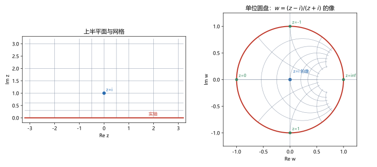
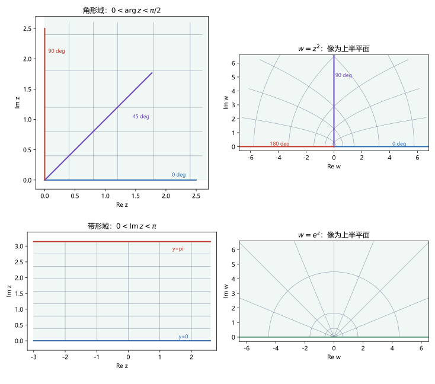

# 第 16 讲 分式线性映射的应用

> **前置**：第 15 讲（保角性、分式线性映射的四步分解、保圆性、保对称性、三对点定映射）、第 04 讲（$e^z$、幂函数与分支）。
> **预计时间**：约 3 小时（含作业；第 5 节的构造流程建议自己先画一遍再对照）。
>
> **一句话定位**：第 15 讲解决“给一个映射，判断它有什么性质”；这一讲反过来，给定两个区域，构造一个把其中一个映成另一个的映射。路线是“先化到标准域，再用四步转运；角形/带形先用初等函数打开”。
>
> **本讲回答什么**：
> 1. 给定两个区域，怎么构造把其中一个映成另一个的映射？
> 2. 为什么标准域选上半平面或单位圆？
> 3. 上半平面到单位圆的标准形式为什么长这样？
> 4. 角形域和带形域为什么要先用幂函数、指数函数“打开”？
> 5. 边界对应为什么能决定内部对应？
>
> **本讲目标（学完你能）**：
> 1. 写出上半平面到单位圆的标准映射，并验证边界与内部；
> 2. 由标准映射解出逆映射，把单位圆映成上半平面；
> 3. 用 $z^{\pi/\theta_0}$ 把顶角为 $\theta_0$ 的角形域打开成上半平面；
> 4. 用 $e^{\pi z/a}$ 把宽度为 $a$ 的带形域打开成上半平面；
> 5. 按“画区域 → 标边界走向 → 选标准域 → 构造 → 校验内点”五步，独立构造一个区域映射；
> 6. 说出儒可夫斯基映射的用途，并算出圆到椭圆的半轴。
>
> **目标达成 = 末尾“掌握度自测”全部打勾。**
>
> **怎么学这一讲**：先画区域和边界走向，不要先写公式。标准域只有两个：上半平面、单位圆。最容易错的三处是：区域映反（没有取内点验证）、角形域的指数用错、边界走向反了。
>
> **这一讲有真实验证**：脚本 `scripts/lec16-01_verify_domain_mapping.py`（标准映射、逆映射、角形/带形开域、内点落区），可复跑。

## 本讲怎么走（脉络图）

```text
给定两个区域
        │
        ▼
画边界、定走向（区域保持在左侧）
        │
        ▼
能直接到标准域？
        ├─ 能：分式线性映射（三对点/标准形式）
        └─ 不能：角形 → z^{π/θ0}；带形 → e^{πz/a}
                    │
                    ▼
标准域之间用分式线性转运
                    │
                    ▼
取一个内点验证（别把区域映反）
                    │
                    ▼
儒可夫斯基映射（认识层）：圆 → 椭圆 → 机翼
```

---
## 本讲要解决什么

第 15 讲解决的是"给一个映射，判断它有什么性质"。这一讲反过来：**给定两个区域，构造一个把其中一个映成另一个的映射**。

这个问题在工程里出现得很具体。比如求一个形状不规则的二维区域的电势分布，直接解拉普拉斯方程很难；如果能用保角映射把区域化成上半平面，问题就变成"上半平面上的拉普拉斯方程"，有标准解法，解完再映回去。机翼绕流、电容器边缘电场，都是这个套路。

手工构造映射，靠的不是灵感，而是一条固定路线：

1. 把两个区域都化到**标准域**——上半平面或单位圆；
2. 在标准域之间用第 15 讲的分式线性映射转运；
3. 遇到角形域、带形域这类"边界不是圆"的区域，先用幂函数或指数函数把它打开成半个平面。

学完之后，你应该能做到：

- 写出上半平面到单位圆的标准映射，并验证边界与内部；
- 由标准映射解出逆映射，把单位圆映成上半平面；
- 用 $z^{\pi/\theta_0}$ 把顶角为 $\theta_0$ 的角形域打开成上半平面；
- 用 $e^{\pi z/a}$ 把宽度为 $a$ 的带形域打开成上半平面；
- 按"画区域 → 标边界走向 → 选标准域 → 构造 → 校验内点"五步，独立构造一个区域映射；
- 说出儒可夫斯基映射的用途，并算出圆到椭圆的半轴。

---

## 1. 先化到标准域：上半平面与单位圆

### 1.1 两个标准域

第 15 讲已经证明：分式线性映射把圆映成圆（直线算过无穷远点的圆），并且由三对点唯一确定。这意味着——**任何边界由圆或直线围成的单连通区域，都能用分式线性映射搬到上半平面或单位圆**。这两个区域就是"标准域"。

为什么要选它们？因为上半平面和单位圆上的问题有现成答案：拉普拉斯方程的解、泊松积分公式、调和函数的边值问题，都是按这两个区域写的。先把区域搬过去，用完标准结果再搬回来。

分式线性映射不是万能的。它保圆，改不了角：一个顶角 $\pi/3$ 的角形域，用分式线性映射映过去，顶角还是 $\pi/3$。遇到角形域、带形域，必须先上幂函数、指数函数（第 4 节）。

### 1.2 为什么只需要盯住边界

一个**单叶**（一一）的解析映射把区域内部映到内部，边界映到边界（第 15 讲的保角性与保圆性保证了这一点）。"单叶"这个条件不能丢：不一一的解析映射会把区域折叠，如 $z^2$ 在整个平面上把 $z$ 与 $-z$ 映到同一点。所以构造映射时，**先把边界对上**，内部对应由"连通性 + 保角性"自动确定。

但"自动确定"不意味着可以不管。边界对上之后，还要取一个内点验证它落在目标区域里——否则可能把内部映到了外部（区域映反）。这一步是第 5 节的重点。

### 1.3 构造流程（先给全貌）

后面几节会把每一步展开。先把流程写出来，读的时候知道自己在哪一步：

| 步骤 | 做什么 | 用到的工具 |
|---|---|---|
| 1 | 画出源区域与目标区域，标出边界 | 无 |
| 2 | 给边界定走向（区域保持在左侧） | 边界对应原理 |
| 3 | 选标准域：能直接到上半平面/单位圆就到，不能就先开角、开带 | 分式线性映射、幂函数、指数函数 |
| 4 | 用三对点或标准形式写出映射 | 第 15 讲第 6 节 |
| 5 | 取一个内点，验证它落在目标区域 | 数值代入 |

本讲剩下的内容，就是把这五步各自讲透，再用例题走几遍。

---

**下一站**：先把区域化到标准域；下一步看最常用的标准映射——上半平面到单位圆。

## 2. 上半平面 → 单位圆

### 2.1 标准形式

设 $z_0$ 在上半平面（$\operatorname{Im}z_0>0$）。把上半平面映成单位圆、且把 $z_0$ 映到 $0$ 的映射是

$$w=e^{i\theta}\frac{z-z_0}{z-\bar z_0},\qquad \operatorname{Im}z_0>0,\quad \theta\in\mathbb R. \tag{16.1}$$

先看 $\theta=0$ 的情形：

$$w=\frac{z-z_0}{z-\bar z_0}. \tag{16.2}$$

### 2.2 为什么是这个形式

要满足两件事：$z_0\mapsto0$，实轴 $\mapsto$ 单位圆。

第一件：分子取 $z-z_0$，在 $z=z_0$ 处为零，所以 $w(z_0)=0$。这是最直接的做法。

第二件：实轴上的点 $z=x$ 满足 $z=\bar z$。于是

$$\lvert x-z_0\rvert=\lvert\overline{x-z_0}\rvert=\lvert x-\bar z_0\rvert .$$

分子分母模相等，所以 $\lvert w\rvert=1$。实轴整条映到单位圆上。

再看内部：$z=z_0$ 时 $w=0$，模小于 $1$；上半平面连通，像也连通，所以整个上半平面映到单位圆内部。三件事合起来，(16.2) 就是标准映射。

### 2.3 旋转因子 $e^{i\theta}$ 管什么

$e^{i\theta}$ 的模是 $1$，乘上它不改变模，只把像整体旋转 $\theta$。它不改变"上半平面 → 单位圆"这个区域对应，只调整边界上点的落位。

什么时候需要它？当题目额外要求"实轴上某点映到单位圆上某点"时。比如要求 $z=\infty$ 映到 $w=1$：由 (16.2)，$z\to\infty$ 时 $w\to1$，已经满足，取 $\theta=0$ 即可。如果要求映到 $w=i$，就要取合适的 $\theta$。

### 2.4 例题

**例 16.1** 求把上半平面映成单位圆、且把 $z_0=i$ 映到 $0$ 的映射；写出实轴上 $0,1,-1,\infty$ 四点的像。

**解**：$z_0=i$，$\bar z_0=-i$，代入 (16.2)：

$$w=\frac{z-i}{z+i}.$$

逐点算：

- $z=0$：$w=\dfrac{-i}{i}=-1$；
- $z=1$：$w=\dfrac{1-i}{1+i}=\dfrac{(1-i)^2}{2}=\dfrac{-2i}{2}=-i$；
- $z=-1$：$w=\dfrac{-1-i}{-1+i}$。分子分母同乘 $-1-i$：分子 $(-1-i)^2=2i$，分母 $(-1+i)(-1-i)=2$，所以 $w=i$；
- $z=\infty$：分子分母同阶，极限为 $1$。

四点 $-1,-i,i,1$ 都在单位圆上，且按实轴从左到右的顺序绕圆一周。

**数值核对**（脚本 `scripts/lec16-01_verify_domain_mapping.py`，EXP1）：实轴取 $2\times10^5$ 个点，$\bigl\lvert\lvert w\rvert-1\bigr\rvert$ 的最大值为 $4.4\times10^{-16}$；$z=i$ 的像为 $0$；上半平面四个采样点的 $\lvert w\rvert$ 最大为 $0.980216$，都在单位圆内。

### 2.5 网格变形

图 1 画的是 (16.2) 对网格的作用。左图是上半平面的水平线与竖直线，右图是它们的像。



右图有两类曲线，值得对上号：

- **水平线** $y=c$ 的像，是与单位圆在 $w=1$ 处内切的圆。$c$ 越小（越靠近实轴），圆越大；$c\to0$ 时退化成单位圆本身。
- **竖直线** $x=c$ 的像，是与单位圆正交的圆（$c\ne0$）；$x=0$（虚轴）的像是实轴上的线段 $(-1,1)$。

数值上（EXP2）：$y=0.5,1,2$ 的像分别是圆心 $1/3,1/2,2/3$、半径 $2/3,1/2,1/3$ 的圆，三点定圆后全点检验偏差约 $3\times10^{-16}$；$x=0.5$ 的像圆心 $1-2i$、半径 $2$，与单位圆正交（圆心距 $\sqrt5$，满足 $\sqrt5^2-2^2=1$）。

这两类曲线不是巧合，而是保角性的直接结果：水平线与竖直线原本正交，像曲线也必须正交；水平线在无穷远两端都趋向同一点，所以像圆在 $w=1$ 处内切。

---

**下一站**：上半平面到单位圆会写了；下一步解逆映射，把单位圆搬回上半平面。

## 3. 单位圆 → 上半平面（逆映射）

### 3.1 把映射解出来

实际做题时，经常需要反方向：把单位圆映成上半平面。不需要重新构造，把 (16.1) 解出 $z$ 即可。

从 $w=\dfrac{z-z_0}{z-\bar z_0}$ 出发：

$$w(z-\bar z_0)=z-z_0\ \Longrightarrow\ wz-w\bar z_0=z-z_0\ \Longrightarrow\ z(w-1)=w\bar z_0-z_0 .$$

所以

$$z=\frac{w\bar z_0-z_0}{w-1}. \tag{16.3}$$

这仍是分式线性映射（分子分母都是一次式，行列式非零）。取 $z_0=i$：

$$z=\frac{-iw-i}{w-1}=\frac{-i(w+1)}{w-1}=\frac{i(1+w)}{1-w}. \tag{16.4}$$

### 3.2 例题

**例 16.2** 验证 $z=\dfrac{i(1+w)}{1-w}$ 把单位圆映成上半平面，且把 $w=0$ 映到 $z=i$。

**解**：先看边界。单位圆上 $\lvert w\rvert=1$，取 $w=e^{i\varphi}$：

$$z=i\frac{1+e^{i\varphi}}{1-e^{i\varphi}} .$$

把分子分母同乘 $e^{-i\varphi/2}$：

$$1+e^{i\varphi}=2e^{i\varphi/2}\cos\frac{\varphi}{2},\qquad
1-e^{i\varphi}=-2ie^{i\varphi/2}\sin\frac{\varphi}{2} .$$

相除：

$$\frac{1+e^{i\varphi}}{1-e^{i\varphi}}=\frac{2\cos(\varphi/2)}{-2i\sin(\varphi/2)}=i\cot\frac{\varphi}{2} .$$

再乘外面的 $i$：

$$z=i\cdot i\cot\frac{\varphi}{2}=-\cot\frac{\varphi}{2},$$

是实数。所以单位圆映到实轴。

再看内部：$w=0$ 时 $z=i$，在上半平面；单位圆内部连通，所以整个内部映到上半平面。

**数值核对**（EXP1 的逆）：$w=0\mapsto i$，$w=1$ 时分母为零、$z=\infty$，$w=-1\mapsto0$，与 (16.4) 一致。

### 3.3 易错

- 把逆映射写成 $\dfrac{z-\bar z_0}{z-z_0}$（直接取倒数）。倒数不等于逆映射，要老老实实解方程。
- 忘记 $z_0$ 必须在上半平面。取在下半平面时，(16.1) 把上半平面映到单位圆的**外部**。
- 认为 $\theta$ 可以随便取。$\theta$ 只调边界落位，不影响区域对应；但一旦题目指定了某点的像，$\theta$ 就被定死了。

---

**下一站**：分式线性映射保圆，改不了角；下一步用幂函数、指数函数打开角形域和带形域。

## 4. 角形域与带形域：先用初等函数开域

分式线性映射只保圆，边界是直线（过无穷远的圆）的区域它也能处理；但**角形域的顶角**它改不了——分式线性映射保角，顶角是多少，映过去还是多少。要把顶角 $\theta_0$ 变成 $\pi$（半个平面），必须用幂函数。

### 4.1 角形域：$z^{\pi/\theta_0}$

设区域是

$$D=\{z:0<\arg z<\theta_0\},\qquad 0<\theta_0<2\pi .$$

取 $\alpha=\pi/\theta_0$，作映射

$$w=z^{\alpha}=z^{\pi/\theta_0}. \tag{16.5}$$

看它把角变成什么。设 $z=re^{i\theta}$，$0<\theta<\theta_0$，取 $\arg z=\theta$ 的那一支：

$$w=r^{\pi/\theta_0}e^{i\pi\theta/\theta_0} .$$

新辐角是 $\pi\theta/\theta_0$。当 $\theta$ 从 $0$ 走到 $\theta_0$，新辐角从 $0$ 走到 $\pi$。所以角形域被打开成上半平面。

两个边界射线：$\theta=0$ 映到正实轴，$\theta=\theta_0$ 映到负实轴。

**分支问题**：$z^{\pi/\theta_0}$ 一般多值（第 04 讲）。在角形域内取定 $\arg z\in(0,\theta_0)$ 的那一支，映射就是单值的。如果角形域不是从正实轴开始（比如 $-\pi/4<\arg z<\pi/4$），先旋转到标准位置，再开角，最后转回来。

### 4.2 例题

**例 16.3** 说明 $w=z^2$ 把第一象限映成上半平面，并写出边界射线的像。

**解**：第一象限是 $0<\arg z<\pi/2$，$\theta_0=\pi/2$，$\alpha=\pi/(\pi/2)=2$。所以 $w=z^2$。

设 $z=re^{i\theta}$，$0<\theta<\pi/2$，则 $w=r^2e^{2i\theta}$，新辐角 $2\theta\in(0,\pi)$，是上半平面。

边界：$\theta=0$（正实轴）映到正实轴；$\theta=\pi/2$（正虚轴）映到负实轴。

**数值核对**（EXP3）：射线 $0^\circ,30^\circ,45^\circ,60^\circ,90^\circ$ 的像，辐角分别为 $0^\circ,60^\circ,90^\circ,120^\circ,180^\circ$；内点 $z=0.5+i$ 的像为 $-0.75+i$，虚部为 $1>0$。

### 4.3 带形域：$e^{\pi z/a}$

设区域是宽度为 $a$ 的水平带形：

$$D=\{z:0<\operatorname{Im}z<a\}.$$

作映射

$$w=e^{\pi z/a}. \tag{16.6}$$

设 $z=x+iy$，$0<y<a$：

$$w=e^{\pi x/a}e^{i\pi y/a} .$$

模是 $e^{\pi x/a}>0$，辐角是 $\pi y/a\in(0,\pi)$。所以带形域映成上半平面。两个边界：$y=0$ 映到正实轴，$y=a$ 映到负实轴。

注意这里必须有因子 $\pi/a$。少了它，辐角只跑到 $\pi y$，$y=a$ 时是 $\pi a$，不是 $\pi$，区域就对不上。因子 $\pi/a$ 的作用是把带的宽度"拉伸"成 $\pi$。

### 4.4 例题

**例 16.4** 说明 $w=e^z$ 把带形 $0<\operatorname{Im}z<\pi$ 映成上半平面，并写出边界线的像。

**解**：这里 $a=\pi$，$\pi/a=1$，所以就是 $w=e^z$。

设 $z=x+iy$，$0<y<\pi$，则 $w=e^xe^{iy}$，辐角 $y\in(0,\pi)$，是上半平面。

边界：$y=0$ 时 $w=e^x>0$，正实轴；$y=\pi$ 时 $w=e^xe^{i\pi}=-e^x<0$，负实轴。

**数值核对**（EXP4）：$y=0,\pi/2,\pi$ 处的像分别是 $2.718282$、$2.718282i$、$-2.718282$；内点 $z=0.3+0.7i$ 的像虚部为 $0.869603>0$。

问题：如果把带形改成 $0<\operatorname{Im}z<2\pi$，$e^z$ 会把两条边界都映到正实轴（$y=0$ 与 $y=2\pi$ 给出同一个 $e^x$），像变成"去掉正实轴的平面"，不再是半平面。这一点在作业第 4 题里会算。

### 4.5 图 2



图 2 有四个面板：上排是角形域 $0<\arg z<\pi/2$ 与它经 $z^2$ 的像；下排是带形 $0<\operatorname{Im}z<\pi$ 与它经 $e^z$ 的像。浅绿色是区域，边界射线用蓝、紫、红标出，方便对照"哪条边映到哪条边"。

### 4.6 易错

- 幂函数的指数写成 $\theta_0/\pi$。正确的是 $\pi/\theta_0$，它把 $\theta_0$ 拉成 $\pi$。
- 带形域漏掉因子 $\pi/a$。宽度不是 $\pi$ 时必须补。
- 角形域跨过负实轴时，分支取错，像会落到下半平面。
- 只验证两条边界射线，不验证内点。

---

**下一站**：角形、带形打开后，还要按边界对应把内部对上；下一步给出边界对应原理和五步流程。

## 5. 边界对应原理与构造流程

### 5.1 边界对应原理

**定理 16.1（边界对应原理）** 设 $f$ 在区域 $D$ 内解析且单叶，把 $D$ 的边界一一地映成目标区域 $G$ 的边界，并且保持走向（沿边界前进时，区域保持在左侧）。则 $f$ 把 $D$ 映成 $G$。

这里的"边界"允许是直线，按"过无穷远点的闭曲线"理解。

为什么？$f$ 是连续双射，把 $D$ 的内部映到目标区域边界的某一侧；保角性保证正性（区域在边界左侧这一性质不被翻转）。所以只要在边界上确认走向一致，内部就不会跑到外面去。

实际做题时，不必严格叙述定理，取一个内点算一下更快。但**知道定理在背后**，才能解释"为什么取一个点就够"。

### 5.2 例 16.5：上半单位圆域

**例 16.5** 求把上半单位圆域

$$D=\{z:\lvert z\rvert<1,\ \operatorname{Im}z>0\}$$

映成上半平面的映射。

**解**：这个区域的边界由两段组成：直径 $(-1,1)$ 和上半圆弧 $\lvert z\rvert=1$。先想办法把单位圆变成直线。

第 15 讲例 15.5 处理过单位圆到虚轴的映射；这里换一个同类映射，它把单位圆内部送到右半平面：

$$w_1=\frac{1+z}{1-z}.$$

它把单位圆映成虚轴（因为 $\lvert z\rvert=1$ 时 $\bar w_1=-w_1$，与例 15.5 同理），把 $z=1$ 送到 $\infty$，$z=-1$ 送到 $0$，$z=0$ 送到 $1$。单位圆内部映成右半平面（$z=0\mapsto1$）。

现在看两段边界：

- 直径：$z=t$，$-1<t<1$。$w_1=\dfrac{1+t}{1-t}>0$，是正实轴。
- 上半圆弧：$z=e^{i\theta}$，$0<\theta<\pi$。由例 16.2 同样的计算，

$$w_1=\frac{1+e^{i\theta}}{1-e^{i\theta}}=i\cot\frac{\theta}{2},$$

是正虚轴（$\cot(\theta/2)>0$）。

所以上半单位圆域被映成**第一象限**：边界是正实轴加正虚轴。取内点 $z=0.5i$ 验证：$w_1=0.6+0.8i$，确实在第一象限。

再把第一象限打开成上半平面：用 $w=w_1^2$（例 16.3）。合起来：

$$w=\left(\frac{1+z}{1-z}\right)^2 . \tag{16.7}$$

检验内点：$z=0.5i$ 时 $w_1=0.6+0.8i$，$w=w_1^2=-0.28+0.96i$，虚部为正，在上半平面。

**数值核对**（EXP5）：直径上 $z=0,0.9$ 的像 $w_1=1,19$，平方后 $1,361$，都在正实轴；圆弧上 $z=i,e^{i\pi/4}$ 的像 $w_1=i,2.414i$，平方后 $-1,-5.828$，都在负实轴；内点 $z=0.5i$ 的像 $-0.28+0.96i$，虚部为正。

### 5.3 例 16.6：角形域到单位圆

**例 16.6** 求把角形域 $0<\arg z<\pi/4$ 映成单位圆的映射。

**解**：分两步。

第一步，开角：顶角 $\pi/4$，用 $z^{\pi/(\pi/4)}=z^4$，把角形域打开成上半平面，记 $\zeta=z^4$。

第二步，上半平面到单位圆：用 (16.2)，取 $z_0=i$：

$$w=\frac{\zeta-i}{\zeta+i}=\frac{z^4-i}{z^4+i} . \tag{16.8}$$

检验边界：$\arg z=0$ 时 $z^4>0$ 为正实数，$w$ 的分子分母是共轭复数，$\lvert w\rvert=1$；$\arg z=\pi/4$ 时 $z^4<0$ 为负实数，同样 $\lvert w\rvert=1$。

检验内点：取 $z=0.5e^{i\pi/8}$，则 $z^4=0.0625e^{i\pi/2}=0.0625i$，

$$w=\frac{0.0625i-i}{0.0625i+i}=\frac{-0.9375i}{1.0625i}=-\frac{0.9375}{1.0625}\approx-0.882,$$

模小于 $1$，在单位圆内。

这个例子说明：**开角 + 转运可以串起来**。实际题目通常就是两三步的复合，每一步用前面的标准形式。

### 5.4 构造流程的落地

把 1.3 节的五步具体化：

1. **画区域**：把边界画出来，标出角点、极点、无穷远。
2. **定走向**：沿边界走，区域保持在左侧。角形域的两条射线要分清哪条是"起点"。
3. **选标准域**：边界是一个圆或一条直线 → 直接用分式线性映射；是两条相交直线（角形域）→ 先开角；是两条平行直线（带形域）→ 先开带。
4. **构造**：优先用标准形式 (16.1)、(16.5)、(16.6)，再复合。三对点只用在"标准形式不够、需要额外指定点的像"时。还有一点要分清：边界是一个圆或一条直线时，三对点可以直接凑；但角形域、带形域的边界是两条相交直线或两条平行直线，顶角不对，光靠三对点凑不出来，必须先开角、开带。
5. **校验**：取一个内点算像，确认落在目标区域；再取边界上两点，确认落在目标边界。

### 5.5 易错

- 只对边界三个点，不校验内点，结果区域映成了外部。
- 走向看反：沿边界走时区域在右侧，说明方向取反了，映射会把内部映到外部。
- 复合顺序写反。先开角再转运，与先转运再开角，结果一般不同。
- 开角后忘记验证边界的两条射线分别映到正、负实轴（顺序错会导致上下颠倒）。

---

**下一站**：五步流程能构造常见区域；下一步看一个经典应用——儒可夫斯基映射与机翼。

## 6. 儒可夫斯基映射（认识层）

### 6.1 形式与椭圆

$$w=\frac12\left(z+\frac1z\right). \tag{16.9}$$

设 $z=re^{i\theta}$：

$$w=\frac12\left(re^{i\theta}+\frac1re^{-i\theta}\right)
=\frac12\left(r+\frac1r\right)\cos\theta+i\frac12\left(r-\frac1r\right)\sin\theta .$$

这是椭圆的参数方程，半轴为

$$a=\frac12\left(r+\frac1r\right),\qquad b=\frac12\left\lvert r-\frac1r\right\rvert . \tag{16.10}$$

所以以原点为心、半径 $r$ 的圆，被映成半轴 $a,b$ 的椭圆。$r=1$ 时 $b=0$，椭圆退化成线段 $[-1,1]$。

**数值核对**（EXP6）：$r=1.5,2,3$ 时，像的 $\max\operatorname{Re}$ 与 $\max\operatorname{Im}$ 分别为 $(1.083333,0.416667)$、$(1.25,0.75)$、$(1.666667,1.333333)$，与 (16.10) 完全一致。

### 6.2 机翼从哪里来

如果圆心不在原点，而是稍微偏移，并且让圆经过 $z=1$（映射的临界点，$w'(1)=0$），像就不再是椭圆，而是一条带尖后缘的曲线——这就是**翼型**（airfoil）。偏移量控制弯度与厚度，半径控制弦长。这正是儒可夫斯基在 20 世纪初提出这套变换的动机：把"绕圆的流动"（有现成解）通过保角映射搬成"绕机翼的流动"。

本课程只要求知道：形式 (16.9)、圆到椭圆的结论 (16.10)、以及它和保角映射的关系。偏移圆的具体计算不要求。

### 6.3 易错

- 把 (16.9) 当成"把圆映成圆"。只有 $r=1$ 退化成线段，一般不保圆——它不是分式线性映射。
- 忘记 $w'(z)=\frac12(1-1/z^2)$ 在 $z=\pm1$ 为零。临界点正是翼型尖后缘的位置，这一点只作认识。

---

**下一站**：儒可夫斯基是认识层；下一讲进入傅里叶级数，把周期信号拆成频率。

## 7. 本讲小结

| 映射 | 作用 | 条件 / 备注 |
|---|---|---|
| $w=e^{i\theta}\dfrac{z-z_0}{z-\bar z_0}$ | 上半平面 → 单位圆，$z_0\mapsto0$ | $\operatorname{Im}z_0>0$ |
| $z=\dfrac{w\bar z_0-z_0}{w-1}$ | 单位圆 → 上半平面（逆映射） | 由上式解出 |
| $z=i\dfrac{1+w}{1-w}$ | 单位圆 → 上半平面 | $z_0=i$ 的特例 |
| $w=z^{\pi/\theta_0}$ | 顶角 $\theta_0$ 的角形域 → 上半平面 | 取 $\arg z\in(0,\theta_0)$ 的分支 |
| $w=e^{\pi z/a}$ | 宽 $a$ 的水平带形 → 上半平面 | $a$ 是带宽 |
| $w=\dfrac12\left(z+\dfrac1z\right)$ | 圆 → 椭圆；偏移圆 → 翼型 | 认识层；临界点 $z=\pm1$ |

**三句话带走**：

1. 区域映射的路线是"化到标准域再转运"：上半平面与单位圆是两个标准域。
2. 角形域和带形域分式线性映射搞不定，要先用 $z^{\pi/\theta_0}$ 或 $e^{\pi z/a}$ 打开。
3. 边界对上不等于内部对上，必须取一个内点校验，否则可能映到外部。

---

## 8. 掌握度自测

- [ ] 我能写出上半平面到单位圆的标准映射，并说出 $z_0$ 与 $\theta$ 各管什么。
- [ ] 我能用 $\lvert x-z_0\rvert=\lvert x-\bar z_0\rvert$ 证明实轴映成单位圆。
- [ ] 我能由标准映射解出逆映射，并验证单位圆映成实轴。
- [ ] 我能说出为什么角形域必须用幂函数，分式线性映射为什么不够。
- [ ] 我能写出把顶角 $\pi/3$ 的角形域打开成上半平面的映射，并说清分支怎么取。
- [ ] 我能写出把宽 $a$ 的带形域打开成上半平面的映射，并解释因子 $\pi/a$ 的来源。
- [ ] 我能按五步流程构造一个区域映射，并用内点校验。
- [ ] 我能算出儒可夫斯基映射把半径 $r$ 的圆映成什么椭圆。

---

## 作业

### 基础

**1.** 求把上半平面映成单位圆、且把 $z_0=2i$ 映到 $0$ 的映射；写出实轴上 $0,2,\infty$ 的像。

**参考答案：**

由 (16.2)，$z_0=2i$，$\bar z_0=-2i$：

$$w=\frac{z-2i}{z+2i}.$$

$z=0$：$w=\dfrac{-2i}{2i}=-1$。

$z=2$：$w=\dfrac{2-2i}{2+2i}=\dfrac{1-i}{1+i}=\dfrac{(1-i)^2}{2}=-i$。

$z=\infty$：$w\to1$。

三点都在单位圆上。

---

**2.** 求把单位圆映成上半平面、且把圆心 $w=0$ 映到 $z=3i$ 的映射。

**参考答案：**

由 (16.3)，取 $z_0=3i$、$\bar z_0=-3i$：

$$z=\frac{w\bar z_0-z_0}{w-1}=\frac{-3iw-3i}{w-1}=\frac{3i(1+w)}{1-w}.$$

验证：$w=0\mapsto3i$；$w=1$ 分母为零，$z=\infty$；$w=-1\mapsto0$。单位圆上 $w=e^{i\varphi}$ 时 $z=3i\cdot i\cot(\varphi/2)=-3\cot(\varphi/2)\in\mathbb R$，所以单位圆映成实轴，内部映到上半平面。

---

**3.** 说明 $w=z^2$ 把第一象限映到哪里；再把区域 $0<\arg z<\pi/3$ 映到哪里。

**参考答案：**

第一象限 $0<\arg z<\pi/2$：$w=z^2$ 把辐角乘以 $2$，得 $0<\arg w<\pi$，即上半平面。

$0<\arg z<\pi/3$：辐角乘以 $2$ 得 $0<\arg w<2\pi/3$，仍是角形域（顶角 $2\pi/3$），不是半平面。要打开成半平面，应当用 $z^{\pi/(\pi/3)}=z^3$。

---

**4.** 说明 $w=e^z$ 把带形 $0<\operatorname{Im}z<2\pi$ 映到哪里。

**参考答案：**

设 $z=x+iy$，$0<y<2\pi$，则 $w=e^xe^{iy}$，模 $e^x>0$，辐角 $y\in(0,2\pi)$。所以像是"去掉正实轴的复平面"：

$$\mathbb C\setminus[0,\infty).$$

两条边界 $y=0$ 与 $y=2\pi$ 都映到正实轴（$w=e^x$ 与 $w=e^{2\pi i}e^x=e^x$），边界重合，所以是裂开的平面，不是上半平面。要得到上半平面，带宽必须是 $\pi$。

---

### 提高

**5.** 求把上半平面映成右半平面的映射，并验证边界对应。

**参考答案：**

取

$$w=-iz .$$

乘以 $-i$ 是顺时针旋转 $90^\circ$：$z=i\mapsto w=1$，$z=1\mapsto w=-i$，$z=-1\mapsto w=i$。

边界：实轴 $z=x$ 映成 $w=-ix$，是虚轴。内部：$z=i$（上半平面）映成 $w=1$，在右半平面。所以上半平面映成右半平面。

---

**6.** 求把带形 $0<\operatorname{Im}z<a$（$a>0$）映成上半平面的映射。

**参考答案：**

由 (16.6)：

$$w=e^{\pi z/a}.$$

验证：$z=x+iy$，$0<y<a$，则 $w=e^{\pi x/a}e^{i\pi y/a}$，辐角 $\pi y/a\in(0,\pi)$，是上半平面。

边界：$y=0$ 映到正实轴（$w=e^{\pi x/a}>0$）；$y=a$ 映到负实轴（$w=e^{\pi x/a}e^{i\pi}<0$）。

---

**7.** 求把第一象限映成单位圆的映射。

**参考答案：**

先用 $z^2$ 把第一象限打开成上半平面（例 16.3），记 $\zeta=z^2$。再用 (16.2)，取 $z_0=i$：

$$w=\frac{\zeta-i}{\zeta+i}=\frac{z^2-i}{z^2+i}.$$

验证边界：$\arg z=0$ 时 $z^2>0$，$\lvert w\rvert=1$；$\arg z=\pi/2$ 时 $z^2<0$，$\lvert w\rvert=1$。内点 $z=0.5+0.5i$：$z^2=0.5i$，$w=\dfrac{0.5i-i}{0.5i+i}=\dfrac{-0.5i}{1.5i}=-\dfrac13$，模小于 $1$。

---

**8.** 求把上半平面映成单位圆、且把 $z_0=1+i$ 映到 $0$ 的映射；写出 $z=\infty$ 的像。

**参考答案：**

$z_0=1+i$，$\bar z_0=1-i$：

$$w=\frac{z-(1+i)}{z-(1-i)}.$$

$z=\infty$ 时分子分母同阶，$w\to1$。

（若要 $z=\infty$ 映到别的点，乘 $e^{i\theta}$ 调整。）

---

### 综合

**9.** 求把第二象限 $D=\{z:\pi/2<\arg z<\pi\}$ 映成单位圆的映射，并验证边界。

**参考答案：**

先用 $\zeta=z^2$ 把顶角 $\pi/2$ 的角形域打开：第二象限的辐角 $\theta\in(\pi/2,\pi)$，乘 $2$ 后得 $2\theta\in(\pi,2\pi)$，是**下半平面**。

再把下半平面映成单位圆。取 $z_0=-i$（在下半平面），标准形式为

$$w=\frac{\zeta-(-i)}{\zeta-\overline{(-i)}}=\frac{\zeta+i}{\zeta-i}.$$

合起来：

$$w=\frac{z^2+i}{z^2-i}.$$

验证边界：$\arg z=\pi/2$ 时 $z^2<0$ 为负实数，$\lvert w\rvert=1$；$\arg z=\pi$ 时 $z^2>0$ 为正实数，$\lvert w\rvert=1$。内点 $z=-1+i$（辐角 $135^\circ$）：$z^2=-2i$，

$$w=\frac{-2i+i}{-2i-i}=\frac{-i}{-3i}=\frac13,$$

模小于 $1$，在单位圆内。

---

**10.** 证明：对 $z_0$ 在上半平面，映射 $w=\dfrac{z-z_0}{z-\bar z_0}$ 把实轴映成单位圆，把上半平面映成单位圆内部。

**参考答案：**

**实轴映成单位圆。** 设 $z=x\in\mathbb R$。因为 $x=\bar x$，

$$\overline{x-z_0}=\bar x-\bar z_0=x-\bar z_0 .$$

所以

$$\lvert w\rvert=\frac{\lvert x-z_0\rvert}{\lvert x-\bar z_0\rvert}=1 .$$

**内部映到内部。** 取 $z=z_0$，$w=0$，$\lvert w\rvert=0<1$。上半平面是连通的，$w$ 在 $\operatorname{Im}z>0$ 内解析、分母不为零（$z\ne\bar z_0$），像是连通的，且不与单位圆相交（否则那一点的 $z$ 在实轴上）。所以整个上半平面的像落在单位圆内部。

**单叶性。** 由 (16.3) 可解出 $z$，说明 $w$ 是双射，内部不会"折叠"。

---

**11.** 对儒可夫斯基映射 $w=\dfrac12\left(z+\dfrac1z\right)$，求 $\lvert z\rvert=2$ 的像椭圆的半轴；并说明为什么机翼用"偏移圆"而不是以原点为心的圆。

**参考答案：**

设 $z=2e^{i\theta}$：

$$w=\frac12\left(2e^{i\theta}+\frac12e^{-i\theta}\right)
=\frac54\cos\theta+i\frac34\sin\theta .$$

所以半轴

$$a=\frac54=1.25,\qquad b=\frac34=0.75 .$$

（与 EXP6 的数值 $1.250000$、$0.750000$ 一致。）

以原点为心的圆，像总是椭圆，前后对称，不能表示机翼。要让像出现尖后缘，必须让圆经过临界点 $z=1$（那里 $w'(z)=\frac12(1-1/z^2)=0$，保角性失效，像出现尖点）；再把圆心偏移，就得到不对称的翼型。偏移量与半径分别控制弯度、厚度与弦长。

---

## 下一讲预告

模块 D 到此结束。下一讲进入积分变换：第 17 讲《傅里叶级数与频谱》。

复变部分处理的是"函数在复平面上的性质"；傅里叶级数处理的是"一个周期信号由哪些频率组成"。两者看起来远，其实共用一套语言：第 17 讲会看到，傅里叶系数可以用复指数写成 $c_n=\frac1T\int_0^T f(t)e^{-in\omega t}dt$，积分核 $e^{-in\omega t}$ 正是单位圆上的点。第 15 讲的保角映射在这里不再出场，但"把函数拆成一组标准构件"的思路会一直用到第 20 讲。
