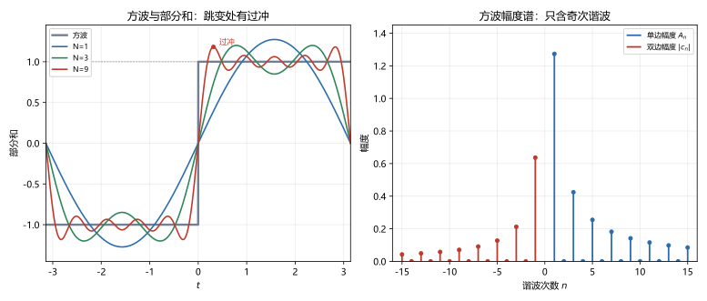

# 第 17 讲 傅里叶级数与频谱

> **前置**：第 09 讲（级数的收敛与部分和）、高数的定积分与分部积分。第 04 讲的 $e^{i\theta}$ 在第 4 节会用到。
> **预计时间**：约 4 小时（含作业；第 1、2 节的推导建议自己动手算一遍）。
>
> **一句话定位**：第 09 讲给了级数；这一讲把周期信号拆成不同频率的正弦/复指数，回答“每个频率成分有多强、相位多少”，并把它画成频谱。
>
> **本讲回答什么**：
> 1. 为什么“乘一个三角函数再积分”就能把某个频率的系数单独挑出来？
> 2. 系数公式里的 $2/T$ 从哪来？常数项为什么写成 $a_0/2$？
> 3. 什么函数才能展开？跳变点收敛到谁？
> 4. 复指数形式为什么值得换？负频率是什么？
> 5. 单边谱为什么是双边谱的两倍？吉布斯的 $9\%$ 是怎么来的？
>
> **本讲目标（学完你能）**：
> 1. 用正交性把 $a_m$、$b_m$ 单独解出来，并说清 $a_0/2$ 的来历；
> 2. 写出三角形式与复指数形式的傅里叶级数，并在两种形式之间互化；
> 3. 逐条检查狄利克雷条件，说明跳变点为什么收敛到左右极限的平均；
> 4. 由复系数 $c_n$ 画双边谱，再折成单边谱，互算幅度与相位；
> 5. 说清吉布斯现象与帕塞瓦尔定理，并用方波算出功率与一个级数和；
> 6. 用部分和与频谱解释一个具体周期信号，而不是只背系数公式。
>
> **目标达成 = 末尾“掌握度自测”全部打勾。**
>
> **怎么学这一讲**：先抓住“正交 = 不同频率互不干扰”，不要先背系数公式。$a_0/2$ 是直流分量；负频率是复指数配对，不是物理频率；单边谱的 $2$ 倍来自正负频率合并。最容易错的是 $a_0$ 与 $a_0/2$、双边/单边幅度换算、跳变点取值。
>
> **这一讲有真实验证**：脚本 `scripts/lec17-01_verify_fourier_series.py`（方波系数、部分和、频谱、帕塞瓦尔），可复跑。

## 本讲怎么走（脉络图）

```text
方波逼近
        │
        ▼
均方误差最小 ──→ 投影系数
        │
        ▼
正交性：不同频率交叉项为 0
        │
        ▼
系数公式 a_m / b_m（含 a0/2）
        │
        ▼
收敛条件：狄利克雷 + 跳变点取平均
        │
        ▼
复指数形式 c_n ──→ 双边谱（含负频率）
        │
        ▼
单边谱 / 幅度谱 / 相位谱
        │
        ▼
吉布斯现象 + 帕塞瓦尔（功率）
```

---
## 本讲要解决什么

先不急着给公式，先解决一个具体问题。

设 $f(t)$ 是以 $2\pi$ 为周期的方波：

$$f(t)=\begin{cases}1,&0<t<\pi,\\-1,&\pi<t<2\pi.\end{cases}$$

我想用一条正弦 $A\sin t$ 去逼近它。$A$ 取多少"最好"？

"最好"需要一个标准。取**均方误差**：

$$E(A)=\int_0^{2\pi}\left[f(t)-A\sin t\right]^2dt . \tag{17.1}$$

把平方展开：

$$E(A)=\int_0^{2\pi}f^2\,dt-2A\int_0^{2\pi}f(t)\sin t\,dt+A^2\int_0^{2\pi}\sin^2t\,dt .$$

$E$ 是 $A$ 的二次函数，开口向上。对 $A$ 求导并令其为零：

$$E'(A)=-2\int_0^{2\pi}f(t)\sin t\,dt+2A\int_0^{2\pi}\sin^2t\,dt=0 .$$

所以

$$A=\frac{\int_0^{2\pi}f(t)\sin t\,dt}{\int_0^{2\pi}\sin^2t\,dt}. \tag{17.2}$$

对本题的方波，$\int_0^{2\pi}f\sin t\,dt=\int_0^{2\pi}\lvert\sin t\rvert dt=4$，$\int_0^{2\pi}\sin^2t\,dt=\pi$，所以

$$A=\frac4\pi\approx1.27324 .$$

这个数就是后面方波级数的第一个系数。注意它是**算出来的**，不是猜的：分母是基函数自己的平方积分，分子是信号与基函数的乘积积分。

再加一条三次谐波：用 $A_1\sin t+A_3\sin3t$ 逼近，同样让均方误差最小。对 $A_1$ 求偏导时，会多出一项

$$-2A_3\int_0^{2\pi}\sin t\sin3t\,dt .$$

这个积分为零（下一节会算）。于是 $A_1$ 的方程与只有一条正弦时完全一样，$A_3$ 也独立。**不同频率之间互不干扰**——这就是"正交"的实际含义，也是整个傅里叶级数能成立的原因。

所以这一讲的顺序是：

1. 把上面的"交叉项为零"一般化，得到三角函数系的正交性；
2. 用它把每个系数单独解出来；
3. 说清这个级数什么时候真的收敛到 $f$；
4. 换成复指数形式，得到双边谱；
5. 从双边谱折出单边谱，画幅度谱与相位谱；
6. 讨论跳变处的吉布斯现象，并用帕塞瓦尔算功率。

学完之后，你应该能做到：

- 不背公式，能从"均方误差最小"重新推出系数公式；
- 手算方波、锯齿波、三角波的系数，并解释为什么只有某些谐波；
- 判断一个函数能否展开，算出跳变点的级数值；
- 说出复指数形式相对三角形式的两个实际好处；
- 在三角系数与复系数之间双向换算，画出单边幅度谱与相位谱；
- 解释吉布斯过冲为什么加项也不消失，并用帕塞瓦尔算功率。

---

## 1. 从"用正弦逼近"到正交性

### 1.1 均方误差与投影

开头那个 $E(A)$ 是"误差平方在一个周期上的积分"。除以周期，就是**均方误差**（mean square error）：

$$\text{MSE}=\frac1T\int_0^T\left[f(t)-s(t)\right]^2dt .$$

用均方误差而不是最大误差，有两个实际原因：它对系数是二次函数，求导方便；它对应能量，物理上可解释（误差的平均功率）。

把函数看成向量，定义**内积**（inner product）：

$$(g,h)=\int_0^Tg(t)h(t)\,dt . \tag{17.3}$$

那么 $\lvert\lvert g\rvert\rvert^2=(g,g)$ 就是"能量"。均方误差最小，等价于让误差向量与基函数正交——这是欧几里得空间里"投影"的同一件事。

### 1.2 一条基函数：投影系数

设用一个基函数 $g$ 去逼近 $f$：$s=Ag$。最小化 $\lvert\lvert f-Ag\rvert\rvert^2$：

$$\frac{d}{dA}\left[(f-Ag,f-Ag)\right]=-2(f,g)+2A(g,g)=0
\Longrightarrow\ A=\frac{(f,g)}{(g,g)} . \tag{17.4}$$

这就是**投影系数**。开头 (17.2) 就是它的特例：$g=\sin t$，$(f,g)=4$，$(g,g)=\pi$。

把 $A$ 代回误差：

$$\lvert\lvert f-Ag\rvert\rvert^2=\lvert\lvert f\rvert\rvert^2-\frac{(f,g)^2}{(g,g)} .$$

误差只剩下"没被 $g$ 解释掉"的那部分。如果 $(f,g)=0$，投影系数为零，$g$ 对逼近毫无帮助——这就是"正交"的意思。

### 1.3 两条基函数：交叉项为零

设 $s=A_1g_1+A_3g_3$，其中 $g_1=\sin t$，$g_3=\sin3t$。展开误差：

$$\lvert\lvert f-s\rvert\rvert^2=\lvert\lvert f\rvert\rvert^2-2A_1(f,g_1)-2A_3(f,g_3)+A_1^2(g_1,g_1)+A_3^2(g_3,g_3)+2A_1A_3(g_1,g_3) .$$

最后一项是交叉项。对 $A_1$ 求偏导：

$$-2(f,g_1)+2A_1(g_1,g_1)+2A_3(g_1,g_3)=0 .$$

如果 $(g_1,g_3)=0$，$A_1$ 就只由 $f$ 与 $g_1$ 决定，与 $A_3$ 无关。算一下：

$$(g_1,g_3)=\int_0^{2\pi}\sin t\sin3t\,dt
=\frac12\int_0^{2\pi}\left[\cos(2t)-\cos(4t)\right]dt=0 .$$

（用了积化和差 $\sin A\sin B=\frac12[\cos(A-B)-\cos(A+B)]$；$\cos2t$、$\cos4t$ 在一个整周期上积分都为零。）

这就是"不同频率互不干扰"的算术来源。把这个性质推广到整个三角函数系，就是下一小节。

### 1.4 三角函数系与正交性

**三角函数系**指

$$1,\ \cos\omega t,\ \sin\omega t,\ \cos2\omega t,\ \sin2\omega t,\ \dots \tag{17.5}$$

其中 $\omega=2\pi/T$ 叫**基频**（fundamental angular frequency）。$n\omega$ 叫第 $n$ 次**谐波**（harmonic）的角频率；$n=1$ 那一条叫**基波**（fundamental）。这两个词后面会反复用。

**正交**的定义：$(g,h)=0$，即在一个周期上乘积的积分为零。

下面五条全部由积分算出，不引用任何"显然"：

**（1）常数与三角函数**

$$\int_0^T\cos n\omega t\,dt=\frac{\sin n\omega T}{n\omega}=\frac{\sin2n\pi}{n\omega}=0\qquad(n\ge1),$$

$$\int_0^T\sin n\omega t\,dt=\frac{1-\cos2n\pi}{n\omega}=0 .$$

**（2）余弦乘余弦**。用 $\cos A\cos B=\frac12[\cos(A-B)+\cos(A+B)]$：

$$\int_0^T\cos n\omega t\cos m\omega t\,dt
=\frac12\int_0^T\cos(n-m)\omega t\,dt+\frac12\int_0^T\cos(n+m)\omega t\,dt .$$

若 $n\ne m$，两个积分都是"整周期上的余弦"，各为零。若 $n=m$，第一项是 $\int_0^T1\,dt=T$，第二项 $\cos2n\omega t$ 积分为零，结果是 $T/2$。合并：

$$\int_0^T\cos n\omega t\cos m\omega t\,dt=\frac T2\delta_{nm}, \tag{17.6}$$

其中 $\delta_{nm}$ 当 $n=m$ 时为 $1$、否则为 $0$（克罗内克符号）。

**（3）正弦乘正弦**。用 $\sin A\sin B=\frac12[\cos(A-B)-\cos(A+B)]$，同理：

$$\int_0^T\sin n\omega t\sin m\omega t\,dt=\frac T2\delta_{nm} . \tag{17.7}$$

**（4）正弦乘余弦**。用 $\sin A\cos B=\frac12[\sin(A+B)+\sin(A-B)]$：

$$\int_0^T\sin n\omega t\cos m\omega t\,dt
=\frac12\int_0^T\sin(n+m)\omega t\,dt+\frac12\int_0^T\sin(n-m)\omega t\,dt=0 . \tag{17.8}$$

$n=m$ 时第二项是 $\sin0=0$，第一项仍为零；所以对一切 $n,m$ 都成立。

**（5）常数乘常数**：$\int_0^T1\cdot1\,dt=T$。

五条合起来：**不同基函数正交，同一个基函数的平方积分为 $T$（常数）或 $T/2$（正弦余弦）**。这就是全部依据。

**数值核对**（脚本 `scripts/lec17-01_verify_fourier_series.py`，EXP1，取 $T=2\pi$）：$n=m=1$ 时 $\int\cos^2=\int\sin^2=\pi=3.141593$；$n=1,m=2$ 与 $n=3,m=5$ 的三类积分都在 $10^{-16}$ 量级，即零。

### 1.5 正交性给了什么

现在回答开头的疑问：为什么乘一个三角函数再积分，就能把某个系数单独挑出来？

因为展开式里其他项与这个基函数正交，乘积积分为零，只剩目标项。下一节把这个动作逐项做一遍。

---

**下一站**：正交性说明不同频率互不干扰；下一步用它把每个系数单独解出来。

## 2. 傅里叶系数公式

### 2.1 展开式与 $a_0/2$ 的来历

设

$$f(t)=\frac{a_0}{2}+\sum_{n=1}^{\infty}\left(a_n\cos n\omega t+b_n\sin n\omega t\right). \tag{17.9}$$

常数项为什么写成 $a_0/2$？用投影看最清楚。常数基函数是 $g=1$，它的投影系数是

$$\frac{(f,1)}{(1,1)}=\frac{\int_0^Tf\,dt}{T}=\frac1T\int_0^Tf\,dt .$$

把这个投影系数记作 $a_0/2$，于是

$$a_0=\frac2T\int_0^Tf(t)\,dt , \tag{17.10}$$

与下面 $a_n$ 的公式同形。换句话说，$a_0/2$ 才是"直流分量"，$a_0$ 只是一个为了方便而放大两倍的记号。第 5 节的单边谱里还会遇到这个两倍关系。

### 2.2 求 $a_m$

在 (17.9) 两边乘 $\cos m\omega t$，再在 $[0,T]$ 上积分。右边逐项算：

- 常数项：$\frac{a_0}{2}\int_0^T\cos m\omega t\,dt=0$（$m\ge1$）；
- 正弦项：$\int_0^T\sin n\omega t\cos m\omega t\,dt=0$，由 (17.8)；
- 余弦项：$\int_0^T\cos n\omega t\cos m\omega t\,dt=\frac T2\delta_{nm}$，由 (17.6)，只有 $n=m$ 那一项留下。

所以

$$\int_0^Tf(t)\cos m\omega t\,dt=a_m\frac T2
\Longrightarrow\ a_m=\frac2T\int_0^Tf(t)\cos m\omega t\,dt . \tag{17.11}$$

把 $m$ 换回 $n$，就是常用的形式。

### 2.3 求 $b_m$

两边乘 $\sin m\omega t$ 再积分。正弦乘正弦由 (17.7) 只留 $n=m$ 项，余弦乘正弦由 (17.8) 全为零，常数项积分为零：

$$b_m=\frac2T\int_0^Tf(t)\sin m\omega t\,dt,\qquad n\ge1 . \tag{17.12}$$

$b_0$ 不定义：$\sin0=0$，写了也是零。

### 2.4 这个推导的逻辑地位

上面的做法是：**先假定展开式成立，逐项积分，解出系数**。这有一个逻辑缺口：逐项积分不是无条件成立的。

补法分两步：

1. 先"猜"：按 (17.10)–(17.12) 算出系数，构造级数；
2. 再"证"：狄利克雷定理（下一节）保证这个级数在连续点收敛到 $f$、在跳变点收敛到左右极限平均。

所以系数公式不是"从恒等式推出来的"，而是"由投影条件定出来的候选，再用收敛定理追认"。这个顺序在傅里叶分析里是标准的，读者不必觉得不严谨；但要知道：**如果函数坏到连狄利克雷条件都不满足，这套系数可能不收敛到它**。

至于逐项积分本身，需要"级数在积分区间上一致收敛"或"$f$ 分段光滑"这类条件。本课程按下述前提使用：$f$ 在一个周期内分段光滑、有界、只有有限个第一类间断点——这正是下一节的狄利克雷条件。

### 2.5 例题：方波

**例 17.1** 设 $f(t)$ 以 $2\pi$ 为周期，在一个周期内

$$f(t)=\begin{cases}1,&0<t<\pi,\\[2pt]-1,&\pi<t<2\pi.\end{cases}$$

求它的傅里叶系数与级数。

**解**：$T=2\pi$，$\omega=1$。

**直流分量**：

$$a_0=\frac1\pi\int_0^{2\pi}f(t)\,dt=\frac1\pi\left(\int_0^\pi1\,dt-\int_\pi^{2\pi}1\,dt\right)=\frac1\pi(\pi-\pi)=0 .$$

**余弦系数**：

$$a_n=\frac1\pi\left(\int_0^\pi\cos nt\,dt-\int_\pi^{2\pi}\cos nt\,dt\right).$$

分别算：

$$\int_0^\pi\cos nt\,dt=\frac{\sin nt}{n}\Big|_0^\pi=\frac{\sin n\pi}{n}=0,$$

$$\int_\pi^{2\pi}\cos nt\,dt=\frac{\sin nt}{n}\Big|_\pi^{2\pi}=\frac{\sin2n\pi-\sin n\pi}{n}=0 .$$

所以 $a_n=0$。这与"$f$ 是奇函数，余弦项为零"一致。

**正弦系数**：

$$b_n=\frac1\pi\left(\int_0^\pi\sin nt\,dt-\int_\pi^{2\pi}\sin nt\,dt\right).$$

$$\int_0^\pi\sin nt\,dt=\frac{1-\cos n\pi}{n}=\frac{1-(-1)^n}{n},$$

$$\int_\pi^{2\pi}\sin nt\,dt=\frac{\cos n\pi-\cos2n\pi}{n}=\frac{(-1)^n-1}{n}.$$

所以

$$b_n=\frac1\pi\left[\frac{1-(-1)^n}{n}-\frac{(-1)^n-1}{n}\right]
=\frac{2}{n\pi}\left[1-(-1)^n\right]
=\begin{cases}\dfrac{4}{n\pi},&n\ \text{奇},\\[6pt]0,&n\ \text{偶}.\end{cases}$$

级数为

$$f(t)=\frac4\pi\left(\sin t+\frac{\sin3t}{3}+\frac{\sin5t}{5}+\cdots\right). \tag{17.13}$$

两条"指纹"：只有奇次谐波；幅度按 $1/n$ 衰减。第 3.4 节会说明这两条分别来自"奇函数"与"有跳变"。

**数值核对**（EXP2）：$b_1=1.273240$、$b_3=0.424413$、$b_5=0.254648$，与 $4/(n\pi)$ 一致；$b_2,b_4$ 在 $10^{-6}$ 量级，即零；$a_n$ 全在 $10^{-5}$ 量级（跳变处采样误差）。

### 2.6 易错

- 把 $a_n$ 的公式写成 $\frac1T\int$。分子上的 $2$ 来自 (17.6) 的 $T/2$，不能丢。
- 把 $a_0$ 当成直流分量。直流分量是 $a_0/2$。
- 看到奇函数就写"余弦项为零"却不检查区间是否关于原点对称。本题 $[0,2\pi]$ 上也成立，是因为方波在平移意义下仍满足奇对称；换一个不对称的区间就要老实算。
- 算 $\int_\pi^{2\pi}\sin nt\,dt$ 时把 $\cos2n\pi$ 写成 $0$。它等于 $1$。

---

**下一站**：系数公式给出了形式；下一步说清这个级数什么时候收敛、跳变点收敛到谁。

## 3. 收敛条件与间断点取值

### 3.1 狄利克雷条件逐条读

**定理 17.1（狄利克雷，Dirichlet conditions）** 设 $f$ 以 $T$ 为周期，在一个周期内满足：

1. **有界**：存在 $M$，$\lvert f(t)\rvert\le M$；
2. **只有有限个第一类间断点**：每个间断点处左右极限都存在（可以不等）；
3. **只有有限个极值点**；
4. **除去间断点外连续**。

则 $f$ 的傅里叶级数处处收敛：在连续点收敛到 $f(t)$，在间断点收敛到 $\dfrac{f(t^+)+f(t^-)}{2}$。

四条各管什么：

- **有界**：保证系数积分有限，$a_n,b_n$ 不会发散。不有界时（如 $1/t$ 在原点附近）系数可能是无穷大。
- **有限个第一类间断**：保证每个跳变点有明确的左右极限，才能谈"平均"。第二类间断（极限不存在，如 $\sin(1/t)$）不在定理范围内。
- **有限个极值**：排除无限振荡。像 $\sin(1/t)$ 在 $0$ 附近无限次上下，级数行为会失控。
- **分段连续**：让每个区间上的积分可以逐段算。

注意定理给的是**逐点收敛**，不是一致收敛。方波在跳变附近就不是一致收敛——这正是第 6 节吉布斯现象的来源。

### 3.2 为什么跳变点取平均

直观解释：第 $N$ 项部分和 $S_N(t)$ 可以写成 $f$ 在 $t$ 附近的一个加权平均（权重由狄利克雷核给出）。权重积分为 $1$，且随 $N$ 增大越来越集中在 $t$ 附近。

- 在连续点，集中到 $t$ 时极限就是 $f(t)$；
- 在跳变点，$t$ 左右两侧的权重各占一半，极限就是左右极限的平均。

严格的核函数推导属于分析课，本课程标为**认识层**：知道"为什么是平均"即可，不需要会证。

### 3.3 例题：方波的跳变点

**例 17.2** 对例 17.1 的方波，求级数在 $t=0$ 与 $t=\pi/2$ 处的值，并用后者导出莱布尼茨级数。

**解**：$t=0$ 是跳变点。左极限 $f(0^-)=-1$，右极限 $f(0^+)=1$，平均为

$$\frac{-1+1}{2}=0 .$$

直接看 (17.13)：每项 $\sin(n\cdot0)=0$，和确实是 $0$，一致。

$t=\pi/2$ 是连续点，$f(\pi/2)=1$。代入 (17.13)：

$$1=\frac4\pi\left(\sin\frac\pi2+\frac13\sin\frac{3\pi}{2}+\frac15\sin\frac{5\pi}{2}+\cdots\right).$$

$\sin(\pi/2)=1$，$\sin(3\pi/2)=-1$，$\sin(5\pi/2)=1$，符号交替：

$$1=\frac4\pi\left(1-\frac13+\frac15-\frac17+\cdots\right)
\Longrightarrow\ 1-\frac13+\frac15-\cdots=\frac\pi4 .$$

这就是莱布尼茨级数。它不是"顺便得到"的，而是方波在 $t=\pi/2$ 处取值的直接结果。

### 3.4 系数衰减速度从哪里来

先给结论：**$f$ 的第 $k$ 阶导数有跳变，系数就按 $1/n^{k+1}$ 衰减。**

推导用一次分部积分。以 $b_n$ 为例：

$$b_n=\frac2T\int_0^Tf(t)\sin(n\omega t)\,dt .$$

取 $u=f$、$dv=\sin(n\omega t)dt$，则 $v=-\dfrac{\cos n\omega t}{n\omega}$：

$$b_n=\frac2T\left\{\left[-\frac{f(t)\cos n\omega t}{n\omega}\right]_0^T
+\frac{1}{n\omega}\int_0^Tf'(t)\cos n\omega t\,dt\right\}. \tag{17.14}$$

看方括号（边界项）。若 $f$ 连续且周期，$f(T)=f(0)$，而 $\cos2n\pi=\cos0=1$，两项抵消，边界项为零；剩下的是 $O(1/n)$ 的积分，再乘 $1/n$，总共 $O(1/n^2)$。

若 $f$ 有跳变，边界项不再抵消。把积分在跳变点处拆成两段，两段的分部积分各出一个边界项；设某跳变高度为 $\Delta$，它贡献 $\Delta/(n\omega)$，乘 $2/T$ 后是 $\Delta/(n\pi)$。所以有跳变时，$b_n$ 的主导项是 $O(1/n)$。

对例 17.1 的方波：两个跳变各高 $2$，各贡献 $2/(n\pi)$，合起来 $4/(n\pi)$，与 (17.13) 完全一致。

三角波：$f$ 连续，所以边界项为零；$f'$ 是分段常数、有跳变，于是 $\int f'\cos$ 是 $O(1/n)$，再乘 $1/n$，得 $b_n=O(1/n^2)$。

这条规则有三层用处：

- 看到系数按 $1/n$ 衰减，就知道信号有跳变；
- 看到按 $1/n^2$ 衰减，就知道信号连续但导数有跳变；
- 想让级数收敛快，就要让信号光滑（或者接受慢收敛）。

### 3.5 端点与周期延拓

在 $[0,T]$ 上定义的函数，傅里叶级数默认按周期 $T$ 向两边延拓。于是 $t=0$ 与 $t=T$ 是同一个点；若 $f(0^+)\ne f(T^-)$，这里也是跳变点，级数收敛到两者的平均。

方波在 $t=0$ 处的跳变，就是"上一周期末尾（$-1$）"与"本周期开头（$+1$）"接不上造成的。

### 3.6 易错

- 在跳变点直接写"级数等于 $f(t)$"。应当是左右极限平均。
- 忘记周期延拓，只检查开区间内部。
- 认为"满足狄利克雷条件"等于"级数一致收敛"。逐点收敛与一致收敛是两件事。
- 用"系数小所以收敛快"却不区分 $1/n$ 与 $1/n^2$。两者的收敛速度差一个数量级。

---

**下一站**：收敛条件解决“能不能展开”；下一步换成复指数形式，得到更紧凑的双边谱。

## 4. 复指数形式与双边谱

### 4.1 为什么要换

三角形式有两个具体的麻烦：

**麻烦一：相位不直接。** $a_n\cos n\omega t+b_n\sin n\omega t$ 要合并成 $A_n\cos(n\omega t+\varphi_n)$，得算

$$A_n=\sqrt{a_n^2+b_n^2},\qquad \varphi_n=\operatorname{atan2}(-b_n,a_n).$$

这里 $\operatorname{atan2}(y,x)$ 是"按象限取角的反正切"：它同时看 $y$ 与 $x$ 的符号，返回 $(-\pi,\pi]$ 内的角。只写 $\arctan(y/x)$ 会丢掉象限，当 $x<0$ 时差 $\pi$。

每个谐波要存两个数，相位还得用反三角函数拼出来。

**麻烦二：运算不封闭。** 求导：

$$\frac{d}{dt}\left[A\cos(n\omega t+\varphi)\right]=-An\omega\sin(n\omega t+\varphi),$$

余弦变成了正弦，表示形式变了；两个谐波相乘要用积化和差，从 $\sin$ 与 $\cos$ 换回和角。每做一次运算都要换一套公式。

复指数把这两个麻烦一起解决：

- 一个复数 $c_n$ 同时存幅度与相位（$\lvert c_n\rvert$ 与 $\arg c_n$）；
- 求导封闭：$\dfrac{d}{dt}e^{in\omega t}=in\omega\,e^{in\omega t}$，还是同一个基函数；
- 相乘封闭：$e^{in\omega t}e^{im\omega t}=e^{i(n+m)\omega t}$，指数相加。

这不是"换个记号"，是把"两套基函数（$\cos$ 与 $\sin$）"换成"一套复基函数"。

### 4.2 推导 $c_n$

把欧拉公式

$$\cos n\omega t=\frac{e^{in\omega t}+e^{-in\omega t}}{2},\qquad
\sin n\omega t=\frac{e^{in\omega t}-e^{-in\omega t}}{2i}$$

代入 (17.9)，逐项归并。

常数项：$\dfrac{a_0}{2}$ 记作 $c_0$。

第 $n$ 项的余弦部分：

$$a_n\cos n\omega t=\frac{a_n}{2}e^{in\omega t}+\frac{a_n}{2}e^{-in\omega t}.$$

第 $n$ 项的正弦部分：

$$b_n\sin n\omega t=\frac{b_n}{2i}e^{in\omega t}-\frac{b_n}{2i}e^{-in\omega t}
=-\frac{ib_n}{2}e^{in\omega t}+\frac{ib_n}{2}e^{-in\omega t}.$$

（用了 $1/i=-i$。）

两式相加，$e^{in\omega t}$ 的系数是

$$\frac{a_n}{2}-\frac{ib_n}{2}=\frac{a_n-ib_n}{2},$$

$e^{-in\omega t}$ 的系数是

$$\frac{a_n}{2}+\frac{ib_n}{2}=\frac{a_n+ib_n}{2}.$$

记

$$c_0=\frac{a_0}{2},\qquad c_n=\frac{a_n-ib_n}{2},\qquad c_{-n}=\frac{a_n+ib_n}{2}\quad(n>0). \tag{17.15}$$

于是

$$f(t)=\sum_{n=-\infty}^{\infty}c_ne^{in\omega t}. \tag{17.16}$$

求和从 $-\infty$ 到 $\infty$：正负两项合起来才是一个实正弦。

### 4.3 直接公式

把 (17.11)、(17.12) 代入 (17.15)：

$$c_n=\frac12\left(\frac2T\int_0^Tf\cos n\omega t\,dt-i\frac2T\int_0^Tf\sin n\omega t\,dt\right)
=\frac1T\int_0^Tf(t)e^{-in\omega t}\,dt . \tag{17.17}$$

最后一步用了 $e^{-in\omega t}=\cos n\omega t-i\sin n\omega t$。

这个公式对**任意整数** $n$ 都成立，包括 $n=0$（给出 $c_0=\frac1T\int f$）和 $n<0$（给出 $c_{-n}$）。所以它比三角形式的三个公式更统一。

**验证 $n<0$**：把 (17.17) 里的 $n$ 换成 $-m$（$m>0$）：

$$c_{-m}=\frac1T\int_0^Tf(t)e^{im\omega t}dt
=\frac1T\int f\cos m\omega t\,dt+i\frac1T\int f\sin m\omega t\,dt
=\frac{a_m}{2}+i\frac{b_m}{2},$$

与 (17.15) 一致。

### 4.4 复指数系的正交性

后面的帕塞瓦尔要用到它，所以单独证。

对整数 $n,m$：

$$\int_0^Te^{in\omega t}e^{-im\omega t}dt=\int_0^Te^{i(n-m)\omega t}dt .$$

若 $n=m$，被积函数是 $1$，积分等于 $T$。

若 $n\ne m$：

$$\int_0^Te^{i(n-m)\omega t}dt
=\frac{e^{i(n-m)\omega T}-1}{i(n-m)\omega}
=\frac{e^{i2\pi(n-m)}-1}{i(n-m)\omega}=0,$$

因为 $n-m$ 是整数，$e^{i2\pi(n-m)}=1$。合并：

$$\int_0^Te^{i(n-m)\omega t}dt=T\delta_{nm} . \tag{17.18}$$

这就是 (17.6)、(17.7) 的复数版：三角函数的正交性可以由它和欧拉公式推出来，反之亦然。

### 4.5 例题：方波的复系数

**例 17.3** 把例 17.1 的方波写成复指数形式。

**解**：$a_n=0$，$b_n=4/(n\pi)$（$n$ 奇）。由 (17.15)：

$$c_n=\frac{0-i\cdot4/(n\pi)}{2}=-\frac{2i}{n\pi},\qquad n\ \text{奇};\qquad c_n=0,\ n\ \text{偶};\qquad c_0=0 .$$

于是

$$f(t)=\sum_{n\ \text{奇}}\left(-\frac{2i}{n\pi}\right)e^{int}. \tag{17.19}$$

$n$ 取负时，$-2i/(n\pi)$ 自动变成 $+2i/(\lvert n\rvert\pi)$，正是共轭，不需要另写公式。

**数值核对**（EXP4）：$c_1=-0.636620i$、$c_3=-0.212207i$、$c_5=-0.127324i$，与 $-2i/(n\pi)$ 一致；偶次在 $10^{-6}$ 量级，即零。

### 4.6 负频率是什么

设 $c_n=\lvert c_n\rvert e^{i\varphi_n}$，由实信号的共轭对称（下面马上证）$c_{-n}=\lvert c_n\rvert e^{-i\varphi_n}$。把两项合起来：

$$c_ne^{in\omega t}+c_{-n}e^{-in\omega t}
=\lvert c_n\rvert\left[e^{i(n\omega t+\varphi_n)}+e^{-i(n\omega t+\varphi_n)}\right]
=2\lvert c_n\rvert\cos(n\omega t+\varphi_n). \tag{17.20}$$

所以负频率那一项不是"另一个物理频率"，而是与正频率配对、合成一个实余弦所必需的。工程上画双边谱，是因为公式对称；只关心物理频率时，看单边谱。

**共轭对称**：设 $f$ 实，对 (17.17) 取共轭：

$$\overline{c_n}=\frac1T\int_0^Tf(t)e^{in\omega t}dt=c_{-n} . \tag{17.21}$$

于是 $\lvert c_{-n}\rvert=\lvert c_n\rvert$（幅度谱偶）、$\arg c_{-n}=-\arg c_n$（相位谱奇）。

### 4.7 易错

- 把 $c_n$ 写成 $a_n-ib_n$（漏除以 $2$）。
- 只对 $n\ge0$ 求和。复指数形式必须从 $-\infty$ 到 $\infty$。
- 认为负频率"没有物理意义所以可以删掉"。删掉之后级数不再是实函数（除非补上共轭项，那就是单边谱的做法）。
- 把 $c_0$ 写成 $a_0$。$c_0=a_0/2$。

---

**下一站**：复指数形式给出双边谱；下一步把它折成单边谱，画幅度和相位。

## 5. 单边谱、幅度谱、相位谱

### 5.1 从双边到单边

双边谱画全部整数 $n$ 的 $c_n$。单边谱只画 $n\ge0$，把负频率的份量并到正频率上。并的公式就是 (17.20)：

$$c_ne^{in\omega t}+c_{-n}e^{-in\omega t}=2\lvert c_n\rvert\cos(n\omega t+\varphi_n),\qquad \varphi_n=\arg c_n .$$

所以单边表示里，第 $n$ 次谐波的幅度是 $2\lvert c_n\rvert$，初相是 $\arg c_n$。定义

$$A_0=a_0=2c_0,\qquad A_n=2\lvert c_n\rvert\quad(n\ge1),\qquad \varphi_n=\arg c_n . \tag{17.22}$$

于是

$$f(t)=\frac{A_0}{2}+\sum_{n=1}^{\infty}A_n\cos(n\omega t+\varphi_n). \tag{17.23}$$

### 5.2 与 $a_n,b_n$ 的换算

由 $c_n=(a_n-ib_n)/2$：

$$\lvert c_n\rvert=\frac12\sqrt{a_n^2+b_n^2}
\Longrightarrow\ A_n=\sqrt{a_n^2+b_n^2} . \tag{17.24}$$

相位：

$$\arg c_n=\arg(a_n-ib_n)=\operatorname{atan2}(-b_n,a_n). \tag{17.25}$$

注意这里必须用 $\operatorname{atan2}$，不能只写 $\arctan(-b_n/a_n)$：后者只给出 $(-\pi/2,\pi/2)$ 内的角，当 $a_n<0$ 时会差 $\pi$。

对例 17.1 的方波：$a_n=0$，$b_n=4/(n\pi)>0$，所以 $\varphi_n=\operatorname{atan2}(-b_n,0)=-\pi/2$，与下一小节的结论一致。

反过来，由 $A_n,\varphi_n$ 求 $a_n,b_n$：

$$a_n=A_n\cos\varphi_n,\qquad b_n=-A_n\sin\varphi_n . \tag{17.26}$$

（因为 $A_n\cos(n\omega t+\varphi_n)=A_n\cos\varphi_n\cos n\omega t-A_n\sin\varphi_n\sin n\omega t$。）

### 5.3 两条谱

- **幅度谱**（amplitude spectrum）：横轴 $n$（或频率 $n\omega$），纵轴 $A_n$；双边谱用 $\lvert c_n\rvert$。
- **相位谱**（phase spectrum）：横轴 $n$，纵轴 $\varphi_n$。

幅度谱说明"每个频率占多大份量"，相位谱说明"每个频率的波峰相对原点偏移多少"。两者合起来才能重建信号。

### 5.4 例题：方波的两条谱

**例 17.4** 写出例 17.1 方波的单边幅度谱与相位谱。

**解**：$a_n=0$，$b_n=4/(n\pi)$（$n$ 奇）。由 (17.24)：

$$A_n=\sqrt{0^2+\left(\frac4{n\pi}\right)^2}=\frac4{n\pi},\qquad n\ \text{奇};\qquad A_n=0,\ n\ \text{偶}.$$

$A_0=0$（直流为零）。

相位由 (17.25)：$a_n=0$、$b_n>0$，所以

$$\varphi_n=\operatorname{atan2}\left(-\frac4{n\pi},0\right)=-\frac\pi2,\qquad n\ \text{奇}.$$

偶次谐波幅度为零，相位无定义（不是零）。

### 5.5 图 1



左图是方波与 $N=1,3,9$ 的部分和。$N$ 越大，逼近越好，但跳变两侧始终有过冲。

右图是幅度谱：蓝线是单边谱 $A_n=4/(n\pi)$，红线是双边谱 $\lvert c_n\rvert=2/(n\pi)$，只画负半轴。同一个谐波在正、负半轴的幅度之比是 $2$，正是 $A_n=2\lvert c_n\rvert$。

### 5.6 易错

- 单边谱忘了乘 $2$，导致功率算出来只有一半（第 6 节帕塞瓦尔会暴露）。
- 在幅度为零的谐波上硬给一个相位。相位在幅度为零处没有意义。
- 把单边谱直接代进复指数逆变换 $\sum c_ne^{in\omega t}$。单边谱对应的是 (17.23) 的余弦和。
- 把"直流分量"写成 $A_0$。直流项是 $A_0/2$。

---

**下一站**：单边、双边谱会画了；下一步看有限项逼近的吉布斯现象，并用帕塞瓦尔算功率。

## 6. 吉布斯现象与帕塞瓦尔

### 6.1 部分和与过冲

方波 (17.13) 的前 $N$ 项部分和是

$$S_N(t)=\frac4\pi\sum_{\substack{n\le N\\ n\ \text{奇}}}\frac{\sin nt}{n}.$$

在跳变点附近，$S_N$ 会冲过 $1$ 再回来。**数值核对**（EXP3，取 $t\in(0,\pi)$ 扫描）：

| $N$ | $1$ | $3$ | $9$ | $25$ | $99$ | $199$ |
|---|---|---|---|---|---|---|
| 最大值 | $1.273240$ | $1.200422$ | $1.182328$ | $1.179473$ | $1.179013$ | $1.178988$ |
| 过冲（减 $1$） | $0.273240$ | $0.200422$ | $0.182328$ | $0.179473$ | $0.179013$ | $0.178988$ |
| 均方根误差 | $0.435282$ | $0.315296$ | $0.201103$ | $0.125015$ | $0.064047$ | $0.045563$ |

最大值趋于 $1.178980$。这个数从哪来？先定义**正弦积分**（sine integral）：

$$\operatorname{Si}(x)=\int_0^x\frac{\sin t}{t}\,dt . \tag{17.27}$$

它没有初等函数形式的原函数，只能查表或数值积分。可以证明（本课程标为认识层）：

$$\max_tS_N(t)\longrightarrow\frac2\pi\operatorname{Si}(\pi)\approx1.178980 . \tag{17.28}$$

所以过冲是 $0.178980$。方波的跳变高度是 $2$，过冲占跳变高度的

$$\frac{0.178980}{2}\approx8.95\% .$$

### 6.2 吉布斯现象说的是什么

**吉布斯现象**（Gibbs phenomenon）三句话：

1. 过冲的**高度**不随 $N$ 减小，趋于跳变高度的 $9\%$；
2. 过冲的**宽度**随 $N$ 变窄，位置向跳变点靠拢；
3. 均方根误差趋于零，所以整体是收敛的——只是在跳变点附近不是一致收敛。

为什么过冲不消失？直观地说，跳变附近的误差来自所有高频项的同相叠加。增加 $N$ 只是把能参与叠加的最高频率提高，让振荡更密、更窄，但峰值由积分 (17.28) 决定，与 $N$ 无关。

工程含义：用有限带宽的系统传输带跳变的信号，跳变处会出现振铃。振铃高度由带宽决定，靠"再多给一点带宽"消不掉，只能靠平滑过渡压下去。

### 6.3 帕塞瓦尔定理

**定理 17.2（帕塞瓦尔，Parseval's theorem）** 若 $f$ 在周期上平方可积，则

$$\frac1T\int_0^T\lvert f(t)\rvert^2dt=\sum_{n=-\infty}^{\infty}\lvert c_n\rvert^2 . \tag{17.29}$$

**证明**：把 $f=\sum c_ne^{in\omega t}$ 代入左边。注意 $\lvert f\rvert^2=f\bar f$，而 $\bar f=\sum_m\overline{c_m}e^{-im\omega t}$：

$$\frac1T\int_0^T\lvert f\rvert^2dt
=\frac1T\int_0^T\left(\sum_nc_ne^{in\omega t}\right)\left(\sum_m\overline{c_m}e^{-im\omega t}\right)dt
=\sum_n\sum_mc_n\overline{c_m}\frac1T\int_0^Te^{i(n-m)\omega t}dt .$$

用复指数正交性 (17.18)：内层积分当 $n=m$ 时为 $1$，否则为 $0$。所以只剩对角项

$$\sum_nc_n\overline{c_n}=\sum_n\lvert c_n\rvert^2 .$$

**三角形式**：把 (17.22) 代进去。$n=0$ 项是 $\lvert c_0\rvert^2=A_0^2/4$；$n\ge1$ 与 $n\le-1$ 成对，各 $\lvert c_n\rvert^2=A_n^2/4$，合起来 $A_n^2/2$：

$$\frac1T\int_0^T\lvert f\rvert^2dt=\frac{A_0^2}{4}+\sum_{n=1}^{\infty}\frac{A_n^2}{2}. \tag{17.30}$$

**物理含义**：左边是信号的平均功率（单位电阻），右边是各频率分量功率之和。**功率按频率可加**，这是频谱分析最重要的一句话。

### 6.4 例题：方波的功率与一个级数

**例 17.5** 用帕塞瓦尔算例 17.1 方波的平均功率，并求 $\sum_{k=0}^{\infty}\dfrac1{(2k+1)^2}$。

**解**：方波 $\lvert f\rvert=1$，所以

$$\frac1T\int_0^{2\pi}\lvert f\rvert^2dt=\frac1{2\pi}\int_0^{2\pi}1\,dt=1 .$$

右边用 (17.30)：$A_0=0$，$A_n=4/(n\pi)$（$n$ 奇），

$$1=\sum_{n\ \text{奇}}\frac12\left(\frac4{n\pi}\right)^2
=\frac{8}{\pi^2}\sum_{n\ \text{奇}}\frac1{n^2} .$$

所以

$$\sum_{n\ \text{奇}}\frac1{n^2}=\sum_{k=0}^{\infty}\frac1{(2k+1)^2}=\frac{\pi^2}{8}\approx1.233701 . \tag{17.31}$$

**数值核对**（EXP6）：时域均方 $0.9999975$；$\sum_{\lvert n\rvert\le20000}\lvert c_n\rvert^2=0.9999797$；单边式 $\sum A_n^2/2=0.9999797$。三者一致，差值来自截断。

### 6.5 易错

- 用单边幅度谱算功率时漏掉 $1/2$（正弦分量的均方是 $A_n^2/2$）。
- 把帕塞瓦尔当成"能量守恒"随口用：它要求平方可积，冲激这类对象要另外处理（第 20 讲）。
- 把吉布斯过冲当成"没收敛"。均方收敛与一致收敛是两回事。
- 把 $\operatorname{Si}(\pi)$ 当成 $\pi$ 或 $1$。它是 $1.8519$ 左右，乘 $2/\pi$ 才是 $1.17898$。

---

**下一站**：吉布斯和帕塞瓦尔收尾；下一讲把周期推广到非周期，进入傅里叶变换。

## 7. 本讲小结

| 概念 | 一句话 | 关键式子 / 条件 |
|---|---|---|
| 内积 | 两个函数在一个周期上乘积的积分 | $(g,h)=\int_0^Tgh\,dt$ |
| 正交 | 内积为零，互相不"混" | $(g,h)=0$ |
| 投影系数 | 均方误差最小时的系数 | $A=(f,g)/(g,g)$ |
| 三角正交性 | 不同谐波积分为零，同频为 $T/2$ | (17.6)–(17.8) |
| 三角系数 | 乘对应基函数再积分 | $a_n=\frac2T\int f\cos n\omega t$，$b_n=\frac2T\int f\sin n\omega t$ |
| 直流分量 | 一个周期的平均值 | $a_0/2=\frac1T\int f$ |
| 狄利克雷条件 | 有界、有限个第一类间断与极值 | 保证逐点收敛 |
| 跳变点 | 收敛到左右极限平均 | $\frac{f(t^+)+f(t^-)}2$ |
| 衰减速度 | 第 $k$ 阶导数有跳变，系数 $\sim1/n^{k+1}$ | 分部积分 |
| 复指数形式 | 一个复数同时存幅度与相位 | $f=\sum c_ne^{in\omega t}$ |
| 复系数 | $\frac1T\int fe^{-in\omega t}$ | 任意整数 $n$ |
| 复正交性 | $\int_0^Te^{i(n-m)\omega t}dt=T\delta_{nm}$ | 帕塞瓦尔的前提 |
| 单边幅度 | 双边幅度的两倍 | $A_n=2\lvert c_n\rvert$ |
| 相位 | 复系数的辐角 | $\varphi_n=\operatorname{atan2}(-b_n,a_n)$ |
| 吉布斯 | 过冲约跳变的 $9\%$，不随项数消失 | 峰值 $2\operatorname{Si}(\pi)/\pi$ |
| 帕塞瓦尔 | 平均功率等于各频率功率之和 | (17.29)、(17.30) |

**三句话带走**：

1. 系数公式不是天上掉的：它是"用基函数投影、让均方误差最小"的解；正交性保证每个系数可以单独求。
2. 级数收敛到 $f$ 的条件是狄利克雷条件；跳变点取左右极限平均；系数衰减速度由跳变（导数的跳变）决定。
3. 复指数形式用一个复数存幅度与相位，双边谱因此对称；单边谱是它的两倍折叠；帕塞瓦尔把功率按频率拆开。

---

## 8. 掌握度自测

- [ ] 我能不看书，从 $E(A)=\int(f-A\sin t)^2$ 解出 $A=4/\pi$。
- [ ] 我能解释"交叉项为零"为什么让两个系数互不影响。
- [ ] 我能逐条算出 (17.6)–(17.8) 的五类积分。
- [ ] 我能说清 $a_0/2$ 的来历，以及它和直流分量的关系。
- [ ] 我能说出狄利克雷四条各管什么，并判断一个具体函数是否满足。
- [ ] 我能用分部积分解释方波 $1/n$、三角波 $1/n^2$ 的来源。
- [ ] 我能说出复指数形式相对三角形式的两个实际好处。
- [ ] 我能证明复指数正交性，并用它推出帕塞瓦尔。
- [ ] 我能把 $a_n,b_n$ 换成 $A_n,\varphi_n$，反过来也换得回去。
- [ ] 我能解释吉布斯的 $9\%$ 为什么加项也不消失。

---

## 作业

### 基础

**1.** 幅值为 $E$、周期为 $T$ 的方波：$f(t)=E$（$0<t<T/2$），$f(t)=-E$（$T/2<t<T$）。求 $a_0,a_n,b_n$。

**参考答案：**

$a_0=0$：正负各半，平均为零。

$a_n=0$：两段余弦积分相减。

$$\int_0^{T/2}\cos n\omega t\,dt=\frac{\sin(n\pi)}{n\omega}=0,\qquad
\int_{T/2}^{T}\cos n\omega t\,dt=\frac{\sin(2n\pi)-\sin(n\pi)}{n\omega}=0 .$$

$b_n$：

$$\int_0^{T/2}\sin n\omega t\,dt=\frac{1-\cos n\pi}{n\omega},\qquad
\int_{T/2}^{T}\sin n\omega t\,dt=\frac{\cos n\pi-1}{n\omega}.$$

所以

$$b_n=\frac{2E}{T}\left[\frac{1-(-1)^n}{n\omega}-\frac{(-1)^n-1}{n\omega}\right]
=\frac{2E}{T}\cdot\frac{2(1-(-1)^n)}{n\omega}
=\frac{4E}{n\pi}\quad(n\ \text{奇}),$$

$b_n=0$（$n$ 偶）。最后一步用了 $\omega=2\pi/T$。

---

**2.** 设 $f(t)=t$（$-\pi<t<\pi$），以 $2\pi$ 为周期。求它的傅里叶系数与级数。

**参考答案：**

$f$ 是奇函数，所以 $a_0=0$、$a_n=0$。

$$b_n=\frac1\pi\int_{-\pi}^{\pi}t\sin nt\,dt=\frac2\pi\int_0^\pi t\sin nt\,dt .$$

分部积分：取 $u=t$、$dv=\sin nt\,dt$，则 $v=-\cos nt/n$：

$$\int_0^\pi t\sin nt\,dt=\left[-\frac{t\cos nt}{n}\right]_0^\pi+\frac1n\int_0^\pi\cos nt\,dt
=-\frac{\pi\cos n\pi}{n}+0=\frac{\pi(-1)^{n+1}}{n}.$$

所以

$$b_n=\frac2\pi\cdot\frac{\pi(-1)^{n+1}}{n}=\frac{2(-1)^{n+1}}{n}.$$

级数：

$$t=2\sum_{n=1}^{\infty}\frac{(-1)^{n+1}}{n}\sin nt,\qquad -\pi<t<\pi .$$

---

**3.** 把第 1 题的方波（幅值 $E$）写成复指数形式，求 $c_n$。

**参考答案：**

$a_n=0$，$b_n=4E/(n\pi)$（$n$ 奇）。由 $c_n=(a_n-ib_n)/2$：

$$c_n=-\frac{2iE}{n\pi}\quad(n\ \text{奇}),\qquad c_n=0\quad(n\ \text{偶}),\qquad c_0=0 .$$

负频系数是共轭 $c_{-n}=+2iE/(n\pi)$。级数：

$$f(t)=\sum_{n\ \text{奇}}\left(-\frac{2iE}{n\pi}\right)e^{in\omega t}.$$

---

**4.** 由第 3 题的 $c_n$ 写出单边幅度 $A_n$ 与相位 $\varphi_n$。

**参考答案：**

$$A_n=2\lvert c_n\rvert=\frac{4E}{n\pi}\quad(n\ \text{奇}),\qquad A_n=0\quad(n\ \text{偶}).$$

$c_n=-2iE/(n\pi)$ 在负虚轴上，辐角为 $-\pi/2$：

$$\varphi_n=-\frac\pi2\quad(n\ \text{奇}).$$

偶次谐波幅度为零，相位无定义。

---

### 提高

**5.** 用方波的帕塞瓦尔恒等式证明

$$\sum_{k=0}^{\infty}\frac1{(2k+1)^2}=\frac{\pi^2}{8}.$$

**参考答案：**

取幅值 $1$ 的方波。时域平均功率：

$$\frac1T\int_0^T\lvert f\rvert^2dt=\frac1{2\pi}\int_0^{2\pi}1\,dt=1 .$$

频域用 (17.30)：$A_0=0$，$A_n=4/(n\pi)$（$n$ 奇），

$$1=\sum_{n\ \text{奇}}\frac12\left(\frac4{n\pi}\right)^2
=\frac{8}{\pi^2}\sum_{n\ \text{奇}}\frac1{n^2}.$$

所以

$$\sum_{n\ \text{奇}}\frac1{n^2}=\frac{\pi^2}{8}.$$

把奇数写成 $2k+1$ 即得。

---

**6.** 设 $f(t)=\lvert\sin t\rvert$，以 $\pi$ 为周期。求它的傅里叶系数，并写出级数。

**参考答案：**

周期 $T=\pi$，$\omega=2$。$f$ 是偶函数，$b_n=0$。

直流：

$$a_0=\frac2\pi\int_0^\pi\sin t\,dt=\frac2\pi\cdot2=\frac4\pi .$$

余弦系数（$n\ge1$）：

$$a_n=\frac2\pi\int_0^\pi\sin t\cos2nt\,dt .$$

积化和差：

$$\sin t\cos2nt=\frac12\left[\sin(2n+1)t+\sin(1-2n)t\right].$$

$$\int_0^\pi\sin(2n+1)t\,dt=\frac{2}{2n+1},\qquad
\int_0^\pi\sin(1-2n)t\,dt=-\frac{2}{2n-1}.$$

所以

$$a_n=\frac2\pi\cdot\frac12\left[\frac{2}{2n+1}-\frac{2}{2n-1}\right]
=\frac2\pi\cdot\frac{-2}{4n^2-1}
=-\frac{4}{\pi(4n^2-1)} .$$

级数：

$$\lvert\sin t\rvert=\frac2\pi-\frac4\pi\sum_{n=1}^{\infty}\frac{\cos2nt}{4n^2-1}.$$

**数值核对**（EXP7）：$n=1,2,3$ 的 $a_n$ 为 $-0.424413$、$-0.084883$、$-0.036378$，与闭式一致。

---

**7.** 证明实信号的复系数满足 $c_{-n}=\overline{c_n}$，并说明幅度谱偶、相位谱奇。

**参考答案：**

$$c_{-n}=\frac1T\int_0^Tf(t)e^{in\omega t}dt
=\overline{\frac1T\int_0^T\overline{f(t)}e^{-in\omega t}dt}
=\overline{\frac1T\int_0^Tf(t)e^{-in\omega t}dt}=\overline{c_n},$$

第三步用了 $f$ 实，$\overline f=f$。

取模：$\lvert c_{-n}\rvert=\lvert\overline{c_n}\rvert=\lvert c_n\rvert$，偶。

取辐角：$\arg c_{-n}=\arg\overline{c_n}=-\arg c_n$（模为零时无定义），奇。

---

**8.** 方波（例 17.1）在 $t=0$ 处的级数和是多少？用收敛定理说明；再用部分和数值验证。

**参考答案：**

$t=0$ 是跳变点（周期延拓后左极限 $-1$、右极限 $+1$）。由定理 17.1，级数收敛到

$$\frac{-1+1}{2}=0 .$$

级数 (17.13) 在 $t=0$ 处每项 $\sin0=0$，和确实为 $0$。数值上 $S_N(0)=0$ 对任意 $N$ 成立。

---

### 综合

**9.** 用帕塞瓦尔算幅值 $1$ 方波的平均功率，并与时域直接积分对照；说明"功率按频率相加"在这里具体是什么。

**参考答案：**

时域：

$$\frac1T\int_0^T\lvert f\rvert^2dt=\frac1{2\pi}\int_0^{2\pi}1\,dt=1 .$$

频域：$c_n=-2i/(n\pi)$（$n$ 奇），

$$\sum_{n=-\infty}^{\infty}\lvert c_n\rvert^2
=2\sum_{n\ \text{奇},n>0}\frac{4}{n^2\pi^2}
=\frac8{\pi^2}\sum_{n\ \text{奇}}\frac1{n^2}
=\frac8{\pi^2}\cdot\frac{\pi^2}{8}=1 .$$

"功率按频率相加"：总平均功率 $1$，等于基波功率 $8/\pi^2\approx0.8106$、三次谐波 $8/(9\pi^2)\approx0.0901$、五次 $8/(25\pi^2)\approx0.0324$……逐项相加。低频占大头，高频按 $1/n^2$ 衰减。

---

**10.** 写一段不超过 20 行的 numpy 程序，计算幅值 $1$ 方波前 $N$ 项部分和在 $(0,\pi)$ 上的最大值，取 $N=9,49,199$，报告过冲，并解释为什么它不随 $N$ 减小。

**参考答案：**

```python
import numpy as np

t = np.linspace(1e-6, np.pi - 1e-6, 200001)
for N in [9, 49, 199]:
    s = sum(4 / (n * np.pi) * np.sin(n * t) for n in range(1, N + 1, 2))
    print(f"N={N}: max={s.max():.6f}, overshoot={s.max()-1:+.6f}")
```

输出约为 $1.182328$、$1.179132$、$1.178988$，过冲从 $0.182$ 降到 $0.179$，趋于 $2\operatorname{Si}(\pi)/\pi-1\approx0.178980$。

原因：过冲来自跳变附近各谐波的同相叠加。$N$ 增大时，新增高频项把过冲区间压窄，但峰值由积分 $\int_0^\pi\sin x/x\,dx$ 决定，与 $N$ 无关。

---

**11.** 设三角波 $f(t)=1-\dfrac{\lvert t\rvert}{\pi}$（$-\pi<t<\pi$），以 $2\pi$ 为周期。求傅里叶系数，写出级数，并用 $t=0$ 验证 $\sum_{n\ \text{奇}}1/n^2=\pi^2/8$。

**参考答案：**

$f$ 是偶函数，$b_n=0$。

直流：

$$a_0=\frac1\pi\int_{-\pi}^{\pi}\left(1-\frac{\lvert t\rvert}{\pi}\right)dt
=\frac1\pi\left(2\pi-\frac{1}{\pi}\cdot\pi^2\right)=1 .$$

余弦系数（$n\ge1$）：

$$a_n=\frac1\pi\int_{-\pi}^{\pi}\left(1-\frac{\lvert t\rvert}{\pi}\right)\cos nt\,dt
=\frac2\pi\int_0^\pi\left(1-\frac t\pi\right)\cos nt\,dt .$$

第一项 $\int_0^\pi\cos nt\,dt=0$。第二项分部积分：

$$\int_0^\pi t\cos nt\,dt=\frac{\cos n\pi-1}{n^2}=\frac{(-1)^n-1}{n^2}.$$

所以

$$a_n=-\frac{2}{\pi^2}\cdot\frac{(-1)^n-1}{n^2}
=\frac{4}{\pi^2n^2}\quad(n\ \text{奇}),\qquad a_n=0\quad(n\ \text{偶}).$$

级数：

$$f(t)=\frac12+\frac4{\pi^2}\sum_{n\ \text{奇}}\frac{\cos nt}{n^2}.$$

在 $t=0$ 处，$f(0)=1$：

$$\frac12+\frac4{\pi^2}\sum_{n\ \text{奇}}\frac1{n^2}=1
\Longrightarrow\ \sum_{n\ \text{奇}}\frac1{n^2}=\frac{\pi^2}{8}.$$

---

## 下一讲预告

这一讲处理周期信号：频谱是离散的竖线。如果信号不是周期的呢？

第 18 讲把周期推向无穷。$T\to\infty$ 时谱线间隔 $2\pi/T\to0$，离散谱线连成连续曲线，求和变成积分，得到傅里叶变换。那一讲会先用一个具体的脉冲串把 $T\to\infty$ 走一遍，再固定 $2\pi$ 的位置，然后算矩形脉冲与单边指数两个基本变换。
