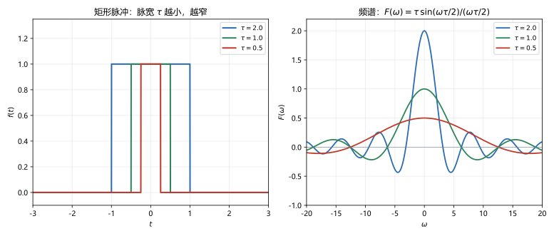

# 第 18 讲 傅里叶变换：定义与基本性质

> **前置**：第 17 讲（傅里叶级数、复指数系数、单边/双边谱）、第 14 讲（含 $e^{iax}$ 的实积分，作业 6 会用到）。
> **预计时间**：约 4 小时（含作业；第 1、2 节的过渡推导建议自己写一遍）。
> **本讲回答**：周期信号的谱线是离散的，非周期信号怎么办？$T\to\infty$ 时那个积分是怎么一步步冒出来的？$2\pi$ 到底从哪来、放哪边？什么函数才有傅里叶变换，为什么常数不行？矩形脉冲的频谱为什么是 sinc？$\operatorname{Si}$、dB、$\delta$ 这些符号第一次出现时是什么？

## 本讲要解决什么

第 17 讲的结论是：周期为 $T$ 的信号可以拆成离散的谐波，频谱是一条一条竖线，间隔 $2\pi/T$。

非周期信号没有周期，这套"离散谱线"的说法就不适用了。但我们可以换一个角度：把非周期信号看成"周期 $T$ 趋于无穷"的信号。$T$ 越大，谱线越密；$T\to\infty$ 时，离散谱线连成一条连续曲线，求和变成积分。

这不是一句口号，可以具体算。下面先拿一个宽 $1$ 的矩形脉冲，周期延拓成 $T=10$ 的脉冲串，把系数算出来；再把 $T$ 改成 $20$、$40$，看谱线怎么变密、系数怎么变。看完这个例子，再抽象成一般推导。

学完之后，你应该能做到：

- 用"脉冲串 + $T$ 变大"的图景解释傅里叶变换是怎么来的；
- 写出正逆变换，说清 $2\pi$ 的位置与来源；
- 判断一个信号是否有普通意义下的傅里叶变换，并说出为什么常数不行；
- 算出矩形脉冲与单边指数的变换，读出零点、主瓣、幅频、相频、$-3\,\mathrm{dB}$ 点；
- 用奇偶性判断变换的虚实与奇偶，并说出为什么能少算一半。

---

## 1. 先算一个具体的脉冲串

### 1.1 构造

取单脉冲

$$f_0(t)=\begin{cases}1,&\lvert t\rvert<\dfrac12,\\[4pt]0,&\lvert t\rvert>\dfrac12,\end{cases} \tag{18.1}$$

宽 $1$、高 $1$、面积 $1$。把它以 $T$ 为周期重复，得到

$$f_T(t)=\sum_{k=-\infty}^{\infty}f_0(t-kT). \tag{18.2}$$

取 $T=10$，则一个周期内只有一个宽 $1$ 的脉冲，其余是零。

### 1.2 算系数

周期信号的复系数是

$$c_n=\frac1T\int_{-T/2}^{T/2}f_T(t)e^{-in\omega_0t}dt,\qquad \omega_0=\frac{2\pi}{T}. \tag{18.3}$$

因为 $f_T$ 在 $[-T/2,T/2]$ 内只在 $\lvert t\rvert<1/2$ 处为 $1$，积分缩到 $(-1/2,1/2)$：

$$c_n=\frac1T\int_{-1/2}^{1/2}e^{-in\omega_0t}dt
=\frac1T\left[\frac{e^{-in\omega_0t}}{-in\omega_0}\right]_{-1/2}^{1/2}
=\frac1T\cdot\frac{2\sin(n\omega_0/2)}{n\omega_0}. \tag{18.4}$$

把与 $T$ 有关的因子单独拿出来。定义

$$F(\omega)=\frac{2\sin(\omega/2)}{\omega} \tag{18.5}$$

（$\omega=0$ 时取极限 $1$）。则 (18.4) 可以写成

$$c_n=\frac{F(n\omega_0)}{T}. \tag{18.6}$$

这个关系不是这一题的特殊巧合：**周期延拓的复系数，等于单脉冲的变换在 $n\omega_0$ 处的值除以 $T$**。第 2 节会一般地证明它。

### 1.3 三组数据

取 $T=10$，$\omega_0=2\pi/10=0.628319$。由 (18.6) 算 $n=1,2,3$：

| $n$ | $\omega_n=n\omega_0$ | $c_n=F(\omega_n)/T$ | $Tc_n=F(\omega_n)$ |
|---|---|---|---|
| $1$ | $0.628319$ | $0.098358$ | $0.983584$ |
| $2$ | $1.256637$ | $0.093545$ | $0.935449$ |
| $3$ | $1.884956$ | $0.085836$ | $0.858364$ |

把 $T$ 改成 $20$ 与 $40$，重复同样的计算：

| $T$ | 谱线间隔 $2\pi/T$ | $Tc_1$ | $F(\omega_1)$ |
|---|---|---|---|
| $10$ | $0.628319$ | $0.983584$ | $0.983632$ |
| $20$ | $0.314159$ | $0.995794$ | $0.995893$ |
| $40$ | $0.157080$ | $0.998773$ | $0.998972$ |

三件事同时发生：

- **$c_n$ 变小**，大约按 $1/T$ 衰减：$T$ 加倍，$c_n$ 减半；
- **$Tc_n$ 稳定下来**，趋于 $F(\omega_n)$：$T=40$ 时已经到 $0.9988$，与 $F$ 的差是 $2\times10^{-4}$（梯形积分误差）；
- **谱线变密**：间隔 $0.628\to0.314\to0.157$，逐次减半。

所以，如果把 $Tc_n$ 画在横轴 $\omega_n$ 上，画出来的就是 $F(\omega)$ 在越来越密的网格上的采样。$T\to\infty$ 时，采样变连续，离散的竖线变成一条曲线。

### 1.4 从数据里读出的结论

$T\to\infty$ 时：

- 单个周期内的信号不再重复，$f_T\to f$（单脉冲）；
- 谱线间隔 $\Delta\omega=2\pi/T\to0$；
- $c_n=F(\omega_n)/T\to0$，但 $Tc_n$ 稳定到 $F(\omega_n)$。

所以"非周期信号的频谱"不能用 $c_n$ 描述（它趋于零），要用 $F(\omega)$。$F$ 是**频谱密度**：它的量纲是"幅度乘时间"，不是"幅度"。第 2.5 节会把这件事说清。

---

## 2. 一般推导：从级数到变换

### 2.1 一般关系

设 $f$ 绝对可积，$f_T$ 是它截断到 $[-T/2,T/2]$ 后的周期延拓。定义**截断变换**

$$F_T(\omega)=\int_{-T/2}^{T/2}f(t)e^{-i\omega t}dt . \tag{18.7}$$

注意这里用的是 $f$ 而不是 $f_T$：在积分区间内两者相等，区间外 $f_T$ 的重复部分不参与。

$f_T$ 的复系数是

$$c_n=\frac1T\int_{-T/2}^{T/2}f_T(t)e^{-in\omega_0t}dt=\frac{F_T(n\omega_0)}{T}. \tag{18.8}$$

这正是 (18.6) 的一般形式。

### 2.2 把级数写成黎曼和

$f_T$ 的复指数级数是

$$f_T(t)=\sum_{n=-\infty}^{\infty}c_ne^{in\omega_0t}. \tag{18.9}$$

把 (18.8) 代入：

$$f_T(t)=\sum_{n=-\infty}^{\infty}\frac{F_T(n\omega_0)}{T}e^{in\omega_0t}. \tag{18.10}$$

现在把 $1/T$ 换成 $\Delta\omega/(2\pi)$。为什么可以？因为

$$\Delta\omega=\omega_0=\frac{2\pi}{T}\ \Longrightarrow\ \frac1T=\frac{\Delta\omega}{2\pi}. \tag{18.11}$$

代入 (18.10)：

$$f_T(t)=\frac1{2\pi}\sum_{n=-\infty}^{\infty}F_T(n\omega_0)e^{in\omega_0t}\,\Delta\omega . \tag{18.12}$$

右边是一个黎曼和，三样东西要一一对上：

- **采样点**：$\omega_n=n\omega_0$；
- **步长**：$\Delta\omega=2\pi/T$；
- **被积函数**：$F_T(\omega)e^{i\omega t}$ 在 $\omega=\omega_n$ 处的值。

### 2.3 令 $T\to\infty$

两部分分别取极限。

**（1）$F_T\to F$**。对任意固定的 $\omega$，

$$\left\lvert F_T(\omega)-F(\omega)\right\rvert
=\left\lvert\int_{\lvert t\rvert>T/2}f(t)e^{-i\omega t}dt\right\rvert
\le\int_{\lvert t\rvert>T/2}\lvert f(t)\rvert dt .$$

因为 $f$ 绝对可积，右边当 $T\to\infty$ 时趋于零。所以 $F_T(\omega)\to F(\omega)$，其中

$$F(\omega)=\int_{-\infty}^{\infty}f(t)e^{-i\omega t}dt . \tag{18.13}$$

**（2）黎曼和→积分**。$F$ 连续，黎曼和收敛到积分；采样点密到步长 $\Delta\omega\to0$，求和收敛到

$$\frac1{2\pi}\int_{-\infty}^{\infty}F(\omega)e^{i\omega t}d\omega . \tag{18.14}$$

两步合起来：

$$f(t)=\frac{1}{2\pi}\int_{-\infty}^{\infty}F(\omega)e^{i\omega t}d\omega . \tag{18.15}$$

这就是**逆变换**；(18.13) 是**正变换**。

### 2.4 $2\pi$ 从哪里来

回看 (18.11)：$2\pi$ 来自 $\omega_0=2\pi/T$。把 $1/T$ 写成 $\Delta\omega/(2\pi)$ 时，分母的 $2\pi$ 留在了积分外面。

如果当初把频率定义成 $f_0=1/T$（赫兹）而不是 $\omega=2\pi/T$（弧度每秒），谱线间隔就是 $1/T$，$2\pi$ 不会出现。所以 $2\pi$ 的位置不是数学必然，而是"用角频率"带来的约定。不同教材选不同约定，公式里的常数就跟着变（3.1 节给对照）。

### 2.5 频谱密度

由 (18.8)，$c_n=F_T(\omega_n)/T$。当 $T$ 大于脉冲的支撑时 $F_T=F$，所以前面的例子里直接写 $F$。$c_n$ 是"第 $n$ 次谐波的复幅度"，量纲是幅度；$F$ 多除了一个 $T$，量纲是"幅度乘时间"。

为什么多除一个 $T$？因为非周期信号的频率成分不再集中在离散点上，而是连续分布。要描述"落在 $[\omega,\omega+d\omega]$ 内的复幅度"，必须乘上区间长度：

$$\text{区间内的复幅度}\approx F(\omega)\frac{d\omega}{2\pi}. \tag{18.16}$$

用矩形脉冲锚定一下：$f_0$ 的面积是 $1$，而 $F(0)=1$。$F(0)$ 等于"零频处的密度"，数值上等于脉冲面积。第 4 节会看到，脉宽为 $\tau$ 时 $F(0)=\tau$，正好是面积。

---

## 3. 定义、口径与存在条件

### 3.1 定义与口径

**定义 18.1** 设 $f$ 在 $\mathbb R$ 上绝对可积，定义

$$\boxed{F(\omega)=\int_{-\infty}^{\infty}f(t)e^{-i\omega t}\,dt} \tag{18.17}$$

为 $f$ 的**傅里叶变换**（Fourier transform），记 $F=\mathcal F[f]$。逆变换为

$$\boxed{f(t)=\frac{1}{2\pi}\int_{-\infty}^{\infty}F(\omega)e^{i\omega t}\,d\omega} \tag{18.18}$$

**口径声明**（与"一、8"一致）：本课程把 $2\pi$ 放在逆变换前，正变换不带 $1/(2\pi)$。这与第 17 讲的级数系数 $c_n=\frac1T\int fe^{-in\omega t}dt$ 配套。

三种常见写法，用矩形脉冲 $\operatorname{rect}(t/2)$ 对照（它的本课程变换是 $F(\omega)=2\operatorname{sinc}\omega$）：

| 写法 | 正变换 | 逆变换 | 该脉冲的峰值 |
|---|---|---|---|
| 本课程 | $\int f e^{-i\omega t}dt$ | $\frac1{2\pi}\int F e^{i\omega t}d\omega$ | $2$ |
| 对称型 | $\frac1{\sqrt{2\pi}}\int f e^{-i\omega t}dt$ | $\frac1{\sqrt{2\pi}}\int F e^{i\omega t}d\omega$ | $2/\sqrt{2\pi}\approx0.7979$ |
| 频率型 | $\int f e^{-i2\pi ft}dt$ | $\int F e^{i2\pi ft}df$ | $2$（变量是 $f$） |

常数因子不是"随便差一点"：性质表会跟着变。以卷积定理为例：

- 本课程：$\mathcal F[f*g]=F(\omega)G(\omega)$；
- 对称型：$\mathcal F_s[f*g]=\sqrt{2\pi}\,F_s(\omega)G_s(\omega)$。

验算对称型：设 $F_s=\frac1{\sqrt{2\pi}}\int fe^{-i\omega t}dt$，则

$$\mathcal F_s[f*g]=\frac1{\sqrt{2\pi}}\int(f*g)e^{-i\omega t}dt
=\frac1{\sqrt{2\pi}}\cdot F\cdot G
=\frac1{\sqrt{2\pi}}\cdot(\sqrt{2\pi}F_s)(\sqrt{2\pi}G_s)
=\sqrt{2\pi}F_sG_s .$$

所以做题前必须先确认用的是哪一行。

### 3.2 存在条件

**定理 18.1** 若 $f$ 在 $\mathbb R$ 上绝对可积：

$$\int_{-\infty}^{\infty}\lvert f(t)\rvert\,dt<\infty, \tag{18.19}$$

则 $F(\omega)$ 对每个 $\omega$ 都存在，且 $F$ 连续、有界、当 $\lvert\omega\rvert\to\infty$ 时 $F(\omega)\to0$。

三条各说一句：

- **存在**：$\lvert F(\omega)\rvert\le\int\lvert f\rvert$，右边有限，所以积分绝对收敛。
- **连续**：$\omega$ 变一点，$e^{-i\omega t}$ 只变一点，而 $\lvert f\rvert$ 是可积的控制函数；因此可以把极限移到积分号内。（这一步的严格依据叫控制收敛定理，本课程不展开证明，只说明它在这里的作用：允许对 $\omega$ 取极限。）
- **趋于零**（黎曼-勒贝格引理）：高频时 $e^{-i\omega t}$ 在 $f$ 非零的区间里来回振荡很多次，正负面积相互抵消。频率越高，抵消越彻底，所以 $F(\omega)\to0$。

用矩形脉冲看这条：$F(\omega)=2\sin\omega/\omega$，包络按 $2/\lvert\omega\rvert$ 衰减，$\omega\to\infty$ 时确实趋于零。

### 3.3 反例：常数与余弦

**例 18.1** 判断 $f(t)=1$ 与 $f(t)=\cos\omega_0t$ 是否有普通意义下的傅里叶变换。

**解**：先看绝对可积。对 $f=1$：

$$\int_{-R}^{R}\lvert1\rvert\,dt=2R\to\infty .$$

对 $f=\cos\omega_0t$：$\lvert\cos\rvert$ 在一个周期上的积分是 $4/\omega_0$，区间每加一个周期就加一份，随 $R$ 线性增长。

**数值核对**（EXP4）：$R=10,100,1000$ 时 $\int_{-R}^{R}\lvert1\rvert dt$ 分别为 $20,200,2000$；$\lvert\cos t\rvert$ 在 $[-100,100]$ 上是 $127$；而矩形脉冲的绝对积分是 $2$，不随区间增长。

所以按定义 (18.17)，这两个函数的积分不收敛，没有普通意义下的傅里叶变换。

它们的频谱要用 $\delta$ 表示：

$$\mathcal F[1]=2\pi\delta(\omega),\qquad
\mathcal F[\cos\omega_0t]=\pi\left[\delta(\omega-\omega_0)+\delta(\omega+\omega_0)\right]. \tag{18.20}$$

**关于 $\delta$，现在只需要知道这些**：它表示一个"面积为 $1$、宽度趋于零"的极限对象，只在积分号下有意义（第 20 讲正式定义）。所以 (18.20) 读作"常数在零频处有一个面积为 $2\pi$ 的集中分量"；余弦在 $\pm\omega_0$ 各有一个面积为 $\pi$ 的集中分量。现在不要拿 $\delta(0)$ 去算数值。

### 3.4 绝对可积不是必要条件

绝对可积是**充分条件**。有些信号不绝对可积，但积分作为广义积分仍收敛，变换仍存在。

一个例子：$f(t)=\sin t/t$。它的绝对值积分发散（每个半周期贡献约 $1/t$ 的调和级数），但

$$\int_{-\infty}^{\infty}\frac{\sin t}{t}e^{-i\omega t}dt$$

作为广义积分收敛，结果是矩形：$\lvert\omega\rvert<1$ 时为 $\pi$，$\lvert\omega\rvert>1$ 时为 $0$。这个结果本课程不推导，只作**认识层**：知道"不绝对可积不等于没有变换"即可。

至于平方可积（$L^2$）理论，工程课程用不到，本课程不展开。

### 3.5 易错

- 把正变换也乘 $1/(2\pi)$。本课程正变换不带 $2\pi$。
- 把 $F(\omega)$ 写成 $F(f)$ 或 $F(i\omega)$。变量是实角频率 $\omega$。
- 认为"有频谱"就等于"有傅里叶变换"。常数有频谱（冲激），但没有普通变换。
- 拿 $\delta(0)$ 算数值。$\delta$ 只在积分号下有意义。

---

## 4. 矩形脉冲与 sinc

### 4.1 计算

**例 18.2** 设

$$f(t)=\begin{cases}1,&\lvert t\rvert<\dfrac\tau2,\\[4pt]0,&\lvert t\rvert>\dfrac\tau2,\end{cases}$$

其中 $\tau>0$ 是脉宽。求 $F(\omega)$。

**解**：积分只在 $(-\tau/2,\tau/2)$ 上不为零：

$$F(\omega)=\int_{-\tau/2}^{\tau/2}e^{-i\omega t}dt
=\left[\frac{e^{-i\omega t}}{-i\omega}\right]_{-\tau/2}^{\tau/2}
=\frac{e^{-i\omega\tau/2}-e^{i\omega\tau/2}}{-i\omega}.$$

分子是 $e^{-i\theta}-e^{i\theta}=-2i\sin\theta$（$\theta=\omega\tau/2$），分母是 $-i\omega$，相除：

$$F(\omega)=\frac{2\sin(\omega\tau/2)}{\omega}
=\tau\,\frac{\sin(\omega\tau/2)}{\omega\tau/2}
=\tau\operatorname{sinc}\frac{\omega\tau}{2}. \tag{18.21}$$

这里 $\operatorname{sinc}x=\sin x/x$，在 $x=0$ 处补定义为 $1$。

$\omega=0$ 时不能直接代，取极限：$\sin(\omega\tau/2)/(\omega\tau/2)\to1$，所以 $F(0)=\tau$，正好是脉冲面积。

### 4.2 三条性质

从 (18.21) 直接读出：

- **实、偶**：$F$ 是实函数，且 $F(-\omega)=F(\omega)$。根源是 $f$ 为实偶函数（第 6 节给一般证明）。
- **零点**：$\sin(\omega\tau/2)=0$ 且 $\omega\ne0$，即 $\omega\tau/2=k\pi$，$\omega=2k\pi/\tau$（$k=\pm1,\pm2,\dots$）。
- **主瓣宽度**：从第一个负零点到第一个正零点，

$$\frac{2\pi}{\tau}-\left(-\frac{2\pi}{\tau}\right)=\frac{4\pi}{\tau}. \tag{18.22}$$

### 4.3 时宽与频宽

把 (18.22) 与 $F(0)=\tau$ 放在一起：

$$F(0)\cdot(\text{主瓣宽度})=\tau\cdot\frac{4\pi}{\tau}=4\pi . \tag{18.23}$$

脉宽越小，主瓣越宽、峰值越低；乘积恒为常数。这是"时宽频宽乘积"的最简单例子。

**数值核对**（EXP6）：

| $\tau$ | $F(0)$ | 第一零点 $2\pi/\tau$ | 主瓣宽度 $4\pi/\tau$ |
|---|---|---|---|
| $0.5$ | $0.5$ | $12.566371$ | $25.132741$ |
| $1.0$ | $1.0$ | $6.283185$ | $12.566371$ |
| $2.0$ | $2.0$ | $3.141593$ | $6.283185$ |

三行的"峰值乘主瓣宽度"都是 $4\pi=12.566371$。

### 4.4 图 1

左图是 $\tau=2,1,0.5$ 的三个脉冲，高度都是 $1$。右图是它们的频谱：$\tau=2$ 的峰值 $2$、第一零点 $\pm\pi$；$\tau=1$ 的峰值 $1$、零点 $\pm2\pi$；$\tau=0.5$ 的峰值 $0.5$、零点 $\pm4\pi$。峰值与零点位置按 (18.21) 变化。

**数值核对**（EXP2，$\tau=2$）：$F(0)=1.999800$（解析值 $2$，差 $2\times10^{-4}$，来自跳变处的梯形积分误差）；$\omega=\pi/2$ 时 $F=1.273240$，与 $2\sin(\pi/2)/(\pi/2)=4/\pi$ 一致；$\omega=\pi$ 时数值为 $0.000200$，即零（同一误差量级）。

### 4.5 关于 sinc 的两种定义

工程文献里 $\operatorname{sinc}$ 有两种：

$$\operatorname{sinc}_1x=\frac{\sin x}{x},\qquad
\operatorname{sinc}_2x=\frac{\sin\pi x}{\pi x}.$$

本课程用第一种。两者的关系是 $\operatorname{sinc}_2x=\operatorname{sinc}_1(\pi x)$；写 (18.21) 时不要再额外乘 $\pi$。用错定义会让零点位置差 $\pi$ 倍。

### 4.6 $\tau\to0$ 的两个极限

$\tau\to0$ 时 $\operatorname{sinc}(\omega\tau/2)\to1$，但前面还有因子 $\tau$，所以

$$F(\omega)=\tau\operatorname{sinc}\frac{\omega\tau}{2}\longrightarrow0 .$$

这与时域一致：高度仍为 $1$、宽度趋于 $0$、面积 $\tau\to0$，极限是零函数。

要让极限成为 $\delta$，必须保持面积为 $1$：把高度取成 $1/\tau$。那时

$$F(\omega)=\frac1\tau\cdot\tau\operatorname{sinc}\frac{\omega\tau}{2}
=\operatorname{sinc}\frac{\omega\tau}{2}\longrightarrow1 .$$

这正是 $\delta$ 的频谱（第 20 讲）。两个极限要分清：**高度固定为 $1$，极限是零；面积固定为 $1$，极限是 $\delta$**。

### 4.7 易错

- 把主瓣宽度写成 $2\pi/\tau$。$2\pi/\tau$ 是相邻两个零点之间的距离；主瓣从 $-2\pi/\tau$ 跨到 $2\pi/\tau$，是 $4\pi/\tau$。
- 把 $F(0)$ 写成 $1$。$F(0)=\tau$，等于脉冲面积。
- 用 $\operatorname{sinc}_2$ 的定义却按 $\operatorname{sinc}_1$ 的零点位置读图。
- 认为"脉宽越小频谱越窄"。正好相反。

---

## 5. 单边指数与频谱的物理含义

### 5.1 计算

**例 18.3** 设 $f(t)=e^{-at}u(t)$，$a>0$，其中 $u(t)$ 是单位阶跃（$t\ge0$ 为 $1$，$t<0$ 为 $0$）。求 $F(\omega)$ 与幅频、相频。

**解**：积分从 $0$ 开始：

$$F(\omega)=\int_0^{\infty}e^{-at}e^{-i\omega t}dt
=\int_0^{\infty}e^{-(a+i\omega)t}dt .$$

原函数是 $-\dfrac{e^{-(a+i\omega)t}}{a+i\omega}$，代入上下限：

$$F(\omega)=0-\left(-\frac{1}{a+i\omega}\right)=\frac{1}{a+i\omega}. \tag{18.24}$$

这里 $t\to\infty$ 时 $e^{-at}\to0$ 用了 $a>0$；没有这个条件，积分发散。

有理化：

$$F(\omega)=\frac{a-i\omega}{a^2+\omega^2},\qquad
\lvert F(\omega)\rvert=\frac{1}{\sqrt{a^2+\omega^2}},\qquad
\arg F(\omega)=-\arctan\frac{\omega}{a}. \tag{18.25}$$

### 5.2 幅频、相频与 $-3\,\mathrm{dB}$

三个位置：

| $\omega$ | $\lvert F\rvert$ | $\arg F$ |
|---|---|---|
| $0$ | $1/a$ | $0$ |
| $a$ | $1/(a\sqrt2)$ | $-\pi/4$ |
| $\to\infty$ | $\to0$（按 $1/\lvert\omega\rvert$） | $\to-\pi/2$ |

**分贝（decibel，dB）**：对幅度比 $R$，定义

$$R_{\mathrm{dB}}=20\log_{10}R .$$

在 $\omega=a$ 处，幅度比是 $\dfrac{1/(a\sqrt2)}{1/a}=\dfrac1{\sqrt2}$，所以

$$20\log_{10}\frac1{\sqrt2}=-10\log_{10}2\approx-3.01\ \mathrm{dB}.$$

这就是"$-3\,\mathrm{dB}$ 点"的来历。$\omega=a$ 也叫**截止角频率**：幅度降到直流值的 $1/\sqrt2$，相位正好 $-45^\circ$。

（这个形状——低频平、高频按 $1/\omega$ 下降、相位从 $0$ 到 $-90^\circ$——在第 26 讲的 RC 电路里会再遇到，那里会给出电路解释。现在只把它当作一个具体的幅频/相频例子。）

**数值核对**（EXP3，$a=3$）：$\omega=0,1,2,5$ 时数值积分与 $1/(3+i\omega)$ 的差都是 $1.0\times10^{-4}$（$t=0$ 处折点的梯形误差）。例如 $\omega=1$ 时数值为 $0.300100-0.100000i$，解析值 $0.300000-0.100000i$。

### 5.3 频谱的物理含义

$F(\omega)$ 是复数，模与辐角回答两个问题：

- $\lvert F(\omega)\rvert$：频率 $\omega$ 附近的成分有多强（密度）；
- $\arg F(\omega)$：这个成分的相位落后多少。

对 $e^{-at}u(t)$：低频强、高频弱，相位从 $0$ 单调转到 $-90^\circ$。这符合直觉：一个突然加上去的指数衰减信号，主要能量在低频，高频被"平滑"掉了。

**负频率**：$\lvert F(\omega)\rvert$ 是偶函数，$\arg F(\omega)$ 是奇函数（第 6 节证明）。负半轴的幅度与正半轴相同、相位相反。它不是"负的物理频率"，而是实信号写成一对共轭复指数的必然结果（第 17 讲 4.6 已推过同样的配对）。

### 5.4 $a\to0$ 会怎样（认识层）

$a$ 越接近 $0$，衰减越慢，$\lvert F(0)\rvert=1/a$ 越大、能量越集中在低频。极限 $a\to0$ 时 $f\to u(t)$，而

$$\frac{1}{a+i\omega}\longrightarrow\frac{1}{i\omega}+\pi\delta(\omega). \tag{18.26}$$

这一步的推导要等第 20 讲的 $\delta$ 函数。现在只需知道：阶跃信号的频谱在 $\omega=0$ 有一个集中分量，其余部分是 $1/(i\omega)$。这也解释了为什么常数与阶跃没有"普通"变换。

### 5.5 易错

- 忘记 $a>0$。$a\le0$ 时积分发散。
- 相位漏负号：$1/(a+i\omega)$ 的辐角是 $-\arctan(\omega/a)$。
- 把 $\lvert F(0)\rvert=1/a$ 当成"信号幅度是 $1/a$"。它是密度，量纲不同。
- 认为负频率的幅度应当更小。实信号的幅度谱是偶函数。

---

## 6. 奇偶性与实虚性

### 6.1 共轭对称

**定理 18.2** 若 $f$ 是实函数，则

$$F(-\omega)=\overline{F(\omega)} . \tag{18.27}$$

**证明**：

$$F(-\omega)=\int f(t)e^{i\omega t}dt
=\overline{\int f(t)e^{-i\omega t}dt}=\overline{F(\omega)},$$

第三步用了 $f$ 实，$\overline f=f$。

于是实信号的幅度谱偶、相位谱奇。

### 6.2 实偶与实奇

**定理 18.3** 设 $f$ 实。

- $f$ 偶 $\Rightarrow$ $F$ 实偶；
- $f$ 奇 $\Rightarrow$ $F$ 纯虚奇。

**证明**：把定义拆成实部与虚部：

$$F(\omega)=\int f(t)\cos\omega t\,dt-i\int f(t)\sin\omega t\,dt . \tag{18.28}$$

若 $f$ 偶：$f(t)\sin\omega t$ 是奇函数，对称区间积分为零，所以 $F$ 为实；$f(t)\cos\omega t$ 是偶函数，积分只依赖 $\lvert\omega\rvert$，所以 $F$ 偶。

若 $f$ 奇：$f(t)\cos\omega t$ 奇，积分为零；$f(t)\sin\omega t$ 偶，积分是实函数且关于 $\omega$ 奇（$\sin$ 变号）。所以 $F=-i\cdot(\text{实奇})$，纯虚奇。

### 6.3 例题

**例 18.4** 用对称性判断两个信号的变换形状，并用定义验证。

（1）$f(t)=\operatorname{rect}(t/2)$（$\tau=2$ 的矩形脉冲）；
（2）$f(t)=te^{-\lvert t\rvert}$。

**解**：

（1）$f$ 实偶，所以 $F$ 实偶。由 (18.21)，$F(\omega)=2\operatorname{sinc}\omega$，确实是实偶。

（2）$f$ 实奇，所以 $F$ 纯虚奇。按定义算，分两段：

$$\int_{-\infty}^{0}te^{t}e^{-i\omega t}dt+\int_0^{\infty}te^{-t}e^{-i\omega t}dt .$$

第二段：$\int_0^\infty te^{-(1+i\omega)t}dt=\dfrac{1}{(1+i\omega)^2}$（因为 $\int_0^\infty te^{-st}dt=1/s^2$）。

第一段：令 $s=-t$，则 $t=-s$，$dt=-ds$，$t$ 从 $-\infty$ 到 $0$ 对应 $s$ 从 $\infty$ 到 $0$：

$$\int_{-\infty}^{0}te^{t}e^{-i\omega t}dt
=\int_{\infty}^{0}(-s)e^{-s}e^{i\omega s}(-ds)
=\int_0^{\infty}(-s)e^{-(1-i\omega)s}ds
=-\frac{1}{(1-i\omega)^2}.$$

两段相加：

$$F(\omega)=\frac{1}{(1+i\omega)^2}-\frac{1}{(1-i\omega)^2}.$$

记 $A=1+i\omega$，则 $\bar A=1-i\omega$：

$$F=\frac{1}{A^2}-\frac{1}{\bar A^2}
=\frac{\bar A^2-A^2}{\lvert A\rvert^4}
=\frac{(\bar A-A)(\bar A+A)}{\lvert A\rvert^4}
=\frac{(-2i\omega)(2)}{(1+\omega^2)^2}
=-\frac{4i\omega}{(1+\omega^2)^2}. \tag{18.29}$$

纯虚，且关于 $\omega$ 奇，与定理 18.3 一致。

**数值核对**（EXP5）：矩形脉冲在 $\omega=\pm0.7$ 处都给 $1.840469$、虚部为零；$te^{-\lvert t\rvert}$ 在 $\omega=0.7$ 处为 $-1.261204i$，在 $\omega=1.9$ 处为 $-0.357612i$，与 (18.29) 的差在 $10^{-16}$ 量级。

### 6.4 这三条性质有什么用

- **少算一半**：实偶信号只算 $\omega\ge0$，负半轴照抄；实奇信号只算虚部。
- **检错**：实偶信号的变换出现虚部，或实奇信号出现实部，一定是算错了。
- **读图**：实信号的幅度谱左右对称、相位谱左右反对称；看到不对称，先怀疑信号不是实的或数据有误。

### 6.5 易错

- 把"实信号"与"实偶信号"混为一谈。实信号只保证共轭对称。
- 认为"实奇信号的变换是奇的实函数"。是**纯虚**奇函数。
- 把 $F(-\omega)=\overline{F(\omega)}$ 写成 $F(-\omega)=F(\omega)$。后者只对实偶信号成立。

---

## 7. 本讲小结

| 概念 | 一句话 | 关键式子 / 条件 |
|---|---|---|
| 正变换 | 时间域到频率密度 | $F(\omega)=\int f e^{-i\omega t}dt$ |
| 逆变换 | 频率密度回到时间域 | $f(t)=\frac1{2\pi}\int F e^{i\omega t}d\omega$ |
| $2\pi$ 的来源 | 来自 $\omega_0=2\pi/T$ 与 $1/T=\Delta\omega/2\pi$ | 放在逆变换前 |
| 频谱密度 | 量纲是幅度乘时间 | 区间内复幅度 $\approx F\,d\omega/(2\pi)$ |
| 存在条件 | 绝对可积充分 | $\int\lvert f\rvert<\infty$ |
| 黎曼-勒贝格 | 高频振荡抵消，$F\to0$ | 矩形脉冲的 sinc 是例子 |
| 矩形脉冲 | 变换是 sinc | $F=\tau\operatorname{sinc}(\omega\tau/2)$，$F(0)=\tau$ |
| 零点与主瓣 | 零点 $2k\pi/\tau$，主瓣 $4\pi/\tau$ | 时宽频宽乘积 $4\pi$ |
| 单边指数 | 一阶低通的频率响应 | $F=1/(a+i\omega)$，$a>0$ |
| 分贝 | 幅度比的 $20\log_{10}$ | 幅度 $1/\sqrt2$ 即 $-3.01\,\mathrm{dB}$ |
| 共轭对称 | 实信号的负频是正频的共轭 | $F(-\omega)=\overline{F(\omega)}$ |
| 实偶/实奇 | 实偶→实偶；实奇→纯虚奇 | 由 (18.28) 拆实虚部 |

**三句话带走**：

1. 非周期信号的频谱是连续的：$T\to\infty$ 时谱线变密、求和变积分，$2\pi$ 来自角频率的定义。
2. 绝对可积是充分条件，常数与余弦没有普通变换，要靠 $\delta$ 记号。
3. 矩形脉冲的频谱是 sinc：脉宽越窄，主瓣越宽，乘积恒为 $4\pi$；实信号的变换有共轭对称，实偶与实奇可以少算一半。

---

## 8. 掌握度自测

- [ ] 我能用 $T=10$ 的脉冲串说清 $c_n$、$Tc_n$、$F(\omega)$ 三者的关系。
- [ ] 我能把黎曼和的步长、采样点、被积函数一一对上，并说明 $T\to\infty$ 时为什么变成积分。
- [ ] 我能说出 $2\pi$ 从哪来、为什么放在逆变换前。
- [ ] 我能用绝对可积判断一个信号是否有普通变换，并举出两个反例。
- [ ] 我能算出矩形脉冲的变换，写出零点、主瓣、$F(0)$。
- [ ] 我能解释时宽频宽乘积为什么是常数。
- [ ] 我能算出 $e^{-at}u(t)$ 的变换，写出幅频、相频、$-3\,\mathrm{dB}$ 点。
- [ ] 我能用对称性判断实偶/实奇信号的变换形状，并说清为什么。
- [ ] 我能解释负频率为什么不是"负的物理频率"。

---

## 作业

### 基础

**1.** 设 $f(t)=\operatorname{rect}(t/2)$（$\lvert t\rvert<1$ 时为 $1$，其余为 $0$）。求 $F(\omega)$，写出零点与主瓣宽度。

**参考答案：**

$\tau=2$，由 (18.21)：

$$F(\omega)=2\operatorname{sinc}\omega=\frac{2\sin\omega}{\omega},\qquad F(0)=2 .$$

零点：$\omega=k\pi$（$k=\pm1,\pm2,\dots$）。

主瓣宽度：从 $-\pi$ 到 $\pi$，宽度 $2\pi$。

---

**2.** 设 $f(t)=e^{-3t}u(t)$。求 $F(\omega)$、幅频、相频，并算出 $\omega=0$ 与 $\omega=3$ 处的幅度与相位。

**参考答案：**

由 (18.24)，$a=3$：

$$F(\omega)=\frac{1}{3+i\omega},\qquad
\lvert F\rvert=\frac1{\sqrt{9+\omega^2}},\qquad
\arg F=-\arctan\frac{\omega}{3}.$$

$\omega=0$：$\lvert F\rvert=1/3$，相位 $0$。

$\omega=3$：$\lvert F\rvert=1/\sqrt{18}=1/(3\sqrt2)\approx0.235702$，相位 $-\pi/4=-45^\circ$。

---

**3.** 设 $f(t)=e^{-2\lvert t\rvert}$。求 $F(\omega)$，并说明它为什么是实偶函数。

**参考答案：**

$$\int_{-\infty}^{\infty}e^{-2\lvert t\rvert}e^{-i\omega t}dt
=\int_{-\infty}^{0}e^{2t}e^{-i\omega t}dt+\int_0^{\infty}e^{-2t}e^{-i\omega t}dt .$$

第一项：$\int_{-\infty}^0e^{(2-i\omega)t}dt=\dfrac{1}{2-i\omega}$。

第二项：$\int_0^{\infty}e^{-(2+i\omega)t}dt=\dfrac{1}{2+i\omega}$。

相加：

$$F(\omega)=\frac{1}{2-i\omega}+\frac{1}{2+i\omega}
=\frac{(2+i\omega)+(2-i\omega)}{4+\omega^2}
=\frac{4}{4+\omega^2} .$$

$f$ 实偶，由定理 18.3，$F$ 实偶；上式确实是实偶。

**数值核对**（EXP7）：$\omega=0,1,2$ 时数值为 $1.000000013$、$0.800000013$、$0.500000013$，与 $4/(4+\omega^2)$ 一致（差 $1.3\times10^{-8}$）。

---

**4.** 判断 $f(t)=1$ 与 $f(t)=\cos t$ 是否有普通意义下的傅里叶变换，说明理由。

**参考答案：**

都没有。按定义需要 $\int_{-\infty}^{\infty}\lvert f\rvert dt<\infty$：

- $f=1$：$\int_{-R}^{R}1\,dt=2R\to\infty$；
- $f=\cos t$：$\int_{-R}^{R}\lvert\cos t\rvert dt$ 随 $R$ 线性增长（每周期 $4$）。

所以积分不收敛，没有普通变换。频谱要用 $\delta$ 表示：

$$\mathcal F[1]=2\pi\delta(\omega),\qquad \mathcal F[\cos t]=\pi[\delta(\omega-1)+\delta(\omega+1)] .$$

---

### 提高

**5.** 设 $f(t)=\operatorname{rect}\!\left(\dfrac{t-2}{2}\right)$（$\lvert t-2\rvert<1$ 时为 $1$）。求 $F(\omega)$，并说明幅度谱与相位谱相对第 1 题有什么变化。

**参考答案：**

这是第 1 题的脉冲右移 $2$。设 $g(t)=\operatorname{rect}(t/2)$，则 $f(t)=g(t-2)$。按定义换元 $u=t-2$：

$$F(\omega)=\int e^{-i\omega t}g(t-2)dt
=\int g(u)e^{-i\omega(u+2)}du
=e^{-2i\omega}\int g(u)e^{-i\omega u}du
=2\operatorname{sinc}\omega\,e^{-2i\omega}.$$

幅度谱：$\lvert F\rvert=2\lvert\operatorname{sinc}\omega\rvert$，与时移前相同。

相位谱：多了线性项 $-2\omega$。

**数值核对**（EXP7）：$\omega=1$ 时数值为 $-0.700306-1.530197i$，解析值 $-0.700351-1.530295i$，差 $1.1\times10^{-4}$。

---

**6.** 用第 14 讲作业 11 的结果求 $f(t)=\dfrac{1}{1+t^2}$ 的傅里叶变换。

**参考答案：**

$$F(\omega)=\int_{-\infty}^{\infty}\frac{e^{-i\omega t}}{1+t^2}dt .$$

第 14 讲作业 11 已经算过这个积分：

$$F(\omega)=\pi e^{-\lvert\omega\rvert} .$$

$f$ 实偶，$F$ 实偶，与定理 18.3 一致。

**数值核对**（EXP7）：$\omega=1$ 时数值为 $1.155727344$，解析值 $\pi/e=1.155727350$，差 $6\times10^{-9}$；$\omega=2$ 时差 $6\times10^{-9}$。$\omega=0$ 时数值 $3.141393$，比 $\pi$ 少 $2\times10^{-4}$，是截断到 $\pm10^4$ 的尾巴误差。

---

**7.** 证明实信号满足 $F(-\omega)=\overline{F(\omega)}$；并说明幅度谱偶、相位谱奇。

**参考答案：**

$$F(-\omega)=\int f(t)e^{i\omega t}dt
=\overline{\int f(t)e^{-i\omega t}dt}
=\overline{F(\omega)},$$

其中 $\overline{f(t)}=f(t)$ 用了 $f$ 实。

取模：$\lvert F(-\omega)\rvert=\lvert\overline{F(\omega)}\rvert=\lvert F(\omega)\rvert$，偶。

取辐角：$\arg F(-\omega)=\arg\overline{F(\omega)}=-\arg F(\omega)$（模为零处无定义），奇。

---

**8.** 证明：实偶信号的变换是实偶函数；实奇信号的变换是纯虚奇函数。

**参考答案：**

把定义拆开：

$$F(\omega)=\int f(t)\cos\omega t\,dt-i\int f(t)\sin\omega t\,dt .$$

**实偶**：$f(t)\sin\omega t$ 奇，对称区间积分为零，所以 $F$ 实；$f(t)\cos\omega t$ 偶，积分只依赖 $\lvert\omega\rvert$，所以 $F$ 偶。

**实奇**：$f(t)\cos\omega t$ 奇，积分为零；$f(t)\sin\omega t$ 偶，积分是实函数，且关于 $\omega$ 奇。所以 $F=-i\cdot(\text{实奇})$，纯虚奇。

---

### 综合

**9.** 用数值积分验证：$\operatorname{rect}(t/2)$ 的变换在 $\omega=0$ 处等于 $2$。再说明若改用对称约定（正逆变换各乘 $1/\sqrt{2\pi}$），同一个信号的变换值会变成多少。

**参考答案：**

按本课程定义：

$$F(0)=\int_{-1}^{1}1\,dt=2 .$$

若用对称约定

$$\tilde F(\omega)=\frac{1}{\sqrt{2\pi}}\int f(t)e^{-i\omega t}dt,$$

则 $\tilde F(0)=2/\sqrt{2\pi}=\sqrt{2/\pi}\approx0.797885$。逆变换也带 $1/\sqrt{2\pi}$，两边配套，重建出的 $f$ 不变。

结论：换约定只改常数因子，物理内容不变；但公式表里的常数会跟着变，不能混用。

---

**10.** 对 $\tau=0.5,1,2$ 三个矩形脉冲，列表写出 $F(0)$、第一零点、主瓣宽度，并验证"峰值乘主瓣宽度"恒为 $4\pi$。

**参考答案：**

| $\tau$ | $F(0)=\tau$ | 第一零点 $2\pi/\tau$ | 主瓣宽度 $4\pi/\tau$ | 乘积 |
|---|---|---|---|---|
| $0.5$ | $0.5$ | $12.566371$ | $25.132741$ | $12.566371$ |
| $1$ | $1$ | $6.283185$ | $12.566371$ | $12.566371$ |
| $2$ | $2$ | $3.141593$ | $6.283185$ | $12.566371$ |

乘积都是 $4\pi=12.566371$，与 (18.23) 一致。

物理含义：时域压窄一倍，频域主瓣展宽一倍、峰值降低一半；两者不能同时压窄。

---

**11.** 设 $f(t)=e^{-a\lvert t\rvert}$，$a>0$。求 $F(\omega)$；说明 $a\to0$ 时 $F$ 的极限与 $\delta$ 函数的关系（认识层）。

**参考答案：**

与第 3 题同理：

$$F(\omega)=\frac{1}{a-i\omega}+\frac{1}{a+i\omega}=\frac{2a}{a^2+\omega^2} .$$

**$a\to0$ 的极限**：对固定 $\omega\ne0$，$F(\omega)\to0$；在 $\omega=0$ 处 $F(0)=2/a\to\infty$。而

$$\int_{-\infty}^{\infty}F(\omega)d\omega=\int_{-\infty}^{\infty}\frac{2a}{a^2+\omega^2}d\omega
=2\left[\arctan\frac{\omega}{a}\right]_{-\infty}^{\infty}=2\pi .$$

面积恒为 $2\pi$、峰高趋于无穷、宽度趋于零——这正是 $2\pi\delta(\omega)$ 的刻画：

$$\lim_{a\to0^+}\frac{2a}{a^2+\omega^2}=2\pi\delta(\omega) .$$

与 $\mathcal F[1]=2\pi\delta(\omega)$ 一致（$a\to0$ 时 $e^{-a\lvert t\rvert}\to1$）。

---

## 下一讲预告

这一讲只算了两个变换，而且都是直接积分。实际做题时，绝大多数变换不需要积分——用性质表更快。

第 19 讲讲性质：线性、时移、频移、尺度、微分、积分、对称性，以及最重要的卷积定理。核心结论是"时域卷积等于频域相乘"，它是滤波器分析的基础。每条性质都会给出推导，并用一个"不用积分就能算"的例子走一遍。
