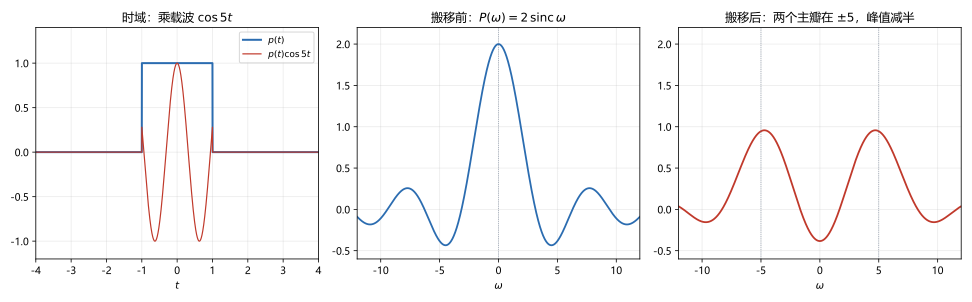
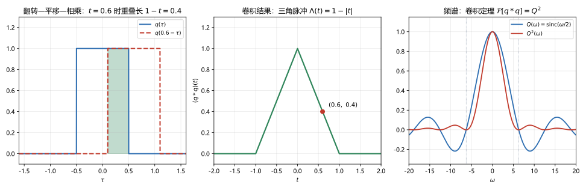
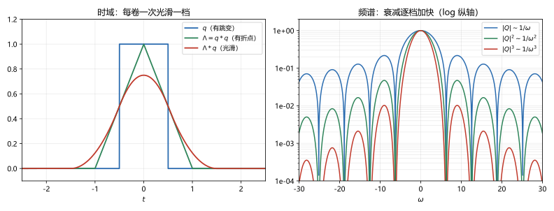

# 第 19 讲 傅里叶变换的性质与卷积定理

> **前置**：第 18 讲（正逆变换与 $2\pi$ 口径、矩形脉冲与 sinc、单边指数、$\delta$ 的"单位面积极限"记号、共轭对称）；第 18 讲图 1（脉宽与主瓣宽度的对照）。
> **预计时间**：约 4.5 小时（含作业；第 4、5 节的推导建议自己写一遍）。
> **本讲回答**：复杂信号的变换能不能不积分？十一条性质是十一条要背的公式，还是一条主线？卷积为什么是"系统"，为什么时域卷积等于频域相乘？对偶式的 $1/(2\pi)$ 从哪来？帕塞瓦尔怎么证？性质表怎么用才不乱？

## 本讲要解决什么

第 18 讲只算了两个变换：矩形脉冲和单边指数，都是按定义从头积分。但实际信号很少是"裸"的——它们是某个已知信号被**加工**出来的：延迟一段、压窄一倍、搬上载波、通过一个系统、求一次导、积一次分、乘一个 $t$。

如果每加工一次就重新积分一遍，傅里叶变换就只是一个笨重的积分公式。本讲换一种讲法：**拿同一个矩形脉冲 $p(t)=\operatorname{rect}(t/2)$，把它逐步加工成越来越复杂的信号；每加工一步都会遇到一个当前工具处理不了的地方，遇到一个就引入一条性质来解决它。** 性质不是凭空列出来的十一条公式，而是这条加工线上依次用到的六件工具，外加两条免费推论。

加工线长这样：

$$
p(t)\ \xrightarrow{\text{延迟}}\ p(t-3)\ \xrightarrow{\text{缩放}}\ \text{窄/宽脉冲}\ \xrightarrow{\text{乘载波}}\ \text{已调信号}\ \xrightarrow{\text{过系统}}\ \text{输出}\ \xrightarrow{\text{微/积分}}\ \text{三角脉冲等}\ \xrightarrow{\text{乘 }t}\ \text{更复杂信号}.
$$

学完之后，你应该能做到：

- 沿加工线说出每条性质是为解决哪个具体麻烦，而不是背十一条孤立公式；
- 对延迟、缩放、乘正弦、求导、积分、乘 $t$ 六类操作，不积分就写出变换；
- 说清每条性质的条件，尤其是微分的边界项、积分的 $\delta$ 项与下限选择；
- 用"翻转—平移—相乘—积分"算简单卷积，说清卷积为什么是系统叠加，并用卷积定理交叉核对；
- 写出卷积定理与对偶式，说清 $1/(2\pi)$ 的位置；
- 用卷积定理证明帕塞瓦尔定理，并算一个信号的能量；
- 按固定顺序使用性质表，知道什么时候必须回到定义。

---

## 1. 延迟——时移性质

### 1.1 先看一个延迟的脉冲

先做一件最简单的事：把 $p(t)=\operatorname{rect}(t/2)$ 右移 $3$，得 $f(t)=p(t-3)=\operatorname{rect}\!\left(\dfrac{t-3}{2}\right)$（$\lvert t-3\rvert<1$ 时为 $1$）。求它的变换。

按定义积分当然可以：把上下限换成 $(2,4)$ 再算一遍。但我们已经知道 $p$ 的变换是 $P(\omega)=2\operatorname{sinc}\omega$（第 18 讲）。**延迟只是把信号整体挪了个位置，频率成分的强弱不该变**——直觉告诉我们答案应该和 $P$ 只差一个因子。剩下的问题是：这个因子是什么，为什么。

### 1.2 时移定理

**定理 19.1（时移）** 若 $\mathcal F[f]=F$，则对任意实数 $t_0$，

$$
\mathcal F[f(t-t_0)]=e^{-i\omega t_0}F(\omega). \tag{19.1}
$$

**证明**：代入定义后换元。令 $u=t-t_0$，则 $t=u+t_0$，$dt=du$，积分限仍是全实轴：

$$
\int_{-\infty}^{\infty}f(t-t_0)e^{-i\omega t}dt
=\int_{-\infty}^{\infty}f(u)e^{-i\omega(u+t_0)}du
=\int_{-\infty}^{\infty}f(u)e^{-i\omega u}\,e^{-i\omega t_0}du. \tag{19.2}
$$

关键一步：$e^{-i\omega t_0}$ 里只有 $\omega$ 和常数 $t_0$，**不含积分变量 $u$**，所以可以提到积分号外：

$$
e^{-i\omega t_0}\int_{-\infty}^{\infty}f(u)e^{-i\omega u}du=e^{-i\omega t_0}F(\omega).
$$

符号为什么是负：$t=u+t_0$ 代进 $e^{-i\omega t}$ 产生 $e^{-i\omega t_0}$，正负号跟着定义里的 $-i\omega t$ 走。

**读法**：$\lvert e^{-i\omega t_0}\rvert=1$，所以幅度谱 $\lvert F\rvert$ 完全不变——印证了"延迟不改变频率成分强弱"的直觉；相位谱加上 $-\omega t_0$，是一条过原点的直线（线性相位）。物理上：每个频率 $\omega$ 的成分晚到 $t_0$，相位落后 $\omega t_0$。

**例 19.1** 求 $f(t)=\operatorname{rect}\!\left(\dfrac{t-3}{2}\right)$ 的变换，并说明幅度谱与相位谱。

**解**：$f(t)=p(t-3)$，用 (19.1)，$t_0=3$：

$$
F(\omega)=2\operatorname{sinc}\omega\cdot e^{-3i\omega}.
$$

幅度谱 $\lvert F\rvert=2\lvert\operatorname{sinc}\omega\rvert$，与未延迟时相同；相位谱在原来的 $0$ 或 $\pi$（$P$ 是实函数，正处相位 $0$、负处相位 $\pi$）之上再加 $-3\omega$。

**数值核对**（EXP1）：$\omega=0.7$ 处数值积分给 $-0.929154-1.588710i$，解析值 $-0.929231-1.588842i$，差 $1.5\times10^{-4}$，来自脉冲跳变处的梯形积分误差；$\omega=1.9$ 处差 $6.5\times10^{-5}$。

### 1.3 备用工具：线性

后面要把信号拆成几块分别加工再合起来（比如乘余弦拆成两个复指数），需要线性：

**定理 19.2（线性）** 若 $\mathcal F[f]=F$、$\mathcal F[g]=G$，$a,b$ 为常数，则

$$
\mathcal F[af+bg]=aF(\omega)+bG(\omega). \tag{19.3}
$$

**证明**：代入定义，把积分拆成两项即得。条件只有一条：两个变换都存在。线性是积分本身的性质。

### 1.4 先立规矩：性质表怎么用、哪些要会推

在继续加工之前，先把"怎么用性质"的规矩立好，免得后面十一条性质糊成一团。

**使用顺序（六步）**：

1. **拆**：把信号写成已知变换对（矩形、单边指数、双边指数等）经过操作的形式；
2. **识别**：标出用了哪些操作（移位、尺度、乘正弦、乘 $t$、求导、积分、卷积）；
3. **查表**：每个操作换成频域效果（表在本讲末汇总）；
4. **查条件**：逐条核对条件，尤其是微分的边界项与积分的 $F(0)$；
5. **组合**：按操作顺序把频域表达式拼起来（先时移后乘 $t$ 与先乘 $t$ 后时移结果不同）；
6. **校验**：用对称性（实偶→实偶）、面积（$F(0)=\int f$）、特殊点或衰减速度检查。

**深度标注（哪些要会推、哪些会查即可）**：

| 性质                             | 深度                                                   |
| -------------------------------- | ------------------------------------------------------ |
| 线性、时移、频移、微分、卷积定理 | **要会随手推**（每条两三行，考卷不给表也写得出） |
| 尺度、积分、频域微分、对偶式     | 要会用、能现场推                                       |
| 对偶、帕塞瓦尔                   | 要会用、知道怎么证                                     |
| 相关、与 $\delta$ 卷积         | 认识层（知道存在，第 20 讲或后续课展开）               |

**一个记号提醒**：$i\omega$ 里的 $i$ 与电路课的 $j$ 是同一个数（$j=i$，第 01 讲已声明）。电路语境写 $j\omega F$ 不算错，本课程统一用 $i$。

**易错**：时移因子写成 $e^{+i\omega t_0}$；把性质表当背诵目录而非加工字典。

---

## 2. 压缩与展宽——尺度性质

### 2.1 把脉冲压窄或展宽

接着把脉冲压窄或展宽，比如 $p(2t)=\operatorname{rect}(t)$（宽 $1$）或 $p(t/2)=\operatorname{rect}(t/4)$（宽 $4$）。第 18 讲图 1 已经画过脉宽与主瓣的对照：脉宽越窄主瓣越宽。现在把这个观察写成公式：时域乘一个系数 $a$，频域怎么变，多出来的系数从哪来。

### 2.2 尺度定理

**定理 19.3（尺度）** 若 $\mathcal F[f]=F$，$a\ne0$ 为实数，则

$$
\mathcal F[f(at)]=\frac{1}{\lvert a\rvert}F\!\left(\frac{\omega}{a}\right). \tag{19.4}
$$

**证明**：换元 $u=at$，分两种情况。

$a>0$：$dt=du/a$，$t$ 从 $-\infty$ 到 $\infty$ 对应 $u$ 同向：

$$
\int_{-\infty}^{\infty}f(at)e^{-i\omega t}dt
=\frac1a\int_{-\infty}^{\infty}f(u)e^{-i(\omega/a)u}du
=\frac1aF\!\left(\frac{\omega}{a}\right).
$$

$a<0$：$dt=du/a$ 仍是负的，但 $t$ 从 $-\infty$ 到 $\infty$ 对应 $u$ 从 $\infty$ 到 $-\infty$，上下限对调再产生一个负号，两个负号抵消：

$$
\int_{-\infty}^{\infty}f(at)e^{-i\omega t}dt
=\frac1a\int_{\infty}^{-\infty}f(u)e^{-i(\omega/a)u}du
=-\frac1a\int_{-\infty}^{\infty}f(u)e^{-i(\omega/a)u}du
=\frac{1}{\lvert a\rvert}F\!\left(\frac{\omega}{a}\right). \tag{19.5}
$$

所以 $1/\lvert a\rvert$ 不是凑出来的：$a>0$ 时它来自 $dt=du/a$；$a<0$ 时它来自"微分的负号"与"限对调的负号"相消。

**读法与校验**：$a=2$ 把时域压窄一半，频谱就展宽一倍、幅度减半。用面积校验：$\int f(at)dt=\frac1{\lvert a\rvert}\int f=\frac{F(0)}{\lvert a\rvert}$，而新公式在 $\omega=0$ 处也给 $\frac{F(0)}{\lvert a\rvert}$，两边一致。视觉上看第 18 讲图 1：$\tau=2,1,0.5$ 三条脉冲与它们的 sinc，正是尺度性质的图像。

**随文算例**（数值核对 EXP2）：

- $p(2t)=\operatorname{rect}(t)$（宽 $1$）：$\frac12P(\omega/2)=\operatorname{sinc}(\omega/2)$。$\omega=1.3$ 处数值 $0.930897$，解析 $0.931056$。
- $p(t/2)=\operatorname{rect}(t/4)$（宽 $4$）：$2P(2\omega)=4\operatorname{sinc}2\omega$。$\omega=0.9$ 处数值 $2.164151$，解析 $2.164106$。
- $a<0$：$f(t)=e^{-t}u(t)$，$F=\frac1{1+i\omega}$；$f(-2t)=e^{2t}u(-t)$，公式给 $\frac12\cdot\frac1{1+i\omega/(-2)}=\frac1{2-i\omega}$。$\omega=1.3$ 处数值 $0.351594+0.228471i$，解析 $0.351494+0.228471i$。

**易错**：漏 $1/\lvert a\rvert$；$a<0$ 时漏绝对值。

---

## 3. 搬上载波——频移与调制

### 3.1 把频谱搬到载波附近

再往前一步，是要把信号通过无线电发出去。基带信号（比如语音、比如我们的脉冲）频谱集中在零频附近，不能直接高效辐射；工程上把它**搬到一个高频载波附近**再发。这里要弄清楚的是：时域乘一个正弦，频域到底发生什么。

### 3.2 频移定理

**定理 19.4（频移）** 若 $\mathcal F[f]=F$，则对任意实数 $\omega_0$，

$$
\mathcal F[e^{i\omega_0t}f(t)]=F(\omega-\omega_0). \tag{19.6}
$$

**证明**：代入定义，把两个指数合并：

$$
\int_{-\infty}^{\infty}e^{i\omega_0t}f(t)e^{-i\omega t}dt
=\int_{-\infty}^{\infty}f(t)e^{-i(\omega-\omega_0)t}dt.
$$

右边正是 $F$ 在 $\omega-\omega_0$ 处的定义式，所以等于 $F(\omega-\omega_0)$。整条性质就是"指数相乘、频率相加"这一步。

**调制（modulation）**：把信号乘一个正弦（称为**载波**）以搬移它的频谱，这个操作叫调制；乘余弦是最简单的幅度调制（AM）。频移定理就是调制的数学：乘 $e^{i\omega_0t}$ 把频谱整体右移 $\omega_0$。

**例 19.2** 求 $f(t)=p(t)\cos 5t=\operatorname{rect}(t/2)\cos 5t$ 的变换，描述频谱形状。

**解**：把余弦拆成复指数：$\cos 5t=\dfrac{e^{i5t}+e^{-i5t}}{2}$。用线性与频移：

$$
F(\omega)=\frac{P(\omega-5)+P(\omega+5)}{2}
=\operatorname{sinc}(\omega-5)+\operatorname{sinc}(\omega+5). \tag{19.7}
$$

形状：原来集中在 $\omega=0$ 的一个 sinc 主瓣，变成集中在 $\omega=\pm5$ 的两个主瓣；峰值从 $2$ 减半到约 $1$（拆成两半各占一份；在 $\omega=5$ 处精确值 $1+\operatorname{sinc}10=0.9456$，因另一瓣的尾巴略有抵消）。这就是"搬移"的字面意思。

图 1 左：时域 $p(t)$ 与 $p(t)\cos5t$（脉冲内被载波振荡填充）。中：搬移前 $P(\omega)=2\operatorname{sinc}\omega$，单主瓣在 $0$。右：搬移后两个主瓣在 $\pm5$，峰值约减半。

**数值核对**（EXP1）：$\omega=5$ 处数值 $0.945582$，解析 $0.945598$；$\omega=0$ 处数值 $-0.383626$，解析 $-0.383570$（两个搬移后的 sinc 在零频处的尾巴叠加）。

工程上，无线电发射就是把语音频谱搬到载频附近，接收端再搬回来。本讲只算"搬移"这一步；完整调制解调属于通信课程。

**易错**：频移方向写反（乘 $e^{i\omega_0t}$ 是 $F(\omega-\omega_0)$，右移）；把调制理解成"频谱乘余弦"——时域乘余弦，频域是**搬移后相加**，不是相乘。

---

## 4. 通过一个系统——卷积与卷积定理

### 4.1 一条滑动平均

现在让信号通过一个系统。考虑最简单的系统：输出等于输入在过去一秒内的累积，

$$
y(t)=\int_{t-1}^{t}x(\tau)d\tau.
$$

窗宽为 $1$，数值上它也等于过去一秒的平均（滑动平均）。接下来要回答：这个输出怎么用 $x$ 的频谱表示？直接对 $y$ 积分很啰嗦。

换元 $\tau=t-s$（$s$ 是"距今多久"）：

$$
y(t)=\int_{0}^{1}x(t-s)ds.
$$

再写回 $\tau$ 形式：引入窗函数 $w(t)=u(t)-u(t-1)$（在 $(0,1)$ 上为 $1$），则 $w(t-\tau)=1$ 当且仅当 $0<t-\tau<1$，即 $\tau\in(t-1,t)$。于是

$$
y(t)=\int_{-\infty}^{\infty}x(\tau)w(t-\tau)d\tau. \tag{19.8}
$$

注意 $t-\tau$ 不是人为规定：它是换元 $\tau=t-s$ 自然产生的。"翻转"只是换元的副产品——把 $w(\tau)$ 变成 $w(-\tau)$ 再平移 $t$，就得到 $w(t-\tau)$。

### 4.2 卷积为什么是"系统"

(19.8) 不是滑动平均独有的。考虑一个**线性时不变**系统：它对"在时刻 $\tau$ 加入的一份输入"的响应只依赖距今多久 $t-\tau$，记作 $h(t-\tau)$，且各份输入的响应可以叠加。把输入看成连续加入的份 $x(\tau)d\tau$，叠加得

$$
y(t)=\int_{-\infty}^{\infty}x(\tau)h(t-\tau)d\tau.
$$

这正是卷积：**卷积就是"系统把过去每一份输入按距今多久加权后叠加"**。$h$ 叫系统的权函数（用 $\delta$ 严格化后就是冲激响应，第 20 讲）。滑动平均是 $h=w$ 的特例。这就回答了"卷积为什么是系统"：它不是凭空定义的数学运算，而是线性时不变系统输出的必然形式。

**定义 19.1（卷积）** 两个函数的卷积（convolution）定义为

$$
(f*g)(t)=\int_{-\infty}^{\infty}f(\tau)g(t-\tau)d\tau. \tag{19.9}
$$

四步读法：把 $g(\tau)$ **翻转**成 $g(-\tau)$，**平移** $t$ 成 $g(t-\tau)$，与 $f(\tau)$ **相乘**，再**积分**。对每个 $t$ 得到一个数，合起来是新函数。在系统语言里：翻转+平移=把权函数对齐到"距今多久"，相乘=取该份输入的贡献，积分=叠加。

**存在性**：若 $f,g$ 都绝对可积，则 $f*g$ 也绝对可积，且 $\int\lvert f*g\rvert\le\int\lvert f\rvert\cdot\int\lvert g\rvert$。理由：$\lvert(f*g)(t)\rvert\le\int\lvert f(\tau)\rvert\lvert g(t-\tau)\rvert d\tau$，再对 $t$ 积分并换元，右边拆成两个独立积分的乘积。

**交换律**：$f*g=g*f$。证明换元 $s=t-\tau$（$t$ 固定，$d\tau=-ds$，限对调）：

$$
(f*g)(t)=\int_{-\infty}^{\infty}f(\tau)g(t-\tau)d\tau
=\int_{-\infty}^{\infty}f(t-s)g(s)ds=(g*f)(t). \tag{19.10}
$$

所以"翻谁"无所谓——系统里"输入加权权函数"与"权函数加权输入"是同一件事。

**结合律与分配律**：$(f*g)*h=f*(g*h)$，$f*(g+h)=f*g+f*h$。这两条不必再换元硬算：下面的卷积定理把它们化到频域乘法，而复数乘法满足 $(FG)H=F(GH)$ 与 $F(G+H)=FG+FH$；而**不同的绝对可积信号有不同的变换**（变换不会把两个不同信号映成同一个频谱），所以频域相等即意味着时域相等。

**与逐点乘积的区别**：卷积是"重叠面积"，乘积是"同点相乘"。数值反例：$q=\operatorname{rect}(t)$，在 $t=0.6$ 处 $(q*q)(0.6)=0.4$（重叠长 $0.4$），而 $(q\cdot q)(0.6)=0$（$q(0.6)=0$）。两者完全不同。

**因果性**：若 $f,g$ 在 $t<0$ 时都为零，则 $f*g$ 在 $t<0$ 时也为零。理由：被积函数非零需要 $\tau\ge0$ 且 $t-\tau\ge0$，即 $0\le\tau\le t$；$t<0$ 时这个区间为空。物理上：因果系统不会在输入到来之前就有输出。

**一句边界**：相关（correlation）与卷积只差"不翻转"，本课程不用相关，知道区别即可。与 $\delta$ 的卷积 $f*\delta=f$ 需要 $\delta$ 的筛选性质，第 20 讲再证，现在只记这个结论作预告。

### 4.3 卷积定理：时域卷积 = 频域乘积

现在回答刚才那个问题：$y=x*w$ 的频谱是什么？

**定理 19.5（卷积定理）** 若 $f,g$ 绝对可积，则

$$
\mathcal F[f*g]=F(\omega)G(\omega). \tag{19.11}
$$

**证明**：四步。代入定义：

$$
\mathcal F[f*g]=\int_{-\infty}^{\infty}\left[\int_{-\infty}^{\infty}f(\tau)g(t-\tau)d\tau\right]e^{-i\omega t}dt.
$$

第一步，交换积分次序（$f,g$ 绝对可积保证二重积分绝对收敛，换序合法）：

$$
=\int_{-\infty}^{\infty}f(\tau)\left[\int_{-\infty}^{\infty}g(t-\tau)e^{-i\omega t}dt\right]d\tau.
$$

第二步，内层换元 $u=t-\tau$（$\tau$ 固定，$dt=du$，$t=u+\tau$）：

$$
\int_{-\infty}^{\infty}g(t-\tau)e^{-i\omega t}dt
=\int_{-\infty}^{\infty}g(u)e^{-i\omega(u+\tau)}du
=e^{-i\omega\tau}G(\omega). \tag{19.12}
$$

第三步，$e^{-i\omega\tau}G(\omega)$ 代回外层，$G(\omega)$ 与 $\tau$ 无关提出：

$$
=G(\omega)\int_{-\infty}^{\infty}f(\tau)e^{-i\omega\tau}d\tau=F(\omega)G(\omega).
$$

时域里"翻转—平移—相乘—积分"那一整套，在频域里就是一次乘法。这就是卷积定理的全部意义，也是它成为滤波器分析底座的原因：系统输出频谱 = 输入频谱 × 系统频谱。

### 4.4 对偶式：时域乘积 = 频域卷积除 $2\pi$

**定理 19.6（对偶式）** 若 $f,g$ 绝对可积，则

$$
\mathcal F[fg]=\frac{1}{2\pi}(F*G)(\omega). \tag{19.13}
$$

**证明**：把 $f,g$ 各用逆变换表示，相乘：

$$
f(t)g(t)=\frac{1}{(2\pi)^2}\int_{-\infty}^{\infty}\int_{-\infty}^{\infty}F(\nu)G(\mu)e^{i(\nu+\mu)t}d\nu d\mu.
$$

换元 $\omega=\nu+\mu$（固定 $\nu$，$\mu=\omega-\nu$，$d\mu=d\omega$）：

$$
f(t)g(t)=\frac{1}{2\pi}\int_{-\infty}^{\infty}\left[\frac{1}{2\pi}\int_{-\infty}^{\infty}F(\nu)G(\omega-\nu)d\nu\right]e^{i\omega t}d\omega
=\frac{1}{2\pi}\int_{-\infty}^{\infty}\frac{(F*G)(\omega)}{2\pi}e^{i\omega t}d\omega.
$$

对照逆变换的形式 $h(t)=\frac1{2\pi}\int H(\omega)e^{i\omega t}d\omega$，读出 $H=\frac{F*G}{2\pi}$，即 (19.13)。

**$1/(2\pi)$ 从哪来**：两个逆变换各带一个 $\frac1{2\pi}$，共 $\frac1{(2\pi)^2}$；换元后其中一个 $\frac1{2\pi}$ 被认作"新逆变换自带的系数"，剩下的一个留在卷积外面。记成 $F*G$ 会差 $2\pi$ 倍。

**两个方向不要记反**：时域卷积 ↔ 频域乘积（不带系数）；时域乘积 ↔ 频域卷积（带 $\frac1{2\pi}$）。系数跟着"哪边做卷积"走：频域做卷积就要除 $2\pi$。

### 4.5 例题：矩形自卷积，两种算法

**例 19.3** 算 $q*q$，其中 $q(t)=\operatorname{rect}(t)$（宽 $1$，$\lvert t\rvert<\tfrac12$）。用直接积分与卷积定理两种方法，并核对一致。

**解（直接积分）**：$q(\tau)=1$ 当 $\tau\in(-\tfrac12,\tfrac12)$；$q(t-\tau)=1$ 当 $\tau\in(t-\tfrac12,t+\tfrac12)$。被积函数是这两个区间的重叠长度。比较端点定重叠：

- $0\le t<1$：左端点取较大者 $\max(-\tfrac12,\,t-\tfrac12)=t-\tfrac12$（因 $t\ge0$）；右端点取较小者 $\min(\tfrac12,\,t+\tfrac12)=\tfrac12$（因 $t\ge0$）。重叠 $(t-\tfrac12,\tfrac12)$，长度 $\tfrac12-(t-\tfrac12)=1-t$。
- $t\ge1$：$t-\tfrac12\ge\tfrac12$，左端点不小于右端点，无重叠，长度 $0$。
- $-1<t<0$：由交换律（或对称地比较端点）得长度 $1+t$。

合起来

$$
(q*q)(t)=\begin{cases}1-\lvert t\rvert,&\lvert t\rvert<1,\\0,&\lvert t\rvert\ge1,\end{cases}=\Lambda(t). \tag{19.14}
$$

**解（卷积定理）**：$Q(\omega)=\operatorname{sinc}(\omega/2)$，所以 $\mathcal F[q*q]=Q^2=\operatorname{sinc}^2(\omega/2)$。

**核对**：第 5 节例 19.4 将用积分性质独立算出 $\mathcal F[\Lambda]=\operatorname{sinc}^2(\omega/2)$。两条完全不同的路线（分段重叠积分 vs 积分性质）给出同一个频谱，互相背书。

图 2 左：$t=0.6$ 时 $q(\tau)$ 与翻转平移后的 $q(0.6-\tau)$，绿色重叠区间 $(0.1,0.5)$ 长 $0.4$。中：卷积结果 $\Lambda(t)$，红点标出 $(0.6,0.4)$。右：$Q$ 与 $Q^2$ 的频谱——$Q^2$ 非负、旁瓣更小、衰减更快（$1/\omega^2$），虚线是公共零点 $\pm2\pi$。

**数值核对**（EXP5）：数值卷积（矩形求和，$dt=0.001$）在 $t=0.6$ 给 $0.399$、$t=0$ 给 $0.999$，与 $0.4$、$1$ 差 $10^{-3}$，是矩形求和的步长误差；$\mathcal F[q*q]$ 在 $\omega=1.1$ 给 $0.901527$，$Q^2=0.903147$，差 $1.6\times10^{-3}$（同一来源）。对偶式数值：$\frac{Q*Q}{2\pi}$ 在 $\omega=0$ 给 $0.997885$，与 $Q(0)=1$ 差 $2.1\times10^{-3}$（频域卷积截断到 $\pm300$ 的尾巴误差）。

### 4.6 重复卷积：越卷越光滑

把卷积再作用一次：$\Lambda*q=q*q*q$。按定义 $(\Lambda*q)(t)=\int_{t-1/2}^{t+1/2}\Lambda(\tau)d\tau$（$q(t-\tau)=1$ 当 $\tau\in(t-\tfrac12,t+\tfrac12)$），分段积分。设 $t\ge0$（偶函数）：

- $0\le t\le\tfrac12$：窗 $(t-\tfrac12,t+\tfrac12)$ 跨 $0$，拆成 $\int_{t-1/2}^{0}(1+\tau)d\tau+\int_0^{t+1/2}(1-\tau)d\tau$。记 $a=t-\tfrac12$、$b=t+\tfrac12$，得 $(-a-\tfrac{a^2}{2})+(b-\tfrac{b^2}{2})=(b-a)-\tfrac{a^2+b^2}{2}=1-\tfrac{2t^2+1/2}{2}=\tfrac34-t^2$。
- $\tfrac12\le t\le\tfrac32$：窗左端 $t-\tfrac12\ge0$，与 $\Lambda$ 支撑 $(0,1)$ 的交为 $(t-\tfrac12,1)$，$\int_{t-1/2}^{1}(1-\tau)d\tau=\tfrac12-(t-\tfrac12)+\tfrac{(t-1/2)^2}{2}=\tfrac12(\tfrac32-t)^2$。
- $t\ge\tfrac32$：无重叠，$0$。

合起来是一个**分段二次**的光滑曲线：

$$
(\Lambda*q)(t)=\begin{cases}\tfrac34-t^2,&\lvert t\rvert\le\tfrac12,\\[2pt]\tfrac12\left(\tfrac32-\lvert t\rvert\right)^2,&\tfrac12\le\lvert t\rvert\le\tfrac32,\\[2pt]0,&\lvert t\rvert\ge\tfrac32.\end{cases} \tag{19.15}
$$

（在 $\lvert t\rvert=\tfrac12$ 处两段都得 $\tfrac12$，且导数连续，所以比 $\Lambda$ 更光滑。）它的频谱是 $Q^3=\operatorname{sinc}^3(\omega/2)$，按 $1/\omega^3$ 衰减。

图 3 左：$q$ 有跳变、$\Lambda=q*q$ 有折点、$\Lambda*q$ 光滑——每卷一次光滑一档。右（log 纵轴）：$\lvert Q\rvert$ 旁瓣约 $10^{-1}$、$\lvert Q\rvert^2$ 约 $10^{-2}$、$\lvert Q\rvert^3$ 约 $10^{-3}$——衰减逐档加快。

**数值核对**（EXP9）：数值三重卷积在 $t=0,0.4,0.8,1.2$ 给 $0.749250,0.589250,0.244475,0.044775$，与 (19.15) 的 $0.75,0.59,0.245,0.045$ 差约 $7.5\times10^{-4}$（矩形求和误差）；$\mathcal F[\Lambda*q]$ 在 $\omega=0.7$ 给 $0.938999$，$Q^3=0.940351$，差 $1.4\times10^{-3}$。

这与第 17 讲"系数衰减速度反映光滑程度"是同一件事的变换版：跳变→$1/\omega$，折点→$1/\omega^2$，光滑→$1/\omega^3$。

**易错**：把卷积当逐点乘积（记住 $t=0.6$ 的反例 $0.4$ vs $0$）；翻转漏掉写成 $\int f(\tau)g(t+\tau)d\tau$（那是相关）；对偶式漏 $\frac1{2\pi}$ 或两方向系数记反；重叠区间积分限凭印象写（先比较端点再取交集）。

---

## 5. 求导与积分——微分、积分性质

### 5.1 给脉冲求导和积分

接下来对信号求导或积分。比如三角脉冲 $\Lambda$ 是某个矩形差的积分，它的导数是矩形差。要弄清两件事：求导和积分在频域对应什么，边界项怎么处理。

### 5.2 时域微分：乘 $i\omega$

**定理 19.7（时域微分）** 若 $f$ 绝对可积、$f'$ 绝对可积，且 $f(\pm\infty)=0$，则

$$
\mathcal F[f'(t)]=i\omega F(\omega). \tag{19.16}
$$

**证明**：代入定义，分部积分。取 $u=e^{-i\omega t}$、$dv=f'(t)dt$，则 $du=-i\omega e^{-i\omega t}dt$、$v=f(t)$：

$$
\int_{-\infty}^{\infty}f'(t)e^{-i\omega t}dt
=\Big[f(t)e^{-i\omega t}\Big]_{-\infty}^{\infty}
+i\omega\int_{-\infty}^{\infty}f(t)e^{-i\omega t}dt.
$$

边界项为什么消失：$\lvert e^{-i\omega t}\rvert=1$，而 $f(t)\to0$（$t\to\pm\infty$），所以两端都是 $0$。剩下 $i\omega F(\omega)$。

**条件不能省**：$f=u(t)$ 在 $+\infty$ 不趋于零，边界项不消失，不能套这条。$u(t)$ 的导数是 $\delta$，它的变换要等第 20 讲。

**跳变处怎么求导**：若 $f$ 有跳变（如 $\Lambda$ 的折点、矩形差的跳变），$f'$ 在跳变点不存在，但在其余点存在且分段连续；只要 $f'$ 绝对可积、$f(\pm\infty)=0$，定理仍按"分段导数（几乎处处）"适用。例 19.4 就这么用。跳变点本身是零测集，不影响积分。

**读法**：乘 $i\omega$ 意味着高频被放大、低频被压制（$\omega=0$ 处直接归零）。求导把信号变"粗糙"，频谱衰减变慢；反过来积分把信号变光滑，频谱衰减加快（例 19.4 会看到 $1/\omega\to1/\omega^2$）。

**高阶**：逐次套用，$f^{(n)}\leftrightarrow(i\omega)^nF$，每一阶都要求相应的边界项消失。

### 5.3 时域积分：零均值情形

设 $g(t)=\displaystyle\int_{-\infty}^{t}f(\tau)d\tau$。先看 $g$ 在两端的值：$g(-\infty)=0$；$g(+\infty)=\int_{-\infty}^{\infty}f=F(0)$。

**定理 19.8（积分，零均值）** 若 $F(0)=0$（即 $\int f=0$），且 $g$ 绝对可积，则

$$
G(\omega)=\frac{F(\omega)}{i\omega}\quad(\omega\ne0). \tag{19.17}
$$

**证明**：$F(0)=0$ 使 $g(+\infty)=0$，于是 $g$ 两端都趋于零，满足微分性质的条件。又 $g'=f$，对 $g$ 用 (19.16)：$i\omega G(\omega)=F(\omega)$，除过去即得。$\omega=0$ 处 $G(0)=\int g$ 是有限数，公式按极限理解。

**"$g$ 绝对可积"何时成立**：$F(0)=0$ 时 $g(t)=-\int_t^\infty f$，故 $\lvert g(t)\rvert\le\int_t^\infty\lvert f\rvert$；若 $f$ 衰减足够快（例如紧支撑或指数衰减，本讲所有例子都满足），右边可积，$g$ 就绝对可积。若 $f$ 衰减太慢（如 $\sim1/t^2$ 的零均值信号），$g$ 可能不可积，此时 (19.17) 只在广义意义下成立——本课程例子不遇到，知道边界即可。

$F(0)=0$ 这个条件就是"零均值"：信号正负面积相消，积分后才不会留下一个不衰减的常数尾巴。

### 5.4 时域积分：非零均值与 $\delta$ 项

若 $F(0)\ne0$，则 $g(+\infty)=F(0)\ne0$，$g$ 不绝对可积，没有普通意义下的变换。但它的频谱仍然可以描述，代价是出现一个集中在 $\omega=0$ 的分量。

**正则化**：给积分加一个衰减权重。令 $a>0$，

$$
g_a(t)=\int_{-\infty}^{t}f(\tau)e^{-a(t-\tau)}d\tau.
$$

越老的输入权重越小，$g_a$ 因此衰减、绝对可积。算它的变换：代入定义并交换积分次序（$f$ 绝对可积保证合法；积分区域是 $\{\tau\le t\}$，故内层 $t$ 从 $\tau$ 到 $\infty$），

$$
G_a(\omega)=\int_{-\infty}^{\infty}f(\tau)e^{a\tau}\left[\int_{\tau}^{\infty}e^{-(a+i\omega)t}dt\right]d\tau
=\int_{-\infty}^{\infty}f(\tau)e^{a\tau}\cdot\frac{e^{-(a+i\omega)\tau}}{a+i\omega}d\tau
=\frac{F(\omega)}{a+i\omega}. \tag{19.18}
$$

（内层积分：$\int_\tau^\infty e^{-(a+i\omega)t}dt=\frac{e^{-(a+i\omega)\tau}}{a+i\omega}$，用了 $a>0$。）

**令 $a\to0$**：把 $G_a$ 拆成两项，

$$
\frac{F(\omega)}{a+i\omega}
=\frac{F(0)}{a+i\omega}+\frac{F(\omega)-F(0)}{a+i\omega}. \tag{19.19}
$$

第一项：第 18 讲 (18.26) 已经给出 $\frac1{a+i\omega}\to\frac1{i\omega}+\pi\delta(\omega)$，乘 $F(0)$ 即 $F(0)\left(\frac1{i\omega}+\pi\delta(\omega)\right)$。

第二项：分子 $F(\omega)-F(0)$ 在 $\omega=0$ 处为零。因为 $F$ 连续（第 18 讲定理 18.1），在 $0$ 附近 $F(\omega)-F(0)\approx F'(0)\,\omega$，除以 $a+i\omega$ 后在 $a\to0$ 时趋于 $\frac{F'(0)\omega}{i\omega}=\frac{F'(0)}{i}$，**有限**，没有奇性；一般地它趋于 $\frac{F(\omega)-F(0)}{i\omega}$。

两项相加，第一项的 $\frac{F(0)}{i\omega}$ 与第二项的 $-\frac{F(0)}{i\omega}$ 抵消，留下：

$$
G(\omega)=\frac{F(\omega)}{i\omega}+\pi F(0)\,\delta(\omega). \tag{19.20}
$$

**$\delta$ 在这里怎么读**：沿用第 18 讲的记号——"面积为 $1$、宽度趋于零"的极限对象，只在积分号下有意义。$\pi F(0)\delta(\omega)$ 读作"零频处一个面积为 $\pi F(0)$ 的集中分量"。它对应时域里那条不衰减的尾巴 $g(+\infty)=F(0)$：常数分量的频谱集中在零频。正式 $\delta$ 运算规则在第 20 讲，本讲只用到这个记号与 (18.26) 的极限。

**数值演示**（EXP7）：取 $f=q=\operatorname{rect}(t)$，$F(0)=1$，$g(t)=\int_{-\infty}^t q$：$t<-\tfrac12$ 为 $0$，$\lvert t\rvert\le\tfrac12$ 为 $t+\tfrac12$，$t>\tfrac12$ 为 $1$；$g(0)=0.5$。按逆变换，$g(0)=\frac1{2\pi}\int G\,d\omega$。数值算 $G_a=\frac{Q}{a+i\omega}$ 的对称积分：

| $a$    | $\frac1{2\pi}\int_{-400}^{400}\frac{Q(\omega)}{a+i\omega}d\omega$ |
| -------- | ------------------------------------------------------------------- |
| $0.5$  | $0.442398$                                                        |
| $0.1$  | $0.487706$                                                        |
| $0.02$ | $0.497508$                                                        |

趋于 $0.5=g(0)$。而 $\frac{Q(\omega)}{i\omega}$ 是奇函数，对称主值积分（上下限对称取极限，第 14 讲主值意义）为 $0$。差的这 $0.5$ 正是 $\delta$ 项的贡献：$\frac1{2\pi}\cdot\pi F(0)=0.5$。**漏掉 $\delta$ 项，就会把 $g(0)$ 算成 $0$。**

### 5.5 下限可以换：因果形式

电路里更常见的是从 $0$ 积到 $t$（因果积分）：$g_0(t)=\int_0^t f(\tau)d\tau$（$t<0$ 时为 $0$）。它与 $g$ 只差一个常数尾巴的处理：若 $f$ 因果（$t<0$ 为零），则 $g_0=g$，(19.20) 直接适用；若 $f$ 非因果，$g_0(t)=g(t)-g(0)$，减去常数 $g(0)$ 在频域对应减 $2\pi g(0)\delta(\omega)$。所以因果形式的变换是 $G_0(\omega)=\frac{F(\omega)}{i\omega}+\pi F(0)\delta(\omega)-2\pi g(0)\delta(\omega)$。本课程例子多为因果或零均值，遇到非因果常数尾巴时按此修正。第 22 讲拉普拉斯的积分性质 $\frac{F(s)}{s}$ 就是因果形式在 $s$ 域的版本（那里初值自动进入，不用手动减尾巴）。

### 5.6 例题：三角脉冲

**例 19.4** 设三角脉冲 $\Lambda(t)=1-\lvert t\rvert$（$\lvert t\rvert<1$），其余为 $0$。用积分性质求它的变换，并用微分性质交叉核对。

**解**：记 $q(t)=\operatorname{rect}(t)$（宽 $1$），$Q(\omega)=\operatorname{sinc}(\omega/2)$。构造

$$
f(t)=q(t+\tfrac12)-q(t-\tfrac12)=
\begin{cases}+1,&-1<t<0,\\-1,&0<t<1,\\0,&\text{其余}.\end{cases}
$$

它的变换用时移与线性：

$$
F_f(\omega)=\left(e^{i\omega/2}-e^{-i\omega/2}\right)Q(\omega)
=2i\sin\frac{\omega}{2}\operatorname{sinc}\frac{\omega}{2}. \tag{19.21}
$$

$F_f(0)=0$（正负面积相消），满足零均值条件；$f$ 紧支撑故 $g$ 绝对可积。而 $g(t)=\int_{-\infty}^t f$ 分段算：$t<-1$ 为 $0$；$-1<t<0$ 为 $\int_{-1}^t1=t+1$；$0<t<1$ 为 $1-\int_0^t1=1-t$；$t>1$ 为 $0$——正是 $\Lambda(t)$。用 (19.17)：

$$
G(\omega)=\frac{F_f(\omega)}{i\omega}
=\frac{2\sin(\omega/2)}{\omega}\operatorname{sinc}\frac{\omega}{2}
=\operatorname{sinc}^2\frac{\omega}{2}, \tag{19.22}
$$

最后一步用了 $\frac{2\sin(\omega/2)}{\omega}=\operatorname{sinc}\frac{\omega}{2}$。

**交叉核对**（微分性质）：$\Lambda'=f$（折点外），所以应有 $i\omega G=F_f$。展开：$i\omega\operatorname{sinc}^2\frac{\omega}{2}=i\omega\cdot\frac{\sin^2(\omega/2)}{(\omega/2)^2}=\frac{4i\sin^2(\omega/2)}{\omega}=2i\sin\frac{\omega}{2}\operatorname{sinc}\frac{\omega}{2}=F_f$，一致。

**数值核对**（EXP4）：$\omega=0.7,1.9,3.0$ 处 $\Lambda$ 的数值变换为 $0.959828$、$0.733124$、$0.442221$，与 $\operatorname{sinc}^2(\omega/2)$ 的差在 $10^{-8}$ 量级；微分核对在 $\omega=0.7$ 处数值 $0.671751i$、解析 $0.671879i$，差 $1.3\times10^{-4}$（$f$ 的跳变处梯形误差）。

注意衰减：$q$ 的频谱按 $1/\omega$ 衰减，$\Lambda=q*q$（例 19.3）的频谱按 $1/\omega^2$ 衰减——积分一次，光滑一档，衰减快一档。

**易错**：积分漏 $\pi F(0)\delta(\omega)$（先算 $F(0)=\int f$，为零才能只用 $F/(i\omega)$）；微分把 $i\omega$ 写成 $\omega$；对 $u(t)$ 这类不衰减信号套微分性质；频域微分漏 $i$（见下节）。

---

## 6. 乘 t，以及两条免费推论

### 6.1 乘一个 $t$

最后给信号乘一个 $t$（比如 $te^{-2t}u(t)$）。先问：这会让频谱变成什么。

**定理 19.9（频域微分）** 若 $tf(t)$ 绝对可积，则

$$
\mathcal F[t f(t)]=i\frac{dF}{d\omega}. \tag{19.23}
$$

**证明**：对定义式关于 $\omega$ 求导。因为 $\lvert tf(t)\rvert$ 可积，可以在积分号下求导：

$$
\frac{dF}{d\omega}=\int_{-\infty}^{\infty}f(t)\cdot(-it)e^{-i\omega t}dt
=-i\int_{-\infty}^{\infty}tf(t)e^{-i\omega t}dt.
$$

两边乘 $i$：$iF'(\omega)=\int tf(t)e^{-i\omega t}dt$，即 (19.23)。

用途：乘 $t$ 的信号不必重新积分，对已知的 $F$ 求一次导即可。

**例 19.5** 求 $f(t)=te^{-2t}u(t)$ 的变换，不直接积分。

**解**：拆：$f=t\cdot h$，$h=e^{-2t}u(t)$，已知 $H=\frac1{2+i\omega}$。识别：乘 $t$ → 频域微分。查条件：$th=te^{-2t}u(t)$ 绝对可积，满足。套 (19.23)：

$$
F(\omega)=i\frac{d}{d\omega}\left(\frac{1}{2+i\omega}\right)
=i\cdot\left(-\frac{i}{(2+i\omega)^2}\right)
=\frac{1}{(2+i\omega)^2}. \tag{19.24}
$$

（求导一步：$\frac{d}{d\omega}(2+i\omega)^{-1}=-(2+i\omega)^{-2}\cdot i$。）

校验：$f$ 在 $t=0$ 处连续（$f(0)=0$）但导数有跳变，比 $h$ 的跳变光滑一档，所以 $\lvert F\rvert=\frac1{4+\omega^2}$ 按 $1/\omega^2$ 衰减，比 $H$ 的 $1/\omega$ 快一档；$F(0)=\frac14=\int_0^\infty te^{-2t}dt$，面积一致。

**数值核对**（EXP4）：$\omega=0.8$ 处数值 $0.156064-0.148633i$，解析 $\frac1{(2+0.8i)^2}=0.156064-0.148633i$，差 $3\times10^{-9}$；$\omega=1.5$ 处同样吻合。

### 6.2 免费推论一：对偶

加工线走完，表里还剩两条不需要再解新问题、直接从已有公式推出的"免费推论"。第一条是对偶。

**定理 19.10（对称性／对偶）** 若 $\mathcal F[f]=F$，则把 $F$ 本身看作时间信号 $F(t)$，它的变换是

$$
\mathcal F[F(t)]=2\pi f(-\omega). \tag{19.25}
$$

**证明**：从逆变换出发，四步。逆变换对一切 $t$ 成立：$f(t)=\frac1{2\pi}\int F(\omega)e^{i\omega t}d\omega$。第一步，哑变量换名（积分变量 $\omega$ 改叫 $t$、外面的 $t$ 改叫 $\omega$，换名不改变等式）：$f(\omega)=\frac1{2\pi}\int F(t)e^{i\omega t}dt$。第二步，两边乘 $2\pi$；第三步，把 $\omega$ 换成 $-\omega$：$2\pi f(-\omega)=\int F(t)e^{-i\omega t}dt$。右边正是 $F(t)$ 的变换定义式。证毕。$2\pi$ 全程跟着逆变换口径走。

**名字辨析**：这条叫"对称性"或"对偶性"，说的是时域与频域角色互换；与第 18 讲"实偶信号的变换是实偶"那种奇偶对称不是一回事。

**例 19.6** 已知 $\operatorname{rect}(t/2)\leftrightarrow2\operatorname{sinc}\omega$，求 $\operatorname{sinc}(t)$ 的变换，并用逆变换验证。

**解**：写已知对为 $f=p$、$F=P=2\operatorname{sinc}$。对偶说：信号 $P(t)=2\operatorname{sinc}t$ 的变换是 $2\pi p(-\omega)$。$p$ 偶，$p(-\omega)=p(\omega)=\operatorname{rect}(\omega/2)$，所以

$$
2\operatorname{sinc}t\ \leftrightarrow\ 2\pi\operatorname{rect}(\omega/2),
\qquad
\operatorname{sinc}t\ \leftrightarrow\ \pi\operatorname{rect}(\omega/2). \tag{19.26}
$$

即 $\lvert\omega\rvert<1$ 时为 $\pi$，$\lvert\omega\rvert>1$ 时为 $0$：sinc 的频谱是一个矩形。

**验证**（不依赖对偶，独立算逆变换）：

$$
\frac1{2\pi}\int_{-1}^{1}\pi e^{i\omega t}d\omega
=\frac12\left[\frac{e^{i\omega t}}{it}\right]_{-1}^{1}
=\frac12\cdot\frac{e^{it}-e^{-it}}{it}
=\frac{\sin t}{t}=\operatorname{sinc}t. \tag{19.27}
$$

$t=0$ 处直接代：$\frac1{2\pi}\cdot\pi\cdot2=1=\operatorname{sinc}0$。

**数值核对**（EXP3）：逆变换数值在 $t=0.7$ 给 $0.920310982$，$t=1.9$ 给 $0.498052678$，与 $\operatorname{sinc}t$ 逐位一致。

**边界**：$\operatorname{sinc}t$ 不绝对可积（第 18 讲 3.4），所以 (19.26) 在广义积分意义下成立；对偶推导假设逆变换成立，这里又用逆变换独立验证过，两头都站得住。

### 6.3 免费推论二：帕塞瓦尔

**定理 19.11（帕塞瓦尔）** 若 $f$ 能量有限（$\int\lvert f\rvert^2<\infty$），则

$$
\int_{-\infty}^{\infty}\lvert f(t)\rvert^2dt=\frac{1}{2\pi}\int_{-\infty}^{\infty}\lvert F(\omega)\rvert^2d\omega. \tag{19.28}
$$

**证明**：构造 $h(t)=\overline{f(-t)}$。先求 $H$：换元 $s=-t$，

$$
H(\omega)=\int\overline{f(-t)}e^{-i\omega t}dt
=\int\overline{f(s)}e^{i\omega s}ds
=\overline{\int f(s)e^{-i\omega s}ds}=\overline{F(\omega)}.
$$

再算卷积在 $0$ 处的值：$(f*h)(0)=\int f(\tau)h(-\tau)d\tau=\int f(\tau)\overline{f(\tau)}d\tau=\int\lvert f\rvert^2$。

用卷积定理：$\mathcal F[f*h]=F\overline{F}=\lvert F\rvert^2$。对它用逆变换并取 $t=0$：

$$
(f*h)(0)=\frac{1}{2\pi}\int_{-\infty}^{\infty}\lvert F(\omega)\rvert^2d\omega.
$$

左边就是 $\int\lvert f\rvert^2$，证毕。$\frac1{2\pi}$ 来自逆变换口径，不是额外假设。

**条件**：能量有限。$u(t)$ 的能量 $\int_0^\infty1\,dt=\infty$，不能用这条。

**与第 17 讲对照**：级数版是"平均功率 = 各谐波功率之和"（周期信号能量无限、功率有限）；变换版是"总能量 = 频谱能量密度积分除 $2\pi$"（非周期能量有限信号）。同一件事在两类信号上的表现。

**数值核对**（EXP6）：$q$ 的时域能量 $1$，频域 $\frac1{2\pi}\int Q^2=0.999682$（截断 $\pm2000$ 尾巴误差 $3\times10^{-4}$）；$\Lambda$ 的时域能量 $\frac23$，频域 $0.666667$。顺带推出两个积分：

$$
\int_{-\infty}^{\infty}\operatorname{sinc}^2x\,dx=\pi,\qquad
\int_{-\infty}^{\infty}\operatorname{sinc}^4x\,dx=\frac{2\pi}{3}. \tag{19.29}
$$

（数值 $3.140592$ 与 $2.094395$。）

### 6.4 性质表汇总与回到定义的时机

把加工线上用到的性质汇总。每行三列：时域操作、频域效果、条件。**用任何一行之前先看第三列。**

| 时域操作                      | 频域效果                                             | 条件                                |
| ----------------------------- | ---------------------------------------------------- | ----------------------------------- |
| $af+bg$                     | $aF+bG$                                            | 两个变换都存在                      |
| $f(t-t_0)$                  | $e^{-i\omega t_0}F(\omega)$                        | 无额外条件                          |
| $e^{i\omega_0t}f(t)$        | $F(\omega-\omega_0)$                               | 无额外条件                          |
| $f(at)$                     | $\frac1{\lvert a\rvert}F(\omega/a)$                | $a\ne0$                           |
| $f'(t)$                     | $i\omega F(\omega)$                                | $f(\pm\infty)=0$，$f'$ 绝对可积 |
| $\int_{-\infty}^t f$        | $\frac{F(\omega)}{i\omega}+\pi F(0)\delta(\omega)$ | $F(0)=0$ 时 $\delta$ 项消失     |
| $tf(t)$                     | $iF'(\omega)$                                      | $tf$ 绝对可积                     |
| $F(t)$（对偶）              | $2\pi f(-\omega)$                                  | 逆变换成立                          |
| $f*g$                       | $F(\omega)G(\omega)$                               | $f,g$ 绝对可积                    |
| $f(t)g(t)$                  | $\frac1{2\pi}(F*G)(\omega)$                        | $f,g$ 绝对可积                    |
| 能量 $\int\lvert f\rvert^2$ | $\frac1{2\pi}\int\lvert F\rvert^2$                 | 能量有限                            |

**什么时候回到定义**：拆不出已知对（比如一个全新形状的脉冲），或条件不满足（比如不衰减信号）。表是加速器，不是替代品。

**考试给不给表**：多数考卷给部分表或不给。线性、时移、频移、微分、卷积这五条必须随手推得出（每条两三行）；其余各条会查、会现场推即可。

**易错**：硬积分不用性质；用性质不查条件；帕塞瓦尔漏 $\frac1{2\pi}$ 或用于能量无限；组合时操作顺序弄反（$t\cdot f(t-1)$ 与 $(tf)(t-1)$ 不是同一个信号）。

---

## 7. 本讲小结

| 加工步骤     | 性质     | 时域 → 频域                                              | 关键条件 / 关键点                  |
| ------------ | -------- | --------------------------------------------------------- | ---------------------------------- |
| 延迟         | 时移     | $f(t-t_0)\to e^{-i\omega t_0}F$                         | 只改相位；因子与积分变量无关       |
| （拆分备用） | 线性     | $af+bg\to aF+bG$                                        | 积分本身的性质                     |
| 缩放         | 尺度     | $f(at)\to\frac1{\lvert a\rvert}F(\omega/a)$             | $a<0$ 两个负号相消               |
| 乘载波       | 频移     | $e^{i\omega_0t}f\to F(\omega-\omega_0)$                 | 调制 = 频谱搬移                    |
| 过系统       | 卷积定理 | $f*g\to FG$                                             | 换序 + 内层换元；卷积 = 系统叠加   |
| （时域乘积） | 对偶式   | $fg\to\frac1{2\pi}F*G$                                  | 系数跟"频域卷积"走                 |
| 求导         | 微分     | $f'\to i\omega F$                                       | 边界项消失；跳变按分段导数         |
| 积分         | 积分     | $\int_{-\infty}^t f\to\frac{F}{i\omega}+\pi F(0)\delta$ | 零均值才无 $\delta$ 项；下限可换 |
| 乘 $t$     | 频域微分 | $tf\to iF'$                                             | $tf$ 绝对可积                    |
| 免费推论     | 对偶     | $F(t)\to2\pi f(-\omega)$                                | 逆变换换名四步                     |
| 免费推论     | 帕塞瓦尔 | $\int\lvert f\rvert^2=\frac1{2\pi}\int\lvert F\rvert^2$ | 取 $h=\bar f(-t)$、$t=0$       |

**三句话带走**：

1. 性质表不是背诵目录而是加工字典：一条主线（延迟→缩放→搬移→过系统→微积分→乘 $t$）把性质串起来，每条在需要它的地方登场；用之前先查条件。
2. 卷积是系统把过去每一份输入按距今多久加权叠加，频域里就是乘法；时域乘积则对应频域卷积除 $2\pi$。
3. 积分性质的 $\delta$ 项来自不衰减的常数尾巴；帕塞瓦尔是卷积定理在 $t=0$ 处的特例。

---

## 8. 掌握度自测

- [ ] 我能沿加工线说出每条性质是为解决哪个具体麻烦，而不是背十一条孤立公式。
- [ ] 我能用换元推出时移因子 $e^{-i\omega t_0}$，并说清它为什么与积分变量无关。
- [ ] 我能分 $a>0$、$a<0$ 推出尺度公式，解释 $1/\lvert a\rvert$ 的两个来源。
- [ ] 我能说清频移与调制的关系，并算出矩形脉冲乘余弦后的频谱。
- [ ] 我能说清卷积为什么是系统叠加，用四步读法算 $q*q$，并用卷积定理核对。
- [ ] 我能写出卷积定理与对偶式，说清 $1/(2\pi)$ 在哪边、为什么。
- [ ] 我能说清微分性质的边界项为什么消失、跳变处导数怎么算，并举一个不能套的信号。
- [ ] 我能算 $F(0)$ 判断积分性质要不要带 $\delta$ 项，解释 $\delta$ 项来源，并说清下限能否换。
- [ ] 我能用卷积定理证明帕塞瓦尔，并算一个信号的能量。
- [ ] 我能按六步顺序使用性质表，并说出什么时候必须回到定义。

---

## 作业

### 基础

**1.** 设 $f(t)=2\operatorname{rect}(t/2)-\operatorname{rect}\!\left(\dfrac{t-1}{2}\right)$。求 $F(\omega)$。

**参考答案：**

已知 $\operatorname{rect}(t/2)\leftrightarrow2\operatorname{sinc}\omega$。第二项是它右移 $1$，变换为 $2\operatorname{sinc}\omega\,e^{-i\omega}$。用线性：

$$
F(\omega)=2\cdot2\operatorname{sinc}\omega-2\operatorname{sinc}\omega\,e^{-i\omega}
=2\operatorname{sinc}\omega\left(2-e^{-i\omega}\right).
$$

校验：$F(0)=2\cdot1\cdot(2-1)=2$，而 $\int f=2\cdot2-2=2$，面积一致。

---

**2.** 设 $f(t)=e^{-2t}u(t)\cos 3t$。求 $F(\omega)$。

**参考答案：**

拆 $\cos 3t=\frac{e^{i3t}+e^{-i3t}}{2}$。已知 $e^{-2t}u(t)\leftrightarrow\frac1{2+i\omega}$。频移加线性：

$$
F(\omega)=\frac12\left[\frac{1}{2+i(\omega-3)}+\frac{1}{2+i(\omega+3)}\right].
$$

通分合并（可选）：

$$
F(\omega)=\frac{2+i\omega}{(2+i\omega)^2+9}.
$$

（分子：$\frac12[(2+i(\omega+3))+(2+i(\omega-3))]=2+i\omega$；分母：$(2+i(\omega-3))(2+i(\omega+3))=(2+i\omega)^2-(3i)^2=(2+i\omega)^2+9$。）

校验：$f$ 实，$F(-\omega)=\overline{F(\omega)}$：把 $\omega$ 换 $-\omega$ 再取共轭，分子 $2-i\omega$ 的共轭是 $2+i\omega$；分母 $(2-i\omega)^2+9$ 的共轭是 $(2+i\omega)^2+9$，正好是原式在 $-\omega$ 处的分母，成立。

---

**3.** 已知 $p(t)=\operatorname{rect}(t/2)\leftrightarrow2\operatorname{sinc}\omega$。用尺度性质求 $\operatorname{rect}(t/4)$ 与 $\operatorname{rect}(2t)$ 的变换，并写出各自的第一零点。

**参考答案：**

$\operatorname{rect}(t/4)=p(t/2)$，$a=\frac12$：$F=2P(2\omega)=4\operatorname{sinc}2\omega$。第一零点：$2\omega=\pi$，$\omega=\pi/2$。

$\operatorname{rect}(2t)=p(2t)$，$a=2$：$F=\frac12P(\omega/2)=\operatorname{sinc}(\omega/2)$。第一零点：$\omega/2=\pi$，$\omega=2\pi$。

校验：宽 $4$ 的脉冲第一零点 $\pi/2=2\pi/4$，宽 $1/2$ 的脉冲第一零点 $2\pi=2\pi/(1/2)$，与第 18 讲"零点 $2k\pi/\tau$"一致。

**数值核对**（EXP2）：$\operatorname{rect}(t/4)$ 在 $\omega=0.9$ 处数值 $2.164151$，解析 $4\operatorname{sinc}1.8=2.164106$。

---

**4.** 设 $f(t)=t\operatorname{rect}(t/2)$。用频域微分求 $F(\omega)$，并说明它为什么是纯虚奇函数。

**参考答案：**

已知 $p\leftrightarrow P=2\operatorname{sinc}\omega=\frac{2\sin\omega}{\omega}$。频域微分：$F=iP'(\omega)$。

$$
P'(\omega)=2\cdot\frac{\omega\cos\omega-\sin\omega}{\omega^2},
\qquad
F(\omega)=\frac{2i(\omega\cos\omega-\sin\omega)}{\omega^2}.
$$

$f$ 实奇（$t$ 奇、$p$ 偶），由第 18 讲定理 18.3，$F$ 纯虚奇；上式分子 $\omega\cos\omega-\sin\omega$ 是奇函数、分母偶，整体实奇，乘 $i$ 后纯虚奇，一致。

**数值核对**（EXP8）：$\omega=1$ 处数值 $-0.602169i$，解析 $2i(\cos1-\sin1)=-0.602337i$，差 $1.7\times10^{-4}$（跳变处梯形误差）；$\omega=2$ 处数值 $-0.870614i$，解析 $-0.870796i$。

---

### 提高

**5.** 设 $f(t)=q(t+1)-q(t-1)$，$q(t)=\operatorname{rect}(t)$（宽 $1$）。令 $g(t)=\int_{-\infty}^t f(\tau)d\tau$。先写出 $g$ 的分段表达式，再用积分性质求 $G(\omega)$。

**参考答案：**

$f$ 在 $(-1.5,-0.5)$ 为 $+1$，在 $(0.5,1.5)$ 为 $-1$，其余 $0$。逐段积分（累加面积）得

$$
g(t)=\begin{cases}0,&t<-1.5,\\t+1.5,&-1.5\le t<-0.5,\\1,&-0.5\le t\le0.5,\\1.5-t,&0.5<t\le1.5,\\0,&t>1.5.\end{cases}
$$

（梯形脉冲：升、平、降。）$F_f(\omega)=(e^{i\omega}-e^{-i\omega})Q(\omega)=2i\sin\omega\operatorname{sinc}\frac{\omega}{2}$，$F_f(0)=0$，零均值条件满足；$f$ 紧支撑故 $g$ 可积。用 (19.17)：

$$
G(\omega)=\frac{F_f(\omega)}{i\omega}=\frac{2\sin\omega}{\omega}\operatorname{sinc}\frac{\omega}{2}.
$$

校验：$g$ 实偶，$G$ 应实偶：$\frac{2\sin\omega}{\omega}$ 实偶、$\operatorname{sinc}\frac{\omega}{2}$ 实偶，乘积实偶，一致。$G(0)=2\cdot1\cdot1=2=\int g$（梯形面积：上底 $1$、下底 $3$、高 $1$，面积 $2$），一致。

**数值核对**（EXP8）：$\omega=1.3$ 处数值 $1.380195$，解析 $\frac{2\sin1.3}{1.3}\operatorname{sinc}0.65=1.380195$，差 $8\times10^{-9}$。

---

**6.** 设 $q(t)=\operatorname{rect}(t)$，$h(t)=e^{-t}u(t)$。按卷积定义（重叠区间）求 $(q*h)(t)$ 的分段表达式，再用卷积定理写出它的变换。

**参考答案：**

$(q*h)(t)=\int_{t-1/2}^{t+1/2}h(\tau)d\tau$（$q(t-\tau)=1$ 当 $\tau\in(t-\tfrac12,t+\tfrac12)$）。比较积分区间与 $h$ 的支撑 $[0,\infty)$，分三段：

- $t\le-\tfrac12$：区间 $(t-\tfrac12,t+\tfrac12)$ 全在 $\tau<0$，$h=0$，结果 $0$；
- $-\tfrac12<t<\tfrac12$：区间与 $[0,\infty)$ 的交为 $[0,t+\tfrac12)$，$\int_0^{t+1/2}e^{-\tau}d\tau=1-e^{-(t+1/2)}$；
- $t\ge\tfrac12$：区间全在 $\tau>0$，$\int_{t-1/2}^{t+1/2}e^{-\tau}d\tau=e^{-(t-1/2)}-e^{-(t+1/2)}=e^{-t}(e^{1/2}-e^{-1/2})$。

卷积定理：$Q(\omega)=\operatorname{sinc}\frac{\omega}{2}$，$H(\omega)=\frac1{1+i\omega}$，

$$
\mathcal F[q*h]=\frac{\operatorname{sinc}(\omega/2)}{1+i\omega}.
$$

**数值核对**（EXP8）：$(q*h)(0.3)=1-e^{-0.8}=0.550671$；变换在 $\omega=1.1$ 处数值 $0.430018-0.473020i$，与 $\frac{\operatorname{sinc}0.55}{1+1.1i}$ 逐位一致。

---

**7.** 已知 $e^{-\lvert t\rvert}\leftrightarrow\dfrac{2}{1+\omega^2}$（第 18 讲作业 11）。用对偶性质求 $f(t)=\dfrac{1}{1+t^2}$ 的变换，并与第 18 讲作业 6 的结果对照。

**参考答案：**

写已知对为 $f_0(t)=e^{-\lvert t\rvert}$、$F_0(\omega)=\frac{2}{1+\omega^2}$。对偶：信号 $F_0(t)=\frac{2}{1+t^2}$ 的变换是 $2\pi f_0(-\omega)=2\pi e^{-\lvert\omega\rvert}$（$f_0$ 偶）。除以 $2$：

$$
\frac{1}{1+t^2}\ \leftrightarrow\ \pi e^{-\lvert\omega\rvert}.
$$

对照：第 18 讲作业 6 用第 14 讲的留数积分独立算出同一结果 $\pi e^{-\lvert\omega\rvert}$。两条路线（复积分 vs 对偶）一致。

**数值核对**（EXP3）：$\omega=1$ 处数值 $1.155727344$，$\pi/e=1.155727350$，差 $6\times10^{-9}$；$\omega=2$ 处差 $6\times10^{-9}$。

---

**8.** 设 $f(t)=\Lambda(t)\cos 5t$，$\Lambda(t)=1-\lvert t\rvert$（$\lvert t\rvert<1$）。求 $F(\omega)$，描述频谱形状。

**参考答案：**

例 19.4 已给 $\Lambda\leftrightarrow\operatorname{sinc}^2\frac{\omega}{2}$。拆余弦、频移、线性：

$$
F(\omega)=\frac12\left[\operatorname{sinc}^2\frac{\omega-5}{2}+\operatorname{sinc}^2\frac{\omega+5}{2}\right].
$$

形状：两个非负的 $\operatorname{sinc}^2$ 主瓣，中心在 $\pm5$，峰值各约 $\frac12$；因为 $\operatorname{sinc}^2\ge0$，搬移后没有负旁瓣。

**数值核对**（EXP8）：$\omega=5$ 处数值 $0.518391$，解析 $\frac12[1+\operatorname{sinc}^25]=0.518391$，差 $6\times10^{-9}$。

---

### 综合

**9.** 用帕塞瓦尔定理求 $\int_{-\infty}^{\infty}\operatorname{sinc}^2x\,dx$ 与 $\int_{-\infty}^{\infty}\operatorname{sinc}^4x\,dx$，写出完整推导。

**参考答案：**

对 $q=\operatorname{rect}(t)$：时域能量 $\int q^2=1$；$Q=\operatorname{sinc}\frac{\omega}{2}$。帕塞瓦尔：

$$
1=\frac{1}{2\pi}\int_{-\infty}^{\infty}\operatorname{sinc}^2\frac{\omega}{2}d\omega
\ \xrightarrow{x=\omega/2,\ d\omega=2dx}\
1=\frac{1}{\pi}\int_{-\infty}^{\infty}\operatorname{sinc}^2x\,dx
\ \Rightarrow\ \int\operatorname{sinc}^2x\,dx=\pi.
$$

对 $\Lambda$：时域能量 $\int_{-1}^{1}(1-\lvert t\rvert)^2dt=2\int_0^1(1-t)^2dt=\frac23$；频谱 $\operatorname{sinc}^2\frac{\omega}{2}$。帕塞瓦尔：

$$
\frac23=\frac{1}{2\pi}\int\operatorname{sinc}^4\frac{\omega}{2}d\omega
=\frac{1}{\pi}\int\operatorname{sinc}^4x\,dx
\ \Rightarrow\ \int\operatorname{sinc}^4x\,dx=\frac{2\pi}{3}.
$$

**数值核对**（EXP6）：$\pi$ 的数值 $3.140592$（截断误差 $10^{-3}$），$\frac{2\pi}{3}$ 的数值 $2.094395$（六位吻合）。

---

**10.** 设 $f(t)=(t-1)e^{-(t-1)}u(t-1)$。按性质表六步顺序求 $F(\omega)$，每步写明用了哪条性质与条件。

**参考答案：**

1. 拆：$f(t)=g(t-1)$，$g(t)=te^{-t}u(t)$。
2. 识别：$g$ 是 $h(t)=e^{-t}u(t)$ 乘 $t$；$f$ 是 $g$ 时移 $1$。
3. 查表：$h\leftrightarrow\frac1{1+i\omega}$；乘 $t$ → 频域微分；时移 → 乘 $e^{-i\omega}$。
4. 查条件：$th(t)=te^{-t}u(t)$ 绝对可积（频域微分合法）；时移无额外条件。
5. 组合：$G(\omega)=i\frac{d}{d\omega}\frac1{1+i\omega}=i\cdot\frac{-i}{(1+i\omega)^2}=\frac1{(1+i\omega)^2}$；$F(\omega)=e^{-i\omega}G(\omega)=\frac{e^{-i\omega}}{(1+i\omega)^2}$。
6. 校验：$F(0)=1=\int_1^\infty(t-1)e^{-(t-1)}dt=\int_0^\infty se^{-s}ds=1$，面积一致；$\lvert F\rvert=\frac1{1+\omega^2}$ 按 $1/\omega^2$ 衰减，与 $g$ 同档（时移不改幅度）。

**数值核对**（EXP8）：$\omega=0.8$ 处数值 $-0.333490-0.510477i$，解析 $\frac{e^{-0.8i}}{(1+0.8i)^2}=-0.333490-0.510477i$，差 $3\times10^{-9}$。

---

**11.** 设 $f(t)=q(t)=\operatorname{rect}(t)$，$g(t)=\int_{-\infty}^t q(\tau)d\tau$。写出 $g$ 的分段表达式；说明 $g$ 为什么没有普通傅里叶变换；写出 $G(\omega)$ 并解释每一项的来源；最后用"对称积分"说明 $\delta$ 项不可漏。

**参考答案：**

分段：$t<-\tfrac12$ 为 $0$；$\lvert t\rvert\le\tfrac12$ 为 $t+\tfrac12$；$t>\tfrac12$ 为 $1$。

$g(+\infty)=1\ne0$，$\int\lvert g\rvert=\infty$，不绝对可积，没有普通变换。

$F_q(0)=\int q=1$。用 (19.20)：

$$
G(\omega)=\frac{Q(\omega)}{i\omega}+\pi\delta(\omega),\qquad Q(\omega)=\operatorname{sinc}\frac{\omega}{2}.
$$

第一项来自"去掉常数尾巴后的零均值部分"（$\omega\ne0$ 处的普通频谱）；第二项来自尾巴 $g(+\infty)=1$：常数分量的频谱集中在零频，面积 $\pi F(0)=\pi$。

对称积分说明：按逆变换 $g(0)=\frac1{2\pi}\int G\,d\omega$。$\frac{Q}{i\omega}$ 是奇函数，对称主值积分为 $0$；$\delta$ 项贡献 $\frac1{2\pi}\cdot\pi=0.5$。合计 $0.5=g(0)$。若漏 $\delta$ 项，会算出 $g(0)=0$，与 $g(0)=0.5$ 矛盾。

**数值核对**（EXP7）：正则化 $G_a=\frac{Q}{a+i\omega}$ 的对称积分随 $a=0.5,0.1,0.02$ 给 $0.442398,0.487706,0.497508$，趋于 $0.5$；奇部主值积分为 $0$。

---

## 下一讲预告

本讲所有性质都假设信号绝对可积，或至少能量有限。但常数、余弦、阶跃这些最基本的信号都不满足——第 18 讲已经看到它们的变换"不存在"。

第 20 讲引入 $\delta$ 函数：它不是普通函数，而是用积分效果定义的极限对象。有了它，常数与余弦的变换可以写成冲激，周期信号的频谱变成冲激串，抽样定理与滤波的频域图景也才能完整画出来。本讲积分性质里那个 $\pi F(0)\delta(\omega)$ 项、卷积里预告的 $f*\delta=f$，到那时都会从"记号/预告"变成可以运算的对象。
