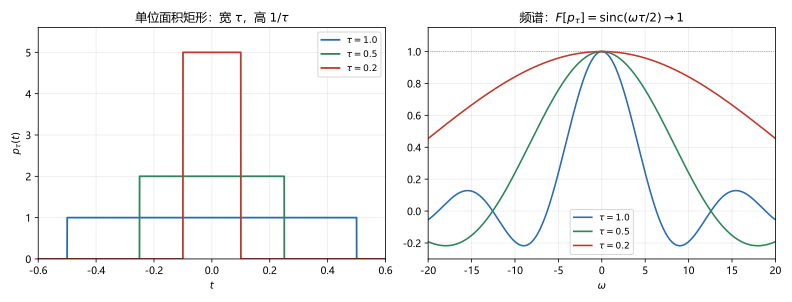
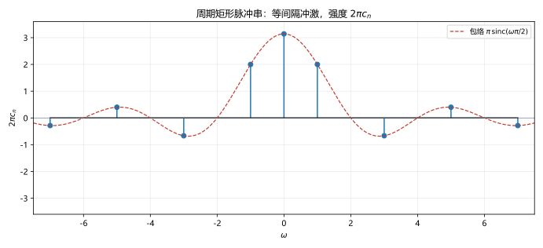
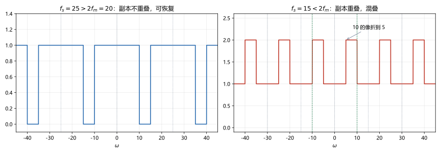

# 第 20 讲 $\delta$ 函数与傅里叶变换的应用

> **前置**：第 18 讲（正逆变换、矩形脉冲与 sinc、绝对可积、$\delta$ 的"单位面积极限"记号）、第 19 讲（对偶、卷积定理与对偶式、微分/积分性质）、第 17 讲（傅里叶级数与线谱）。
> **预计时间**：约 4.5 小时（含作业；第 5 节的抽样链建议自己推一遍）。
> **本讲回答**：常数、余弦、阶跃没有普通傅里叶变换，怎么给它们频域描述？$\delta$ 到底是什么、为什么不能逐点定义？$\delta$ 的频谱为什么是 1，常数为什么是 $2\pi\delta$？周期信号的变换为什么是冲激串？抽样为什么是"乘 $\delta$ 串"，Nyquist 的 2 倍从哪来，混叠怎么算？

## 本讲要解决什么

第 18 讲留下了一个问题：$f(t)=1$、$\cos\omega_0t$、$u(t)$ 这些最基本的信号都不绝对可积，按定义**没有普通意义下的傅里叶变换**。第 19 讲又留下两个尾巴：积分性质里冒出一个 $\pi F(0)\delta(\omega)$ 项，卷积一节预告了 $f*\delta=f$——两处都用了 $\delta$，但从没定义过它。

这一讲把这三件事一次说清。主线是一个问题接一个问题：

1. **问题**：没有普通变换的信号，能不能有一种"广义频谱"？
2. **工具**：单位面积的矩形脉冲，宽趋于零时极限是什么？（这逼出 $\delta$。）
3. **定义**：$\delta$ 不能逐点定义，只能用它"筛出函数值"的积分效果定义。这带来三条性质：尺度、与阶跃的关系、与卷积。
4. **结案**：$\mathcal F[\delta]=1$；用第 19 讲对偶定理推出 $\mathcal F[1]=2\pi\delta$；再由频移推出余弦、正弦的频谱。
5. **推广**：周期信号＝级数逐项变换 → 冲激串，和第 17 讲的线谱对上。
6. **应用**：抽样＝信号乘 $\delta$ 串 → 频域复制 → Nyquist 与混叠 → 理想低通恢复。

学完之后，你应该能做到：

- 用矩形极限解释 $\delta$ 的来历，用积分效果写出它的定义，说清 $\delta(0)$ 为什么不谈；
- 推出 $\delta(at)$、$\delta=u'$、$f*\delta=f$；
- 写出 $\delta$、$1$、$e^{i\omega_0t}$、$\cos$、$\sin$、周期信号的变换，并说清每个冲激的面积；
- 从"乘 $\delta$ 串"推出抽样频谱的复制公式，说明 $1/T_s$ 与 Nyquist 条件的来源；
- 算混叠频率，写出理想低通的恢复式与插值核。

---

## 1. 从没有频谱的信号说起

### 1.1 最基本的信号反而没有频谱

第 18 讲 3.3 算过：$f=1$ 的绝对积分 $\int_{-R}^{R}1\,dt=2R$ 随 $R$ 发散，$\cos\omega_0t$ 也一样，所以它们没有普通意义下的傅里叶变换。但这两个信号太基本了：直流、正弦是电路的日常。没有频谱描述，频域分析就缺了一块。

第 18 讲当时给了一个"占位"说法：

$$\mathcal F[1]=2\pi\delta(\omega),\qquad
\mathcal F[\cos\omega_0t]=\pi[\delta(\omega-\omega_0)+\delta(\omega+\omega_0)],$$

并声明 $\delta$ 只是"面积 $1$、宽度趋于零"的记号，第 20 讲正式定义。现在兑现。

### 1.2 卡点：宽度趋于零，但面积不能丢

想把"一个点上的单位面积"做成一个对象，最自然的想法是取矩形：宽 $\tau$、高 $1/\tau$，面积恒为 $1$：

$$p_\tau(t)=\begin{cases}1/\tau,&\lvert t\rvert<\tau/2,\\0,&\lvert t\rvert>\tau/2.\end{cases} \tag{20.1}$$

让 $\tau\to0$。第 18 讲 4.6 已经区分过两种极限：

- **高度固定为 $1$**、宽度趋于零：面积 $\tau\to0$，极限是零函数；
- **面积固定为 $1$**、高度取 $1/\tau$：高度趋于无穷，宽度趋于零，积分始终是 $1$。

要的是后一种。这个极限对象记作 $\delta(t)$。

**它的频谱**：由第 18 讲 (18.21)，$F[p_\tau]=\tau\operatorname{sinc}(\omega\tau/2)$，但这里 $p_\tau$ 的高度是 $1/\tau$，所以

$$F[p_\tau]=\operatorname{sinc}\frac{\omega\tau}{2}\ \longrightarrow\ 1\qquad(\tau\to0). \tag{20.2}$$

对任意固定的 $\omega$，频谱趋于 $1$——**平谱**。这与时域图景一致：时间上越集中，频率上越分散；集中到一点，就覆盖所有频率且强度相同。

图 1 左：$\tau=1,0.5,0.2$ 的单位面积矩形，高度 $1,2,5$，宽度递减。右：对应的 $\operatorname{sinc}(\omega\tau/2)$；$\tau$ 越小曲线越平，向 $1$ 靠拢。

**数值核对**（EXP1）：高度依次 $1,2,5,20$；$\omega=3$ 处频谱 $0.664982,0.908559,0.984112,1.003051$，与 $\operatorname{sinc}(3\tau/2)$ 的差在 $10^{-3}$ 量级（矩形跳变处的梯形误差）。趋势明确：$\tau\to0$ 时趋于 $1$。

### 1.3 定义：不用"点上的值"，用"筛出的值"

$\delta$ 不能逐点定义：宽度为零、高度无穷，任何"$\delta(0)=\infty$、其余为 $0$"的写法都无法自洽（$\infty\cdot0$ 没有定义）。正确的做法是**只规定它作用在连续函数上产生什么**：

**定义 20.1（$\delta$ 的积分定义）** 对任意在 $0$ 处连续的函数 $\varphi$，规定

$$\int_{-\infty}^{\infty}\delta(t)\varphi(t)\,dt=\varphi(0). \tag{20.3}$$

这个"筛出 $t=0$ 处的值"的作用叫**筛选性质**。取 $\varphi=1$ 得 $\int\delta=1$；把 $\delta$ 平移，得

$$\int_{-\infty}^{\infty}\delta(t-t_0)\varphi(t)\,dt=\varphi(t_0). \tag{20.4}$$

**三句话把边界钉死**：

- $\delta$ **不是普通函数**，没有逐点的函数值；$\delta(0)$ 不谈，$\delta(t)$ 在 $t\ne0$ 处也不谈。
- 它**只在积分号下有意义**；写 $\delta$ 的等式，最终都要靠"乘一个连续函数再积分"来兑现。
- 定义 (20.3) 要求 $\varphi$ 连续；这是极限 $\tau\to0$ 能穿过 $\varphi$ 的条件（$\int p_\tau\varphi\to\varphi(0)$），本课程只用不证。

**深度标注**：$\delta$ 的积分定义、筛选、尺度、$f*\delta=f$ 要会用来算；广义函数理论只用不证；$\delta\cdot\delta$、$\delta'$、$\delta(0)$ 的讨论本课程不碰（第 6 节清单）。

**例 20.1** 计算 $\displaystyle\int_{-\infty}^{\infty}(t^2+1)\delta(t-2)\,dt$ 与 $\displaystyle\int_{-\infty}^{\infty}\delta(2t-4)\,dt$。

**解**：第一题用 (20.4)，$\varphi(t)=t^2+1$、$t_0=2$：

$$\int_{-\infty}^{\infty}(t^2+1)\delta(t-2)\,dt=\varphi(2)=2^2+1=5.$$

第二题先换元 $s=2t-4$，则 $t=(s+4)/2$、$dt=ds/2$，$t$ 从 $-\infty$ 到 $\infty$ 对应 $s$ 同向：

$$\int_{-\infty}^{\infty}\delta(2t-4)\,dt
=\frac12\int_{-\infty}^{\infty}\delta(s)\,ds=\frac12.$$

**数值核对**（EXP2）：用 $p_\tau$ 逼近，第一题 $\tau=0.1,0.02$ 时给 $5.000793,4.999993$；第二题两值都给 $0.500000$。

**易错**：把 $\delta$ 当普通函数代值（写 $\delta(0)=\infty$ 然后乘零）；忽略"面积固定"这个前提，误以为"高度固定、宽度趋零"也能得到 $\delta$。

---

## 2. $\delta$ 的三条性质

### 2.1 尺度：$\delta(at)$ 多出 $1/\lvert a\rvert$

上一节第二题已经用换元算出 $\int\delta(2t-4)dt=1/2$。把它一般化：

**性质 20.1（尺度）** 对 $a\ne0$，

$$\delta(at)=\frac{1}{\lvert a\rvert}\delta(t). \tag{20.5}$$

**证明**：把 $\delta(at)$ 作用在测试函数 $\varphi$ 上，换元 $s=at$。$a>0$ 时 $dt=ds/a$、限同向；$a<0$ 时 $dt=ds/a$ 为负、限对调再出负号，两者相消，统一写成 $\lvert a\rvert$：

$$\int_{-\infty}^{\infty}\delta(at)\varphi(t)\,dt
=\frac{1}{\lvert a\rvert}\int_{-\infty}^{\infty}\delta(s)\varphi\!\left(\frac{s}{a}\right)ds
=\frac{1}{\lvert a\rvert}\varphi(0).$$

右边正是 $\frac{1}{\lvert a\rvert}\delta(t)$ 作用在 $\varphi$ 上的结果。由定义 (20.3) 的唯一性，得 (20.5)。

取 $a=-1$：$\delta(-t)=\delta(t)$，$\delta$ 是偶的（在积分意义下）。

### 2.2 与阶跃：$\delta=u'$

$u(t)$ 在 $0$ 处跳高 $1$。它的导数在通常意义下处处为零（除 $0$ 点不存在），但"跳变"这件事应该对应一个冲激。用测试函数验证：

$$\int_{-\infty}^{\infty}u'(t)\varphi(t)\,dt
=-\int_{-\infty}^{\infty}u(t)\varphi'(t)\,dt
=-\int_{0}^{\infty}\varphi'(t)\,dt
=-[\varphi(\infty)-\varphi(0)]=\varphi(0).$$

第一步是分部积分（边界项因 $\varphi$ 在无穷远衰减而消失），第二步用了 $u$ 在 $t<0$ 为零、$t>0$ 为一。右边正是 $\int\delta\varphi$。所以在广义意义下

$$\delta(t)=u'(t),\qquad\text{等价地}\qquad u(t)=\int_{-\infty}^{t}\delta(\tau)\,d\tau. \tag{20.6}$$

读法：阶跃的"跳变率"就是冲激；反过来，冲激的累积就是阶跃。这与直觉一致：在 $t=0$ 之前累积为 $0$，之后累积为 $1$。

### 2.3 与卷积：$f*\delta=f$

第 19 讲预告过 $f*\delta=f$，现在能证。按卷积定义并把 $\delta(t-\tau)$ 看成 $\tau$ 的函数（它是偶的，$\delta(t-\tau)=\delta(\tau-t)$）：

$$(f*\delta)(t)=\int_{-\infty}^{\infty}f(\tau)\delta(t-\tau)\,d\tau
=\int_{-\infty}^{\infty}f(\tau)\delta(\tau-t)\,d\tau=f(t). \tag{20.7}$$

最后一步用筛选性质 (20.4)（把 $f$ 看成 $\tau$ 的函数，$\delta(\tau-t)$ 筛出 $\tau=t$）。条件是 $f$ 在 $t$ 处连续。

**读法**：$\delta$ 是卷积的单位元——任何信号与它卷积都还原。这也解释了第 19 讲为什么说"卷积是系统叠加"：一个"什么都不做"的系统，权函数就是 $\delta$。

**易错**：$\delta(at)$ 漏 $1/\lvert a\rvert$；把 $\delta=u'$ 理解成"逐点求导"（$u$ 在 $0$ 点导数不存在，这是广义导数）。

---

## 3. $\delta$、常数、余弦的频谱

### 3.1 $\delta$ 的频谱是 1

把 $e^{-i\omega t}$ 当作测试函数（它对 $t$ 连续），用筛选性质：

$$\mathcal F[\delta]=\int_{-\infty}^{\infty}\delta(t)e^{-i\omega t}\,dt=e^{-i\omega\cdot0}=1. \tag{20.8}$$

读法：$\delta$ 含所有频率，且每个频率的复幅度都是 $1$——平谱。这正是图 1 右的极限。

### 3.2 常数的频谱是 $2\pi\delta$

第 19 讲的对偶定理：若 $f\leftrightarrow F$，则 $F(t)\leftrightarrow2\pi f(-\omega)$。取 $f=\delta$、$F=1$：

$$\mathcal F[1]=2\pi\delta(-\omega)=2\pi\delta(\omega) \tag{20.9}$$

（用了 $\delta$ 偶）。独立验证：把 $2\pi\delta(\omega)$ 代入逆变换，

$$\frac{1}{2\pi}\int_{-\infty}^{\infty}2\pi\delta(\omega)e^{i\omega t}\,d\omega=e^{i0\cdot t}=1,$$

还原出常数 $1$，两端自洽。

**读法**：直流只有零频成分，全部集中在 $\omega=0$，面积 $2\pi$。面积不是 $1$，是因为正逆变换的 $2\pi$ 口径（第 18 讲 2.4）——冲激强度与口径绑定，换约定就换面积。

### 3.3 余弦与正弦：一对共轭冲激

先用频移。把 $f=1$、$F=2\pi\delta(\omega)$ 代入频移定理（第 19 讲）：乘 $e^{i\omega_0t}$ 使频谱右移 $\omega_0$，

$$\mathcal F[e^{i\omega_0t}]=2\pi\delta(\omega-\omega_0). \tag{20.10}$$

**例 20.2** 求 $\cos\omega_0t$ 与 $\sin\omega_0t$ 的傅里叶变换。

**解**：把余弦拆成复指数，用线性与 (20.10)：

$$\cos\omega_0t=\frac{e^{i\omega_0t}+e^{-i\omega_0t}}{2}
\ \Longrightarrow\
\mathcal F[\cos\omega_0t]=\pi[\delta(\omega-\omega_0)+\delta(\omega+\omega_0)]. \tag{20.11}$$

正弦用 $\sin\omega_0t=\dfrac{e^{i\omega_0t}-e^{-i\omega_0t}}{2i}$：

$$\mathcal F[\sin\omega_0t]
=\frac{2\pi}{2i}[\delta(\omega-\omega_0)-\delta(\omega+\omega_0)]
=-i\pi[\delta(\omega-\omega_0)-\delta(\omega+\omega_0)]. \tag{20.12}$$

也可以写成 $i\pi[\delta(\omega+\omega_0)-\delta(\omega-\omega_0)]$，两种写法等价。

**读法**：

- 余弦是实偶信号，频谱是两个**实**冲激，关于 $\omega=0$ 对称，各面积 $\pi$（两瓣合起来 $2\pi$，与常数的面积一致——余弦是常数的"搬到 $\pm\omega_0$ 的两个半份"）。
- 正弦是实奇信号，频谱是**纯虚**冲激，且关于 $\omega$ 奇（第 18 讲定理 18.3 的实奇→纯虚奇，在这里兑现）。
- 冲激的"强度"是复数时照样只用积分效果：逆变换时 $\frac1{2\pi}\int \pi\delta(\omega-\omega_0)e^{i\omega t}d\omega=\frac12e^{i\omega_0t}$，两瓣相加才得到实的余弦。

**数值核对**（EXP3）：用 $e^{-a\lvert t\rvert}\cos\omega_0t$ 逼近余弦（$a\to0$），其谱为 $\frac{a}{a^2+(\omega-\omega_0)^2}+\frac{a}{a^2+(\omega+\omega_0)^2}$。在 $\omega_0$ 邻域 $[\omega_0-1,\omega_0+1]$ 上积分，$a=0.5,0.1,0.02$ 给 $2.242659,2.947968,3.102741$，趋于 $\pi=3.141593$；全轴积分给 $5.841891,6.194322,6.265408$，趋于 $2\pi=6.283185$。有限窗口截掉了约 $2a$ 的尾巴，所以小 $a$ 时略低于 $\pi$——这是数值误差，不是公式误差。

**易错**：漏 $2\pi$；把冲激当普通函数算；$\sin$ 的符号或虚数单位写错（$\sin\leftrightarrow$ 纯虚奇，不是实偶）。

---

## 4. 周期信号：从线谱到冲激串

### 4.1 周期信号在第 17 讲只有线谱

第 17 讲把周期信号拆成 $\sum c_ne^{in\omega_0t}$，画出的是离散的竖线（$c_n$ 的幅度与相位）。第 18 讲说周期信号不绝对可积，没有普通变换。现在有了 $\delta$，可以逐项变换。

### 4.2 逐项变换

**定理 20.1（周期信号的傅里叶变换）** 设 $f$ 以 $T$ 为周期、复系数为 $c_n$，则（广义意义下）

$$\mathcal F[f](\omega)=2\pi\sum_{n=-\infty}^{\infty}c_n\,\delta(\omega-n\omega_0),
\qquad \omega_0=\frac{2\pi}{T}. \tag{20.13}$$

**证明**：把级数逐项代入，每项用频移 (20.10)：

$$f(t)=\sum_n c_ne^{in\omega_0t}
\ \Longrightarrow\
\mathcal F[f]=\sum_n c_n\cdot2\pi\delta(\omega-n\omega_0).$$

逐项变换的合法性依赖级数在狄利克雷条件下的一致收敛（第 17 讲 3.1），在广义函数意义下成立；本课程按此使用。

**读法**：周期信号的频谱是**等间隔冲激串**，间隔 $\omega_0$，第 $n$ 根的"面积"是 $2\pi c_n$。注意两个量不要混：

- 第 17 讲的线谱高度是 $\lvert c_n\rvert$（复幅度）；
- 这里的冲激**面积**是 $2\pi c_n$，多一个 $2\pi$，来自逆变换口径。

### 4.3 例：周期矩形脉冲串

**例 20.3** 设 $f$ 以 $2\pi$ 为周期，在一个周期内 $f(t)=1$（$\lvert t\rvert<\pi/2$）、其余为 $0$（50% 占空比的矩形脉冲串）。求复系数与傅里叶变换，画冲激谱。

**解**：$\omega_0=2\pi/T=1$。系数

$$c_n=\frac1{2\pi}\int_{-\pi/2}^{\pi/2}e^{-int}dt
=\frac1{2\pi}\cdot\frac{2\sin(n\pi/2)}{n}
=\frac{\sin(n\pi/2)}{n\pi}\quad(n\ne0),
\qquad c_0=\frac12. \tag{20.14}$$

（$n=0$ 时 $c_0=\frac1{2\pi}\cdot\pi=\frac12$。）于是

$$2\pi c_n=\frac{2\sin(n\pi/2)}{n}=\pi\operatorname{sinc}\frac{n\pi}{2}.$$

具体值：$n=\pm1$ 时 $2\pi c_n=2$；$n=\pm3$ 时 $-2/3$；$n=\pm5$ 时 $2/5$；$n=0$ 时 $2\pi c_0=\pi$。

图 2：冲激在 $\omega=n$ 处等间隔排列，高度（面积）$2\pi c_n$ 交替正负；虚线是包络 $\pi\operatorname{sinc}(\omega\pi/2)$。直流冲激面积 $\pi$，第一对 $\pm1$ 处各 $2$。

**与第 17 讲对照**：同一组 $c_n$，第 17 讲画的是线谱（高度 $\lvert c_n\rvert$，相位另画）；这里画的是冲激串（面积 $2\pi c_n$，带符号）。两幅图描述同一件事，差一个 $2\pi$ 与"线 vs 冲激"的画法。

**数值核对**（EXP4）：$n=1,3,5$ 的数值 $c_n$ 为 $0.318310,-0.106103,0.063662$，与 $\sin(n\pi/2)/(n\pi)$ 逐位一致；$2\pi c_n$ 为 $2,-2/3,2/5$，与 $\pi\operatorname{sinc}(n\pi/2)$ 一致。

**边界**：周期信号能量无限，帕塞瓦尔要用功率版（第 17 讲）；本讲不重复。

**易错**：冲激强度漏 $2\pi$；把 $c_n$ 直接当冲激高度；忘记 $n=0$ 的直流冲激。

---

## 5. 抽样与滤波：$\delta$ 串乘信号

### 5.1 抽样只是"隔点取值"吗

工程上抽样就是每隔 $T_s$ 取一个值。但"取值"之后，原来连续信号的频谱发生了什么？如果只是丢点，为什么有的信号能无损恢复、有的会混叠？要回答这些，必须把抽样写成数学运算。

### 5.2 抽样＝乘 $\delta$ 串

**定义 20.2（理想抽样）** 设抽样间隔 $T_s$、抽样角频率 $\omega_s=2\pi/T_s$，冲激串

$$p(t)=\sum_{n=-\infty}^{\infty}\delta(t-nT_s). \tag{20.15}$$

抽样信号为 $x_s(t)=x(t)p(t)$——在每个采样时刻取 $x$ 的值，其余为零。

**$p$ 的频谱**：$p$ 是周期为 $T_s$ 的信号，复系数 $c_n=\frac1{T_s}\int_{-T_s/2}^{T_s/2}\delta(t)e^{-in\omega_st}dt=\frac1{T_s}$（区间内只有 $t=0$ 一个冲激）。用 (20.13)：

$$P(\omega)=2\pi\sum_n\frac1{T_s}\delta(\omega-n\omega_s)
=\omega_s\sum_n\delta(\omega-n\omega_s). \tag{20.16}$$

### 5.3 频域：复制

用第 19 讲的对偶式（时域乘积 ↔ 频域卷积除 $2\pi$）：

$$X_s(\omega)=\frac1{2\pi}(X*P)(\omega)
=\frac1{2\pi}\int_{-\infty}^{\infty}X(\nu)\sum_n\omega_s\delta(\omega-\nu-n\omega_s)\,d\nu.$$

用频域筛选（把 $\delta(\omega-\nu-n\omega_s)$ 看成 $\nu$ 的函数，筛出 $\nu=\omega-n\omega_s$）：

$$X_s(\omega)=\frac{\omega_s}{2\pi}\sum_nX(\omega-n\omega_s)
=\frac1{T_s}\sum_{n=-\infty}^{\infty}X(\omega-n\omega_s). \tag{20.17}$$

**读法**：抽样后频谱是原频谱以 $\omega_s$ 为周期**复制**，每份幅度乘 $1/T_s$。这就是"抽样＝频谱复制"的来历，不是背的。

### 5.4 Nyquist：副本不重叠

设 $x$ 带限：$X(\omega)=0$ 当 $\lvert\omega\rvert>\omega_m$。复制后，第 $n$ 份占 $[n\omega_s-\omega_m,\,n\omega_s+\omega_m]$。相邻两份不重叠的条件是

$$\omega_s-\omega_m>\omega_m\quad\Longleftrightarrow\quad \omega_s>2\omega_m. \tag{20.18}$$

这就是 **Nyquist 条件**：抽样角频率必须严格大于最高频率的两倍（等号时两份刚好边界相接，临界，工程上不留这个余量）。

不重叠时，用一个理想低通就能只留下 $n=0$ 那一份：

$$H(\omega)=T_s\operatorname{rect}\!\left(\frac{\omega}{2\omega_c}\right),
\qquad \omega_m<\omega_c<\omega_s-\omega_m. \tag{20.19}$$

乘 $T_s$ 是为了抵消 (20.17) 的 $1/T_s$。低通的时域核：

$$h(t)=\frac{1}{2\pi}\int_{-\omega_c}^{\omega_c}T_s e^{i\omega t}d\omega
=T_s\cdot\frac{\omega_c}{\pi}\operatorname{sinc}(\omega_c t).$$

取 $\omega_c=\pi/T_s=\omega_s/2$（最自然的选择），则 $T_s\omega_c/\pi=1$，

$$h(t)=\operatorname{sinc}(\omega_c t),\qquad
h(nT_s)=\operatorname{sinc}(n\pi)=0\ (n\ne0),\quad h(0)=1. \tag{20.20}$$

于是恢复式是一个**插值公式**：

$$x(t)=\sum_{n=-\infty}^{\infty}x(nT_s)\,h(t-nT_s)
=\sum_n x(nT_s)\operatorname{sinc}\bigl(\omega_c(t-nT_s)\bigr). \tag{20.21}$$

每个样本乘一个 sinc，在别的采样点上正好为零、在自己那点为 $1$——样本被精确穿过。

**数值核对**（EXP6）：$\omega_c=12.5$ 时 $h(n\pi/\omega_c)$ 在 $n=0,\pm1,\pm2$ 给 $1,0,0$（$10^{-9}$ 量级）。

### 5.5 混叠：副本重叠时

若 $\omega_s\le2\omega_m$，相邻副本重叠，低通无法只取一份，恢复出来的信号被污染——这叫**混叠**（aliasing）。

**例 20.4** 设 $x(t)=\cos(2\pi\cdot10t)$（$10$ Hz），以 $f_s=15$ Hz 抽样。求混叠后的频率，并验证样本。

**解**：Nyquist 要求 $f_s>2f_0=20$ Hz，$15$ Hz 不够。采样值

$$x(nT_s)=\cos\left(2\pi\cdot10\cdot\frac{n}{15}\right)=\cos\frac{4\pi n}{3}.$$

而 $5$ Hz 信号在同一点的值是 $\cos(2\pi\cdot5\cdot n/15)=\cos(2\pi n/3)$。两者相等，因为 $\frac{4\pi n}{3}=2\pi n-\frac{2\pi n}{3}$，余弦相同。所以 $10$ Hz 被"折"成了 $5$ Hz：

$$f_{\text{alias}}=\lvert f_0-f_s\rvert=\lvert10-15\rvert=5\ \text{Hz}. \tag{20.22}$$

（更一般地，取 $\lvert f_0-kf_s\rvert$ 中最小且不超过 $f_s/2$ 的那个。）

**数值核对**（EXP5）：$n=0,1,2,3,4$ 时两信号的采样值都是 $1,-0.5,-0.5,1,-0.5$，逐位相同。

图 3 左：$f_s=25>2f_m=20$，各副本（高 1，未乘 $1/T_s$）分离，低通能取出中间一份。右：$f_s=15<20$，副本重叠（重叠处高度叠加到 2），$10$ 的像折到 $5$。

**例 20.5** 设 $x$ 带限于 $\lvert\omega\rvert\le10$ rad/s，以 $\omega_s=25$ rad/s 抽样（满足 Nyquist），写出恢复式与插值核。

**解**：$T_s=2\pi/25=\pi/12.5$，取 $\omega_c=12.5=\omega_s/2$。由 (20.19)–(20.21)：

$$x(t)=\sum_n x(nT_s)\operatorname{sinc}\bigl(12.5(t-nT_s)\bigr),
\qquad h(t)=\operatorname{sinc}(12.5t).$$

$h$ 的零点在 $t=n\pi/12.5=nT_s$，正好落在其他采样点；$h(0)=1$。这就是"用 sinc 把离散点连成连续信号"。

**一句现实边界**：理想低通的 $h(t)$ 向 $t<0$ 无限延伸，是非因果的，物理上做不出来；实际用有延迟、有过渡带的滤波器近似，抽样定理的"无损"在工程上是"足够好"。这一段只作认识层，不展开。

**易错**：把 $2\omega_m$ 记成 $\omega_m$；$\omega$ 与 $f$ 混用（差 $2\pi$）；混叠频率算成 $|10-15|=5$ 后不检查是否超过 $f_s/2$（这里 $5<7.5$，没问题）；把理想低通当成可实现滤波器。

---

## 6. 本讲小结

| 对象 | 变换 | 关键点 / 条件 |
|---|---|---|
| $\delta(t)$ | $1$ | 筛选定义；只在积分号下 |
| $1$ | $2\pi\delta(\omega)$ | 由对偶；面积为 $2\pi$ |
| $e^{i\omega_0t}$ | $2\pi\delta(\omega-\omega_0)$ | 频移 |
| $\cos\omega_0t$ | $\pi[\delta(\omega-\omega_0)+\delta(\omega+\omega_0)]$ | 实偶→实偶冲激，各面积 $\pi$ |
| $\sin\omega_0t$ | $-i\pi[\delta(\omega-\omega_0)-\delta(\omega+\omega_0)]$ | 实奇→纯虚奇冲激 |
| 周期信号 $\sum c_ne^{in\omega_0t}$ | $2\pi\sum c_n\delta(\omega-n\omega_0)$ | 冲激串，面积 $2\pi c_n$ |
| 抽样 $x(t)\sum\delta(t-nT_s)$ | $\frac1{T_s}\sum X(\omega-n\omega_s)$ | 频谱复制；Nyquist $\omega_s>2\omega_m$ |

**$\delta$ 的定义性性质清单**：

- 筛选：$\int\delta(t-t_0)\varphi(t)dt=\varphi(t_0)$；
- 尺度：$\delta(at)=\delta(t)/\lvert a\rvert$；
- 与阶跃：$\delta=u'$，$u(t)=\int_{-\infty}^t\delta$；
- 与卷积：$f*\delta=f$。

**本课程不碰**：$\delta\cdot\delta$、$\delta'$、$\delta$ 的严格广义函数理论（只用不证）。

**三句话带走**：

1. $\delta$ 不是普通函数，是"单位面积、宽度趋零"的极限对象，用筛选性质定义；它把不衰减信号的频谱接上了。
2. 常数、余弦的频谱是冲激：常数集中在零频（面积 $2\pi$），余弦在 $\pm\omega_0$ 各一个（面积 $\pi$）；周期信号的频谱是等间隔冲激串，面积 $2\pi c_n$。
3. 抽样＝乘 $\delta$ 串，频域＝复制；副本不重叠（$\omega_s>2\omega_m$）就能用理想低通恢复，重叠就混叠。

---

## 7. 掌握度自测

- [ ] 我能用"面积固定的矩形极限"解释 $\delta$ 的来历，并说清为什么高度固定不行。
- [ ] 我能写出 $\delta$ 的积分定义与筛选性质，并说清 $\delta(0)$ 为什么不谈。
- [ ] 我能推出 $\delta(at)=\delta(t)/\lvert a\rvert$，并解释 $1/\lvert a\rvert$ 的来源。
- [ ] 我能证明 $\delta=u'$ 与 $f*\delta=f$。
- [ ] 我能写出 $\delta$、$1$、$e^{i\omega_0t}$、$\cos$、$\sin$ 的变换，并说清每个冲激的面积。
- [ ] 我能推出周期信号的冲激串公式，并说明与第 17 讲线谱的差别。
- [ ] 我能从"乘 $\delta$ 串"推出抽样频谱的复制公式与 $1/T_s$。
- [ ] 我能解释 Nyquist 的 2 倍来自"副本不重叠"，并写出理想低通的恢复式与插值核。
- [ ] 我能算混叠频率并用样本验证。

---

## 作业

### 基础

**1.** 计算 $\displaystyle\int_{-\infty}^{\infty}(t^3+2t)\delta(t-1)\,dt$ 与 $\displaystyle\int_{-\infty}^{\infty}\delta(3t-6)\,dt$。

**参考答案：**

第一题用筛选，$\varphi(t)=t^3+2t$、$t_0=1$：$\varphi(1)=1+2=3$。

第二题换元 $s=3t-6$，$dt=ds/3$：

$$\int_{-\infty}^{\infty}\delta(3t-6)\,dt=\frac13\int\delta(s)\,ds=\frac13.$$

（也可用尺度：$\delta(3t-6)=\delta(3(t-2))=\frac13\delta(t-2)$，积分得 $1/3$。）

---

**2.** 计算 $\displaystyle\int_{-\infty}^{\infty}(t^2+1)\,\delta(2-2t)\,dt$。

**参考答案：**

先化尺度：$2-2t=-2(t-1)$，$\delta(-2(t-1))=\dfrac{1}{\lvert-2\rvert}\delta(t-1)=\dfrac12\delta(t-1)$。于是

$$\int(t^2+1)\cdot\frac12\delta(t-1)\,dt=\frac12(1^2+1)=1.$$

---

**3.** 用测试函数证明 $\delta=u'$，并说明 $\int_{-\infty}^t\delta=u(t)$。

**参考答案：**

对任意连续可微、无穷远衰减的 $\varphi$，分部积分：

$$\int u'\varphi=-\int u\varphi'=-\int_0^\infty\varphi'=-[\varphi(\infty)-\varphi(0)]=\varphi(0)=\int\delta\varphi.$$

所以 $\delta=u'$（广义）。反过来，$\int_{-\infty}^t\delta(\tau)d\tau$：$t<0$ 时积分区间不含 $0$，为 $0$；$t>0$ 时含 $0$，为 $1$；正是 $u(t)$（$t=0$ 的值按约定取 $1$ 或 $1/2$，不影响积分意义）。

---

**4.** 求 $\mathcal F[\delta(t-3)]$ 与 $\mathcal F[e^{-i2t}]$。

**参考答案：**

时移：$\mathcal F[\delta(t-3)]=e^{-3i\omega}\cdot1=e^{-3i\omega}$。

频移（或直接用 (20.10) 把 $\omega_0$ 换成 $-2$）：$\mathcal F[e^{-i2t}]=2\pi\delta(\omega+2)$。

---

### 提高

**5.** 求 $f(t)=3\cos2t-2\sin5t$ 的傅里叶变换。

**参考答案：**

用线性与 (20.11)(20.12)：

$$3\cos2t\ \leftrightarrow\ 3\pi[\delta(\omega-2)+\delta(\omega+2)],$$

$$-2\sin5t\ \leftrightarrow\ -2\cdot(-i\pi)[\delta(\omega-5)-\delta(\omega+5)]
=2i\pi[\delta(\omega-5)-\delta(\omega+5)].$$

相加：

$$F(\omega)=3\pi[\delta(\omega-2)+\delta(\omega+2)]+2i\pi[\delta(\omega-5)-\delta(\omega+5)].$$

校验：$f$ 实，$F(-\omega)=\overline{F(\omega)}$：第一项实偶成立；第二项在 $-\omega$ 处为 $2i\pi[\delta(-\omega-5)-\delta(-\omega+5)]=2i\pi[\delta(\omega+5)-\delta(\omega-5)]$，取共轭得 $-2i\pi[\delta(\omega+5)-\delta(\omega-5)]=2i\pi[\delta(\omega-5)-\delta(\omega+5)]$，与原式一致。

---

**6.** 设 $f$ 是幅值 $\pm1$ 的方波：周期 $2\pi$，$f=1$（$0<t<\pi$）、$f=-1$（$\pi<t<2\pi$）。求复系数与傅里叶变换。

**参考答案：**

$$c_n=\frac1{2\pi}\left[\int_0^\pi e^{-int}dt-\int_\pi^{2\pi}e^{-int}dt\right]
=\frac1{2\pi}\cdot\frac{1-(-1)^n}{in}\cdot2
=\frac{1-(-1)^n}{in\pi}.$$

$n$ 偶时 $c_n=0$；$n$ 奇时 $c_n=\dfrac{2}{in\pi}=-\dfrac{2i}{n\pi}$。$c_0=0$（正负半周相消）。于是

$$\mathcal F[f]=2\pi\sum_{n\ \text{odd}}\left(-\frac{2i}{n\pi}\right)\delta(\omega-n)
=\sum_{n\ \text{odd}}\left(-\frac{4i}{n}\right)\delta(\omega-n).$$

校验：与第 17 讲方波 $b_n=4/(n\pi)$ 对应（$c_n=-ib_n/2$ 对 $n>0$），幅度 $4/\lvert n\rvert$ 一致；纯虚来自实奇信号。

---

**7.** 设周期矩形脉冲串的周期 $T=4$、脉宽 $2$（一个周期内 $\lvert t\rvert<1$ 时为 $1$）。写出冲激位置与冲激强度。

**参考答案：**

$\omega_0=2\pi/T=\pi/2$。系数

$$c_n=\frac1{4}\int_{-1}^{1}e^{-in(\pi/2)t}dt
=\frac1{4}\cdot\frac{2\sin(n\pi/2)}{n\pi/2}
=\frac{\sin(n\pi/2)}{n\pi}.$$

冲激在 $\omega=n\pi/2$，强度 $2\pi c_n=\dfrac{2\sin(n\pi/2)}{n}=\pi\operatorname{sinc}\dfrac{n\pi}{2}$。$n=\pm1$ 时 $2$，$n=\pm3$ 时 $-2/3$，$n=0$ 时 $c_0=1/2$、强度 $\pi$。

---

**8.** 设 $x(t)=\cos(2\pi\cdot8t)$，分别以 $f_s=20$ Hz 与 $f_s=12$ Hz 抽样，判断是否混叠；若混叠，求混叠频率并用样本验证。

**参考答案：**

$f_0=8$ Hz，Nyquist 要求 $f_s>16$ Hz。

- $f_s=20$：$20>16$，不混叠（$f_s/2=10>8$）。
- $f_s=12$：$12<16$，混叠；$f_{\text{alias}}=\lvert8-12\rvert=4$ Hz（$4<6=f_s/2$，无需再折）。

验证：$f_s=12$ 时 $x(nT_s)=\cos(2\pi\cdot8n/12)=\cos(4\pi n/3)$；$4$ Hz 的样本为 $\cos(2\pi\cdot4n/12)=\cos(2\pi n/3)$；两者因 $4\pi n/3=2\pi n-2\pi n/3$ 相等。

---

### 综合

**9.** 某信号带限于 $5$ kHz。求最小抽样频率；若实际用 $8$ kHz 抽样，其中 $6$ kHz 的成分会落到哪里？

**参考答案：**

最小抽样频率 $f_s^{\min}=2\times5=10$ kHz（严格大于，工程取 $>10$）。

$8$ kHz 低于 $10$ kHz，$6$ kHz 超出 $f_s/2=4$ kHz，发生混叠：$f_{\text{alias}}=\lvert6-8\rvert=2$ kHz。即 $6$ kHz 的成分会在样本中表现为 $2$ kHz，与真实的 $2$ kHz 成分无法区分。

---

**10.** 用 $\mathcal F[\delta]=1$ 与对偶定理求 $\mathcal F[1]$，再用逆变换验证。

**参考答案：**

对偶：若 $f\leftrightarrow F$，则 $F(t)\leftrightarrow2\pi f(-\omega)$。取 $f=\delta$、$F=1$：信号 $1(t)$ 的变换为 $2\pi\delta(-\omega)=2\pi\delta(\omega)$（$\delta$ 偶）。

逆变换验证：$\frac1{2\pi}\int 2\pi\delta(\omega)e^{i\omega t}d\omega=\frac1{2\pi}\cdot2\pi\cdot e^{0}=1$，还原常数。

---

**11.** 设 $x_s(t)=x(t)\sum_n\delta(t-nT_s)$。推导 $X_s(\omega)=\frac1{T_s}\sum_nX(\omega-n\omega_s)$，并说明理想低通恢复时为什么乘 $T_s$。

**参考答案：**

冲激串 $p=\sum\delta(t-nT_s)$ 周期为 $T_s$，复系数 $c_n=\frac1{T_s}$（一个周期内只有 $t=0$ 的冲激，筛选给 $1$）。由周期信号变换公式：

$$P(\omega)=2\pi\sum_n\frac1{T_s}\delta(\omega-n\omega_s)=\omega_s\sum_n\delta(\omega-n\omega_s).$$

时域乘积用对偶式：

$$X_s=\frac1{2\pi}(X*P)
=\frac1{2\pi}\omega_s\sum_nX(\omega-n\omega_s)
=\frac1{T_s}\sum_nX(\omega-n\omega_s).$$

低通恢复：取 $H(\omega)=T_s\operatorname{rect}(\omega/(2\omega_c))$，在通带内 $H=T_s$，乘 $X_s$ 后 $\frac1{T_s}\cdot T_s=1$，只剩 $n=0$ 的 $X(\omega)$。若不乘 $T_s$，恢复出的信号会被缩小 $1/T_s$ 倍。

---

## 下一讲预告

$\delta$ 解决了"不衰减但不增长"的信号（常数、余弦、周期信号）的频域描述。但 $e^{2t}$、$t^2$ 这类**增长**的信号，乘任何 $\delta$ 组合都救不回来——它们的傅里叶积分在无穷远处发散。

第 21 讲引入拉普拉斯变换：给信号乘一个衰减因子 $e^{-\sigma t}$，把"增长"压成"可积"，再把 $\sigma+i\omega$ 记作 $s$。代价是必须同时记录收敛域；好处是微分方程会整体变成代数方程。